# 🎬 Try THIS All-in-One AI Platform in 2025 (ChatGPT, Claude, Sora)

> **Chaîne** : [Brock Mesarich | AI for Non Techies](https://www.youtube.com/@BrockMesarich)  
> **Lien YouTube** : [https://www.youtube.com/watch?v=xgVIInLWiFA](https://www.youtube.com/watch?v=xgVIInLWiFA)  
> **Date de publication** : 20250104  
> **Durée** : 00:06:58  
> **Identifiant vidéo** : `xgVIInLWiFA`  
> **Transcription & Analyse** : `whisper-v3-large-turbo+gemini-3.5-flash-lite`  

---

## 📌 Synthèse Exécutive & Outils

### 💡 Résumé

Cette vidéo présentée par la chaîne *Brock Mesarich | AI for Non Techies* explore le potentiel d'une plateforme d'intelligence artificielle tout-en-un révolutionnaire, **Abacus AI**, proposée pour un coût modique de 10 dollars par mois. L'analyste y décortique la centralisation de multiples grands modèles de langage (LLM) et d'outils de génération multimédia au sein d'une unique interface, éliminant ainsi la friction liée à la multiplication des abonnements et des onglets de navigation. À travers des démonstrations pratiques, la vidéo met en lumière la puissance d'un système de routage intelligent capable d'aiguiller chaque requête vers le modèle le plus performant — qu'il s'agisse de Claude 3.5 Sonnet pour le code ou de ChatGPT-4o pour des concepts complexes comme la physique quantique.

Au-delà du simple échange textuel, la plateforme intègre des capacités avancées de génération de vidéos par IA (mettant en concurrence des moteurs de pointe tels que Runway et Kling AI à partir d'une image fixe du Colisée de Rome) ainsi que des fonctionnalités destinées aux utilisateurs plus techniques. L'analyste démontre notamment l'utilisation de **Code LLM** pour une intégration directe dans des environnements de développement comme VS Code, et la création simplifiée d'agents autonomes via l'outil **AI Engineer**. Ce dernier permet de concevoir en quelques clics des agents spécialisés, tels qu'un assistant de messagerie capable de se connecter à Gmail pour automatiser le tri, la rédaction et l'envoi de réponses professionnelles.

Cette approche centralisée s'apparente à un véritable « couteau suisse » technologique, particulièrement pertinent pour les professionnels non techniques cherchant à automatiser leurs flux de travail sans complexité superflue. En regroupant des écosystèmes d'IA jusqu'alors cloisonnés, Abacus AI redéfinit l'ergonomie opérationnelle et démocratise l'accès à des technologies de pointe, transformant radicalement la manière dont les utilisateurs interagissent avec l'intelligence artificielle au quotidien.

---

### 🛠️ Outils, Modèles & Logiciels Présentés

* **Abacus AI (Chat LLM)** : Plateforme tout-en-un centralisant l'accès à de multiples grands modèles de langage, outils de génération vidéo et agents IA pour un tarif mensuel de 10 dollars.
* **Route LLM** : Fonctionnalité de routage intelligent qui analyse le prompt de l'utilisateur pour l'acheminer automatiquement vers le LLM le plus performant pour la tâche demandée.
* **Claude 3.5 Sonnet** : Modèle de langage de pointe développé par Anthropic, particulièrement reconnu et sélectionné pour l'écriture et l'optimisation de code informatique.
* **ChatGPT-4o & O1 / O1 Mini** : Modèles phares d'OpenAI utilisés pour les raisonnements complexes, l'explication de concepts scientifiques et diverses tâches conversationnelles.
* **Gemini (incluant Gemini 2.0)** : Modèle multimodal de Google intégré à la plateforme pour des analyses textuelles et des traitements de données diversifiés.
* **Grok** : Modèle de langage développé par xAI, accessible directement depuis l'interface unifiée d'Abacus AI.
* **Runway** : Outil de génération et d'animation vidéo par IA, testé dans la vidéo pour transformer une image fixe en séquence animée.
* **Kling AI** : Modèle concurrent de génération vidéo, utilisé en mode pro pour comparer les rendus d'animation à partir du même prompt visuel.
* **Code LLM** : Module d'Abacus AI s'intégrant directement dans les environnements de développement (comme VS Code) pour modifier le code en tant qu'agent IA.
* **AI Engineer** : Outil de création de chatbots et d'agents IA personnalisés (journaliste, répondeur d'e-mails) sans nécessiter de compétences avancées en programmation.
* **n8n** : Mentionné dans les technologies globales associées à l'automatisation des flux de travail et des agents autonomes.
* **Make & Zapier** : Outils de référence en matière d'automatisation no-code et d'intégration d'applications tierces.
* **Prompt Engineering** : Méthodologie consistant à structurer et affiner les instructions textuelles pour optimiser les réponses et les créations générées par les modèles d'IA.

---

### 🔑 Points Clés & Enseignements Stratégiques

* **Centralisation des abonnements** : Regrouper l'accès à des dizaines de LLM et de moteurs de génération vidéo sur une seule plateforme réduit drastiquement les coûts opérationnels et la complexité de gestion des abonnements multiples.
* **Routage intelligent des requêtes (Route LLM)** : L'utilisation d'un système de routage automatique garantit que chaque tâche (programmation, vulgarisation scientifique, analyse) est traitée par le modèle intrinsèquement le plus compétent dans ce domaine précis.
* **Optimisation des flux de développement** : Claude 3.5 Sonnet est confirmé comme la référence actuelle pour les tâches de programmation, générant rapidement des applications fonctionnelles de prise de notes et de suivi de sessions de travail.
* **Flexibilité et comparabilité multimédia** : La possibilité de tester un même prompt visuel sur plusieurs moteurs de génération vidéo (Runway vs Kling AI) à partir d'une image de base permet d'évaluer rapidement le rendu optimal sans changer d'écosystème.
* **Intégration IDE native** : L'outil Code LLM permet aux profils techniques d'interagir directement avec l'IA au sein de leur éditeur de code (VS Code), évitant les pertes de temps liées aux copier-coller constants entre navigateurs.
* **Démocratisation de la création d'agents** : Le module AI Engineer permet aux utilisateurs non techniques de concevoir des agents IA spécialisés (comme un assistant de réponse aux e-mails) en quelques clics grâce à des modèles préconfigurés.
* **Automatisation agentique autonome** : La configuration d'agents capables d'agir de manière autonome (ex. : lecture des e-mails non lus, rédaction et envoi de réponses) libère un temps précieux sur les tâches administratives répétitives.
* **Intégration de données contextuelles (RAG)** : La possibilité d'injecter des données d'entraînement et des consignes spécifiques (ex. ton professionnel, signatures personnalisées) garantit que les agents génèrent des réponses alignées avec les standards de l'utilisateur.
* **Gain d'ergonomie opérationnelle** : L'élimination de la multiplication des onglets et des interfaces disparates simplifie considérablement l'expérience utilisateur et fluidifie l'intégration de l'IA dans les processus quotidiens.
* **Accessibilité financière** : Proposer un accès mutualisé à des technologies de pointe pour seulement 10 dollars par mois abaisse considérablement la barrière à l'entrée pour les PME, les créateurs de contenu et les entrepreneurs individuels.

---

## ⏱️ Chronologie & Transcription Complète Audio & Visuelle (Mot pour Mot)

### ⏱️ `[00:00:00 - 00:00:34]` | Segment #01

**🔊 Audio (Transcription Intégrale Mot pour Mot en Français) :**
> Dans cette vidéo, je vais vous montrer un truc qui va rendre l'interaction avec l'IA extrêmement facile. Cette plateforme permet de combiner de manière transparente des grands modèles de langage, de générer des vidéos, du code et de créer des agents IA. Non seulement cela, mais elle vous donne accès à tous vos modèles préférés et à vos outils de génération de vidéo pour seulement 10 dollars par mois. Entrons dans le vif du sujet. D'accord. Alors tout d'abord, nous allons venir sur Abacus AI. Abacus AI a tout un tas de produits différents, mais ce sur quoi nous voulons nous concentrer dans cette vidéo, c'est Chat LLM. Donc ce que nous faisons, une fois que nous arrivons réellement sur cette partie de l'application, vous allez

**👁️ Analyse Visuelle d'Écran (gemini-3.5-flash-lite) :**
**Interface & Outils** : Navigateur web affichant l'interface de la plateforme Abacus.ai (ChatLLM).

**Contenu textuel & Code** : Interface utilisateur de ChatLLM avec des options pour "New Chat", la barre de saisie "Write something...", et des raccourcis vers des fonctionnalités telles que l'image, le code, le playground, et la recherche web.

**Action / Démonstration** : Navigation et présentation de l'interface principale de la plateforme d'IA Abacus.ai.

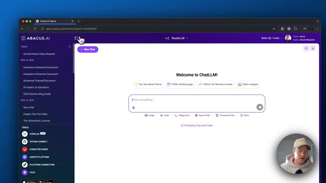
*⏱️ 00:00:25 — Capture d'écran montrant l'interface Web de la plateforme Abacus.ai (ChatLLM) avec la barre de saisie de texte et les options associées.*

---

### ⏱️ `[00:00:34 - 00:00:55]` | Segment #02

**🔊 Audio (Transcription Intégrale Mot pour Mot en Français) :**
> pour voir cette interface utilisateur. Donc vous pouvez voir que vous pouvez discuter avec lui comme avec n'importe quel grand modèle de langage. Il y a certaines choses en bas ici. Si vous cliquez sur le haut, vous pouvez voir que nous avons accès à tous ces différents grands modèles de langage, ce qui est la raison pour laquelle cette plateforme est vraiment géniale. Donc vous pouvez voir que nous avons accès à O1, O1 Mini, ChatGPT 4 O Mini. Nous avons Grok. Nous avons Gemini.

**👁️ Analyse Visuelle d'Écran (gemini-3.5-flash-lite) :**
**Interface & Outils** : Navigateur web affichant la plateforme Abacus.ai (ChatLLM).

**Contenu textuel & Code** : Barre de texte de saisie "Write something...", boutons de fonctionnalités (Image, Code, Playground, Search Web, etc.) et suggestions de requêtes au centre.

**Action / Démonstration** : Présentation de l'interface de discussion avec les grands modèles de langage et démonstration des options disponibles en bas de la fenêtre de saisie.

*⏱️ 00:00:39 — Capture d'écran montrant l'interface utilisateur de ChatLLM sur la plateforme Abacus.ai avec une barre de saisie de texte et des suggestions de prompts.*

---

### ⏱️ `[00:00:55 - 00:01:15]` | Segment #03

**🔊 Audio (Transcription Intégrale Mot pour Mot en Français) :**
> Nous avons le nouveau Gemini 2.0 qui vient de sortir, Claw 3.5 Sonnet. Donc, un truc qui est vraiment cool, c'est que si vous regardez Route LLM, cela va ensuite vous donner la meilleure réponse avec n'importe lequel de ces grands modèles de langage en fonction du prompt que vous nous donnez. Laissez-moi vous montrer comment cela fonctionne. D'accord, alors voici mon premier prompt. Aide-moi à écrire le code pour une application qui prend des notes et suit les sessions de travail.

**👁️ Analyse Visuelle d'Écran (gemini-3.5-flash-lite) :**
**Interface & Outils** : Navigateur web affichant l'interface d'Abacus.AI (ChatLLM / RouteLLM).

**Contenu textuel & Code** : Interface utilisateur avec options de saisie de prompt, boutons pour ajouter des images, du code, un playground ou effectuer des recherches web.

**Action / Démonstration** : Présentation de la plateforme de routage de grands modèles de langage (LLM) et de l'interface de discussion.

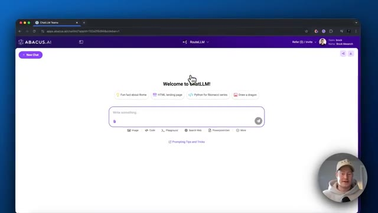
*⏱️ 00:01:00 — Interface web d'Abacus.AI affichant le service RouteLLM avec la barre de saisie de texte et des exemples de prompts.*

*⏱️ 00:01:05 — Gros plan sur le champ de saisie de texte de l'interface ChatLLM d'Abacus.AI avec le curseur actif.*

---

### ⏱️ `[00:01:15 - 00:01:34]` | Segment #04

**🔊 Audio (Transcription Intégrale Mot pour Mot en Français) :**
> Donc vous pouvez voir qu'il l'oriente vers Claude 3.5 Sonnet parce que Claude 3.5 Sonnet est généralement reconnu comme le meilleur grand modèle de langage pour les tâches de programmation. Donc vous pouvez voir qu'il est en train d'écrire le code ici. C'est génial. Et maintenant, laissez-moi poser une autre question et voir vers quoi il nous dirige. Une autre chose aussi, c'est que vous pouvez voir que nous pourrions le régénérer avec un modèle différent.

**👁️ Analyse Visuelle d'Écran (gemini-3.5-flash-lite) :**
**Interface & Outils** : Navigateur web affichant la plateforme Abacus.AI (RouteLLM / ChatLLM Teams) avec incrustation vidéo du présentateur en bas à droite.

**Contenu textuel & Code** : Code source Python complet pour une application de suivi de sessions et de notes utilisant tkinter, json et datetime.

**Action / Démonstration** : Navigation et défilement à travers la réponse textuelle et le bloc de code généré par le grand modèle de langage.

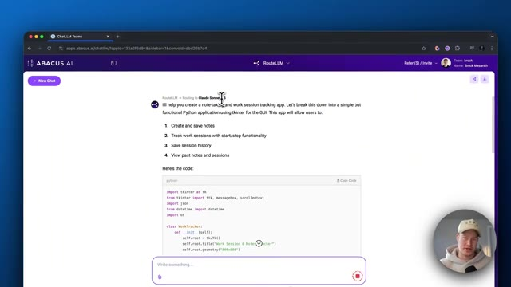
*⏱️ 00:01:20 — Interface d'Abacus.AI montrant une réponse générée par Claude 3.5 Sonnet avec du code Python pour une application de notes.*

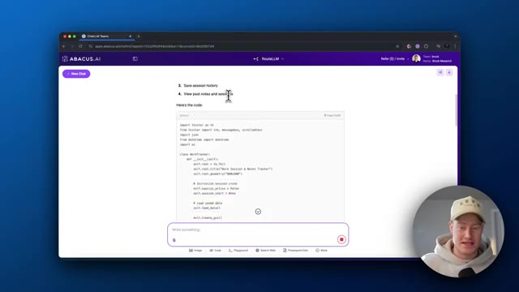
*⏱️ 00:01:25 — Défilement de la page sur Abacus.AI affichant le début du code source en Python avec tkinter.*

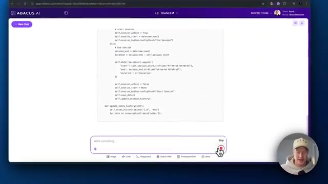
*⏱️ 00:01:30 — Suite du code source Python généré par l'IA montrant les fonctions de gestion des sessions et de l'historique.*

---

### ⏱️ `[00:01:35 - 00:01:54]` | Segment #05

**🔊 Audio (Transcription Intégrale Mot pour Mot en Français) :**
> Donc si nous n'aimons pas ce que Claude 3.5 Sonnet nous a donné, nous pourrions alors, vous savez, faire en sorte que ChatGPT 4.0 ou 4.0 Mini ou O1 exécute réellement cette tâche. Très bien. Alors, pouvez-vous me donner une explication de la physique quantique ? Vous pouvez voir qu'il achemine maintenant cela vers ChatGPT 4.0 parce qu'il pense que c'est le bon modèle que nous devrions utiliser pour une question spécifique comme celle-ci.

**👁️ Analyse Visuelle d'Écran (gemini-3.5-flash-lite) :**
**Interface & Outils** : Abacus.AI (RouteLLM) dans un navigateur web.

**Contenu textuel & Code** : Texte descriptif de fonctionnalités d'application et options de régénération de modèle (Claude 3.5 Sonnet, GPT-4o Mini), avec un champ de saisie de prompt (« Can you give me a... »).

**Action / Démonstration** : Saisie d'une question ou d'une instruction dans l'interface de chat pour interagir avec le LLM sélectionné.

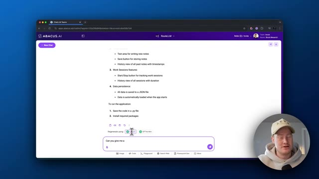
*⏱️ 00:01:39 — Capture d'écran montrant l'interface d'Abacus.AI (RouteLLM) avec le texte d'une application générée et une invite de saisie en bas.*

---

### ⏱️ `[00:01:54 - 00:02:17]` | Segment #06

**🔊 Audio (Transcription Intégrale Mot pour Mot en Français) :**
> Donc c'est plutôt cool. C'est la fonctionnalité de routage des LLM. Si vous voulez interagir avec l'IA, mais que vous ne voulez pas avoir à basculer entre différentes plateformes et grands modèles de langage, c'est une excellente façon de le faire. Ensuite, ce que je vais vous montrer, venons-en au nouveau chat ici, c'est que nous pouvons réellement générer une vidéo formidable en utilisant Abacus AI. Donc vous pouvez voir que si nous venons à la génération de vidéo en bas, nous pouvons alors sélectionner n'importe lequel de ces modèles de génération de vidéo.

**👁️ Analyse Visuelle d'Écran (gemini-3.5-flash-lite) :**
**Interface & Outils** : Navigateur web affichant la plateforme Abacus.ai (ChatLLM).

**Contenu textuel & Code** : Interface utilisateur de chat multi-LLM, zone de saisie de texte et options de génération (Image, Code, Playground, Recherche Web).

**Action / Démonstration** : Navigation et démonstration des fonctionnalités de routage des LLM et des options de génération de contenu.

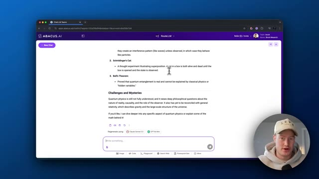
*⏱️ 00:02:00 — Interface de ChatLLM par Abacus.ai montrant une conversation sur la physique quantique et le chat de Schrödinger.*

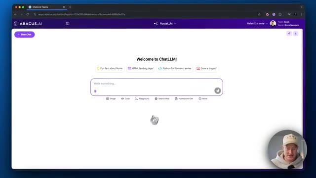
*⏱️ 00:02:06 — Page d'accueil de l'interface ChatLLM avec la barre de recherche et les suggestions de prompts.*

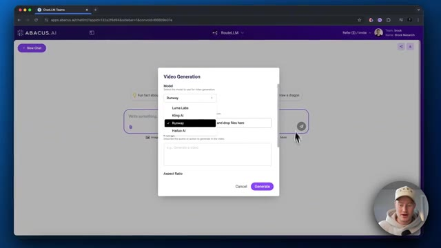
*⏱️ 00:02:11 — Fenêtre modale de génération vidéo affichant les différents modèles disponibles (Runway, Luma Labs, Kling AI, Hailuo AI).*

---

### ⏱️ `[00:02:17 - 00:02:36]` | Segment #07

**🔊 Audio (Transcription Intégrale Mot pour Mot en Français) :**
> Donc nous avons Luma Labs, nous avons Kling AI, nous avons Runway, Palua AI, nous avons toutes ces différentes plateformes de génération vidéo rien que sur cette application. Donc laissez-moi allons-y directement et utilisons Runway. J'aime bien utiliser Runway. Nous devons ensuite ajouter une image. D'accord, alors ce que je vais faire, je vais prendre une photo du Colisée de Rome.

**👁️ Analyse Visuelle d'Écran (gemini-3.5-flash-lite) :**
**Interface & Outils** : Abacus.ai, navigateur web Google Chrome, incrustation vidéo du présentateur.

**Contenu textuel & Code** : Menu de sélection des modèles d'IA pour la génération vidéo : Luma Labs, Kling AI, Runway, Hailuo AI.

**Action / Démonstration** : Le présentateur sélectionne ou parcourt les différentes plateformes de génération vidéo disponibles sur l'interface d'Abacus.ai.

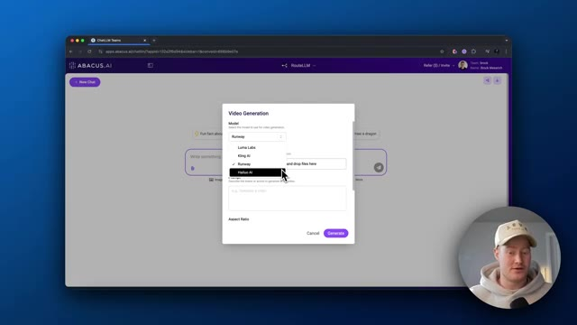
*⏱️ 00:02:22 — Capture d'écran montrant l'interface d'Abacus.ai avec un menu déroulant affichant les différents modèles de génération vidéo (Luma Labs, Kling AI, Runway, Hailuo AI).*

---

### ⏱️ `[00:02:36 - 00:02:58]` | Segment #08

**🔊 Audio (Transcription Intégrale Mot pour Mot en Français) :**
> Et ce que je vais faire ici, c'est que je vais ensuite animer cette vidéo. Je vais la télécharger ici et je vais lui donner un prompt. Je veux qu'elle transforme ceci en véritable Rome antique avec des gens qui se promènent autour du Colisée. et ensuite nous pourrons avoir une idée de ce que cela peut réellement faire. Très bien. Alors voici mon prompt. Je vais générer ceci et cela devrait prendre une seconde et cela va réellement nous cracher une vidéo générée.

**👁️ Analyse Visuelle d'Écran (gemini-3.5-flash-lite) :**
**Interface & Outils** : Abacus.AI (navigateur web, interface de chat et génération multimédia).

**Contenu textuel & Code** : Modèle Runway sélectionné, cadre de départ (Start Frame), fichier image importé, champ de prompt textuel.
[DESC_IMAGE_3_CONTENT] Prompt textuel soumis : 'Generate a video of ancient rome. I want gladiators and spectators walking around the colosseum.'

**Action / Démonstration** : Configuration et soumission d'une génération vidéo par IA à partir d'une image fixe.

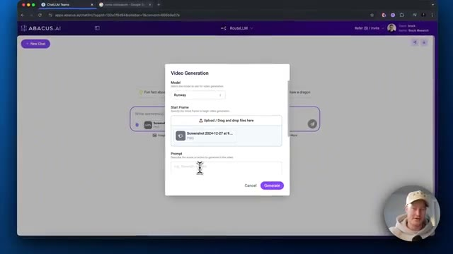
*⏱️ 00:02:42 — Interface Abacus.AI affichant une boîte de dialogue 'Video Generation' avec sélection du modèle Runway et téléchargement de l'image de départ.*

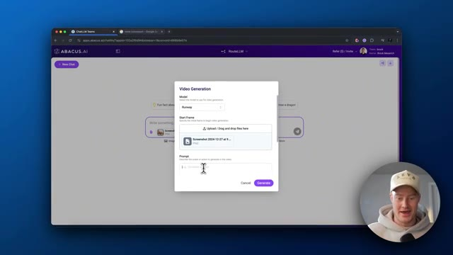
*⏱️ 00:02:47 — Interface Abacus.AI montrant la configuration d'un prompt pour la génération vidéo à partir d'une image.*

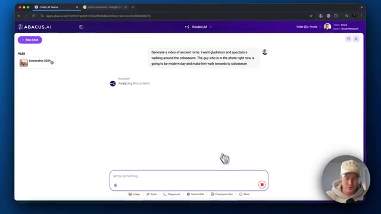
*⏱️ 00:02:52 — Interface Abacus.AI affichant le chat avec le prompt textuel envoyé pour générer une vidéo de la Rome antique.*

---

### ⏱️ `[00:02:58 - 00:03:21]` | Segment #09

**🔊 Audio (Transcription Intégrale Mot pour Mot en Français) :**
> D'accord. Jetons un œil à ceci. Cela a évidemment été généré par Runway. D'accord. Donc, il a compris l'idée de le voir marcher vers le Colisée, mais maintenant, donnons-lui un autre prompt et veillons à bien insister sur le fait que nous voulons des gens qui marchent autour et que nous voulons que ce soit la Rome antique. D'accord. Ce que nous allons faire maintenant, c'est faire exactement la même chose, mais utilisons plutôt Kling AI, car Kling AI est une autre excellente plateforme de génération de vidéo.

**👁️ Analyse Visuelle d'Écran (gemini-3.5-flash-lite) :**
**Interface & Outils** : Interface web d'Abacus.AI (ChatLLM)

**Contenu textuel & Code** : Interface utilisateur de génération de contenu par IA avec options de prompts et de sélection de fonctionnalités vidéo.

**Action / Démonstration** : Navigation et démonstration d'une vidéo générée par l'IA montrant un monument (le Colisée).

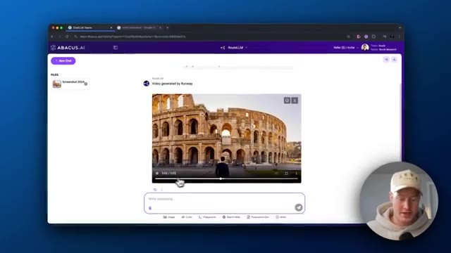
*⏱️ 00:03:04 — Interface d'Abacus.AI affichant une vidéo générée par Runway représentant une personne marchant vers le Colisée, avec la caméra du présentateur en bas à droite.*

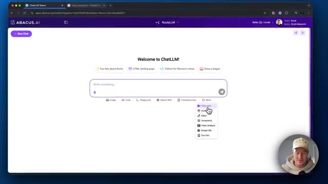
*⏱️ 00:03:15 — Interface d'Abacus.AI sur ChatLLM montrant un menu déroulant pour la génération de vidéo (« Video-Gen »), avec la caméra du présentateur en bas à droite.*

---

### ⏱️ `[00:03:22 - 00:03:41]` | Segment #10

**🔊 Audio (Transcription Intégrale Mot pour Mot en Français) :**
> Standard, passons en mode pro. Et ensuite, ce que nous allons faire, nous allons prendre exactement la même photo et je vais utiliser exactement le même prompt. Et ensuite, nous pourrons en quelque sorte comparer les deux. Très bien, générons-le. C'est un prompt assez basique que je vais lui donner, mais nous pouvons juste, tu sais, je veux juste vous montrer la fonctionnalité de cette plateforme, comment nous pouvons utiliser différents outils de génération de vidéo et comment vous pouvez voir la différence entre eux.

**👁️ Analyse Visuelle d'Écran (gemini-3.5-flash-lite) :**
**Interface & Outils** : Navigateur web, Abacus.ai (interface de génération d'IA).

**Contenu textuel & Code** : Paramètres de génération vidéo : ratio 16:9, durée, échelle CFG et prompt textuel descriptif.

**Action / Démonstration** : Configuration des paramètres et saisie d'un prompt pour la génération de vidéo IA.

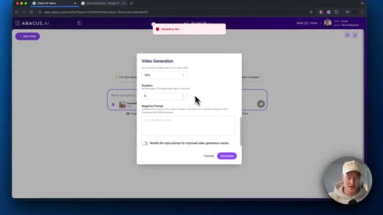
*⏱️ 00:03:31 — Interface d'Abacus.ai avec une fenêtre modale de configuration de génération vidéo (ratio 16:9, durée 5 secondes).*

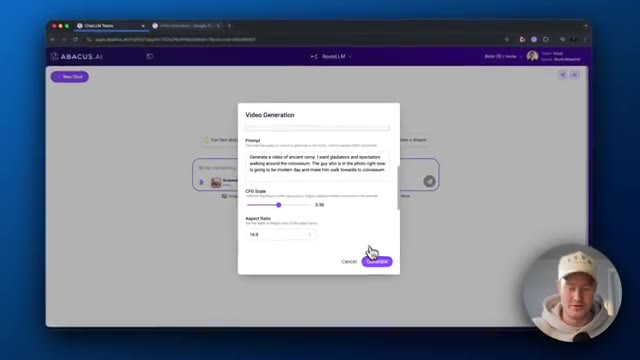
*⏱️ 00:03:36 — Fenêtre modale de génération vidéo sur Abacus.ai montrant le champ de prompt textuel et le bouton de génération.*

---

### ⏱️ `[00:03:41 - 00:04:01]` | Segment #11

**🔊 Audio (Transcription Intégrale Mot pour Mot en Français) :**
> Bon, alors maintenant jetons un œil à la vidéo que Kling a réellement générée pour nous. Voilà. Vous pouvez le voir marcher vers le Colisée. C'est plutôt cool. Et je voulais juste insister sur le fait que nous pouvions réellement créer des vidéos générées par IA avec plusieurs plateformes de génération d'IA différentes.

**👁️ Analyse Visuelle d'Écran (gemini-3.5-flash-lite) :**
**Interface & Outils** : Navigateur web affichant la plateforme Abacus.AI (RouteLLM) et une incrustation vidéo du présentateur en bas à droite.

**Contenu textuel & Code** : Interface utilisateur de chat et de génération multimédia avec le résultat vidéo de Kling AI représentant un homme de dos marchant en direction du Colisée de Rome.

**Action / Démonstration** : Visualisation du résultat de la génération vidéo obtenue via Kling AI sur la plateforme Abacus.AI.

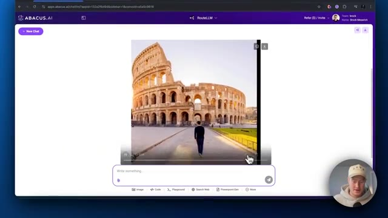
*⏱️ 00:03:46 — Interface d'Abacus.AI affichant le résultat de la vidéo générée montrant une personne marchant vers le Colisée de Rome.*

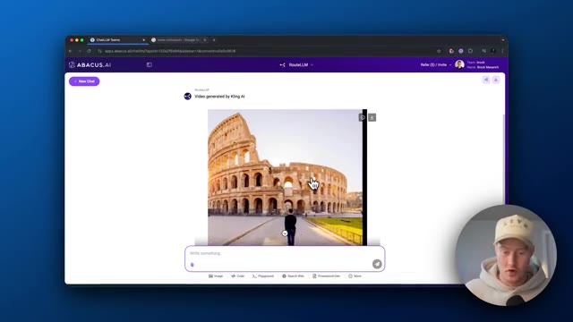
*⏱️ 00:03:51 — Interface d'Abacus.AI avec la mention "Video generated by Kling AI" au-dessus de la vidéo montrant le Colisée.*

---

### ⏱️ `[00:04:01 - 00:04:29]` | Segment #12

**🔊 Audio (Transcription Intégrale Mot pour Mot en Français) :**
> Donc vous pouvez venir ici, sélectionner le modèle que vous voulez utiliser. C'est un excellent moyen de générer des vidéos sans avoir à naviguer entre tous ces différents modèles. Et je tiens à mentionner que cela ne coûte que 10 $ pour avoir accès à cette plateforme et à toutes ces autres plateformes qui y sont reliées. Rien que cela est donc une excellente raison d'utiliser cette plateforme. Donc encore une fois, Abacus AI dispose de tellement d'outils différents sur sa plateforme que je ne peux pas vraiment tous les aborder dans cette vidéo, mais je vais vous en montrer quelques autres qui, selon moi, sont vraiment super et peuvent vous être très utiles, surtout si vous n'êtes pas une personne technique.

**👁️ Analyse Visuelle d'Écran (gemini-3.5-flash-lite) :**
**Interface & Outils** : Navigateur web affichant la plateforme Abacus.AI (ChatLLM).

**Contenu textuel & Code** : Interface utilisateur de génération de contenu par IA, barre de texte "Write something..." et options de modèles.

**Action / Démonstration** : Présentation de l'interface de génération de vidéo et de chat de la plateforme Abacus.AI.

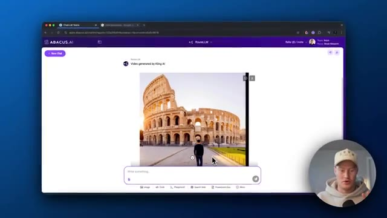
*⏱️ 00:04:08 — Interface d'Abacus.AI affichant une vidéo générée du Colisée avec Kling AI.*

*⏱️ 00:04:22 — Page d'accueil de ChatLLM sur Abacus.AI avec une barre de saisie pour les prompts.*

---

### ⏱️ `[00:04:29 - 00:04:56]` | Segment #13

**🔊 Audio (Transcription Intégrale Mot pour Mot en Français) :**
> Donc la prochaine chose que je veux aborder est la capacité de vous aider réellement à coder. Donc ce que vous pourriez faire, c'est que vous pourriez aller sur Code LLM ici, et fondamentalement ce que vous faites, c'est que vous pouvez télécharger ceci sur votre MacBook ou sur votre ordinateur de bureau. Et ce que ça fera, c'est que ça sera réellement intégré à l'intérieur de votre plateforme de codage. Donc par exemple, si vous utilisez VS Code, vous pourriez réellement interagir avec ceci en tant qu'agent IA et il modifiera réellement le code pour vous dans votre plateforme. Donc c'est pour les personnes plus techniques.

**👁️ Analyse Visuelle d'Écran (gemini-3.5-flash-lite) :**
**Interface & Outils** : Interface web d'Abacus.AI (ChatLLM) affichant une boîte de dialogue contextuelle de téléchargement de logiciel.

**Contenu textuel & Code** : Options de téléchargement pour Code LLM incluant macOS (10.15+, .zip, CLI), Linux (Debian, Ubuntu, .deb, .rpm, .tar.gz) et Windows (10, 11, installateurs et .zip).

**Action / Démonstration** : Présentation des différentes options de téléchargement de l'assistant de code IA (Code LLM) pour divers systèmes d'exploitation.

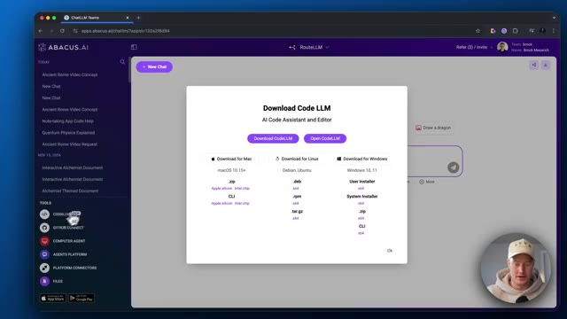
*⏱️ 00:04:36 — Interface d'Abacus.AI affichant une fenêtre modale de téléchargement pour "Code LLM" (AI Code Assistant and Editor) avec des options pour Mac, Linux et Windows.*

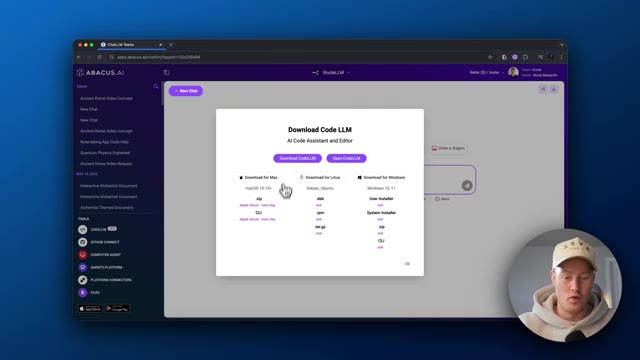
*⏱️ 00:04:43 — Vue similaire sur l'interface d'Abacus.AI montrant les liens de téléchargement de Code LLM pour macOS, Linux et Windows.*

---

### ⏱️ `[00:04:56 - 00:05:32]` | Segment #14

**🔊 Audio (Transcription Intégrale Mot pour Mot en Français) :**
> Je ne vais pas aborder cela dans cette vidéo, mais c'est un cas d'usage incroyable. Si vous voulez utiliser l'IA dans vos flux de travail sans avoir à faire de copier-coller entre Claude ou ChatGPT, elle est déjà intégrée à votre plateforme. La fonctionnalité suivante s'appelle AI Engineer. Et c'est un outil vraiment génial. Vous pouvez en fait venir créer un chatbot personnalisé ou même créer vos propres agents IA personnalisés en tapant ce que vous voulez, en expliquant ce que vous voulez qu'il fasse, et il va réellement écrire le code et construire un agent pour vous. Donc si vous venez ici et que vous cliquez sur créer un agent, vous pouvez voir que l'assistant d'agent IA ici va en fait vous donner quelques modèles. Vous pouvez donc réellement créer un agent journaliste.

**👁️ Analyse Visuelle d'Écran (gemini-3.5-flash-lite) :**
**Interface & Outils** : Navigateur web affichant la plateforme Abacus.ai (ChatLLM et module AI Engineer).

**Contenu textuel & Code** : Options d'interface pour la création de chatbots personnalisés, d'agents IA, et modèles prédéfinis (Email Answering Agent, Document Entity Extraction Agent).

**Action / Démonstration** : Navigation et exploration des fonctionnalités d'ingénierie IA intégrées à la plateforme Abacus.ai.

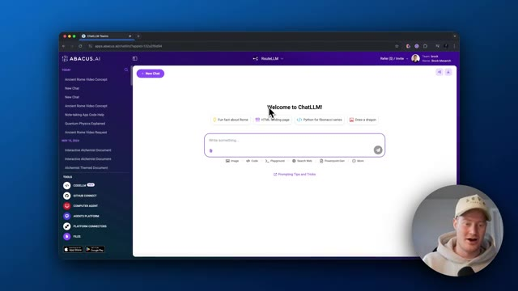
*⏱️ 00:05:05 — Interface principale d'Abacus.ai affichant l'accueil de ChatLLM avec des options de prompts rapides.*

*⏱️ 00:05:14 — Navigation vers la section 'AI Engineer' sur la plateforme Abacus.ai, montrant l'assistant intégré pour créer des chatbots et agents.*

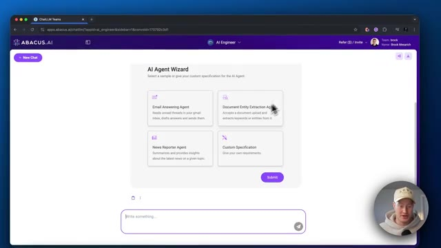
*⏱️ 00:05:23 — Affichage de l'assistant 'AI Agent Wizard' sur Abacus.ai proposant divers modèles d'agents prédéfinis.*

---

### ⏱️ `[00:05:32 - 00:06:07]` | Segment #15

**🔊 Audio (Transcription Intégrale Mot pour Mot en Français) :**
> un agent de réponse aux e-mails, toutes ces différentes choses, ou vous pouvez créer votre propre agent à partir de zéro. Continuons avec l'agent de réponse aux e-mails. Il demande donc si nous voulons rendre cela autonome et la réponse est oui. De cette façon, nous n'avons pas besoin d'approuver chaque message qu'il va envoyer, avec référence aux connaissances. Nous pourrions donc en fait ajouter nos propres données d'entraînement pour qu'il sache comment nous voulons qu'il réponde à nos e-mails, par exemple, et nous pourrions ajouter en quelque sorte notre consigne ici. Prenons simplement celle de base, maintenir un ton professionnel et signer les réponses par « cordialement, brock meserich », soumettons donc ceci et voyons où cela nous mène

**👁️ Analyse Visuelle d'Écran (gemini-3.5-flash-lite) :**
**Interface & Outils** : Navigateur web affichant la plateforme Abacus.AI (chatLLM).

**Contenu textuel & Code** : Formulaire de configuration d'agent avec les options de l'agent de réponse aux e-mails, la question « Make Autonomous? » (options radio Yes / No sélectionnées actuellement sur No), et la section « Reference Knowledge ».

**Action / Démonstration** : Le curseur de la souris survole l'option « Make Autonomous? » pour configurer l'autonomie de l'agent de messagerie.

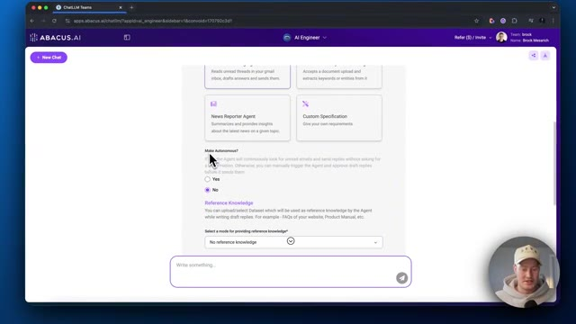
*⏱️ 00:05:41 — Capture d'écran de l'interface Abacus.AI montrant les options de configuration d'un agent de réponse aux e-mails, avec notamment l'option « Make Autonomous? » permettant de choisir entre « Yes » et « No ».*

---

### ⏱️ `[00:06:07 - 00:06:39]` | Segment #16

**🔊 Audio (Transcription Intégrale Mot pour Mot en Français) :**
> comme vous pouvez le voir, il est en train de générer le code pour notre agent IA d'accord, donc voici la conclusion, il est dit que nous avons créé et déployé avec succès l'agent de réponse aux emails dans votre projet d'IA de plaidoyer. L'agent est conçu pour examiner les fils de discussion d'emails non lus dans votre boîte de réception Gmail, rédiger des réponses et les envoyer automatiquement. Vous pourriez ensuite accéder à l'agent juste ici et tout ce que nous aurions à faire, c'est d'aller connecter notre compte Gmail, et ensuite il commencera réellement, vous savez, à exécuter ces flux de travail agentiques. Très bien, les gars, voilà c'est fait. Ce sont les équipes de chat LLM d'Abacus AI. Il y a tellement d'autres cas d'utilisation géniaux avec cette plateforme, mais je voulais juste aborder celui-ci dans cette vidéo. C'est

**👁️ Analyse Visuelle d'Écran (gemini-3.5-flash-lite) :**
**Interface & Outils** : Navigateur web affichant la plateforme Abacus.AI (interface ChatLLM Teams).

**Contenu textuel & Code** : Texte récapitulatif du déploiement réussi de l'agent de réponse aux emails (« Email Answering Agent ») et liens d'accès vers l'application.

**Action / Démonstration** : Navigation et clic sur le lien pour accéder à l'application de l'agent IA nouvellement créé.

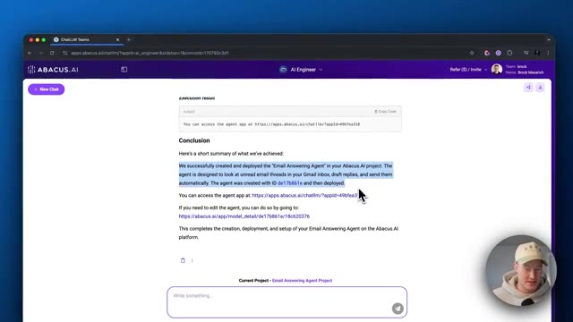
*⏱️ 00:06:15 — Résultat d'exécution sur Abacus.AI montrant la conclusion du déploiement de l'agent de réponse aux emails.*

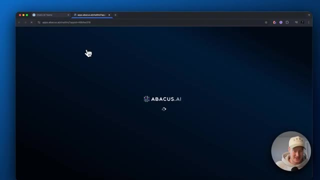
*⏱️ 00:06:23 — Écran de chargement ou transition sur la plateforme Abacus.AI lors de l'accès à l'application de l'agent.*

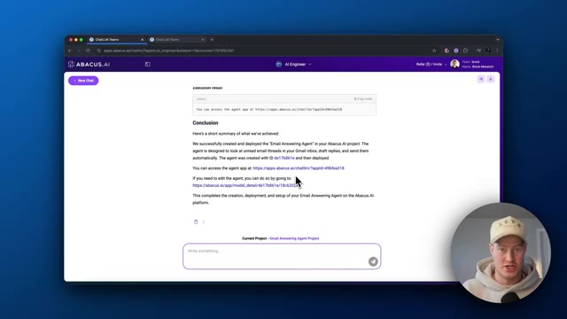
*⏱️ 00:06:31 — Retour sur la page de conclusion du projet d'agent IA avec le curseur pointant vers un lien de modification.*

---

### ⏱️ `[00:06:39 - 00:06:58]` | Segment #17

**🔊 Audio (Transcription Intégrale Mot pour Mot en Français) :**
> comme un couteau suisse pour les outils d'IA. Si vous voulez exploiter toutes ces différentes plateformes ensemble, mais que vous ne voulez pas avoir à payer pour chacune d'elles individuellement ou filtrer entre elles et, vous savez, avoir plusieurs onglets sur votre ordinateur. C'est très facile, très simple à utiliser. Cela étant dit, si vous voulez vous inscrire, il y a un lien dans la description. Abonnez-vous à la chaîne et je vous vois dans la prochaine vidéo.

**👁️ Analyse Visuelle d'Écran (gemini-3.5-flash-lite) :**
**Interface & Outils** : Navigateur web affichant l'application Abacus.AI ChatLLM.

**Contenu textuel & Code** : Page d'accueil de l'interface de chat avec un champ de saisie central ("Write something..."), des suggestions de requêtes et le logo Abacus.AI en haut à gauche.

**Action / Démonstration** : Présentation de la plateforme agrégatrice de modèles de langage par le créateur.

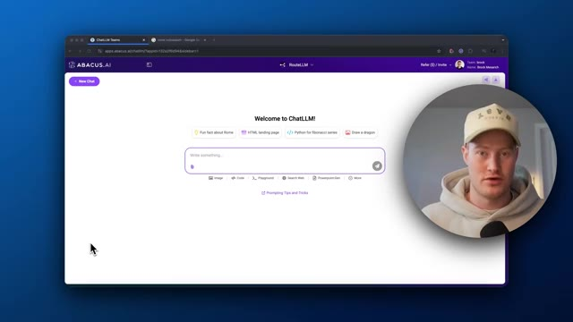
*⏱️ 00:06:44 — Capture d'écran montrant l'interface Web de ChatLLM par Abacus.AI, avec une bulle vidéo du présentateur en bas à droite.*

---

