# 🎬 Building AI Agents is Easier Than You Think (I'll Show You)

> **Chaîne** : [Brock Mesarich | AI for Non Techies](https://www.youtube.com/@BrockMesarich)  
> **Lien YouTube** : [https://www.youtube.com/watch?v=kTJQJnRH9B0](https://www.youtube.com/watch?v=kTJQJnRH9B0)  
> **Date de publication** : 20250111  
> **Durée** : 00:09:22  
> **Identifiant vidéo** : `kTJQJnRH9B0`  
> **Transcription & Analyse** : `whisper-v3-large-turbo+gemini-3.5-flash-lite`  

---

## 📌 Synthèse Exécutive & Outils

### 💡 Résumé

Cette vidéo présentée par la chaîne *Brock Mesarich | AI for Non Techies* met en lumière une évolution majeure dans l'univers de l'automatisation : les **Agents Zapier**. Contrairement aux flux de travail traditionnels (*Zaps*) caractérisés par une structure linéaire, rigide et sélective de type « si ceci, alors cela », les agents IA introduisent une couche d'autonomie et de compréhension contextuelle semblable à celle d'un collaborateur humain. Capables d'interagir dynamiquement avec le web, d'exécuter des requêtes complexes et de prendre des initiatives basées sur des instructions en langage naturel (*prompt engineering*), ces agents redéfinissent la productivité opérationnelle pour les profils non techniques.

L'analyse démontre concrètement la supériorité de ces systèmes autonomes à travers la conception pas à pas d'un assistant de recherche de contenu fonctionnant 24h/24 et 7j/7. En combinant des déclencheurs temporels automatisés (comme des exécutions horaires ou planifiées), des recherches web en temps réel et des intégrations natives avec des outils tiers (Google Agenda, Google Sheets, Slack, ChatGPT), le créateur illustre comment automatiser la veille informationnelle et la génération d'idées de vidéos. L'accent est mis sur la simplicité d'implémentation : il suffit de dicter ou de taper en langage clair les objectifs de l'agent pour qu'il configure ses propres sous-tâches, recherche les actualités technologiques brûlantes (comme Gemini ou OpenAI), structure les données et notifie les équipes.

Au-delà de la simple démonstration technique, cette approche s'inscrit dans une logique d'optimisation des processus similaire à l'automatisation quantitative appliquée aux flux de travail. En éliminant les frictions liées à la configuration manuelle de nodes et de filtres complexes, les agents Zapier abaissent drastiquement la barrière à l'entrée de l'intelligence artificielle agentique. Cette flexibilité permet aux créateurs de contenu comme aux professionnels de déléguer des tâches cognitives répétitives, garantissant ainsi un avantage compétitif axé sur l'efficacité et l'agilité informationnelle.

### 🛠️ Outils, Modèles & Logiciels Présentés

* **Zapier Agents** : Nouvelle fonctionnalité de pointe permettant de concevoir des agents IA autonomes capables de gérer des flux de travail complexes avec une compréhension contextuelle et une navigation web en temps réel.
* **Zapier (Zaps)** : La plateforme d'automatisation traditionnelle basée sur des déclencheurs et des actions sélectives et statiques.
* **ChatGPT** : Modèle de langage utilisé pour le traitement textuel, la génération de titres accrocheurs et la structuration des idées de contenu.
* **Google Agenda** : Application de calendrier exploitée comme source de données pour extraire les réunions, les participants et les noms de domaine à des fins de prospection.
* **Google Sheets** : Tableur cloud utilisé pour centraliser, consolider et stocker les recherches de prospects ou de données structurées.
* **Slack** : Outil de messagerie instantanée d'entreprise servant de canal de notification final pour diffuser les rapports et idées générés par l'agent.
* **Google Gemini** : Mentionné comme exemple d'actualité technologique de pointe analysée et recherchée par l'agent IA.
* **OpenAI** : Écosystème d'IA évoqué via ses initiatives et innovations suivies par le système de veille automatisé.

### 🔑 Points Clés & Enseignements Stratégiques

* **Paradigme « Employé vs Flux statique »** : Les agents Zapier agissent comme de véritables collaborateurs autonomes capables de prendre des décisions contextuelles, contrastant fortement avec les Zaps traditionnels entièrement figés par des conditions logiques strictes.
* **Instructions en langage naturel** : La configuration des comportements d'un agent ne requiert plus de logique de programmation ni de paramétrage de nodes complexes, mais se fait simplement en écrivant ou en dictant textuellement les consignes souhaitées.
* **Capacité de recherche web autonome** : L'agent dispose de la faculté intrinsèque d'effectuer des requêtes sur Google en temps réel pour collecter des informations actualisées sans intervention humaine.
* **Architecture des déclencheurs (*Triggers*)** : Les flux de l'agent peuvent être initiés soit par une planification temporelle rigoureuse (ex. : exécution toutes les heures), soit à la demande via une interaction directe avec le chatbot.
* **Extraction et enrichissement de données** : Capacité à analyser des sources hétérogènes (comme les participants de Google Agenda) pour en extraire des adresses e-mail, disséquer les noms de domaine et réaliser des recherches ciblées par entreprise.
* **Consolidation structurée** : L'agent sait automatiser la mise en forme des informations collectées pour les injecter proprement dans des cellules de tableurs (Google Sheets) en regroupant les données par entité.
* **Diffusion multicanale automatisée** : Intégration fluide avec des outils de communication comme Slack pour envoyer des notifications ciblées, soit via une sélection automatique du canal, soit en définissant une destination fixe et sécurisée.
* **Validation humaine initiale (*Human-in-the-loop*)** : Pour les actions critiques ou les diffusions externes, l'agent peut nécessiter une approbation manuelle lors de la première exécution avant de basculer en mode 100 % autonome.
* **Génération de contenu contextuel et formaté** : En combinant les capacités de recherche et des modèles comme ChatGPT, l'agent peut structurer dynamiquement des livrables complexes (ex. : associer une idée de vidéo à des propositions de titres optimisés).
* **Veille concurrentielle et technologique continue** : Mise en place d'un système de surveillance automatisé (sur les innovations en IA) tournant 24h/24 et 7j/7 pour identifier instantanément les tendances propices à l'exploitation éditoriale.
* **Évolutivité dynamique du comportement** : Possibilité d'itérer et d'affiner les instructions d'un agent à la volée (par exemple, en modifiant les règles de formatage du texte) pour adapter immédiatement sa production sans reconstruire le flux de zéro.
* **Démocratisation de l'IA agentique** : Suppression des barrières techniques pour les utilisateurs non-techniciens (*non-techies*), leur permettant de déployer des architectures d'automatisation avancées autrefois réservées aux ingénieurs en données.

---

## ⏱️ Chronologie & Transcription Complète Audio & Visuelle (Mot pour Mot)

### ⏱️ `[00:00:00 - 00:00:28]` | Segment #01

**🔊 Audio (Transcription Intégrale Mot pour Mot en Français) :**
> Vous avez probablement déjà entendu parler de Zapier, la plateforme qui vous permet de connecter vos applications et de créer des automatisations. Mais vous n'avez probablement jamais entendu parler de ceci : les Agents Zapier. Cette nouvelle fonctionnalité au sein de Zapier est l'avenir de l'automatisation des flux de travail. Qu'est-ce qu'un Agent Zapier ? Il vous permet de construire des flux de travail en IA qui gèrent des tâches complexes avec une compréhension contextuelle. Je sais que cela peut sembler compliqué, mais voyez-le plutôt comme un employé, par opposition à des déclencheurs et des flux de travail prédéfinis dans les Zaps.

**👁️ Analyse Visuelle d'Écran (gemini-3.5-flash-lite) :**
**Interface & Outils** : Aucun logiciel, terminal ou graphique affiché.

**Contenu textuel & Code** : Aucun code source, indicateur technique ou donnée chiffrée.

**Action / Démonstration** : Le présentateur s'adresse directement à la caméra en parlant.

---

### ⏱️ `[00:00:28 - 00:00:55]` | Segment #02

**🔊 Audio (Transcription Intégrale Mot pour Mot en Français) :**
> Dans cette vidéo, je vais vous montrer comment je l'utilise tous les jours pour gagner des heures chaque semaine. Pour les besoins de cette vidéo, je vais vous montrer comment je l'utilise pour générer automatiquement des idées de contenu afin de ne pas avoir à le faire moi-même. Très bien, plongeons dans le vif du sujet. Attendez. Laissez-moi prendre une gorgée de café et attaquons. Bon, alors tout d'abord, ce que je vais faire, c'est que je vais aller dans Zapier et je veux parler rapidement de la différence entre un flux de travail Zap normal et un agent Zapier.

**👁️ Analyse Visuelle d'Écran (gemini-3.5-flash-lite) :**
**Interface & Outils** : Navigateur web affichant la plateforme d'automatisation Zapier.

**Contenu textuel & Code** : Instructions textuelles pour configurer un agent IA de recherche d'idées de contenu YouTube, interface utilisateur Zapier avec options de création (Zap, Table, Interface, Chatbot, Canvas).

**Action / Démonstration** : Présentation et configuration d'un agent de recherche automatisé pour générer des idées de contenu vidéo.

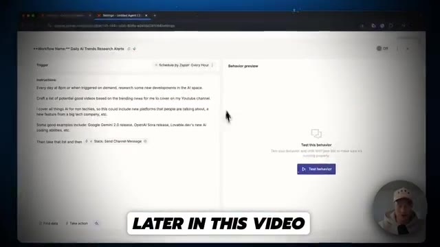
*⏱️ 00:00:35 — Interface d'un workflow de recherche d'actualités sur l'IA avec des instructions détaillées.*

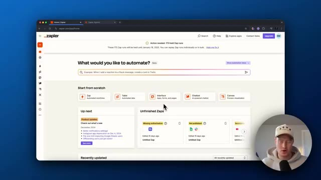
*⏱️ 00:00:42 — Tableau de bord d'accueil de Zapier permettant de créer des automatisations ("What would you like to automate?").*

---

### ⏱️ `[00:00:55 - 00:01:15]` | Segment #03

**🔊 Audio (Transcription Intégrale Mot pour Mot en Français) :**
> Ce sont deux choses complètement différentes. Donc vous avez probablement déjà entendu parler d'un Zap. Si vous venez par ici, laissez-moi vous montrer un exemple rapide. Vous pouvez voir qu'il s'agit d'un assistant de recherche de prospects et, essentiellement, il suit cette progression de type flux de travail statique. Donc essentiellement, nous avons un événement déclencheur, qui est un nouvel événement Google Calendar, et ensuite il envoie une liste d'actions qu'il va accomplir.

**👁️ Analyse Visuelle d'Écran (gemini-3.5-flash-lite) :**
**Interface & Outils** : Navigateur web, interface Zapier.

**Contenu textuel & Code** : Étapes du flux de travail Zapier : 1. Google Calendar (New Event), 2 & 3. Formatter by Zapier (Text), 4. ChatGPT (Conversation), 5. HubSpot (Create Contact).

**Action / Démonstration** : Le présentateur montre un exemple concret de flux de travail automatisé (Zap) sur Zapier.

*⏱️ 00:01:05 — Interface de Zapier montrant le flux séquentiel d'un Zap de recherche de prospects, avec Google Calendar, Formatter, ChatGPT et HubSpot.*

---

### ⏱️ `[00:01:16 - 00:01:52]` | Segment #04

**🔊 Audio (Transcription Intégrale Mot pour Mot en Français) :**
> Donc c'est très statique. Ça ne l'est pas, ce n'est pas dynamique. Ça ne peut pas agir de manière autonome, mais vous savez ce qui va se passer à chaque fois, n'est-ce pas ? Comme lorsqu'un nouveau calendrier est ajouté, il va alors, vous savez, formater le texte, formater le texte, l'envoyer à ChatGPT et ensuite créer un nouveau contact. Vous savez, c'est ce qui va se passer. C'est comme ça qu'un Zap fonctionne, ce qui est super. Vous savez, Zapier est une excellente plateforme pour ça. Mais ce donc dont je veux parler, c'est des agents Zapier. Donc si nous entrons dans les agents Zapier, allons voir l'assistant de recherche de prospects ici, qui est un agent que j'ai réellement configuré auparavant. Entrons dans les paramètres pour que je puisse vous montrer à quoi cela ressemble. Et vous verrez que vous avez la possibilité de le nommer, d'ajouter une description,

**👁️ Analyse Visuelle d'Écran (gemini-3.5-flash-lite) :**
**Interface & Outils** : Navigateur web affichant l'interface de Zapier (éditeur de flux de travail et Zapier Agents).

**Contenu textuel & Code** : Un workflow séquentiel comprenant Google Calendar, Formatter, ChatGPT et HubSpot, suivi d'une interface de chat pour un agent IA.

**Action / Démonstration** : Présentation visuelle d'un processus automatisé statique suivi de la transition vers une interface d'agent conversationnel autonome.

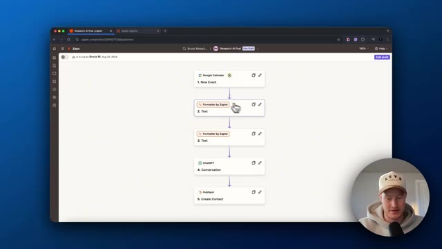
*⏱️ 00:01:25 — Capture d'écran montrant un flux de travail Zapier avec plusieurs étapes enchaînées (Google Calendar, Formatter, ChatGPT, HubSpot).*

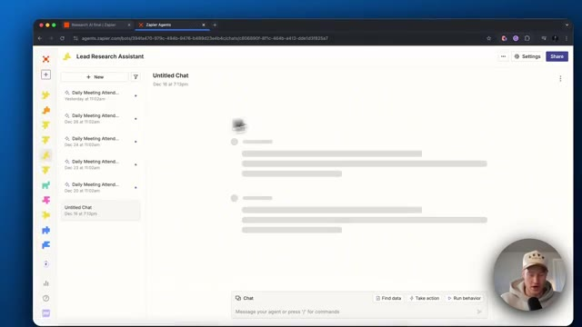
*⏱️ 00:01:43 — Interface de Zapier Agents affichant un assistant de recherche de leads ("Lead Research Assistant") avec une zone de discussion (chat).*

---

### ⏱️ `[00:01:52 - 00:02:12]` | Segment #05

**🔊 Audio (Transcription Intégrale Mot pour Mot en Français) :**
> ajoutez une source de données, qui est, vous savez, n'importe laquelle de ces sources de données et vous pourriez ajouter des comportements. Il s'agit donc essentiellement de flux de travail que l'agent va automatiser. Donc si je viens ici, allons à l'intérieur de ce comportement. Tout d'abord, vous allez voir que le déclencheur est planifié par Zapier tous les jours, ou vous pourriez changer cela pour à la demande. Il est donc uniquement déclenché lorsque vous discutez réellement avec le robot conversationnel.

**👁️ Analyse Visuelle d'Écran (gemini-3.5-flash-lite) :**
**Interface & Outils** : Interface web de Zapier Agents avec incrustation vidéo du présentateur en bas à droite.

**Contenu textuel & Code** : Paramètres de configuration d'agent IA, sections "Data sources", "Behaviors", déclencheurs et instructions numérotées pour l'automatisation.

**Action / Démonstration** : Le présentateur clique sur un comportement pour ouvrir ses détails et examiner les instructions du flux de travail.

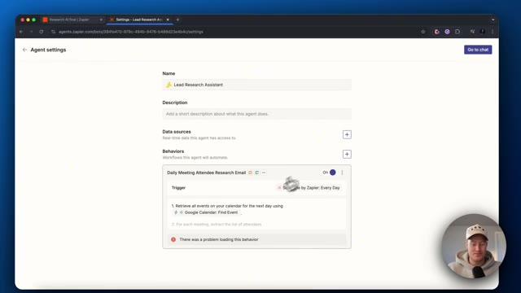
*⏱️ 00:01:57 — Vue d'ensemble des paramètres d'un agent sur Zapier avec la section comportements et un message d'avertissement.*

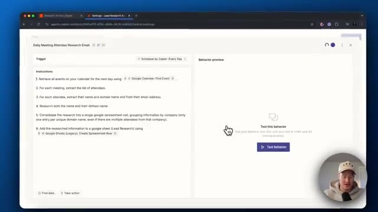
*⏱️ 00:02:02 — Détail du comportement d'un agent avec la liste des instructions et le panneau de test à droite.*

---

### ⏱️ `[00:02:12 - 00:02:35]` | Segment #06

**🔊 Audio (Transcription Intégrale Mot pour Mot en Français) :**
> Mais ensuite, vous allez voir les instructions. Donc tout d'abord, nous pouvons lui parler et lui dire ce que nous voulons qu'il fasse au lieu de devoir faire les flux de travail à l'intérieur de Zapier. Donc, récupérez tous les événements sur le calendrier du jour suivant en utilisant trouver un événement Google Agenda. C'est donc essentiellement une action ici. Donc ce que vous pourriez faire si vous faites une barre oblique, vous pourriez soit trouver des données en utilisant n'importe laquelle des données que vous utilisez, qu'il s'agisse de feuilles de calcul Google et de Google Docs, ou n'importe quoi de ce genre.

**👁️ Analyse Visuelle d'Écran (gemini-3.5-flash-lite) :**
**Interface & Outils** : Navigateur web affichant l'interface de Zapier (Agents / Central).

**Contenu textuel & Code** : Instructions numérotées : 1. Récupérer les événements du calendrier, 2. Extraire la liste des participants, 3. Extraire le nom et le domaine, 4. Rechercher les informations, 5. Consolider dans Google Sheets, 6. Ajouter les informations.

**Action / Démonstration** : Le présentateur explique et commente les instructions textuelles configurées dans l'outil d'automatisation Zapier.

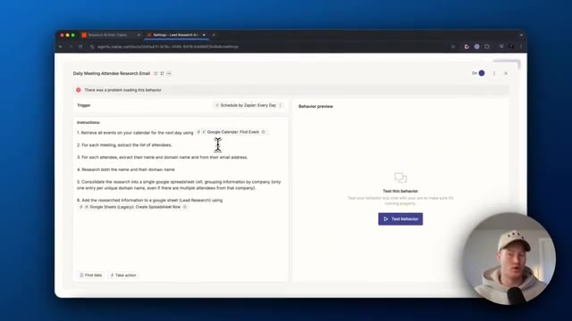
*⏱️ 00:02:18 — Interface de Zapier montrant les instructions étape par étape pour automatiser la recherche des participants à des réunions.*

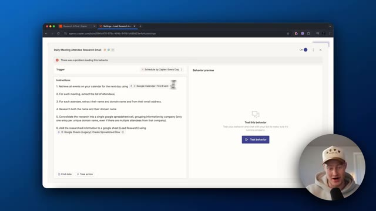
*⏱️ 00:02:23 — Même interface de Zapier montrant le curseur en mouvement pendant que le présentateur explique les instructions textuelles.*

---

### ⏱️ `[00:02:35 - 00:02:56]` | Segment #07

**🔊 Audio (Transcription Intégrale Mot pour Mot en Français) :**
> Ou vous pouvez lui faire effectuer une action, ce qui est fondamentalement la même chose que dans les Zaps. Mais, vous savez, vous tapez ce que vous voulez. Donc, par exemple, si nous voulons une étape ChatGPT ici, nous pourrions alors cliquer sur ChatGPT. Et puis fondamentalement, c'est un peu la même chose que si nous créions un Zap, vous savez, configurez ceci. Et ensuite, il utilisera cette action ici à l'intérieur de ce flux de travail d'agent que l'agent est en train d'exécuter.

**👁️ Analyse Visuelle d'Écran (gemini-3.5-flash-lite) :**
**Interface & Outils** : Navigateur web affichant l'interface de configuration Zapier Agents.

**Contenu textuel & Code** : Instructions textuelles détaillées pour un processus automatisé de recherche de contacts de réunion et ajout d'actions d'intégration.

**Action / Démonstration** : Sélection et ajout d'une étape d'action ChatGPT dans le flux de travail Zapier.

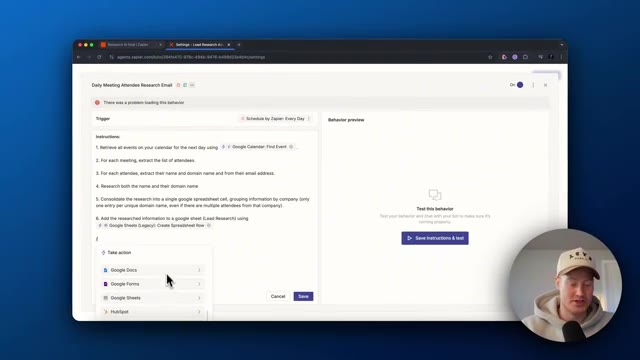
*⏱️ 00:02:40 — L'interface de configuration Zapier montre un menu déroulant d'actions incluant Google Docs, Google Forms et Google Sheets.*

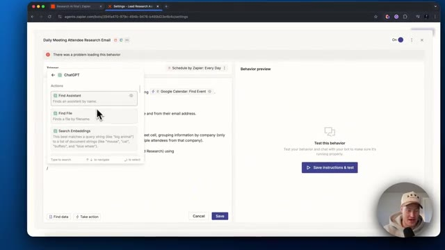
*⏱️ 00:02:45 — Le menu contextuel affiche les actions disponibles pour l'intégration de ChatGPT dans Zapier, telles que "Find Assistant" et "Find File".*

*⏱️ 00:02:50 — Une étape ChatGPT est ajoutée aux instructions de l'agent dans Zapier, illustrant la configuration d'une conversation.*

---

### ⏱️ `[00:02:56 - 00:03:16]` | Segment #08

**🔊 Audio (Transcription Intégrale Mot pour Mot en Français) :**
> Continuons donc. Pour chaque réunion, extrayez la liste des participants. Pour chaque participant, extrayez son nom et son nom de domaine à partir de son adresse e-mail. Faites des recherches sur le nom et sur son nom de domaine. Consolidez les recherches dans une seule cellule de feuille de calcul Google. En regroupant les informations par entreprise uniquement. Ajoutez les informations recherchées dans la feuille de calcul Google appelée lead research en utilisant à nouveau cette action.

**👁️ Analyse Visuelle d'Écran (gemini-3.5-flash-lite) :**
**Interface & Outils** : Navigateur web affichant l'interface de Zapier Central / Agents.

**Contenu textuel & Code** : Instructions textuelles détaillées pour l'agent IA (extraction d'événements Google Calendar, récupération des participants, analyse des e-mails et consolidation dans Google Sheets).

**Action / Démonstration** : Le présentateur explique les différentes étapes de configuration des instructions de l'agent d'automatisation Zapier.

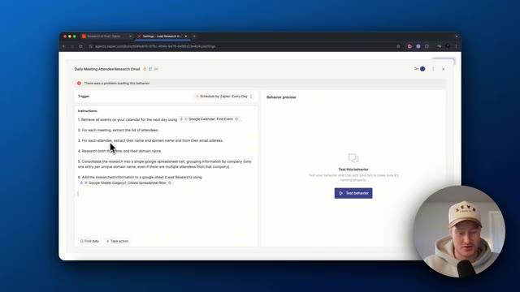
*⏱️ 00:03:01 — Interface Zapier affichant les instructions d'un agent d'automatisation des réunions quotidiennes.*

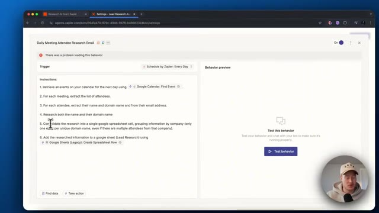
*⏱️ 00:03:06 — Vue similaire de l'interface Zapier avec le curseur pointant sur les instructions de recherche et de consolidation.*

---

### ⏱️ `[00:03:16 - 00:03:37]` | Segment #09

**🔊 Audio (Transcription Intégrale Mot pour Mot en Français) :**
> Et pour configurer l'action, tout ce que vous avez à faire, c'est de cliquer ici. Vous devez vous assurer de configurer votre compte, puis de cliquer sur la feuille de calcul que vous voulez réellement alimenter avec ceci. C'est donc ainsi que cela fonctionne. C'est essentiellement vous qui énoncez à voix haute ce que vous voulez construire et cela le construit, ce qui est génial. J'aime cela tellement plus que de construire réellement avec des Zaps. Ensuite, ce que je vais faire, c'est que je vais passer en revue et je vais construire un assistant de recherche de contenu.

**👁️ Analyse Visuelle d'Écran (gemini-3.5-flash-lite) :**
**Interface & Outils** : Navigateur web affichant l'interface de configuration de l'outil d'automatisation Zapier Central / Agents.

**Contenu textuel & Code** : Paramètres de configuration d'action Google Sheets, instructions numérotées pour l'agent (récupération d'événements Google Calendar, recherche, consolidation dans une feuille de calcul).

**Action / Démonstration** : Configuration des actions de l'agent Zapier pour interagir avec Google Sheets et automatiser l'alimentation des données.

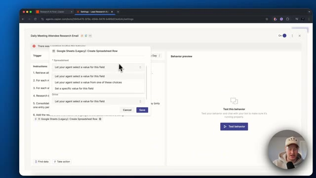
*⏱️ 00:03:21 — Interface de configuration Zapier affichant une fenêtre modale pour lier l'action Google Sheets (Legacy) avec des options de sélection de valeurs.*

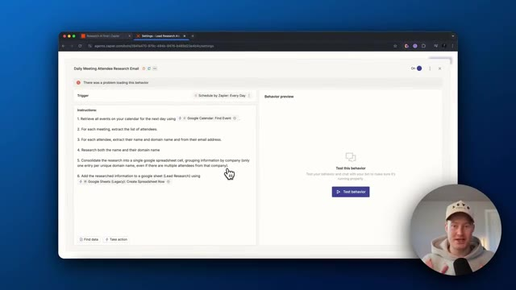
*⏱️ 00:03:26 — Interface de Zapier montrant les instructions textuelles d'un agent automatisé pour la recherche de contacts à partir d'un calendrier.*

---

### ⏱️ `[00:03:37 - 00:04:13]` | Segment #10

**🔊 Audio (Transcription Intégrale Mot pour Mot en Français) :**
> Cela va réellement tourner en pilote automatique 24h/24 et 7j/7 et trouver des idées de contenu pour moi. Je n'ai donc pas à le faire moi-même. C'est comme embaucher un employé qui travaille 24h/24 et 7j/7 en pilote automatique. Plongeons donc là-dedans maintenant. Très bien. Maintenant que vous savez exactement ce qu'est un agent Zapier, allons-y et construisons-en un. Rendez-vous donc sur les agents Zapier. Cliquez sur nouveaux agents. Vous pouvez voir qu'il y a certains modèles que vous pouvez utiliser. Cependant, je vais simplement créer un agent personnalisé à partir de zéro et donnons-lui un nom. Appelons cela, je vais appeler cela un agent de recherche de contenu. Et en partant de zéro, nous n'avons pas nécessairement besoin d'ajouter de sources de données pour l'instant. Nous y reviendrons peut-être. Et maintenant, ce que nous voulons faire, c'est

**👁️ Analyse Visuelle d'Écran (gemini-3.5-flash-lite) :**
**Interface & Outils** : Navigateur web affichant l'interface de Zapier Agents.

**Contenu textuel & Code** : Paramètres de configuration d'agents IA, noms, déclencheurs et comportements automatisés.

**Action / Démonstration** : Navigation et configuration des paramètres d'un agent IA sur Zapier.

---

### ⏱️ `[00:04:13 - 00:04:45]` | Segment #11

**🔊 Audio (Transcription Intégrale Mot pour Mot en Français) :**
> je veux en fait créer un comportement. C'est donc un peu les flux de travail que nous voulons réellement automatiser. Créons donc un comportement et vous pouvez voir que nous sommes invités à le faire. Nous devons en fait configurer le déclencheur. Alors, une chose que je n'ai pas mentionnée, c'est que vous pouvez réellement sélectionner un événement déclencheur provenant d'une autre application. Disons que vous recevez un e-mail ou quelque chose du genre, alors ce flux de travail serait déclenché. C'est donc plutôt cool aussi. Essentiellement, vous pourriez donc créer un agent de messagerie où chaque fois qu'un nouvel e-mail arrive, il filtre automatiquement s'il est important pour vous. Et si c'est le cas, il vous le rappellera, ou vous pourriez vous envoyer un message Slack ou quelque chose comme ça. C'est un cas d'utilisation plutôt cool. Mais pour celui-ci, je vais l'utiliser pour m'aider à construire

**👁️ Analyse Visuelle d'Écran (gemini-3.5-flash-lite) :**
**Interface & Outils** : Interface web Zapier Central / Zapier AI Agents (`agents.zapier.com`).

**Contenu textuel & Code** : Panneau de configuration "Untitled behavior", option "Select trigger" avec la liste des applications intégrables (Scheduled, Asana, Gmail, Google Calendar, Google Docs, Google Forms), et section "Behavior preview".

**Action / Démonstration** : Configuration d'un comportement automatisé (behavior) pour un agent IA en sélectionnant l'événement ou l'application déclencheuse (Trigger).

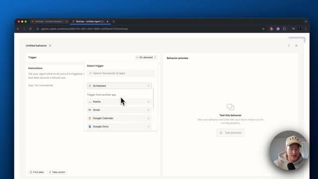
*⏱️ 00:04:21 — Interface de Zapier AI Agents montrant le menu déroulant de sélection d'un déclencheur (Trigger) avec les options Asana, Gmail et Google Calendar.*

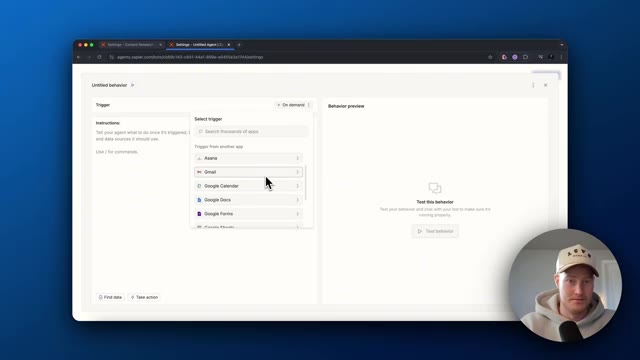
*⏱️ 00:04:29 — Interface Zapier AI Agents avec le curseur ciblant l'application Gmail comme déclencheur pour le nouveau comportement de l'agent.*

---

### ⏱️ `[00:04:45 - 00:05:13]` | Segment #12

**🔊 Audio (Transcription Intégrale Mot pour Mot en Français) :**
> contenu. Donc voici mon premier ensemble d'instructions. Donc chaque jour à 20 heures ou lorsque déclenché à la demande pour rechercher de nouveaux développements dans le domaine de l'IA. Et nous devons venir ici et changeons cela pour planifié. Je vais vous montrer exactement comment le déclencher à la demande plus tard dans cette vidéo. Faisons donc, déclenchons ceci toutes les heures, honnêtement. Donc toutes les heures, il surveillera les dernières actualités en IA, identifiera tout ce qui est intéressant et pourrait être sympa à traiter sur la chaîne. Cela étant dit, abonnez-vous à cette chaîne. Nous traitons de tout ce qui concerne l'IA pour les non-techniciens. Désolé pour la pub.

**👁️ Analyse Visuelle d'Écran (gemini-3.5-flash-lite) :**
**Interface & Outils** : Navigateur web affichant l'interface de configuration de Zapier Agents.

**Contenu textuel & Code** : Panneau de configuration des déclencheurs comprenant les options "On demand", "Scheduled" et diverses applications intégrées.

**Action / Démonstration** : Sélection et modification du type de déclencheur pour automatiser une tâche liée à l'intelligence artificielle.

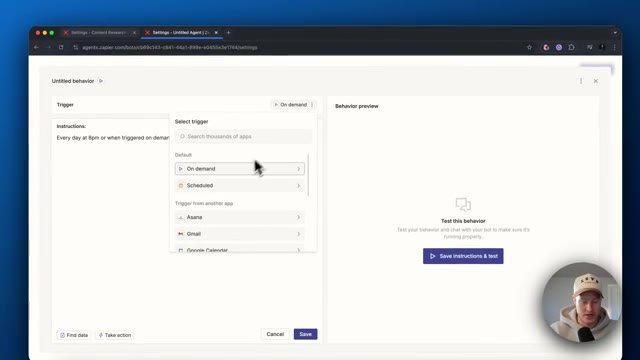
*⏱️ 00:04:52 — Vue de l'interface Zapier affichant le menu déroulant des déclencheurs (triggers) avec l'option "On demand" sélectionnée.*

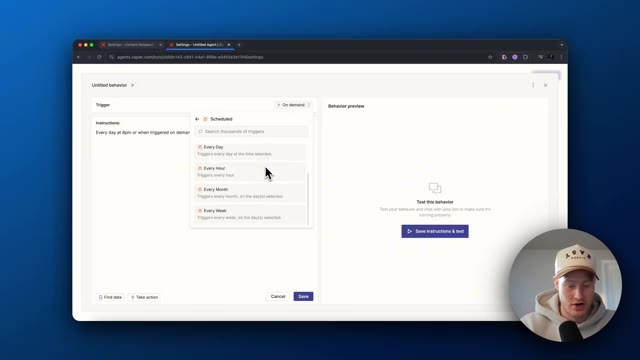
*⏱️ 00:04:59 — Sélection de l'option de déclenchement planifié ("Scheduled") affichant les fréquences disponibles (Every Day, Every Hour, etc.).*

---

### ⏱️ `[00:05:13 - 00:05:40]` | Segment #13

**🔊 Audio (Transcription Intégrale Mot pour Mot en Français) :**
> Revenons-en à nos moutons. Donc, décalage horaire, faisons. Très bien. Donc, toutes les heures, au début de l'heure, ce sera déclenché. D'accord. Donc, élabore une liste de bonnes vidéos potentielles basées sur l'actualité tendance pour que je les traite sur ma chaîne YouTube. Et ensuite, donnons-lui un peu de contexte sur ce dont traite ma chaîne YouTube afin qu'elle puisse comprendre qui je suis et qui est mon public cible. C'est parti. Je couvre tout ce qui touche à l'IA, tout ce qui touche à l'IA pour les non-techniciens. Cela peut donc inclure de nouvelles plateformes dont les gens parlent, une nouvelle fonctionnalité d'une entreprise technologique, et cetera.

**👁️ Analyse Visuelle d'Écran (gemini-3.5-flash-lite) :**
**Interface & Outils** : Interface web de Zapier (Agents) et navigateur web.

**Contenu textuel & Code** : Instructions textuelles pour l'agent : « Every day at 8pm or when triggered on demand, research some new developments in the AI space. Craft a list of potential good videos based on the trending news for me to cover on my YouTube channel... » et déclencheur réglé sur « Schedule by Zapier: Every Hour ».

**Action / Démonstration** : Saisie et modification des instructions textuelles définissant le comportement et le déclencheur horaire de l'agent IA.

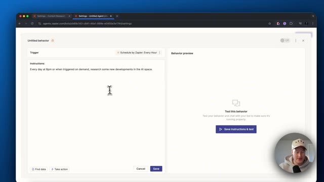
*⏱️ 00:05:20 — Interface de configuration d'agent Zapier montrant le champ des instructions avec le curseur de la souris.*

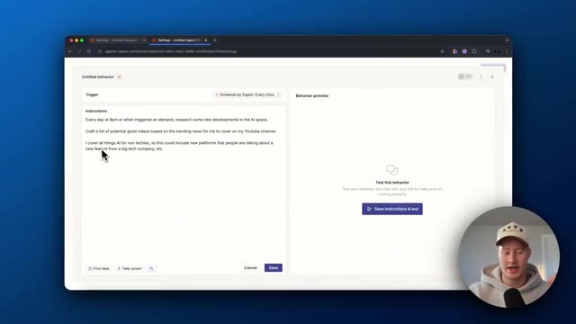
*⏱️ 00:05:34 — Interface de configuration d'agent Zapier avec le texte complet des instructions saisi pour la recherche de tendances en IA.*

---

### ⏱️ `[00:05:41 - 00:06:13]` | Segment #14

**🔊 Audio (Transcription Intégrale Mot pour Mot en Français) :**
> Et ensuite, voici quelques exemples juste afin de donner à notre agent un peu plus de contexte. Ensuite, ce que nous allons faire, c'est que nous allons ajouter l'action. Donc ensuite, ce que je voulais faire, c'est que je veux qu'il prenne cette information et tout ce que je vais faire, c'est que je vais cliquer sur barre oblique, aller pour effectuer une action, et je vais faire en sorte que cela m'envoie réellement un message Slack, donc envoyer un message sur le canal. Tout ce que nous devons faire, nous devons venir ici pour connecter notre compte et notre canal Slack. Vous pourriez soit laisser l'agent sélectionner ceci et remplir automatiquement n'importe quel canal qu'il pense être le mieux adapté, mais laissez-moi plutôt définir une valeur spécifique pour que je sache exactement dans quel canal il va être publié à chaque fois, alors en fait

**👁️ Analyse Visuelle d'Écran (gemini-3.5-flash-lite) :**
**Interface & Outils** : Interface web Zapier (Agents Central)

**Contenu textuel & Code** : Instructions textuelles définissant le comportement de l'agent IA (recherche d'actualités tech, création d'une liste de sujets vidéo) et intégration Slack.

**Action / Démonstration** : Configuration des instructions et ajout d'une action d'envoi automatique sur Slack par l'agent IA.

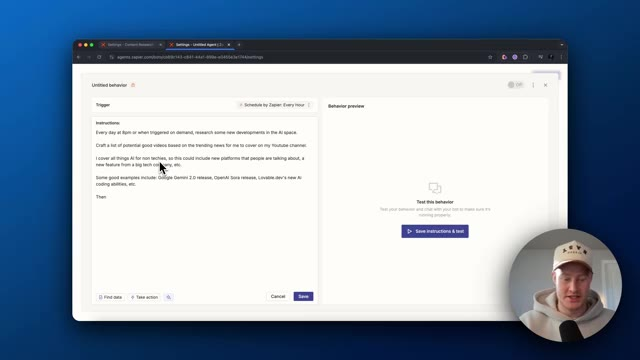
*⏱️ 00:05:49 — L'interface de configuration Zapier Agent montrant les instructions pour l'IA, avec le curseur pointant vers la section de code/texte.*

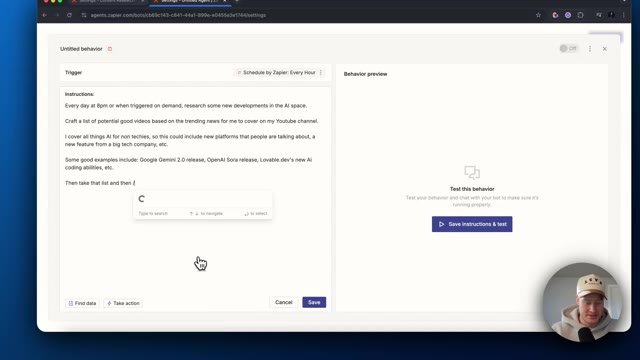
*⏱️ 00:05:57 — La saisie de la suite des instructions textuelles pour l'agent Zapier avec une boîte de recherche contextuelle.*

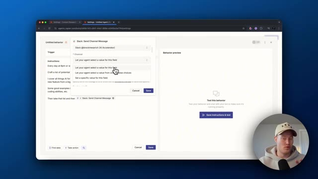
*⏱️ 00:06:05 — L'ajout d'une action "Slack: Send Channel Message" pour configurer la destination de la liste générée.*

---

### ⏱️ `[00:06:13 - 00:06:32]` | Segment #15

**🔊 Audio (Transcription Intégrale Mot pour Mot en Français) :**
> n'ont pas encore de canal configuré mais appelons ça vous savez, ajoutons un canal aléatoire ici et et maintenant sauvegardons cela. Et nous pourrions cliquer sur les suggestions automatiques ici. Voyons donc ce qu'il nous suggère réellement. IA par Zapier, analyser et renvoyer des données. D'accord, commençons par ceci. Je pourrais y ajouter des éléments, mais cela devrait fonctionner maintenant. Ce que nous pourrions faire, c'est aller de l'avant et tester ce comportement.

**👁️ Analyse Visuelle d'Écran (gemini-3.5-flash-lite) :**
**Interface & Outils** : Navigateur web affichant l'interface de configuration des agents Zapier (agents.zapier.com).

**Contenu textuel & Code** : Éditeur de texte contenant des instructions pour un agent IA de recherche sur l'actualité tech et YouTube, avec des suggestions d'actions automatisées.

**Action / Démonstration** : Le présentateur configure les instructions d'un agent Zapier, consulte les suggestions automatiques et s'apprête à enregistrer les modifications.

---

### ⏱️ `[00:06:32 - 00:07:06]` | Segment #16

**🔊 Audio (Transcription Intégrale Mot pour Mot en Français) :**
> Donc maintenant, il va déclencher ceci et il devrait aller de l'avant et faire des recherches. Le truc génial avec ça, c'est qu'il a la capacité de vraiment parcourir internet. Vous pouvez voir qu'il va effectuer une recherche Google. Il est en train de chercher sur Google. Les gars, c'est tellement génial. Nous sommes littéralement en train de construire un employé IA en utilisant des agents Zapier. D'accord, donc il a continué, a fait des recherches là-dessus. La sortie de Google Gemini 2.0. C'est un bon sujet à couvrir. C'est une super idée de vidéo. Donc évidemment, je veux dire, il sait ce qu'il fait. L'initiative pour les éditeurs d'OpenAI. Intéressant. Les grands services web de Nvidia, une grande idée. Une étude sur l'IA ou la moralité financée par OpenAI. Les innovations en matière d'IA en 2024. Résumer toute l'IA

**👁️ Analyse Visuelle d'Écran (gemini-3.5-flash-lite) :**
**Interface & Outils** : Zapier Central (agents.zapier.com), navigateur web Google Chrome.

**Contenu textuel & Code** : Workflow "**Daily AI Trends Research Alerts**", déclencheur "Schedule by Zapier: Every Hour", instructions de recherche d'actualités IA, résultats suggérés (Google Gemini 2.0, OpenAI Publisher Initiative, Nvidia Web Services).

**Action / Démonstration** : Démonstration de l'exécution en temps réel d'un agent IA autonome effectuant des recherches sur Google pour automatiser la veille de contenu.

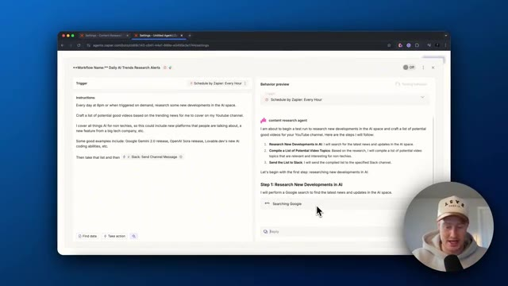
*⏱️ 00:06:40 — Interface Zapier Central affichant la configuration du workflow d'IA et le statut d'exécution en direct "Searching Google".*

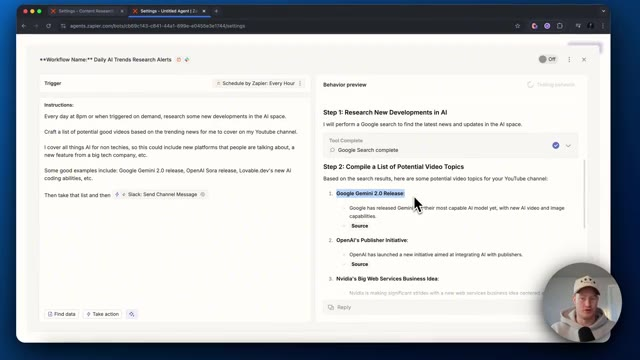
*⏱️ 00:06:49 — Résultats de recherche complétés par l'agent Zapier affichant une liste de sujets de vidéos IA générés automatiquement (ex: Google Gemini 2.0 Release).*

---

### ⏱️ `[00:07:06 - 00:07:40]` | Segment #17

**🔊 Audio (Transcription Intégrale Mot pour Mot en Français) :**
> innovations. D'accord. Donc c'est vraiment une liste plutôt chouette et je pourrais être beaucoup plus précis avec mes consignes dans celle-ci, mais pour l'instant, ça a l'air super et ça a l'air bien. Et pour l'instant, ce que je dois faire, je dois approuver ceci pour la première fois avant que ça n'envoie réellement ce message Slack. Retournons maintenant sur Slack. Très bien. C'est parti. Ça a effectivement publié ceci sur Slack, Google Gemini. Je l'ouvre. OpenAI's Publisher Initiative. C'est super. Donc ça fonctionne correctement. C'est génial. D'accord, donc je voulais en fait aller encore un peu plus loin maintenant, regardez ceci. Donc j'ai ajouté utilise ChatGPT et trouve quelques idées de titres potentielles pour chacune des idées de vidéo que tu me donnes, formate-le comme ceci.

**👁️ Analyse Visuelle d'Écran (gemini-3.5-flash-lite) :**
**Interface & Outils** : Zapier Agents (Zapier Central), Slack, Navigateur Web.

**Contenu textuel & Code** : Agent IA "Daily AI Trends Research Alerts", consignes de veille technologique (Google Gemini 2.0, OpenAI Sora, Lovable.dev), intégration de modules ChatGPT et Slack.

**Action / Démonstration** : Configuration, prévisualisation et approbation de l'exécution d'un workflow d'agent autonome de veille stratégique IA.

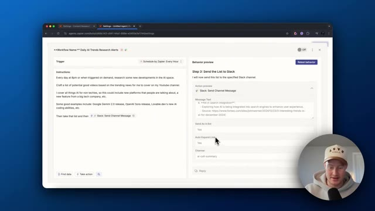
*⏱️ 00:07:15 — Configuration de l'agent Zapier pour le workflow "Daily AI Trends Research Alerts" avec l'aperçu du message à envoyer sur Slack.*

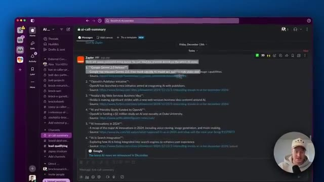
*⏱️ 00:07:23 — Application Slack affichant dans le canal #ai-call-summary la liste récapitulative des tendances IA générée par le bot Zapier.*

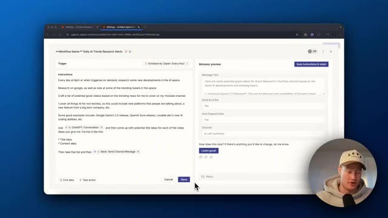
*⏱️ 00:07:31 — Édition du prompt de l'agent Zapier intégrant ChatGPT pour affiner les idées de titres et de contenu avant validation.*

---

### ⏱️ `[00:07:40 - 00:07:58]` | Segment #18

**🔊 Audio (Transcription Intégrale Mot pour Mot en Français) :**
> Donc je voulais qu'il me donne l'idée de titre et ensuite l'idée de contenu et ensuite il prendra cette liste et ensuite encore une fois, l'enverra dans un canal Slack. Donc je voulais formater cela un peu différemment. Maintenant, testons ceci et ce sera vraiment cool. Juste, je veux vous montrer ça parce que c'est juste à quel point Zapier Agents est dynamique. Vous pouvez simplement taper ce que vous voulez qu'il fasse et il s'apprendra réellement à le faire. D'accord, super.

**👁️ Analyse Visuelle d'Écran (gemini-3.5-flash-lite) :**
**Interface & Outils** : Navigateur web, interface d'automatisation Zapier Agents.

**Contenu textuel & Code** : Instructions du workflow pour la recherche de tendances IA, intégration ChatGPT et Slack, aperçu du message.

**Action / Démonstration** : Configuration et test d'un workflow d'agent conversationnel Zapier avant son déploiement.

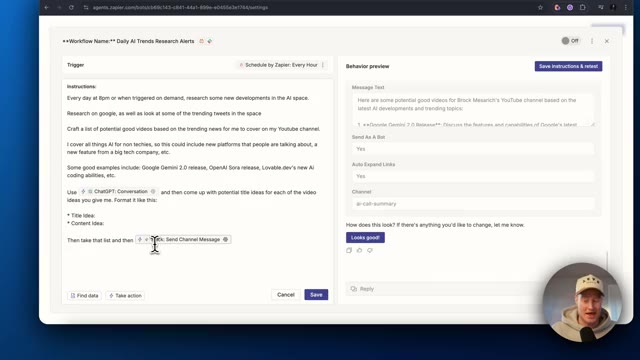
*⏱️ 00:07:44 — Interface Zapier affichant les instructions d'un agent IA pour générer des idées de vidéos et les envoyer sur Slack.*

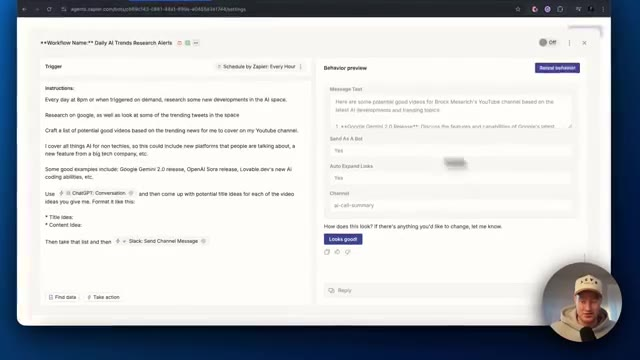
*⏱️ 00:07:49 — Aperçu du comportement de l'agent dans Zapier avec la prévisualisation du message texte et les paramètres Slack.*

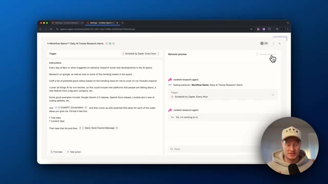
*⏱️ 00:07:54 — L'utilisateur clique sur le bouton de test pour lancer l'exécution du workflow de recherche de tendances IA.*

---

### ⏱️ `[00:07:58 - 00:08:16]` | Segment #19

**🔊 Audio (Transcription Intégrale Mot pour Mot en Français) :**
> Donc, il a trouvé les, il a fait des recherches sur les idées de contenu et maintenant vous pouvez voir qu'il est à l'étape de trouver réellement les idées de titres. D'accord, donc ça a l'air bien. On dirait que je dois approuver cela pour que cela soit envoyé à ChatGPT. D'accord, donc on dirait qu'il en fait un à la fois et qu'il propose cinq idées de titres différentes pour chacune de ces vidéos.

**👁️ Analyse Visuelle d'Écran (gemini-3.5-flash-lite) :**
**Interface & Outils** : Interface web de Zapier (Agents) avec un panneau de configuration des instructions et une section de prévisualisation.

**Contenu textuel & Code** : Instructions textuelles du workflow automatisé pour la recherche de tendances IA et la génération d'idées de vidéos YouTube avec ChatGPT et Slack.

**Action / Démonstration** : Examen des étapes du workflow automatisé et de la génération des idées de titres de vidéos par l'agent IA.

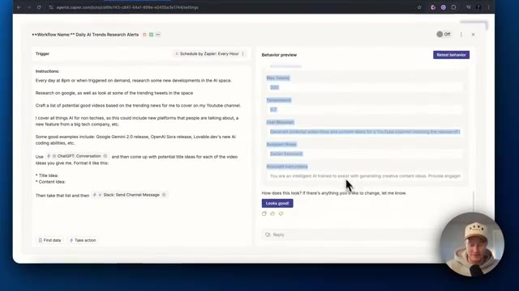
*⏱️ 00:08:03 — Interface de configuration d'un agent Zapier affichant les instructions du workflow et un panneau de prévisualisation du comportement.*

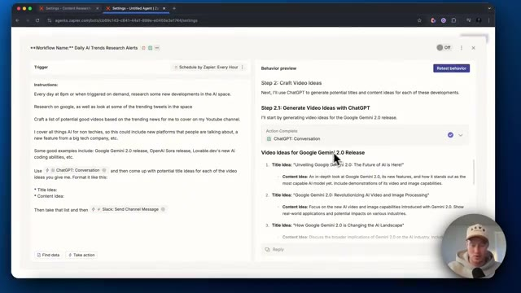
*⏱️ 00:08:12 — Interface de Zapier affichant les idées de titres et de contenu générées par l'agent pour la sortie de Google Gemini 2.0.*

---

### ⏱️ `[00:08:16 - 00:08:35]` | Segment #20

**🔊 Audio (Transcription Intégrale Mot pour Mot en Français) :**
> Donc je n'ai pas forcément besoin de faire ça. Donnons-lui un tout petit peu plus de consignes. D'accord, donc j'ai essentiellement dit, je veux que tu le fasses pour chacune des idées de vidéo en une seule consigne, en une seule consigne, au lieu d'avoir à, vous savez, envoyer plusieurs consignes à ChatGPT pour absolument chacune des idées de contenu. Donc enregistre ça, je vais retester ce comportement et j'espère que cela fonctionne correctement.

**👁️ Analyse Visuelle d'Écran (gemini-3.5-flash-lite) :**
**Interface & Outils** : Interface web de Zapier (Agents) avec un panneau de configuration de workflow et une webcam du présentateur en bas à droite.

**Contenu textuel & Code** : Instructions textuelles pour un agent d'IA nommé "Daily AI Trends Research Alerts", utilisant ChatGPT et Slack, accompagnées de prévisualisations de contenus orientés sur Google Gemini 2.0.

**Action / Démonstration** : Le présentateur ajuste et complète les instructions textuelles dans l'interface de l'agent pour structurer la génération de prompts uniques pour chaque idée de vidéo.

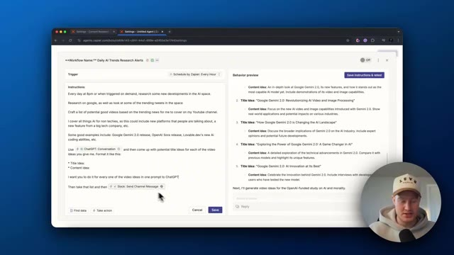
*⏱️ 00:08:21 — Interface Zapier affichant un panneau de configuration d'agent d'IA avec des instructions textuelles et un aperçu des idées de vidéos générées sur la droite.*

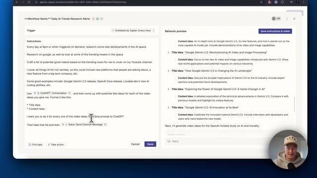
*⏱️ 00:08:26 — Vue similaire de l'interface Zapier montrant le curseur interagissant avec le texte des instructions pour affiner les consignes de l'agent.*

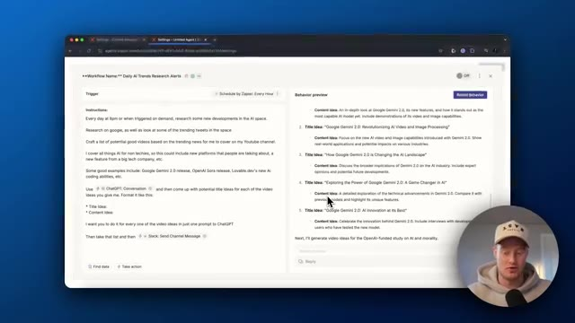
*⏱️ 00:08:30 — Panneau de configuration Zapier avec le volet de prévisualisation des résultats mis à jour affichant des idées de titres et de contenu basées sur Gemini 2.0.*

---

### ⏱️ `[00:08:35 - 00:08:53]` | Segment #21

**🔊 Audio (Transcription Intégrale Mot pour Mot en Français) :**
> D'accord, donc on dirait qu'il a effectivement fait ça correctement. Donc maintenant, nous avons l'idée de titre pour ceci, puis l'idée de contenu. Et nous avons cela pour les cinq ou, je suppose, les six idées de contenu. Maintenant, c'est l'envoi de cette liste sur Slack. C'est parti. Voici notre message envoyé sur Slack. Nous avons notre titre. Nous avons l'actualité. Nous avons l'idée de titre et nous avons l'idée de contenu.

**👁️ Analyse Visuelle d'Écran (gemini-3.5-flash-lite) :**
**Interface & Outils** : Zapier (éditeur de workflow) et Slack (messagerie d'équipe).

**Contenu textuel & Code** : Instructions de workflow automatisé, prompts ChatGPT, idées de titres et de contenu sur l'IA (Google Gemini 2.0, OpenAI, etc.), et message final posté sur Slack.
[DESC_IMAGE_3] Visualisation du résultat final de l'automatisation avec la réception de la liste des idées de contenu sur un canal Slack.

**Action / Démonstration** : Explications face caméra et analyse conceptuelle des marchés.

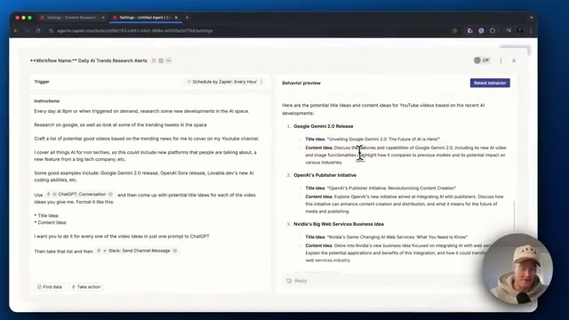
*⏱️ 00:08:40 — Interface Zapier montrant l'aperçu du comportement d'un workflow avec les idées de titres et de contenu pour des vidéos YouTube.*

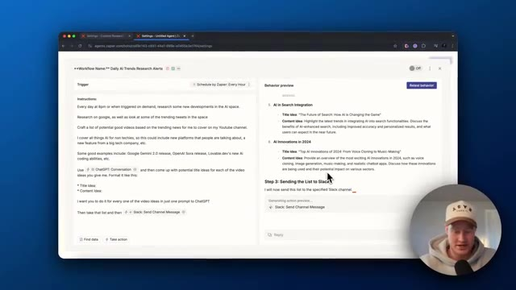
*⏱️ 00:08:44 — Interface Zapier montrant la suite de l'aperçu du workflow, notamment l'étape d'envoi de la liste sur Slack.*

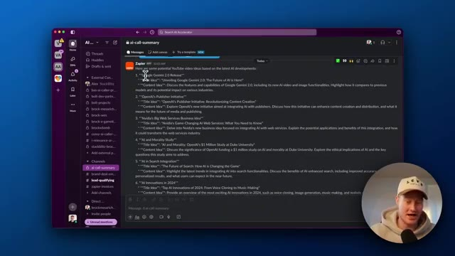
*⏱️ 00:08:49 — Interface Slack affichant le message automatisé généré par Zapier contenant la liste complète des idées de vidéos YouTube.*

---

### ⏱️ `[00:08:53 - 00:09:22]` | Segment #22

**🔊 Audio (Transcription Intégrale Mot pour Mot en Français) :**
> C'est formidable. Nous avons construit tout cela en moins de 10 minutes environ. Nous avons un agent qui, maintenant, recherche littéralement chaque heure des idées de contenu pour nous, puis les envoie dans notre canal Slack. Nous pourrions rendre cela plus dynamique. Je pourrais ajouter ceci à Notion. Je pourrais faire en sorte que cela m'envoie un e-mail avec toutes ces idées de contenu. Ceci n'est qu'un tout petit aperçu de Zapier Agents et je suis tellement impatient d'en parler davantage sur cette chaîne. Je pense que ce sera un cas d'usage vraiment sympa pour beaucoup de gens. Donc, si vous voulez plus de contenu comme celui-ci, assurez-vous de laisser un commentaire, faites-moi savoir que vous avez aimé, laissez un pouce bleu, abonnez-vous à la chaîne. On se voit dans la prochaine vidéo, les amis.

**👁️ Analyse Visuelle d'Écran (gemini-3.5-flash-lite) :**
**Interface & Outils** : Navigateur web affichant l'interface de Zapier Central / Agents.

**Contenu textuel & Code** : Workflow nommé 'Daily AI Trends Research Alerts' avec des instructions textuelles pour rechercher des actualités sur l'IA et envoyer un message sur Slack.

**Action / Démonstration** : Présentation de la configuration et des instructions textuelles d'un agent automatisé d'intelligence artificielle.

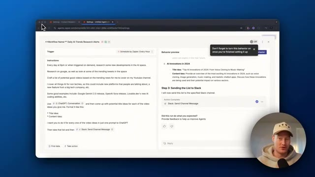
*⏱️ 00:09:00 — Capture d'écran montrant l'interface de configuration d'un agent de workflow Zapier, avec les instructions de recherche et un aperçu des résultats.*

---

