# 🎬 Build THIS AI SaaS with Lovable AI (Idea to App in Minutes)

> **Chaîne** : [Brock Mesarich | AI for Non Techies](https://www.youtube.com/@BrockMesarich)  
> **Lien YouTube** : [https://www.youtube.com/watch?v=-NxObRv7md0](https://www.youtube.com/watch?v=-NxObRv7md0)  
> **Date de publication** : 20250116  
> **Durée** : 00:21:25  
> **Identifiant vidéo** : `-NxObRv7md0`  
> **Transcription & Analyse** : `whisper-v3-large-turbo+gemini-3.5-flash-lite`  

---

## 📌 Synthèse Exécutive & Outils

### 💡 Résumé

Cette vidéo, présentée par Brock Mesarich sur la chaîne *Brock Mesarich | AI for Non Techies*, démontre comment concevoir, structurer et déployer de A à Z une application SaaS à haute valeur perçue — un coach d'affaires intelligent — sans posséder la moindre compétence en programmation. L'approche repose sur le no-code et le couplage stratégique d'interfaces utilisateurs modernes et de moteurs conversationnels avancés. À travers une méthodologie rigoureuse, le créateur désacralise la création de logiciels, montrant qu'il est désormais possible de transformer une simple idée en un produit commercialisable en quelques minutes grâce à l'écosystème actuel des technologies d'intelligence artificielle.

Le processus technique s'articule autour de deux piliers fondamentaux : la brique front-end/interface utilisateur, confiée à des constructeurs visuels assistés par IA (comme Lovable), et la brique logique conversationnelle, orchestrée par des agents intelligents via des plateformes de chatbot (Chatling). La démonstration détaille la mise en place d'un tunnel conversationnel sophistiqué, l'utilisation de variables dynamiques pour personnaliser l'expérience utilisateur, l'intégration de conditions logiques et la gestion des intentions. De plus, la vidéo aborde l'intégration de solutions de paiement (Stripe) pour transformer un simple prototype fonctionnel en une véritable entreprise SaaS génératrice de revenus.

L'analyse de cette architecture démontre l'abaissement radical des barrières à l'entrée technologiques pour les entrepreneurs, les analystes et les non-techniciens. En déléguant le code brut à des agents génératifs et le design à des interfaces no-code, le créateur met en lumière un nouveau paradigme d'automatisation des processus métier et de création de produits digitaux. Cette stratégie permet de se concentrer exclusivement sur la proposition de valeur, l'expérience client (UX) et l'optimisation des prompts, ouvrant la voie à un prototypage et à un déploiement ultra-rapides sur le marché.

### 🛠️ Outils, Modèles & Logiciels Présentés

* **Lovable** : Plateforme de développement de logiciels assistée par IA permettant de concevoir des interfaces utilisateur et des applications SaaS complètes sans compétences en codage.
* **Chatling** : Outil de création et de personnalisation de chatbots IA par glisser-déposer, utilisé pour orchestrer les flux conversationnels du coach d'affaires.
* **Claude 3.5 Sonnet** : Modèle de langage (LLM) avancé d'Anthropic, choisi pour sa précision et la qualité de ses raisonnements contextuels dans le traitement des requêtes métier.
* **ChatGPT (OpenAI / GPT-4o mini)** : Grand modèle de langage de référence, évoqué comme alternative pour alimenter les briques de génération de texte et de réponses automatisées.
* **Stripe** : Solution de paiement en ligne intégrée pour monétiser l'application SaaS et automatiser la gestion des abonnements clients.

### 🔑 Points Clés & Enseignements Stratégiques

1. **Architecture SaaS No-Code Découplée** : Séparer l'interface utilisateur (gérée par Lovable) de la logique conversationnelle (gérée par Chatling) permet de construire un produit robuste, maintenable et rapidement itérable.
2. **Personnalisation Dynamique par Variables** : L'utilisation de variables contextuelles (comme la capture et le stockage du nom de l'utilisateur) humanise l'interaction et renforce l'engagement client dès les premiers points de contact.
3. **Optimisation des Prompts et Contraintes de Longueur** : Pour éviter de saturer l'utilisateur, les prompts du modèle doivent intégrer des instructions strictes limitant les réponses à un nombre précis de phrases (maximum trois).
4. **Gestion Avancée des Flux et Conditions** : L'implémentation d'étapes conditionnelles et de correspondances d'intentions permet d'aiguiller l'utilisateur vers des parcours conversationnels personnalisés selon qu'il a des questions supplémentaires ou non.
5. **Utilisation Stratégique de la Mémoire Conversationnelle** : Le système mappe et réinjecte les réponses précédentes de l'IA et de l'utilisateur dans les blocs suivants pour maintenir un contexte cohérent tout au long de la session de coaching.
6. **Choix du Modèle de IA (LLM)** : La sélection de Claude 3.5 Sonnet par rapport à d'autres modèles est motivée par sa supériorité perçue dans la formulation de conseils pratiques, structurés et de niveau professionnel.
7. **Alternative entre Modèle Généraliste et Base de Connaissances** : L'utilisation directe des grands modèles de langage convient aux conseils métier larges, tandis que l'ajout d'une base de connaissances propriétaire (documents, fichiers) s'impose pour des réponses hautement spécifiques.
8. **Prototypage et Tests Itératifs en Temps Réel** : L'utilisation du mode aperçu (preview) permet de valider instantanément le comportement du bot, d'ajuster les variables et de corriger les frictions dans le tunnel conversationnel avant le déploiement public.
9. **Monétisation Intégrée** : L'ajout de passerelles de paiement comme Stripe transforme instantanément un prototype utilitaire en un produit viable capable de générer des flux de trésorerie récurrents.
10. **Automatisation de l'Expertise Métier** : La structuration d'un agent capable d'analyser des problématiques complexes (comme l'optimisation d'entonnoirs marketing) illustre comment industrialiser du conseil à forte valeur ajoutée grâce à l'IA conversationnelle.

---

## ⏱️ Chronologie & Transcription Complète Audio & Visuelle (Mot pour Mot)

### ⏱️ `[00:00:00 - 00:00:19]` | Segment #01

**🔊 Audio (Transcription Intégrale Mot pour Mot en Français) :**
> Vous voulez créer un logiciel, mais vous ne savez pas quoi ? Voici une idée pour vous. Dans cette vidéo, je vais créer une application de business coach IA avec Lovable. Lovable vous aide à créer des logiciels grâce à l'IA. Donc, même si vous êtes une personne non technique comme moi, vous pouvez créer des produits vraiment géniaux. Je vais également créer un agent IA avec une plateforme appelée Chatling.

**👁️ Analyse Visuelle d'Écran (gemini-3.5-flash-lite) :**
**Interface & Outils** : AUCUNE

**Contenu textuel & Code** : AUCUNE

**Action / Démonstration** : AUCUNE

---

### ⏱️ `[00:00:19 - 00:00:38]` | Segment #02

**🔊 Audio (Transcription Intégrale Mot pour Mot en Français) :**
> Chatling vous permet de créer des chatbots IA et de les personnaliser en quelques minutes. Cela servira en fait de coach d'affaires et répondra à toutes les questions que nos clients se posent. Ces deux plateformes seront réunies afin de réellement créer une application SaaS de valeur. Je vais également vous montrer comment ajouter Stripe afin que vous puissiez vraiment faire payer cette application elle-même.

**👁️ Analyse Visuelle d'Écran (gemini-3.5-flash-lite) :**
**Interface & Outils** : Interface graphique de présentation avec logos de services SaaS (Chatling, Lovable).

**Contenu textuel & Code** : Logos des applications Chatling et Lovable reliés à un encadré central "Valuable SaaS Application".

**Action / Démonstration** : Présentation visuelle de l'intégration et de la combinaison des deux outils SaaS.

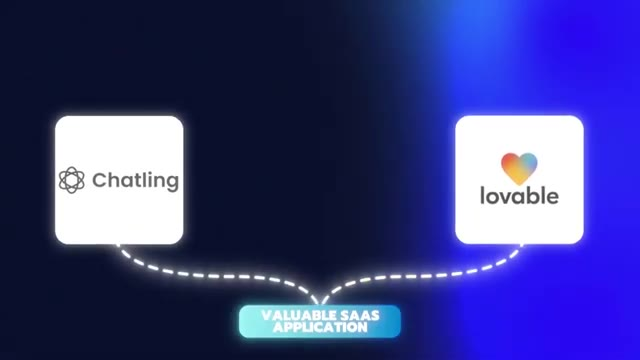
*⏱️ 00:00:34 — Schéma montrant la fusion des plateformes Chatling et Lovable pour créer une application SaaS de valeur.*

---

### ⏱️ `[00:00:39 - 00:01:02]` | Segment #03

**🔊 Audio (Transcription Intégrale Mot pour Mot en Français) :**
> Très bien, sans plus attendre, plongeons dans le vif du sujet. Très bien, donc tout d'abord, nous devons nous rendre sur Chatling AI. Chatling vous permet en fait de créer des chatbots IA personnalisés pour votre entreprise grâce à cet outil de glisser-déposer ici. Assurez-vous donc de vous inscrire si ce n'est pas déjà fait. Je vais me connecter à mon compte ici. Et ensuite, après avoir créé ce chatbot IA, je vais en fait créer mon application complète en utilisant Lovable, sans aucune expérience en codage.

**👁️ Analyse Visuelle d'Écran (gemini-3.5-flash-lite) :**
**Interface & Outils** : Navigateur web affichant le site officiel et le tableau de bord de l'application Chatling AI.

**Contenu textuel & Code** : Interface utilisateur de création de chatbots, boutons d'inscription et listes de projets de chatbots existants.

**Action / Démonstration** : Navigation sur le site web de Chatling AI et présentation du tableau de bord de gestion des chatbots.

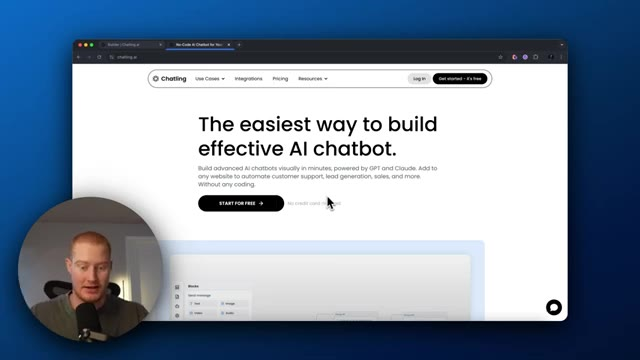
*⏱️ 00:00:45 — Page d'accueil du site Web de Chatling AI présentant l'outil de création de chatbots.*

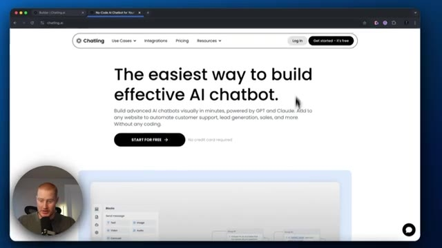
*⏱️ 00:00:51 — Vue similaire de la page d'accueil de Chatling AI montrant les options de création de chatbots.*

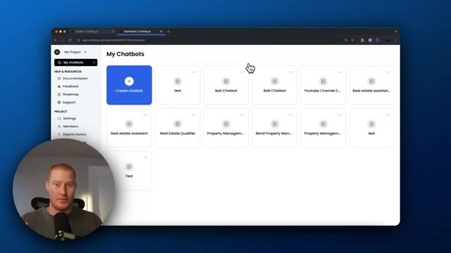
*⏱️ 00:00:57 — Tableau de bord de l'application Chatling AI affichant la liste des chatbots créés et le bouton de création.*

---

### ⏱️ `[00:01:03 - 00:01:22]` | Segment #04

**🔊 Audio (Transcription Intégrale Mot pour Mot en Français) :**
> Il suffit d'écrire ce que je veux créer, et cela va réellement me construire l'interface utilisateur de notre logiciel. Je vais également configurer un abonnement avec Stripe et en faire un SaaS IA entièrement déployable et lançable. Donc, tout d'abord, vous voudrez venir ici et créer un chatbot. Et partons de zéro ici, même s'il y a des modèles disponibles. Appelons cet agent Lovable.

**👁️ Analyse Visuelle d'Écran (gemini-3.5-flash-lite) :**
**Interface & Outils** : Navigateur web affichant l'interface de gestion de chatbots Chatling.ai.

**Contenu textuel & Code** : Liste de projets de chatbots sous forme de cartes ("My Chatbots", "Bolt Chatbot", "Real estate assistant", etc.) et modale de saisie du nom.

**Action / Démonstration** : Le présentateur navigue dans le tableau de bord et initie la création d'un nouveau chatbot en cliquant sur l'interface.

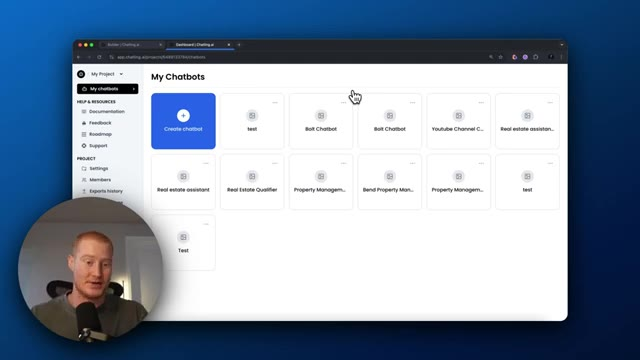
*⏱️ 00:01:08 — Vue d'ensemble du tableau de bord affichant la liste des chatbots existants et le bouton pour en créer un nouveau.*

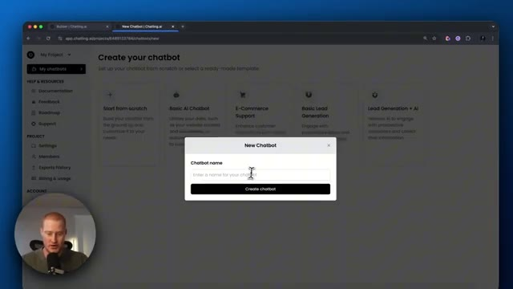
*⏱️ 00:01:17 — Fenêtre modale de création d'un nouveau chatbot avec un champ de texte pour nommer le robot.*

---

### ⏱️ `[00:01:22 - 00:01:44]` | Segment #05

**🔊 Audio (Transcription Intégrale Mot pour Mot en Français) :**
> Et ensuite, nous avons ce tableau de bord ici et nous voulons commencer dans le constructeur. C'est ici que nous allons réellement construire notre agent IA ou notre chatbot IA. Et si vous venez sur le côté gauche, vous pouvez voir qu'il y a différents blocs. Il y a des blocs de texte, des blocs d'images, des vidéos, il y a des blocs de capture de réponse, il y a des blocs IA, des étapes conditionnelles, des requêtes HTTP, toutes ces différentes choses.

**👁️ Analyse Visuelle d'Écran (gemini-3.5-flash-lite) :**
**Interface & Outils** : Application web Chatting.ai (constructeur no-code d'agents et chatbots IA).

**Contenu textuel & Code** : Nœud "START", volet des composants "Blocks", catégories "Send message" (Text, Image, Video, Audio, Carousel) et "Capture response" (Buttons, Text, Number, Email, URL, Date/Time, Form), projet "Lovable Agent".

**Action / Démonstration** : Exploration du tableau de bord de création d'agent IA et ouverture du menu des blocs fonctionnels pour construire le scénario du chatbot.

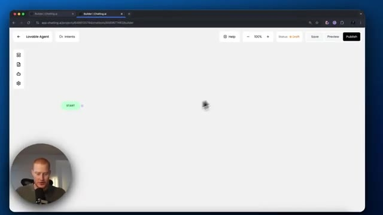
*⏱️ 00:01:28 — Interface du constructeur Chatting.ai affichant le canevas d'édition avec le nœud initial "START" au centre et la vignette vidéo du présentateur en bas à gauche.*

*⏱️ 00:01:33 — Menu latéral "Blocks" ouvert sur Chatting.ai présentant les différentes catégories de modules "Send message" (Text, Image, Video, Audio, Carousel) et "Capture response" (Buttons, Text, Number, Email, Form).*

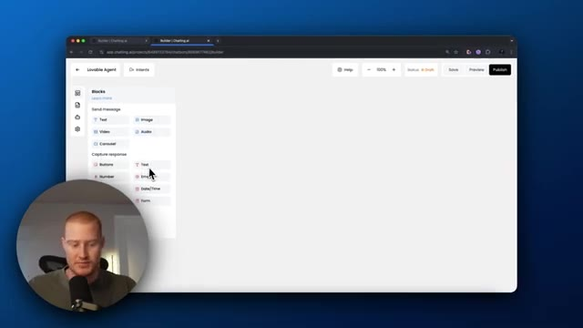
*⏱️ 00:01:39 — Survol au curseur des blocs de capture de réponse (notamment le bloc "Text") dans le panneau latéral d'outils de Chatting.ai.*

---

### ⏱️ `[00:01:44 - 00:02:03]` | Segment #06

**🔊 Audio (Transcription Intégrale Mot pour Mot en Français) :**
> Cela peut sembler confus, mais restez avec moi dans cette vidéo pour que vous compreniez réellement comment faire cela. Donc, tout d'abord, ce que nous voulons faire, c'est glisser et déposer un bloc de texte ici. Et ce que ce bloc de texte va faire, c'est qu'il sera essentiellement déclenché lorsque vous interagissez réellement pour la première fois avec le bot. Et tout ce que nous avons à faire, c'est de venir ici et de taper ce que nous voulons, en fait, ce avec quoi nous voulons saluer notre utilisateur.

**👁️ Analyse Visuelle d'Écran (gemini-3.5-flash-lite) :**
**Interface & Outils** : Interface web de construction de chatbot visuel (Chatling.ai).

**Contenu textuel & Code** : Espace de travail de workflow avec un nœud de départ et un panneau latéral de configuration de texte.

**Action / Démonstration** : Glisser-déposer d'un bloc de texte et configuration de son contenu textuel dans le constructeur de chatbot.

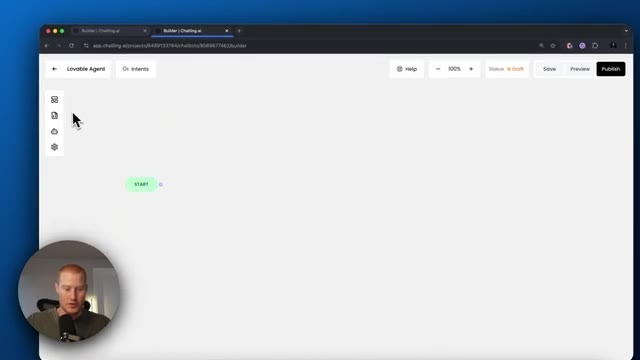
*⏱️ 00:01:49 — Interface de création de chatbot montrant un nœud de départ 'START' sur un espace de travail visuel.*

*⏱️ 00:01:58 — Ajout d'un bloc de texte et affichage de ses propriétés d'édition pour configurer le message à envoyer.*

---

### ⏱️ `[00:02:03 - 00:02:24]` | Segment #07

**🔊 Audio (Transcription Intégrale Mot pour Mot en Français) :**
> Donc, à l'intérieur de ce bloc de texte, je vais dire : bonjour, je suis votre coach en affaires. D'abord, puis-je obtenir votre nom, s'il vous plaît ? Et ensuite, ce que nous ferons en dessous, c'est que nous allons réellement ajouter une réponse de capture. Et ensuite, appelons ceci nom du contact. Et ce que fait cette variable enregistrée, c'est qu'elle va enregistrer leur réponse ici, peu importe le texte qu'ils mettent. Et ensuite, nous pourrons l'utiliser plus tard dans notre conversation.

**👁️ Analyse Visuelle d'Écran (gemini-3.5-flash-lite) :**
**Interface & Outils** : Interface web de construction de chatbot (Chatling.ai / Lovable Agent).

**Contenu textuel & Code** : Blocs de workflow conversationnel, panneau de configuration latéral pour l'envoi de texte et la capture de réponse avec des variables préexistantes.
[DESC_IMAGE_3]

**Action / Démonstration** : L'utilisateur configure le bloc de capture de texte en assignant la variable correspondante au nom du contact.

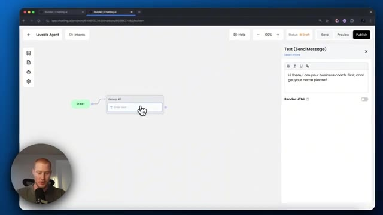
*⏱️ 00:02:08 — Configuration d'un bloc de message textuel dans un constructeur de chatbot, affichant la question de bienvenue du coach d'affaires.*

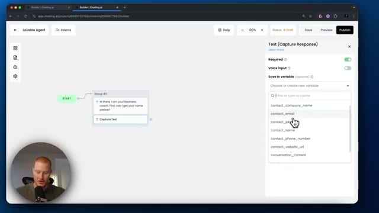
*⏱️ 00:02:14 — Sélection et attribution d'une variable de contact ('contact_name') pour capturer la réponse de l'utilisateur.*

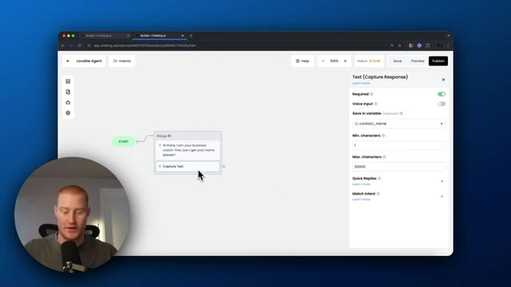
*⏱️ 00:02:19 — Visualisation du flux de conversation mis à jour avec le bloc de capture de texte et la variable sélectionnée.*

---

### ⏱️ `[00:02:24 - 00:02:47]` | Segment #08

**🔊 Audio (Transcription Intégrale Mot pour Mot en Français) :**
> Ensuite, ce que nous allons faire, c'est que nous allons réellement ouvrir un nouveau bloc ici. Et nous allons en faire juste un autre bloc de texte avant d'obtenir réellement la réponse dynamique de l'IA. Et ce que je vais taper ici, c'est : merci, nom du contact. À quels problèmes faites-vous face dans votre entreprise ? Et afin d'accéder réellement à nos variables ici, utilisez simplement une accolade ouvrante, puis référez-vous au nom du contact, qui est la variable précédente que je viens d'enregistrer.

**👁️ Analyse Visuelle d'Écran (gemini-3.5-flash-lite) :**
**Interface & Outils** : Navigateur web affichant l'interface de création de chatbot Chatling (app.chatling.ai).

**Contenu textuel & Code** : Un diagramme de flux de chatbot comprenant un nœud de départ (START), un premier bloc (Group #1) contenant un message d'accueil textuel (« Hi there, I am your business coach... ») et une action de capture de texte, ainsi qu'un second bloc en cours de configuration nommé « Group #2 ».

**Action / Démonstration** : Le créateur ajoute et nomme un nouveau bloc de texte dans le flux conversationnel pour structurer les étapes du chatbot.

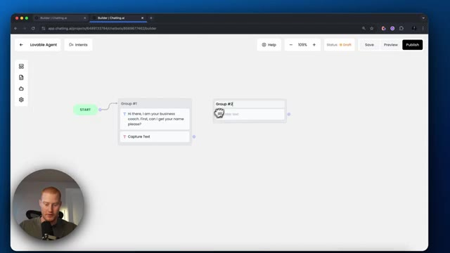
*⏱️ 00:02:30 — Capture d'écran montrant l'interface de création d'un agent conversationnel avec un bloc en cours d'édition (Group #2) et le présentateur visible en incrustation dans le coin inférieur gauche.*

---

### ⏱️ `[00:02:47 - 00:03:08]` | Segment #09

**🔊 Audio (Transcription Intégrale Mot pour Mot en Français) :**
> Et ici, il les accueillera par leur nom qu'ils ont réellement saisi. C'est le but de ces variables personnalisées. Nous voulons ensuite ajouter un autre texte capturé ici, car nous voulons capturer les problèmes qu'ils rencontrent avec leur entreprise. Et ensuite, nous enverrons cette variable à l'étape de l'IA qui sera alors capable de traiter leur question. Très bien. Donc ce que je vais faire, c'est que je vais en fait sauvegarder cette réponse ici.

**👁️ Analyse Visuelle d'Écran (gemini-3.5-flash-lite) :**
**Interface & Outils** : Éditeur de chatbot web de type "builder" (Chatling.ai) avec une interface visuelle par blocs connectés.

**Contenu textuel & Code** : Diagramme de flux conversationnel comprenant un bloc "START", un "Group #1" pour l'accueil et la capture du nom, et un "Group #2" utilisant la variable personnalisée `{contact_name}`.

**Action / Démonstration** : Configuration d'un flux conversationnel de chatbot en ajoutant et paramétrant des variables personnalisées et des blocs de capture de texte.

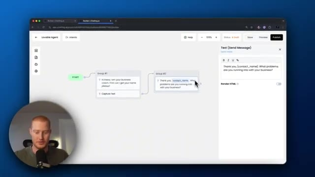
*⏱️ 00:02:53 — Vue d'un éditeur de chatbot visuel montrant un flux avec un panneau latéral de configuration de texte contenant une variable personnalisée.*

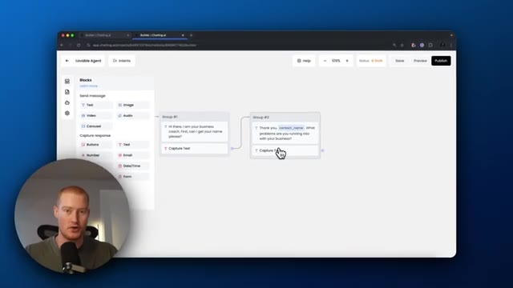
*⏱️ 00:02:58 — Le même éditeur de flux avec le panneau latéral affichant les blocs de construction disponibles pour concevoir la conversation.*

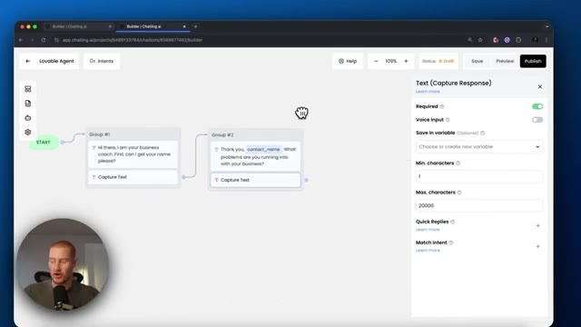
*⏱️ 00:03:03 — L'interface de l'éditeur de chatbot affichant les paramètres de capture de réponse textuelle dans le panneau latéral droit.*

---

### ⏱️ `[00:03:08 - 00:03:40]` | Segment #10

**🔊 Audio (Transcription Intégrale Mot pour Mot en Français) :**
> Je vais juste nommer cette réponse. C'est donc le nom de la variable. Cela va ensuite l'enregistrer. Et à l'intérieur de notre étape de réponse de l'IA ici, au lieu d'accéder à la base de connaissances, nous voulons utiliser le modèle d'IA. Donc, cela va simplement utiliser un grand modèle de langage comme ChatGPT et toutes les connaissances qu'il possède afin de répondre à toutes les questions liées à l'entreprise. Si vous avez des informations spécifiques sur lesquelles vous voulez entraîner votre modèle d'IA et que vous voulez qu'il accède uniquement à ces informations, utilisez la base de connaissances ici et vous pouvez en fait aller télécharger des documents, des fichiers et des trucs afin de pouvoir réellement accéder à cette connaissance. Mais pour cela, je vais utiliser le modèle d'IA parce que

**👁️ Analyse Visuelle d'Écran (gemini-3.5-flash-lite) :**
**Interface & Outils** : Interface web d'un constructeur de chatbot visuel par flux (type Chatling ou équivalent).

**Contenu textuel & Code** : Blocs de flux séquentiels (Group #1, Group #2, Group #3), options de configuration de l'étape 'AI Response', sélection de source de données et variables.

**Action / Démonstration** : Configuration des paramètres d'une étape de réponse par IA dans un parcours utilisateur automatisé.

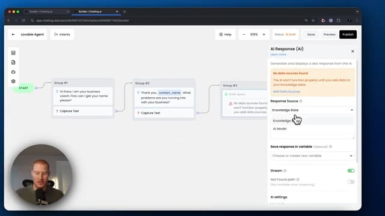
*⏱️ 00:03:16 — L'image 1 montre l'interface de création de chatbot avec un panneau latéral ouvert permettant de configurer la source de réponse de l'IA (sélection entre 'Knowledge Base' et 'AI Model').*

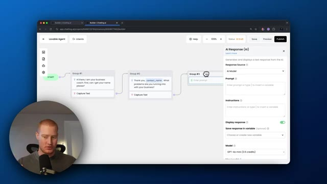
*⏱️ 00:03:24 — L'image 2 montre le même éditeur de flux, avec la source de réponse réglée sur 'AI Model' et les champs de configuration associés (Prompt, Instructions, Modèle GPT-4o mini).*

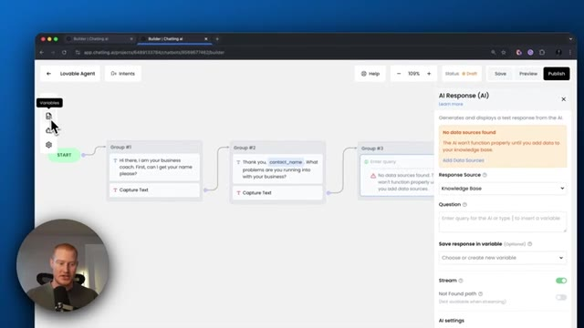
*⏱️ 00:03:32 — L'image 3 montre l'interface de l'application avec le menu latéral gauche ouvert sur l'onglet 'Variables' et le panneau de configuration de l'étape de réponse de l'IA sur la droite.*

---

### ⏱️ `[00:03:40 - 00:04:12]` | Segment #11

**🔊 Audio (Transcription Intégrale Mot pour Mot en Français) :**
> ce sera plus efficace. Et juste ici se trouve notre prompt. L'utilisateur a décrit son problème commercial comme suit. Utilisez la variable personnalisée de réponse que nous avons capturée juste ici. Et ensuite, vous êtes un expert en coaching d'entreprise qui fournit des conseils spécifiques et pratiques pour aider l'utilisateur à résoudre son problème. Si nécessaire, posez une question de suivi supplémentaire pour clarifier davantage leur problème. Et ensuite, dans les instructions ici, c'est ainsi que nous voulons que notre IA agisse. Je vais donc simplement écrire, gardez votre réponse aussi courte que possible. Essayez de penser à environ trois phrases maximum. De cette façon, notre utilisateur n'est pas spammé avec un paragraphe massif. Et ensuite, nous voulons réellement créer un autre

**👁️ Analyse Visuelle d'Écran (gemini-3.5-flash-lite) :**
**Interface & Outils** : Chatling.ai (constructeur de chatbot visuel par blocs)

**Contenu textuel & Code** : Variables dynamiques ([response]), prompt de l'expert en coaching d'entreprise, instructions de formatage et sélection du modèle GPT-4o mini.

**Action / Démonstration** : Configuration du prompt et des instructions d'un nœud IA dans le flux conversationnel.

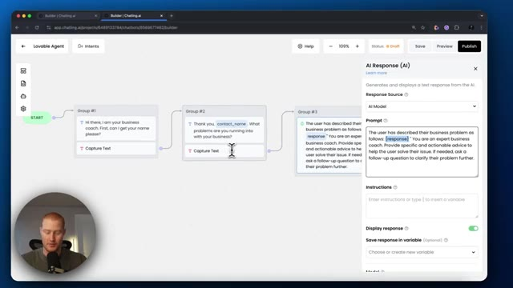
*⏱️ 00:03:48 — Vue d'ensemble de l'interface de création de chatbot montrant le flux conversationnel et le panneau de configuration de la réponse de l'IA.*

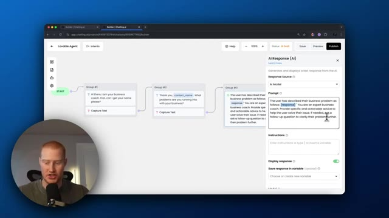
*⏱️ 00:03:56 — Gros plan sur le panneau latéral de l'IA avec la modification du prompt intégrant la variable de réponse utilisateur.*

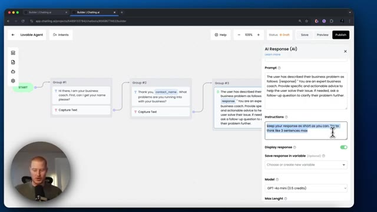
*⏱️ 00:04:04 — Ajout d'instructions spécifiques dans le champ dédié pour limiter la longueur de la réponse à trois phrases maximum.*

---

### ⏱️ `[00:04:12 - 00:04:47]` | Segment #12

**🔊 Audio (Transcription Intégrale Mot pour Mot en Français) :**
> variable ici et je vais simplement appeler ça réponse_ia et comme ça nous pourrons l'utiliser dans une autre étape, vous pourriez choisir le modèle que vous voulez donc Claude 3.5 Sonnet, vous pourriez utiliser ChatGPT 4o mini pour moi, personnellement j'aime Claude 3.5 Sonnet donc je vais juste utiliser celui-ci et ensuite je vais aussi ajouter un bloc de texte ici qui demande fondamentalement je vais ajouter une question de suivi ici est-ce que ça aide un peu juste pour qu'on puisse avoir une idée si cela aide réellement l'utilisateur, ensuite ce que nous devons faire ajouter une capture de réponse ici, je pense que vous comprenez un peu ce qui se passe maintenant donc capturer la réponse et marquons simplement ceci comme une variable de réponse. Donc ensuite, nous devons ajouter

**👁️ Analyse Visuelle d'Écran (gemini-3.5-flash-lite) :**
**Interface & Outils** : Interface web de construction de flux conversationnel (Chatling.ai / Lovable Agent).

**Contenu textuel & Code** : Blocs de messages séquentiels, variables dynamiques ("response", "contact_name"), et liste déroulante des modèles de langage (Claude, Gemini, GPT).

**Action / Démonstration** : Sélection d'un modèle d'IA dans le panneau latéral et modification du flux conversationnel par étapes.

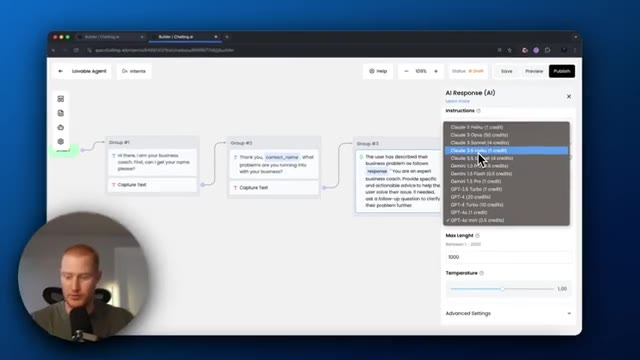
*⏱️ 00:04:21 — L'écran montre l'interface de construction de chatbot avec un panneau latéral ouvert permettant de sélectionner un modèle d'IA (Claude 3.5 Sonnet est survolé).*

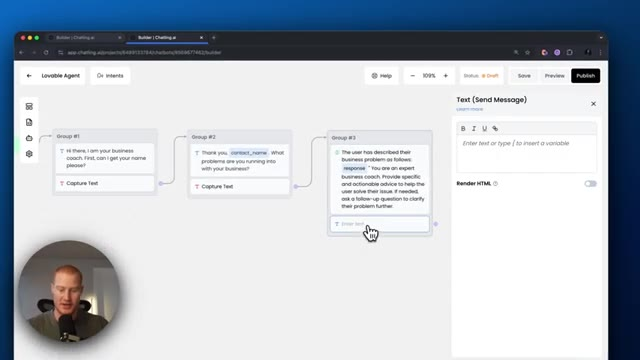
*⏱️ 00:04:30 — L'interface du constructeur de chatbot affiche un flux de conversation en trois étapes (Group #1, #2, #3) avec un panneau de configuration textuelle à droite.*

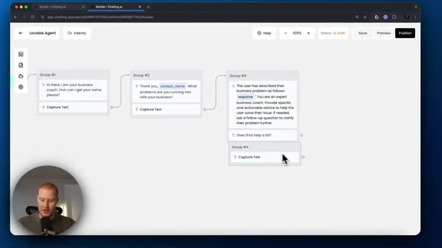
*⏱️ 00:04:38 — L'interface présente l'ajout d'une nouvelle étape (Group #4) avec une action de capture de texte connectée au flux existant.*

---

### ⏱️ `[00:04:47 - 00:05:12]` | Segment #13

**🔊 Audio (Transcription Intégrale Mot pour Mot en Français) :**
> une autre étape de réponse de l'IA ici. Nous allons en faire un bloc différent. Je vais donc connecter ce module ici, puis encore une fois, je vais changer ceci pour modèle d'IA et voici le message. L'utilisateur a posé la question suivante qui peut être ou non un suivi de votre réponse précédente. La question est ensuite cette variable de réponse. Donc, quelle que soit leur réponse ici même. Fournissez une réponse réfléchie et spécifique pour aider l'utilisateur, si nécessaire, incluez un exemple ou des conseils étape par étape.

**👁️ Analyse Visuelle d'Écran (gemini-3.5-flash-lite) :**
**Interface & Outils** : Interface de création de chatbot (Chatling / Lovable Agent).

**Contenu textuel & Code** : Paramètres du bloc AI Response, source de données, source de réponse réglée sur 'AI Model', et champ de prompt contenant une question utilisateur.

**Action / Démonstration** : Configuration et personnalisation d'un bloc de réponse par IA dans le générateur de workflow.

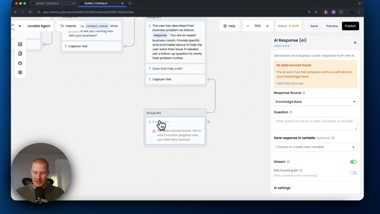
*⏱️ 00:04:53 — Vue d'ensemble de l'interface de création de chatbot montrant un bloc 'AI Response' avec un avertissement sur les sources de données.*

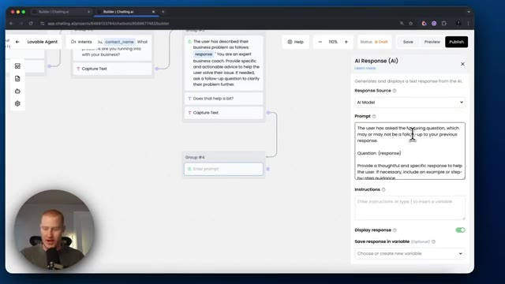
*⏱️ 00:05:00 — Configuration du panneau 'AI Response' avec le champ de prompt modifié pour interagir avec le modèle d'IA.*

---

### ⏱️ `[00:05:12 - 00:05:32]` | Segment #14

**🔊 Audio (Transcription Intégrale Mot pour Mot en Français) :**
> Réponse précédente que vous avez donnée, la réponse. Nous allons donc également mapper cette variable de réponses de l'IA ici. De cette façon, nous pouvons fournir du contexte à notre agent IA. Même chose pour l'instruction comme dernière étape ici. Je vais garder la réponse aussi courte que possible. Essayez de penser à trois phrases maximum, environ. Et ensuite, nous allons également utiliser Claude 3.5 Sonnet à nouveau.

**👁️ Analyse Visuelle d'Écran (gemini-3.5-flash-lite) :**
**Interface & Outils** : Application web de construction de chatbot/agent IA (Chatling.ai) affichée dans un navigateur, avec une vue de flux de nœuds (workflow builder).

**Contenu textuel & Code** : Configuration du nœud "AI Response" comprenant un champ Prompt structuré avec des variables ([response], [ai_answer]) et un champ Instructions pour limiter la longueur des réponses de l'IA.

**Action / Démonstration** : Saisie et configuration des instructions textuelles et des variables contextuelles dans le panneau de l'agent IA.

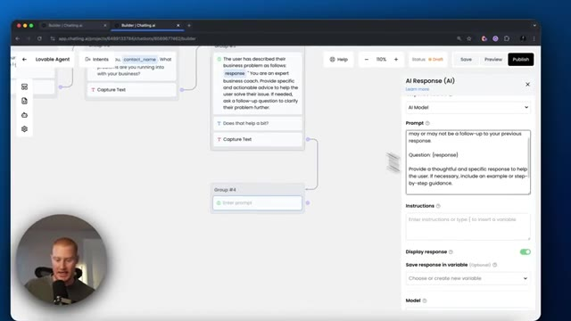
*⏱️ 00:05:17 — L'interface du créateur d'agent IA affiche un panneau de configuration "AI Response" avec un champ de invite (prompt) en cours de modification.*

![Le panneau de configuration affiche maintenant l'ajout de la variable de réponse précédente ([ai_answer]) dans le prompt de l'agent.](../screenshots/-NxObRv7md0/-NxObRv7md0_000522_seg14.jpg)
*⏱️ 00:05:22 — Le panneau de configuration affiche maintenant l'ajout de la variable de réponse précédente ([ai_answer]) dans le prompt de l'agent.*

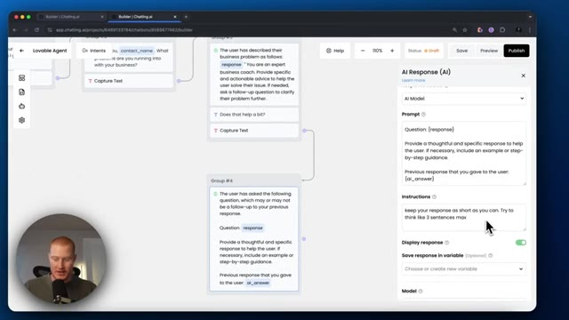
*⏱️ 00:05:27 — Le curseur de la souris remplit le champ "Instructions" avec la consigne de garder les réponses courtes (maximum 3 phrases).*

---

### ⏱️ `[00:05:33 - 00:05:52]` | Segment #15

**🔊 Audio (Transcription Intégrale Mot pour Mot en Français) :**
> Encore une chose. Nous allons également ajouter un autre bloc de texte ici et essentiellement dire, faites-moi savoir si vous avez d'autres questions. Comme ça, nous pourrons y répondre si nécessaire. Ensuite, ce que nous allons faire, c'est que nous allons suivre une étape conditionnelle. Suivez bien juste ici. Ensuite, nous devons en fait ajouter un nouveau bloc de texte de capture de texte, puis cliquer sur ce bloc de texte. Nous devons en fait ajouter une intention.

**👁️ Analyse Visuelle d'Écran (gemini-3.5-flash-lite) :**
**Interface & Outils** : Navigateur web affichant l'interface de construction visuelle de chatbot (Chatling.ai).

**Contenu textuel & Code** : Blocs de flux conversationnel, invites de texte (Send Message), et paramètres de nœuds de chatbot.

**Action / Démonstration** : Ajout et configuration d'un nouveau bloc de texte et manipulation des nœuds conditionnels dans le flux du chatbot.

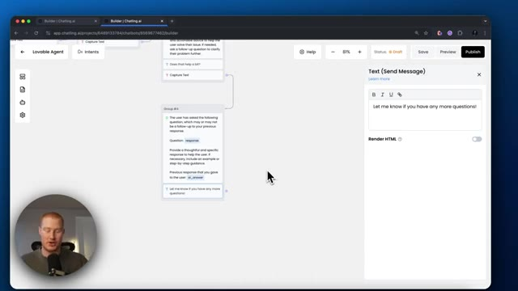
*⏱️ 00:05:37 — Vue générale de l'interface de création de chatbot avec un panneau latéral à droite contenant le texte 'Let me know if you have any more questions!'.*

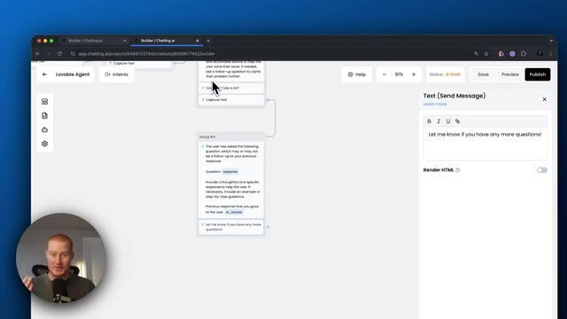
*⏱️ 00:05:42 — Le curseur survole un bloc de texte de l'arborescence du chatbot dans le créateur visuel.*

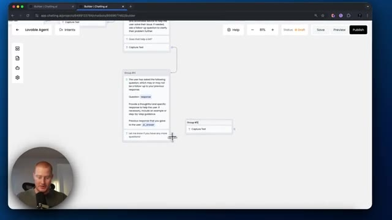
*⏱️ 00:05:47 — Création et déplacement d'un nouveau groupe (Group #5) avec un bloc 'Capture Text' à côté du groupe précédent.*

---

### ⏱️ `[00:05:52 - 00:06:12]` | Segment #16

**🔊 Audio (Transcription Intégrale Mot pour Mot en Français) :**
> Donc, descendons pour faire correspondre l'intention ici, et ensuite nous devons créer une nouvelle intention. Appelons-la simplement "j'ai d'autres questions". Donc s'ils ont d'autres questions, cela sera envoyé vers un flux de travail ou un parcours conversationnel différent. Donc ensuite, nous voulons cliquer sur l'intention "j'ai d'autres questions". Et ensuite, créons aussi une autre intention : "je n'ai plus de questions".

**👁️ Analyse Visuelle d'Écran (gemini-3.5-flash-lite) :**
**Interface & Outils** : Interface de création de chatbot web (Chatling.ai).

**Contenu textuel & Code** : Formulaire de création d'intention avec les champs Nom et Description, et configuration des correspondances d'intentions dans le flux.

**Action / Démonstration** : Création et nommage d'une nouvelle intention conversationnelle nommée 'I have more questions'.

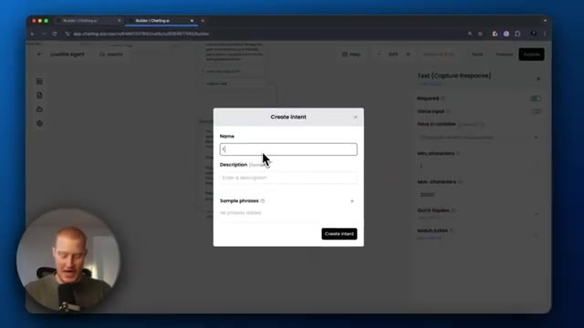
*⏱️ 00:05:57 — Fenêtre modale 'Create intent' ouverte avec le champ 'Name' vide.*

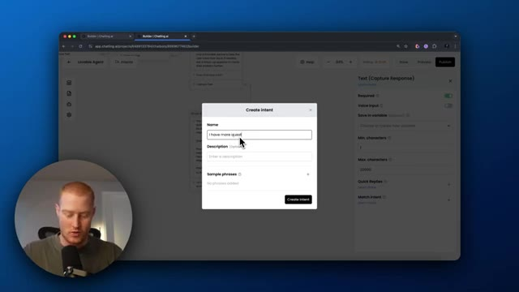
*⏱️ 00:06:02 — Saisie du nom de l'intention 'I have more questions' dans la fenêtre modale.*

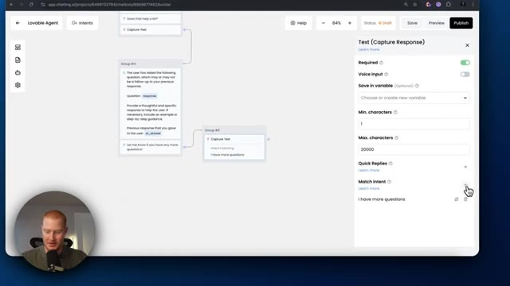
*⏱️ 00:06:07 — Visualisation du flux de travail mis à jour avec la nouvelle intention associée 'I have more questions'.*

---

### ⏱️ `[00:06:13 - 00:06:35]` | Segment #17

**🔊 Audio (Transcription Intégrale Mot pour Mot en Français) :**
> Et ensuite, pour la phrase d'exemple, disons simplement ça. Voilà. Et puis encore une fois, nous devons réellement l'ajouter ici. Nous devons également nous assurer de l'enregistrer en tant que variable de réponse pour l'utiliser dans les étapes suivantes. Avant d'ajouter réellement notre étape suivante, nous devons ensuite connecter ces déclencheurs locaux ici. Connectons donc les deux, car nous devons envoyer notre utilisateur sur différents chemins conversationnels s'ils répondent à ces questions pour chacune de ces réponses qu'ils donnent.

**👁️ Analyse Visuelle d'Écran (gemini-3.5-flash-lite) :**
**Interface & Outils** : Chatling.ai (éditeur visuel de chatbot IA sans code)

**Contenu textuel & Code** : - Configuration du bloc "Text (Capture Response)" :
  - Variable de sauvegarde : `response`
  - Limite de caractères : Min 1, Max 20000
  - Réponses rapides / Correspondance d'intentions : "I have more questions", "I do not have any more questions"
- Nœuds du workflow : "Group #4" (contenant les variables `{response}` et `{ai_answer}`) et "Group #6 (Capture Text)"

**Action / Démonstration** : Configuration d'une étape de capture de texte dans le flux du chatbot : association de la réponse de l'utilisateur à la variable `response` et paramétrage des options de suivi d'intention.

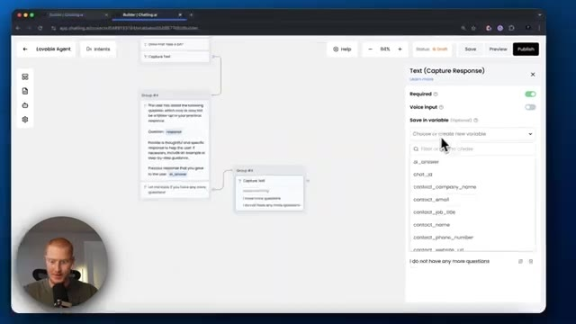
*⏱️ 00:06:18 — Interface du builder Chatling.ai affichant un menu déroulant sous "Save in variable" pour attribuer la saisie utilisateur à une variable.*

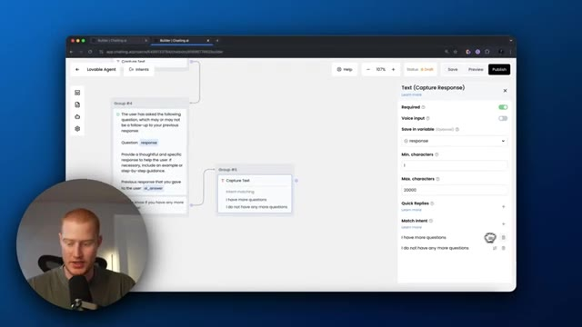
*⏱️ 00:06:24 — Panneau de configuration "Text (Capture Response)" où la variable "response" est définie, avec les paramètres de longueur de caractères et les réponses rapides.*

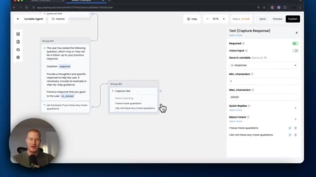
*⏱️ 00:06:30 — Canvas de création de workflow montrant la connexion entre le nœud de prompt "Group #4" et le nœud "Group #6" (Capture Text).*

---

### ⏱️ `[00:06:35 - 00:06:55]` | Segment #18

**🔊 Audio (Transcription Intégrale Mot pour Mot en Français) :**
> Donc s'ils ont d'autres questions, nous allons les envoyer vers un flux de travail différent, et nous allons ajouter un bloc de texte ici. D'accord, donc s'ils ont d'autres questions, ils vont être envoyés directement ici. En gros, le texte sera : « Faites-moi savoir quelles questions vous avez. » Et ensuite, nous voulons capturer ce texte ici. Nous allons capturer ceci en tant que réponse.

**👁️ Analyse Visuelle d'Écran (gemini-3.5-flash-lite) :**
**Interface & Outils** : Application web de construction de chatbots (Chatling.ai).

**Contenu textuel & Code** : Blocs logiques (Group #4, Capture Text, Send Message) et configurations de variables (réponses, questions).

**Action / Démonstration** : Manipulation des blocs de workflow et édition du texte de redirection pour les questions supplémentaires.

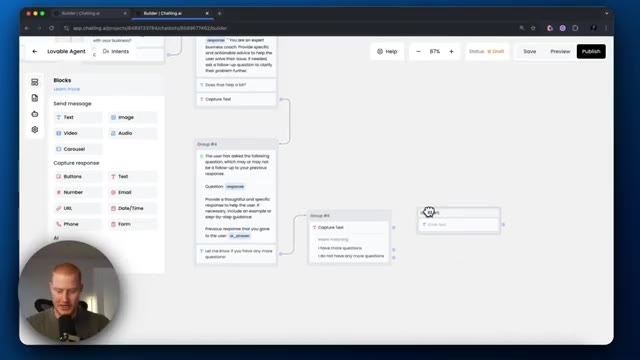
*⏱️ 00:06:40 — Interface de construction de chatbot montrant un flux de travail avec des blocs logiques connectés et un présentateur en bas à gauche.*

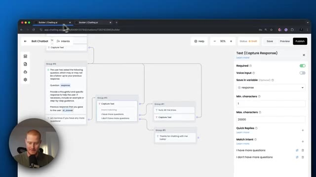
*⏱️ 00:06:45 — Éditeur de configuration textuelle à droite pour la capture de réponse d'un agent conversationnel.*

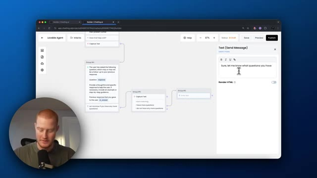
*⏱️ 00:06:50 — Éditeur de message textuel affichant la phrase « Sure, let me know what questions you have » dans un bloc de workflow.*

---

### ⏱️ `[00:06:55 - 00:07:29]` | Segment #19

**🔊 Audio (Transcription Intégrale Mot pour Mot en Français) :**
> Et ensuite, ce que nous allons faire, c'est que nous allons réinjecter cela ici, ce qui correspond fondamentalement à l'étape de l'intelligence artificielle qui indique que l'utilisateur a décrit son problème commercial comme suit. Et ensuite, nous sommes invités ici à répondre en tant que coach d'affaires. Donc s'ils ont d'autres questions, nous capturerons cette réponse pour la renvoyer ici, de sorte qu'ils continueront à interagir avec le robot conversationnel d'intelligence artificielle, essentiellement, c'est ce que cela signifie en explication simple. Et puis, s'ils n'ont plus de questions, tout ce que nous avons à faire est d'ajouter un autre bloc de texte ici et de dire simplement merci pour votre temps, merci pour la discussion, passez une excellente journée, et ensuite cela se chargera de mettre fin à la conversation.

**👁️ Analyse Visuelle d'Écran (gemini-3.5-flash-lite) :**
**Interface & Outils** : Chatling (application de création de chatbots par IA)

**Contenu textuel & Code** : Blocs de flux conversationnel, variables de capture de réponse textuelle, paramètres de configuration des nœuds d'IA.

**Action / Démonstration** : Configuration des étapes du flux de discussion et sélection des blocs fonctionnels pour structurer l'interaction du chatbot.

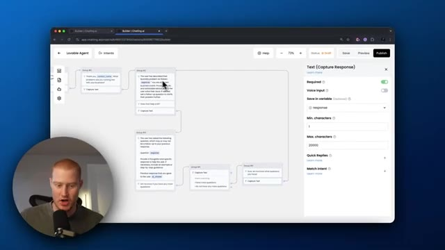
*⏱️ 00:07:03 — Interface de conception d'un agent conversationnel montrant un diagramme de flux (workflow) avec plusieurs blocs de condition et de texte, et un panneau latéral de configuration de réponse.*

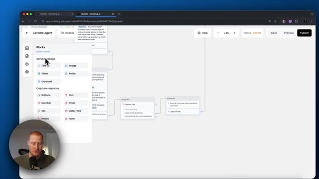
*⏱️ 00:07:21 — Interface de conception de l'agent affichant un menu déroulant des blocs disponibles ('Blocks') pour ajouter des messages ou capturer des réponses (texte, image, boutons, etc.).*

---

### ⏱️ `[00:07:29 - 00:08:01]` | Segment #20

**🔊 Audio (Transcription Intégrale Mot pour Mot en Français) :**
> la conversation, donc voilà, nous avons construit notre chatbot IA. Maintenant, ce que nous devons faire, c'est allons-y et testons cela. Tout ce qu'on a à faire, c'est de cliquer sur aperçu ici. Super. Alors bonjour. Je suis votre coach d'affaires. Tout d'abord, puis-je avoir votre prénom ? Merci, Brock. Vous pouvez donc voir qu'il utilise cette variable personnalisée. Quels problèmes rencontrez-vous dans votre entreprise ? En gros, je dis que j'ai des problèmes avec mon entonnoir et que j'ai besoin d'aide pour les corriger. Il va donc maintenant prendre cette réponse et l'envoyer ici à notre étape IA. D'accord. Donc, pour fournir les conseils les plus utiles concernant les problèmes d'entonnoir, j'aurai besoin d'informations plus spécifiques. Alors, à quelle étape de l'entonnoir rencontrez-vous le

**👁️ Analyse Visuelle d'Écran (gemini-3.5-flash-lite) :**
**Interface & Outils** : Application web de création de chatbot (Chatling.ai / Lovable Agent).

**Contenu textuel & Code** : Blocs logiques d'IA connectés en flux et interface de test en temps réel (Preview).

**Action / Démonstration** : Test du chatbot IA en cliquant sur le bouton d'aperçu et en répondant aux questions de l'assistant.

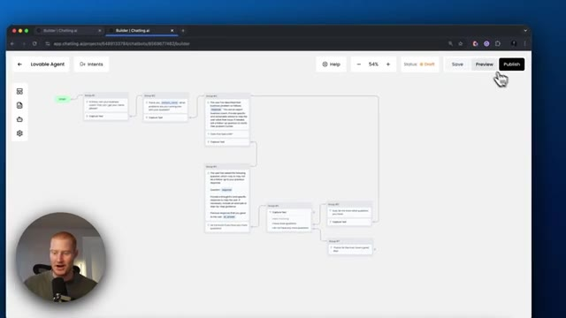
*⏱️ 00:07:37 — Interface de construction de chatbot avec le workflow des blocs et le curseur sur le bouton de prévisualisation.*

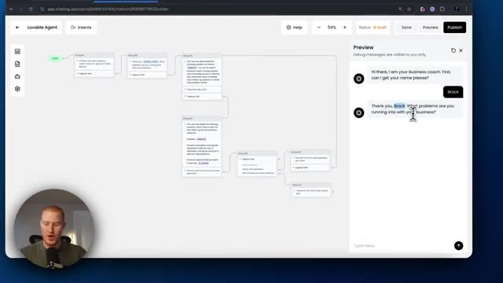
*⏱️ 00:07:45 — Panneau de prévisualisation ouvert sur le côté droit avec l'interaction utilisateur en cours (« Brock »).*

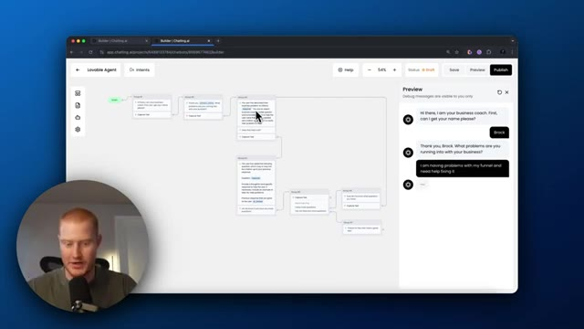
*⏱️ 00:07:53 — Poursuite de la conversation de test dans le panneau de prévisualisation où l'utilisateur indique son problème.*

---

### ⏱️ `[00:08:01 - 00:08:35]` | Segment #21

**🔊 Audio (Transcription Intégrale Mot pour Mot en Français) :**
> la plus grande baisse ? Quels sont vos taux de conversion actuels entre les étapes ? Quels types d'entreprises ou de produits vendez-vous ? Disons simplement que, donc bien sûr, j'obtiens mes prospects grâce à YouTube. D'accord. Donc je viens de saisir un peu plus d'informations sur mon entreprise. Donc, espérons que notre coach IA pourra nous aider sur la base de ces informations. Donc ça me dit en fait comment je pourrais améliorer mes taux de conversion. Donc stratégie de contenu, optimisation, amélioration du lead magnet, améliorations du tunnel de vente. Donc si vous ne connaissez rien au marketing sur Internet, cela vous dépasse peut-être, mais tout ce que vous devez savoir, c'est que cela fournit en fait des informations plutôt sympas. Faites-moi savoir si vous

**👁️ Analyse Visuelle d'Écran (gemini-3.5-flash-lite) :**
**Interface & Outils** : Application web Chatling (constructeur de chatbot par IA, interface de type workflow).

**Contenu textuel & Code** : Diagramme de blocs logiques et conversationnels reliés par des flèches, interface de prévisualisation affichant des questions de diagnostic commercial et des réponses de l'IA.

**Action / Démonstration** : Saisie de données dans le chatbot de test et affichage des recommandations stratégiques générées par l'IA.

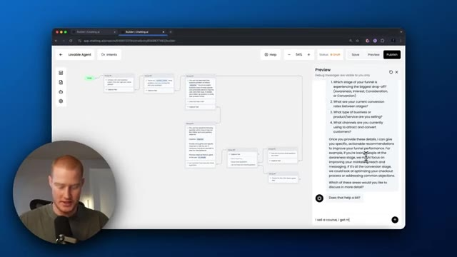
*⏱️ 00:08:10 — Interface d'un créateur de chatbot (Chatling) affichant un diagramme de flux conversationnel à gauche et une fenêtre de prévision de chat à droite où l'utilisateur saisit des informations sur son entreprise.*

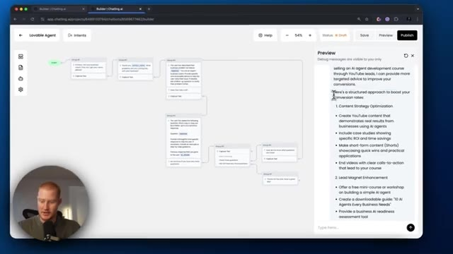
*⏱️ 00:08:18 — La même interface de chatbot montrant la réponse de l'agent IA dans la fenêtre de prévisualisation avec des recommandations structurées pour optimiser les taux de conversion.*

---

### ⏱️ `[00:08:35 - 00:08:55]` | Segment #22

**🔊 Audio (Transcription Intégrale Mot pour Mot en Français) :**
> Vous avez d'autres questions ? Oui, c'est le cas. Quels autres canaux devrais-je utiliser à part YouTube ? Donc vous pouvez voir que ça a vraiment correspondu à l'intention. Il a donc pu comprendre que vous aviez d'autres questions. Donc quels autres canaux devrais-je utiliser à part YouTube ? Et voilà. Donc maintenant, il nous donne en fait un peu plus de différents types de plateformes qu'on pourrait utiliser. Je vais juste répondre ici et dire, oui, c'est le cas.

**👁️ Analyse Visuelle d'Écran (gemini-3.5-flash-lite) :**
**Interface & Outils** : Application web de construction de chatbot (Lovable Agent / Chatting.ai)

**Contenu textuel & Code** : Diagramme de flux conversationnel, nœuds conditionnels, et messages de test dans le panneau de prévisualisation interactif.

**Action / Démonstration** : Test en direct du chatbot et validation de la reconnaissance d'intention concernant les questions sur les canaux marketing.

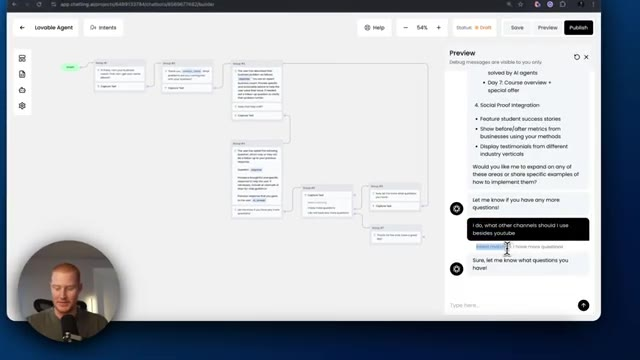
*⏱️ 00:08:40 — Interface de chatbot montrant un flux de dialogue à gauche et une fenêtre de prévisualisation avec une question posée sur les autres canaux marketing à droite.*

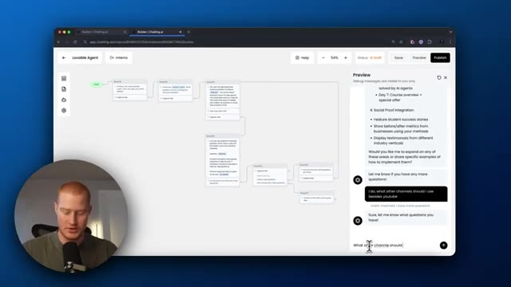
*⏱️ 00:08:45 — Suite de la démonstration du chatbot avec la saisie en direct d'une question dans le volet de prévisualisation.*

---

### ⏱️ `[00:08:55 - 00:09:31]` | Segment #23

**🔊 Audio (Transcription Intégrale Mot pour Mot en Français) :**
> Parce que ça aide un peu. Et voilà. Donc maintenant que notre boîte de discussion IA est configurée, il nous suffit de cliquer sur publier. Et maintenant, allons-y pour la partie la plus amusante et commençons réellement à construire notre application en utilisant Lovable. D'accord, donc si vous ne savez pas ce qu'est Lovable, Lovable est une plateforme de programmation par IA qui vous permet réellement de taper ce que vous essayez de construire et elle le construira avec du langage naturel. Donc pensez simplement à taper dans cette boîte ici et elle vous aidera à construire un logiciel et même à construire le backend de notre application. Donc je vais parcourir ce processus dans cette vidéo ainsi que d'expliquer comment configurer Stripe, ce qui est assez facile à faire avec cette plateforme également, pour que vous puissiez ensuite commencer à facturer pour votre logiciel même si

**👁️ Analyse Visuelle d'Écran (gemini-3.5-flash-lite) :**
**Interface & Outils** : Navigateur web affichant l'outil de création de chatbot Chatling et la plateforme de développement d'applications Lovable.

**Contenu textuel & Code** : Organigramme de logique conversationnelle, aperçu de chat en direct, et interface de génération d'applications pilotée par l'IA.

**Action / Démonstration** : Publication d'un agent de discussion configuré puis navigation vers la plateforme de développement Lovable.

*⏱️ 00:09:04 — Interface de configuration d'agent conversationnel montrant un organigramme de flux de discussion à gauche et un panneau de prévisualisation avec une notification de publication réussie à droite.*

*⏱️ 00:09:13 — Page d'accueil de la plateforme Lovable (lovable.dev) avec le slogan « Idea to app in seconds » et une zone de texte centrale pour créer une application.*

---

### ⏱️ `[00:09:31 - 00:10:04]` | Segment #24

**🔊 Audio (Transcription Intégrale Mot pour Mot en Français) :**
> Tu n'es pas une personne technique comme moi. Tout d'abord, ce que je vais faire, c'est que je vais lui demander de créer. D'accord, alors voici mon instruction. Je lui demande fondamentalement d'agir en tant que coach en affaires. Je vais ajouter un chatbot IA à cette application qui agira comme un coach en affaires. Le but de cette application est de pouvoir enregistrer des notes de la session de conseil. Pensez donc à ceci comme à un endroit où ajouter notre chatbot IA, mais nous voulons pouvoir stocker toutes les informations que nous abordons lors de ce genre de session de conseil avec notre coach IA. Commençons donc par ceci et il commencera réellement à coder cela pour nous, vous pouvez voir sur le côté gauche que c'est là que nous faisons réellement des changements.

**👁️ Analyse Visuelle d'Écran (gemini-3.5-flash-lite) :**
**Interface & Outils** : Navigateur web affichant la plateforme de développement d'applications Lovable.dev.

**Contenu textuel & Code** : Texte de prompt de création d'application : "Build me an app that acts as a business coach..." avec des instructions pour ajouter un chatbot IA et une interface avec dégradé.

**Action / Démonstration** : Saisie et soumission d'un prompt textuel pour générer automatiquement une application complète sans compétences techniques.

*⏱️ 00:09:40 — Interface du site Lovable.dev avec une boîte de texte contenant le prompt pour créer une application de coaching en affaires, et la caméra du présentateur en bas à droite.*

*⏱️ 00:09:56 — Vue similaire de l'interface Lovable.dev montrant la saisie de l'instruction pour générer l'application à partir d'une idée.*

---

### ⏱️ `[00:10:04 - 00:10:36]` | Segment #25

**🔊 Audio (Transcription Intégrale Mot pour Mot en Français) :**
> et interagir avec notre application. Et le côté droit va réellement nous montrer un aperçu ainsi que nous écrire du code. D'accord. Donc vous pouvez voir le code en train d'être écrit juste ici. Donnez à ceci juste un petit peu de temps et nous devrions avoir un aperçu chargé. D'accord. Donc voici initialement ce qu'il nous construit. C'est une interface utilisateur assez simple. Elle n'a pas l'air géniale, mais nous pouvons y apporter des modifications. Alors essayons juste ceci. Disons simplement session de conseil numéro un, discuter de la manière d'optimiser mon entonnoir de vente bla bla bla, nous pourrions l'enregistrer et ensuite nous pourrions ajouter une autre note, toutes ces choses ici, allons-y simplement et ce que je vais faire, je vais en fait aller chercher une capture d'écran de

**👁️ Analyse Visuelle d'Écran (gemini-3.5-flash-lite) :**
**Interface & Outils** : Navigateur web affichant la plateforme de développement et de prototypage Lovable.dev.

**Contenu textuel & Code** : Code source JSON/Tailwind pour les styles de l'application et interface utilisateur d'une application de prise de notes pour coachs professionnels.
[DESC_IMAGE_2] Navigation et démonstration interactive de l'application web générée par IA.

**Action / Démonstration** : Explications face caméra et analyse conceptuelle des marchés.

*⏱️ 00:10:12 — Vue de l'interface de développement Lovable affichant le code source d'une application web (configuration Tailwind CSS avec couleurs primaires et secondaires).*

*⏱️ 00:10:20 — Aperçu en direct de l'application 'Business Coach Notes' générée, montrant une interface divisée en deux volets avec une liste de notes et un éditeur.*

*⏱️ 00:10:28 — L'application 'Business Coach Notes' mise à jour avec du texte de démonstration saisi dans l'éditeur de notes à droite.*

---

### ⏱️ `[00:10:36 - 00:11:01]` | Segment #26

**🔊 Audio (Transcription Intégrale Mot pour Mot en Français) :**
> Un autre logiciel que j'aime et que je donne à celui-ci afin de construire une interface utilisateur sans avoir à réfléchir exactement à la manière dont je veux construire ceci, donc j'aime aller sur dribble.com et trouver des idées de différents logiciels, alors ajoutons simplement une application de prise de notes, donc j'aime l'apparence de celle-ci, évidemment nous n'allons pas utiliser exactement la même fonctionnalité que cette application, mais je vais juste copier. Je vais faire une capture d'écran de ceci, et la donner à Lovable ici.

**👁️ Analyse Visuelle d'Écran (gemini-3.5-flash-lite) :**
**Interface & Outils** : Navigateur web affichant Lovable.dev et Dribbble.com

**Contenu textuel & Code** : Maquettes d'interfaces utilisateur, barres de recherche, listes de notes et options de design.

**Action / Démonstration** : Navigation sur le web pour trouver des idées d'interface utilisateur et visualisation d'un prototype d'application.

*⏱️ 00:10:43 — Interface de prévisualisation d'une application de notes de coaching nommée 'Business Coach Notes'.*

*⏱️ 00:10:49 — Page d'accueil du site Dribbble avec la barre de recherche active.*

*⏱️ 00:10:55 — Aperçu d'un design de tableau de bord pour application de prise de notes sur Dribbble.*

---

### ⏱️ `[00:11:01 - 00:11:26]` | Segment #27

**🔊 Audio (Transcription Intégrale Mot pour Mot en Français) :**
> Et ensuite, en gros, disons : créons quelque chose avec un thème similaire. Avançons avec ça et laissons ceci écrire le code. Cool. Donc ça, évidemment, ne ressemble pas exactement à la même chose parce qu'on n'a pas besoin d'utiliser toutes ces fonctionnalités différentes ici, mais ça nous a donné une mise en page différente ici. Alors essayons ça. J'aime bien les petits aspects de dégradé ici. C'est bien mieux qu'avant. Alors disons simplement : session de conseil. Super. Ça a l'air cool.

**👁️ Analyse Visuelle d'Écran (gemini-3.5-flash-lite) :**
**Interface & Outils** : Navigateur web affichant la plateforme de développement d'applications Lovable.dev et le site Dribbble.

**Contenu textuel & Code** : Interface utilisateur générée par IA, instructions textuelles de prompt, design d'application de notes avec code modifiable via Supabase.

**Action / Démonstration** : Saisie d'un prompt pour s'inspirer d'une capture d'écran et modification automatique de l'interface et du code de l'application.

*⏱️ 00:11:07 — Interface Lovable affichant l'application Business Coach Notes en cours de génération avec un panneau de chat à gauche et un aperçu en direct à droite.*

*⏱️ 00:11:20 — Interface Lovable mise à jour montrant la modification du design de l'application 'Business Coach Notes' avec un thème violet épuré.*

---

### ⏱️ `[00:11:26 - 00:12:01]` | Segment #28

**🔊 Audio (Transcription Intégrale Mot pour Mot en Français) :**
> mettons maintenant essentiellement disons ajoutons la possibilité d'ajouter des étiquettes afin de catégoriser les notes d'accord donc j'ai fait quelques modifications ici nous pouvons maintenant ajouter une étiquette donc appelons ceci contenu donc si jamais nous avons une session de contenu avec notre coach IA coach d'affaires IA nous pourrions alors étiqueter ceci comme contenu et retourner dans nos notes alors commençons à taper disons simplement j'ai décidé que je dois commencer à faire trois shorts YouTube par semaine nous pouvons ensuite enregistrer nos notes créer une nouvelle note c'est cool nous pouvons filtrer ici. Super. Ça a l'air cool. C'est très basique. Nous pouvons aller beaucoup plus en détail avec ça, mais je vais commencer avec ça pour l'instant. Ce que nous devons faire maintenant les prochaines étapes c'est nous devons

**👁️ Analyse Visuelle d'Écran (gemini-3.5-flash-lite) :**
**Interface & Outils** : Lovable (plateforme de développement web par IA) et l'interface de prévisualisation de l'application de notes.

**Contenu textuel & Code** : Application web 'Business Coach Notes' avec des sections 'My Notes' et 'Content session', incluant la fonctionnalité d'ajout de tags et de notes textuelles.

**Action / Démonstration** : Le créateur teste et démontre l'ajout d'une étiquette pour catégoriser une note de session de coaching.

*⏱️ 00:11:35 — L'image montre l'interface de l'application 'Business Coach Notes' avec un champ de saisie de texte actif pour ajouter une étiquette (tag) intitulée 'Add a tag' dans la section 'Content session'.*

*⏱️ 00:11:52 — L'image présente l'application avec une étiquette 'Content' nouvellement ajoutée et affichée à la fois dans le panneau d'édition à droite et dans la liste des notes à gauche.*

---

### ⏱️ `[00:12:01 - 00:12:21]` | Segment #29

**🔊 Audio (Transcription Intégrale Mot pour Mot en Français) :**
> pour ajouter réellement la possibilité aux utilisateurs de se connecter et d'authentifier leurs comptes. Nous pourrions donc faire cela en utilisant Lovable dans l'intégration Supabase. Donc essentiellement, pour avoir accès à cette application, vous allez devoir réellement vous connecter et créer votre compte. Faisons donc cela maintenant. Cliquons sur cette intégration Supabase ici. Lovable rend cela extrêmement facile à utiliser. Allons-y donc et créons un nouveau projet.

**👁️ Analyse Visuelle d'Écran (gemini-3.5-flash-lite) :**
**Interface & Outils** : Navigateur web affichant la plateforme Lovable et l'application en cours de développement (Business Coach Notes).

**Contenu textuel & Code** : Panneau de chat IA de Lovable, interface utilisateur d'une application de notes et options d'intégration Supabase (« Connect to add authentication, store data... »).

**Action / Démonstration** : Le présentateur survole l'icône et le menu Supabase pour illustrer l'intégration de l'authentification et de la base de données.

*⏱️ 00:12:06 — Interface de l'application Lovable avec un panneau de chat à gauche et un aperçu d'une application de notes (« Business Coach Notes ») à droite.*

*⏱️ 00:12:16 — Le menu déroulant Supabase ouvert en haut à droite de l'interface Lovable montrant les options pour connecter l'authentification et la base de données.*

---

### ⏱️ `[00:12:21 - 00:12:44]` | Segment #30

**🔊 Audio (Transcription Intégrale Mot pour Mot en Français) :**
> Nous allons nommer ce coach d'affaires et créer un nouveau projet. Juste ici, il est indiqué qu'il configure de nouveaux projets. Donnez donc à cela quelques minutes et ça devrait être prêt. Pendant que cela charge, je suis en train d'apporter quelques modifications. Je demande donc à Lovable d'ajouter la possibilité d'avoir des dossiers qui sont catégorisés par les étiquettes sur les notes. Donc si c'est sous aide à la création de contenu, ce sera ensuite ajouté à une sorte de dossier ici afin de catégoriser un peu mieux ces notes pour rester un peu plus organisé.

**👁️ Analyse Visuelle d'Écran (gemini-3.5-flash-lite) :**
**Interface & Outils** : Supabase, interface Lovable (application web de notes de coaching).

**Contenu textuel & Code** : Configuration de base de données Supabase, clés API du projet, interface de chat Lovable avec historique des modifications et aperçu d'application "Business Coach Notes".

**Action / Démonstration** : Configuration d'un nouveau projet et ajout de modifications de code via Lovable.

*⏱️ 00:12:27 — Capture montrant le tableau de bord Supabase avec la configuration d'un projet de coaching d'affaires.*

*⏱️ 00:12:33 — Capture montrant l'interface de l'application Lovable avec le volet de chat à gauche et un aperçu d'application de notes de coaching à droite.*

*⏱️ 00:12:39 — Capture montrant l'application Lovable avec la sélection d'une note de session de contenu dans l'interface.*

---

### ⏱️ `[00:12:45 - 00:13:03]` | Segment #31

**🔊 Audio (Transcription Intégrale Mot pour Mot en Français) :**
> D'accord, super. C'est génial maintenant. Donc vous pouvez voir que nous avons maintenant différents dossiers à l'intérieur de nos notes pour en quelque sorte catégoriser tout ça un peu mieux. Testons cela une fois ici. Donc appelons juste ça. Ouais, donc ça a l'air super là. Maintenant, retournons sur Supabase et assurons-nous que c'est bien connecté. Tout ce qu'on a à faire, c'est venir dans notre compte.

**👁️ Analyse Visuelle d'Écran (gemini-3.5-flash-lite) :**
**Interface & Outils** : Interface web de l'application de prise de notes "Business Coach Notes" développée avec Lovable.

**Contenu textuel & Code** : Dossiers de notes ("content", "business") et section d'édition de notes avec tags.

**Action / Démonstration** : Test et démonstration de l'ouverture d'un dossier et de la visualisation des notes associées.

*⏱️ 00:12:49 — Vue de l'application de notes montrant des dossiers de catégories "content" et "business".*

*⏱️ 00:12:54 — Interaction avec l'application pour tester l'ajout et l'affichage des notes dans le dossier "content".*

*⏱️ 00:12:59 — Résultat du test avec une note intitulée "Funnel Building" affichée à l'intérieur du dossier.*

---

### ⏱️ `[00:13:04 - 00:13:24]` | Segment #32

**🔊 Audio (Transcription Intégrale Mot pour Mot en Français) :**
> Nous allons venir sur coach d'entreprise. Nous allons connecter cela. Et cela va maintenant faire de la magie côté back-end ici dans Lovable. Donc, si vous ne savez pas ce qu'est Supabase, Supabase est essentiellement la façon dont nous stockons les informations des utilisateurs et ajoutons un back-end à notre application. Cela pourrait donc être assez complexe si vous ne savez pas ce que c'est, mais Lovable rend cela extrêmement facile à utiliser.

**👁️ Analyse Visuelle d'Écran (gemini-3.5-flash-lite) :**
**Interface & Outils** : Présentation ou face-caméra explicatif du trader sans interface logicielle partagée.

**Contenu textuel & Code** : Explications orales des stratégies et mise en contexte méthodologique du marché.

**Action / Démonstration** : Explications face caméra et analyse conceptuelle des marchés.

---

### ⏱️ `[00:13:24 - 00:13:44]` | Segment #33

**🔊 Audio (Transcription Intégrale Mot pour Mot en Français) :**
> Vous pouvez simplement saisir ce que vous voulez et cela va vraiment construire ces choses dans le backend pour nous, ce qui est absolument hallucinant vu que je ne sais pas coder et que je peux réellement créer ces différentes choses. En gros, ce que vous voulez faire, c'est un peu suivre ce que Lovable dit ici. Vous pouvez donc voir que nous avons maintenant des comptes utilisateurs et la connexion. Nous pouvons stocker et utiliser de vraies données. Nous pourrions ajouter des fonctionnalités avancées avec des edge functions, ce que nous allons faire.

**👁️ Analyse Visuelle d'Écran (gemini-3.5-flash-lite) :**
**Interface & Outils** : Supabase et Lovable (plateformes de développement no-code / backend).

**Contenu textuel & Code** : Éditeur de table Supabase et interface de prévisualisation Lovable avec des fonctionnalités de gestion de notes et d'authentification.

**Action / Démonstration** : Connexion du backend Supabase et affichage de l'interface utilisateur générée automatiquement par l'IA.

*⏱️ 00:13:29 — Vue de l'interface Supabase montrant un tableau vide dans l'éditeur de table, avec une incitation à créer une nouvelle table.*

*⏱️ 00:13:34 — Interface de l'application Lovable affichant un tableau de bord "Business Coach Notes" connectée à Supabase avec des sections pour les notes et le funnel de vente.*

---

### ⏱️ `[00:13:45 - 00:14:05]` | Segment #34

**🔊 Audio (Transcription Intégrale Mot pour Mot en Français) :**
> Et ça dit en gros que si nous prévoyons de faire se connecter les utilisateurs, nous recommandons vivement de configurer d'abord l'authentification. Donc disons « configurons l'authentification » et maintenant nous allons faire ce qui doit être fait afin de faire cela. Ça demande quelles informations nous voulons stocker. Disons « stockons le nom d'utilisateur » et stockons le nom d'utilisateur et toutes les notes et tous les dossiers qu'ils enregistrent sur leurs comptes.

**👁️ Analyse Visuelle d'Écran (gemini-3.5-flash-lite) :**
**Interface & Outils** : Interface web de développement (Lovable.dev / Supabase) avec affichage du code/prévisualisation et incrustation vidéo du présentateur.

**Contenu textuel & Code** : Documentation de connexion Supabase, fonctionnalités utilisateur (User Accounts and Login, Store and Use Real Data), et instructions sur la configuration de l'authentification.

**Action / Démonstration** : Le présentateur commente l'intégration de Supabase et l'importance de configurer l'authentification en premier pour les utilisateurs.

*⏱️ 00:13:50 — Interface Lovable affichant la prévisualisation de l'application 'Business Coach Notes' connectée à Supabase, avec le panneau de chat à gauche et la webcam du présentateur en bas à droite.*

*⏱️ 00:13:55 — Même interface Lovable montrant le texte généré par l'IA dans le panneau de chat à gauche proposant de configurer l'authentification.*

---

### ⏱️ `[00:14:05 - 00:14:37]` | Segment #35

**🔊 Audio (Transcription Intégrale Mot pour Mot en Français) :**
> Il est en train d'écrire du code qu'il va utiliser à l'intérieur de Supabase afin de configurer toutes ces informations. Encore une fois, c'est assez technique de faire ce genre de choses soi-même. Et le fait que Lovable puisse faire cela est assez époustouflant. C'est génial. Nous pouvons donc appliquer ces changements. Ensuite, nous allons exécuter ce code SQL à l'intérieur de Supabase. Si nous venons dans l'éditeur de tables, vous pouvez maintenant voir deux tables différentes configurées qui ont en fait été créées par notre agent ici. Il y a donc une table de notes et ensuite des profils. Nous pourrions donc stocker les notes ici ainsi que les différents profils que nous avons configurés. D'accord. Donc maintenant nous avons cette connexion

**👁️ Analyse Visuelle d'Écran (gemini-3.5-flash-lite) :**
**Interface & Outils** : Lovable.dev (AI web app builder) et Supabase Dashboard (Table Editor / SQL Database)

**Contenu textuel & Code** : Code SQL DDL (`CREATE TABLE profiles`, `CREATE TABLE notes`), règles de sécurité RLS (`ENABLE ROW LEVEL SECURITY`), triggers PL/pgSQL (`handle_new_user`), statut de migration SQL et schéma de base de données PostgreSQL.

**Action / Démonstration** : Génération et exécution automatique des scripts de migration SQL par l'assistant IA de Lovable pour configurer la base de données Supabase liée à l'application.

*⏱️ 00:14:13 — Interface Lovable générant le code SQL (CREATE TABLE, règles RLS) pour la base de données Supabase à gauche, avec l'aperçu de l'application à droite.*

*⏱️ 00:14:21 — Fenêtre de chat Lovable confirmant l'application réussie de la migration SQL ("The migration has been applied successfully!").*

*⏱️ 00:14:29 — Console Supabase dans l'onglet Table Editor montrant les tables SQL créées (`notes` et `profiles`).*

---

### ⏱️ `[00:14:37 - 00:15:01]` | Segment #36

**🔊 Audio (Transcription Intégrale Mot pour Mot en Français) :**
> juste ici sur notre compte. Nous pouvons nous connecter et nous inscrire. Tout d'abord, ce que nous voulons faire, nous voulons venir ici et nous devons désactiver quelque chose à l'intérieur de notre Supabase. Donc, venez sur le côté gauche là où il est écrit authentification, venez sur e-mail, et nous voulons désactiver l'e-mail confirmé. De cette façon, lorsqu'un utilisateur s'inscrit, il n'a pas réellement besoin d'aller sur son e-mail et de vérifier toutes les informations. Donc ce que nous pouvons faire, c'est que nous pouvons simplement nous inscrire en utilisant notre e-mail. Boum, voilà.

**👁️ Analyse Visuelle d'Écran (gemini-3.5-flash-lite) :**
**Interface & Outils** : Navigateur web affichant l'interface de Supabase.

**Contenu textuel & Code** : Section "Authentication" avec les options "Users", "Policies", "Providers", "Rate Limits", "Email Templates", "URL Configuration" et "Hooks".

**Action / Démonstration** : Navigation dans le panneau latéral gauche pour configurer les paramètres d'authentification.

*⏱️ 00:14:43 — Capture d'écran montrant le tableau de bord Supabase avec le menu d'authentification ouvert.*

---

### ⏱️ `[00:15:01 - 00:15:35]` | Segment #37

**🔊 Audio (Transcription Intégrale Mot pour Mot en Français) :**
> Nous avons maintenant accès à notre application de coaching d'affaires. Et ensuite, si nous actualisons notre Superbase, vous pouvez voir qu'un nouveau compte a été créé avec l'identifiant de cet utilisateur. Donc maintenant, vous savez, nous pourrions nous connecter et avoir accès à notre application, et ajoutons une note ici et assurons-nous que cela fonctionne également. Appelons donc ceci test. Appelons ceci test, puis test, très créatif ici, mais nous voulons juste nous assurer que notre application enregistre ces informations. J'ai donc créé ce dossier. Si nous venons sur Supabase, venons dans nos notes, et voilà. Notre nouvelle note a ensuite été enregistrée pour notre utilisateur qui était

**👁️ Analyse Visuelle d'Écran (gemini-3.5-flash-lite) :**
**Interface & Outils** : Supabase Table Editor et Lovable platform.

**Contenu textuel & Code** : Identifiant utilisateur et données de la base de données Supabase, interface utilisateur de prise de notes pour le coaching.

**Action / Démonstration** : Navigation et vérification de la création d'un nouveau compte utilisateur dans la base de données Supabase.

*⏱️ 00:15:09 — Vue de la base de données Supabase montrant un nouveau compte utilisateur créé dans la table de la base de données.*

*⏱️ 00:15:18 — Aperçu de l'interface de l'application de coaching d'affaires ("Business Coach Notes") sur la plateforme Lovable.*

---

### ⏱️ `[00:15:35 - 00:15:54]` | Segment #38

**🔊 Audio (Transcription Intégrale Mot pour Mot en Français) :**
> capables de se connecter et d'avoir accès à leur compte. C'est génial. Nous avons configuré cela. Maintenant, la dernière étape que nous devons ajouter est d'ajouter la possibilité de percevoir des paiements de la part des utilisateurs et de leur permettre d'accéder à un compte seulement s'ils nous payent réellement avec Stripe, parce que nous voulons gagner de l'argent d'une manière ou d'une autre. Alors allons-y et faisons cela. Je tiens à mentionner que toutes ces étapes fonctionnent exactement de la même manière.

**👁️ Analyse Visuelle d'Écran (gemini-3.5-flash-lite) :**
**Interface & Outils** : Navigateur web, Lovable.dev, Supabase.

**Contenu textuel & Code** : Interface utilisateur de l'application de notes avec un panneau de chat textuel affichant l'historique des modifications de code, de migration SQL et d'authentification.

**Action / Démonstration** : Le créateur montre l'état actuel de l'application après la mise en œuvre de l'authentification et de la gestion des sessions.

*⏱️ 00:15:40 — Capture d'écran montrant l'interface de développement Lovable avec le panneau de chat à gauche et l'aperçu de l'application "Business Coach Notes" à droite, ainsi que le présentateur en incrustation.*

---

### ⏱️ `[00:15:54 - 00:16:21]` | Segment #39

**🔊 Audio (Transcription Intégrale Mot pour Mot en Français) :**
> Donc, si vous développez votre propre application, suivez simplement la façon d'utiliser Supabase et de configurer Stripe. Peu importe si vous créez une application de notes pour coach d'entreprise, vous pourriez construire quelque chose d'un peu plus complexe, tout ce que vous voulez faire. Mais ici, je veux vous montrer un exemple rapide, en utilisant notamment un chatbot IA. Je pense que c'est un très bel ajout à une application comme celle-ci. Très bien, ensuite, disons simplement : « aide-moi à configurer Stripe ». Donc, après lui avoir demandé de configurer Stripe pour moi, il nous donne ensuite une liste de contrôle afin de s'assurer que nous pouvons le faire.

**👁️ Analyse Visuelle d'Écran (gemini-3.5-flash-lite) :**
**Interface & Outils** : Navigateur web, plateforme de développement Lovable, interface utilisateur de prévisualisation d'application.

**Contenu textuel & Code** : Code source généré, instructions textuelles de l'assistant IA, interface de l'application "Business Coach Notes" avec gestion des notes et authentification Supabase.
[DESC_IMAGE_2] Navigation et démonstration visuelle de la création d'une application de notes pour coach d'entreprise.

**Action / Démonstration** : Explications face caméra et analyse conceptuelle des marchés.

*⏱️ 00:16:01 — Interface de l'application Lovable affichant un assistant textuel à gauche et un aperçu de l'application "Business Coach Notes" à droite, avec la webcam du présentateur en bas à droite.*

*⏱️ 00:16:14 — Même interface Lovable montrant le panneau de prévisualisation de l'application de notes avec un curseur de souris positionné sur le champ de saisie du chat, et le présentateur dans la webcam.*

---

### ⏱️ `[00:16:21 - 00:16:45]` | Segment #40

**🔊 Audio (Transcription Intégrale Mot pour Mot en Français) :**
> Donc le projet Supabase est configuré. On l'a fait. L'authentification est implémentée. On l'a fait. Maintenant, nous devons ajouter un compte Stripe et la configuration du produit. Nous devons configurer nos clés API Stripe. Et ensuite, nous avons besoin de fonctions Edge pour gérer les paiements, ce qui se fait à l'intérieur de Supabase. Et nous allons demander à Lovable de faire ça pour nous. Donc, premièrement, nous devons créer votre produit Stripe et avoir l'ID du prix. Donc ce que nous allons faire, c'est aller sur Stripe, assurez-vous d'être en mode test ici.

**👁️ Analyse Visuelle d'Écran (gemini-3.5-flash-lite) :**
**Interface & Outils** : Plateforme de développement Lovable.dev, application "Business Coach Notes" en prévisualisation web.

**Contenu textuel & Code** : Liste de contrôle des prérequis d'intégration Stripe :
- [x] Supabase project is set up
- [x] Authentication is implemented
- [ ] Stripe account and product setup
- [ ] Stripe API keys configured
- [ ] Edge function for handling payments

**Action / Démonstration** : Revue détaillée par le présentateur de la feuille de route générée par l'IA dans Lovable pour configurer les paiements Stripe via Supabase.

*⏱️ 00:16:27 — Interface Lovable.dev montrant le volet de chat avec la liste de contrôle pour l'intégration Stripe (curseur sur la configuration du compte/produit Stripe) et la prévisualisation de l'application "Business Coach Notes".*

*⏱️ 00:16:33 — Interface Lovable.dev montrant le volet de chat où le curseur survol la ligne "Edge function for handling payments" dans la liste de contrôle d'intégration Stripe.*

*⏱️ 00:16:39 — Interface Lovable.dev affichant les instructions textuelles détaillées pour ajouter la clé API secrète Stripe dans Supabase Edge Functions.*

---

### ⏱️ `[00:16:45 - 00:17:05]` | Segment #41

**🔊 Audio (Transcription Intégrale Mot pour Mot en Français) :**
> Cela rendra les choses un peu plus faciles. Ensuite, nous allons vouloir créer un paiement. Créons donc simplement un lien de paiement. Appelons cela application de coaching d'entreprise. Et nous devons, ensuite nous allons appeler cela récurrent. De cette façon, ils sont facturés tous les mois. Et ce sera 15 dollars ici. Ajoutons ce produit. Vous pouvez évidemment faire en sorte que votre abonnement soit ce que vous voulez, un paiement unique ou un paiement récurrent comme celui-ci.

**👁️ Analyse Visuelle d'Écran (gemini-3.5-flash-lite) :**
**Interface & Outils** : Tableau de bord Stripe (dashboard.stripe.com)

**Contenu textuel & Code** : Configuration d'un produit récurrent (abonnement) nommé « Business coach app » au prix de 15,00 USD par mois.

**Action / Démonstration** : Création et paramétrage d'un lien de paiement récurrent pour une application de coaching d'entreprise sur Stripe.

*⏱️ 00:16:50 — Interface Stripe montrant la création d'un lien de paiement et l'ajout d'un produit.*

*⏱️ 00:16:55 — Formulaire Stripe pour ajouter un nouveau produit nommé « Business coach app » avec option récurrente.*

*⏱️ 00:17:00 — Aperçu de la page de paiement Stripe avec le produit « Business coach app » configuré à 15,00 USD par mois.*

---

### ⏱️ `[00:17:05 - 00:17:24]` | Segment #42

**🔊 Audio (Transcription Intégrale Mot pour Mot en Français) :**
> Ensuite, nous allons descendre et cliquer sur ceci ici. Cliquez sur le prix. Et ici, en haut dans le coin supérieur droit, nous voulons ensuite aller sur notre compte Lovable, puis fournir ces informations ici. Donc, voici mon ID de produit. Super. Maintenant que j'ai effectivement ajouté notre ID de prix Stripe, nous devons ensuite ajouter nos clés API.

**👁️ Analyse Visuelle d'Écran (gemini-3.5-flash-lite) :**
**Interface & Outils** : Navigateur web affichant Stripe Dashboard et la plateforme de développement Lovable.dev.

**Contenu textuel & Code** : Configuration des abonnements Stripe, ID de prix (price_...), et interface de génération d'applications avec assistant IA.
[DESC_ACTION_1] Navigation sur Stripe pour récupérer l'ID du produit tarifaire.
[DESC_ACTION_2] Affichage des instructions de l'assistant Lovable pour la configuration de Stripe.
[DESC_ACTION_3] Saisie et envoi de l'ID produit Stripe dans le chat de Lovable.

**Action / Démonstration** : Explications face caméra et analyse conceptuelle des marchés.

*⏱️ 00:17:09 — Capture montrant le tableau de bord Stripe avec les détails du produit et le prix pour l'application "Business Coach", incluant l'ID du produit prêt à être copié.*

*⏱️ 00:17:14 — Interface de la plateforme Lovable montrant le panneau de chat d'intelligence artificielle avec une liste de contrôle pour l'intégration de Stripe.*

*⏱️ 00:17:19 — Interface Lovable similaire à l'image 2, avec la saisie en cours du message contenant l'ID du produit dans le chat de l'assistant IA.*

---

### ⏱️ `[00:17:24 - 00:17:50]` | Segment #43

**🔊 Audio (Transcription Intégrale Mot pour Mot en Français) :**
> C'est essentiellement la possibilité pour nous d'utiliser Stripe. Si vous ne savez pas ce que c'est, si vous n'êtes pas une personne technique, vous allez vouloir descendre jusqu'aux développeurs, descendre jusqu'aux clés API, et nous voulons en fait révéler notre clé ici même et ne montrer ces informations à personne. D'accord. Une fois que vous avez fait cela, revenez sur Lovable. Et une chose que je tiens à mentionner, c'est de ne jamais, au grand jamais, publier vos clés secrètes Stripe ou l'une de vos clés API dans ce chat ici, car les gens peuvent voir ces informations.

**👁️ Analyse Visuelle d'Écran (gemini-3.5-flash-lite) :**
**Interface & Outils** : Stripe Dashboard, Lovable.dev

**Contenu textuel & Code** : Tableau de bord développeur Stripe, liste des clés API, interface de configuration de la clé STRIPE_SECRET_KEY.

**Action / Démonstration** : Navigation vers l'onglet des clés API dans Stripe et intégration de la clé secrète dans l'application.

*⏱️ 00:17:30 — Vue générale du tableau de bord Stripe sur la page des développeurs en mode test.*

*⏱️ 00:17:37 — Navigation vers la section des clés API (API keys) dans l'interface Stripe.*

*⏱️ 00:17:43 — Interface de l'application Lovable montrant le champ de saisie pour la clé secrète Stripe.*

---

### ⏱️ `[00:17:50 - 00:18:10]` | Segment #44

**🔊 Audio (Transcription Intégrale Mot pour Mot en Français) :**
> Vous devez ensuite le coller dans cette case ici. Donc s'il est écrit « entrez les clés API », vous pouvez l'ajouter en toute sécurité juste ici, mais pas dans ce chat. Alors collons ceci. Sauvegardons-le. Et cela va maintenant enregistrer ces informations dans notre compte Supabase. Je dis juste que j'ai ajouté la clé API. Que dois-je faire maintenant ? D'accord. Donc maintenant, on nous invite à utiliser ce bouton « s'abonner maintenant ».

**👁️ Analyse Visuelle d'Écran (gemini-3.5-flash-lite) :**
**Interface & Outils** : Interface de développement web Lovable.dev, assistant conversationnel intégré et aperçu d'application web.

**Contenu textuel & Code** : Champ de saisie pour la clé secrète Stripe (STRIPE_SECRET_KEY) masquée par des astérisques, boutons "Cancel" et "Save", et message de confirmation de sauvegarde des clés API.

**Action / Démonstration** : Saisie et sauvegarde de la clé secrète API Stripe dans l'interface de configuration de l'application.

*⏱️ 00:17:55 — L'écran montre une application de développement web avec un panneau d'intégration pour saisir une clé API Stripe (STRIPE_SECRET_KEY) et un aperçu de l'application "Business Coach Notes" à droite.*

*⏱️ 00:18:05 — L'écran montre la même application après l'enregistrement de la clé API, avec un message de confirmation vert indiquant "API keys have been saved successfully" et le bouton "Save".*

---

### ⏱️ `[00:18:10 - 00:18:30]` | Segment #45

**🔊 Audio (Transcription Intégrale Mot pour Mot en Français) :**
> Et allons-y pour tester cela. Pour que Stripe fonctionne, ça ne va pas fonctionner dans l'aperçu ici. Nous devons donc réellement déployer ceci sur une URL et y accéder dans notre navigateur pour nous assurer que nous pouvons réellement tester cela. Ça ne fonctionnera pas autrement. Maintenant que ceci est effectivement déployé sur une URL, allons-y pour tester cela. Alors tout d'abord, inscrivons-nous et maintenant nous pouvons nous abonner.

**👁️ Analyse Visuelle d'Écran (gemini-3.5-flash-lite) :**
**Interface & Outils** : Lovable (générateur d'applications web par IA), navigateur web Google Chrome.

**Contenu textuel & Code** : Clé d'API Stripe (`STRIPE_SECRET_KEY`), fonctions Edge de paiement et de vérification d'abonnement, interface de l'application "Business Coach Notes", URL de déploiement `coachify-animate.lovable.app`.

**Action / Démonstration** : Déploiement de l'application web depuis Lovable vers une URL externe publique afin de pouvoir tester le fonctionnement réel du système de paiement Stripe en dehors du mode aperçu.

*⏱️ 00:18:15 — Interface Lovable affichant le chat d'intégration Stripe et le menu "Publish" ouvert pour déployer l'application sur un domaine public.*

*⏱️ 00:18:20 — Aperçu de l'application "Business Coach Notes" dans Lovable avec le message "Subscribe to Access Notes" et le panneau de déploiement.*

*⏱️ 00:18:25 — Nouvel onglet de navigateur ouvrant l'URL déployée `coachify-animate.lovable.app` pour la phase de test.*

---

### ⏱️ `[00:18:30 - 00:18:54]` | Segment #46

**🔊 Audio (Transcription Intégrale Mot pour Mot en Français) :**
> Cela devrait maintenant nous amener sur une page de paiement Stripe et ce que nous pourrions faire. D'accord. Nous pourrions donc simplement coller de fausses informations de carte ici. Et comme nous sommes en mode test, il s'agit d'une fausse transaction. Donc cette transaction ne sera pas réellement validée, mais cela permettra simplement de s'assurer que tout fonctionne correctement. Traiter ceci. Voilà. On dirait que c'est passé et nous avons maintenant accès à notre application où nous pouvons ensuite ajouter des notes, enregistrer des notes.

**👁️ Analyse Visuelle d'Écran (gemini-3.5-flash-lite) :**
**Interface & Outils** : Navigateur web affichant la documentation Stripe, une page de paiement Stripe Checkout et une application web de notes.

**Contenu textuel & Code** : Numéros de cartes bancaires fictifs pour les tests Stripe (Visa, Mastercard, etc.), formulaire de paiement Stripe avec champs pour le numéro de carte, la date, le CVC, le nom et l'adresse.

**Action / Démonstration** : Navigation sur la documentation des cartes de test Stripe puis saisie des informations de paiement fictives sur la page de paiement.

*⏱️ 00:18:36 — Documentation Stripe affichant les numéros de cartes de test.*

*⏱️ 00:18:42 — Page de paiement Stripe avec le formulaire de saisie des informations de carte de test et le bouton 'Subscribe'.*

---

### ⏱️ `[00:18:54 - 00:19:27]` | Segment #47

**🔊 Audio (Transcription Intégrale Mot pour Mot en Français) :**
> Et voilà. Donc ça fonctionne maintenant. Ensuite, nous pourrions revenir sur notre compte Stripe. Et ensuite, vérifions simplement les transactions. Vous pouvez voir qu'un paiement de 15 dollars est bien passé. Il reste 14,26 dollars après les frais. Donc cela fonctionne maintenant. Nous avons une application SaaS entièrement conçue avec laquelle nous pouvons réellement gagner de l'argent et nous pouvons modifier cela comme nous le voulons. C'ès une interface utilisateur très basique de cette application. Très bien. Donc la prochaine chose que nous devons faire est en fait d'ajouter notre agent IA que nous avons construit dans ChatLink à notre site web afin de jouer réellement le rôle de coach d'affaires. Revenons donc à notre compte. Allons-y

**👁️ Analyse Visuelle d'Écran (gemini-3.5-flash-lite) :**
**Interface & Outils** : Navigateur web affichant le tableau de bord Stripe et une application web de prise de notes.

**Contenu textuel & Code** : Solde USD de 14,26 $ affiché sur le tableau de bord de test de Stripe.

**Action / Démonstration** : Consultation du tableau de bord Stripe pour vérifier le paiement réussi.

*⏱️ 00:19:02 — Le tableau de bord Stripe en mode test affichant les transactions et le solde du compte.*

---

### ⏱️ `[00:19:27 - 00:19:53]` | Segment #48

**🔊 Audio (Transcription Intégrale Mot pour Mot en Français) :**
> jusqu'au widget de site web, cliquez sur le chat flottant, et nous voulons copier ce code ici. Ensuite, nous pourrions avoir un chatbot dans le coin inférieur droit de notre application. Et puis, tout ce que vous avez à faire, c'est fondamentalement de demander à notre charmant assistant ici de dire d'intégrer ce code dans notre application. Autorisez uniquement les utilisateurs qui ont un compte payant à y accéder. Ainsi, la seule façon d'avoir accès à ce chatbot est de payer pour rejoindre notre plateforme.

**👁️ Analyse Visuelle d'Écran (gemini-3.5-flash-lite) :**
**Interface & Outils** : Navigateur web, interface de Chatling, plateforme de développement Lovable.

**Contenu textuel & Code** : Code d'intégration JavaScript pour un widget de chatbot et code SQL pour la gestion de base de données.

**Action / Démonstration** : Copie du code du widget de chat et visualisation de l'application web en cours de développement.

*⏱️ 00:19:33 — Image #1 montre l'interface de Chatling avec les options d'intégration du chatbot, notamment le type d'affichage "Floating Chat" et le code à copier pour l'ajouter au site web.*

*⏱️ 00:19:40 — Image #2 montre l'interface de Lovable avec un panneau de code/SQL à gauche et l'aperçu de l'application web "Business Coach Notes" à droite.*

---

### ⏱️ `[00:19:53 - 00:20:12]` | Segment #49

**🔊 Audio (Transcription Intégrale Mot pour Mot en Français) :**
> Enfin, nous avons juste besoin de redéployer notre site et de cette façon, nous pourrons y accéder à nouveau. Actualisons ceci. D'accord, alors cliquons sur l'URL de notre site ici. Venons dans un navigateur Incognito ici. De cette façon, nous pourrons essayer de nous inscrire en tant que nouvel utilisateur. Alors inscrivons-nous. Voilà. Nous sommes maintenant inscrits. Nous pouvons nous abonner maintenant et nous allons devoir saisir nos informations ici.

**👁️ Analyse Visuelle d'Écran (gemini-3.5-flash-lite) :**
**Interface & Outils** : Navigateur web Google Chrome (mode normal et mode Incognito).

**Contenu textuel & Code** : URL de l'application web (coachify-animate.lovable.app) et interface utilisateur de la plateforme de notes de coaching.

**Action / Démonstration** : Navigation vers l'application web, ouverture d'un onglet incognito et test de l'interface de connexion en tant que nouvel utilisateur.

*⏱️ 00:19:58 — L'application web 'Business Coach Notes' affichant la liste des notes dans un navigateur.*

*⏱️ 00:20:02 — Une nouvelle fenêtre de navigation en mode Incognito (navigation privée) ouverte dans le navigateur.*

*⏱️ 00:20:07 — La page d'accueil de l'application 'Business Coach Notes' invitant l'utilisateur à s'abonner pour accéder aux notes.*

---

### ⏱️ `[00:20:12 - 00:20:32]` | Segment #50

**🔊 Audio (Transcription Intégrale Mot pour Mot en Français) :**
> Entrons une carte. Cliquez sur s'abonner et ça devrait marcher. Bon, alors nous pouvons maintenant ajouter une nouvelle note. Nous pouvons ensuite venir ici, discuter avec notre coach d'entreprise. Alors bonjour, je suis votre coach d'entreprise. D'abord, puis-je obtenir votre prénom, s'il vous plaît ? Donc mon prénom est Brock, voilà. Ça va enregistrer cette information. Ouais, alors disons simplement, en gros, je veux juste, donc j'ai besoin d'aide avec le processus de vente.

**👁️ Analyse Visuelle d'Écran (gemini-3.5-flash-lite) :**
**Interface & Outils** : Application web 'Business Coach Notes' avec un widget de chat intégré (Support Bot).

**Contenu textuel & Code** : Interface utilisateur de prise de notes avec une section de session de coaching et un agent conversationnel virtuel demandant le prénom de l'utilisateur.

**Action / Démonstration** : Navigation dans l'application web et interaction avec le bot de coaching virtuel dans la bulle de chat.

*⏱️ 00:20:17 — L'interface de l'application 'Business Coach Notes' montre une nouvelle note de session de coaching créée.*

*⏱️ 00:20:22 — Une fenêtre de chat 'Support Bot' s'ouvre en bas à droite de l'application web, affichant un message d'accueil du coach d'entreprise.*

*⏱️ 00:20:27 — La conversation avec le bot de support se poursuit, le bot répondant au prénom de l'utilisateur et posant une question sur son entreprise.*

---

### ⏱️ `[00:20:32 - 00:21:06]` | Segment #51

**🔊 Audio (Transcription Intégrale Mot pour Mot en Français) :**
> Peux-tu m'aider ? Je vends des agents IA et mets en place des solutions d'IA pour les entreprises. Alors, envoyons ça. Appelons cette session processus de vente. L'étiquette va être vente, concentre-toi sur les résultats commerciaux plutôt que sur les fonctionnalités techniques, mets l'accent sur le retour sur investissement. Pourquoi ? Donc honnêtement, ça pourrait être vraiment utile. Donc ce que je vais faire, je vais en fait copier et coller ça ici. Et ensuite, nous pourrions simplement enregistrer cela dans nos notes ici. Il y a un moyen simple de le faire. Super. C'est génial. Donc maintenant, ça fonctionne. Nous avons un coach d'affaires ajouté via Chatling. Je vais terminer le chat ici. Et nous avons accès à, nous avons ensuite créé un utilisateur

**👁️ Analyse Visuelle d'Écran (gemini-3.5-flash-lite) :**
**Interface & Outils** : Application web "Business Coach Notes" avec un assistant chatbot intégré (Support Bot).

**Contenu textuel & Code** : Texte du chatbot listant des conseils pour vendre des solutions d'IA, axés sur les résultats commerciaux et le ROI.

**Action / Démonstration** : Interaction avec le chatbot et visualisation des notes générées par l'IA dans l'application web.

---

### ⏱️ `[00:21:06 - 00:21:25]` | Segment #52

**🔊 Audio (Transcription Intégrale Mot pour Mot en Français) :**
> comptes. Nous avons ajouté la possibilité de se connecter via Stripe. Et c'est une application très simple que je construis. Mais j'espère que vous comprenez la puissance de Lovable et la puissance de Chatling pour construire une application interactive sympa comme celle-ci. Vous avez retiré de la valeur de ceci. Assurez-vous de vous abonner à la chaîne. Inscrivez-vous à la fois sur Chatling et Lovable dans la description. Et je vous vois dans la prochaine vidéo.

**👁️ Analyse Visuelle d'Écran (gemini-3.5-flash-lite) :**
**Interface & Outils** : Navigateur web affichant une application web interactive (Lovable.app) et un widget de chatbot intégré (Chatling).

**Contenu textuel & Code** : Interface utilisateur d'une application de notes de coaching avec des sections « My Notes », « Sales Process » et une fenêtre de chat contextuelle (« Support Bot ») affichant des conseils de vente.

**Action / Démonstration** : Navigation et présentation de l'application interactive intégrant un chatbot propulsé par l'IA.

*⏱️ 00:21:11 — Capture d'écran montrant l'interface de l'application web « Business Coach Notes » hébergée sur Lovable.dev, avec un widget de chatbot « Support Bot » (Chatling) ouvert sur la droite.*

---

