# 🎬 This NEW Lovable AI Hack is INSANE (Build Amazing UI in Minutes)

> **Chaîne** : [Brock Mesarich | AI for Non Techies](https://www.youtube.com/@BrockMesarich)  
> **Lien YouTube** : [https://www.youtube.com/watch?v=v48gJFQvE1Y](https://www.youtube.com/watch?v=v48gJFQvE1Y)  
> **Date de publication** : 20250118  
> **Durée** : 00:07:18  
> **Identifiant vidéo** : `v48gJFQvE1Y`  
> **Transcription & Analyse** : `whisper-v3-large-turbo+gemini-3.5-flash-lite`  

---

## 📌 Synthèse Exécutive & Outils

### 💡 Résumé

Cette vidéo présentée par Brock Mesarich pour la chaîne *Brock Mesarich | AI for Non Techies* met en lumière une faille comblée dans le développement d'applications par IA : la pauvreté visuelle et ergonomique souvent générée par les plateformes de type no-code/low-code orientées IA. Alors que des outils comme Lovable ou Bolt.new permettent de concevoir rapidement la logique et la structure d'applications SaaS, leurs interfaces utilisateur (UI) manquent cruellement de raffinement esthétique et d'animations fluides pour les non-programmeurs.

La solution révolutionnaire présentée repose sur l'utilisation de **21st.dev**, un répertoire spécialisé de composants d'interface utilisateur prêts à l'emploi. Le présentateur démontre en direct comment explorer cette bibliothèque de composants avancés — incluant des animations de défilement, des effets de lueur (*glow effects*), des témoignages animés et des docks interactifs — puis d'utiliser un générateur de prompts optimisé spécifiquement pour des environnements comme Lovable. En un simple copier-coller, l'IA contextuelle intègre de manière transparente ces éléments visuels haut de gamme dans l'application en cours de construction.

Au-delà de la simple esthétique, cette méthode transforme radicalement l'approche du développement produit en permettant aux créateurs non-techniques d'atteindre un standard de design digne d'agences professionnelles. La vidéo illustre la simplicité d'itération visuelle (bascule en mode sombre, intégration d'éléments dynamiques) et fournit des conseils méthodologiques pour structurer ses prompts lors de l'assemblage de multiples composants complexes.

---

### 🛠️ Outils, Modèles & Logiciels Présentés

*   **Lovable** : Plateforme de développement d'applications assistée par IA de prédilection du présentateur, utilisée pour concevoir et générer des interfaces et des logiques logicielles sans coder.
*   **21st.dev** : Répertoire et bibliothèque de composants d'interface utilisateur (UI) haut de gamme offrant des prompts pré-optimisés pour les générateurs d'applications IA.
*   **Bolt.new** : Alternative puissante de développement d'applications full-stack pilotée par l'intelligence artificielle, compatible avec les exports de composants de 21st.dev.
*   **Vercel / v0** : Outils de génération d'interface utilisateur et de déploiement frontal, également pris en charge par les optimisations de prompts du répertoire.
*   **Gemini** : Modèle linguistique étendu (mentionné dans le contexte global de l'écosystème d'automatisation et d'IA).
*   **Claude** : Modèle d'IA conversationnel de pointe fréquemment sollicité pour la génération de code et de structures logicielles complexes.
*   **ChatGPT** : Assistant conversationnel universel utilisé pour le prompt engineering et l'assistance au développement.
*   **n8n / Make / Zapier** : Outils d'automatisation de flux de travail et d'intégration de données (évoqués dans l'expertise globale de la chaîne en matière d'IA et de productivité).
*   **Grok** : Modèle d'intelligence artificielle conversationnelle (intégré aux outils d'analyse et de recherche de l'écosystème).

---

### 🔑 Points Clés & Enseignements Stratégiques

*   **Résolution du problème de l'UI générique** : Les applications créées par des outils no-code comme Lovable ou Bolt.new souffrent traditionnellement d'un design rudimentaire et de polices basiques, un écueil désormais surmonté grâce à l'injection de composants externes.
*   **Utilisation d'un répertoire spécialisé** : La plateforme **21st.dev** agit comme une bibliothèque centralisée de composants graphiques avancés (animations, bannières, boutons interactifs) immédiatement intégrables.
*   **Optimisation des prompts par plateforme** : Chaque composant de 21st.dev dispose d'une fonctionnalité de génération de prompt adaptée et optimisée spécifiquement pour des environnements cibles (Lovable, Bolt.new, v0).
*   **Flux de travail par copier-coller instantané** : Le processus technique se résume à copier le prompt optimisé sur le répertoire et à le coller directement dans le module de chat de Lovable pour matérialiser le composant.
*   **Élévation de la valeur perçue des produits SaaS** : L'intégration d'interfaces sophistiquées permet aux fondateurs non-techniciens de commercialiser des applications dont l'apparence visuelle rivalise avec des produits développés par des équipes d'ingénieurs seniors.
*   **Itération visuelle en temps réel** : La possibilité d'ajuster rapidement l'aspect des composants (par exemple, demander le passage en mode sombre via une capture d'écran et un prompt textuel) fluidifie le prototypage.
*   **Intégration d'éléments dynamiques complexes** : Il est possible d'ajouter sans friction des éléments à forte valeur visuelle tels que des lampes animées, des compteurs d'utilisateurs en flux continu ou des docks interactifs.
*   **Hiérarchisation spatiale dans les prompts** : Pour empiler plusieurs composants avec succès, il est impératif d'identifier clairement chaque élément par son nom dans le prompt afin d'indiquer à l'IA où positionner le nouveau bloc par rapport au précédent.
*   **Gain de temps drastique pour les non-codeurs** : Cette méthodologie évite d'avoir à maîtriser les langages de style (CSS, frameworks d'animation) tout en garantissant un rendu graphique moderne et professionnel.
*   **Synergie entre IA générative et design systems** : L'association d'une IA générative d'applications (Lovable) et d'un design system externe (21st.dev) représente l'état de l'art du développement logiciel sans code ultra-rapide.

---

## ⏱️ Chronologie & Transcription Complète Audio & Visuelle (Mot pour Mot)

### ⏱️ `[00:00:00 - 00:00:18]` | Segment #01

**🔊 Audio (Transcription Intégrale Mot pour Mot en Français) :**
> Les gars, je viens de trouver le truc le plus fou pour des plateformes comme Lovable. Je ne mens pas en disant ça, c'est la chose la plus intéressante que j'aie trouvée depuis que j'ai découvert des plateformes comme Lovable et Bolt.new. Si vous avez créé des applications avec ces plateformes, elles n'ont peut-être pas la plus belle interface utilisateur, mais ce truc que je vais vous montrer change tout.

**👁️ Analyse Visuelle d'Écran (gemini-3.5-flash-lite) :**
**Interface & Outils** : Page web affichée sur un téléviseur vintage.

**Contenu textuel & Code** : Texte publicitaire et slogan "The NPM for Design Engineers".

**Action / Démonstration** : Le présentateur introduit son sujet en montrant des visuels d'illustration sur un vieux poste de télévision.

---

### ⏱️ `[00:00:18 - 00:00:37]` | Segment #02

**🔊 Audio (Transcription Intégrale Mot pour Mot en Français) :**
> Si vous restez jusqu'à la fin de cette vidéo, je vais vous montrer comment vous pourriez copier des composants d'interface utilisateur dans votre propre application en utilisant cette plateforme appelée 21st.dev. Cette plateforme est essentiellement un répertoire d'un tas de composants d'interface utilisateur différents que vous pouvez utiliser dans vos propres applications et les intégrer instantanément.

**👁️ Analyse Visuelle d'Écran (gemini-3.5-flash-lite) :**
**Interface & Outils** : Navigateur web, plateforme 21st.dev, éditeur de composants UI.

**Contenu textuel & Code** : Répertoire de composants d'interface utilisateur (UI), grille de miniatures de design de landing pages et éléments interactifs.

**Action / Démonstration** : Navigation et présentation du catalogue de composants UI de la plateforme 21st.dev.

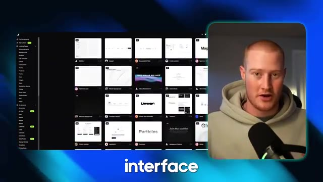
*⏱️ 00:00:32 — Capture d'écran de la plateforme 21st.dev montrant un répertoire de composants UI sous forme de galerie avec le présentateur à droite.*

---

### ⏱️ `[00:00:37 - 00:00:56]` | Segment #03

**🔊 Audio (Transcription Intégrale Mot pour Mot en Français) :**
> Très bien, cela étant dit, je veux foncer et vous montrer ça en vrai. Les gars, c'est tout simplement la chose la plus dingue que j'aie vue en ce qui concerne des plateformes comme Bolt.new, Lovable, toutes ces plateformes pour créer avec l'IA. J'ai trouvé ce truc qui va complètement changer la façon dont vous créez vos applications et donne à l'interface utilisateur un air spectaculaire. C'est fou.

**👁️ Analyse Visuelle d'Écran (gemini-3.5-flash-lite) :**
**Interface & Outils** : Navigateur web affichant une application web hébergée sur Lovable (lovable.app) et webcam du présentateur.

**Contenu textuel & Code** : Page de garde d'une application web avec le titre 'AI for Non-Techies', un effet lumineux central bleu et une barre de navigation flottante comportant plusieurs icônes.

**Action / Démonstration** : Présentation visuelle et démonstration en direct de l'interface utilisateur générée par l'IA sur la plateforme Lovable.

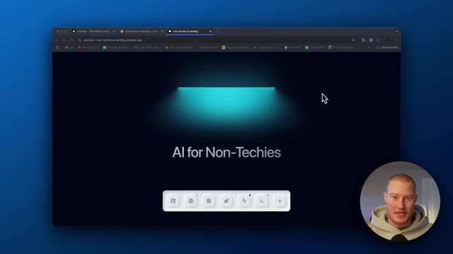
*⏱️ 00:00:42 — Capture d'écran montrant le navigateur web avec un aperçu de l'application 'AI for Non-Techies' hébergée sur Lovable, avec le présentateur incrusté en bas à droite.*

---

### ⏱️ `[00:00:56 - 00:01:29]` | Segment #04

**🔊 Audio (Transcription Intégrale Mot pour Mot en Français) :**
> Donc tout d'abord, je veux vous montrer ceci que j'ai construit très rapidement, je veux juste vous montrer les composants d'interface utilisateur. Regardez comme c'est beau et incroyable, regardez ça ici. Ces petits, ce petit dock de ces choses que vous pouvez voir ici pour la liste d'attente. Le bouton de la liste d'attente a un joli petit effet de lueur. Les tarifs, ça a l'air incroyable. Regardez cette animation ici les gars. Ça a l'air génial. Je vais vous montrer exactement comment faire cela dans cette vidéo. J'ai donc trouvé ce répertoire appelé 21st.dev et ce qu'est ce répertoire, c'est toute une bibliothèque de composants d'interface utilisateur.

**👁️ Analyse Visuelle d'Écran (gemini-3.5-flash-lite) :**
**Interface & Outils** : Navigateur web affichant des applications web et une bibliothèque de composants (21st.dev).

**Contenu textuel & Code** : Composants d'interface utilisateur (dock, boutons, cartes de tarification) et bibliothèque de composants UI.

**Action / Démonstration** : Présentation des composants UI d'une page web créée rapidement et navigation dans la bibliothèque de composants 21st.dev.

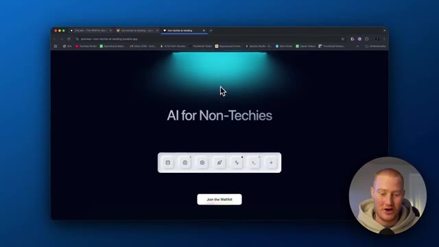
*⏱️ 00:01:04 — Page d'accueil du site web 'AI for Non-Techies' avec un dock d'icônes interactives au centre et un bouton d'inscription à la liste d'attente.*

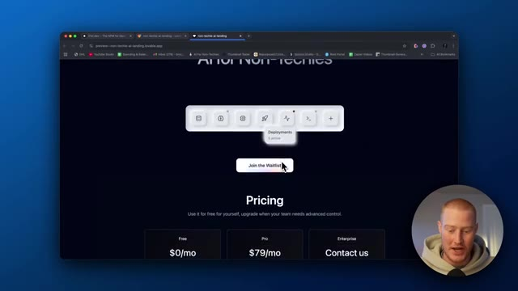
*⏱️ 00:01:12 — Défilement vers le bas de la page web montrant la section des tarifs (Pricing) avec les offres Free ($0/mo), Pro ($79/mo) et Enterprise.*

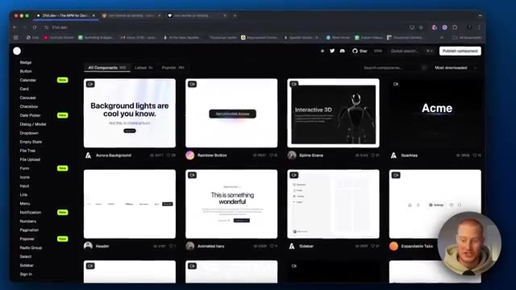
*⏱️ 00:01:21 — Navigation sur le site 21st.dev affichant une bibliothèque de composants d'interface utilisateur (UI components) sous forme de grille.*

---

### ⏱️ `[00:01:29 - 00:01:48]` | Segment #05

**🔊 Audio (Transcription Intégrale Mot pour Mot en Français) :**
> Donc les composants d'interface utilisateur. Un composant, c'est comme chacun de ces éléments. Donc comme le texte, à quoi ça ressemble, cette animation, ça c'est un composant UI, ça c'est un composant UI, tous ces éléments. Donc vous pouvez faire défiler ici et voir n'importe quel composant UI qui vous plaît et l'ajouter simplement à votre application. Et je vais vous montrer exactement comment faire cela.

**👁️ Analyse Visuelle d'Écran (gemini-3.5-flash-lite) :**
**Interface & Outils** : Navigateur web affichant la plateforme de composants UI 21st.dev et une application web en prévisualisation.

**Contenu textuel & Code** : Galerie de composants d'interface utilisateur (backgrounds, boutons, headers, sections de tarification).

**Action / Démonstration** : Navigation et défilement à travers la bibliothèque de composants UI pour expliquer les éléments d'interface.

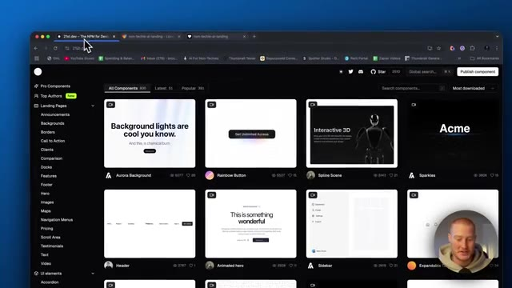
*⏱️ 00:01:39 — Catalogue en ligne de composants d'interface utilisateur sur le site 21st.dev montrant diverses cartes de design.*

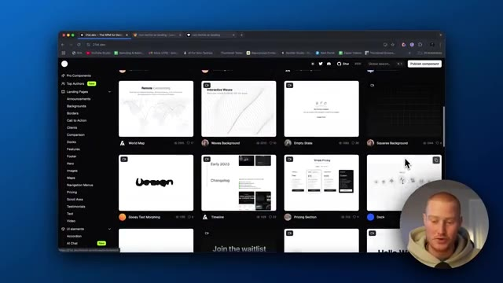
*⏱️ 00:01:44 — Défilement dans le catalogue de composants de 21st.dev affichant de nouvelles cartes de composants UI.*

---

### ⏱️ `[00:01:49 - 00:02:23]` | Segment #06

**🔊 Audio (Transcription Intégrale Mot pour Mot en Français) :**
> Donc par exemple, vous pouvez voir juste ici, les lampes juste ici, construisez des lampes de la bonne manière. ceci, je l'ai copié dans mon application et maintenant ça ressemble à ça avec cette animation vraiment stylée que vous pouvez facilement ajouter à votre plateforme. Donc tout ce que vous avez à faire c'est de venir ici, de cliquer sur ceci, et c'est fou. Donc vous obtenez le code afin de juste copier et coller ceci dans votre application, mais il y a cette fonctionnalité à l'intérieur qui l'optimise pour lovable, pour bolt.new, pour Vercel, v0, toutes ces différentes plateformes. Donc vous pouvez voir que j'ai ceci juste ici prêt à l'emploi. Copier le prompt

**👁️ Analyse Visuelle d'Écran (gemini-3.5-flash-lite) :**
**Interface & Outils** : Navigateur web affichant une plateforme de composants UI (Aceternity UI) avec panneau de code et options de copie de prompt.

**Contenu textuel & Code** : Code source React/TypeScript pour un composant d'animation de lampe ("Build lamps the right way"), options de prompt pour Lovable, v0.dev et Bolt.new.

**Action / Démonstration** : Le présentateur montre comment copier un composant d'UI animé pour l'intégrer facilement dans une application web à l'aide d'outils no-code ou d'IA.

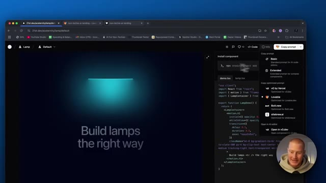
*⏱️ 00:02:06 — Interface de la bibliothèque de composants montrant le code source d'un effet lumineux avec un menu déroulant "Copy prompt" ouvert sur le côté.*

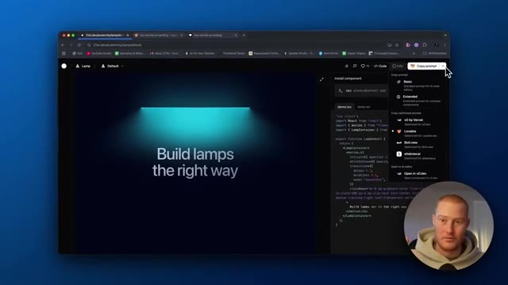
*⏱️ 00:02:14 — Vue similaire de l'interface de code et de composants avec le curseur de la souris interagissant sur le bouton d'exportation de prompt.*

---

### ⏱️ `[00:02:23 - 00:03:01]` | Segment #07

**🔊 Audio (Transcription Intégrale Mot pour Mot en Français) :**
> pour Lovable. Et voilà. Ça a copié ce prompt. Ce que je vais faire, c'est que je vais aller sur Lovable maintenant. Et tout ce que je vais faire, c'est que je vais coller ceci et il va maintenant créer ce composant d'interface utilisateur et simplement le prendre et le mettre dans mon application exactement tel quel. Et nous pourrions évidemment le personnaliser. Donc tout d'abord, disons que c'était une application vide pour moi. Donc je vais copier ce prompt. Alors allons-y. Vous pouvez voir, j'ai maintenant cet ensemble de composants d'interface utilisateur. Nous pourrions venir ici et prévisualiser cette application. Regardez juste à quel point c'est bien. Et tout ce que j'ai fait, c'est simplement copier et coller ce code à l'intérieur de 21st.dev. Et nous pourrions revenir et nous pourrions trouver tout ce que nous voulons. Donc

**👁️ Analyse Visuelle d'Écran (gemini-3.5-flash-lite) :**
**Interface & Outils** : Navigateur web affichant la plateforme de développement d'applications Lovable (lovable.dev).

**Contenu textuel & Code** : Interface utilisateur de Lovable, grille de projets, champ de saisie de prompt et barre latérale de l'éditeur.

**Action / Démonstration** : Navigation sur la plateforme Lovable et préparation de la saisie d'un prompt pour générer ou modifier une application.

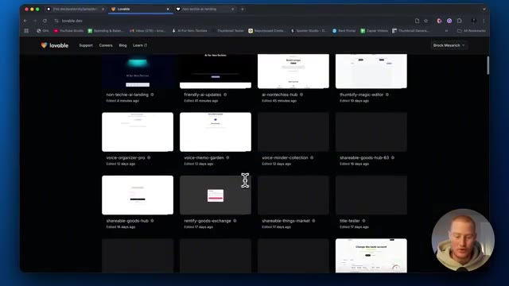
*⏱️ 00:02:32 — Capture d'écran montrant le tableau de bord principal de Lovable avec une grille de projets récents.*

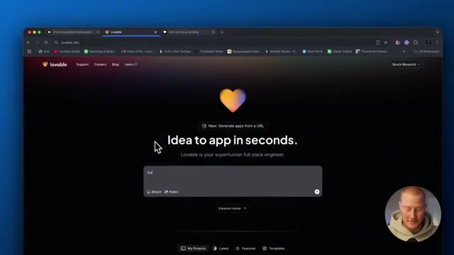
*⏱️ 00:02:42 — Interface de la page d'accueil de Lovable affichant la barre de saisie de prompt "Idea to app in seconds".*

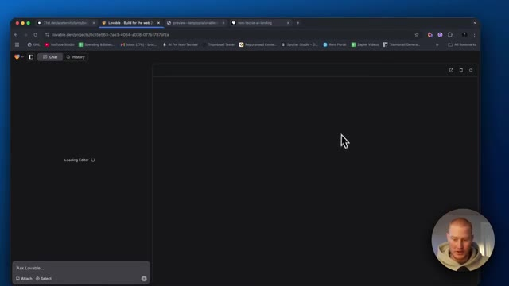
*⏱️ 00:02:51 — Interface de l'éditeur Lovable en cours de chargement ("Loading Editor") avec une zone de chat à gauche.*

---

### ⏱️ `[00:03:01 - 00:03:37]` | Segment #08

**🔊 Audio (Transcription Intégrale Mot pour Mot en Français) :**
> par exemple, si nous aimons ce bouton ici, comme vous l'avez vu dans le premier que j'ai construit, vous savez, j'ai copié ce bouton et l'ai essentiellement collé ici ainsi que ceci. Regardez ce petit dock ici qui ressemble presque à un clavier d'ordinateur. C'est tellement incroyable. Genre, ça a l'air juste, je ne sais pas comment l'expliquer, ça fait juste du bien à mes TOCs, genre ça a l'air si propre et je viens de trouver ça sur 21st.dev donc vous pouvez venir et trouver n'importe quoi, laissez-moi jouer avec encore d'autres choses pour que vous puissiez voir que nous pouvons ajouter ces témoignages animés, nous pouvons venir sur ce côté gauche et vous pouvez voir toutes ces différentes choses, donc pour les pages de destination, vous pouvez voir des éléments d'interface utilisateur comme par exemple

**👁️ Analyse Visuelle d'Écran (gemini-3.5-flash-lite) :**
**Interface & Outils** : Navigateur web affichant une application web en cours de développement et la plateforme de composants 21st.dev.

**Contenu textuel & Code** : Composants d'interface utilisateur, dock interactif, boutons, typographie et grille de composants web.

**Action / Démonstration** : Navigation et démonstration d'un composant de dock interactif copié sur une page web.

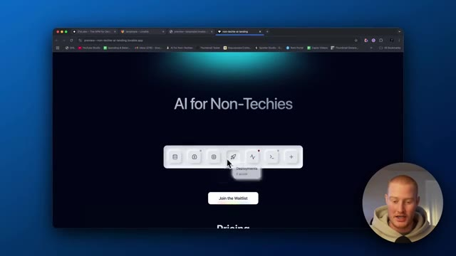
*⏱️ 00:03:10 — Aperçu d'une page web affichant un dock de navigation interactif de style clavier sous le titre "AI for Non-Techies".*

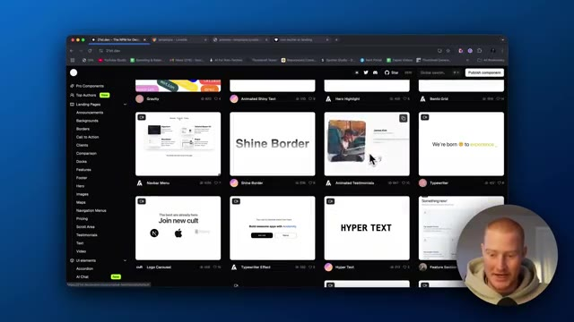
*⏱️ 00:03:28 — Interface du site 21st.dev présentant une galerie de composants d'interface utilisateur (UI) avec des aperçus en grille.*

---

### ⏱️ `[00:03:37 - 00:04:10]` | Segment #09

**🔊 Audio (Transcription Intégrale Mot pour Mot en Français) :**
> nous pourrions arriver à genre avatar et voyons à quoi ressemble avatar pour une raison quelconque ceux-ci ne veulent pas se charger donc la seule chose qui se charge c'est quand je suis sur la page d'accueil mais laissez-moi juste continuer à faire défiler et trouver certaines de ces choses que nous aimons réellement et nous pourrions l'ajouter facilement à notre application d'accord donc si nous avons une sorte d'application de voix IA nous pourrions alors utiliser ce composant d'interface utilisateur qui a l'air super propre tout ce que nous avons à faire c'est de venir ici ce qui testons d'abord test test test genre ça a l'air super propre c'est génial donc tout ce que nous avons à faire c'est de venir ici choisir l'application pour laquelle nous essayons d'optimiser ceci nous allons utiliser Lovable parce que c'est mon sans code préféré

**👁️ Analyse Visuelle d'Écran (gemini-3.5-flash-lite) :**
**Interface & Outils** : Navigateur web affichant la plateforme de composants 21st.dev.

**Contenu textuel & Code** : Composants d'interface utilisateur (UI), code source React/TSX, et commandes d'installation npm (`npx shadcn@latest add`).

**Action / Démonstration** : Navigation et exploration de différents composants UI interactifs sur la plateforme de développement 21st.dev.

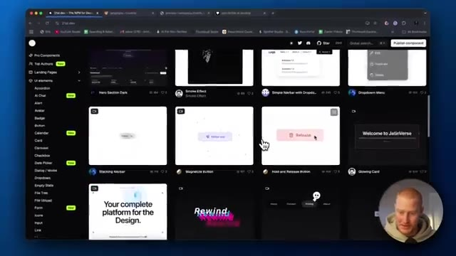
*⏱️ 00:03:45 — Image montrant l'interface du site web 21st.dev avec une grille de composants UI (boutons, cartes) et la webcam du présentateur en bas à droite.*

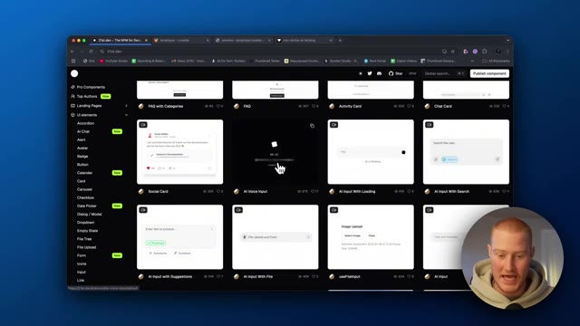
*⏱️ 00:03:53 — Image montrant une autre section de la grille de composants sur 21st.dev, notamment des composants liés à l'IA (Social Card, AI Voice Input, AI Input with Loading).*

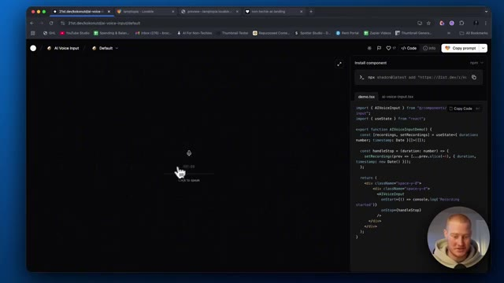
*⏱️ 00:04:01 — Image montrant la vue détaillée d'un composant sélectionné (AI Voice Input) avec le code source affiché dans un panneau à droite (React/TypeScript).*

---

### ⏱️ `[00:04:10 - 00:04:44]` | Segment #10

**🔊 Audio (Transcription Intégrale Mot pour Mot en Français) :**
> plateforme de codage IA, copiez ceci, puis ce que je vais faire, c'est que je vais dire : implémente ce composant d'interface utilisateur blow the lamp, puis colle-le. Et voilà, il est en train de coller ceci et de le copier dans notre application. Donnons-lui une petite seconde et jetons-y un œil. Boum. C'est parti. Test, test, test. Comment ça va ? Ça a l'air super, mais changeons ceci. Change ça en mode sombre. Je vais faire une capture d'écran ici et ensuite lui faire savoir de quoi nous parlons parce que je veux que ce soit exactement comme ça. Je trouve que ça a vraiment un super look. OK, voilà. C'est maintenant en mode sombre. Ça a l'air génial. Jusqu'à présent, c'est une interface utilisateur magnifique pour notre application, sans utiliser le moindre code.

**👁️ Analyse Visuelle d'Écran (gemini-3.5-flash-lite) :**
**Interface & Outils** : Lovable (plateforme de développement web IA) et un navigateur web affichant 21st.dev.

**Contenu textuel & Code** : Code source React/TypeScript, instructions d'installation npm, et prévisualisation d'un composant d'interface utilisateur d'entrée vocale (AI Voice Input).

**Action / Démonstration** : Copie et intégration d'un composant UI externe dans l'application via Lovable.

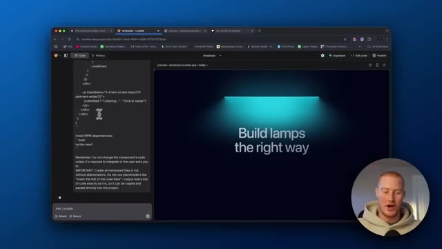
*⏱️ 00:04:18 — L'interface de Lovable affichant le panneau de code à gauche et un aperçu de l'application montrant l'en-tête de la lampe avec le texte 'Build lamps the right way'.*

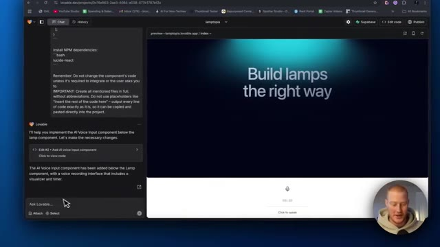
*⏱️ 00:04:27 — L'application mise à jour affichant à la fois le composant lampe et le composant d'entrée vocale IA nouvellement intégré en bas.*

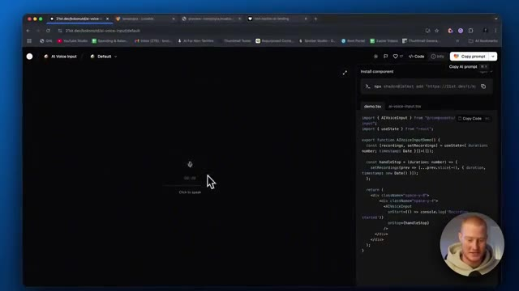
*⏱️ 00:04:35 — Un navigateur affichant le site 21st.dev avec l'aperçu du composant d'interface utilisateur d'entrée vocale et son code source TypeScript.*

---

### ⏱️ `[00:04:44 - 00:05:04]` | Segment #11

**🔊 Audio (Transcription Intégrale Mot pour Mot en Français) :**
> Donc j'aime bien cette fonctionnalité d'animation de défilement ici. Alors ajoutons ça encore une fois. Copiez le prompt pour Lovable. Il est déjà optimisé pour Lovable et il aura maintenant une sorte d'effet de défilement comme celui-ci ajouté à notre application. Les gars, ça me souffle vraiment l'esprit. Je sais que j'exagère peut-être un peu la chose dans cette vidéo, mais c'est vraiment tellement cool pour moi.

**👁️ Analyse Visuelle d'Écran (gemini-3.5-flash-lite) :**
**Interface & Outils** : Navigateur web avec interface de développement de composants UI et éditeur de code.

**Contenu textuel & Code** : Code source React/TypeScript pour les animations de défilement et instructions d'installation du composant.

**Action / Démonstration** : Démonstration et copie d'un prompt optimisé pour intégrer une animation de défilement dans Lovable.

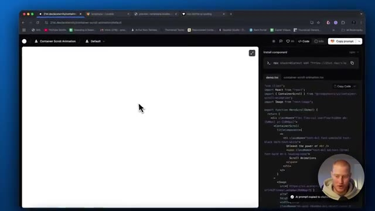
*⏱️ 00:04:49 — Interface web montrant la prévisualisation d'un composant de défilement avec du code source à droite et une webcam du présentateur.*

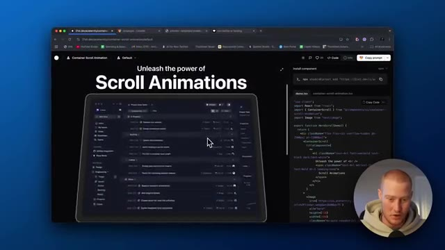
*⏱️ 00:04:54 — Affichage de l'animation de défilement avec le texte 'Unleash the power of Scroll Animations' et un visuel interactif.*

---

### ⏱️ `[00:05:04 - 00:05:27]` | Segment #12

**🔊 Audio (Transcription Intégrale Mot pour Mot en Français) :**
> En utilisant Lovable, en utilisant Bolt, c'est super de construire des applications sympas et de créer des produits SaaS. Mais la plupart du temps, l'interface utilisateur n'est tout simplement pas très belle. Et la raison à cela, c'est que nous ne savons pas vraiment comment construire nous-mêmes ces composants d'interface utilisateur à moins de savoir coder. Le fait maintenant que nous ayons un répertoire comme celui-ci sur 21st.dev et que nous puissions copier et coller n'importe lequel d'entre eux dans nos applications, cela change la donne.

**👁️ Analyse Visuelle d'Écran (gemini-3.5-flash-lite) :**
**Interface & Outils** : Lovable, navigateur web, interface de développement web, 21st.dev.

**Contenu textuel & Code** : Code source React, composants d'animation d'interface utilisateur (UI/UX), fenêtres de prévisualisation web.

**Action / Démonstration** : Démonstration de la création d'interfaces et de composants visuels pour applications web.

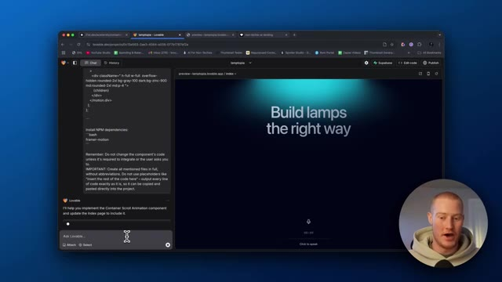
*⏱️ 00:05:10 — Interface Lovable affichant l'éditeur de code à gauche et un aperçu d'application SaaS à droite, avec la webcam du présentateur en bas à droite.*

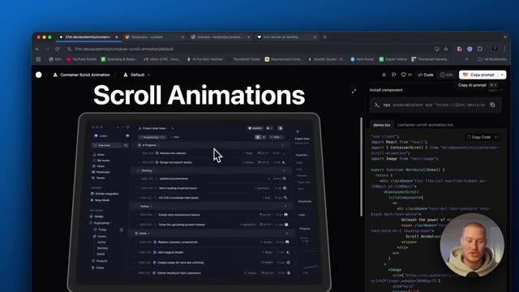
*⏱️ 00:05:21 — Navigateur montrant une bibliothèque de composants UI (21st.dev) avec du code React et un aperçu d'animation de défilement, et la webcam du présentateur en incrustation.*

---

### ⏱️ `[00:05:27 - 00:06:03]` | Segment #13

**🔊 Audio (Transcription Intégrale Mot pour Mot en Français) :**
> Nous pouvons maintenant créer des applications superbes visuellement. Fini les polices d'écriture très basiques, les éléments et les arrière-plans rudimentaires dans nos applications. Nous avons une application vraiment très cool. Donc je vais arrêter de insister là-dessus parce que c'est probablement agaçant à ce stade, mais ça me dépasse complètement. Bon, c'est parti. Alors voici une nouvelle animation de défilement. D'accord, donc si, pour une raison quelconque, nous avions quelque chose sur un iPad, nous pourrions simplement dire, tu sais, ajoute cette image à l'ipad et ensuite cela la mettra en valeur un peu comme, tu sais, ce qu'il y a juste ici. Ajoutons une chose de plus juste pour les besoins de cette vidéo, alors ajoutons maintenant, voyons voir, quelles sont des choses vraiment cool ici. D'accord, donc ce flux de chiffres ici, j'aime bien ça, donc si nous avons un genre de, attends

**👁️ Analyse Visuelle d'Écran (gemini-3.5-flash-lite) :**
**Interface & Outils** : Navigateur web affichant Lovable et 21st.dev avec une vue incrustée (picture-in-picture) du présentateur Brock Mesarich.

**Contenu textuel & Code** : Code source React/JSX, dépendances NPM, composants d'interface utilisateur et aperçus de design web modernes.

**Action / Démonstration** : Présentation de la création d'applications visuellement sophistiquées et exploration de composants graphiques UI pour le développement web.

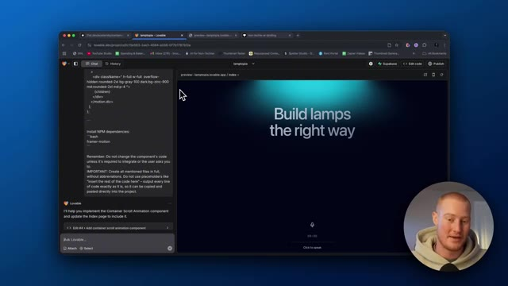
*⏱️ 00:05:36 — Interface de l'application Lovable affichant un panneau de chat avec du code à gauche et un aperçu visuel élégant d'une landing page à droite avec un fond sombre et le texte 'Build lamps the right way'.*

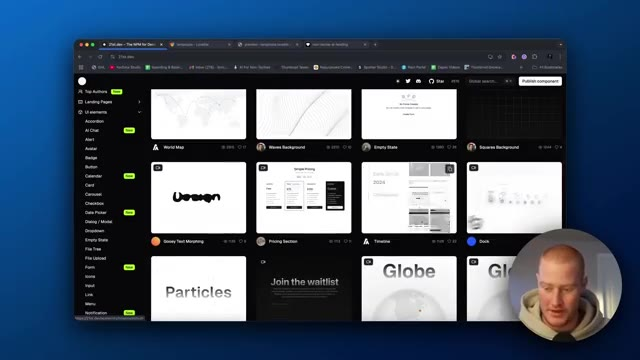
*⏱️ 00:05:54 — Navigation sur le site 21st.dev montrant une bibliothèque de composants d'interface utilisateur (UI) avec différentes cartes de prévisualisation comme World Map, Waves Background, Pricing Section et Globe.*

---

### ⏱️ `[00:06:03 - 00:06:24]` | Segment #14

**🔊 Audio (Transcription Intégrale Mot pour Mot en Français) :**
> liste pour notre liste de diffusion, ce qui fait qu'assurez-vous de vous inscrire à ma à ma liste de diffusion ci-dessous ia pour les non-techniciens Mais si nous avions une liste de diffusion ou quelque chose comme ça, nous pourrions montrer, d'accord, voici combien d'utilisateurs je me suis déjà inscrit. Copions donc cela. Ajoutons maintenant ceci pour montrer combien d'utilisateurs nous avons inscrits à notre liste de diffusion.

**👁️ Analyse Visuelle d'Écran (gemini-3.5-flash-lite) :**
**Interface & Outils** : Navigateur web (Google Chrome), interface de composant web, code source React.

**Contenu textuel & Code** : Code source visible (imports React, composant NumberFlow, instructions d'installation npx shadcn@latest), message de chargement de la prévisualisation.
[DESC_IMAGE_1] Navigation sur un site de composants web et présentation du code source d'un composant interactif.

**Action / Démonstration** : Explications face caméra et analyse conceptuelle des marchés.

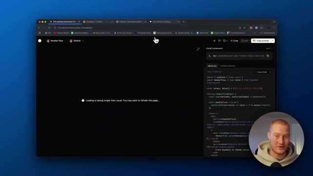
*⏱️ 00:06:09 — Capture d'écran montrant un navigateur web affichant une interface de développement avec du code React et un panneau de prévisualisation en cours de chargement, accompagné de la vidéo incrustée du présentateur en bas à droite.*

---

### ⏱️ `[00:06:24 - 00:07:01]` | Segment #15

**🔊 Audio (Transcription Intégrale Mot pour Mot en Français) :**
> Bon, une dernière chose. J'essaie d'ajouter ce composant d'interface utilisateur numérique ici. Mais une autre chose que je veux mentionner, c'est que lorsque vous construisez votre application et que, disons, vous ajoutez ces différents composants d'interface utilisateur, vous devez juste en quelque sorte les identifier lorsque vous parlez dans le prompt. Donc par exemple, vous devez déterminer ce qu'est ce composant d'interface utilisateur de lampe, quel est son nom, et ensuite vous pouvez l'adresser et dire, ok, en dessous de ce composant de lampe, ajoutez ce composant. Et cela rend tellement plus facile de construire réellement votre application d'une manière intuitive. C'est donc un petit conseil pour vous les gars, mais voyons comment nous pourrions réellement ajouter ce dernier composant d'interface utilisateur ici. Bon, alors pour une raison quelconque, j'ai des problèmes à implémenter réellement cette petite, euh, fonctionnalité ici.

**👁️ Analyse Visuelle d'Écran (gemini-3.5-flash-lite) :**
**Interface & Outils** : Navigateur web affichant l'interface de développement Lovable et la plateforme 21st.dev.

**Contenu textuel & Code** : Code source, messages d'erreur de l'assistant IA, et liste de composants UI (Landing Pages, Pro Components).

**Action / Démonstration** : Navigation et démonstration de l'intégration de composants d'interface utilisateur dans une application générée par IA.

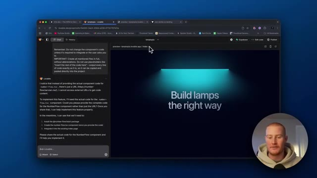
*⏱️ 00:06:33 — Aperçu d'une application web en cours de développement avec un assistant conversationnel à gauche et le rendu visuel à droite.*

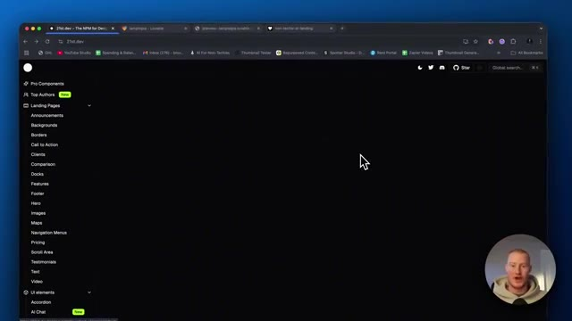
*⏱️ 00:06:42 — Navigation sur le site 21st.dev montrant un catalogue de composants d'interface utilisateur pour le développement web.*

---

### ⏱️ `[00:07:01 - 00:07:18]` | Segment #16

**🔊 Audio (Transcription Intégrale Mot pour Mot en Français) :**
> Donc ne tenez pas compte de ça mais les gars, j'espère que vous avez tiré de la valeur de cette vidéo. C'est une façon vraiment cool. Je l'ai dit 10 fois. Je n'ai pas besoin de le répéter. Mais j'espère que vous avez tiré de la valeur. J'espère que cela change un peu la façon dont vous construisez vos applications avec Lovable. C'génial. Dites-moi si vous avez tiré de la valeur de ceci, abonnez-vous à la chaîne pour plus de hacks comme celui-ci et je vous vois dans la prochaine vidéo.

**👁️ Analyse Visuelle d'Écran (gemini-3.5-flash-lite) :**
**Interface & Outils** : Navigateur web (Google Chrome), site 21st.dev, éditeur de code/panneau de prévisualisation.

**Contenu textuel & Code** : Code source React avec des instructions d'installation (`npx shadcn@latest add...`), des imports de composants et des fonctions de gestion d'état (`useState`, `NumberFlow`), ainsi qu'un aperçu interactif affichant la valeur "-3,243.5".

**Action / Démonstration** : Présentation de l'interface et du code d'un composant de flux de nombres pour une application web.

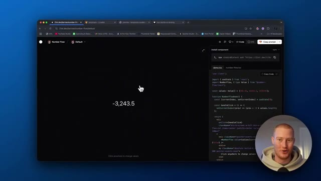
*⏱️ 00:07:05 — Capture d'écran montrant un navigateur web avec le site 21st.dev affichant un composant de flux de nombres (Number Flow), avec du code React visible sur le côté droit et la webcam du présentateur en bas à droite.*

---

