# 🎬 How to Make a Website with AI in 30 Seconds (I'll Show You)

> **Chaîne** : [Brock Mesarich | AI for Non Techies](https://www.youtube.com/@BrockMesarich)  
> **Lien YouTube** : [https://www.youtube.com/watch?v=t9aBhd4PNUE](https://www.youtube.com/watch?v=t9aBhd4PNUE)  
> **Date de publication** : 20250121  
> **Durée** : 00:09:35  
> **Identifiant vidéo** : `t9aBhd4PNUE`  
> **Transcription & Analyse** : `whisper-v3-large-turbo+gemini-3.5-flash-lite`  

---

## 📌 Synthèse Exécutive & Outils

### 💡 Résumé
La vidéo de la chaîne *Brock Mesarich | AI for Non Techies* met en lumière une problématique récurrente pour les entrepreneurs : la perte de temps excessive consacrée à la création d'un site web avant même de valider une offre ou d'acquérir un premier client. À travers la plateforme d'intelligence artificielle **Durable**, l'intervenant démontre qu'il est possible de générer un site internet professionnel, fonctionnel et esthétique en moins de 30 secondes, simplement en renseignant quelques informations textuelles de base (nom, description, localisation et secteur d'activité). 

Au-delà de la simple génération de pages web, la démonstration expose une suite d'outils complète intégrée à la plateforme, comprenant un CRM personnalisé, des fonctionnalités de facturation, des agents spécialisés en SEO et en contenu, ainsi qu'un module de marketing automatisé pour les réseaux sociaux. L'objectif stratégique est d'éliminer les barrières techniques et temporelles à l'entrée, permettant aux créateurs d'entreprise de se concentrer immédiatement sur l'essentiel : l'acquisition clients et la validation du marché, tout en bénéficiant d'un design responsive optimisé pour le mobile et le référencement naturel.

### 🛠️ Outils, Modèles & Logiciels Présentés
* **Durable** : Plateforme de création de sites web propulsée par l'intelligence artificielle capable de générer un site complet, un CRM, des outils marketing et une facturation en moins de 30 secondes.
* **ChatGPT** : Modèle de langage étendu mentionné pour son rôle futur dans le référencement (SEO) et la découvrabilité des sites web par les utilisateurs.
* **n8n** : Outil d'automatisation de flux de travail (workflow automation) évoqué dans l'écosystème technologique global de la chaîne.
* **Make** : Plateforme d'intégration et d'automatisation no-code permettant de connecter différentes applications entre elles.
* **Zapier** : Solution cloud d'automatisation connectant des applications pour exécuter des tâches répétitives sans code.
* **Claude** : Assistant conversationnel avancé basé sur l'IA, utilisé pour le traitement de données et la génération de contenu textuel.
* **Grok** : Modèle d'intelligence artificielle conversationnelle développé pour l'écosystème de données en temps réel.

### 🔑 Points Clés & Enseignements Stratégiques
* **Éviter le piège de la procrastination technique** : Ne jamais consacrer des semaines ou des mois à la conception d'un site web avant d'avoir validé son offre de services ou de produits auprès de clients réels.
* **Rapidité d'exécution radicale** : Utiliser des générateurs basés sur l'IA pour réduire le temps de mise en ligne d'un site web de plusieurs semaines à moins de 30 secondes.
* **Structuration par le prompt contextuel** : Fournir une description précise de l'activité (ex: agence immobilière haut de gamme en Arizona, ciblant les acheteurs de résidences de vacances ou de locations de courte durée) pour obtenir un modèle de site immédiatement pertinent.
* **Réplication et scalabilité pour agences** : Possibilité d'utiliser des modèles pré-configurés pour dupliquer rapidement des structures de sites web pour différents clients, maximisant ainsi l'efficacité opérationnelle.
* **Génération multimédia contextuelle** : L'IA intègre automatiquement des images de stock cohérentes avec la zone géographique et la thématique du site (ex: paysages de l'Arizona), avec la possibilité d'importer de véritables visuels par la suite.
* **Optimisation automatique du copywriting** : Utilisation des fonctions d'IA intégrées pour simplifier, affiner et rendre les textes plus percutants en un seul clic afin d'augmenter les taux de conversion.
* **Personnalisation visuelle dynamique** : Ajustement instantané des palettes de couleurs pour coller à l'identité visuelle du secteur (ex: teintes de pierre et de roche pour l'immobilier en Arizona) et modification de la géométrie des éléments (coins arrondis).
* **Adaptabilité multi-support native** : Vérification immédiate du rendu responsive sur ordinateur, tablette (iPad) et mobile (iPhone) pour garantir une expérience utilisateur irréprochable sur tous les terminaux.
* **Intégration d'éléments de réputation et de conversion** : Présentation automatique d'avis clients ("heureux invités") et de formulaires de capture de prospects (leads) stratégiquement positionnés pour stimuler l'engagement.
* **Écosystème multifonctionnel global** : Regroupement sur une seule et même interface d'un constructeur de site, d'un CRM client, de modules de facturation et d'une suite marketing pour gérer l'activité post-lancement.
* **Référencement naturel (SEO) automatisé** : Intégration de mots-clés pertinents dès l'abonnement de base (à partir de 12 dollars par mois) pour positionner le site favorablement sur les moteurs de recherche traditionnels et les futurs moteurs conversationnels.
* **Focus prioritaire sur l'acquisition** : Libérer un maximum de temps et d'énergie mentale au démarrage d'une entreprise pour le rediriger exclusivement vers la recherche et la conversion de clients payants.

---

## ⏱️ Chronologie & Transcription Complète Audio & Visuelle (Mot pour Mot)

### ⏱️ `[00:00:00 - 00:00:34]` | Segment #01

**🔊 Audio (Transcription Intégrale Mot pour Mot en Français) :**
> D'accord, alors créer un site web en 2025, c'est tout simplement une galère. Je connais tellement de gens dans ma vie personnelle qui veulent lancer une entreprise et qui consacrent tellement de temps à créer un site web avant même d'avoir un service ou un produit à proposer. Vous ne voulez pas être cette personne. Donc si vous voulez lancer une entreprise ou si vous avez une entreprise existante et que vous avez besoin d'un site web, cette plateforme vous permet de le faire extrêmement facilement en le créant avec l'IA. En utilisant Durable, vous pouvez réellement créer un site web en 30 secondes grâce à l'IA et dans cette vidéo, je vais vous montrer comment vous pouvez le faire et le personnaliser extrêmement rapidement pour pouvoir lancer votre entreprise en 2025. Ceci étant dit, plongeons directement dans le sujet.

**👁️ Analyse Visuelle d'Écran (gemini-3.5-flash-lite) :**
**Interface & Outils** : Site web de Durable AI (plateforme de création de sites web).

**Contenu textuel & Code** : Page d'accueil de Durable avec sections 'Choose your own adventure', 'Customize to your liking', 'Publish and grow your business' et boutons de démarrage gratuit.

**Action / Démonstration** : Présentation visuelle de la plateforme d'IA pour la création rapide de sites web.

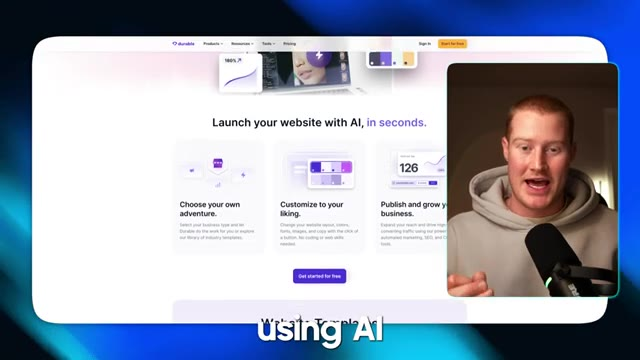
*⏱️ 00:00:25 — Capture d'écran du site web de l'outil de création de sites par IA 'Durable', montrant la page d'accueil avec le texte 'Launch your website with AI, in seconds' et incrustation du présentateur.*

---

### ⏱️ `[00:00:34 - 00:01:07]` | Segment #02

**🔊 Audio (Transcription Intégrale Mot pour Mot en Français) :**
> Très bien. Donc, première chose à faire, à l'intérieur de Durable, je vais venir. Je me connecte à mon compte. Assurez-vous de créer un compte. Et je vais cliquer sur créer une entreprise. Et ce que nous faisons ici, c'est que nous avons simplement besoin de saisir ces informations dans ce formulaire et cela va nous aider à créer un modèle afin de structurer notre site web. Donc, nom de l'entreprise, pensons à un cas d'usage et à un type spécifique de site web que je veux générer. Disons que nous voulons générer quelque chose pour une entreprise immobilière. Alors, appelons simplement ceci Arizona Real Estate Group. Décrivez l'entreprise.

**👁️ Analyse Visuelle d'Écran (gemini-3.5-flash-lite) :**
**Interface & Outils** : Application Web Durable (app.durable.co) affichée dans un navigateur web.

**Contenu textuel & Code** : Formulaire de création d'entreprise comprenant les champs : nom de l'entreprise, description, localisation, langue du site web et option de réplication de design.

**Action / Démonstration** : Saisie des informations de l'entreprise dans le formulaire de l'application Durable.

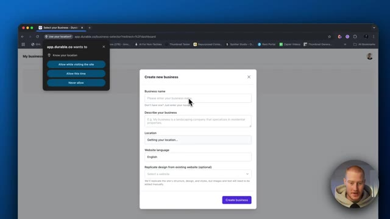
*⏱️ 00:00:42 — Vue de l'interface de l'application Durable affichant une modale 'Create new business' avec une pop-up de géolocalisation.*

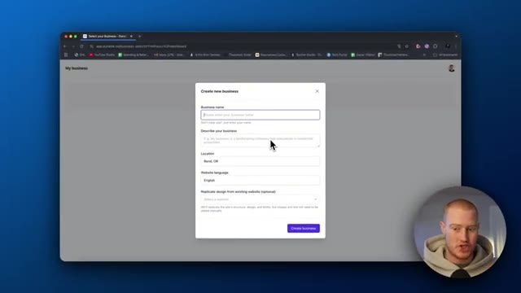
*⏱️ 00:00:50 — Vue de l'interface Durable montrant le formulaire de création d'entreprise rempli avec la localisation (Bend, OR).*

---

### ⏱️ `[00:01:07 - 00:01:37]` | Segment #03

**🔊 Audio (Transcription Intégrale Mot pour Mot en Français) :**
> Donc évidemment, je vais juste écrire ça ici. D'accord. Donc agence immobilière en Arizona, nous sommes spécialisés dans les propriétés haut de gamme que nous avons listées à l'achat ou à la location. D'accord. J'ai donc aussi ajouté, nous nous concentrons sur les acheteurs qui veulent acheter une maison de vacances pour eux-mêmes ou pour la louer pour des séjours de courte durée. J'ai donc ajouté un peu de complexité ici pour voir un peu si elle est capable de structurer cela et de l'ajouter au site web en conséquence. Donc l'emplacement, je vais dire Scottsdale, en Arizona, la langue du site web, l'anglais, conception reproduite de n'importe quel site web existant.

**👁️ Analyse Visuelle d'Écran (gemini-3.5-flash-lite) :**
**Interface & Outils** : Navigateur web affichant l'application de création de site web / entreprise (Durable).

**Contenu textuel & Code** : Formulaire avec les champs 'Business name' (Arizona Real Estate Group), 'Describe your business', 'Location', 'Website language'.

**Action / Démonstration** : Saisie de texte dans le champ de description de l'entreprise pour définir l'activité immobilière haut de gamme.

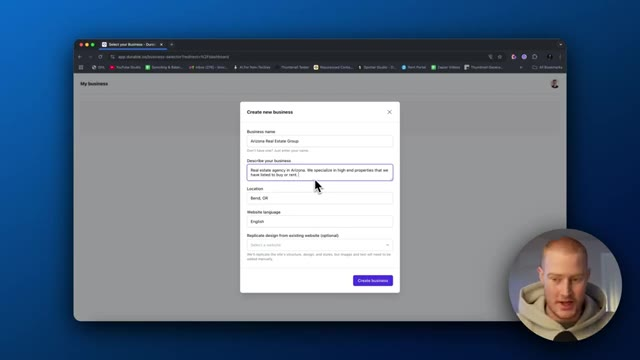
*⏱️ 00:01:14 — Interface de création d'entreprise montrant le formulaire avec le nom et la description d'une agence immobilière en Arizona.*

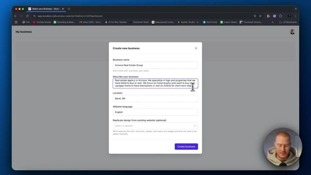
*⏱️ 00:01:22 — Poursuite de la saisie de la description dans le formulaire de création d'entreprise, détaillant le public cible et les services.*

---

### ⏱️ `[00:01:37 - 00:02:09]` | Segment #04

**🔊 Audio (Transcription Intégrale Mot pour Mot en Français) :**
> C'est plutôt cool. Donc si j'avais déjà un site web créé, je pourrais juste genre le répliquer. Donc si vous construisez des sites web en tant d'agence ou quelque chose, ce qui est une super opportunité de le faire, vous pourriez juste genre avoir un modèle pour une entreprise et puis littéralement ça va juste créer ce modèle et puis juste changer ces informations ici spécifiques à chaque entreprise différente. Donc c'est cool. Créons l'entreprise. Et maintenant, ça devrait en fait aller de l'avant et construire notre site web pour nous. Donc j'ai vraiment vu quelque part que Durable dit qu'il peut construire votre site web en 30 secondes ou en moins de 30 secondes. Donc il a effectivement construit ça en moins de 30 secondes. Laissez-moi vérifier et voir à quoi ça ressemble. Nous allons définitivement devoir y apporter des modifications. Je vais vous montrer comment faire. C'est

**👁️ Analyse Visuelle d'Écran (gemini-3.5-flash-lite) :**
**Interface & Outils** : Navigateur web affichant l'application SaaS Durable.ai.

**Contenu textuel & Code** : Formulaire de création de site incluant le nom de l'entreprise, la description, l'emplacement, la langue et l'option de réplication de design.

**Action / Démonstration** : Configuration d'un nouveau site web d'agence immobilière et lancement de sa création par la plateforme IA.

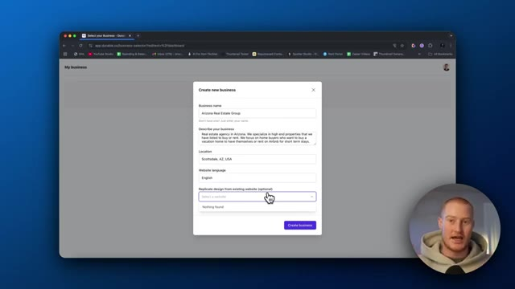
*⏱️ 00:01:45 — Interface de création d'entreprise avec un champ pour répliquer le design d'un site web existant.*

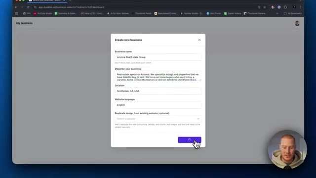
*⏱️ 00:01:53 — Clic sur le bouton de validation pour créer la nouvelle entreprise sur la plateforme.*

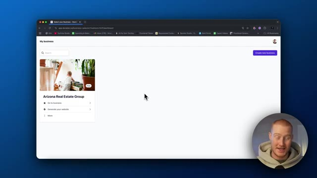
*⏱️ 00:02:01 — Tableau de bord affichant le projet 'Arizona Real Estate Group' nouvellement créé.*

---

### ⏱️ `[00:02:09 - 00:02:44]` | Segment #05

**🔊 Audio (Transcription Intégrale Mot pour Mot en Français) :**
> vraiment facile, mais le fait que cela construise un site web en 30 secondes est génial. Et puis aussi vous pouvez voir que nous avons ce tableau de bord complet ici, ce qui est une autre des choses incroyables de cette plateforme que j'apprécie vraiment, nous avons évidemment le site web, nous avons le marketing donc nous pouvons créer des publications sur les réseaux sociaux sur Facebook, Instagram et X, nous pouvons, vous savez, nous avons un CRM ici qui est personnalisé pour chacun de nos clients, nous avons la facturation, nous avons une sorte de modèle de marque ici et ensuite nous avons aussi des agents, ce qui ressemble à un spécialiste SEO, un spécialiste de contenu, tout ça, donc ce n'est pas seulement un constructeur de sites web, c'est en quelque sorte une suite complète de tous ces différents outils dont vous avez besoin afin de

**👁️ Analyse Visuelle d'Écran (gemini-3.5-flash-lite) :**
**Interface & Outils** : Navigateur web affichant l'interface de la plateforme Durable (app.durable.co).

**Contenu textuel & Code** : Tableaux de bord de gestion, options de création de site web en 30 secondes, gestion de la relation client (CRM), et fonctionnalités d'agents d'IA.

**Action / Démonstration** : Navigation à travers les différents menus et onglets du tableau de bord de la plateforme par le présentateur.

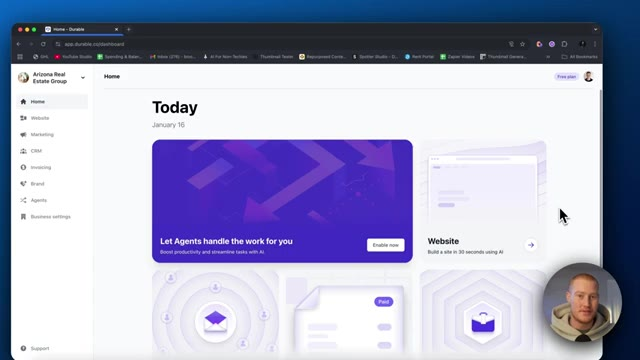
*⏱️ 00:02:18 — Capture d'écran montrant le tableau de bord principal de la plateforme Durable avec l'option de création de site web par IA.*

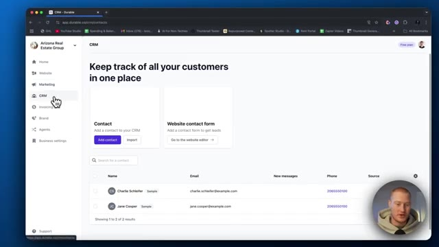
*⏱️ 00:02:27 — Capture d'écran affichant la section CRM de la plateforme avec la liste des contacts et clients.*

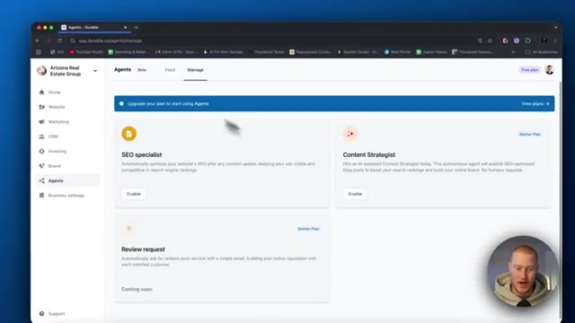
*⏱️ 00:02:35 — Capture d'écran montrant la section des agents IA de la plateforme (SEO specialist, Content Strategist, etc.).*

---

### ⏱️ `[00:02:44 - 00:03:20]` | Segment #06

**🔊 Audio (Transcription Intégrale Mot pour Mot en Français) :**
> gérer un site web pour vous-même ou pour un client. Très bien, donc je clique simplement sur générer le site web et il est actuellement en train de le générer et il a bien dit qu'il le ferait en moins de 30 secondes. Et voilà. C'était à peu près 30 secondes. Vous pouvez voir qu'il a maintenant ce site web qui, honnêtement, a l'air vraiment bien sur la base du premier type de consigne que nous lui avons donné. C'est vraiment bien. Je suis assez impressionné par cela. Si nous remontons tout en haut, vous pouvez voir qu'il a en fait des images en arrière-plan qu'il fait défiler. Ce sont de vraies images de l'intérieur de l'Arizona, ce qui est cool. Découvrez un luxe sans pareil dans les résidences locatives les plus exclusives du comté de Maricopa. Évidemment, ce que nous pourrions

**👁️ Analyse Visuelle d'Écran (gemini-3.5-flash-lite) :**
**Interface & Outils** : Navigateur web affichant le constructeur de site web Durable AI avec panneau de prévisualisation.

**Contenu textuel & Code** : Interface utilisateur de création de site web avec texte d'en-tête, boutons d'appel à l'action et options d'édition.

**Action / Démonstration** : Présentation et navigation à travers les différentes sections du site web généré par l'IA.

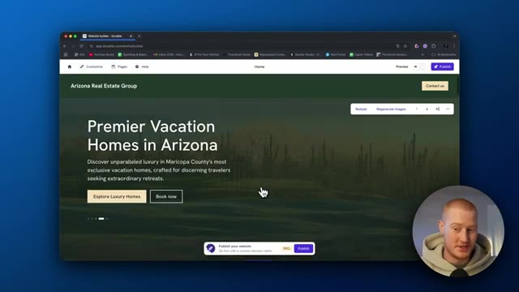
*⏱️ 00:02:53 — Aperçu du site web généré montrant la page d'accueil avec un design moderne et professionnel.*

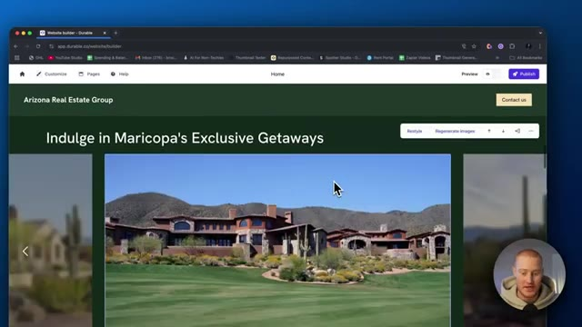
*⏱️ 00:03:02 — Défilement de la page montrant des sections supplémentaires avec des images et du texte générés automatiquement.*

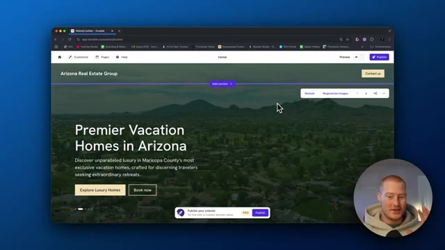
*⏱️ 00:03:11 — Vue globale du constructeur de site web montrant les options de personnalisation et de publication.*

---

### ⏱️ `[00:03:20 - 00:03:53]` | Segment #07

**🔊 Audio (Transcription Intégrale Mot pour Mot en Français) :**
> ce qu'on fait, c'est qu'on peut cliquer sur n'importe lequel de ces éléments ici et modifier cela. Donc, si on ne veut évidemment pas avoir ce texte, peut-être qu'il n'est pas spécifique à notre entreprise, ce n'est pas la bonne information, nous pourrions cliquer sur régénérer. Nous pourrions le simplifier, l'optimiser pour le référencement naturel. C'est plutôt cool. Les fonctionnalités d'IA sur cette plateforme sont honnêtement époustouflantes et plutôt utiles en fait. Alors simplifions simplement ce texte ici et voyons ce qu'il nous donne. Alors voilà. Il a juste rendu notre sous-texte ici un peu plus percutant, ce qui est vraiment cool. Vous pouvez cliquer dessus. Je crois qu'on peut en changer le style. Donc style un, style deux. Oh, on dirait que ça change le style des boutons. Alors voilà

**👁️ Analyse Visuelle d'Écran (gemini-3.5-flash-lite) :**
**Interface & Outils** : Navigateur web affichant l'application Durable Website Builder.

**Contenu textuel & Code** : Éditeur de site web avec un aperçu de page pour "Arizona Real Estate Group" et des options de personnalisation textuelle (Tagline, Headline, Subtext) incluant un bouton de régénération.

**Action / Démonstration** : Sélection et modification du texte de la section de présentation dans l'éditeur du site web.

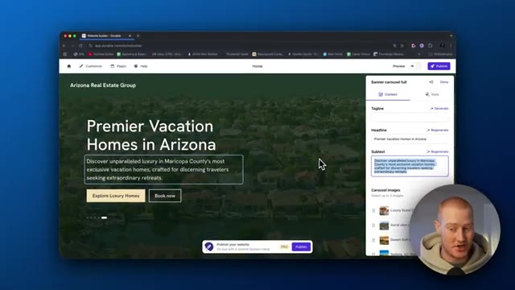
*⏱️ 00:03:29 — Capture d'écran montrant l'interface de création de site web Durable avec le panneau d'édition de texte ouvert sur le côté droit.*

---

### ⏱️ `[00:03:53 - 00:04:26]` | Segment #08

**🔊 Audio (Transcription Intégrale Mot pour Mot en Français) :**
> aller. C'est super. Laissez-moi faire défiler jusqu'en bas de ceci. En fait, une autre chose ici, nous pourrions en fait régénérer les images. Donc c'est cool. Cependant, j'aime bien ce qu'il nous a réellement donné. Donc vous pouvez voir que nous avons une nouvelle section ici. Nous pourrions ajouter une section si nous voulons. Nous pourrions donc personnaliser cela autant que nous le voulons mais c'est juste le premier, encore une fois, ce premier prototype d'un site web qu'il nous a construit donc allons-y : offrez-vous les échappées exclusives de Maricopa. Évidemment, ce sont juste comme des images de stock que j'ai récupérées sur Internet donc si nous voulions ajouter nos propres images de biens réelles, nous devrions les fournir à notre genre d'assistant IA ici et il le ferait alors

**👁️ Analyse Visuelle d'Écran (gemini-3.5-flash-lite) :**
**Interface & Outils** : Navigateur web affichant l'outil de création de sites web par IA "Durable" avec une webcam du présentateur en bas à droite.

**Contenu textuel & Code** : Éditeur de site web avec options de personnalisation, boutons "Restyle" et "Regenerate images", et texte de présentation immobilière.
[DESC_IMAGE_3] Navigation et visualisation des images générées automatiquement pour illustrer le site web immobilier.

**Action / Démonstration** : Explications face caméra et analyse conceptuelle des marchés.

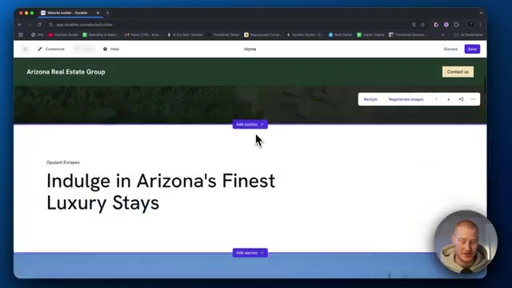
*⏱️ 00:04:02 — Interface du créateur de site web Durable montrant une section de texte avec les options Restyle et Regenerate images.*

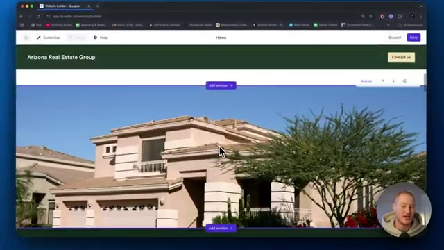
*⏱️ 00:04:10 — Aperçu d'une image générée par IA représentant une grande maison dans le cadre de la construction du site immobilier.*

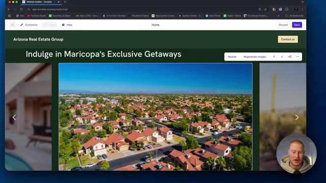
*⏱️ 00:04:18 — Vue aérienne de quartier résidentiel générée automatiquement sur le site web en cours de création.*

---

### ⏱️ `[00:04:26 - 00:04:48]` | Segment #09

**🔊 Audio (Transcription Intégrale Mot pour Mot en Français) :**
> mets à jour toutes ces images pour nous donc voilà, on n'a évidemment pas besoin de rendre ça fonctionnel donc essentiellement quand tu cliques là-dessus ça t'envoie vers, tu sais, les annonces immobilières réelles et ça montre aussi toutes les différentes marques avec lesquelles on travaille. Donc tu pourrais cliquer là-dessus et on pourrait ajouter différents logos ici pour montrer de la crédibilité. Donc essentiellement, selon si tu es une agence ou quelque chose comme ça, tu pourrais alors ajouter toutes les différentes entreprises avec lesquelles tu as travaillé.

**👁️ Analyse Visuelle d'Écran (gemini-3.5-flash-lite) :**
**Interface & Outils** : Constructeur de site web Durable (app.durable.co)

**Contenu textuel & Code** : Éditeur de contenu web, paramètres d'images, attributs alt, titres de blocs et galerie de logos partenaires (Logoipsum)

**Action / Démonstration** : Modification des propriétés et des logos de la vitrine sur un site web immobilier généré par IA

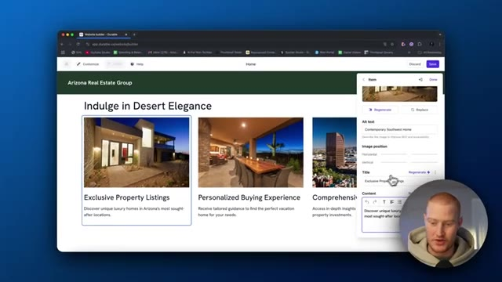
*⏱️ 00:04:32 — Interface de création de site web Durable montrant l'édition d'un bloc de propriétés immobilières avec panneau latéral de configuration d'image.*

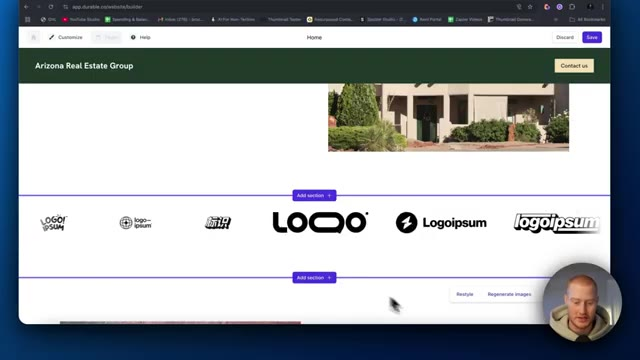
*⏱️ 00:04:37 — Aperçu du site web immobilier affichant une section de présentation de marques partenaires avec plusieurs faux logos (Logoipsum).*

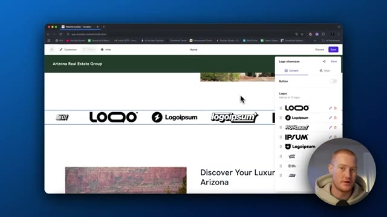
*⏱️ 00:04:43 — Panneau latéral de l'éditeur Durable affichant la liste des logos de la section "Logo showcase" permettant d'ajouter ou modifier jusqu'à 12 logos.*

---

### ⏱️ `[00:04:48 - 00:05:25]` | Segment #10

**🔊 Audio (Transcription Intégrale Mot pour Mot en Français) :**
> Et j'ai ça sur une bannière ici, ici de la part de nos heureux invités. Donc j'aime bien, j'ai en fait ajouté ça. C'est très intuitif et ça sait à quoi un site web de bien immobilier devrait ressembler. C'est la super partie avec ça. Nous n'avons pas besoin de décortiquer et de lui dire chaque petit détail dont nous avons besoin pour rendre cette chose belle. Il sait déjà que nous devons ajouter, vous savez, des informations de nos heureux invités afin d'augmenter les conversions de personnes voulant réellement travailler avec notre entreprise. Et puis il a même ajouté un formulaire de collection de prospects ici, ce qui est plutôt génial. Donc les gars, c'est vraiment bien jusqu'à présent. Cependant, je ne suis pas fan de ce style vert ici. Alors laissez-moi aller de l'avant et voir si je peux restyler ceci et voir

**👁️ Analyse Visuelle d'Écran (gemini-3.5-flash-lite) :**
**Interface & Outils** : Navigateur web affichant le constructeur de site web Durable avec interface d'édition visuelle par glisser-déposer/blocs.

**Contenu textuel & Code** : Page web en cours de construction pour "Arizona Real Estate Group", comprenant des témoignages de clients, des images immobilières et des boutons d'appel à l'action.

**Action / Démonstration** : Le présentateur navigue et présente la section des témoignages ("Happy Guests") générée automatiquement sur le site web immobilier.

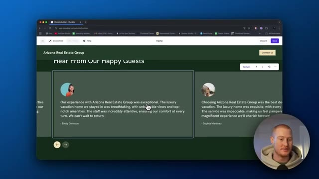
*⏱️ 00:04:58 — Aperçu d'un constructeur de site web montrant la section des avis clients "Hear From Our Happy Guests" pour l'agence Arizona Real Estate Group.*

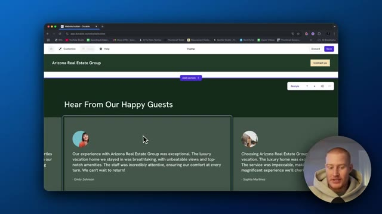
*⏱️ 00:05:07 — Vue de l'interface de création de site web avec le curseur sur une section, permettant d'ajouter ou de modifier des éléments de la page.*

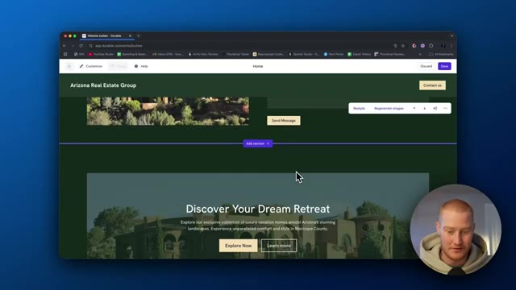
*⏱️ 00:05:16 — Navigation dans le constructeur de site web affichant une autre section intitulée "Discover Your Dream Retreat" avec des images de propriétés.*

---

### ⏱️ `[00:05:25 - 00:05:50]` | Segment #11

**🔊 Audio (Transcription Intégrale Mot pour Mot en Français) :**
> c'est un peu ce que ça nous donne ici. D'accord. Donc en fait, j'ai cliqué sur réinitialiser le style et ça a restylisé toute cette petite section. Donc ça a l'air sympa. Ça a définitivement changé l'en-tête ici. Au lieu d'être par ici, ça l'a ajouté là. Je trouve que ça a l'air plutôt sympa. Ça a toujours les effets verts ici, ce qui me permet d'aller voir comment je peux personnaliser ça. Allons simplement dans les couleurs. Oh, donc on peut changer la palette de couleurs pour ce qu'on veut. Alors allons-y pour des couleurs plus de type Arizona.

**👁️ Analyse Visuelle d'Écran (gemini-3.5-flash-lite) :**
**Interface & Outils** : Constructeur de sites web Durable (app.durable.co).

**Contenu textuel & Code** : Interface utilisateur de création de site internet, options de style et palettes de couleurs.

**Action / Démonstration** : Modification et réinitialisation du style d'une section du site web avec aperçu en temps réel.

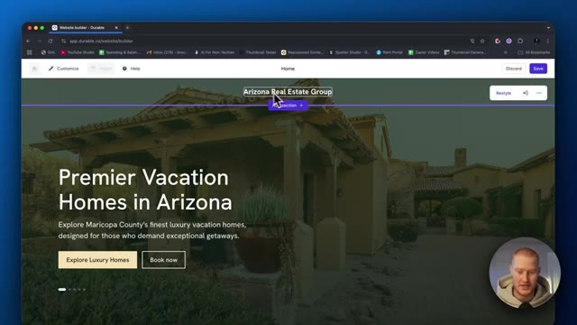
*⏱️ 00:05:31 — Vue de l'interface de création de site web montrant l'en-tête de la page d'accueil avec le titre du groupe immobilier.*

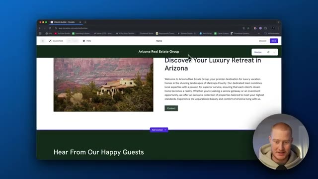
*⏱️ 00:05:37 — Affichage de la page modifiée avec un thème de couleur vert foncé appliqué à l'en-tête et aux sections.*

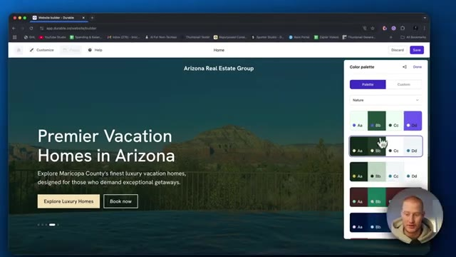
*⏱️ 00:05:43 — Panneau latéral droit ouvert affichant la palette de couleurs et les options de personnalisation du design.*

---

### ⏱️ `[00:05:50 - 00:06:23]` | Segment #12

**🔊 Audio (Transcription Intégrale Mot pour Mot en Français) :**
> J'ai l'impression que ça colle. Oh, voilà. Ça a l'air beaucoup mieux. Ça correspond un peu au paysage de l'Arizona avec, vous savez, de la pierre et des rochers. Ça a l'air super. D'accord. Voyons ce que nous pourrions d'autre personnaliser ici et à quel point c'est facile. D'accord, mots-clés. Vous pouvez voir que je suis sur le forfait gratuit ici, mais si nous venons sur Durable, jetons un œil à leurs tarifs. D'accord, donc ça a l'air d'être 12 dollars par mois pour le forfait de base, 20 pour le forfait professionnel, et je parie que vous pourriez commencer avec juste le forfait à 12 dollars. On dirait qu'il y a un référencement automatisé, donc nous l'aurions inclus, mais on dirait que l'outil comprend les mots-clés sur lesquels nous voulons nous positionner. Donc si vous y connaissez quelque chose en référencement,

**👁️ Analyse Visuelle d'Écran (gemini-3.5-flash-lite) :**
**Interface & Outils** : Navigateur web, constructeur de site web Durable AI (app.durable.co).

**Contenu textuel & Code** : Palette de couleurs, options de personnalisation d'un site web, grilles de tarification (plans Starter, Business, Mogul) avec fonctionnalités incluses.

**Action / Démonstration** : Sélection d'une palette de couleurs adaptée au paysage de l'Arizona sur un constructeur de site web IA, puis navigation vers la page des prix.

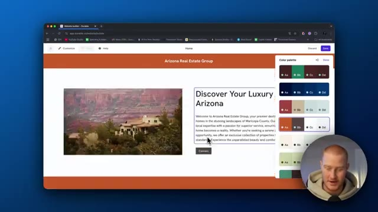
*⏱️ 00:05:58 — Interface d'un constructeur de site web (Durable AI) montrant l'aperçu d'un site sur l'immobilier en Arizona avec un panneau latéral de sélection de palette de couleurs.*

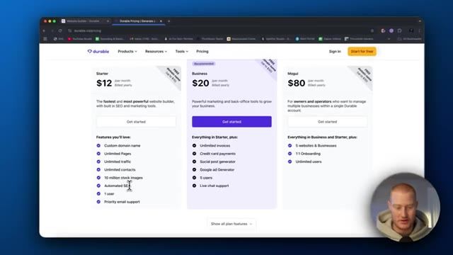
*⏱️ 00:06:14 — Page de tarification (pricing) de la plateforme Durable AI montrant différentes offres d'abonnement (Starter à 12$, Business à 20$, Mogul à 80$).*

---

### ⏱️ `[00:06:23 - 00:06:58]` | Segment #13

**🔊 Audio (Transcription Intégrale Mot pour Mot en Français) :**
> il est essentiel d'obtenir des vues sur votre site web. Donc, chaque fois que les gens recherchent sur Google ou à l'avenir, sur chat gpt ou n'importe quel autre moteur de modèle de langage étendu, il se classera alors plus haut sur celui-ci afin que votre site web soit plus vu. Donc, si vous cherchez des propriétés airbnb en arizona, c'est un peu comme cela que fonctionne le référencement naturel, nous pourrions donc, vous savez, faire en sorte qu'il optimisât certaines choses sur le site web pour ce référencement naturel, ce qui est en fait une fonctionnalité incroyable. d'accord, donc une chose est que je veux des coins plus arrondis et si je viens vers ces autres styles ici, nous pourrions changer cela, alors ajoutons, choisissons la taille des coins arrondis pour votre site web. Faisons juste moyen, c'est fait. Et puis sauvegardons ceci. Et ensuite, cela devrait générer ces

**👁️ Analyse Visuelle d'Écran (gemini-3.5-flash-lite) :**
**Interface & Outils** : Navigateur web affichant le constructeur de site web alimenté par l'IA Durable.

**Contenu textuel & Code** : Liste de mots-clés SEO ciblés sur l'immobilier et options de style pour le site web.

**Action / Démonstration** : Navigation et démonstration de la configuration des fonctionnalités de référencement et d'édition visuelle.

---

### ⏱️ `[00:06:58 - 00:07:35]` | Segment #14

**🔊 Audio (Transcription Intégrale Mot pour Mot en Français) :**
> avec les coins arrondis. D'accord. Donc maintenant, je clique sur l'aperçu et voilà à quoi ressemblerait notre site une fois en ligne. C'est parti. Ça a l'air super. Oh, voilà. Voilà les coins arrondis. D'accord. Donc vous pouvez voir qu'il a ajouté ces coins arrondis ici et ça a l'air super. Les photos sont géniales. J'aime bien l'aspect des coins arrondis. Et c'était aussi simple que de modifier une petite chose de plus ici. Les gars, ce site web a vraiment l'air super pour littéralement moins de cinq minutes de mon temps. J'ai écrit une consigne de base sur ce que j'essayais de construire et il l'a construit. Encore une fois, nous pourrions ajouter et modifier tout ce que nous voulons ici. Nous pourrions ensuite aller sur le

**👁️ Analyse Visuelle d'Écran (gemini-3.5-flash-lite) :**
**Interface & Outils** : Navigateur web affichant le constructeur de site Durable.

**Contenu textuel & Code** : Page web en mode prévisualisation avec des images de propriétés immobilières et un design moderne aux coins arrondis.

**Action / Démonstration** : Visualisation de l'aperçu du site web pour vérifier l'application des coins arrondis sur les images.

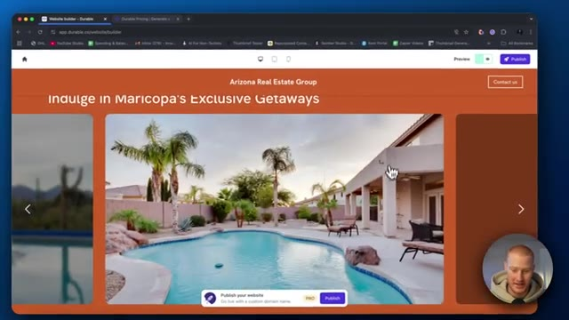
*⏱️ 00:07:16 — Aperçu du site web affichant un carrousel d'images avec des coins arrondis pour les photos de propriétés.*

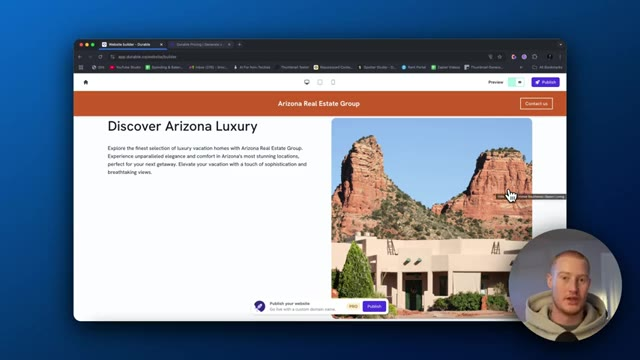
*⏱️ 00:07:26 — Aperçu d'une section du site web « Discover Arizona Luxury » avec une image de paysage aux coins arrondis.*

---

### ⏱️ `[00:07:35 - 00:08:08]` | Segment #15

**🔊 Audio (Transcription Intégrale Mot pour Mot en Français) :**
> tablette et voir à quoi ça ressemble sur un iPad ou un truc comme ça. Incroyable. Ça a l'air génial, les gars. Et puis sur l'iPhone aussi, la mise en page pour le coup ressemble franchement à un site web professionnel. On dirait que j'ai payé quelqu'un pour me construire un site web. Et un truc sur lequel je veux vraiment insister, les gars, c'est que tellement de gens perdent leur temps à construire un site web pour leur entreprise. Si vous avez une idée d'entreprise ou que vous venez juste de lancer une entreprise et que vous passez une tonne de temps sur votre site web avant même d'avoir des clients, vous perdez votre temps. Et Durable fait en sorte qu'il soit extrêmement facile de se construire un site web, d'avoir quelque chose en ligne et prêt à l'emploi. De cette façon, vous

**👁️ Analyse Visuelle d'Écran (gemini-3.5-flash-lite) :**
**Interface & Outils** : Navigateur web affichant l'outil de création de sites web Durable AI.

**Contenu textuel & Code** : Maquette de site web pour "Arizona Real Estate Group" avec texte descriptif et boutons de navigation.

**Action / Démonstration** : Navigation et basculement entre les vues desktop et mobile du site généré automatiquement.

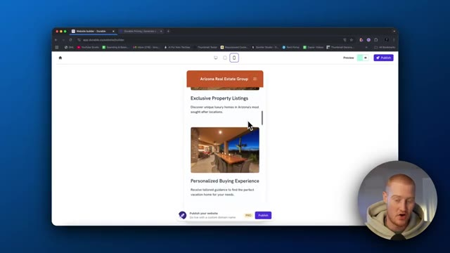
*⏱️ 00:07:43 — Aperçu du site web généré par IA sous format mobile (iPhone) montrant le design responsive et épuré.*

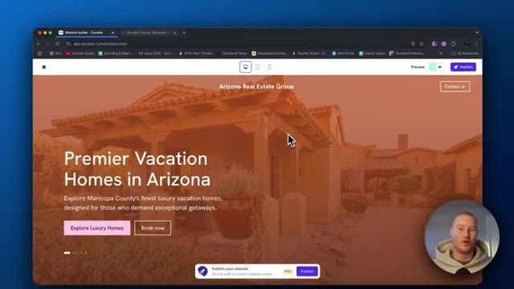
*⏱️ 00:07:51 — Aperçu du site web généré par IA sur écran d'ordinateur affichant la page d'accueil d'une agence immobilière en Arizona.*

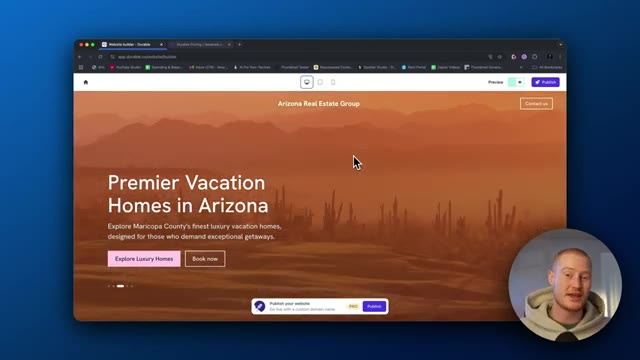
*⏱️ 00:08:00 — Aperçu similaire du site web sur ordinateur avec une image de fond de paysage désertique et des boutons d'appel à l'action.*

---

### ⏱️ `[00:08:08 - 00:08:43]` | Segment #16

**🔊 Audio (Transcription Intégrale Mot pour Mot en Français) :**
> pourrait alors, vous savez, aller de l'avant et essayer d'obtenir des clients. Et cela, rien que cela, rend cette plateforme utile. Juste la facilité d'utilisation afin de mettre un site web sur pied. Dernière chose que je veux aborder dans cette vidéo, je ne vais pas plonger profondément là-dedans. Peut-être que je le ferai dans une prochaine vidéo, mais je veux montrer les autres fonctionnalités. Nous avons donc l'onglet marketing ici. Nous n'avons pas seulement des sites web que nous pouvons construire. Nous avons le marketing. Nous pouvons donc réellement créer certaines publications. Il semble que nous devions faire une mise à niveau pour faire cela. CRM également. Nous pouvons ajouter différents contacts ici et garder une trace de tous nos clients. Donc disons que nous ajoutons un formulaire de contact sur le site web, que nous avons effectivement ajouté, vous pouvez le voir ici. Il collecte ensuite toutes ces informations. Et puis au lieu d'avoir ceci

**👁️ Analyse Visuelle d'Écran (gemini-3.5-flash-lite) :**
**Interface & Outils** : Navigateur web affichant la plateforme de création de site web et CRM Durable (app.durable.co).

**Contenu textuel & Code** : Tableaux de contacts clients, formulaires de lead generation, URL de site web pré-générée, options de publication et de domaine.
[DESC_IMAGE_3] Navigation dans l'interface de gestion client et démonstration de l'ajout d'un contact dans le CRM.

**Action / Démonstration** : Explications face caméra et analyse conceptuelle des marchés.

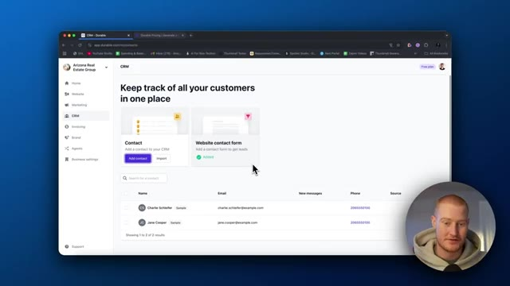
*⏱️ 00:08:17 — Capture d'écran montrant l'interface CRM de la plateforme Durable avec la liste des contacts et clients.*

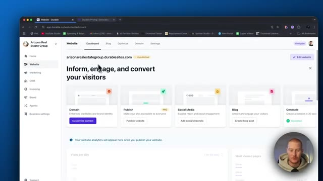
*⏱️ 00:08:26 — Capture d'écran montrant le tableau de bord de gestion de site web sur la plateforme Durable (arizonarealestategroup.durablesites.com).*

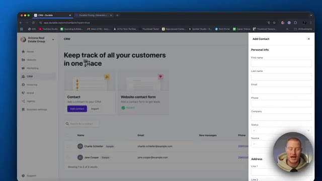
*⏱️ 00:08:34 — Capture d'écran montrant le CRM de Durable avec un panneau latéral ouvert pour l'ajout d'un nouveau contact.*

---

### ⏱️ `[00:08:43 - 00:09:17]` | Segment #17

**🔊 Audio (Transcription Intégrale Mot pour Mot en Français) :**
> envoyé vers un autre CRM, nous avons un CRM qui est intégré de manière native dans Durable. Donc c'est vraiment génial. Nous pourrions évidemment leur envoyer une facture, leur envoyer un e-mail, les ajouter à une liste de diffusion, tout ce genre de choses extraordinaires, ainsi que la facturation. Donc si vous gérez, disons, une agence, par exemple, vous pourriez facturer directement sur le site Web au lieu d'avoir à utiliser quelque chose comme Stripe. Agents IA, je ne me suis pas vraiment penché sur ce qu'est cette fonctionnalité pour l'instant, mais vous pourriez voir des spécialistes SEO. Nous pourrions optimiser notre site Web avec du contenu SEO de manière autonome, ce qui est vraiment super, un stratège de contenu. Nous pourrions donc embaucher un consultant alimenté par l'IA afin de concevoir en quelque sorte notre stratégie de contenu,

**👁️ Analyse Visuelle d'Écran (gemini-3.5-flash-lite) :**
**Interface & Outils** : Application web Durable (CRM et tableaux de bord de gestion).

**Contenu textuel & Code** : Interface utilisateur affichant la liste des contacts du CRM, avec des options pour ajouter des contacts, envoyer des factures ou des e-mails.

**Action / Démonstration** : Navigation dans le CRM intégré de l'application pour présenter la gestion des clients.

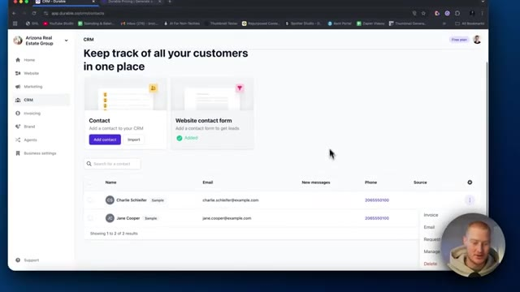
*⏱️ 00:08:52 — Capture d'écran montrant l'interface du CRM de Durable avec une liste de contacts et des options de gestion.*

---

### ⏱️ `[00:09:17 - 00:09:35]` | Segment #18

**🔊 Audio (Transcription Intégrale Mot pour Mot en Français) :**
> tout ça. Aucun humain n'est requis, c'est juste 100 % de l'IA. Voilà qui est fait, les amis. C'est Durable. Nous avons créé un site web extraordinaire en un peu moins de 10 minutes. C'est une super plateforme à utiliser, les amis. Si vous voulez lancer un site web très rapidement, c'est la meilleure façon de le faire avec l'IA. Donc si vous avez aimé cette vidéo, n'oubliez pas de laisser un pouce bleu, de commenter, de vous abonner et de vous inscrire sur Durable. Je vous retrouve dans la prochaine vidéo, les amis.

**👁️ Analyse Visuelle d'Écran (gemini-3.5-flash-lite) :**
**Interface & Outils** : Navigateur web affichant le tableau de bord de l'outil de création de sites web Durable.

**Contenu textuel & Code** : Interface utilisateur de gestion de site web avec des menus pour le site, le marketing, le CRM, la facturation et les agents IA.

**Action / Démonstration** : Navigation et présentation du tableau de bord de l'application Durable.

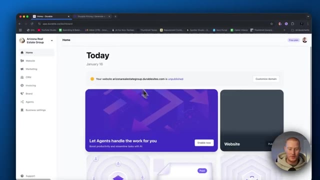
*⏱️ 00:09:21 — Capture d'écran du tableau de bord de l'application Durable montrant la page d'accueil du site créé.*

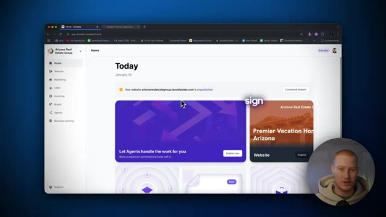
*⏱️ 00:09:26 — Capture d'écran similaire montrant l'interface avec un effet de transition ou de texte superposé.*

---

