# 🎬 Brand NEW Lovable x Figma Integration (Build Amazing UI)

> **Chaîne** : [Brock Mesarich | AI for Non Techies](https://www.youtube.com/@BrockMesarich)  
> **Lien YouTube** : [https://www.youtube.com/watch?v=c_qnRGzQUxA](https://www.youtube.com/watch?v=c_qnRGzQUxA)  
> **Date de publication** : 20250123  
> **Durée** : 00:05:24  
> **Identifiant vidéo** : `c_qnRGzQUxA`  
> **Transcription & Analyse** : `whisper-v3-large-turbo+gemini-3.5-flash-lite`  

---

## 📌 Synthèse Exécutive & Outils

### 💡 Résumé

Bienvenue dans cette analyse approfondie pour la chaîne *Brock Mesarich | AI for Non Techies*. Dans cette vidéo, nous explorons l'impact révolutionnaire de la toute nouvelle intégration entre Lovable et Figma, une synergie technologique qui redéfinit les standards de prototypage rapide et de développement de logiciels pilotés par l'intelligence artificielle. Plutôt que de coder manuellement ou d'assembler des composants de manière isolée, cette approche permet de concevoir des interfaces utilisateur (UI) hautement professionnelles sur Figma, de les traduire instantanément en code structuré, puis de les injecter directement dans un environnement de développement intelligent comme Lovable pour les rendre pleinement opérationnels.

Au-delà de la simple démonstration technique, cette vidéo illustre l'évolution des workflows sans code et assistés par IA, où le design visuel devient le véritable cahier des charges exécutable. L'analyste démontre comment bridge (relier) des maquettes complexes — telles qu'un site e-commerce complet avec pages de paiement et formulaires — vers une application vivante en quelques clics grâce à des intermédiaires puissants comme builder.io. Cette méthode s'inscrit dans une stratégie globale d'optimisation du temps de développement, réduisant considérablement la friction entre la phase créative du design et l'implémentation logicielle.

Bien que l'outil soit encore en phase d'amélioration continue et puisse générer quelques imperfections graphiques mineures lors de la conversion, cette intégration représente un bond en avant magistral pour les créateurs, entrepreneurs et non-techies. Elle complète à merveille les méthodes d'importation de composants unitaires (comme v0 ou 24th.dev), offrant désormais une vision holistique : transformer des écosystèmes visuels entiers en applications web dynamiques, prêtes à être optimisées et enrichies par l'IA générative.

### 🛠️ Outils, Modèles & Logiciels Présentés

* **Lovable** : Plateforme de développement de logiciels pilotée par l'IA permettant de créer, modifier et déployer des applications web complètes en quelques minutes.
* **Figma** : Outil de conception d'interfaces utilisateur et de sites web de référence, utilisé pour créer des maquettes et des cadres structurels de haute fidélité.
* **Builder.io** : Passerelle technique indispensable et plugin Figma qui convertit des designs visuels complexes en code propre prêt à être exporté.
* **24th.dev** : Application web d'inspiration pour la récupération et l'intégration de composants d'UI unitaires, complémentaire aux workflows de design globaux.
* **Gemini** : Modèle d'intelligence artificielle de pointe (mentionné dans l'écosystème IA global des créateurs).
* **Claude** : Modèle de langage avancé souvent exploité pour la génération de code et l'assistance au développement (écosystème de référence).
* **Grok** : Modèle conversationnel d'IA axé sur l'actualité et l'analyse de données en temps réel.
* **Make** & **Zapier** : Plateformes d'automatisation de flux de travail interconnectant divers services cloud (outils standards de l'écosystème no-code).
* **n8n** : Outil d'automatisation de workflows open-source et auto-hégeable pour orchestrer des architectures logicielles complexes.
* **ChatGPT** : Assistant conversationnel universel utilisé pour le prompt engineering et l'assistance textuelle et logique.

### 🔑 Points Clés & Enseignements Stratégiques

* **Paradigme du design-to-code instantané** : L'intégration Lovable x Figma élimine le fossé traditionnel entre les équipes de design UI/UX et les développeurs en transformant des maquettes visuelles directement en code exécutable.
* **Utilisation de l'Auto Layout** : Il est impératif d'utiliser la fonction *Auto Layout* dans Figma avant l'exportation pour garantir que la structure des composants soit interprétée et disposée correctement par l'outil de conversion.
* **Rôle charnière de Builder.io** : L'utilisation du plugin Builder.io sert de pont technologique pour analyser la hiérarchie visuelle de Figma et générer les options de code adaptées à l'importation.
* **Sélection granulaire des options de mise en page** : Lors de l'export, l'analyste recommande de comparer minutieusement les différentes propositions de rendu du code afin de sélectionner celle qui présente la plus haute fidélité visuelle avant le transfert vers Lovable.
* **Complémentarité des approches d'importation** : Cette méthode de pages entières ne remplace pas l'utilisation de bibliothèques de composants unitaires (comme 24th.dev), mais s'y associe pour offrir un cadre macroscopique tout en affinant les détails.
* **Transition du visuel au fonctionnel** : L'importation génère une interface graphique parfaite mais statique ; l'étape suivante obligatoire consiste à exploiter l'IA de Lovable pour greffer la logique métier, les états et l'interactivité aux boutons et formulaires.
* **Gestion des attentes et maturité technologique** : En tant que fonctionnalité en accès anticipé (early access), des erreurs mineures de rendu (comme des logos manquants ou des décalages) peuvent survenir, nécessitant des ajustements itératifs.
* **Optimisation drastique du time-to-market** : Cette méthodologie permet aux non-techies et aux développeurs solo de valider des concepts de produits minimum viables (MVP) en un temps record grâce à un design de niveau professionnel dès le premier jour.
* **Prompt engineering et itération contextuelle** : Une fois le design Figma injecté dans Lovable, la phase de modification par l'IA repose sur des instructions textuelles précises pour transformer le squelette statique en application dynamique.
* **Scalabilité des flux de travail créatifs** : L'adoption de ce type d'intégration modifie durablement la productivité des créateurs en automatisant les tâches répétitives de codage frontal, leur permettant de se concentrer sur l'expérience utilisateur et la proposition de valeur.

---

## ⏱️ Chronologie & Transcription Complète Audio & Visuelle (Mot pour Mot)

### ⏱️ `[00:00:00 - 00:00:29]` | Segment #01

**🔊 Audio (Transcription Intégrale Mot pour Mot en Français) :**
> Lovable, une plateforme qui vous permet de créer des logiciels avec l'IA en quelques minutes. Cette toute nouvelle fonctionnalité vous aide à créer des applications superbes qui ont réellement l'aspect et la sensation de professionnalisme en utilisant Figma. Si vous avez vu ma dernière vidéo, j'ai parlé d'une astuce qui vous aide à copier des composants d'interface utilisateur dans vos projets. Eh bien, cette nouvelle fonctionnalité vous aide à créer des applications entières en utilisant Figma et à les importer directement dans vos projets Lovable. Dans cette vidéo, je vais vous montrer comment faire cela. Cela devrait rendre votre processus de création d'applications beaucoup plus simple.

**👁️ Analyse Visuelle d'Écran (gemini-3.5-flash-lite) :**
**Interface & Outils** : Figma, Navigateur web

**Contenu textuel & Code** : Maquettes d'applications mobiles, interfaces de design et outils de prototypage de Figma

**Action / Démonstration** : Présentation des fonctionnalités de design et de prototypage de Figma liées au développement d'applications

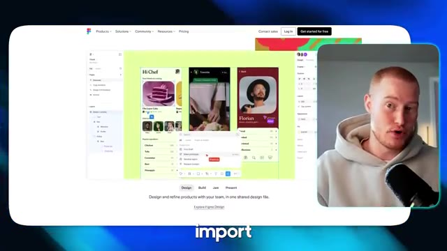
*⏱️ 00:00:22 — Interface du site web de Figma montrant des maquettes d'applications mobiles et des outils de design, avec un encart vidéo du présentateur.*

---

### ⏱️ `[00:00:29 - 00:00:55]` | Segment #02

**🔊 Audio (Transcription Intégrale Mot pour Mot en Français) :**
> Imaginez ceci, vous avez un design magnifique que vous avez créé dans Figma et vous pouvez l'importer directement dans Lovable. Maintenant, vous pouvez modifier votre application à l'aide de l'IA avec Lovable, en ayant déjà un modèle complet qui a été fait pour vous. D'accord, entrons dans le vif du sujet. Très bien. Alors, première chose, je suis ici dans Figma. Si vous ne savez pas ce qu'est Figma, Figma est une plateforme qui vous permet de créer des interfaces utilisateur ou des sites Web d'apparence incroyable et vous permet de les personnaliser comme vous le souhaitez.

**👁️ Analyse Visuelle d'Écran (gemini-3.5-flash-lite) :**
**Interface & Outils** : Lovable et Figma.

**Contenu textuel & Code** : Maquettes graphiques et interface de génération de code par IA.
[DESC_IMAGE_3] Maquettes de design et interface de développement.

**Action / Démonstration** : Explications face caméra et analyse conceptuelle des marchés.

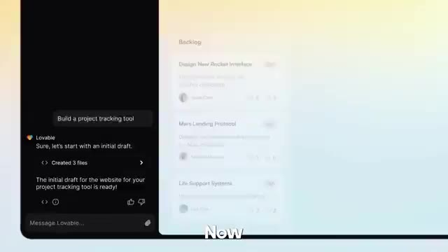
*⏱️ 00:00:36 — Interface de Lovable montrant le chat avec le prompt de création d'un outil de suivi de projet.*

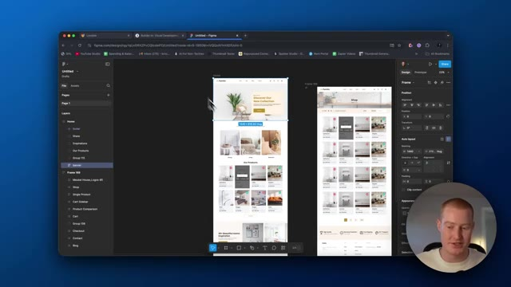
*⏱️ 00:00:48 — Interface de Figma affichant les maquettes d'un site web de e-commerce avec le présentateur en incrustation.*

---

### ⏱️ `[00:00:55 - 00:01:28]` | Segment #03

**🔊 Audio (Transcription Intégrale Mot pour Mot en Français) :**
> Vous pourriez utiliser beaucoup de, vous pourriez trouver différents modèles ici et essentiellement juste les coller dans vos applications pour les utiliser comme sorte d'infrastructure pour votre application web ou votre site web. Donc j'ai trouvé celui-ci que j'aime bien. Donc c'est pour une entreprise de meubles. Et comme vous pouvez le voir, nous avons ces différentes pages. Donc c'est un site web entier, n'est-ce pas ? Avec le paiement, nous avons un formulaire de contact, une page de blog, tout ça. Ce que je vais faire, c'est que je vais copier cette page d'accueil et la convertir en code, puis l'importer dans un projet Lovable. Et je vais le faire maintenant. Donc tout d'abord, ce que vous devez faire, c'est venir sur builder.io. Le lien pour ceci sera dans la description.

**👁️ Analyse Visuelle d'Écran (gemini-3.5-flash-lite) :**
**Interface & Outils** : Interface de design Figma affichée dans un navigateur web avec panneau de calques et propriétés.

**Contenu textuel & Code** : Modèles de pages web (Accueil, Boutique, Panier, Checkout, Contact, Blog) pour une application ou un site e-commerce.

**Action / Démonstration** : Navigation et exploration visuelle des différents écrans et templates de design dans le logiciel Figma.

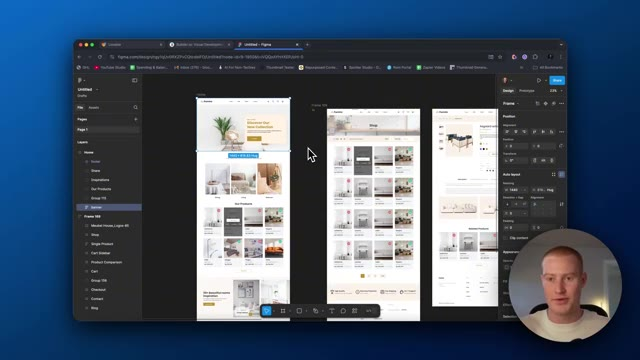
*⏱️ 00:01:03 — Vue d'interface Figma montrant des maquettes de pages d'accueil et de boutiques de e-commerce avec le présentateur en incrustation.*

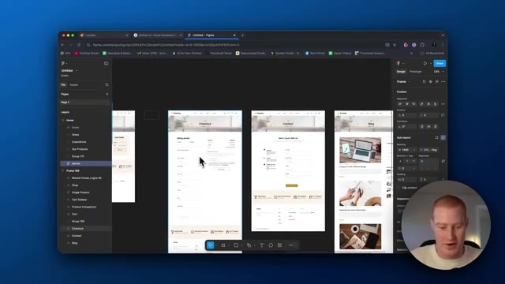
*⏱️ 00:01:11 — Navigation dans Figma sur des maquettes de pages de paiement (checkout) et de contact d'un site web.*

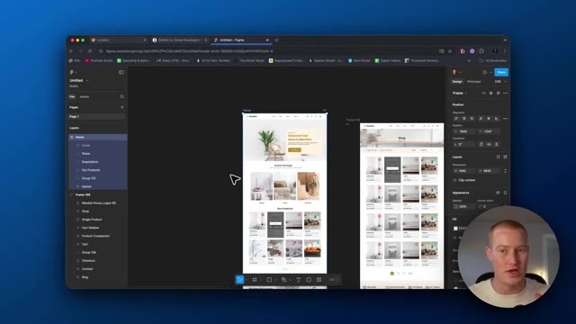
*⏱️ 00:01:19 — Présentation d'une maquette complète de site e-commerce dans l'interface de conception Figma.*

---

### ⏱️ `[00:01:28 - 00:01:47]` | Segment #04

**🔊 Audio (Transcription Intégrale Mot pour Mot en Français) :**
> Essentiellement, inscrivez-vous avec ceci et vous devez télécharger un tuteur. Alors allez sur l'application et ensuite ce que vous allez faire, c'est que vous allez venir et cliquer sur obtenir le plugin Figma. En gros, une fois que vous avez ça connecté à votre Figma, tout ce que vous avez à faire, c'est de revenir sur votre Figma, de cliquer sur les composants exacts ou la page que vous voulez copier dans Lovable pour ceci.

**👁️ Analyse Visuelle d'Écran (gemini-3.5-flash-lite) :**
**Interface & Outils** : Navigateur web et logiciel Figma

**Contenu textuel & Code** : Tableaux de bord, pages de plugins et maquettes de design UI/UX

**Action / Démonstration** : Navigation sur Builder.io, consultation d'un plugin Figma et visualisation de maquettes de design dans Figma

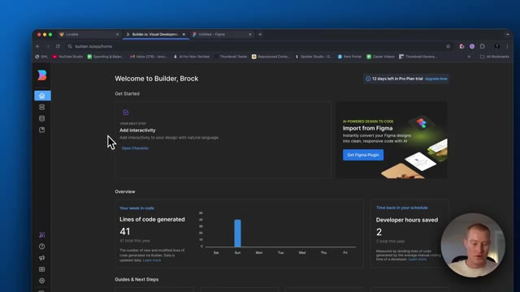
*⏱️ 00:01:33 — Image #1 montre le tableau de bord de Builder.io avec une section 'Get Started' et des statistiques d'utilisation.*

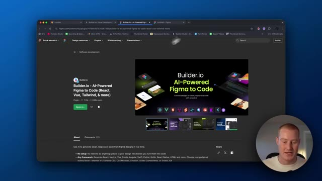
*⏱️ 00:01:37 — Image #2 présente la page du plugin Figma 'Builder.io - AI-Powered Figma to Code' sur le navigateur.*

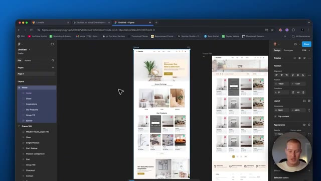
*⏱️ 00:01:42 — Image #3 affiche l'interface de design Figma avec des maquettes de pages web d'une boutique e-commerce.*

---

### ⏱️ `[00:01:47 - 00:02:06]` | Segment #05

**🔊 Audio (Transcription Intégrale Mot pour Mot en Français) :**
> Je veux que ça devienne tout simplement la page d'accueil. Donc essentiellement, il est vraiment important que vous veniez cliquer sur auto layout. De cette façon, ce sera disposé correctement. Et ensuite, la prochaine chose que nous voulons faire, c'est de venir ici et de cliquer sur ce plugin builder.io. Donc, cliquez sur notre plugin ici que nous venons de télécharger. Et ensuite, ce que nous allons faire, c'est que nous allons laisser cela en mode facile pour l'exportation.

**👁️ Analyse Visuelle d'Écran (gemini-3.5-flash-lite) :**
**Interface & Outils** : Logiciel de design Figma et interface de plugin Builder.io.

**Contenu textuel & Code** : Panneau des calques, options d'Auto Layout, propriétés de design et fenêtre de prévisualisation d'exportation de plugin.

**Action / Démonstration** : Manipulation des calques de design et ouverture du plugin Builder.io pour exporter la mise en page.

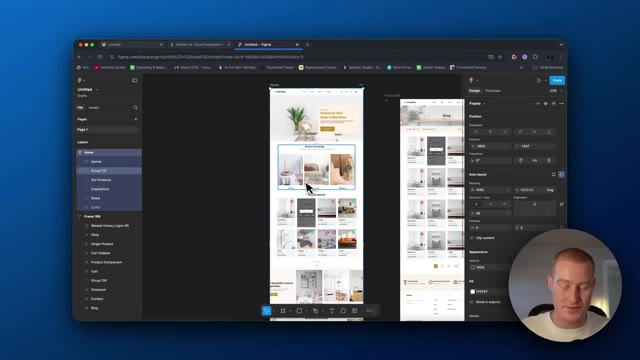
*⏱️ 00:01:52 — Capture d'écran montrant l'interface de Figma avec la sélection d'un groupe d'éléments et les options d'Auto Layout visibles dans le panneau de droite.*

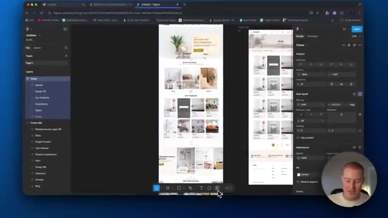
*⏱️ 00:01:56 — Vue de Figma où le curseur survole la barre d'outils inférieure pour accéder aux options de plugins ou d'exportation.*

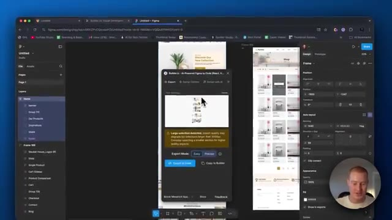
*⏱️ 00:02:01 — Affichage d'une fenêtre pop-up de plugin (Builder.io) intégrée à Figma avec des alertes d'exportation et des boutons d'action.*

---

### ⏱️ `[00:02:06 - 00:02:39]` | Segment #06

**🔊 Audio (Transcription Intégrale Mot pour Mot en Français) :**
> Assurez-vous d'avoir la bonne page que vous voulez copier sur Lovable. Et nous allons l'exporter en code. Donc essentiellement, cela convertit ce design sur Figma en code. Et ensuite, je vous montrerai comment vous pouvez facilement l'importer dans votre application Lovable de manière native directement depuis Figma. Très bien. Et donc ce que vous allez voir maintenant, c'est que vous allez voir les mises en page. Vous aurez deux options ici et nous devons sélectionner l'option de mise en page qui a meilleure allure et qui, selon nous, sera la meilleure à importer dans Lovable. Laissez-moi donc regarder rapidement tout ça. Alors, pendant que je regarde tout ça,

**👁️ Analyse Visuelle d'Écran (gemini-3.5-flash-lite) :**
**Interface & Outils** : Figma, Plugin Builder.io AI-Powered Figma to Code

**Contenu textuel & Code** : Fenêtre de conversion de design Figma vers du code (React, Vue, Tailwind) avec sélection des versions.

**Action / Démonstration** : Conversion d'un design Figma en code à l'aide d'une extension d'intelligence artificielle.

*⏱️ 00:02:14 — Interface de Figma avec un plugin Builder.io ouvert en train de convertir le design en code ("Analyzing selected Figma layers").*

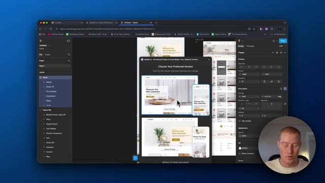
*⏱️ 00:02:22 — Sélection des versions de design converties par le plugin Builder.io dans Figma.*

---

### ⏱️ `[00:02:39 - 00:03:15]` | Segment #07

**🔊 Audio (Transcription Intégrale Mot pour Mot en Français) :**
> celui-ci a l'air bien. Cependant, on dirait qu'ici, il y a une sorte d'erreur où c'est comme, c'est comme si le logo ne s'affichait pas correctement. Et donc sur celui-ci, celui-ci a l'air bien. a l'air super, ok, alors je vais continuer et avancer avec celui-ci, donc je clique sur celui-ci, et ensuite, ce qu'il nous faut faire, c'est cliquer sur ouvrir dans Lovable, ça va maintenant commencer à exporter ceci vers notre projet Lovable, et ensuite nous pourrons commencer à modifier cela exactement comme nous le ferions avec n'importe quel projet Lovable, laissez-moi lui donner une seconde pendant que ça charge ici, pendant que ça charge en fait, désolé, je veux faire une, euh, je veux mentionner une chose, donc vous avez peut-être vu ma vidéo précédente où je passe en revue

**👁️ Analyse Visuelle d'Écran (gemini-3.5-flash-lite) :**
**Interface & Outils** : Figma, Builder.io plugin, Lovable

**Contenu textuel & Code** : Options de design de versions, barre de progression de conversion de code (Analyzing exported code, Generating React components)

**Action / Démonstration** : Sélection d'une version de design et lancement de la conversion du projet Figma en code Lovable / React

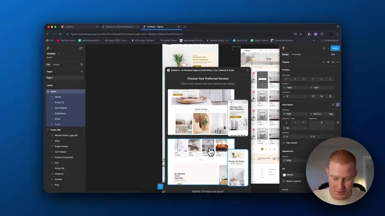
*⏱️ 00:02:48 — Interface Figma avec une pop-up de Builder.io affichant plusieurs versions de design parmi lesquelles choisir.*

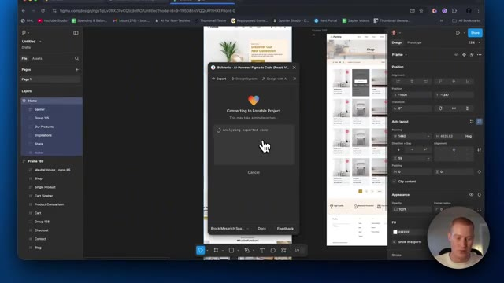
*⏱️ 00:02:57 — Pop-up affichant la conversion en cours vers un projet Lovable avec le message "Analyzing exported code".*

*⏱️ 00:03:06 — Progression de la conversion dans Builder.io avec l'étape "Generating React components".*

---

### ⏱️ `[00:03:15 - 00:03:51]` | Segment #08

**🔊 Audio (Transcription Intégrale Mot pour Mot en Français) :**
> 24th.dev afin de copier et coller différents composants d'interface utilisateur dans vos applications Lovable. J'adore cette application web. C'est vraiment un cas d'usage tellement cool. Cette vidéo a reçu beaucoup de, beaucoup de gens ont adoré ça et en ont retiré énormément de valeur. Vous vous dites donc peut-être, eh bien, est-ce que cela remplace ce genre de truc que j'avais trouvé ? Et la réponse est non, parce que Figma est vraiment doué pour créer des sortes de cadres complets pour vos sites web ou pour vos applications. Mais si vous voulez quand même trouver de l'inspiration via des composants d'interface utilisateur, vous pouvez facilement les importer dans vos applications que vous avez construites sur Figma puis chargées dans Lovable. Donc tous ces outils fonctionnent vraiment très bien

**👁️ Analyse Visuelle d'Écran (gemini-3.5-flash-lite) :**
**Interface & Outils** : Figma, Builder.io plugin, navigateur web.

**Contenu textuel & Code** : Fenêtre modale affichant "Converting to Lovable Project" avec des étapes de chargement : "Analyzing exported code", "Generating React components", "Generating more React components", "Making them pixel-perfect".

**Action / Démonstration** : Conversion de maquettes de design Figma en composants de code pour une application Lovable via le plugin Builder.io.

*⏱️ 00:03:24 — Capture d'écran montrant l'interface de Figma avec un plugin Builder.io en cours de conversion vers un projet Lovable.*

---

### ⏱️ `[00:03:51 - 00:04:13]` | Segment #09

**🔊 Audio (Transcription Intégrale Mot pour Mot en Français) :**
> ensemble. Et c'est pourquoi je suis si enthousiaste à l'idée de cette nouvelle intégration Figma, ainsi que de ces autres types d'intégrations qui arrivent pour Lovable. Alors ensuite, laissez-moi cliquer à l'intérieur de Lovable. Lançons ce projet. Et comme n'importe quel projet Lovable, vous pouvez voir qu'il va commencer à écrire le code parce que builder.io a converti cela en code qui pouvait facilement être importé dans Lovable. Alors donnons-lui une seconde et jetons un coup d'œil au résultat ici. D'accord, c'est parti.

**👁️ Analyse Visuelle d'Écran (gemini-3.5-flash-lite) :**
**Interface & Outils** : Figma, Navigateur Web, Interface Lovable

**Contenu textuel & Code** : Pop-up de lancement de projet Builder.io sur Figma et interface de développement Lovable avec du code source React/TypeScript.

**Action / Démonstration** : Navigation et lancement d'un projet Figma vers Lovable.

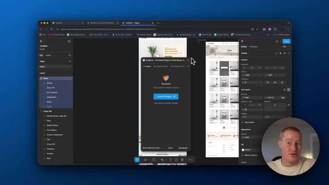
*⏱️ 00:03:56 — Interface Figma affichant un design et une fenêtre pop-up Builder.io avec le bouton "Launch Project".*

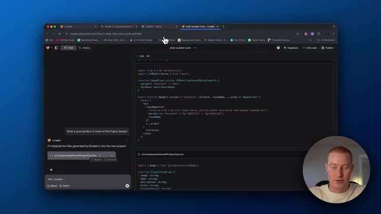
*⏱️ 00:04:02 — Interface de l'éditeur de code de Lovable montrant le code source d'un projet en cours de développement.*

---

### ⏱️ `[00:04:13 - 00:04:33]` | Segment #10

**🔊 Audio (Transcription Intégrale Mot pour Mot en Français) :**
> Il semble que notre site soit en ligne et opérationnel. Ça a l'air super. Ça ressemble exactement à ce que c'était dans Figma. Vous pouvez voir que nous avons tous ces produits ici. Nous avons ces différentes catégories que nous pouvons parcourir. Évidemment, cette application ou ce site web, ces boutons et tout le reste ne sont pas fonctionnels. Nous devons donc aller dans Lovable et rendre tout cela fonctionnel.

**👁️ Analyse Visuelle d'Écran (gemini-3.5-flash-lite) :**
**Interface & Outils** : Navigateur web affichant l'aperçu d'un site de e-commerce de meubles développé via Lovable / Figma.

**Contenu textuel & Code** : Interface utilisateur d'un site web de vente de meubles (logo Furniro, navigation, catégories Dining, Living, Bedroom, produits avec prix en roupies indonésiennes).
[DESC_IMAGE_3] Le présentateur navigue et fait défiler la page d'accueil du site web pour en démontrer le fonctionnement et le design.

**Action / Démonstration** : Explications face caméra et analyse conceptuelle des marchés.

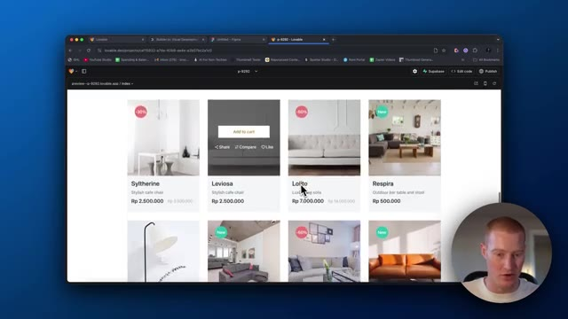
*⏱️ 00:04:18 — Aperçu du site web de e-commerce de meubles montrant une grille de produits avec leurs prix et un encart vidéo du présentateur en bas à droite.*

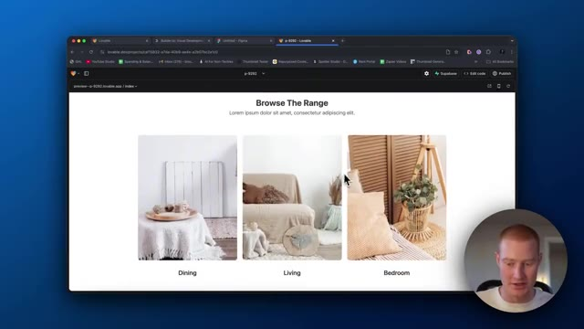
*⏱️ 00:04:23 — Aperçu du site web montrant la section des catégories "Browse The Range" avec des photos illustrant la salle à manger, le salon et la chambre.*

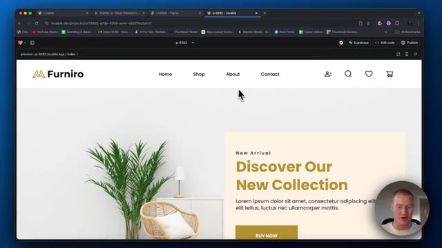
*⏱️ 00:04:28 — Aperçu de la page d'accueil du site web "Furniro" avec le menu de navigation supérieur, le logo et la section "New Arrival".*

---

### ⏱️ `[00:04:33 - 00:05:05]` | Segment #11

**🔊 Audio (Transcription Intégrale Mot pour Mot en Français) :**
> Mais jusqu'à présent, ça a l'air super. Très bien, les gars, voilà. C'est la nouvelle intégration Figma dans Lovable. Et une chose que je tiens à mentionner, c'est ceci : au moment où je tourne cette vidéo, cette fonctionnalité est en fait déjà en ligne. J'ai eu un accès anticipé grâce à l'équipe de Lovable pour tester cela et vous le présenter, puisque vous avez vraiment beaucoup aimé mes vidéos sur cette plateforme. Donc, une chose que je tiens à souligner, c'est qu'il y a quelques erreurs avec ça. Ce n'est pas parfait à chaque fois ; d'après ce que j'ai compris, ils travaillent pour faire en sorte que cette intégration fonctionne de manière beaucoup plus fluide. De cette façon, à chaque fois que vous avez un modèle Figma ou quelque chose que vous voulez importer dans

**👁️ Analyse Visuelle d'Écran (gemini-3.5-flash-lite) :**
**Interface & Outils** : Figma (navigateur web)

**Contenu textuel & Code** : Maquette de page web avec des visuels de produits, des sections de texte et un panneau de propriétés à droite.

**Action / Démonstration** : Navigation et présentation de la maquette design dans l'interface Figma.

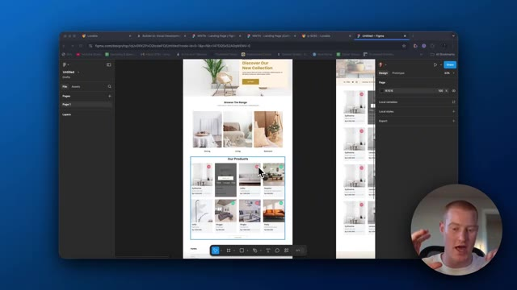
*⏱️ 00:04:41 — Capture d'écran montrant l'interface de Figma avec la maquette d'un site web e-commerce, ainsi que le présentateur en médaillon dans le coin inférieur droit.*

---

### ⏱️ `[00:05:05 - 00:05:24]` | Segment #12

**🔊 Audio (Transcription Intégrale Mot pour Mot en Français) :**
> votre application, elle est pratiquement impeccable à chaque fois. Cependant, nous n'en sommes pas encore là. Vous pourriez donc rencontrer quelques petits problèmes lors de vos tests. Mais voilà, les gars, merci de nous avoir suivis. N'oubliez pas de laisser un pouce bleu, de commenter, de vous abonner. J'espère que vous avez apprécié cette astuce. J'espère qu'elle vous apportera de la valeur. Et j'espère que cela changera un peu votre façon de créer des applications web grâce à l'IA. Cela étant dit, merci beaucoup. Et je vous dis à très bientôt dans la prochaine vidéo.

**👁️ Analyse Visuelle d'Écran (gemini-3.5-flash-lite) :**
**Interface & Outils** : Figma (dans un navigateur web)

**Contenu textuel & Code** : Maquette de site e-commerce (section héros, catégories "Browse The Range", section "Our Products" avec des images de meubles) et panneau latéral de design de Figma à droite.

**Action / Démonstration** : Navigation et présentation de la maquette de design sur l'interface Figma.

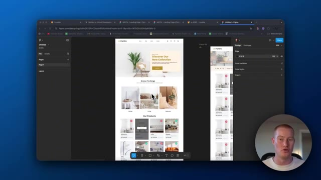
*⏱️ 00:05:10 — Capture d'écran montrant l'interface de Figma avec la maquette d'une page de site e-commerce de mobilier et décoration, et le présentateur dans un encart vidéo en bas à droite.*

---

