# 🎬 ChatGPT Can Now DO Things For You (ChatGPT Operator)

> **Chaîne** : [Brock Mesarich | AI for Non Techies](https://www.youtube.com/@BrockMesarich)  
> **Lien YouTube** : [https://www.youtube.com/watch?v=myufuUYMQds](https://www.youtube.com/watch?v=myufuUYMQds)  
> **Date de publication** : 20250123  
> **Durée** : 00:06:58  
> **Identifiant vidéo** : `myufuUYMQds`  
> **Transcription & Analyse** : `whisper-v3-large-turbo+gemini-3.5-flash-lite`  

---

## 📌 Synthèse Exécutive & Outils

### 💡 Résumé

La vidéo aborde un tournant technologique majeur dans l'écosystème de l'intelligence artificielle avec l'arrivée de **ChatGPT Operator**, le nouvel agent autonome d'OpenAI capable d'exécuter des actions concrètes directement sur le Web à la place de l'utilisateur. Accessible en avant-première pour les abonnés Pro à 200 dollars par mois, cet outil marque le passage d'une IA purement conversationnelle à une IA d'exécution, capable de naviguer de manière isolée via un navigateur cloud sécurisé. À travers l'analyse des cas pratiques démontrés par des experts comme Rowan Chung sur Twitter, la vidéo illustre la capacité de l'agent à automatiser des flux de travail complexes, allant de la constitution de paniers e-commerce à la recherche logistique et financière.

Bien que la technologie soit encore en phase d'aperçu (preview), ses limites opérationnelles mettent en lumière le concept hybride de collaboration homme-machine. L'agent sait identifier les obstacles techniques — tels que le blocage de certains sites (YouTube, Reddit), le contournement par des moteurs alternatifs (Bing), ou l'apparition de barrières de sécurité de type captchas — et déléguer intelligemment le contrôle à l'utilisateur humain lorsque des actions critiques (validation de paiements, authentification) sont requises. Cette approche pose les bases d'une automatisation généralisée pour 2025, redéfinissant la productivité des profils non techniques.

### 🛠️ Outils, Modèles & Logiciels Présentés

* **ChatGPT Operator** : Nouvel agent IA autonome d'OpenAI capable d'exécuter des tâches de navigation web et des actions concrètes dans un navigateur cloud sécurisé.
* **ChatGPT Pro** : Abonnement premium à 200 dollars par mois offrant l'accès anticipé aux fonctionnalités de pointe et aux agents autonomes d'OpenAI.
* **Gemini** : Modèle d'intelligence artificielle conversationnelle et multimodale concurrent, mentionné dans l'écosystème des grands language models.
* **Claude** : Assistant conversationnel avancé développé par Anthropic, reconnu pour ses capacités d'analyse et de traitement de requêtes complexes.
* **Grok** : Modèle d'IA conversationnelle développé par xAI, intégré à l'écosystème de la plateforme X (Twitter).
* **n8n** : Plateforme d'automatisation de flux de travail (workflow automation) orientée low-code/no-code pour connecter différentes applications.
* **Make** : Outil visuel d'intégration et d'automatisation de processus cloud (anciennement Integromat).
* **Zapier** : Solution SaaS pionnière d'automatisation permettant de lier des milliers d'applications web sans coder.

### 🔑 Points Clés & Enseignements Stratégiques

* **Transition vers les agents autonomes** : L'année 2025 marque l'ère des agents IA capables non seulement de recommander, mais d'exécuter des actions de bout en bout sur le web.
* **Architecture d'exécution cloud** : ChatGPT Operator déploie ses actions dans un navigateur distant hébergé sur le cloud, garantissant un environnement isolé du poste de travail local de l'utilisateur.
* **Automatisation e-commerce contextuelle** : Capacité à transformer instantanément une liste d'ingrédients issue d'une photo ou d'une recette en un panier d'achat validé sur des plateformes de grande distribution comme Walmart.
* **Résilience et contournement de restrictions** : Face aux sites web bloquant l'agent (comme Reddit ou YouTube), l'outil bascule dynamiquement sur des moteurs de recherche alternatifs (Bing) pour collecter l'information requise.
* **Recherche d'actifs et filtrage de données** : Application des agents à l'analyse sectorielle, telle que la veille sur des segments de marché émergents ou des cryptomonnaies, en compilant des listes de tokens filtrés selon des critères spécifiques.
* **Gestion des barrières de sécurité (Captchas)** : Détection automatisée des obstacles de type « Êtes-vous un humain » avec interruption de la tâche et envoi d'une notification pour intervention humaine ciblée.
* **Orchestration logistique et voyage** : Cartographie comparative exhaustive des options de transport (vols directs onéreux vs itinéraires économiques avec escales) sur des plateformes comme Booking.com.
* **Modèle de collaboration hybride (Human-in-the-Loop)** : Implication de l'utilisateur uniquement pour les décisions critiques ou sécurisées (validation de paiements par carte bancaire, résolution de captchas), optimisant ainsi le temps de travail effectif.
* **Accessibilité pour les profils non techniques** : Démocratisation des outils d'automatisation avancés permettant à des utilisateurs sans compétences en programmation de déléguer des tâches numériques chronophages.
* **ROI et tarification des innovations** : L'accès anticipé aux technologies de rupture nécessite souvent des investissements initiaux élevés (abonnements Pro à forte valeur ajoutée), servant de rampe de lancement avant une démocratisation grand public.

---

## ⏱️ Chronologie & Transcription Complète Audio & Visuelle (Mot pour Mot)

### ⏱️ `[00:00:00 - 00:00:23]` | Segment #01

**🔊 Audio (Transcription Intégrale Mot pour Mot en Français) :**
> Les gars, nous avons des nouvelles absolument massives aujourd'hui dans le domaine de l'IA. OpenAI a effectivement sorti ChatDBT Operator. C'est un changement radical. C'est fondamentalement le produit d'OpenAI qui permet à ChatDBT non seulement d'être plus interactif, mais vous pouvez réellement exécuter des actions avec Operator. Je suis tellement excité d'aller tester cela. J'ai acheté l'abonnement ChatDBT Pro pour 200 dollars par mois juste pour pouvoir vous le présenter.

**👁️ Analyse Visuelle d'Écran (gemini-3.5-flash-lite) :**
**Interface & Outils** : Navigateur web affichant le site officiel d'OpenAI et l'interface d'accès à l'outil Operator.

**Contenu textuel & Code** : Texte de présentation "Introducing Operator" avec description de l'agent de recherche et message de notification de disponibilité progressive.

**Action / Démonstration** : Navigation sur le site d'OpenAI et tentative d'accès à la plateforme Operator.

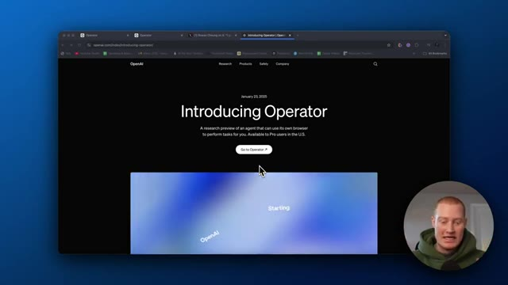
*⏱️ 00:00:06 — Page web officielle d'OpenAI présentant le nouvel outil "Operator" avec un bouton de redirection et la webcam du présentateur en bas à droite.*

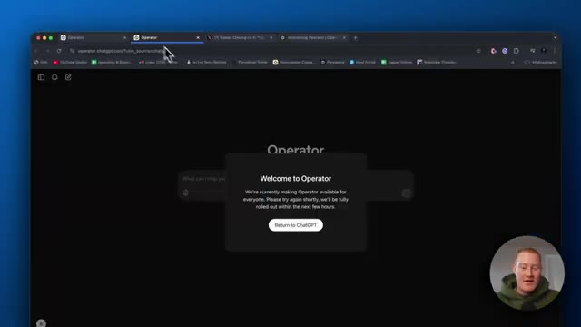
*⏱️ 00:00:17 — Interface d'Operator affichant une fenêtre pop-up de bienvenue indiquant que le déploiement est en cours, avec le présentateur visible en incrustation vidéo.*

---

### ⏱️ `[00:00:23 - 00:00:48]` | Segment #02

**🔊 Audio (Transcription Intégrale Mot pour Mot en Français) :**
> Vous n'avez pas besoin de payer pour le tester. Cependant, je n'y ai pas encore accès. Je devrais y avoir accès dans les prochaines heures. Je ferai bientôt une vidéo où je le teste moi-même pour que vous puissiez voir et ne pas avoir à dépenser d'argent pour le faire vous-même. Mais dans cette vidéo, je vais passer en revue certains des principaux cas d'utilisation que j'ai vus sur Twitter de personnes qui ont obtenu un accès anticipé à ChatGPT Operator afin que vous puissiez comprendre ce que c'est et les capacités qu'il possède réellement, car c'est absolument fou.

**👁️ Analyse Visuelle d'Écran (gemini-3.5-flash-lite) :**
**Interface & Outils** : Navigateur web affichant l'interface de l'outil Operator (OpenAI).

**Contenu textuel & Code** : Message textuel de la pop-up : "Welcome to Operator - We're currently making Operator available for everyone. Please try again shortly, we'll be fully rolled out within the next few hours" avec un bouton "Return to ChatGPT".

**Action / Démonstration** : Le présentateur présente l'interface d'Operator et le message de déploiement progressif en cours sur l'écran.

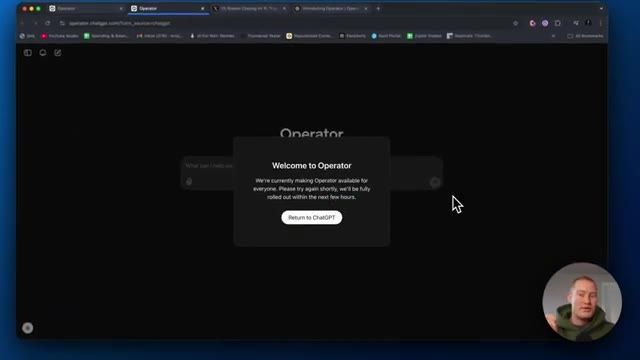
*⏱️ 00:00:29 — Capture d'écran montrant l'interface du navigateur affichant une pop-up de bienvenue de l'outil Operator avec un message d'attente de déploiement.*

---

### ⏱️ `[00:00:49 - 00:01:10]` | Segment #03

**🔊 Audio (Transcription Intégrale Mot pour Mot en Français) :**
> Donc, ce que je vais faire, c'est que je vais venir sur Twitter ici. Donc c'est Rowan Chung. Allez-y, suivez-le sur Twitter. Il a un compte formidable, il couvre toute l'actualité de l'IA, mais j'aime vraiment ce fil qu'il a décortiqué. Donc il semble qu'il ait eu un accès anticipé à ChatGPT Operator. Je vais simplement lire ce tweet et passer en revue les choses qu'il a remarquées. C'est le nouvel agent IA d'OpenAI qui agit de manière autonome sur le Web en votre nom.

**👁️ Analyse Visuelle d'Écran (gemini-3.5-flash-lite) :**
**Interface & Outils** : Navigateur web affichant la plateforme X (Twitter)

**Contenu textuel & Code** : Profil de Rowan Cheung avec ses abonnés (543.5K), la bio de sa newsletter "The Rundown", et un tweet vidéo en cours de lecture.

**Action / Démonstration** : Le présentateur navigue sur Twitter et survole le profil de Rowan Cheung pour le montrer à l'écran.

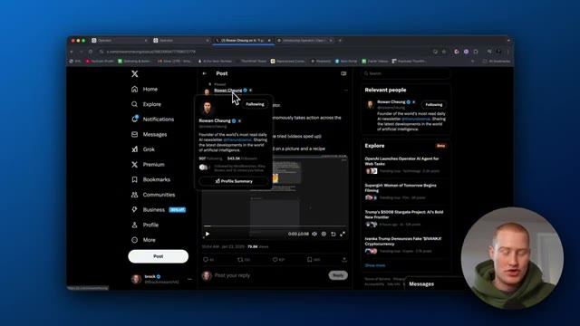
*⏱️ 00:00:54 — Capture d'écran montrant le fil Twitter (X) de Rowan Cheung avec une info-bulle de profil et une vidéo intégrée, ainsi que le présentateur en bas à droite.*

---

### ⏱️ `[00:01:10 - 00:01:29]` | Segment #04

**🔊 Audio (Transcription Intégrale Mot pour Mot en Français) :**
> Voici donc les neuf cas d'usage les plus impressionnants qu'il a essayés. Numéro un : commander des ingrédients pour le dîner à partir d'une photo et d'une recette. Donc, vous ne pouvez plus seulement demander à ChatGPT une recette et il vous donne une liste. Vous pouvez ensuite lui demander d'acheter les vrais ingrédients et de les commander. C'est la puissance d'Operator et de ces agents IA.

**👁️ Analyse Visuelle d'Écran (gemini-3.5-flash-lite) :**
**Interface & Outils** : Navigateur web affichant le réseau social X (Twitter).

**Contenu textuel & Code** : Publication de Rowan Cheung listant les 9 cas d'usage d'un nouvel agent IA d'OpenAI, avec le point numéro 1 en surbrillance : « Ordering dinner ingredients based on a picture and a recipe ».

**Action / Démonstration** : Navigation et présentation visuelle d'un tweet illustrant les cas d'usage de l'agent IA d'OpenAI.

*⏱️ 00:01:15 — Capture d'écran du navigateur affichant le réseau social X (anciennement Twitter) avec un post de Rowan Cheung présentant le premier cas d'usage d'un agent IA (« Ordering dinner ingredients based on a picture and a recipe »), avec la vidéo intégrée au centre et la pastille vidéo du présentateur en bas à droite.*

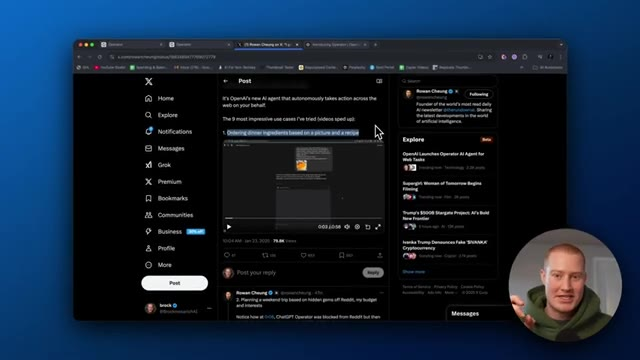
*⏱️ 00:01:20 — Capture d'écran identique montrant le post sur X, avec de légers mouvements de curseur et le présentateur s'exprimant dans l'encadré en bas à droite.*

---

### ⏱️ `[00:01:30 - 00:01:50]` | Segment #05

**🔊 Audio (Transcription Intégrale Mot pour Mot en Français) :**
> Très bien, donc on dirait que ce qu'il est en train de faire, c'est de remplir un panier. Il lui a demandé de remplir un panier avec ces ingrédients. Évidemment, cette vidéo est très accélérée. Donc ce qu'il fait, c'est qu'il ouvre un nouveau navigateur ici qui est en fait déployé sur le cloud. Donc ce n'est pas comme s'il fonctionnait dans votre Google Chrome. Et il est en train de chercher sur Walmart, tous ces différents ingrédients.

**👁️ Analyse Visuelle d'Écran (gemini-3.5-flash-lite) :**
**Interface & Outils** : Navigateur cloud Operator Browser, site web de Walmart

**Contenu textuel & Code** : Interface web de commande d'épicerie en ligne, barre de recherche et onglets de navigation

**Action / Démonstration** : Navigation automatisée vers une épicerie en ligne pour ajouter des ingrédients au panier

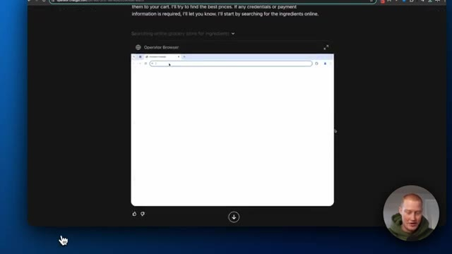
*⏱️ 00:01:35 — Vue d'un navigateur cloud (Operator Browser) intégré dans une interface sombre avec un présentateur en bas à droite.*

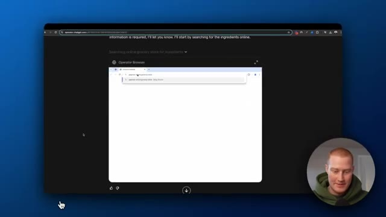
*⏱️ 00:01:40 — Le navigateur intégré commence à saisir une URL pour rechercher une épicerie en ligne.*

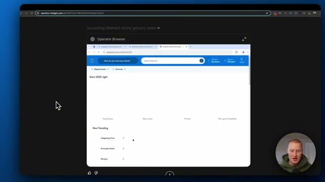
*⏱️ 00:01:45 — Le navigateur cloud accède au site d'une grande surface (Walmart) pour commencer les courses.*

---

### ⏱️ `[00:01:51 - 00:02:13]` | Segment #06

**🔊 Audio (Transcription Intégrale Mot pour Mot en Français) :**
> Comme vous pouvez le voir, il effectue une recherche sur le site web et il est en train de cliquer sur tous les ingrédients, tous les ingrédients dont vous avez besoin, et de les ajouter au panier. Il est en train de les ajouter au panier ici. Et ensuite, faisons défiler. Il va faire cela pour tous les ingrédients. Et maintenant, nous avons un panier complet, 40,60 dollars pour absolument chaque ingrédient qui figurait sur cette liste que ChatGPT a réellement créée.

**👁️ Analyse Visuelle d'Écran (gemini-3.5-flash-lite) :**
**Interface & Outils** : Navigateur web automatisé (Operator Browser) affichant le site e-commerce de Walmart.

**Contenu textuel & Code** : Résultats de recherche d'ingrédients de cuisine (cannelle, crème fraîche, crème lourde), prix des articles, boutons d'ajout au panier et récapitulatif du panier d'achat avec montant total.

**Action / Démonstration** : Recherche automatique d'ingrédients, sélection et ajout au panier des produits nécessaires pour une recette.

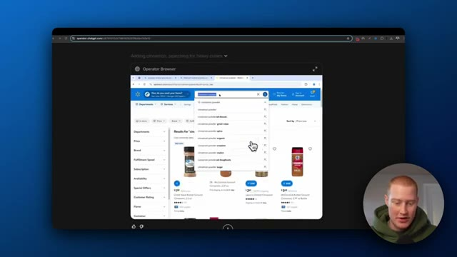
*⏱️ 00:01:56 — Une capture d'écran montrant une recherche de poudre de cannelle sur le site web de Walmart via un navigateur automatisé.*

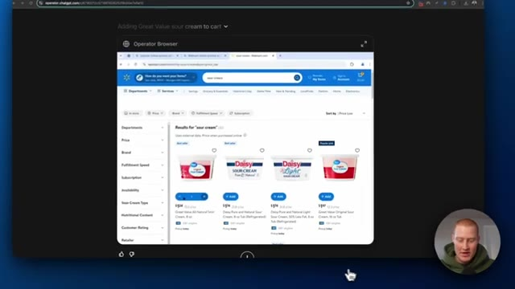
*⏱️ 00:02:02 — Une vue du panier d'achat avec l'ajout de crème sûre (sour cream) sur le site e-commerce de Walmart.*

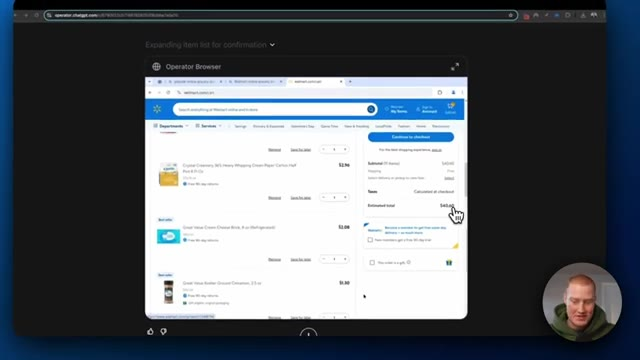
*⏱️ 00:02:08 — L'affichage du panier final avec le récapitulatif des articles sélectionnés et le total estimé de la commande.*

---

### ⏱️ `[00:02:13 - 00:02:46]` | Segment #07

**🔊 Audio (Transcription Intégrale Mot pour Mot en Français) :**
> Voici le premier cas d'usage. C'est génial. Plus besoin de chercher vos propres courses. Vous pouvez utiliser l'opérateur ChatGPT pour les commander à votre place. Numéro deux, planifier un voyage d'un week-end sur des pépites cachées de Reddit avec votre budget et vos intérêts. En gros, ce qu'il demande, c'est qu'il demande à l'opérateur ChatGPT de planifier un week-end en Autriche sur la base de pépites cachées de Reddit. Il a expliqué son point de départ, son budget, etc., et qu'il adore le plein air. Ce que ça va faire maintenant, c'est que ça va chercher sur Reddit, ce qui est un excellent point ici, donc certaines applications ou certains sites Web sont bloqués par l'opérateur ChatGPT à l'heure actuelle.

**👁️ Analyse Visuelle d'Écran (gemini-3.5-flash-lite) :**
**Interface & Outils** : Navigateur web, interface X (Twitter), interface Operator Browser (ChatGPT Operator).

**Contenu textuel & Code** : Publication textuelle sur X détaillant la planification de voyage et message d'erreur de sécurité réseau de Reddit ("You've been blocked by network security").

**Action / Démonstration** : Navigation sur X pour présenter un cas d'usage de l'agent IA, puis affichage de la tentative de contournement ou du blocage rencontré par ChatGPT Operator sur Reddit.

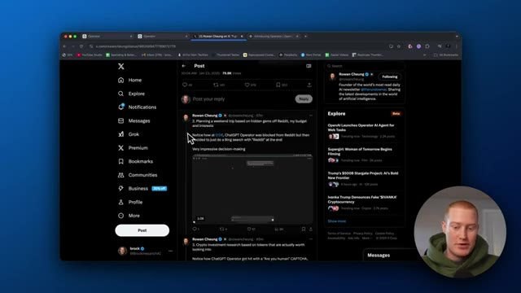
*⏱️ 00:02:21 — Capture d'écran du réseau social X (Twitter) montrant un post de Rowan Cheung sur l'agent IA ChatGPT Operator, illustrant le cas d'usage de la planification de week-end.*

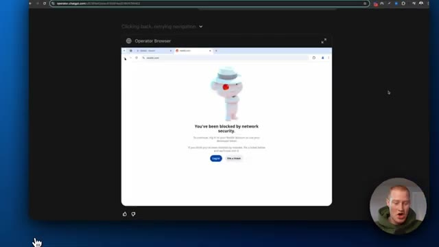
*⏱️ 00:02:38 — Capture d'écran du navigateur intégré Operator Browser affichant un message de blocage de sécurité réseau sur le site Reddit.*

---

### ⏱️ `[00:02:46 - 00:03:06]` | Segment #08

**🔊 Audio (Transcription Intégrale Mot pour Mot en Français) :**
> Donc vous ne pouvez pas utiliser YouTube par exemple pour une raison quelconque et c'est pareil avec Reddit. Donc ce qu'il a fait, c'est qu'il a réellement identifié qu'il ne peut pas utiliser Reddit et il est allé sur Bing en fait, et il est en train de chercher ici maintenant parce qu'il a identifié que, évidemment, vous ne pouvez pas chercher sur Reddit, mais la meilleure option suivante est tout simplement de chercher sur Bing.

**👁️ Analyse Visuelle d'Écran (gemini-3.5-flash-lite) :**
**Interface & Outils** : Navigateur web virtuel (Operator Browser) intégré à une interface de type ChatGPT/agent IA.

**Contenu textuel & Code** : Page de blocage de sécurité de Reddit ("You've been blocked by network security") avec des boutons de connexion.

**Action / Démonstration** : L'agent IA tente d'accéder à Reddit mais fait face à un blocage de sécurité, nécessitant une alternative comme Bing.

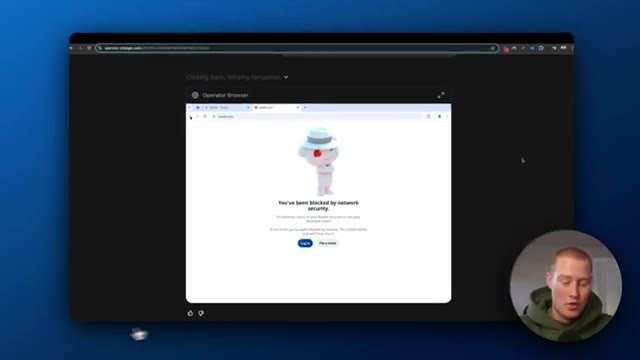
*⏱️ 00:02:51 — Capture montrant un navigateur virtuel affichant une page d'erreur Reddit avec le message "You've been blocked by network security".*

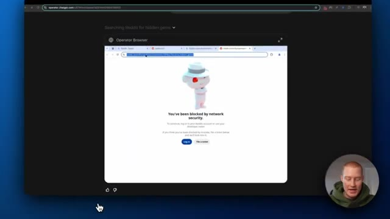
*⏱️ 00:02:56 — Capture similaire montrant la sélection de l'URL dans le navigateur virtuel suite au blocage par la sécurité réseau de Reddit.*

---

### ⏱️ `[00:03:06 - 00:03:39]` | Segment #09

**🔊 Audio (Transcription Intégrale Mot pour Mot en Français) :**
> Et vous pouvez voir ce qu'il est en train de faire, c'est qu'il trouve toutes ces différentes perles rares en faisant en quelque sorte des recherches ici. Et maintenant, il l'ajoute en fait à une liste de tous ces endroits où il devrait voyager en fonction de ses critères de voyage. C'est donc un cas assez intéressant. Évidemment, il était juste en train de faire des recherches sur Internet là. Numéro trois : une recherche d'investissement en cryptomonnaies basée sur des jetons qui valent vraiment la peine d'être examinés. On dirait que ChatGPT Operator s'est fait piéger par un captcha « Êtes-vous un humain », euh et lui a ensuite envoyé une notification pour qu'il confirme. C'est donc quelque chose à mentionner, donc ChatGPT Operator, il y a en quelque sorte un

**👁️ Analyse Visuelle d'Écran (gemini-3.5-flash-lite) :**
**Interface & Outils** : Navigateur web, interface de ChatGPT Operator et réseau social X (Twitter).

**Contenu textuel & Code** : Liste numérotée de destinations touristiques en Autriche (Gross Walsertal, Bregenzerwald, etc.) générée par l'agent IA.

**Action / Démonstration** : L'agent IA navigue sur le web, recherche des recommandations de voyage et compile une liste personnalisée basée sur les critères de l'utilisateur.

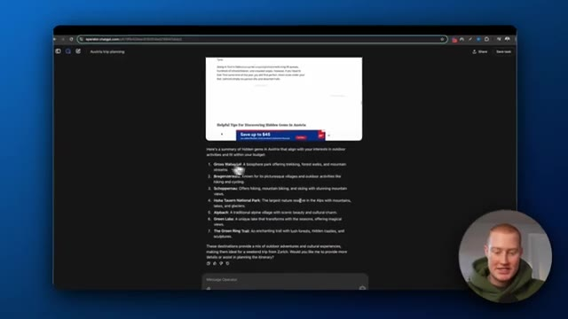
*⏱️ 00:03:15 — Capture d'écran montrant l'interface d'un navigateur affichant ChatGPT Operator avec une liste de suggestions de voyage et de "perles rares" en Autriche.*

---

### ⏱️ `[00:03:39 - 00:04:00]` | Segment #10

**🔊 Audio (Transcription Intégrale Mot pour Mot en Français) :**
> une fonctionnalité pratique où, si elle rencontre un obstacle, vous pouvez réellement prendre le relais de quoi que ce soit qu'elle est en train de faire, euh, et de la tâche qu'elle exécute, donc vous pouvez voir qu'elle va sur le navigateur de l'opérateur. Elle est en train de chercher de nouveaux jetons mèmes. Et juste ici, vous vous heurtez au captcha et cela l'invite à prendre le contrôle afin qu'il puisse ensuite aller de l'avant et faire le captcha lui-même.

**👁️ Analyse Visuelle d'Écran (gemini-3.5-flash-lite) :**
**Interface & Outils** : Interface web d'Operator (chatgpt.com) et navigateur intégré (Operator Browser).

**Contenu textuel & Code** : Invite textuelle concernant la recherche d'investissement sur les nouveaux tokens crypto et les résultats de moteur de recherche Microsoft Bing.

**Action / Démonstration** : Navigation autonome de l'agent IA ouvrant une page de recherche web et rencontrant un obstacle de sécurité (CAPTCHA).

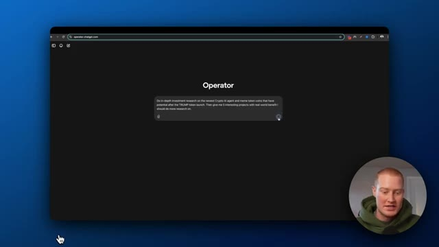
*⏱️ 00:03:44 — Interface principale d'Operator affichant le champ de saisie d'un prompt utilisateur sur fond sombre.*

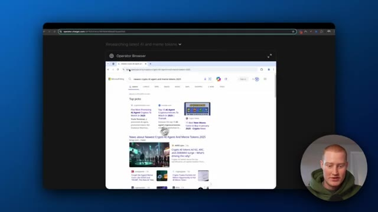
*⏱️ 00:03:49 — Fenêtre intégrée d'Operator Browser affichant les résultats d'une recherche sur les crypto-monnaies.*

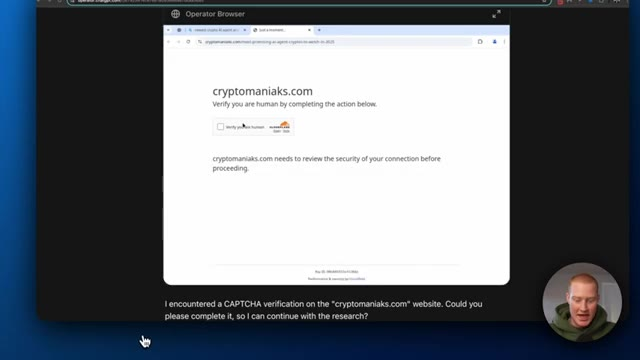
*⏱️ 00:03:55 — Page web affichant un test CAPTCHA (Cloudflare) avec un message textuel de l'assistant demandant une intervention humaine.*

---

### ⏱️ `[00:04:00 - 00:04:36]` | Segment #11

**🔊 Audio (Transcription Intégrale Mot pour Mot en Français) :**
> Et encore une fois, cela fournit juste une liste de tous ces différents outils ici ou de tous ces différents jetons d'IA, ce qui est plutôt cool. Numéro quatre, réserver un vol aller simple de Zurich à Vienne en utilisant l'intégration de booking. Très bien, alors jetons un œil à ce flux de travail ici. On dirait qu'il va sur booking.com. Il effectue cette recherche dans le navigateur web. Il recherche en fait des vols de Zurich à Vienne et il sélectionne la date qu'il a réellement fournie à ChatGPT. En gros, ce qu'il a fait ici, c'est qu'il a cartographié toutes les différentes options pour que vous puissiez voir que Swiss Airlines propose un vol direct mais qu'il coûte 424 dollars. Il indique le départ

**👁️ Analyse Visuelle d'Écran (gemini-3.5-flash-lite) :**
**Interface & Outils** : Navigateur web, site Booking.com et interface de chat de l'agent IA (OpenAI Operator).

**Contenu textuel & Code** : Formulaire de recherche de vol rempli (départ Zurich) et liste détaillée des options de vols avec horaires, durées et prix.

**Action / Démonstration** : Navigation automatisée sur Booking.com et sélection d'un vol aller simple par l'agent IA.

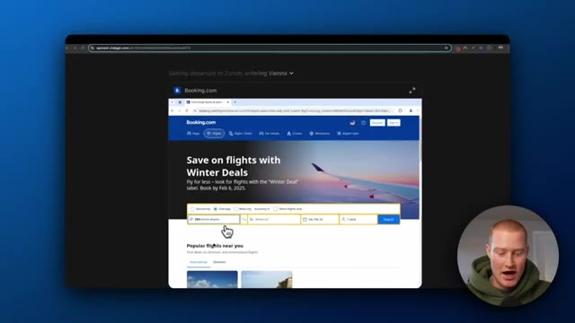
*⏱️ 00:04:18 — Interface de Booking.com affichant la recherche de vol de Zurich à Vienne automatisée par l'agent IA.*

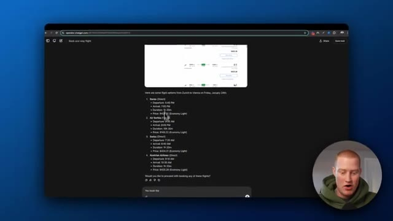
*⏱️ 00:04:27 — Interface textuelle affichant la liste des options de vol générées par l'agent IA pour le trajet Zurich-Vienne.*

---

### ⏱️ `[00:04:36 - 00:05:14]` | Segment #12

**🔊 Audio (Transcription Intégrale Mot pour Mot en Français) :**
> l'heure est, l'heure d'arrivée et la durée totale. Air Serbia, c'est 145 dollars mais ça prend 10 heures et 30 minutes. Donc il détaille tout cela. Chachapiti demande, aimeriez-vous procéder à la réservation de l'un de ces vols ? Et ensuite il répond et dit, oui, réserve le troisième vol. Et il va en fait aller jusqu'au bout, sélectionner ce voyage puis essayer de le réserver pour lui. On dirait qu'il a rencontré quelques problèmes où il n'a pas forcément aimé le paiement. Vous devez évidemment saisir vos propres informations de carte de crédit. Donc vous pouvez simplement reprendre le contrôle et saisir ces informations vous-même et il réservera le voyage automatiquement. Mais c'est vraiment génial. Je déteste coordonner les vols. Je viens en fait juste

**👁️ Analyse Visuelle d'Écran (gemini-3.5-flash-lite) :**
**Interface & Outils** : Navigateur web affichant une interface d'agent conversationnel IA (Operator ChatGPT) et le site Booking.com.

**Contenu textuel & Code** : Liste de propositions de vols avec horaires, durées, prix (Swiss, Air Serbia, Austrian Airlines) et récapitulatif de réservation.

**Action / Démonstration** : Sélection et confirmation par l'utilisateur du troisième vol pour procéder automatiquement à la réservation via l'agent IA.

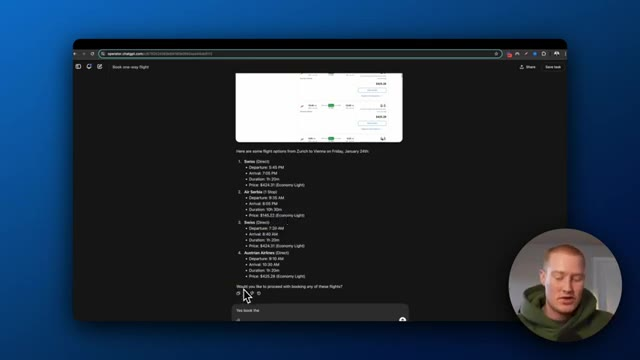
*⏱️ 00:04:46 — Image montrant une liste de vols de Zurich à Vienne générée par l'agent IA, avec les options Swiss, Air Serbia et Austrian Airlines.*

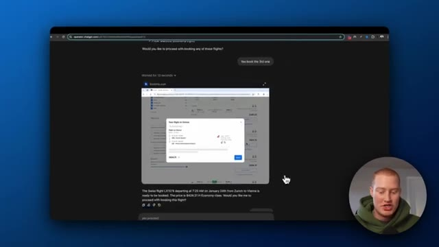
*⏱️ 00:04:55 — Image montrant l'agent IA interagissant avec Booking.com pour préparer la réservation du vol Swiss sélectionné.*

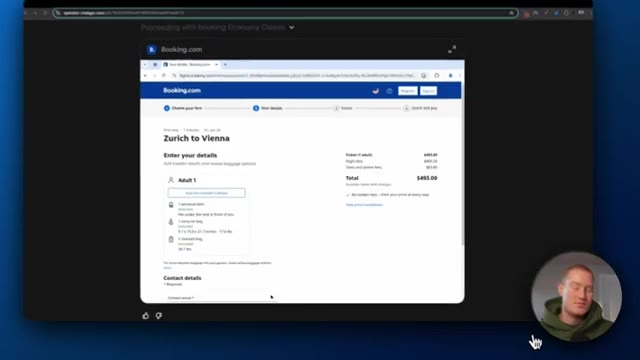
*⏱️ 00:05:04 — Image montrant la page de saisie des détails du passager et du paiement sur Booking.com pour le vol Zurich-Vienne.*

---

### ⏱️ `[00:05:14 - 00:05:48]` | Segment #13

**🔊 Audio (Transcription Intégrale Mot pour Mot en Français) :**
> j'étais en Thaïlande et c'était le plus gros cauchemar de ma vie. J'aurais pu utiliser Chachabut pour trouver l'itinéraire le moins cher et le plus rapide pour moi. J'aurais fait ça. Mais Operator n'était pas disponible il y a deux semaines. Très bien. Je ne vais donc pas passer en revue d'autres de ces cas d' usage que Rowan a réellement trouvés. Mais en gros, il a dit qu'il était très impressionné par la version préliminaire de recherche d'Operator. Il adore le fait qu'il puisse accomplir des tâches pour moi pendant que je fais un autre travail et qu'il me prévienne simplement lorsqu'il a besoin que je reprenne le relais. C'est donc quelque chose auquel nous serons probablement confrontés, il ne peut probablement pas gérer toutes ces tâches complexes à l'heure actuelle. Il est en mode aperçu, mais il vous préviendra quand

**👁️ Analyse Visuelle d'Écran (gemini-3.5-flash-lite) :**
**Interface & Outils** : Navigateur web affichant la plateforme X (Twitter) et une vidéo intégrée montrant l'interface d'OpenAI Operator.

**Contenu textuel & Code** : Publications sur X concernant les fonctionnalités d'OpenAI Operator, notamment la réservation de vols et la planification de rendez-vous, avec le profil de Rowan Cheung visible.

**Action / Démonstration** : Navigation et présentation visuelle d'un tweet et d'une vidéo de démonstration illustrant les capacités d'un agent IA pour les tâches web.

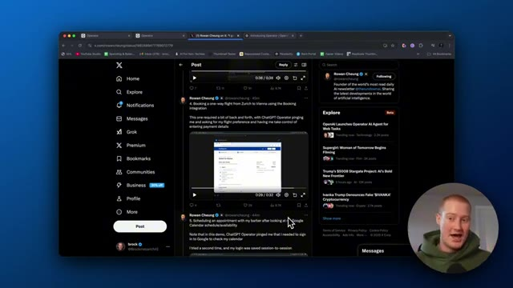
*⏱️ 00:05:22 — Capture d'écran montrant le fil d'actualité de la plateforme X (anciennement Twitter) avec un post de Rowan Cheung présentant une vidéo de démonstration d'Operator, tandis que le présentateur apparaît en bas à droite.*

---

### ⏱️ `[00:05:48 - 00:06:08]` | Segment #14

**🔊 Audio (Transcription Intégrale Mot pour Mot en Français) :**
> doit prendre le relais. Donc il pouvait s'occuper d'une grande partie de ce travail de fond que, vous savez, vous n'avez pas, vous n'aviez pas nécessairement à faire, mais quand il a besoin que vous fassiez quelque chose, tout ce que vous avez à faire, c'est simplement de prendre le relais et ensuite de le rendre à l'opérateur ChatGPT. Donc c'est plutôt génial les gars. D'accord. Donc ils déployent ça en ce moment même pour les utilisateurs pro. Vous devez donc payer 200 dollars par mois pour avoir réellement accès à ceci.

**👁️ Analyse Visuelle d'Écran (gemini-3.5-flash-lite) :**
**Interface & Outils** : Navigateur web affichant X (Twitter) et le site d'OpenAI.

**Contenu textuel & Code** : Publication sur X concernant l'agent IA Operator et page d'introduction officielle d'OpenAI datée du 23 janvier 2025.

**Action / Démonstration** : Navigation sur le web et présentation des fonctionnalités de l'agent IA Operator par le présentateur.

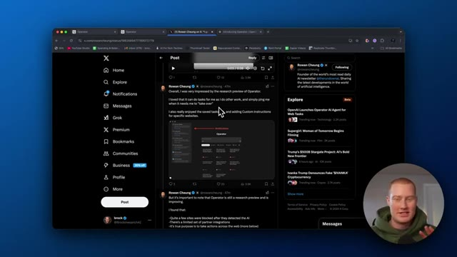
*⏱️ 00:05:53 — Capture d'écran du navigateur affichant un fil d'actualités X (Twitter) avec un post de Rowan Cheung sur Operator.*

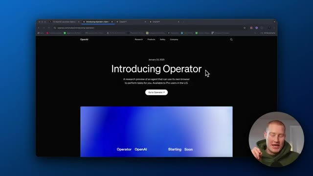
*⏱️ 00:06:03 — Capture d'écran du navigateur affichant la page de présentation officielle d'OpenAI pour l'outil Operator.*

---

### ⏱️ `[00:06:08 - 00:06:30]` | Segment #15

**🔊 Audio (Transcription Intégrale Mot pour Mot en Français) :**
> Mais les gars, c'est un aperçu en direct des prochaines étapes vers lesquelles nous allons dans le monde de l'intelligence artificielle. Avoir des agents d'IA qui peuvent effectuer des tâches pour nous. Donc les gars, si vous voulez apprendre comment vous pouvez réellement exploiter ces nouvelles technologies et construire des agents d'IA qui travaillent pour vous, cette chaîne est parfaite pour cela. C'est AI for non-techies. J'explique l'IA pour les personnes non techniques.

**👁️ Analyse Visuelle d'Écran (gemini-3.5-flash-lite) :**
**Interface & Outils** : Navigateur web affichant le site officiel d'OpenAI (openai.com).

**Contenu textuel & Code** : Texte de présentation : "Introducing Operator" et la description d'un agent de recherche utilisant son propre navigateur.

**Action / Démonstration** : Présentation de la page web annonçant le nouvel agent IA d'OpenAI.

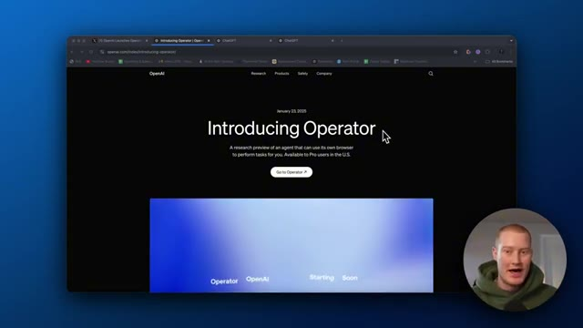
*⏱️ 00:06:14 — Capture d'écran du navigateur affichant la page d'annonce d'OpenAI pour l'outil Operator avec le présentateur en incrustation.*

---

### ⏱️ `[00:06:30 - 00:06:48]` | Segment #16

**🔊 Audio (Transcription Intégrale Mot pour Mot en Français) :**
> Je suis une personne non technique, mais j'utilise l'IA tous les jours pour devenir plus productif, plus efficace et développer mon entreprise. Donc si cela vous correspond, assurez-vous de vous abonner. Mais les gars, 2025 va être l'année des agents IA et je suis tellement enthousiaste à l'idée de couvrir cela sur cette chaîne et de voir des choses incroyables que je pourrais construire et vous présenter, les gars.

**👁️ Analyse Visuelle d'Écran (gemini-3.5-flash-lite) :**
**Interface & Outils** : Navigateur web affichant le site d'OpenAI.

**Contenu textuel & Code** : Texte principal : "Introducing Operator" et description d'un agent de recherche pour navigateur, avec un bouton "Go to Operator".

**Action / Démonstration** : Présentation visuelle de l'annonce d'OpenAI concernant les agents IA sur le web.

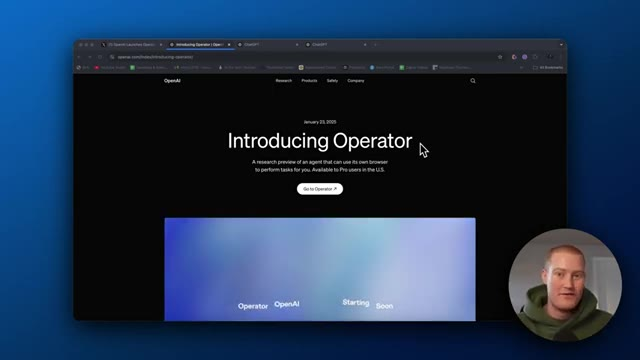
*⏱️ 00:06:34 — Capture d'écran montrant la page web d'OpenAI présentant "Operator", un agent IA pour le navigateur.*

---

### ⏱️ `[00:06:48 - 00:06:58]` | Segment #17

**🔊 Audio (Transcription Intégrale Mot pour Mot en Français) :**
> Donc, cela étant dit, restez à l'écoute pour ma prochaine vidéo où je vais réellement tester cela moi-même pour que vous n'ayez pas à payer et à le tester vous-même. Donc, cela étant dit, je vous vois les gars dans la prochaine vidéo.

**👁️ Analyse Visuelle d'Écran (gemini-3.5-flash-lite) :**
**Interface & Outils** : Navigateur web affichant la page officielle d'OpenAI.

**Contenu textuel & Code** : Texte « Introducing Operator » et une description de l'agent de recherche ainsi qu'un bouton « Go to Operator ».

**Action / Démonstration** : Navigation et présentation de la page web du nouvel outil OpenAI.

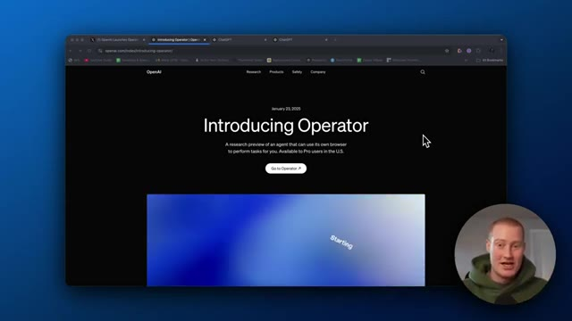
*⏱️ 00:06:51 — Capture d'écran montrant le site web d'OpenAI avec la page de présentation d'Operator.*

---

