# 🎬 Building an AI Agent to Replace My Assistant (In 12 Minutes)

> **Chaîne** : [Brock Mesarich | AI for Non Techies](https://www.youtube.com/@BrockMesarich)  
> **Lien YouTube** : [https://www.youtube.com/watch?v=NPiPCL2gmn4](https://www.youtube.com/watch?v=NPiPCL2gmn4)  
> **Date de publication** : 20250124  
> **Durée** : 00:15:45  
> **Identifiant vidéo** : `NPiPCL2gmn4`  
> **Transcription & Analyse** : `whisper-v3-large-turbo+gemini-3.5-flash-lite`  

---

## 📌 Synthèse Exécutive & Outils

### 💡 Résumé
Cette vidéo explore la création d'un agent IA autonome sur Zapier pour automatiser des tâches administratives complexes, telles que la gestion des e-mails, le tri de la boîte de réception et la planification de réunions. À travers une approche pratique, Brock Mesarich démontre comment un utilisateur non technique peut concevoir, configurer et déployer une infrastructure d'agents intelligents pour maximiser sa productivité et s'adapter aux mutations technologiques actuelles.

L'démonstration se concentre sur la mise en place d'un « agent administrateur » capable d'analyser le contenu d'un e-mail entrant, d'identifier sa nature (spam, partenariat, prospection ou support), d'appliquer dynamiquement des libellés contextuels et de rédiger des brouillons de réponse personnalisés. En connectant des sources de données externes telles qu'un guide de style textuel stocké sur Google Docs, l'agent apprend à imiter le ton et la syntaxe exacts de l'utilisateur pour maintenir une communication authentique.

Cette méthodologie d'automatisation intelligente s'inscrit dans une vision stratégique où l'individu, épausté par une flotte d'agents spécialisés, peut opérer avec l'efficacité d'une structure d'une taille nettement supérieure. Le processus met en lumière l'importance d'un prompt engineering structuré en langage naturel pour orchestrer des flux de travail décisionnels sans nécessiter de compétences en programmation.

### 🛠️ Outils, Modèles & Logiciels Présentés
* **Zapier Agents** : Plateforme no-code permettant de concevoir et de déployer des agents autonomes capables d'exécuter des flux de travail complexes en langage naturel.
* **Gmail** : Outil de messagerie intégré comme source de déclenchement pour l'analyse des e-mails entrants et l'application automatisée de libellés.
* **Google Docs** : Solution de stockage cloud utilisée pour alimenter l'agent en sources de données contextuelles (guides de style de messagerie).
* **Slack** : Plateforme de messagerie collaborative mentionnée pour la réception de notifications et l'automatisation des réponses de l'agent.
* **ChatGPT / Claude / Gemini / Grok** : Modèles d'intelligence artificielle de pointe évoqués dans l'écosystème global pour le traitement du langage naturel et la génération de contenu.
* **Make / n8n** : Plateformes alternatives d'automatisation des flux de travail et d'intégration de systèmes tiers.
* **Airtable** : Base de données relationnelle flexible utilisable comme source de contexte pour alimenter les agents IA.

### 🔑 Points Clés & Enseignements Stratégiques
* **Paradigme de l'agent unique** : Structurer son activité autour d'une équipe d'agents IA autonomes permet de démultiplier sa puissance opérationnelle et d'atteindre des niveaux de productivité comparables à des structures d'élite.
* **Spécialisation des agents** : Développer des agents dédiés à des missions précises (recherche de contenu, gestion administrative, support client) garantit une exécution plus fiable et ciblée.
* **Utilisation de sources de données contextuelles** : Alimenter un agent avec des documents de référence (ex. : guide de style de messagerie) permet d'aligner parfaitement ses productions textuelles sur le ton et la voix de l'utilisateur.
* **Approche déclarative en langage naturel** : Concevoir les flux de travail et les comportements de l'agent en décrivant les instructions textuellement, exactement comme on le ferait pour former un nouvel assistant humain.
* **Hiérarchisation et filtrage des flux entrants** : Configurer une étape d'analyse initiale pour classifier catégoriquement les e-mails (partenariats, spam, ventes, réunions) avant d'engager toute action de réponse.
* **Optimisation de la boîte de réception** : Automatiser l'application de libellés et d'étiquettes dans Gmail pour segmenter instantanément les opportunités à forte valeur ajoutée et éliminer le bruit informationnel.
* **Gestion conditionnelle des réponses** : Programmer l'agent pour qu'il s'abstienne de rédiger des brouillons sur les e-mails non pertinents (comme le démarchage ou le spam), économisant ainsi des ressources et du temps de relecture.
* **Exploration contextuelle des historiques** : Permettre à l'agent d'analyser les fils de discussion antérieurs pour extraire le contexte historique nécessaire à la rédaction de réponses pertinentes et personnalisées.
* **Automatisation de la planification** : Intégrer la recherche de créneaux disponibles directement dans le flux de l'agent pour fluidifier la coordination des réunions sans intervention manuelle.
* **Accessibilité pour les non-techniciens** : Démocratiser l'usage des technologies d'automatisation avancées grâce à des interfaces intuitives et conversationnelles, abaissant la barrière à l'entrée de l'IA générative.

---

## ⏱️ Chronologie & Transcription Complète Audio & Visuelle (Mot pour Mot)

### ⏱️ `[00:00:00 - 00:00:37]` | Segment #01

**🔊 Audio (Transcription Intégrale Mot pour Mot en Français) :**
> La plupart des gens savent que les agents d'IA vont être l'invention la plus influente de notre époque. Il est incroyablement important de vous préparer pour ne pas perdre votre emploi à cause d'eux. Mais voici le fait. Si vous vous positionnez correctement avec une équipe d'agents d'IA, vous serez dix fois plus puissant que vous ne l'êtes aujourd'hui. Des entreprises d'un milliard de dollars seront fondées par des équipes d'une seule personne et une équipe d'agents d'IA. Alors pourquoi est-ce que je dis tout cela ? Dans cette vidéo, j'ai créé un agent pour gérer toutes mes tâches administratives au lieu d'embaucher une vraie personne. Les agents Zapier sont l'introduction parfaite pour créer vous-même des agents. Je suis une personne non technique et sur cette chaîne YouTube, je couvre comment

**👁️ Analyse Visuelle d'Écran (gemini-3.5-flash-lite) :**
**Interface & Outils** : Navigateur web, plateforme d'automatisation Zapier Agents, interface de configuration de workflow d'e-mails.

**Contenu textuel & Code** : Instructions d'automatisation pour un agent IA (brouillon de réponse Gmail basé sur le style de Brock), déclencheur Gmail (New Email), données source et actions (Gmail, Google Calendar).

**Action / Démonstration** : Présentation de la configuration d'un agent d'IA pour l'automatisation des e-mails dans le cadre d'un tutoriel.

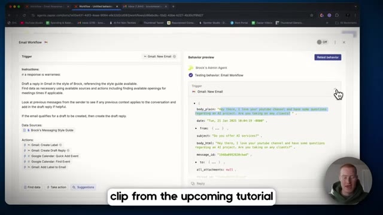
*⏱️ 00:00:27 — Capture d'écran montrant l'interface de Zapier Agents avec un workflow d'e-mail configuré ("Email Workflow") et un aperçu du comportement ("Behavior preview").*

---

### ⏱️ `[00:00:37 - 00:00:57]` | Segment #02

**🔊 Audio (Transcription Intégrale Mot pour Mot en Français) :**
> les non-techniciens comme moi peuvent garder une longueur d'avance sur l'adoption de l'IA. Dans cette vidéo, je vais vous montrer comment utiliser Zapier Agents afin que vous puissiez commencer à vous bâtir une équipe et rester dans le top 1 % des premiers adoptants de l'IA. Très bien, plongeons-nous là-dedans. Très bien, alors allons-y et connectons-nous d'abord à notre compte Zapier. Donc si vous n'avez pas encore de compte, assurez-vous de vous inscrire.

**👁️ Analyse Visuelle d'Écran (gemini-3.5-flash-lite) :**
**Interface & Outils** : Navigateur web affichant l'interface de Zapier (tableau de bord des Zaps).

**Contenu textuel & Code** : Liste de flux de travail automatisés ("Communication Agent Messages Table-Zap 1", "Lead Research AI", etc.), icônes d'applications connectées et statuts.

**Action / Démonstration** : Navigation et présentation du tableau de bord Zapier pour la création d'agents et d'automatisations.

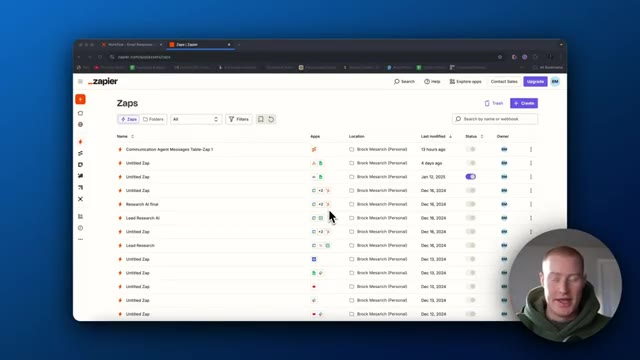
*⏱️ 00:00:52 — L'interface du tableau de bord Zapier affichant la liste des "Zaps" de l'utilisateur avec le présentateur visible en incrustation (picture-in-picture) dans le coin inférieur droit.*

---

### ⏱️ `[00:00:57 - 00:01:22]` | Segment #03

**🔊 Audio (Transcription Intégrale Mot pour Mot en Français) :**
> Il y a un lien dans la description. Cependant, au lieu d'aller sur les Zaps, si vous connaissez cette plateforme, vous avez peut-être utilisé des Zaps pour automatiser vos flux de travail. C'est un peu différent de cela. Nous allons donc en fait aller sur le côté gauche et venir sur les agents. Les agents sont un tout nouveau produit sur lequel Zapier travaille réellement. Afin de créer des agents autonomes, je pourrais faire des choses pour vous avec l'IA, évidemment. Donc, tout d'abord, ce que je vais faire, c'est que je vais vous montrer un exemple d'un agent précédent que j'ai réellement créé.

**👁️ Analyse Visuelle d'Écran (gemini-3.5-flash-lite) :**
**Interface & Outils** : Navigateur web affichant l'interface de la plateforme Zapier et l'interface de Zapier Agents.

**Contenu textuel & Code** : Liste de Zaps existants ("Communication Agent Messages Table-Zap 1", "Research AI final", "Lead Research AI") et messages d'accueil de l'agent d'IA (« Hi Brock, I'm looking forward to working together... »).

**Action / Démonstration** : Navigation depuis le tableau de bord des Zaps classiques de Zapier vers la section dédiée aux agents d'intelligence artificielle.

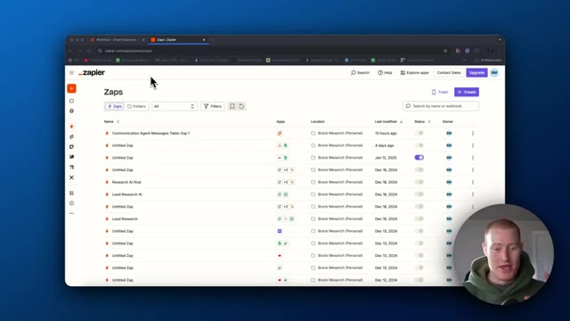
*⏱️ 00:01:04 — Interface principale de Zapier montrant la liste des Zaps (automatisations de flux de travail) avec le panneau de configuration latéral.*

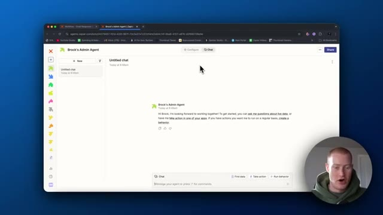
*⏱️ 00:01:16 — Interface utilisateur de l'agent Zapier (Brock's Admin Agent) affichant un chat interactif pour dialoguer avec l'agent d'IA.*

---

### ⏱️ `[00:01:22 - 00:01:43]` | Segment #04

**🔊 Audio (Transcription Intégrale Mot pour Mot en Français) :**
> ainsi vous pouvez comprendre exactement comment ceux-ci fonctionnent et comment nous pourrions configurer cela pour nous-mêmes. Vous pouvez donc voir que j'ai un agent de recherche de contenu ici. Donc cet agent recherche réellement de nouvelles actualités sur l'IA et trouve des idées de contenu pour moi. Et donc une chose que je veux mentionner, c'est que cela fonctionne de manière autonome. Chaque jour, il fait cela en pilotage automatique, trouve des idées pour que je crée du contenu.

**👁️ Analyse Visuelle d'Écran (gemini-3.5-flash-lite) :**
**Interface & Outils** : Navigateur web affichant l'interface de configuration d'un agent de recherche.

**Contenu textuel & Code** : Champs de configuration d'un agent IA (« Name », « Description », « Data sources », « Behaviors », « AI Trends Video Ideas Daily »).

**Action / Démonstration** : Présentation et explication des paramètres et fonctionnalités de l'agent de recherche de contenu par le créateur.

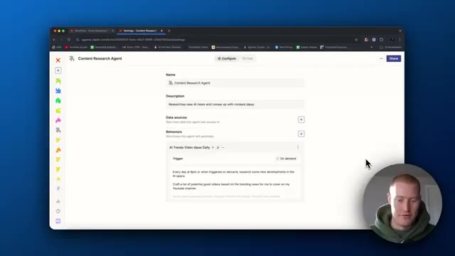
*⏱️ 00:01:27 — Vue d'ensemble de l'interface d'un agent de recherche de contenu avec le présentateur en médaillon.*

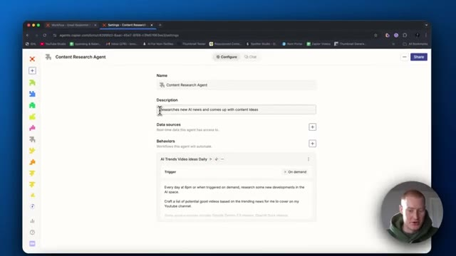
*⏱️ 00:01:33 — Gros plan sur le champ de description de l'agent de recherche de contenu en cours d'édition.*

*⏱️ 00:01:38 — Aperçu de l'interface de configuration de l'agent affichant les sources de données et les comportements.*

---

### ⏱️ `[00:01:43 - 00:02:08]` | Segment #05

**🔊 Audio (Transcription Intégrale Mot pour Mot en Français) :**
> Et fondamentalement, ce que je dois vous montrer ici, c'est qu'il y a de multiples petites sections sur lesquelles nous devons nous concentrer. Il y a donc des sources de données. Nous pourrions alimenter notre agent IA avec n'importe quel contexte que nous voulons. Vous savez, jetons un œil à certaines de ces différentes sources que nous pourrions télécharger. Nous pourrions donc télécharger un fichier sur Airtable. Nous pourrions télécharger notre CRM. Nous pourrions télécharger des documents Google. Je vais vous montrer plus tard dans cette vidéo comment j'exploite et utilise réellement cela dans mon agent administratif que je vais construire ici dans un petit moment.

**👁️ Analyse Visuelle d'Écran (gemini-3.5-flash-lite) :**
**Interface & Outils** : Navigateur web affichant l'interface de configuration d'un agent IA (Zapier Central / Agents).

**Contenu textuel & Code** : Paramètres d'un agent nommé « Content Research Agent », incluant le nom, la description, les sources de données (« Data sources »), les comportements (« Behaviors ») et un déclencheur (« Trigger »).

**Action / Démonstration** : Le présentateur survole et présente les différentes sections de configuration de l'agent IA, notamment les sources de données.

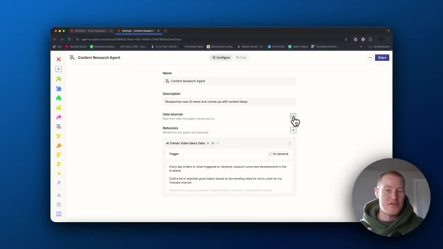
*⏱️ 00:01:50 — Interface de configuration d'un agent IA (« Content Research Agent ») avec un curseur pointant sur le bouton d'ajout de sources de données.*

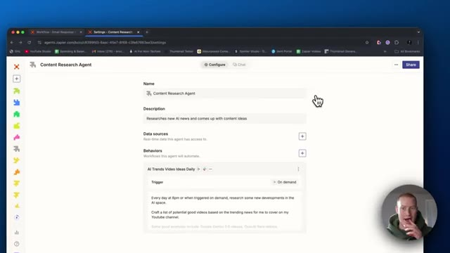
*⏱️ 00:02:02 — La même interface de configuration de l'agent IA avec le curseur se déplaçant vers le haut de la page.*

---

### ⏱️ `[00:02:08 - 00:02:33]` | Segment #06

**🔊 Audio (Transcription Intégrale Mot pour Mot en Français) :**
> Donc, la prochaine chose sur laquelle nous voulons nous concentrer, ce sont les comportements. Donc, ce sont les flux de travail que notre agent va automatiser. Et si vous voulez créer un comportement, vous venez ici, vous cliquez sur ce bouton plus. Mais je vais vous montrer dès maintenant comment cela fonctionne. Donc, voilà. Nous sommes invités à faire cette première chose ici, qui est notre déclencheur. Nous pourrions donc soit l'avoir à la demande, où nous pourrions simplement taper avec notre agent IA et simplement poser une question et dire, hé, trouve des idées de contenu pour moi.

**👁️ Analyse Visuelle d'Écran (gemini-3.5-flash-lite) :**
**Interface & Outils** : Interface web de Zapier (Zapier Agents)

**Contenu textuel & Code** : Champs de configuration pour un agent de recherche de contenu, paramètres de comportement et options de déclenchement.

**Action / Démonstration** : Navigation et explication des paramètres de comportement et de flux de travail de l'agent.

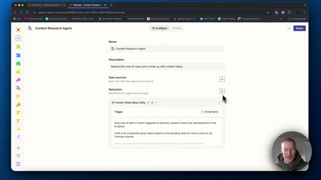
*⏱️ 00:02:14 — Vue d'ensemble de la configuration de l'agent sur Zapier avec la section Behaviors et le bouton plus.*

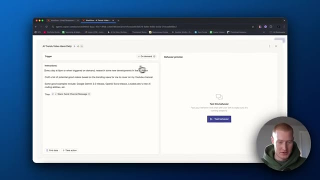
*⏱️ 00:02:21 — Interface de configuration détaillée d'un comportement d'agent avec les instructions et les options de déclenchement.*

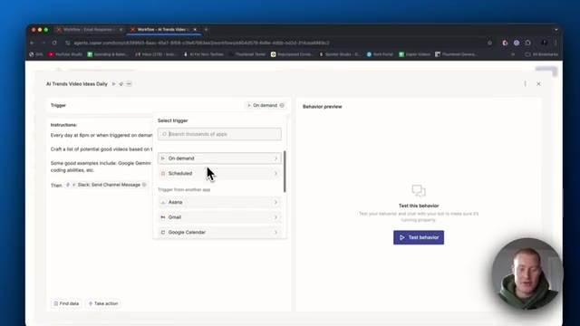
*⏱️ 00:02:27 — Menu déroulant de sélection du déclencheur (trigger) avec les options On demand et Scheduled.*

---

### ⏱️ `[00:02:33 - 00:02:54]` | Segment #07

**🔊 Audio (Transcription Intégrale Mot pour Mot en Français) :**
> Ou nous pourrions planifier cela ou le faire déclencher par une certaine application. Donc par exemple, si vous recevez un e-mail, alors cela démarre et déclenche ce flux de travail. Pour ce cas d'utilisation, ce que je ferais, c'est d'ajouter une fréquence personnalisée. Donc je dirais tous les jours à 20 heures. Vous pouvez donc voir dans les instructions, laissez-moi parcourir cela. Tous les jours à 20 heures ou lorsque c'est déclenché à la demande, faites des recherches sur de nouveaux développements dans le domaine de l'IA.

**👁️ Analyse Visuelle d'Écran (gemini-3.5-flash-lite) :**
**Interface & Outils** : Navigateur web affichant l'interface Zapier Agents ou une plateforme de workflows similaire.

**Contenu textuel & Code** : Options de déclenchement (Triggers) incluant des applications tierces (Asana, Gmail) et des options de planification (Scheduled, Custom Frequency).

**Action / Démonstration** : Le curseur survole et sélectionne différentes options de déclenchement pour configurer les conditions d'exécution du flux de travail.

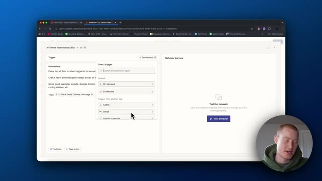
*⏱️ 00:02:38 — Interface d'un constructeur de flux montrant le menu de sélection des déclencheurs avec des options comme On demand, Scheduled, Asana et Gmail.*

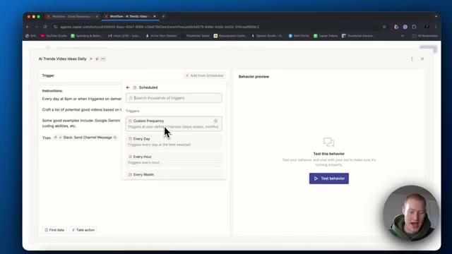
*⏱️ 00:02:43 — Menu des déclencheurs planifiés affichant les options Custom Frequency, Every Day, Every Hour et Every Month.*

---

### ⏱️ `[00:02:54 - 00:03:15]` | Segment #08

**🔊 Audio (Transcription Intégrale Mot pour Mot en Français) :**
> Crée une liste de bonnes vidéos potentielles basées sur l'actualité tendance pour que je les traite sur ma chaîne YouTube. De bons exemples incluent, et j'ai donné un certain type d'exemples, de bons sujets à aborder. Et puis vous pouvez voir que j'ai réellement ajouté cette action. Donc après cela, envoyez ensuite un message sur le canal Slack. Et je vais vous montrer exactement comment vous pouvez les ajouter. Donc vous pourriez soit trouver des données, qui sont les sources de données que nous utilisons.

**👁️ Analyse Visuelle d'Écran (gemini-3.5-flash-lite) :**
**Interface & Outils** : Interface web de Zapier (Agents) et navigateur Chrome.

**Contenu textuel & Code** : Instructions textuelles pour l'agent IA : "Every day at 8pm or when triggered on demand, research some new developments in the AI space. Craft a list of potential good videos based on the trending news for me to cover on my YouTube channel. Some good examples include: Google Gemini 2.0 release, OpenAI Sora release, Lovable.dev's new AI coding abilities, etc." suivi de l'action "Slack: Send Channel Message".

**Action / Démonstration** : Configuration et paramétrage d'un workflow d'automatisation IA dans Zapier pour envoyer les suggestions de sujets sur Slack.

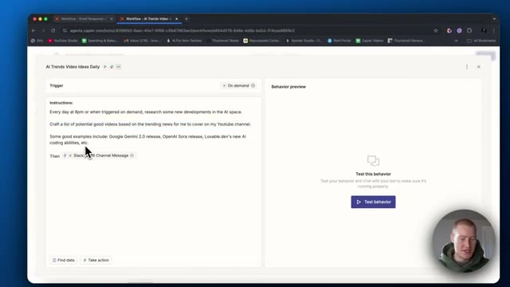
*⏱️ 00:02:59 — Interface de Zapier montrant la configuration d'un agent IA avec des instructions pour générer des idées de vidéos YouTube.*

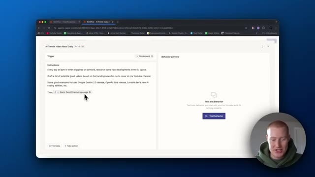
*⏱️ 00:03:04 — Suite de la configuration de l'agent Zapier avec l'action Slack "Send Channel Message".*

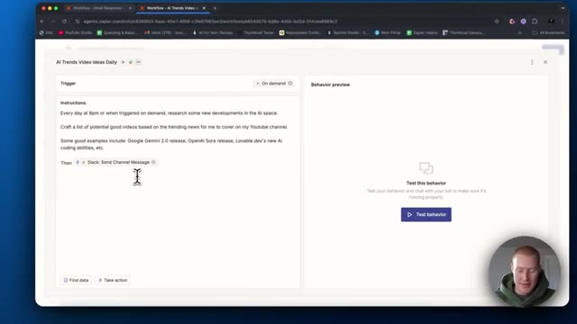
*⏱️ 00:03:10 — Manipulation de l'interface Zapier pour finaliser l'action d'envoi du message sur Slack.*

---

### ⏱️ `[00:03:15 - 00:03:39]` | Segment #09

**🔊 Audio (Transcription Intégrale Mot pour Mot en Français) :**
> Et donc nous pourrions en quelque sorte lui donner accès à cette information ou nous pourrions faire en sorte que cela crée réellement des actions pour nous. Vous pourriez voir que nous choisissons, nous avons choisi le message sur le canal Slack, ou nous pourrions générer un brouillon de réponse par e-mail. Toutes ces différentes choses sont tellement d'actions différentes que nous pouvons demander à notre agent d'exécuter. Mais ce sur quoi je veux me concentrer ici, ce sont les agents Zapier. La chose qui est vraiment géniale à ce sujet, c'est que nous tapons simplement ce que nous essayons de construire en langage naturel et cela construira automatiquement le flux de travail pour notre agent IA.

**👁️ Analyse Visuelle d'Écran (gemini-3.5-flash-lite) :**
**Interface & Outils** : Interface web de Zapier (Agents/Bots).

**Contenu textuel & Code** : Configuration d'un bot IA automatisé avec des instructions textuelles et des options d'actions (Slack, Gmail, Asana).

**Action / Démonstration** : Sélection d'une action à déclencher et manipulation du texte d'instructions dans le workflow.

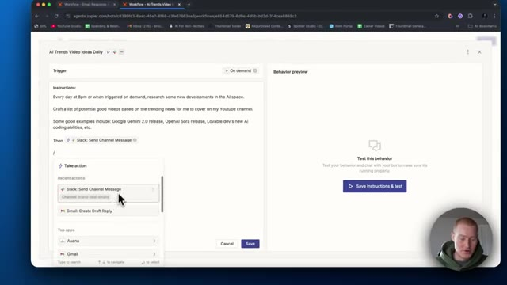
*⏱️ 00:03:21 — Vue de l'interface de Zapier montrant un menu déroulant d'actions avec l'option Slack sélectionnée par le curseur.*

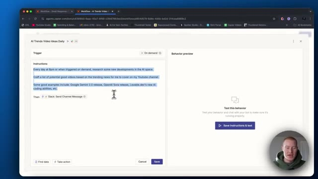
*⏱️ 00:03:33 — Vue de l'interface de Zapier montrant le texte des instructions de l'agent IA en cours de sélection par le curseur.*

---

### ⏱️ `[00:03:39 - 00:04:09]` | Segment #10

**🔊 Audio (Transcription Intégrale Mot pour Mot en Français) :**
> Et maintenant que vous comprenez comment cela fonctionne, je vais parcourir et construire réellement mon assistant administrateur IA. Ainsi, vous pourrez voir exactement comment vous pourriez faire cela pour vous-même. Ce que nous voulons faire, c'est venir sur agents, cliquer sur nouvel agent, et je vais appeler ceci l'agent administrateur de Brock. Et disons simplement que c'est un agent qui gère toutes les tâches administratives telles que la révision des e-mails, l'ajout d'étiquettes d'e-mails, la planification de réunions, la réponse aux messages Slack, etc.

**👁️ Analyse Visuelle d'Écran (gemini-3.5-flash-lite) :**
**Interface & Outils** : Interface web de Zapier Agents pour la création et la configuration d'agents IA personnalisés.

**Contenu textuel & Code** : Paramètres de configuration d'agent IA, nom de l'agent, descriptions, sources de données et comportements automatisés.

**Action / Démonstration** : Navigation dans l'interface de création et de configuration d'agents IA pour automatiser des tâches administratives et de recherche.

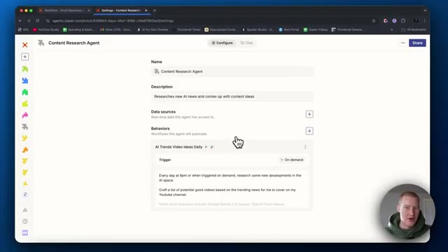
*⏱️ 00:03:47 — Interface de configuration d'un agent de recherche de contenu (Content Research Agent) montrant ses paramètres, descriptions et comportements.*

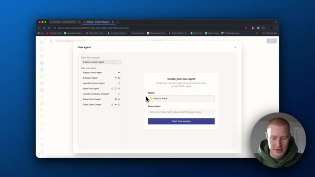
*⏱️ 00:03:54 — Fenêtre de création d'un nouvel agent sur Zapier, avec un champ de nom et de description en cours de remplissage pour créer un assistant administrateur.*

---

### ⏱️ `[00:04:09 - 00:04:36]` | Segment #11

**🔊 Audio (Transcription Intégrale Mot pour Mot en Français) :**
> Donc c'est à peu près une description de base de ce que nous allons réellement construire. Je vais donc cliquer sur « Commencer à partir de zéro ». Et ensuite, vous verrez ce chat. C'est une façon d'interagir avec notre agent IA. Comme je l'ai dit, si vous voulez interagir avec lui à la demande. Ensuite, nous devons aller dans configurer et nous voulons ensuite ajouter une source de données. Donc ce que j'ai fait, étant donné que ce sera notre assistant administratif qui pourra répondre aux e-mails et aux messages Slack, je pense qu'il est vraiment important que je doive ensuite essayer de copier mon style d'écriture par e-mail ou sur Slack.

**👁️ Analyse Visuelle d'Écran (gemini-3.5-flash-lite) :**
**Interface & Outils** : Navigateur web affichant l'interface de gestion et de configuration des agents Zapier.

**Contenu textuel & Code** : Paramètres de l'agent IA : nom « Brock's Admin Agent », description des tâches administratives, sources de données et comportements planifiés (ex. : tous les vendredis à 14h, résumé de tableur, création de brouillon d'e-mail).

**Action / Démonstration** : Navigation et explication des onglets de configuration et de chat de l'agent IA.

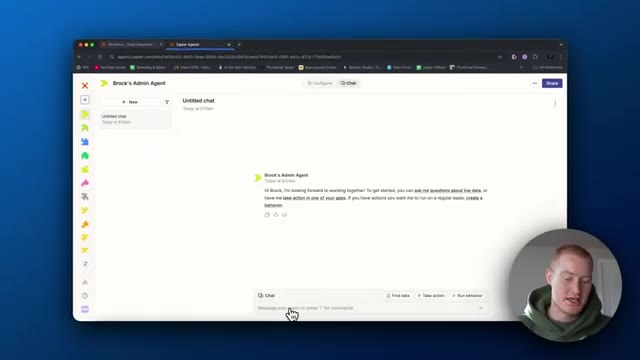
*⏱️ 00:04:16 — Interface de discussion (chat) de l'agent IA « Brock's Admin Agent » sur la plateforme Zapier.*

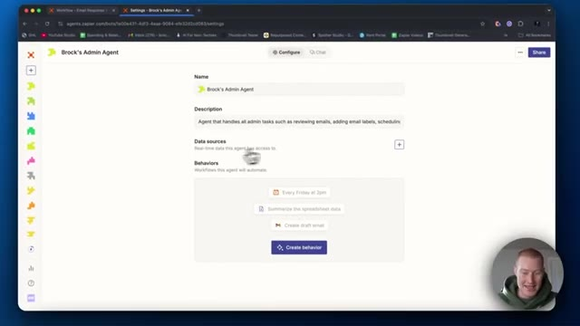
*⏱️ 00:04:23 — Page de configuration de l'agent IA montrant le nom, la description, les sources de données et les comportements automatisés.*

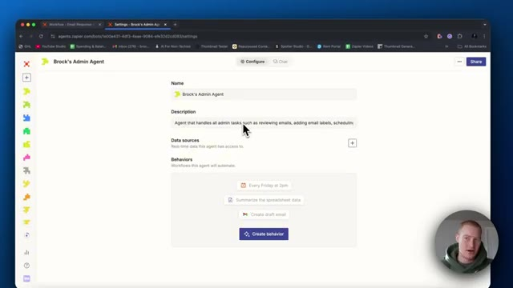
*⏱️ 00:04:29 — Vue rapprochée de la description et des paramètres de configuration de l'agent IA.*

---

### ⏱️ `[00:04:36 - 00:04:54]` | Segment #12

**🔊 Audio (Transcription Intégrale Mot pour Mot en Français) :**
> Donc ce que j'ai fait, c'est que j'ai pris les devants et j'ai ajouté un document Google dans mes Google Docs, j'ai essentiellement copié un tas de réponses différentes à des e-mails que j'ai envoyés. De cette façon, nous avons le contexte de la façon dont je réponds aux gens. Donc ce que nous faisons, c'est que nous venons ici et nous avons juste besoin de nous connecter et de connecter notre source de données. Le guide de style de messagerie de Brock.

**👁️ Analyse Visuelle d'Écran (gemini-3.5-flash-lite) :**
**Interface & Outils** : Navigateur web affichant l'interface de création d'agents d'automatisation Zapier Central.

**Contenu textuel & Code** : Champs de configuration d'un agent nommé "Brock's Admin Agent" avec sélection d'un compte Google Docs et d'un document source.

**Action / Démonstration** : Ajout d'une source de données Google Docs pour fournir du contexte et des exemples de réponses aux e-mails de l'agent.

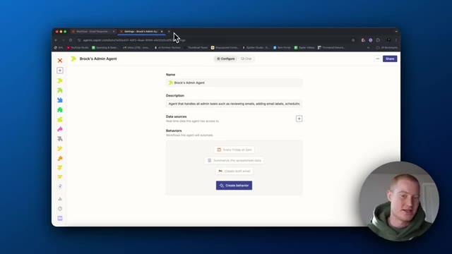
*⏱️ 00:04:41 — Interface de configuration d'un agent Zapier montrant le nom de l'agent et ses paramètres généraux.*

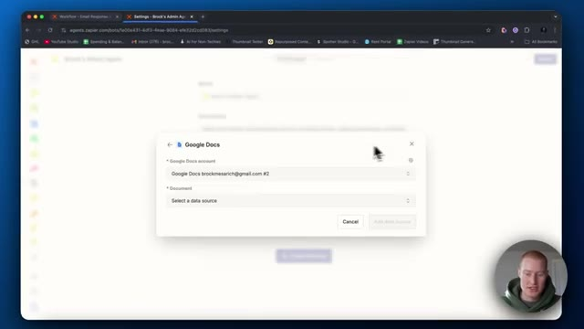
*⏱️ 00:04:50 — Fenêtre modale de configuration de la source de données Google Docs pour lier un document de référence.*

---

### ⏱️ `[00:04:54 - 00:05:15]` | Segment #13

**🔊 Audio (Transcription Intégrale Mot pour Mot en Français) :**
> Je vais ajouter cela comme source de données. Et ensuite, ce qu'il nous faut faire, c'est que nous devons créer un comportement. Venons-en donc au comportement. Et c'est là que nous allons commencer cela, en décrivant à notre agent comment nous voulons qu'il interagisse. Tout d'abord, appelons ce comportement. Appelons cela simplement flux de travail d'e-mail. Et ensuite, le déclencheur pour cela va être lorsqu'un nouvel e-mail est ajouté à notre boîte de réception.

**👁️ Analyse Visuelle d'Écran (gemini-3.5-flash-lite) :**
**Interface & Outils** : Interface web de Zapier Central (agents IA).

**Contenu textuel & Code** : Configuration des agents, section 'Behaviors', options de déclenchement (Trigger) comme 'On demand' ou 'Scheduled'.

**Action / Démonstration** : Le curseur clique sur le bouton 'Create behavior' pour ajouter un nouveau comportement à l'agent.

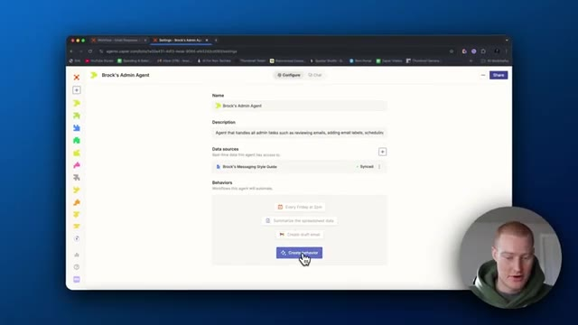
*⏱️ 00:05:00 — L'interface de configuration d'un agent d'administration montrant le nom, la description, les sources de données et le bouton pour créer un comportement.*

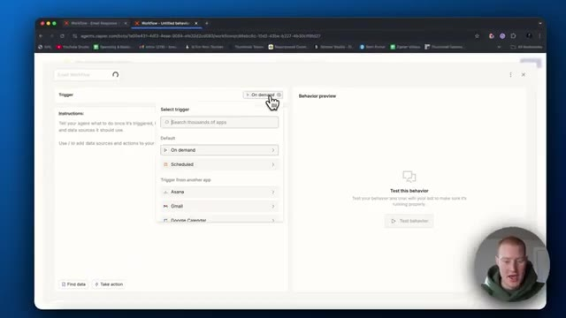
*⏱️ 00:05:10 — L'éditeur de workflow ou de comportement affichant le menu déroulant pour sélectionner un déclencheur (trigger).*

---

### ⏱️ `[00:05:15 - 00:05:34]` | Segment #14

**🔊 Audio (Transcription Intégrale Mot pour Mot en Français) :**
> Donc tout ce que nous avons à faire est de connecter notre compte de messagerie ici. Évidemment, nous utilisons Gmail. Et ensuite, pour tout ce qui arrive dans ma boîte aux lettres, si vous avez des libellés ou quelque chose du genre, vous pouvez aussi personnaliser cela. Et maintenant, nous avons juste besoin de taper en langage naturel comment nous voulons que cela fonctionne. Donc je vais vous montrer comment faire cela maintenant. Très bien, voilà ce que j'ai tapé. Donc quand il y a un e-mail, première étape, nous voulons analyser l'e-mail.

**👁️ Analyse Visuelle d'Écran (gemini-3.5-flash-lite) :**
**Interface & Outils** : Interface web de Zapier Agents / Workflow Editor.

**Contenu textuel & Code** : Configuration du déclencheur Gmail avec compte email et options de libellés, suivis d'instructions textuelles pour classifier les e-mails (Sponsoring, Réunion, Spam, etc.).

**Action / Démonstration** : Connexion du compte de messagerie et configuration des règles de déclenchement et d'analyse des e-mails.

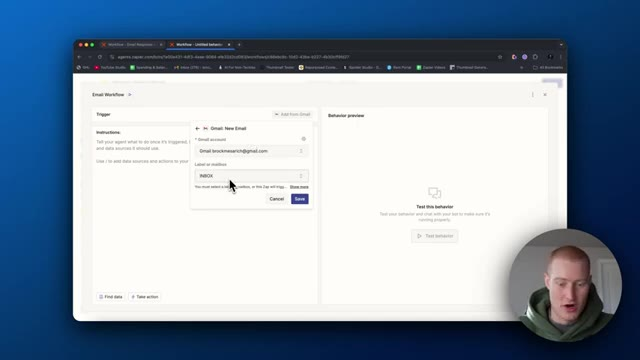
*⏱️ 00:05:20 — Interface de configuration du flux de travail montrant la liaison d'un compte Gmail et la sélection des libellés (INBOX).*

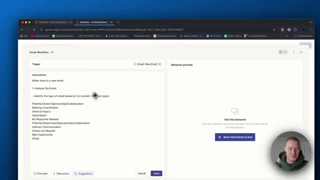
*⏱️ 00:05:30 — Édition des instructions détaillées pour l'agent de messagerie, listant différents types d'e-mails à classifier.*

---

### ⏱️ `[00:05:34 - 00:05:54]` | Segment #15

**🔊 Audio (Transcription Intégrale Mot pour Mot en Français) :**
> Nous devons identifier le type d'e-mail en fonction de son contenu. Et voici les types possibles de genres d'e-mails que je pourrais recevoir. Donc, potentiels partenariats ou collaborations de marques, coordination de réunions, demande générale, ventes ou spam, aucune réponse nécessaire. J'ai déjà ajouté cette communication interne, demande de suivi, nouvelle opportunité, autre, vous saisissez l'idée.

**👁️ Analyse Visuelle d'Écran (gemini-3.5-flash-lite) :**
**Interface & Outils** : Navigateur web affichant Zapier Central (agents.zapier.com) et le workflow de gestion d'e-mails.

**Contenu textuel & Code** : Instructions du workflow listant les types d'e-mails : Potential Brand Sponsorship/Collaboration, Meeting Coordination, General Inquiry, Sales/Spam, No Response Needed.

**Action / Démonstration** : Le créateur configure et modifie les instructions textuelles du workflow automatisé pour classifier les types de messages reçus.

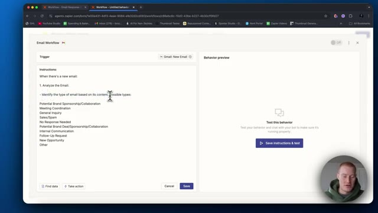
*⏱️ 00:05:39 — Vue d'ensemble de l'interface Zapier montrant le workflow de gestion d'e-mails avec les instructions de classification.*

*⏱️ 00:05:44 — Affichage du panneau de configuration des instructions du bot d'e-mail dans Zapier Central.*

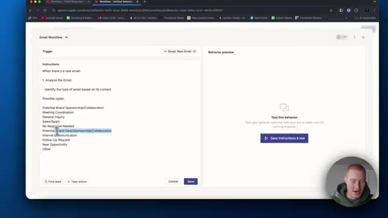
*⏱️ 00:05:49 — Sélection du texte dans les instructions du workflow pour modifier les types de classifications d'e-mails.*

---

### ⏱️ `[00:05:54 - 00:06:13]` | Segment #16

**🔊 Audio (Transcription Intégrale Mot pour Mot en Français) :**
> Donc voici le genre d'e-mails que je peux recevoir. Je dois donc dire à notre agent d'analyser et d'identifier de quel type de demande il s'agit. Je pourrais ainsi lui faire exécuter certaines actions pour chacun de ces différents types d'e-mails. Et remarquez, je écris simplement cela en langage naturel comme si j'étais en train d'apprendre à un employé comment gérer ces tâches, ce qui est plutôt cool. D'accord, ensuite, voici mes étapes.

**👁️ Analyse Visuelle d'Écran (gemini-3.5-flash-lite) :**
**Interface & Outils** : Interface web de Zapier Central (gestion de workflows et d'agents IA)

**Contenu textuel & Code** : Instructions détaillées pour l'agent IA : 'Analyze the Email - Identify the type of email based on its content. Possible types: Potential Brand Sponsorship/Collaboration, Meeting Coordination, General Inquiry, Sales/Spam, No Response Needed, Internal Communication, Follow-Up Request, New Opportunity, Other'

**Action / Démonstration** : Configuration des instructions de l'agent en langage naturel pour catégoriser automatiquement les e-mails entrants selon différents types de requêtes.

*⏱️ 00:05:59 — Capture d'écran montrant une interface de workflow d'e-mails avec un panneau d'instructions textuelles en langage naturel définissant l'analyse des types de demandes.*

---

### ⏱️ `[00:06:13 - 00:06:33]` | Segment #17

**🔊 Audio (Transcription Intégrale Mot pour Mot en Français) :**
> Déterminez donc si l'e-mail mérite une réponse. S'il ne le mérite pas, ou s'il s'agit de ventes ou de spam, ne rédigez pas de réponse. C'est donc évidemment explicite, s'il s'agit d'un e-mail de vente et que c'est juste du spam, je n'ai pas besoin de rédiger de réponse. L'IA le sait donc déjà. S'il relève d'une offre de marque potentielle, d'un parrainage ou d'une collaboration, ajoutez alors une étiquette de marques intéressées dans Gmail.

**👁️ Analyse Visuelle d'Écran (gemini-3.5-flash-lite) :**
**Interface & Outils** : Interface web de Zapier Central / Zapier Agents.

**Contenu textuel & Code** : Instructions détaillées pour l'agent IA d'e-mail incluant l'analyse du type d'e-mail (sponsoring, réunion, vente/spam, etc.) et les conditions de réponse.

**Action / Démonstration** : Explication des instructions de configuration du workflow d'e-mail automatisé par l'IA.

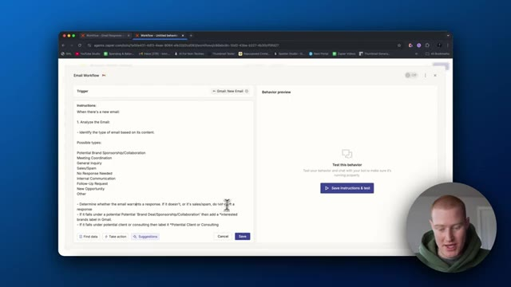
*⏱️ 00:06:18 — Capture d'écran montrant l'interface d'un workflow d'automatisation d'e-mails avec les instructions de l'agent IA et le présentateur en incrustation.*

---

### ⏱️ `[00:06:33 - 00:06:56]` | Segment #18

**🔊 Audio (Transcription Intégrale Mot pour Mot en Français) :**
> Donc j'ai une certaine section dans mon Gmail qui a une certaine étiquette pour les entreprises potentielles qui veulent travailler avec moi. Et de cette façon, je n'ai pas à trier mes e-mails et, c'est tout, cela rend ma boîte de réception de messages tellement moins encombrée, en quelque sorte. Donc cela va me faire gagner tellement de temps et m'aider de tellement de manières différentes. Donc cela va automatiquement étiqueter ce genre d'opportunité comme une marque intéressée dans Gmail.

**👁️ Analyse Visuelle d'Écran (gemini-3.5-flash-lite) :**
**Interface & Outils** : Navigateur web affichant l'interface Zapier (création de workflow).

**Contenu textuel & Code** : Instructions textuelles détaillant l'analyse des e-mails, les catégories possibles (Sponsoring, Réunion, Spam, etc.) et les actions à effectuer (attribution d'étiquettes dans Gmail).

**Action / Démonstration** : Configuration des instructions du déclencheur et des actions pour trier et étiqueter automatiquement les e-mails entrants.

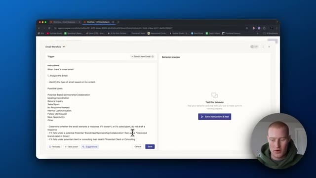
*⏱️ 00:06:39 — Vue de l'interface de Zapier montrant les instructions d'un flux de travail pour l'automatisation du traitement des e-mails.*

---

### ⏱️ `[00:06:56 - 00:07:17]` | Segment #19

**🔊 Audio (Transcription Intégrale Mot pour Mot en Français) :**
> Et puis un autre, s'il relève d'un client potentiel ou du conseil, alors étiquetez-le client potentiel ou conseil. Donc encore une fois, c'est une autre étiquette. Ainsi, je pourrais avoir tout cela accessible dans une seule sorte de partie de ma boîte de réception. Une chose que je tiens à mentionner, si vous voulez accéder aux instructions que j'utilise pour créer cet agent, il y a un lien dans la description pour vous inscrire à mes ressources et vous obtiendrez en quelque sorte un document complet avec toutes celles-ci.

**👁️ Analyse Visuelle d'Écran (gemini-3.5-flash-lite) :**
**Interface & Outils** : Interface web de workflow et d'automatisation (type Zapier Central ou outil similaire).

**Contenu textuel & Code** : Instructions textuelles pour un agent IA : analyse des e-mails, identification des types (sponsoring, réunion, spam, etc.), détermination de la nécessité d'une réponse, et application d'étiquettes spécifiques comme 'Potential Client or Consulting'.

**Action / Démonstration** : Configuration et affichage des instructions d'un workflow automatisé de gestion d'e-mails.

*⏱️ 00:07:01 — Capture d'écran montrant une interface de workflow d'e-mails avec un éditeur de texte à gauche détaillant les instructions d'analyse et de classification des e-mails, et une section de test à droite, avec la vidéo du présentateur en médaillon en bas à droite.*

---

### ⏱️ `[00:07:17 - 00:07:42]` | Segment #20

**🔊 Audio (Transcription Intégrale Mot pour Mot en Français) :**
> Donc vous pourriez copier et coller ceux-ci si vous essayez de répliquer le même agent. Très bien. Donc j'ai pris les devants et j'ai ajouté cette instruction ici. Donc numéro deux, nous devons rédiger une réponse et un e-mail. Donc si une réponse est justifiée, ce que l'ia sera réellement capable d'identifier, du genre, est-ce que cela vaut la peine d'avoir une réponse ? Si ce n'est pas le cas, ça n'ira même pas à l'étape deux. Donc si c'est justifié, alors rédigez une réponse dans Gmail dans le style de Brock, en faisant référence au guide de style disponible.

**👁️ Analyse Visuelle d'Écran (gemini-3.5-flash-lite) :**
**Interface & Outils** : Interface web de Zapier (Agents)

**Contenu textuel & Code** : Instructions détaillées pour le workflow d'e-mail : instructions sur les types de demandes (suivi, nouvelle opportunité), détermination de la réponse, étiquetage dans Gmail et rédaction d'une réponse dans le style de Brock.

**Action / Démonstration** : Le présentateur explique et montre les différentes instructions et étapes configurées pour l'agent IA de gestion d'e-mails.

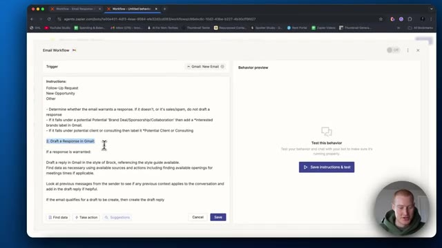
*⏱️ 00:07:23 — Interface de configuration de workflow d'e-mail montrant les instructions pour l'agent IA avec le présentateur en médaillon.*

*⏱️ 00:07:35 — Vue similaire de l'interface de configuration du workflow d'e-mail avec les instructions de l'agent IA.*

---

### ⏱️ `[00:07:42 - 00:08:05]` | Segment #21

**🔊 Audio (Transcription Intégrale Mot pour Mot en Français) :**
> Voici la source de données avec laquelle nous l'avons lié. Et je vais vous montrer comment la lier en fait directement à notre agent dans ce genre d'instruction ici. Trouver des données si nécessaire en utilisant les sources et les actions disponibles, y compris trouver les créneaux disponibles pour les heures de réunion, le cas échéant. Cela pourrait donc aussi planifier des réunions pour nous. Et ensuite, examiner les messages précédents de l'expéditeur pour voir si un contexte antérieur s'applique à la conversation et l'ajouter dans le brouillon d'e-mail si cela s'avère utile.

**👁️ Analyse Visuelle d'Écran (gemini-3.5-flash-lite) :**
**Interface & Outils** : Navigateur web affichant l'interface de Zapier Central (agents.zapier.com) avec un éditeur de workflow email et une webcam du présentateur.

**Contenu textuel & Code** : Instructions textuelles pour l'agent IA : gestion des emails (suivi, opportunités, spam), rédaction de réponses dans le style de Brock, recherche de données et de créneaux de réunion.

**Action / Démonstration** : Le présentateur explique et édite les instructions textuelles de l'agent IA pour la gestion automatisée des emails.

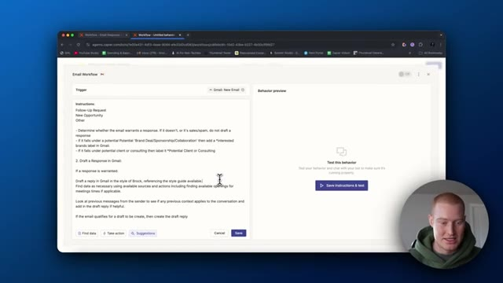
*⏱️ 00:07:48 — Interface de configuration d'un agent de workflow email (Zapier Central) avec les instructions détaillées pour l'IA.*

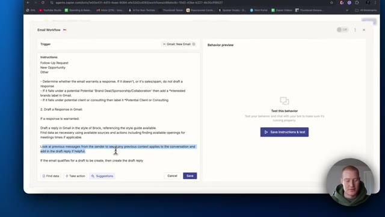
*⏱️ 00:07:59 — Sélection d'une ligne de texte spécifique dans les instructions de l'agent pour le workflow email.*

---

### ⏱️ `[00:08:05 - 00:08:23]` | Segment #22

**🔊 Audio (Transcription Intégrale Mot pour Mot en Français) :**
> Donc essentiellement, s'il y a du contexte dans un fil de discussion par e-mail avec quelqu'un que nous avons besoin que notre agent IA ait comme information ou comme contexte, il va automatiquement parcourir et rechercher ceux-ci pour voir s'il y a des informations pertinentes à utiliser dans notre flux de travail. Et puis, c'est une grande partie. Si l'e-mail se qualifie pour qu'un brouillon soit créé, alors créez le brouillon de réponse.

**👁️ Analyse Visuelle d'Écran (gemini-3.5-flash-lite) :**
**Interface & Outils** : Interface web de configuration de workflow (Zapier Central / Agents).

**Contenu textuel & Code** : Instructions textuelles détaillant les consignes pour l'agent IA concernant le traitement des e-mails, la rédaction de réponses et la prise en compte du contexte des messages précédents.

**Action / Démonstration** : Le présentateur survole et sélectionne du texte dans les instructions du workflow pour illustrer l'analyse du contexte des e-mails.

*⏱️ 00:08:10 — Interface d'un constructeur de flux de travail montrant les instructions pour l'agent IA, avec le curseur sélectionnant du texte concernant les messages précédents.*

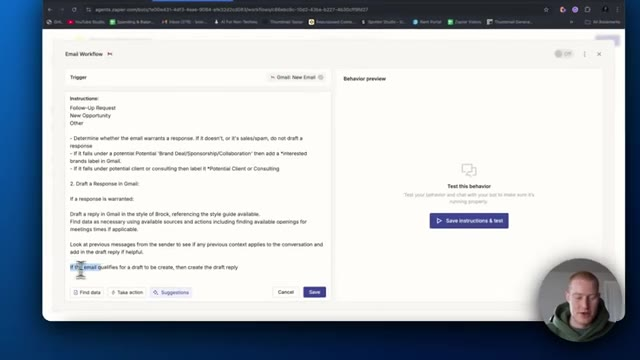
*⏱️ 00:08:19 — Vue similaire de l'interface avec une portion de texte différente surlignée par le curseur.*

---

### ⏱️ `[00:08:24 - 00:08:45]` | Segment #23

**🔊 Audio (Transcription Intégrale Mot pour Mot en Français) :**
> Donc essentiellement, cela va rédiger des réponses pour nous. Et ensuite, tout ce que nous avons à faire, c'est d'aller dans nos brouillons d'e-mails et de voir tous ces messages auxquels notre IA est prête à envoyer une réponse. Les confirmer, s'assurer qu'ils sont prêts à être envoyés, faire une tout petite modification si nous en avons besoin, et ensuite les envoyer. Cela va me faire gagner tellement de temps en, vous savez, n'ayant pas réellement à rédiger de réponses. Et rappelez-vous, cela utilise mon guide de style contextuel, donc l'IA sait comment j'aime communiquer.

**👁️ Analyse Visuelle d'Écran (gemini-3.5-flash-lite) :**
**Interface & Outils** : Navigateur web affichant l'interface de création de workflow (Agent.ai ou outil similaire) et un panneau de prévisualisation du comportement.

**Contenu textuel & Code** : Instructions détaillées de l'agent pour le traitement des e-mails (détermination de la réponse, ajout d'étiquettes Gmail, rédaction d'une réponse dans le style de Brock, recherche de disponibilités).

**Action / Démonstration** : Configuration et affichage des instructions d'un workflow automatisé gérant les réponses aux e-mails via l'IA.

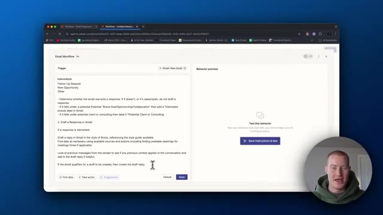
*⏱️ 00:08:29 — Capture d'écran montrant une interface de workflow d'automatisation des e-mails avec les instructions de l'agent IA, ainsi qu'une incrustation vidéo du présentateur en bas à droite.*

---

### ⏱️ `[00:08:46 - 00:09:06]` | Segment #24

**🔊 Audio (Transcription Intégrale Mot pour Mot en Français) :**
> Voilà, c'est fait. D'accord, alors la suite, c'est là où nous devons réellement ajouter nos sources de données et nos actions. Je vais donc vous montrer comment faire maintenant. Alors assurez-vous de bien faire attention ici. Pour les sources de données, ce qu'on va faire, c'est qu'on va cliquer sur slash, et ensuite vous pouvez voir que ça nous donne différentes commandes qu'on pourrait avoir, comme qu'on pourrait donner à notre agent. Nous devons donc trouver les données et vous pouvez voir que cette source de données est liée.

**👁️ Analyse Visuelle d'Écran (gemini-3.5-flash-lite) :**
**Interface & Outils** : Navigateur web, interface de création de workflow (Agent / Copilot).

**Contenu textuel & Code** : Instructions textuelles détaillées pour l'agent (« Determine whether the email warrants a response... », « Draft a Response in Gmail ») et options de configuration en bas (Find data, Take action).

**Action / Démonstration** : Le curseur de la souris survole la zone de configuration des sources de données et des actions du workflow.

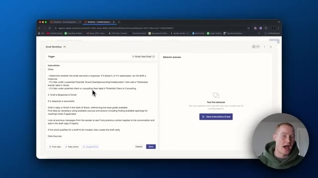
*⏱️ 00:08:51 — Interface d'un constructeur de workflow montrant les instructions pour un agent de traitement d'e-mails et la section des sources de données.*

---

### ⏱️ `[00:09:06 - 00:09:26]` | Segment #25

**🔊 Audio (Transcription Intégrale Mot pour Mot en Français) :**
> Voici donc le guide de style de messagerie de Brock. Et maintenant que j'ai lié ceci, il s'y référera chaque fois que je dirai, vous savez, réponds dans le style de Brock ou peu importe le cas de figure. Ensuite, nous devons ajouter nos actions. C'est la partie la plus importante, évidemment. Et la façon dont nous ajoutons nos actions est de venir ici, de cliquer sur « effectuer une action ». Et vous pouvez voir toutes ces différentes applications sur lesquelles nous pouvons réellement créer des actions avec notre agent IA.

**👁️ Analyse Visuelle d'Écran (gemini-3.5-flash-lite) :**
**Interface & Outils** : Interface web de configuration d'agent d'automatisation (Zapier Central) avec une incrustation vidéo du présentateur.

**Contenu textuel & Code** : Instructions textuelles du bot de gestion des e-mails, source de données « Brock's Messaging Style Guide » et menu contextuel des applications disponibles pour les actions (« Take action »).

**Action / Démonstration** : Le présentateur survole et présente les différentes options d'actions et les sources de données liées pour configurer le comportement de l'assistant e-mail.

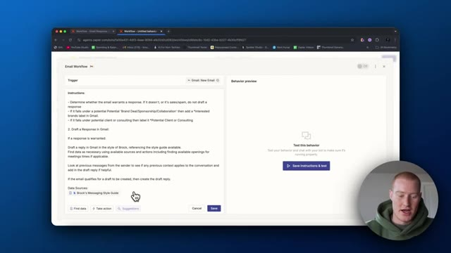
*⏱️ 00:09:11 — Interface d'un workflow d'e-mail montrant les instructions de l'agent et la source de données liée pour le style de message.*

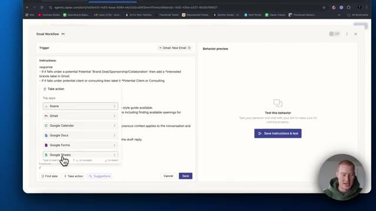
*⏱️ 00:09:21 — Déroulement du menu d'actions permettant d'intégrer différentes applications comme Asana, Gmail, Google Calendar, Docs et Sheets.*

---

### ⏱️ `[00:09:26 - 00:09:45]` | Segment #26

**🔊 Audio (Transcription Intégrale Mot pour Mot en Français) :**
> Donc je vais cliquer sur Gmail et ça va essentiellement créer un brouillon de réponse. Donc tout ce qu'il nous faut faire, c'est connecter notre compte Gmail, ce que j'ai déjà fait ici. Mais assurez-vous d'ajouter ceci pour toutes ces informations ici. Laissez simplement ce champ vide et laissez votre IA générer une valeur pour ce champ car elle sera capable d'identifier à qui elle répond et ce que l'e-mail doit inclure.

**👁️ Analyse Visuelle d'Écran (gemini-3.5-flash-lite) :**
**Interface & Outils** : Navigateur web affichant l'interface Zapier Agents.

**Contenu textuel & Code** : Instructions détaillées de gestion des e-mails, étiquetage automatique et configuration de brouillons Gmail.

**Action / Démonstration** : Configuration des actions de l'agent pour créer automatiquement des brouillons de réponse sur Gmail.

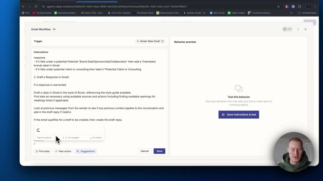
*⏱️ 00:09:31 — Vue rapprochée de l'interface de configuration du workflow d'e-mail avec une fenêtre de recherche active.*

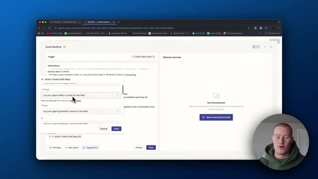
*⏱️ 00:09:36 — Affichage du menu déroulant de configuration 'Gmail: Create Draft Reply' avec les options de sélection de champ.*

---

### ⏱️ `[00:09:46 - 00:10:04]` | Segment #27

**🔊 Audio (Transcription Intégrale Mot pour Mot en Français) :**
> Donc, enregistrons cela. Et maintenant, laissez-moi ajouter un peu plus de ces actions ici. D'accord, voici donc les autres actions que j'ai ajoutées pour ce flux de travail d'e-mail spécifique. J'ai donc ajouté une création d'étiquette, car évidemment nous devions créer différentes étiquettes. J'ai ajouté Google Agenda, ajouter un événement, Google Agenda, trouver un événement, puis ajouter une étiquette à l'e-mail. Et voilà.

**👁️ Analyse Visuelle d'Écran (gemini-3.5-flash-lite) :**
**Interface & Outils** : Navigateur web affichant l'interface de Zapier Central / Agents.

**Contenu textuel & Code** : Instructions détaillées pour le traitement des e-mails, sources de données (Brock's Messaging Style Guide) et liste des actions (Gmail: Create Label, Gmail: Create Draft Reply, Google Calendar: Quick Add Event, etc.).

**Action / Démonstration** : Présentation et explication des différentes actions configurées pour le flux de travail automatisé des e-mails.

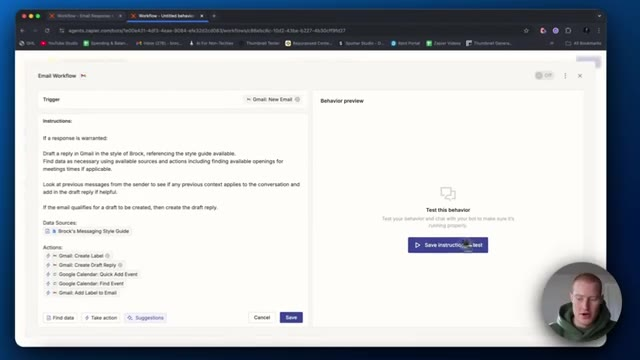
*⏱️ 00:09:50 — Interface Zapier montrant la configuration d'un workflow e-mail avec les instructions et les actions associées.*

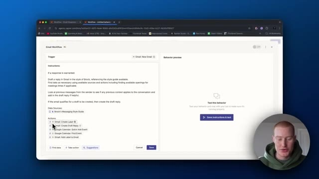
*⏱️ 00:09:55 — Gros plan sur la liste des actions configurées dans le flux de travail de l'agent Zapier.*

---

### ⏱️ `[00:10:04 - 00:10:32]` | Segment #28

**🔊 Audio (Transcription Intégrale Mot pour Mot en Français) :**
> Donc tout est prêt. Je vais enregistrer ceci et nous pourrions en fait tester ce comportement. Très bien. Donc comme vous pouvez le voir ici, je ne sais pas si vous pouvez voir, je viens de m'envoyer un faux e-mail me demandant si je propose des services d'IA. Donc ce que je dois faire maintenant, c'est que je vais tester ce comportement et voir s'il est capable d'identifier cela. Donc ce que vous verrez lorsque vous testez un comportement, c'est que vous le verrez réellement passer par tout le processus. Vous pouvez voir déclencher un nouveau Gmail. Il extrait donc maintenant des informations de mon compte Gmail.

**👁️ Analyse Visuelle d'Écran (gemini-3.5-flash-lite) :**
**Interface & Outils** : Navigateur web affichant l'interface Zapier Agents pour la configuration d'un agent e-mail.

**Contenu textuel & Code** : Instructions du flux de travail e-mail, sources de données (Brock's Messaging Style Guide), actions Gmail et Google Calendar, et panneau de test du comportement.
[DESC_IMAGE_3] L'utilisateur clique sur le bouton pour tester le comportement du bot d'automatisation des e-mails.

**Action / Démonstration** : Explications face caméra et analyse conceptuelle des marchés.

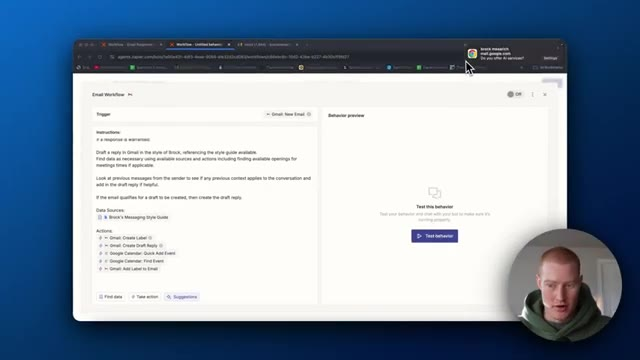
*⏱️ 00:10:11 — Interface Zapier affichant un flux de travail e-mail avec des instructions et des actions configurées, ainsi que le présentateur en incrustation.*

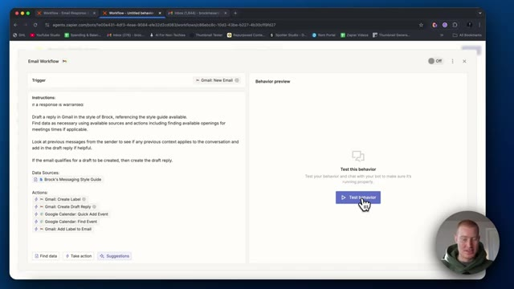
*⏱️ 00:10:18 — Le curseur de la souris survole le bouton "Test behavior" dans l'interface Zapier pour lancer un test.*

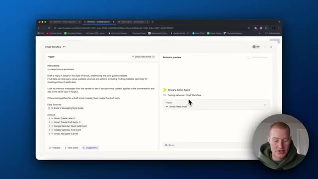
*⏱️ 00:10:25 — L'interface affiche le panneau de prévisualisation du comportement "Testing behavior: Email Workflow" après le lancement du test.*

---

### ⏱️ `[00:10:32 - 00:11:05]` | Segment #29

**🔊 Audio (Transcription Intégrale Mot pour Mot en Français) :**
> Très bien. Et il semble que maintenant on passe à l'étape suivante. Il a compris qu'il s'agit d'un client potentiel ou d'une demande de consultation, et il a effectivement pris les devants pour créer une étiquette, exactement comme je l'ai dit, donc client potentiel ou consultation. Ensuite, j'ai juste besoin d'approuver ceci. Ça a l'air super parce qu'il a été capable d'identifier ça. Laissez-moi aller jeter un œil au contenu de l'e-mail. Alors, salut, j'adore ta chaîne YouTube et j'ai quelques questions concernant un projet d'IA. Prends-tu de nouveaux clients ? L'IA a donc été capable d'identifier qu'il s'agit d'un nouveau client potentiel dans ma boîte de réception. Elle signale donc cela dans mon compte Gmail. Il semble donc qu'elle ait effectivement créé cette étiquette maintenant. Et maintenant, elle

**👁️ Analyse Visuelle d'Écran (gemini-3.5-flash-lite) :**
**Interface & Outils** : Interface web de Zapier Central / Agents d'automatisation (navigateur web).

**Contenu textuel & Code** : Instructions du workflow e-mail, sources de données (guide de style), actions configurées (création d'étiquettes, brouillons Gmail, Google Agenda) et aperçu du comportement de l'agent.

**Action / Démonstration** : Présentation et explication du fonctionnement de l'agent IA d'administration et de son aperçu comportemental.

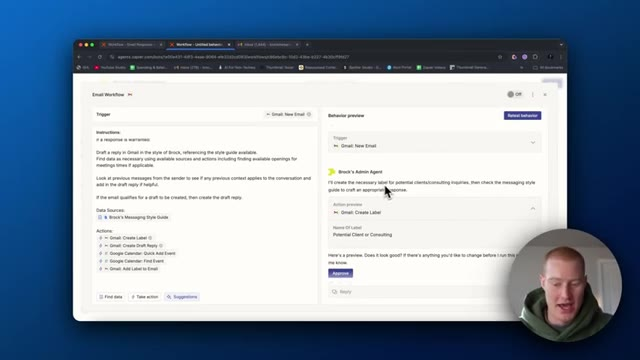
*⏱️ 00:10:41 — Interface de configuration d'un workflow d'agent IA montrant les instructions du déclencheur et l'aperçu du comportement de l'agent avec la création d'étiquette Gmail.*

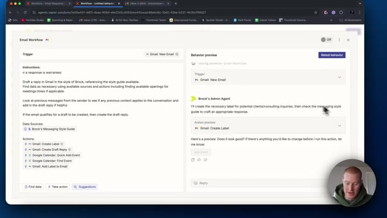
*⏱️ 00:10:49 — Suite de la prévisualisation du comportement de l'agent d'automatisation des e-mails avec les détails des actions programmées.*

---

### ⏱️ `[00:11:05 - 00:11:40]` | Segment #30

**🔊 Audio (Transcription Intégrale Mot pour Mot en Français) :**
> en vérifiant effectivement le guide du style de message que nous avons lié juste ici afin de rédiger une réponse appropriée. Les gars, c'est tellement cool. Ça va me faire gagner tellement de temps. D'accord. Donc maintenant, ça essaie réellement de trouver différentes réponses que j'ai eues basées sur des demandes de clients et des communications professionnelles via mon guide du style de messagerie de Brock. C'est plutôt intéressant. D'accord, c'est incroyable. Donc j'ai maintenant créé un brouillon de réponse à cette demande potentielle d'un client. Voici donc ce que ça a réellement généré. Alors, bonjour. Merci d'avoir pris contact pour vos aimables paroles concernant ma chaîne YouTube. Je suis ravi d'apprendre que vous vous intéressez aux services d'IA et que vous avez un projet en tête. Oui, je prends actuellement en charge des projets pour des projets liés à l'IA. Ou oui, je suis actuellement

**👁️ Analyse Visuelle d'Écran (gemini-3.5-flash-lite) :**
**Interface & Outils** : Navigateur web affichant l'interface Zapier Central ou un outil d'agent IA similaire.

**Contenu textuel & Code** : Instructions pour un workflow de gestion d'e-mails, sources de données incluant le guide de style de messagerie de Brock, actions configurées et aperçu du comportement de l'agent.

**Action / Démonstration** : Configuration et démonstration d'un workflow automatisé pour rédiger des réponses d'e-mails basées sur un guide de style.

*⏱️ 00:11:13 — Capture d'écran montrant l'interface d'un workflow d'automatisation d'e-mails avec des instructions et des sources de données configurées.*

---

### ⏱️ `[00:11:40 - 00:12:13]` | Segment #31

**🔊 Audio (Transcription Intégrale Mot pour Mot en Français) :**
> prendre en charge des clients pour des projets liés à l'intelligence artificielle. J'aimerais en savoir plus sur votre projet et sur la manière dont je pourrais vous aider. Pourriez-vous partager un peu plus vos ce que vous recherchez en termes de support ? Si cela peut vous être utile, vous pouvez également planifier un moment pour en discuter davantage. Faites-moi part de vos disponibilités et je ferai de mon mieux pour m'adapter. Ainsi, puisque nous avons la possibilité de créer des événements, nous pourrions même faire en sorte que notre agent IA coordonne l'événement, planifie et l'ajoute à notre calendrier Google. Les gars, c'est vraiment, vraiment cool. D'accord. Donc pour les besoins de cette vidéo, je ne veux pas vraiment aller dans ma messagerie car il y a des informations sensibles, mais j'ai en fait vérifié et il y a un nouveau brouillon ajouté dans ma boîte aux lettres.

**👁️ Analyse Visuelle d'Écran (gemini-3.5-flash-lite) :**
**Interface & Outils** : Interface web de Zapier Central ou d'un outil d'automatisation d'agents IA, affichée dans un navigateur web.

**Contenu textuel & Code** : Instructions textuelles du prompt pour le traitement des e-mails, sources de données (style guide), actions configurées (Gmail, Google Calendar) et aperçu d'un brouillon de réponse à un client potentiel.

**Action / Démonstration** : Présentation et explication visuelle du workflow d'automatisation de la gestion des e-mails par l'intelligence artificielle.

*⏱️ 00:11:48 — Capture d'écran montrant l'interface d'un workflow d'automatisation d'e-mails, avec à gauche les instructions de déclenchement et de réponse, et à droite un aperçu du brouillon d'e-mail généré par l'IA.*

---

### ⏱️ `[00:12:13 - 00:12:33]` | Segment #32

**🔊 Audio (Transcription Intégrale Mot pour Mot en Français) :**
> Donc tout ce que j'ai à faire, c'est de parcourir mes brouillons maintenant et d'approuver tous ces différents messages pour qu'ils soient envoyés via mon agent IA. Nous pourrions même faire en sorte qu'ils s'envoient automatiquement, mais j'aime pouvoir tester et m'assurer que tout est prêt avant l'envoi. Voilà donc qui est fait. Passons maintenant à la partie Slack de cet agent IA. Ok, dernière chose avant de passer réellement à la partie Slack de ceci, j'ai juste besoin d'activer ce comportement.

**👁️ Analyse Visuelle d'Écran (gemini-3.5-flash-lite) :**
**Interface & Outils** : Interface web de Zapier Agents / Workflow d'e-mail.

**Contenu textuel & Code** : Instructions pour l'agent (rédaction de réponses dans le style de Brock, recherche de données dans Google Calendar, création de brouillons d'e-mails) et aperçu du corps d'un e-mail généré.

**Action / Démonstration** : Démonstration de la configuration d'un agent IA pour automatiser la gestion et la réponse aux e-mails entrants.

*⏱️ 00:12:18 — Capture d'écran montrant l'interface d'un agent IA d'automatisation (Zapier Agents) avec les instructions, sources de données et actions de l'agent configurées pour gérer les réponses aux e-mails.*

*⏱️ 00:12:28 — Capture d'écran similaire montrant l'aperçu du comportement de l'agent IA générant un brouillon de réponse d'e-mail personnalisé.*

---

### ⏱️ `[00:12:33 - 00:12:53]` | Segment #33

**🔊 Audio (Transcription Intégrale Mot pour Mot en Français) :**
> Donc maintenant, chaque fois qu'un nouvel e-mail arrive, cela fonctionnera automatiquement correctement. Donc ce que je dois faire, c'est que je suis toujours à l'intérieur de l'agent administrateur de Brock. Comprenez bien cela. Mais ce que je dois faire, c'est simplement créer un nouveau comportement. Nous aurons donc un comportement différent pour chacune de ces différentes tâches que nous aimons effectuer. C'est ainsi que ces agents fonctionnent. Donc, évidemment, nous avons le flux de travail des e-mails que nous avons créé. Nous avons juste besoin de créer un nouveau comportement.

**👁️ Analyse Visuelle d'Écran (gemini-3.5-flash-lite) :**
**Interface & Outils** : Interface web de Zapier Agents.

**Contenu textuel & Code** : Configuration de l'agent, source de données ('Brock's Messaging Style Guide') et workflow d'e-mail avec déclencheur Gmail.

**Action / Démonstration** : Présentation et explication de la configuration des comportements et des workflows automatisés de l'agent.

*⏱️ 00:12:38 — Vue de l'interface de l'agent Zapier montrant la configuration de 'Brock's Admin Agent' avec le flux d'e-mails.*

*⏱️ 00:12:43 — Gros plan sur le panneau de configuration du flux d'e-mails au sein de l'agent d'administration.*

*⏱️ 00:12:48 — Navigation dans les paramètres de configuration des comportements et déclencheurs de l'agent.*

---

### ⏱️ `[00:12:53 - 00:13:16]` | Segment #34

**🔊 Audio (Transcription Intégrale Mot pour Mot en Français) :**
> Mais ceci va être simplement pour le flux de travail Slack et l'automatisation que nous essayons de construire. Allons-y donc et donnons-lui le titre d'agent Slack. Je vais appeler ceci flux de travail Slack. D'accord, et nous devons commencer à rédiger nos instructions ici. Donc, lorsqu'il y a une nouvelle mention de mon nom d'utilisateur dans Slack, nous devons d'abord analyser la mention. Déterminez donc le type de message en fonction de son contenu, évaluez si la mention nécessite une réponse ou une réaction pour l'accuser réception.

**👁️ Analyse Visuelle d'Écran (gemini-3.5-flash-lite) :**
**Interface & Outils** : Navigateur web affichant l'interface de création d'agents Zapier Central.

**Contenu textuel & Code** : Éditeur de workflow d'agent avec champ de titre, section de déclenchement ('Trigger'), zone de rédaction des instructions et panneau de prévisualisation du comportement ('Behavior preview').
[DESC_IMAGE_2] Saisie des instructions de l'agent pour automatiser la gestion des mentions sur Slack.

**Action / Démonstration** : Explications face caméra et analyse conceptuelle des marchés.

*⏱️ 00:12:59 — Interface de configuration d'agent avec le champ de titre nommé 'Untitled behavior' et la zone d'instructions vide.*

*⏱️ 00:13:04 — Interface de configuration montrant le titre renommé en 'Slack Workflow' et la saisie des instructions relatives aux mentions sur Slack.*

---

### ⏱️ `[00:13:16 - 00:13:36]` | Segment #35

**🔊 Audio (Transcription Intégrale Mot pour Mot en Français) :**
> Donc en gros, c'est la même chose que dans le flux de travail des e-mails. Et ensuite, nous devons aussi ajouter un nouveau déclencheur. Donc ça va être Slack. Et ensuite, je vais appeler ça, ça va être à chaque fois que je suis mentionné à l'intérieur de mon canal Slack. Donc voilà. Quand une nouvelle mention se produit, alors ceci sera déclenché. Deuxième étape ici, nous devons examiner le contenu ou le contexte du fil de discussion si applicable.

**👁️ Analyse Visuelle d'Écran (gemini-3.5-flash-lite) :**
**Interface & Outils** : Navigateur web affichant l'interface de création de flux de travail de Zapier Central / agents.zapier.com.

**Contenu textuel & Code** : Menu de sélection de déclencheur affichant les options par défaut ("On demand", "Scheduled") et des applications intégrées (Asana, Gmail, Google Calendar).

**Action / Démonstration** : Le présentateur sélectionne ou configure le déclencheur ("Trigger") pour le flux de travail Slack.

*⏱️ 00:13:21 — Capture d'écran montrant l'interface de configuration d'un workflow Zapier avec un menu déroulant pour sélectionner un déclencheur ("Select trigger").*

---

### ⏱️ `[00:13:36 - 00:14:01]` | Segment #36

**🔊 Audio (Transcription Intégrale Mot pour Mot en Français) :**
> Donc, c'est la même chose qu'avec les e-mails, nous devons examiner le contexte de la conversation que nous avons avec la personne. Donc, si c'est dans un fil de discussion sur Slack, il comprendra alors en quelque sorte tout ce dont nous avons parlé. Il a donc du contexte avant de répondre. Donc, si la mention fait partie d'un fil de discussion, récupérez et analysez les messages précédents dans le fil pour le contexte, puis incorporez les détails pertinents si nécessaire du fil dans votre brouillon de réponse. D'accord. Et maintenant, passons à l'étape trois, nous devons notifier Brock via le bot Slack.

**👁️ Analyse Visuelle d'Écran (gemini-3.5-flash-lite) :**
**Interface & Outils** : Navigateur web affichant l'interface de Zapier pour la création de workflows d'agents IA (Slack Workflow).

**Contenu textuel & Code** : Instructions textuelles du prompt de l'agent : analyse des mentions sur Slack, évaluation du besoin de réponse, et révision du contexte des fils de discussion (Thread Context).

**Action / Démonstration** : Le présentateur explique et montre les instructions du prompt configuré pour analyser les messages et le contexte des fils de discussion sur Slack.

*⏱️ 00:13:42 — Interface de configuration d'un workflow Slack sur Zapier montrant les instructions pour analyser les mentions.*

*⏱️ 00:13:55 — La même interface de workflow Slack avec du texte sélectionné dans les instructions de prise en compte du contexte des messages.*

---

### ⏱️ `[00:14:02 - 00:14:24]` | Segment #37

**🔊 Audio (Transcription Intégrale Mot pour Mot en Français) :**
> Donc, publiez un message dans le chat Slack ou le canal du bot Slack avec un résumé de la mention. Et ensuite, j'ai ajouté quelques exemples. Donc, vous avez été mentionné dans le nom du canal à propos d'un bref résumé. Nous devons également ajouter un lien cliquable vers le message d'origine, puis un bref brouillon de réponse en utilisant. Et ensuite, j'ai ajouté la source de données, le guide du style de messagerie de Brock. Ainsi, il a le contexte de la façon de répondre ou un Slack pour réagir avec le raisonnement pour une révision facile.

**👁️ Analyse Visuelle d'Écran (gemini-3.5-flash-lite) :**
**Interface & Outils** : Navigateur web affichant un outil de workflow d'automatisation (Zapier ou similaire) et la webcam du présentateur en bas à droite.

**Contenu textuel & Code** : Instructions détaillées pour analyser une mention Slack, examiner le contexte du fil de discussion et notifier l'utilisateur via Slackbot avec des exemples de résumés.

**Action / Démonstration** : Le présentateur explique les instructions de configuration du workflow pour automatiser le traitement des mentions Slack.

*⏱️ 00:14:07 — Capture d'écran montrant une interface de workflow avec des instructions pour configurer les mentions Slack.*

---

### ⏱️ `[00:14:24 - 00:14:57]` | Segment #38

**🔊 Audio (Transcription Intégrale Mot pour Mot en Français) :**
> Voilà, c'est fait. Ensuite, je lui dis de ne pas hésiter à utiliser Google Agenda pour le contexte des réunions ou des événements, tous les outils de gestion de projet, si applicable, et ensuite le contexte des fils de discussion pour les messages précédents lorsqu'ils sont disponibles, comme je viens de le dire. Et puis ensuite, nous devons ajouter nos actions ici. Pour que cela puisse réellement exécuter ces tâches. Très bien. Voici donc toutes les actions que nous allons utiliser pour cela, le flux de travail Slack au sein de notre agent. Nous allons donc utiliser l'envoi d'un message direct via Slack, Slack, récupérer les messages d'un fil de discussion, puis Slack, trouver le message. Et enfin, la possibilité de trouver un événement dans Google Agenda, ainsi que de créer un événement dans Google Agenda. Donc

**👁️ Analyse Visuelle d'Écran (gemini-3.5-flash-lite) :**
**Interface & Outils** : Navigateur web, interface de configuration Zapier (Agents Zapier / Slack Workflow).

**Contenu textuel & Code** : Instructions textuelles du bot, consignes sur Google Agenda et les fils de discussion, liste d'actions disponibles (Slack, Google Calendar).

**Action / Démonstration** : Configuration et édition d'un workflow d'agent intelligent dans Zapier.

*⏱️ 00:14:32 — Interface de configuration Zapier affichant les instructions d'un workflow Slack avec des options de contexte Google Agenda.*

*⏱️ 00:14:40 — Interface Zapier montrant l'éditeur de workflow avec des actions disponibles listées sous les instructions.*

*⏱️ 00:14:49 — Vue similaire de l'interface Zapier montrant le curseur sur les options d'actions pour le workflow Slack.*

---

### ⏱️ `[00:14:57 - 00:15:15]` | Segment #39

**🔊 Audio (Transcription Intégrale Mot pour Mot en Français) :**
> Donc encore une fois, assurez-vous de relier toutes vos actions ici à vos profils spécifiques pour chacune de ces plateformes. Et ensuite, nous devons simplement ajouter nos sources de données. Et ensuite, ce flux de travail devrait être prêt. Donc en gros, trouver des données, ajouter cela là. Cela permet à notre agent de comprendre très facilement, vous savez, les actions et les sources de données auxquelles il a accès. Alors enregistrons cela.

**👁️ Analyse Visuelle d'Écran (gemini-3.5-flash-lite) :**
**Interface & Outils** : Navigateur web affichant l'interface de création d'agents/workflows (Zapier Agents).

**Contenu textuel & Code** : Configuration d'un workflow Slack avec des instructions textuelles, des actions (Slack: Send Direct Message, Retrieve Thread Messages, Find Message, Google Calendar) et une section de prévisualisation du comportement.

**Action / Démonstration** : Le présentateur explique comment relier les actions aux profils et ajouter les sources de données pour configurer le flux de travail.

*⏱️ 00:15:01 — Interface de configuration d'un flux de travail Slack montrant les instructions, les actions disponibles et la webcam du présentateur en bas à droite.*

*⏱️ 00:15:06 — Vue légèrement élargie du même interface de configuration avec l'ajout du champ des sources de données ("Data Sources").*

---

### ⏱️ `[00:15:15 - 00:15:37]` | Segment #40

**🔊 Audio (Transcription Intégrale Mot pour Mot en Français) :**
> Maintenant, je dois aller de l'avant et m'envoyer un faux message Slack et m'assurer que tout fonctionne correctement. Très bien, voilà les gars. Nous avons réellement créé un agent IA qui pouvait gérer toutes mes tâches administratives, et c'était vraiment simple à faire en utilisant les agents Zapier. Donc si vous voulez plus de contenu comme celui-ci, où je passe en revue des cas d'utilisation spécifiques pour les agents Zapier et la construction d'un agent pour vous-même, assurez-vous de commenter ce que vous aimeriez me voir construire dans les commentaires ci-dessous.

**👁️ Analyse Visuelle d'Écran (gemini-3.5-flash-lite) :**
**Interface & Outils** : Navigateur web affichant l'interface de configuration Zapier (Agents) avec la webcam du présentateur.

**Contenu textuel & Code** : Paramètres de l'agent IA : nom ("Brock's Admin Agent"), description, sources de données ("Brock's Messaging Style Guide") et sections de comportements pour les workflows (Email Workflow, Slack Workflow).

**Action / Démonstration** : Le présentateur explique la configuration de l'agent IA administrateur et montre l'interface de paramétrage des workflows.

*⏱️ 00:15:21 — Interface de configuration d'un agent Zapier nommé "Brock's Admin Agent", avec une vue en incrustation du présentateur dans un cercle en bas à droite.*

---

### ⏱️ `[00:15:37 - 00:15:45]` | Segment #41

**🔊 Audio (Transcription Intégrale Mot pour Mot en Français) :**
> Laissez un pouce bleu, laissez un commentaire, abonnez-vous à la chaîne, inscrivez-vous avec les agents Zapier ci-dessous. Cela étant dit, merci d'avoir suivi. Je vous vois dans la prochaine vidéo. Santé.

**👁️ Analyse Visuelle d'Écran (gemini-3.5-flash-lite) :**
**Interface & Outils** : Navigateur web affichant l'interface de configuration des agents Zapier.

**Contenu textuel & Code** : Paramètres de l'agent incluant le nom ("Brock's Admin Agent"), la description, les sources de données (style guide), et les flux de travail automatisés (Email Workflow, Slack Workflow).

**Action / Démonstration** : Présentation de la configuration des agents Zapier en fin de vidéo.

*⏱️ 00:15:39 — Interface de configuration d'un agent Zapier nommé "Brock's Admin Agent", avec le présentateur incrusté en médaillon circulaire.*

---

