# 🎬 Building an AI Agent SaaS with Lovable (In 1 Hour)

> **Chaîne** : [Brock Mesarich | AI for Non Techies](https://www.youtube.com/@BrockMesarich)  
> **Lien YouTube** : [https://www.youtube.com/watch?v=Z7iOmxX8EFo](https://www.youtube.com/watch?v=Z7iOmxX8EFo)  
> **Date de publication** : 20250125  
> **Durée** : 01:05:34  
> **Identifiant vidéo** : `Z7iOmxX8EFo`  
> **Transcription & Analyse** : `whisper-v3-large-turbo+gemini-3.5-flash-lite`  

---

## 📌 Synthèse Exécutive & Outils

### 💡 Résumé

Cette vidéo immersive, présentée par Brock Mesarich (pour sa chaîne « AI for Non Techies ») et son homologue technique Mark, lève le voile sur le développement ultra-rapide d'une application SaaS de type « Agent AI marketplace » (inspirée de la plateforme *agent.ai*) en l'espace d'une heure. Adoptant un format brut et sans montage, les intervenants partagent l'arrière-scène de la construction itérative d'un produit logiciel de bout en bout, illustrant à la fois la puissance de la génération de code textuelle et les frictions techniques inhérentes à ce type d'approche agile. 

La stratégie centrale repose sur l'exploitation d'une faille d'optimisation du prompt engineering et du design itératif : combiner des générateurs d'applications web full-stack avec des bibliothèques de composants UI haut de gamme (notamment des modèles interactifs de type *Tesla Bot* issus de plateformes tierces). En injectant du code et des styles granulaires directement dans l'outil de développement, ils démontrent comment une personne non-technique peut surpasser l'esthétique de plateformes existantes tout en naviguant à travers les bugs de compilation en temps réel.

Au-delà de la simple démonstration de code, la vidéo explore la viabilité de lancer des concepts de start-up technologiques complexes en 2025 grâce à l'intelligence artificielle générative. Elle met en lumière l'importance d'une structure de prompt rigoureuse — allant jusqu'à l'utilisation de GPTs spécialisés —, l'intégration de bases de données relationnelles comme Supabase, et la gestion méthodique des erreurs front-end/back-end pour transformer une simple idée abstraite en un produit fonctionnel.

### 🛠️ Outils, Modèles & Logiciels Présentés

* **Lovable** : Plateforme de développement d'applications web pilotée par l'IA générative, utilisée ici pour concevoir l'interface utilisateur et orchestrer le code du SaaS.
* **21st.dev** : Place de marché et bibliothèque de composants UI avancés (tels que l'interface inspirée du *Tesla Bot*), fournissant des prompts de design hautement optimisés.
* **Supabase** : Infrastructure de base de données relationnelle et backend-as-a-service connectée à l'application pour gérer la logique et les fonctions edge.
* **ChatGPT / GPTs spécialisés** : Modèles conversationnels d'OpenAI et assistants personnalisés dédiés à l'optimisation et à la rédaction de prompts pour Lovable.
* **Bolt** : Alternative de développement d'applications web par IA mentionnée pour sa compatibilité avec les prompts de composants UI.
* **OpenAI** : Fournisseur de modèles linguistiques destiné à alimenter et activer les agents IA au sein de la plateforme SaaS.
* **Agent.ai** : Plateforme de référence et source d'inspiration principale reproduite sous une version allégée durant la session.
* **Make & n8n** : Outils d'automatisation de flux de travail (mentionnés dans l'écosystème global d'automatisation des agents).
* **Zapier** : Logiciel d'automatisation d'intégration et de connexion d'applications tiers.
* **Gemini & Claude** : Modèles d'IA alternatifs évoqués dans le paysage global des grands modèles de langage.
* **Grok** : Modèle d'intelligence artificielle conversationnelle développé par xAI.

### 🔑 Points Clés & Enseignements Stratégiques

* **Prototypage ultra-rapide sans code** : Démontrer la faisabilité de concevoir, structurer et lancer un SaaS fonctionnel en moins d'une heure en s'affranchissant des barrières techniques traditionnelles.
* **Exploitation de composants UI haut de gamme** : Utiliser des bibliothèques externes (*21st.dev*) pour importer des designs complexes (effets de projecteur, animations interactives) sans coder manuellement les animations.
* **Méthodologie de prompt granulaire** : Copier-coller des snippets de code et des descriptions de micro-détails entre guillemets pour forcer l'IA à respecter des éléments visuels précis sans altérer le reste de la page.
* **Préservation des composants clés** : Structurer les prompts de modification en demandant explicitement à l'IA de conserver les éléments fonctionnels et structurels existants (comme le design du robot) tout en y ajoutant de nouvelles sections.
* **Correction itérative des bugs en direct** : Accepter la friction technique et l'apparition d'erreurs de rendu visuel pour enseigner à l'audience comment réagir face aux conflits de code générés par l'IA.
* **Création d'assistants de prompt sur mesure** : Utiliser un GPT personnalisé spécifiquement entraîné pour formuler des prompts adaptés aux exigences syntaxiques de Lovable et maximiser la précision des résultats.
* **Anatomie d'une landing page orientée SaaS** : Transformer une interface simple en une page de destination à part entière intégrant des propositions de valeur claires, telles qu'un marché d'embauche d'agents IA spécialisés.
* **Modularité des micro-éléments** : Isoler des composants précis d'un site web (boutons à bordures dégradées, icônes, effets de survol) pour les réinjecter un par un dans l'application en cours de création.
* **Préparation de l'infrastructure backend** : Anticiper la connexion à Supabase et la configuration de fonctions edge pour faire passer l'application d'un simple prototype visuel à un outil véritablement connecté à des API d'IA.
* **Avantage compétitif des non-codeurs** : Souligner comment l'IA permet à des profils non techniques de concevoir des interfaces modernes et esthétiques surpassant parfois le design de plateformes existantes établies.
* **Transparence des workflows d'ingénierie** : Privilégier un format de vidéo brut et sans montage pour exposer la réalité des essais, des erreurs et des ajustements nécessaires lors de l'utilisation d'outils de développement pilotés par l'IA.

---

## ⏱️ Chronologie & Transcription Complète Audio & Visuelle (Mot pour Mot)

### ⏱️ `[00:00:00 - 00:00:30]` | Segment #01

**🔊 Audio (Transcription Intégrale Mot pour Mot en Français) :**
> Yo, qu'est-ce qui se passe les gars ? On a Mark qui est de retour. Si vous n'avez pas vu notre dernière vidéo, on a fait une plongée en profondeur dans la création d'une application de réseau social avec Lovable. On a fait de notre mieux en tout cas. Et je voulais le faire revenir parce que je trouve que cette vidéo a vraiment cartonné. Et je pense que vous aimez vraiment voir les coulisses de la création de différentes applications et tout ça en utilisant Lovable. Donc ça va être une vidéo un peu brute et sans montage. On va littéralement lancer une idée de ce qu'on essaie de construire, la construire ici en public et genre littéralement rencontrer des problèmes et vous nous verrez traverser tout ça. Donc ça ne va pas être joli.

**👁️ Analyse Visuelle d'Écran (gemini-3.5-flash-lite) :**
**Interface & Outils** : Application de visioconférence.

**Contenu textuel & Code** : Aucun contenu technique, graphique ou code source affiché (zone principale floutée).

**Action / Démonstration** : Conversation d'introduction entre les deux intervenants.

---

### ⏱️ `[00:00:30 - 00:00:57]` | Segment #02

**🔊 Audio (Transcription Intégrale Mot pour Mot en Français) :**
> Ce ne sera pas une vidéo montée, mais oui, je suis heureux de retrouver Mark. Mark est un type génial. Je viens de passer une semaine avec lui et oui, je pense qu'il peut apporter beaucoup et nous aider à construire quelque chose de cool. Donc, de la même manière qu'on a cadré ça un peu comme la dernière vidéo, je suis en quelque sorte la personne non technique. Lui, il est un peu plus technique. Il peut donc expliquer certaines de ces choses un peu mieux que je ne le peux. Je me suis donc dit que ce serait sympa, tu sais, pour vous de voir les deux perspectives. Je pense donc que, tu sais, ça fonctionne plutôt bien en ce qui concerne la dynamique.

**👁️ Analyse Visuelle d'Écran (gemini-3.5-flash-lite) :**
**Interface & Outils** : 

**Contenu textuel & Code** : 

**Action / Démonstration** : 

---

### ⏱️ `[00:00:57 - 00:01:21]` | Segment #03

**🔊 Audio (Transcription Intégrale Mot pour Mot en Français) :**
> Cela étant dit, Mark, ravi de te ravoir ici. Faisons ça. C'est un plaisir d'être de retour et ravi de m'adresser à nouveau à ton audience. Et oui, le plan aujourd'hui est de construire quelque chose d'un peu plus délicat, un peu plus nuancé et d'utiliser un hack fou que tu as trouvé, Brock, pas moi, pour vraiment passer au niveau supérieur sur la façon dont cette adorable vue va réellement s'afficher. Donc ça va être vraiment, vraiment intéressant. Ouais, c'est clair. Faisons ça. Très bien. Alors, quelle est l'idée ?

**👁️ Analyse Visuelle d'Écran (gemini-3.5-flash-lite) :**
**Interface & Outils** : Visioconférence (gros plan statique des présentateurs)

**Contenu textuel & Code** : Aucun contenu technique, indicateur, code ou données chiffrées affiché.

**Action / Démonstration** : Les présentateurs discutent et échangent des propos introductifs sans manipulation ni démonstration en cours.

---

### ⏱️ `[00:01:21 - 00:01:42]` | Segment #04

**🔊 Audio (Transcription Intégrale Mot pour Mot en Français) :**
> Tu as eu l'idée, alors fonce. Ouais, on a un peu eu l'idée tous les deux. J'ai eu l'idée initiale. Tu as en quelque sorte rebondi dessus. Donc j'ai eu l'idée de créer une sorte de produit logiciel d'agent IA. Évidemment, tout le monde sait que les agents IA font fureur à l'approche de 2025. Alors pourquoi ne pas essayer de construire une plateforme qui exploite cela et voir si c'est seulement possible ?

**👁️ Analyse Visuelle d'Écran (gemini-3.5-flash-lite) :**
**Interface & Outils** : Visioconférence (aucun graphique, code, terminal ou échange affiché).

**Contenu textuel & Code** : Aucun élément technique, code source, prompt ou indicateur visible.

**Action / Démonstration** : Conversation entre les intervenants sans démonstration technique ni manipulation de graphique.

---

### ⏱️ `[00:01:42 - 00:02:01]` | Segment #05

**🔊 Audio (Transcription Intégrale Mot pour Mot en Français) :**
> C'est l'une des choses que je voulais tester dans cette vidéo, c'est du genre, ouais, c'est une idée sympa, mais est-ce que c'est seulement possible ? Donc je suppose que c'est ce qu'on va découvrir dans cette vidéo si tu regardes jusqu'à la fin. Alors, qu'est-ce que tu penses d'un truc comme ça ? Et tu m'as même donné l'idée du genre, et si on essayait de recréer quelque chose comme agent ou c'est quoi ?

**👁️ Analyse Visuelle d'Écran (gemini-3.5-flash-lite) :**
**Interface & Outils** : Visioconférence (type Zoom ou Google Meet) et contenu flouté.

**Contenu textuel & Code** : Aucun contenu technique, graphique ou code visible en raison du flou.

**Action / Démonstration** : Conversation ou interview entre les deux intervenants.

---

### ⏱️ `[00:02:01 - 00:02:24]` | Segment #06

**🔊 Audio (Transcription Intégrale Mot pour Mot en Français) :**
> Agent.ai. Agent.ai. C'est donc une entreprise que l'ancien, ou je crois la personne qui a inventé HelpSpot et l'a vendu ou peu importe, a créée. C'est fondamentalement comme une place de marché, un peu comme LinkedIn pour embaucher des agents, ce qui est, vous savez, un clin d'œil au composant d'interface utilisateur. Mais nous allons essayer de créer une version de plus basse résolution de tout cela en utilisant uniquement du texte pour générer du code, rien d'autre.

**👁️ Analyse Visuelle d'Écran (gemini-3.5-flash-lite) :**
**Interface & Outils** : Visioconférence et navigateur web flouté.

**Contenu textuel & Code** : Aucun contenu technique, graphique ou textuel lisible en raison du flou général de la partie droite.

**Action / Démonstration** : Discussion entre le présentateur et l'intervenant sans démonstration technique visible.

---

### ⏱️ `[00:02:24 - 00:02:44]` | Segment #07

**🔊 Audio (Transcription Intégrale Mot pour Mot en Français) :**
> Ouais, super. Ça a l'air d'être une excellente idée. Faisons ça. Alors, partageons l'écran. Très bien. Donc, la dernière fois, nous avons suivi le processus consistant à examiner quelques idées sur la façon de faire de l'ingénierie de prompt avec Lovable. Une chose que nous allons faire dès le départ, c'est de regarder quelle est notre pièce d'inspiration ici.

**👁️ Analyse Visuelle d'Écran (gemini-3.5-flash-lite) :**
**Interface & Outils** : Navigateur web affichant la plateforme Lovable (lovable.dev) et interface de visioconférence.

**Contenu textuel & Code** : Page d'accueil de Lovable avec la zone de saisie de prompt et des exemples de projets suggérés.

**Action / Démonstration** : Partage d'écran de l'interface de développement Lovable par l'un des intervenants.

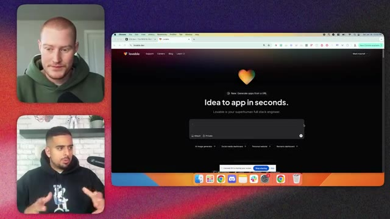
*⏱️ 00:02:34 — Capture d'écran montrant les deux participants en visioconférence sur la gauche et le navigateur web affichant la plateforme Lovable (lovable.dev) avec le slogan 'Idea to app in seconds' et une barre de prompt au centre.*

---

### ⏱️ `[00:02:44 - 00:03:16]` | Segment #08

**🔊 Audio (Transcription Intégrale Mot pour Mot en Français) :**
> Donc ça s'appelle agent.ai, et si vous allez sur la plateforme actuelle, vous allez voir que vous avez ces agents que vous pouvez embaucher. Maintenant, quand vous cliquez dessus, vous pourrez fournir une certaine forme de saisie, et ensuite cette saisie, une fois que vous les aurez embauchés, va demander quelque chose comme "donne-moi une idée de mème" ou "donne-moi quelqu'un à rechercher comme prospect". Donc voici l'interface utilisateur générale de cette plateforme, et nous ne allons pas nécessairement tout recréer, mais nous allons essayer d'en capturer les détails, oui, exactement, exactement, donc une chose

**👁️ Analyse Visuelle d'Écran (gemini-3.5-flash-lite) :**
**Interface & Outils** : Navigateur web affichant la plateforme agent.ai.

**Contenu textuel & Code** : Présentation de différents agents IA disponibles sur la plateforme, tels que Company Research Agent et Flux Image Generator, avec leurs coûts en crédits et options d'embauche ("Hire").

**Action / Démonstration** : Navigation et présentation de la marketplace d'agents IA sur le site agent.ai.

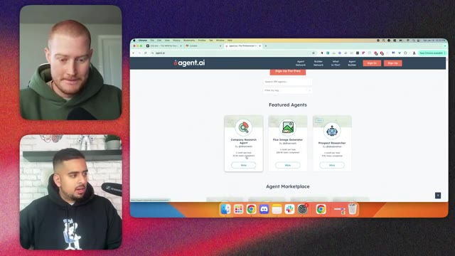
*⏱️ 00:02:52 — Capture d'écran montrant le site web agent.ai avec la liste des agents en vedette, aux côtés de deux intervenants en visioconférence.*

---

### ⏱️ `[00:03:16 - 00:03:47]` | Segment #09

**🔊 Audio (Transcription Intégrale Mot pour Mot en Français) :**
> nous allons commencer par utiliser l'incroyable astuce de Brock ici qui consiste à utiliser 21st.dev pour nous donner des modèles supplémentaires de prompts qui nous offrent des interfaces utilisateur très robustes, ce ne sont pas juste des trucs basiques qu'on obtient avec Lovable ou Bolt ou peu importe la plateforme d'application web que vous utilisez, donc voilà à quoi ça ressemble et vous auriez déjà vu une vidéo sur la chaîne de Brock mais celle que j'ai regardée, je me suis dit, ce serait génial à utiliser, ce serait ceci, fondamentalement cette interface utilisateur de type Tesla Bot.

**👁️ Analyse Visuelle d'Écran (gemini-3.5-flash-lite) :**
**Interface & Outils** : Navigateur web affichant la plateforme 21st.dev (bibliothèque de composants UI).

**Contenu textuel & Code** : Catalogue de composants d'interface utilisateur (Background lights, Interactive 3D, Acme, Magic UI, etc.) avec barre de recherche et filtres.

**Action / Démonstration** : Navigation et présentation de la plateforme de composants d'interface utilisateur 21st.dev pour enrichir les projets.

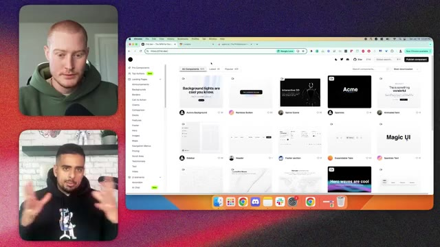
*⏱️ 00:03:24 — Capture d'écran montrant le site web 21st.dev affiché sur un écran d'ordinateur, avec deux intervenants en visioconférence dans des encarts à gauche.*

---

### ⏱️ `[00:03:47 - 00:04:07]` | Segment #10

**🔊 Audio (Transcription Intégrale Mot pour Mot en Français) :**
> Si je reviens simplement dessus ici, laissez-moi faire. Très bien. Et si je développe le tout, vous allez voir que vous avez une sorte de design à la Tesla Bot.

**👁️ Analyse Visuelle d'Écran (gemini-3.5-flash-lite) :**
**Interface & Outils** : Navigateur web Chrome sur macOS, affichant une interface de composants de design avec code source.

**Contenu textuel & Code** : Code source React/JSX pour composant 3D interactif et aperçu visuel 'Interactive 3D'.

**Action / Démonstration** : Navigation et affichage progressif d'un composant 3D interactif représentant un robot sur une page web de design.

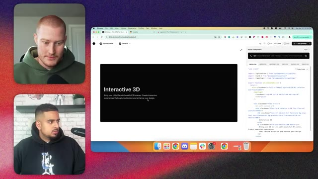
*⏱️ 00:03:57 — Affichage de composants de design web avec du code React et un encart interactif 3D vide sur le côté gauche.*

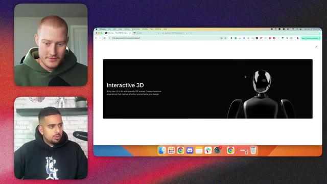
*⏱️ 00:04:02 — Apparition d'un modèle 3D de type robot humanoïde dans l'encart interactif de la page web.*

---

### ⏱️ `[00:04:07 - 00:04:51]` | Segment #11

**🔊 Audio (Transcription Intégrale Mot pour Mot en Français) :**
> Et ensuite, quand vous déplacez votre curseur, il vous suit, ce qui est super cool. Et au lieu que j'aie à me soucier de coder ceci ou de le demander et de passer la prochaine heure juste à essayer de faire ça, ce que vous pouvez faire, c'est simplement prendre le prompt et je vais aller sur Lovable et je vais dire : "J'essaie euh j'essaie de créer une application web qui me permet d'utiliser plusieurs agents, commencez par simplement recréer l'interface utilisateur suivante. Faites attention à tous les micro-détails ci-dessous."

**👁️ Analyse Visuelle d'Écran (gemini-3.5-flash-lite) :**
**Interface & Outils** : Navigateur web affichant des bibliothèques de composants et la plateforme Lovable.

**Contenu textuel & Code** : Code source React/JSX pour un composant 3D interactif et interface de génération de prompt par IA.

**Action / Démonstration** : Navigation vers la plateforme Lovable pour intégrer un prompt de composant 3D.

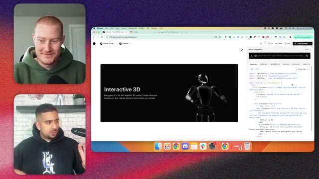
*⏱️ 00:04:18 — Présentation d'un composant 3D interactif avec son code source affiché à droite.*

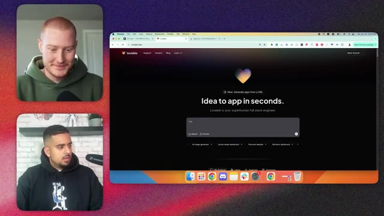
*⏱️ 00:04:29 — Page d'accueil de la plateforme Lovable permettant de transformer des idées en applications.*

---

### ⏱️ `[00:04:51 - 00:05:27]` | Segment #12

**🔊 Audio (Transcription Intégrale Mot pour Mot en Français) :**
> Et tout ce que je vais faire, c'est que je vais mettre entre guillemets et coller le prompt complet que nous venons d'obtenir de 21st.dev. Clique sur le côté droit, le petit truc aussi. Comme ça tu peux voir, ce qui est probablement déjà optimisé pour ça rien qu'en copiant le prompt, mais tu peux voir que tu peux l'euh, tu peux l'optimiser pour n'importe quelle plateforme que tu utilises. Je suppose que pour Lovable et Bolt, c'est exactement le même prompt, mais le fait que ce soit genre optimisé pour ces différentes plateformes, c'est juste, je ne sais pas, cool pour moi. Ouais, tout à fait. Donc si on clique là-dessus et qu'on copie le prompt, soyons juste super prudents, bon conseil. Et on va juste mettre ça

**👁️ Analyse Visuelle d'Écran (gemini-3.5-flash-lite) :**
**Interface & Outils** : Navigateur Google Chrome affichant le site 21st.dev, avec des fenêtres de visioconférence.

**Contenu textuel & Code** : Interface utilisateur de 21st.dev montrant un composant 3D interactif (« Interactive 3D » avec un robot noir), une commande d'installation (`npx shadcn@latest add ...`), du code React/TypeScript et un bouton de copie de prompt.

**Action / Démonstration** : Le présentateur explique comment utiliser et copier le prompt ou le code d'un composant issu de la plateforme 21st.dev.

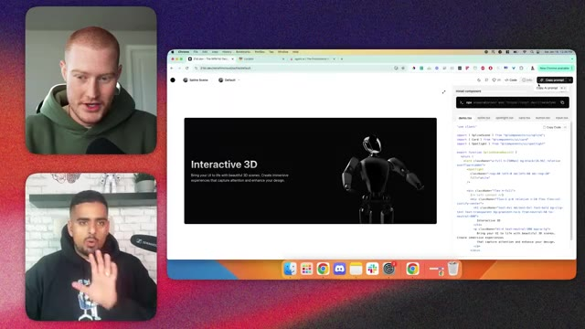
*⏱️ 00:05:00 — Capture d'écran montrant le présentateur et son invité en visioconférence à gauche, et le navigateur Chrome affichant la plateforme 21st.dev avec un composant 3D interactif et son code source à droite.*

---

### ⏱️ `[00:05:27 - 00:05:47]` | Segment #13

**🔊 Audio (Transcription Intégrale Mot pour Mot en Français) :**
> entre guillemets ici et ensuite nous allons coller ceci. Et ce que je m'attends à avoir n'est pas quelque chose de fonctionnel parce que nous allons devoir faire les mêmes choses que nous faisons habituellement, c'est-à-dire créer un Supabase, nous connecter à Supabase pour pouvoir commencer à créer des fonctions edge, connecter des trucs comme OpenAI, activer les agents. Mais le but de ceci est juste d'essayer de recréer ce que nous venons de voir sur 21st.dev.

**👁️ Analyse Visuelle d'Écran (gemini-3.5-flash-lite) :**
**Interface & Outils** : Navigateur web affichant Lovable.dev, macOS Dock.

**Contenu textuel & Code** : Code source lié à des composants React/UI avec des instructions pour l'installation de dépendances NPM.

**Action / Démonstration** : Génération et prévisualisation d'une application ou d'un composant d'interface utilisateur via l'outil Lovable.

*⏱️ 00:05:32 — Capture d'écran montrant l'interface de Lovable.dev avec du code et une prévisualisation en cours de chargement (« Spinning up preview... »), aux côtés des flux vidéo de deux intervenants.*

---

### ⏱️ `[00:05:48 - 00:06:12]` | Segment #14

**🔊 Audio (Transcription Intégrale Mot pour Mot en Français) :**
> Bien sûr. Et, je veux dire, en gros, on ne va probablement pas – les boutons ne seront probablement même pas fonctionnels, mais on verra ça après avoir défini l'apparence de l'interface utilisateur, la façon dont on veut qu'elle soit. Ouais, une étape à la fois. Donc ça va prendre un peu de temps. Ce qui est cool, c'est que si vous avez même le courage de parcourir le code ici, juste dans les grandes lignes, vous verrez qu'il est capable de traduire assez bien sur le plan technique, exactement ce qu'il voit ici.

**👁️ Analyse Visuelle d'Écran (gemini-3.5-flash-lite) :**
**Interface & Outils** : Navigateur web affichant une application de type IDE / Lovable (génération de code) avec des fenêtres de code source et de dépendances NPM.

**Contenu textuel & Code** : Du code source de composants d'interface utilisateur en React et des lignes de commandes de dépendances NPM (`@splinetool/react-spline`, `framer-motion`, etc.).

**Action / Démonstration** : Explication et visualisation de la génération de code pour l'interface utilisateur de l'application.

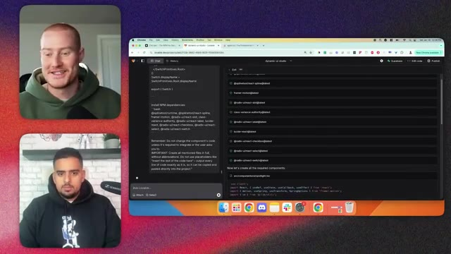
*⏱️ 00:05:54 — Capture d'écran montrant une visioconférence entre deux personnes à gauche et l'interface d'un environnement de développement de code à droite.*

---

### ⏱️ `[00:06:13 - 00:06:33]` | Segment #15

**🔊 Audio (Transcription Intégrale Mot pour Mot en Français) :**
> Donc c'est bon. Ça va prendre son temps. Je vais peut-être retourner à la sortie pour qu'on attende juste que ça se lance vraiment. Super. Aussi, un truc que je veux mentionner aussi, c'est qu'en retournant sur agent.ai, cette interface utilisateur a juste l'air nulle. Je veux dire, je suis peut-être partial ou quelque chose du genre, mais putain, on dirait que ça a été construit en 2010 ou un truc comme ça.

**👁️ Analyse Visuelle d'Écran (gemini-3.5-flash-lite) :**
**Interface & Outils** : Lovable.dev (éditeur de code et interface de prévisualisation web) dans un navigateur Google Chrome sur macOS.

**Contenu textuel & Code** : Code source React/TypeScript dans le panneau de gauche avec des composants (`SelectLabel`, `SelectItem`) et un écran de chargement avec un cœur et le texte "Spinning up preview..." dans le panneau de droite.

**Action / Démonstration** : Le présentateur patiente pendant le chargement de l'aperçu du projet en cours de génération sur la plateforme Lovable.

*⏱️ 00:06:18 — Capture d'écran montrant le navigateur Google Chrome avec l'interface de développement Lovable.dev affichant du code source à gauche et un aperçu en cours de chargement ("Spinning up preview...") à droite, avec les deux présentateurs en haut à gauche et en bas à gauche.*

---

### ⏱️ `[00:06:34 - 00:06:59]` | Segment #16

**🔊 Audio (Transcription Intégrale Mot pour Mot en Français) :**
> Donc le fait qu'on ne soit pas des codeurs et qu'on soit capables de lancer un truc qui a l'air un peu mieux. Oh, c'est une petite compétition ? Cette petite compétition ? On arrive pour vous. Ouais, ouais. Je pense que ce nom de domaine à lui seul a une valeur nette plus élevée que nous deux réunis. Donc première tentative sur ce coup-là, on a déjà une copie de cette interface utilisateur où maintenant on a ce petit projecteur mignon ici qui tourne en rond et en rond et en rond.

**👁️ Analyse Visuelle d'Écran (gemini-3.5-flash-lite) :**
**Interface & Outils** : Navigateur web affichant l'outil de développement et de génération d'applications Lovable.dev avec un panneau de code à gauche et un panneau de prévisualisation à droite.

**Contenu textuel & Code** : Code source React visible dans le panneau de gauche et interface utilisateur interactive avec modélisation 3D générée automatiquement.

**Action / Démonstration** : Génération et chargement en direct d'une interface utilisateur web interactive 3D par l'intelligence artificielle.

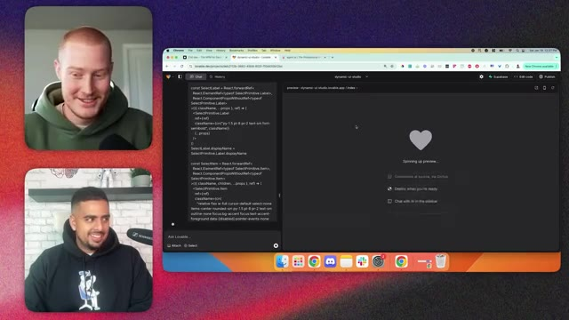
*⏱️ 00:06:40 — Aperçu du chargement du site web avec le message de prévisualisation "Spinning up preview" dans l'interface de Lovable.dev.*

*⏱️ 00:06:46 — Écran de prévisualisation vide en cours de chargement sur l'application web générée par IA.*

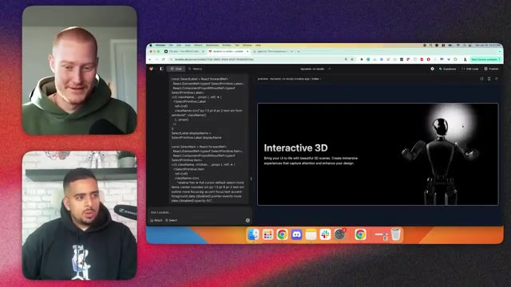
*⏱️ 00:06:53 — Affichage final de la section "Interactive 3D" avec un rendu graphique tridimensionnel d'un avatar humanoïde.*

---

### ⏱️ `[00:06:59 - 00:07:25]` | Segment #17

**🔊 Audio (Transcription Intégrale Mot pour Mot en Français) :**
> Donc c'est un bon début. Et maintenant nous voulons en faire une vraie page de destination. Donc ce que je vais dire c'est, je vais dire bon travail pour l'avoir recréée. Nous voulons créer une page de destination à part entière en préservant ces éléments, spécifiquement le robot.

**👁️ Analyse Visuelle d'Écran (gemini-3.5-flash-lite) :**
**Interface & Outils** : Lovable (navigateur web Chrome sur macOS), interface de développement web avec panneau de code et panneau de prévisualisation.

**Contenu textuel & Code** : Code source React (composants SelectLabel, SelectItem) et aperçu graphique d'une page web avec le texte "Interactive 3D" et un modèle 3D de robot noir.

**Action / Démonstration** : Présentation et révision du code généré et de l'aperçu de l'interface utilisateur interactive comportant l'élément 3D du robot.

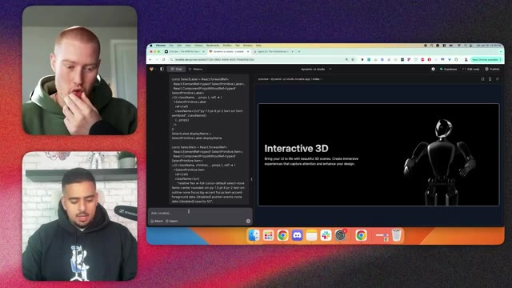
*⏱️ 00:07:05 — Capture d'écran montrant l'interface de Lovable (éditeur de code et aperçu web) avec du code React d'un côté et un aperçu visuel interactif avec un robot 3D de l'autre, ainsi que deux participants en visio.*

---

### ⏱️ `[00:07:25 - 00:07:51]` | Segment #18

**🔊 Audio (Transcription Intégrale Mot pour Mot en Français) :**
> Et laissez-moi juste faire un zoom ici pour le public comme je l'ai fait la dernière fois. Très bien, spécifiquement pour la conception de robots et la réactivité. Mais nous voulons modifier l'en-tête, les légendes et ajouter des éléments à la page.

**👁️ Analyse Visuelle d'Écran (gemini-3.5-flash-lite) :**
**Interface & Outils** : Navigateur web affichant Lovable.dev (Dynamic UI Studio) avec panneau de code/chat et aperçu en direct.

**Contenu textuel & Code** : Code source dans le panneau de gauche et prompt textuel demandant de créer une landing page complète en préservant la conception du robot, ainsi qu'un aperçu visuel montrant le texte 'Interactive 3D' et un modèle de robot noir.

**Action / Démonstration** : Saisie d'un prompt pour modifier et étendre la conception d'une page web interactive avec un robot 3D.

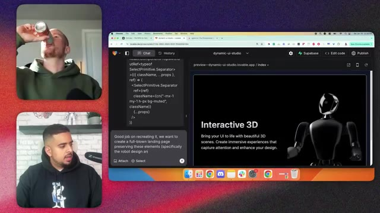
*⏱️ 00:07:32 — Capture d'écran montrant l'interface de développement Lovable.dev avec un panneau de chat à gauche affichant du code et un prompt textuel, et un aperçu d'une page web interactive 3D avec un robot à droite.*

---

### ⏱️ `[00:07:51 - 00:08:10]` | Segment #19

**🔊 Audio (Transcription Intégrale Mot pour Mot en Français) :**
> Wouah, mon orthographe est horribles aujourd'hui. cela va nous permettre d'introduire le concept de pouvoir embaucher des agents sur notre plateforme. Je vais donc simplement envoyer ça et voir ce qu'on obtient.

**👁️ Analyse Visuelle d'Écran (gemini-3.5-flash-lite) :**
**Interface & Outils** : Navigateur web affichant Lovable (dynamic-ui-studio)

**Contenu textuel & Code** : Un prompt textuel dans le chat (« Good job on recreating it, we want to create a full-blown landing page... ») et le code source visible en arrière-plan à gauche.

**Action / Démonstration** : Saisie et envoi d'un prompt pour modifier et enrichir la landing page interactive 3D.

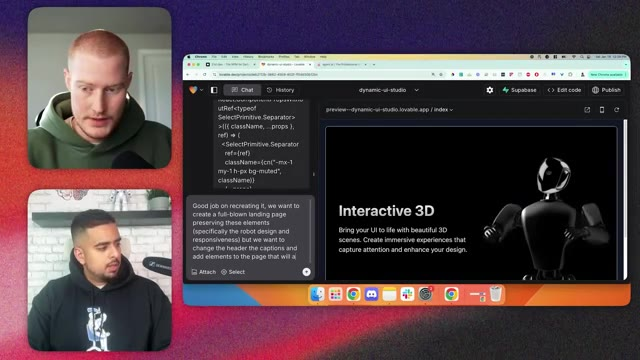
*⏱️ 00:07:56 — Capture d'écran montrant l'interface de Lovable avec un panneau de chat textuel à gauche et l'aperçu d'une page web interactive 3D avec un robot à droite, ainsi que les flux vidéo des deux intervenants sur le côté gauche.*

---

### ⏱️ `[00:08:11 - 00:08:34]` | Segment #20

**🔊 Audio (Transcription Intégrale Mot pour Mot en Français) :**
> Génial. L'objectif est que, espérons-le, cela ne change pas. On préserve ce composant. On fait juste s'y ajouter. Ouais. J'aime la façon dont tu as formulé ça dans le prompt, car c'est un aspect important, parce que la plupart du temps, ça va le changer et tu dois y retourner et t'en occuper. C'est juste une vraie galère. Si je pouvais payer pour avoir un GPT qui rédige des prompts de la façon dont tu le fais, je paierais une somme folle d'argent pour pouvoir tout formuler comme tu le fais.

**👁️ Analyse Visuelle d'Écran (gemini-3.5-flash-lite) :**
**Interface & Outils** : Navigateur web (Google Chrome), interface de développement Lovable.dev, interface de visioconférence.

**Contenu textuel & Code** : Panneau de chat montrant des instructions de prompt pour l'implémentation de composants UI, et un aperçu d'une page web avec le titre "Interactive 3D" et un modèle 3D de robot.

**Action / Démonstration** : Examen du résultat généré par l'IA dans l'outil de développement Lovable.dev et discussion sur la préservation des composants existants.

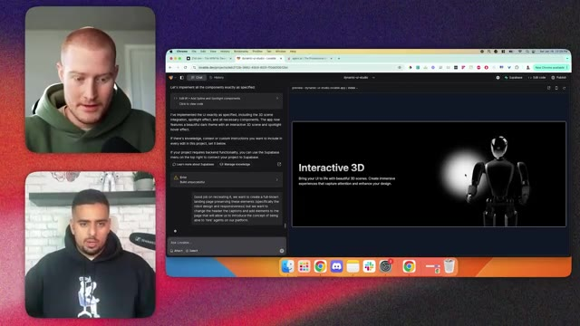
*⏱️ 00:08:16 — Capture d'écran montrant l'interface de Lovable.dev avec un panneau de chat à gauche et un aperçu d'interface web avec un élément 3D interactif à droite, ainsi que les deux intervenants en visioconférence sur le côté gauche.*

---

### ⏱️ `[00:08:34 - 00:09:12]` | Segment #21

**🔊 Audio (Transcription Intégrale Mot pour Mot en Français) :**
> Je l'ai fait, oui. J'ai créé un GPT pour Lovable. Et toi ? Je pourrais mettre le lien dans la description pour que ton audience puisse l'utiliser aussi. C'est utile. Ouais, ce serait génial. Bon sang, ça a l'air top. C'est super. C'est génial. Un marché d'agents IA. Donc, embaucher des agents IA spécialisés pour vos projets. D'accord, plutôt cool. D'accord, et ici vous pouvez voir les éléments Lovable où il y a toujours d'une manière ou d'une autre cette icône de bot qui apparaît tout le temps. Euh, ce que je voulais montrer à l'audience aussi — j'improvise un peu là — mais quand j'ai parcouru ce site, j'ai remarqué qu'il y avait ces boutons, j'essaie de trouver

**👁️ Analyse Visuelle d'Écran (gemini-3.5-flash-lite) :**
**Interface & Outils** : Navigateur web (Google Chrome) affichant l'interface de développement et de prévisualisation de Lovable, ainsi qu'un outil de chat textuel avec l'IA.

**Contenu textuel & Code** : Une page de présentation intitulée "AI Agents Marketplace" avec des sections sur les agents spécialisés, des capacités avancées et une sécurité renforcée, accompagnée d'un panneau latéral de discussion avec Lovable.

**Action / Démonstration** : Présentation de la création d'un GPT/application web dédiée à un marché d'agents IA via la plateforme Lovable.

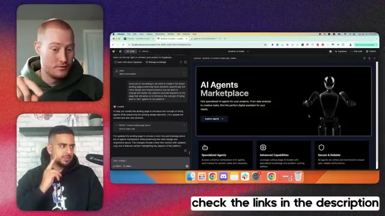
*⏱️ 00:08:44 — Capture d'écran montrant une visioconférence entre deux présentateurs et, au centre, un écran partagé affichant une application web de marché d'agents IA créée sur Lovable.*

---

### ⏱️ `[00:09:12 - 00:09:47]` | Segment #22

**🔊 Audio (Transcription Intégrale Mot pour Mot en Français) :**
> les boutons euh comme ce genre de boutons avec des bordures ouais donc ce que je peux faire c'est que je peux aussi copier ce prompt et je peux retourner voir et dire, est-ce que tu peux créer le bouton explorer les agents dans ce design ? C'est ça. Et après je vais coller ça. Donc maintenant vous pouvez aussi non seulement devoir créer toute la page pour imiter un composant, mais si vous aimez un petit élément de ce site web, comme ce globe qui tourne en rond ou ces petits boutons avec des bordures ou ces icônes, n'est-ce pas ? Donc vous pouvez

**👁️ Analyse Visuelle d'Écran (gemini-3.5-flash-lite) :**
**Interface & Outils** : Navigateur web affichant des outils de développement d'interface et des plateformes de création d'applications.

**Contenu textuel & Code** : Code source React, instructions d'installation de composants et prévisualisation d'éléments d'interface utilisateur.

**Action / Démonstration** : Navigation entre la page de génération d'application IA et la bibliothèque de composants UI pour copier des éléments de design.

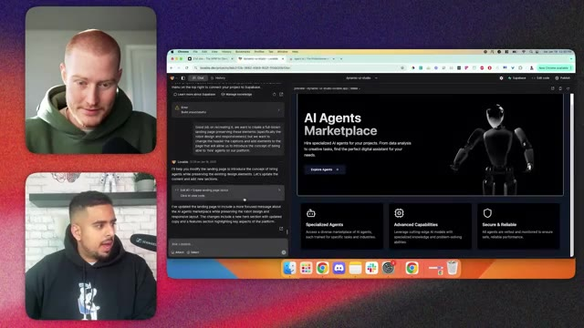
*⏱️ 00:09:20 — Aperçu d'une interface de développement web montrant une landing page d'une marketplace d'agents IA avec des blocs de fonctionnalités.*

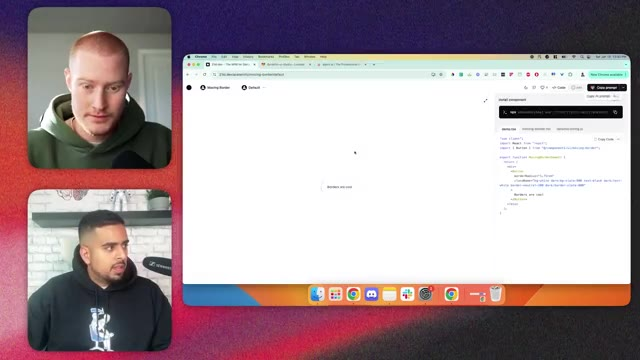
*⏱️ 00:09:38 — Affichage d'une page de documentation de composants UI montrant du code React et un exemple de bouton avec bordure animée.*

---

### ⏱️ `[00:09:47 - 00:10:16]` | Segment #23

**🔊 Audio (Transcription Intégrale Mot pour Mot en Français) :**
> en fait modifier des éléments individuels comme ce truc pour commencer sur lequel on peut passer la souris et qui a un peu ce dégradé, vous pouvez intégrer tout cela dans votre application aussi ouais c'est tellement une astuce je veux dire essayer d'expliquer comment fabriquer ça euh avant même de donner une capture d'écran en disant faites-le ressembler à ça ouais c'est tellement tout le monde sait que c'est un peu la galère quand on essaie de faire ça donc ça rend les choses tellement simples et ensuite ce qu'on pourrait faire c'est qu'on pourrait simplement dire pour tous les boutons reproduisez ce style, vous savez, basé sur ce composant d'interface utilisateur.

**👁️ Analyse Visuelle d'Écran (gemini-3.5-flash-lite) :**
**Interface & Outils** : Navigateur Chrome, site web de composants UI (21st.dev), Lovable (IDE web).

**Contenu textuel & Code** : Bibliothèque de composants UI, code de configuration Tailwind CSS, aperçu de l'application "AI Agents Marketplace".

**Action / Démonstration** : Présentation de composants d'interface réutilisables et intégration de code dans une application web.

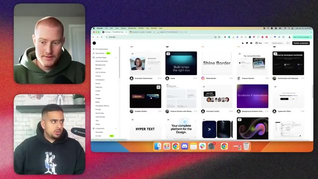
*⏱️ 00:09:54 — Vue d'un navigateur web montrant une bibliothèque de composants d'interface utilisateur avec des vignettes animées (ex. Animated Testimonials, Shine Border, Gradient Button).*

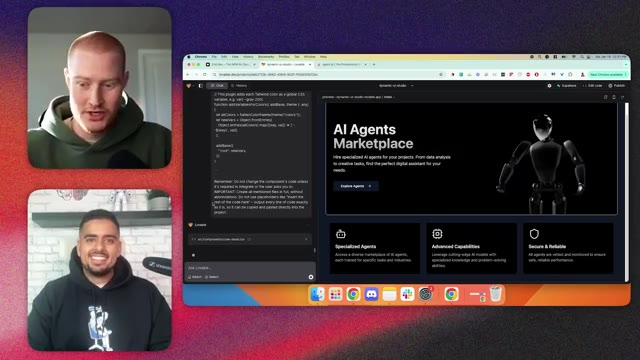
*⏱️ 00:10:01 — Interface de développement Lovable montrant le code source JavaScript/Tailwind à gauche et l'aperçu d'une application « AI Agents Marketplace » à droite.*

---

### ⏱️ `[00:10:16 - 00:10:37]` | Segment #24

**🔊 Audio (Transcription Intégrale Mot pour Mot en Français) :**
> Et ça pourrait faire ça pour tous les différents boutons, pas seulement un. Donc c'est plutôt cool. Exactement. Très bien. Donc on a un bug ici. Je vais juste cliquer sur essayer de corriger dès le départ. Laissez-moi voir à quoi ressemble l'erreur. On dirait qu'il y a un mélange avec l'élément que j'ai essayé de lui faire recréer sur le bouton et le reste de l'interface utilisateur.

**👁️ Analyse Visuelle d'Écran (gemini-3.5-flash-lite) :**
**Interface & Outils** : Navigateur web affichant l'interface de Lovable.dev (générateur d'application par IA).

**Contenu textuel & Code** : Panneau de chat Lovable avec du code JSON, un fil de discussion d'assistant IA montrant une erreur de compilation ("Build unsuccessful") et un message d'erreur dans la fenêtre d'aperçu de l'application ("The app encountered an error").

**Action / Démonstration** : Le présentateur s'apprête à cliquer sur le bouton "Try to fix" pour tenter de résoudre automatiquement l'erreur de construction générée par l'IA.

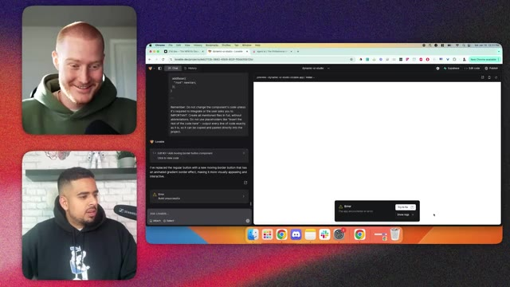
*⏱️ 00:10:21 — Capture d'écran montrant l'interface de Lovable (éditeur web) avec un panneau de chat à gauche et un aperçu d'application affichant un message d'erreur, ainsi que deux flux vidéo des présentateurs dans des encarts à gauche.*

---

### ⏱️ `[00:10:37 - 00:11:09]` | Segment #25

**🔊 Audio (Transcription Intégrale Mot pour Mot en Français) :**
> Donc j'espère que je n'aurai pas à intervenir, mais jetons un œil ici et voyons si ça peut se résoudre tout seul. Ouais. Et c'est pour ça qu'on fait ces vidéos long format, n'est-ce pas ? Parce qu'on rencontre effectivement des erreurs. Tu sais, il ne s'agit pas juste de couper tout ça et de montrer seulement ce qui fonctionne. Donc parfois, tu sais, c'est utile pour vous de pouvoir voir comment nous corrigeons les erreurs lorsque nous en rencontrons. Ouais, intéressant, ok, genre là maintenant, impossible de lire les propriétés de bla bla bla bla bla, ok, ok, donc un problème CSS aussi, donc la règle générale c'est que je vais essayer de cliquer sur "essayer de corriger" une fois de plus et puis

**👁️ Analyse Visuelle d'Écran (gemini-3.5-flash-lite) :**
**Interface & Outils** : Lovable (outil de développement web assisté par IA), navigateur Google Chrome sur macOS.

**Contenu textuel & Code** : Messages d'erreur de compilation, logs de build Vite/React, et code de configuration Tailwind CSS (tailwind.config.ts).

**Action / Démonstration** : Examen des erreurs de compilation et affichage des correctifs proposés par l'assistant IA dans l'interface de développement.

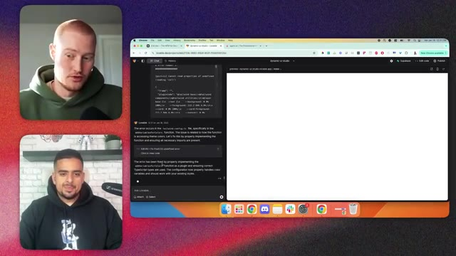
*⏱️ 00:10:45 — Capture montrant l'interface de Lovable avec une discussion résolvant une erreur de configuration Tailwind et un aperçu d'application vide à droite.*

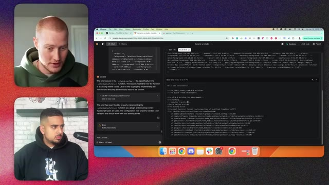
*⏱️ 00:10:53 — Capture montrant l'interface de Lovable avec l'affichage d'un journal d'erreurs de compilation (Build error) dans le panneau de droite.*

---

### ⏱️ `[00:11:09 - 00:11:42]` | Segment #26

**🔊 Audio (Transcription Intégrale Mot pour Mot en Français) :**
> J'ai un autre chemin pour essayer de régler ça, très bien, voyons voir, vas-y, c'est pas grave, on adore les erreurs. Donc je veux lui demander, pourquoi, faisons un zoom ici, pourquoi penses-tu que tu rencontres

**👁️ Analyse Visuelle d'Écran (gemini-3.5-flash-lite) :**
**Interface & Outils** : Navigateur web affichant l'application Lovable (Lovable.dev) et le rendu d'une application web en cours de développement, avec une barre latérale affichant des messages d'erreur et de correction.

**Contenu textuel & Code** : Messages d'erreur liés au fichier `tailwind.config.ts`, indiquant un problème d'accès aux couleurs du thème et des corrections apportées en TypeScript.

**Action / Démonstration** : Analyse et résolution d'une erreur de configuration dans le code source de l'application via un assistant de développement par IA.

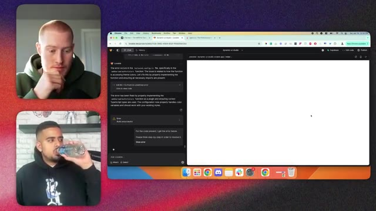
*⏱️ 00:11:18 — Capture d'écran montrant l'interface du navigateur avec un outil de développement de type Lovable et l'aperçu de l'application, ainsi que deux intervenants en visioconférence.*

---

### ⏱️ `[00:11:42 - 00:12:20]` | Segment #27

**🔊 Audio (Transcription Intégrale Mot pour Mot en Français) :**
> la même erreur encore et encore ? Y a-t-il un problème spécifique pour changer le style ou le format du bouton afin de imiter le composant que j'ai fourni médite là-dessus avant de répondre pour augmenter la probabilité que nous résolvions cela maintenant alors encore une fois tu aimes utiliser le mot médites un mot lourd

**👁️ Analyse Visuelle d'Écran (gemini-3.5-flash-lite) :**
**Interface & Outils** : Navigateur web Google Chrome, interface Lovable.dev

**Contenu textuel & Code** : Message d'erreur 'Build unsuccessful' et interface de génération de code par IA avec l'historique des prompts.

**Action / Démonstration** : Consultation d'une erreur de build et discussion sur la correction d'un problème dans la configuration Tailwind.

*⏱️ 00:11:51 — Capture d'écran montrant le navigateur Google Chrome avec l'interface de développement Lovable.dev, affichant un message d'erreur de construction ('Build unsuccessful') et un panneau de chat avec une invite concernant une configuration Tailwind, ainsi que deux présentateurs en visioconférence sur la gauche.*

---

### ⏱️ `[00:12:20 - 00:12:53]` | Segment #28

**🔊 Audio (Transcription Intégrale Mot pour Mot en Français) :**
> Euh, pour les LLM, ça les pousse à réfléchir, à raisonner, à essayer de prendre du recul sur la cause racine de l'erreur. Donc je continue à dire d'ajouter cette histoire de variables. Au pire, si ça nous donne mal à la tête, j'abandonnerai ce composant de bouton, ce n'est pas bien grave, ce n'est pas un changement radical. Voyons voir ici, si j'y jette un œil, la prochaine chose que j'aime toujours examiner, c'est

**👁️ Analyse Visuelle d'Écran (gemini-3.5-flash-lite) :**
**Interface & Outils** : Navigateur web (Google Chrome), plateforme Lovable.

**Contenu textuel & Code** : Invite de chat demandant au LLM d'analyser la cause racine d'une erreur récurrente liée aux variables de couleur Tailwind et au composant de bouton.

**Action / Démonstration** : Le présentateur discute de la logique de débogage et de l'analyse de la cause racine par l'IA.

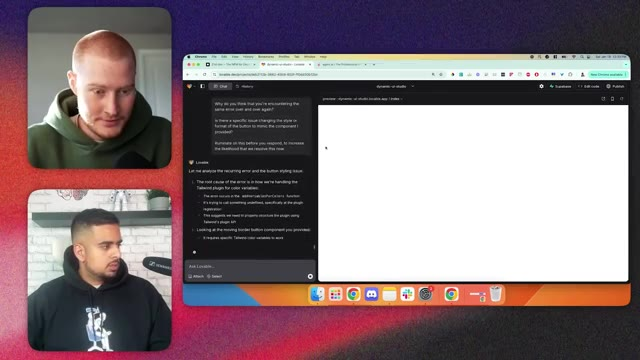
*⏱️ 00:12:28 — Vue d'écran partagée montrant deux participants en haut et en bas à gauche, et une application web de développement (Lovable) avec un panneau de chat à gauche et un aperçu vide à droite.*

---

### ⏱️ `[00:12:53 - 00:13:16]` | Segment #29

**🔊 Audio (Transcription Intégrale Mot pour Mot en Français) :**
> est-ce que j'obtiens des erreurs différentes c'est la même erreur encore et encore donc une chose que j'aime aussi faire c'est aller sur chat gpt pas nécessairement 01 Pro, mais je vais dire que je continue à rencontrer ce problème. D'accord. Et puis si ça ne marche pas, selon l'importance que ça a, soit je m'éloigne, soit on continue.

**👁️ Analyse Visuelle d'Écran (gemini-3.5-flash-lite) :**
**Interface & Outils** : Navigateur web, interface Lovable / environnement de développement en ligne.

**Contenu textuel & Code** : Message d'erreur de build dans la console : "TypeError: Cannot read properties of undefined (reading 'call')".

**Action / Démonstration** : Navigation et consultation d'un message d'erreur de code dans l'interface de développement.

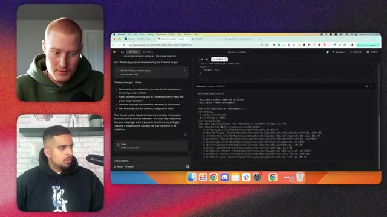
*⏱️ 00:13:04 — Interface de développement avec un panneau de chat IA à gauche et une console affichant une erreur de compilation build à droite.*

---

### ⏱️ `[00:13:16 - 00:13:37]` | Segment #30

**🔊 Audio (Transcription Intégrale Mot pour Mot en Français) :**
> Donc idéalement, nous persistons. Oui. Donc je vais dire : je continue de rencontrer ces erreurs. C'est un peu petit ici. Avec la création d'une application web. J'essaie d'intégrer cet élément.

**👁️ Analyse Visuelle d'Écran (gemini-3.5-flash-lite) :**
**Interface & Outils** : Navigateur web Google Chrome affichant l'interface de ChatGPT.

**Contenu textuel & Code** : Page d'accueil de ChatGPT avec une barre de saisie de texte contenant des images miniatures et le texte "I fre...".

**Action / Démonstration** : L'utilisateur interagit avec l'interface de ChatGPT pour saisir un prompt textuel et joindre des images.

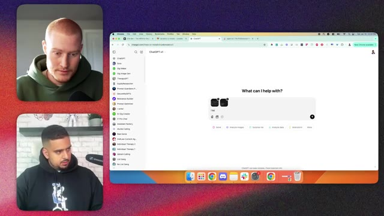
*⏱️ 00:13:21 — Capture d'écran montrant l'interface du navigateur Google Chrome avec l'application ChatGPT ouverte, ainsi que deux vignettes vidéo des participants sur le côté gauche.*

---

### ⏱️ `[00:13:37 - 00:14:00]` | Segment #31

**🔊 Audio (Transcription Intégrale Mot pour Mot en Français) :**
> Je ne suis pas sûr de ce qui ne va pas. Alors retournons sur NPM ici. Quel est le bouton que nous voulons intégrer ? C'est cette chose. Ouais. Alors mettons ceci ici entre guillemets. Laisse-moi juste coller, copier ceci. Ouais. Bon, pour copier réellement le prompt lui-même, pourquoi pas ?

**👁️ Analyse Visuelle d'Écran (gemini-3.5-flash-lite) :**
**Interface & Outils** : Navigateur web (Google Chrome), site 21st.dev, et interface ChatGPT.

**Contenu textuel & Code** : Catalogue de composants d'interface utilisateur et interface de discussion avec une IA contenant un prompt relatif à un problème de code.

**Action / Démonstration** : Navigation sur un site de composants UI pour choisir un élément à intégrer, puis utilisation de ChatGPT pour résoudre un problème d'intégration.

*⏱️ 00:13:43 — Vue d'un navigateur affichant le site de composants UI (21st.dev) avec plusieurs aperçus d'éléments graphiques interactifs.*

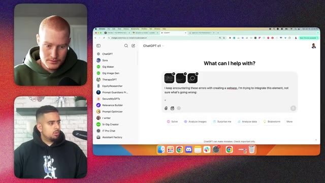
*⏱️ 00:13:49 — Vue de l'interface ChatGPT avec un prompt décrivant une erreur lors de l'intégration d'un élément dans une application web.*

---

### ⏱️ `[00:14:00 - 00:14:21]` | Segment #32

**🔊 Audio (Transcription Intégrale Mot pour Mot en Français) :**
> Ouais, c'est ce que j'allais dire. Colle ça ici et vois ce que 01 a à dire à ce sujet. Et puis parfois ce que je fais, c'est que je demande à ChatGPT d'écrire réellement un prompt pour Lovable. Mais fais juste en sorte de résumer de manière concise ce qui, selon toi, doit être corrigé et utilise simplement une commande. Ouais. Et voilà.

**👁️ Analyse Visuelle d'Écran (gemini-3.5-flash-lite) :**
**Interface & Outils** : Navigateur web (Google Chrome) affichant l'interface de ChatGPT o1.

**Contenu textuel & Code** : Fenêtre de discussion ChatGPT o1 avec des instructions textuelles visibles sur les consignes de code et de composants.

**Action / Démonstration** : Interaction avec l'interface de ChatGPT pour générer ou corriger du code et des prompts.

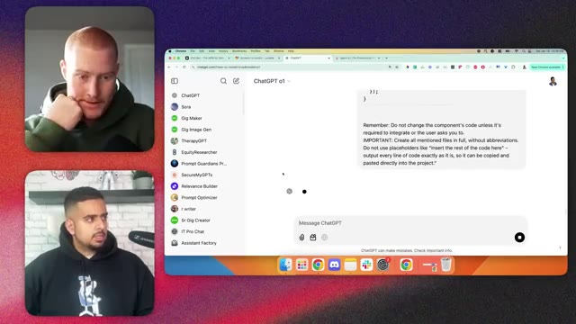
*⏱️ 00:14:05 — Capture d'écran montrant l'interface de ChatGPT o1 dans un navigateur web, avec les flux vidéo des deux présentateurs à gauche.*

---

### ⏱️ `[00:14:21 - 00:14:59]` | Segment #33

**🔊 Audio (Transcription Intégrale Mot pour Mot en Français) :**
> 01 est en train de ressasser. Il est en train de ressasser. Ouais. Oui. Non, ça c'est une tuerie. On a discuté de ça dans la dernière vidéo. C'est tellement un bon mot à utiliser pour amener ces derniers à fonctionner comme vous le voulez. Parce qu'en réalité, parfois c'est tout ce qu'il a besoin de faire, c'est vraiment de réfléchir à ces choses-là. Et il ne le fera pas à moins que vous ne le poussiez un peu à le faire parfois. Hum voyons voir intéressant, c'est tellement important que tu aies dit rappelle-toi de ne pas changer le composant à moins que ce ne soit requis typiquement ceux-ci ne peuvent pas lire les propriétés définies donc il apparaît qu'une partie du prompt dans 21st dev dit de ne pas changer quelque chose donc je pense que cette commande est en train de se mélanger avec le fait que je dise

**👁️ Analyse Visuelle d'Écran (gemini-3.5-flash-lite) :**
**Interface & Outils** : Interface web de ChatGPT (ChatGPT o1) dans un navigateur, avec une vue partagée incluant deux participants en haut et en bas à gauche.

**Contenu textuel & Code** : Texte du prompt indiquant des consignes sur le code ("Remember: Do not change the component's code...", "IMPORTANT: Create all mentioned files in full, without abbreviations...") et un message indiquant le temps de réflexion ("Thought about web app integration error for 23 seconds").

**Action / Démonstration** : Présentation de la phase de raisonnement (réflexion / o1) de ChatGPT et de ses réponses textuelles dans une interface de chat.

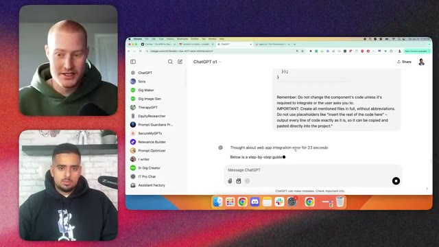
*⏱️ 00:14:30 — Capture d'écran montrant l'interface de ChatGPT o1 avec le processus de réflexion de l'IA affiché à l'écran, ainsi que deux intervenants en visioconférence sur le côté gauche.*

---

### ⏱️ `[00:14:59 - 00:15:31]` | Segment #34

**🔊 Audio (Transcription Intégrale Mot pour Mot en Français) :**
> est-ce que tu peux changer quelque chose ce qui ah ouais c'est bon à savoir donc euh est-ce que tu peux agir en tant qu'ingénieur de prompt pendant une seconde et créer un prompt hyper concis pour mon créateur d'application web sur la façon de contourner ce problème ouais quel hack d'utiliser ChatGPT o1 pour ça pour genre identifier ça parce qu'on aurait tourné en rond en essayant de comprendre ça mais le fait que ça tu sais et ça a tout

**👁️ Analyse Visuelle d'Écran (gemini-3.5-flash-lite) :**
**Interface & Outils** : Navigateur Google Chrome, interface de ChatGPT o1, et application de visioconférence (type Zoom/Meet).

**Contenu textuel & Code** : Réponse de ChatGPT o1 concernant une erreur d'intégration d'application web ("moving-border component" avec Tailwind/PostCSS/Vite) et un prompt en cours de saisie par l'utilisateur ("can you act as a prompt").

**Action / Démonstration** : L'utilisateur consulte une solution générée par ChatGPT o1 pour résoudre un problème de configuration technique et s'apprête à rédiger un nouveau prompt.

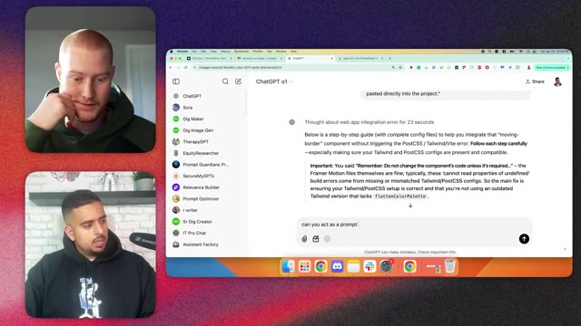
*⏱️ 00:15:07 — Capture d'écran montrant une visioconférence entre deux personnes à gauche, et l'interface du navigateur Chrome affichant ChatGPT o1 à droite.*

---

### ⏱️ `[00:15:31 - 00:15:53]` | Segment #35

**🔊 Audio (Transcription Intégrale Mot pour Mot en Français) :**
> sens parce que ces instructions à la fin disent toujours de ne pas changer, tu sais, n'importe quel composant ou peu importe. Ouais. Donc ici, il a mis, vérifie ta version de Tailwind. Donc un tas de trucs de jargon technique. On va retourner ici. Et si ça ne résout toujours pas le problème, ça ne me dérange pas de revenir en arrière et de passer à autre chose parce que tout va bien. D'accord. Donc en gros, 01 nous a mis sur la bonne voie ici avec cette instruction.

**👁️ Analyse Visuelle d'Écran (gemini-3.5-flash-lite) :**
**Interface & Outils** : ChatGPT, Lovable (IDE de développement web).

**Contenu textuel & Code** : Instructions techniques pour Tailwind CSS, erreurs de compilation de code (build failed).

**Action / Démonstration** : Consultation d'une solution générée par l'IA pour corriger un problème de version de Tailwind.

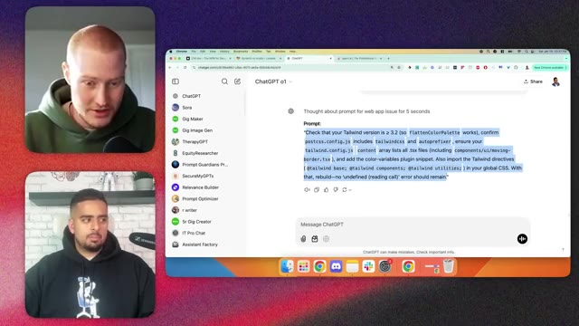
*⏱️ 00:15:37 — Interface ChatGPT affichant un prompt sélectionné contenant des instructions de configuration pour Tailwind CSS.*

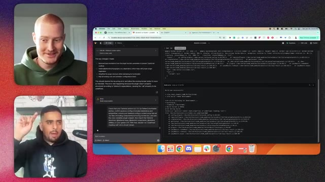
*⏱️ 00:15:47 — Interface de développement web Lovable avec un terminal affichant des logs de compilation et des erreurs de build.*

---

### ⏱️ `[00:15:53 - 00:16:13]` | Segment #36

**🔊 Audio (Transcription Intégrale Mot pour Mot en Français) :**
> Nous venons de cliquer sur "réparer" car nous avions cette étrange erreur qui disait que vous aviez une erreur de permission, ce qui est une erreur très différente de celle que nous rencontrions, qui était une boucle de rétroaction positive. Et une fois que nous avons cliqué sur essayer de réparer, elle a pu se résoudre d'elle-même. Et maintenant nous avons un bouton. Je peux voir en quelque sorte cette petite bordure que nous visons ici, mais ce n'est pas extrêmement clair.

**👁️ Analyse Visuelle d'Écran (gemini-3.5-flash-lite) :**
**Interface & Outils** : Lovable (outil de développement web assisté par IA) et Google Chrome.

**Contenu textuel & Code** : Message d'erreur concernant la tentative de modification d'un fichier sans l'autorisation nécessaire (ex: `postcss.config.js`).

**Action / Démonstration** : Consultation de l'erreur de permission dans l'interface de l'application web Lovable après avoir cliqué sur tenter de réparer.

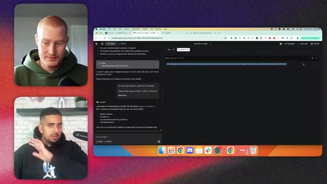
*⏱️ 00:15:58 — Capture d'écran montrant le navigateur Google Chrome avec l'interface de Lovable affichant un message d'erreur de permission ("Tried editing file without permission").*

---

### ⏱️ `[00:16:13 - 00:16:47]` | Segment #37

**🔊 Audio (Transcription Intégrale Mot pour Mot en Français) :**
> Donc ce que je vais faire, c'est que je vais utiliser cette fonctionnalité dans Lovable où vous pouvez sélectionner un composant spécifique et ajuster juste ce composant. Vous pouvez voir ici, quand je le mets en surbrillance, je vois qu'il a une bordure. Oui, exact. C'est définitivement probablement quelque chose lié à l'interface utilisateur, euh, comme un aspect de coloration où vous ne pouvez pas, vous savez, c'est là, mais vous ne pouvez pas, c'est juste que ce n'est pas reflété et vous ne pouvez pas le voir à cause de la façon dont l'arrière-plan a l'air, ce qui ne sont que de tout petits détails, mais le fait, vous savez, de passer en revue ceci, de vous montrer comment, si vous êtes pointilleux sur quelque chose comme ça, vous pourriez le réparer, c'est

**👁️ Analyse Visuelle d'Écran (gemini-3.5-flash-lite) :**
**Interface & Outils** : Navigateur web (Lovable) et application de visioconférence.

**Contenu textuel & Code** : Interface de développement no-code affichant un site 'AI Agents Marketplace' et des messages de chat d'assistance technique.

**Action / Démonstration** : Le créateur montre l'interface de Lovable et explique l'utilisation des fonctionnalités de l'outil pour ajuster les composants.

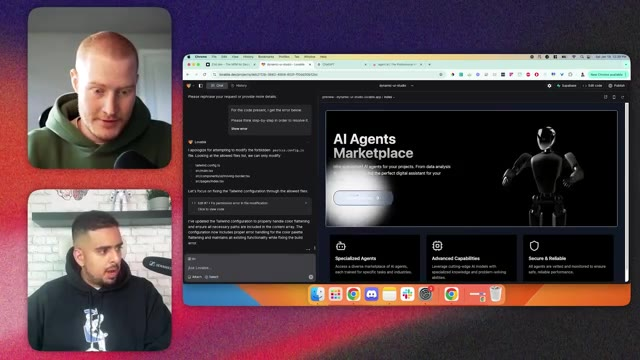
*⏱️ 00:16:21 — Capture d'écran montrant l'interface de Lovable avec un panneau de chat à gauche et un aperçu d'application web à droite, ainsi que deux participants en visio.*

---

### ⏱️ `[00:16:47 - 00:17:12]` | Segment #38

**🔊 Audio (Transcription Intégrale Mot pour Mot en Français) :**
> c'est un peu pour ça qu'on revoit un truc comme ça, donc j'ai cliqué sur l'élément et j'ai dit, est-ce qu'on peut changer la couleur de ce bouton en blanc et faire en sorte que la bordure bouge de manière dynamique, on va voir ce que ça donne, encore une fois ce n'est pas une colline sur laquelle je suis prêt à mourir, donc on va juste passer à autre suite après et essayer de construire la vraie application, ouais, et ça vaut pour n'importe quel composant que vous construisez, ce n'est pas juste un bouton, vous savez, vous pourriez utiliser ces concepts dont nous parlons pour un formulaire ou tous ces autres composants d'interface utilisateur aussi.

**👁️ Analyse Visuelle d'Écran (gemini-3.5-flash-lite) :**
**Interface & Outils** : Lovable.dev (outil de développement UI propulsé par l'IA), navigateur Google Chrome, macOS.

**Contenu textuel & Code** : Interface web Lovable avec un chat textuel affichant un prompt ("Can we change the colour of this button to white, and have the border dynamically move...") et un panneau de prévisualisation montrant le titre "AI Agents Marketplace" et un bouton "Explore Agents".

**Action / Démonstration** : Le présentateur présente l'outil de développement d'interface utilisateur Lovable et montre un prompt pour modifier dynamiquement la couleur et la bordure d'un bouton.

*⏱️ 00:16:53 — Capture d'écran montrant le présentateur et son invité en visioconférence à gauche, et l'interface de l'application Lovable.dev sur le navigateur Chrome à droite, affichant un projet avec une zone de chat et un aperçu d'interface utilisateur pour un "AI Agents Marketplace".*

---

### ⏱️ `[00:17:12 - 00:17:31]` | Segment #39

**🔊 Audio (Transcription Intégrale Mot pour Mot en Français) :**
> Gardez donc cela à l'esprit lorsque vous rencontrez ces problèmes. Cela pourrait, espérons-le, être une bonne ressource pour vous. Oui, tout à fait. Voyons donc si cela prend forme ici. Ne devrait pas être une demande trop difficile. Et voilà. Nous avons donc réussi à mettre le bouton en blanc.

**👁️ Analyse Visuelle d'Écran (gemini-3.5-flash-lite) :**
**Interface & Outils** : Navigateur web (Google Chrome), interface Lovable (outil de développement d'applications par IA).

**Contenu textuel & Code** : Interface de chat avec des instructions pour modifier la configuration de Tailwind et changer la couleur d'un bouton, ainsi qu'un aperçu en direct d'un site web intitulé « AI Agents Marketplace ».

**Action / Démonstration** : Modification du code source et de l'interface utilisateur d'une application web à l'aide d'un assistant IA.

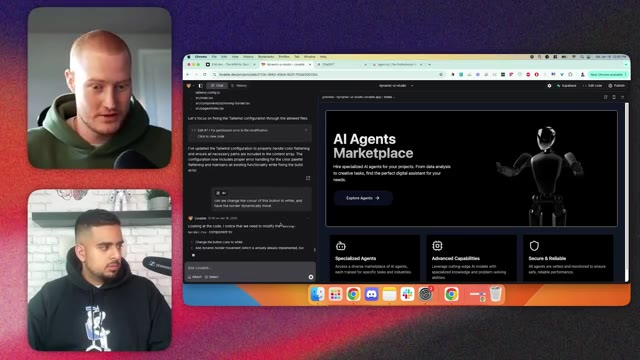
*⏱️ 00:17:17 — Capture d'écran montrant l'interface d'un assistant de développement par IA (Lovable) avec un aperçu web d'une marketplace d'agents IA à droite et une conversation avec l'IA à gauche, ainsi que deux présentateurs en haut à gauche.*

---

### ⏱️ `[00:17:31 - 00:17:50]` | Segment #40

**🔊 Audio (Transcription Intégrale Mot pour Mot en Français) :**
> Maintenant, tout l'arrière-plan en mouvement, je ne peux même plus le voir. Ouais, peu importe. Je dis qu'on passe à autre chose. C'est comme ça. Ouais, donc on a cette page. Très bien, alors faisons en sorte qu'elle fasse quelque chose quand on clique sur Explorer les agents. Par souci de simplicité, on va en fait connecter Supabase. On va créer un compte Supabase maintenant parce qu'on va avoir besoin d'activer certaines fonctionnalités à un moment donné.

**👁️ Analyse Visuelle d'Écran (gemini-3.5-flash-lite) :**
**Interface & Outils** : Navigateur web, Lovable.dev, interface de prévisualisation web, outil de développement assisté par IA.

**Contenu textuel & Code** : Interface utilisateur avec un chat de modification de code et une page web affichant un "AI Agents Marketplace" avec un bouton "Explore Agents".

**Action / Démonstration** : Le présentateur discute de la page web générée et prépare une modification pour le bouton "Explore Agents".

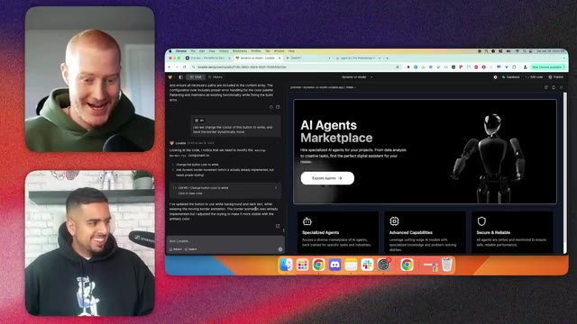
*⏱️ 00:17:36 — Capture d'écran montrant l'interface de développement d'application web Lovable avec un chat textuel à gauche et un aperçu d'une page de marketplace d'agents IA à droite, ainsi que deux intervenants en visioconférence.*

---

### ⏱️ `[00:17:51 - 00:18:14]` | Segment #41

**🔊 Audio (Transcription Intégrale Mot pour Mot en Français) :**
> Alors autant le faire maintenant. Allons donc sur Supabase ici. Et ensuite, je vais simplement aller créer un projet. Créons donc un nouveau projet ici. Et appelons ce projet Agent's AI. Voilà. Pas de problème de droits d'auteur là-dessus. Et ensuite, nous allons créer un mot de passe.

**👁️ Analyse Visuelle d'Écran (gemini-3.5-flash-lite) :**
**Interface & Outils** : Navigateur web Chrome affichant la plateforme Supabase.

**Contenu textuel & Code** : Page d'accueil de Supabase et formulaire de création de projet (nom du projet, mot de passe, région, etc.).

**Action / Démonstration** : Navigation sur le site de Supabase puis accès au formulaire de création d'un nouveau projet.

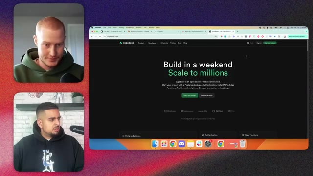
*⏱️ 00:17:57 — Page d'accueil du site Supabase montrant le slogan "Build in a weekend, Scale to millions".*

*⏱️ 00:18:02 — Interface du tableau de bord Supabase sur le formulaire de création d'un nouveau projet.*

---

### ⏱️ `[00:18:15 - 00:18:33]` | Segment #42

**🔊 Audio (Transcription Intégrale Mot pour Mot en Français) :**
> Pour ceux qui ne savent pas, vous savez, la plupart des gens qui regardent ceci le savent probablement après avoir vu les vidéos précédentes, Supabase est simplement le backend de notre application. Donc évidemment, ce que vous voyez, c'est le frontend. Ce que nous construisons sur Lovable, nous devons construire un backend afin de pouvoir stocker des choses. Nous pourrions, vous savez, avoir accès à différents agents et tout ça, ajouter différents utilisateurs et paiements, tout ce genre de choses. Donc c'est pourquoi nous configurons cela maintenant.

**👁️ Analyse Visuelle d'Écran (gemini-3.5-flash-lite) :**
**Interface & Outils** : Navigateur web (Google Chrome) affichant le tableau de bord de Supabase.

**Contenu textuel & Code** : Formulaire de création de projet Supabase avec les champs pour l'organisation, le nom du projet ("agentui"), la taille du calcul, le mot de passe de la base de données et la sélection de la région (West US).

**Action / Démonstration** : Le présentateur montre la configuration du backend Supabase nécessaire pour l'application en cours de développement.

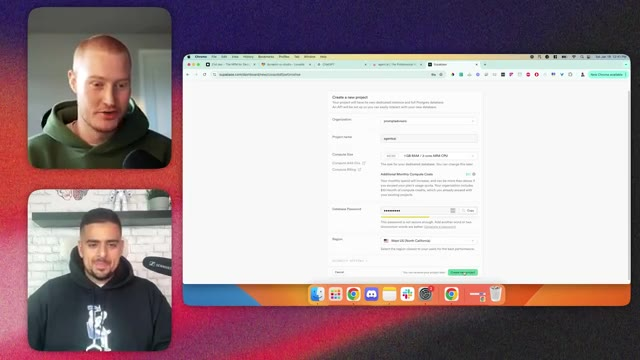
*⏱️ 00:18:19 — Capture d'écran montrant une visioconférence entre deux présentateurs à gauche et l'interface du tableau de bord Supabase à droite pour la création d'un nouveau projet.*

---

### ⏱️ `[00:18:33 - 00:18:56]` | Segment #43

**🔊 Audio (Transcription Intégrale Mot pour Mot en Français) :**
> Oui. Oui. Donc ça va prendre un peu de temps. Donc nous allons couper jusqu'à ce que tout soit configuré parce que c'est juste du temps mort pour l'instant. Ouais, ça marche. Très bien, donc nous avons notre base de données Supabase pour l'agence qui est configurée. Nous n'allons rien faire avec pour l'instant. Nous allons simplement retourner dans Lovable. Nous allons cliquer sur cette icône Supabase. Mark, ça ne va probablement pas encore charger parce que si tu retournes sur Supabase, tu parles trop vite.

**👁️ Analyse Visuelle d'Écran (gemini-3.5-flash-lite) :**
**Interface & Outils** : Navigateur web affichant Supabase et l'outil de développement Lovable.dev.

**Contenu textuel & Code** : Tableau de bord Supabase avec les clés API (anon, service_role) et interface utilisateur Lovable avec prévisualisation d'un marché d'agents IA.

**Action / Démonstration** : Le créateur montre la configuration en cours de la base de données Supabase et la plateforme Lovable pour construire une application d'agence IA.

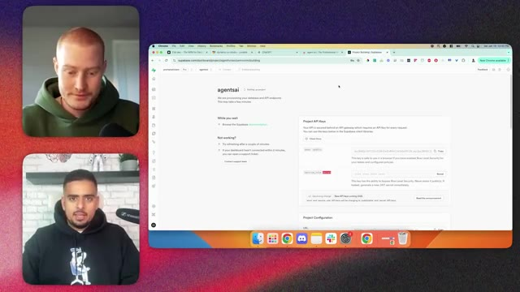
*⏱️ 00:18:39 — L'écran affiche le tableau de bord de configuration de Supabase pour un projet nommé "agentsai", montrant les clés d'API du projet et l'état de provisionnement de la base de données.*

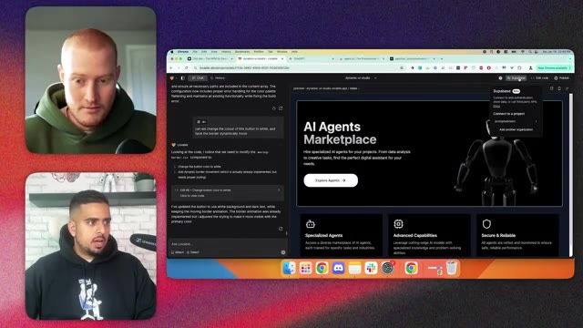
*⏱️ 00:18:51 — L'écran affiche l'interface de Lovable montrant une application web "AI Agents Marketplace" en cours de développement avec un panneau de chat interactif sur la gauche.*

---

### ⏱️ `[00:18:56 - 00:19:18]` | Segment #44

**🔊 Audio (Transcription Intégrale Mot pour Mot en Français) :**
> Tu parles trop vite. Oh, ouais, voilà. Je pense que tout est question de – ça prend environ 15, 30 secondes pour se propager, mais quand tu cliques ici, tu devrais cliquer sur connecter. Compris. Et ça devrait être simple parce que c'est une toute nouvelle base de données standard. Et une autre chose pour le public, c'est juste un rappel. Dans un outil comme Bolt, vous n'avez pas nécessairement besoin de vous connecter à une base de données pour permettre la création de fonctionnalités.

**👁️ Analyse Visuelle d'Écran (gemini-3.5-flash-lite) :**
**Interface & Outils** : Navigateur web (Google Chrome), interface de développement Lovable.dev, et menu pop-up Supabase.

**Contenu textuel & Code** : Page web affichant "AI Agents Marketplace", panneau de chat de l'assistant de code sur la gauche, et menu déroulant de sélection de projet Supabase avec un bouton "Connect".

**Action / Démonstration** : Configuration et connexion d'une base de données Supabase à l'application web en cours de développement.

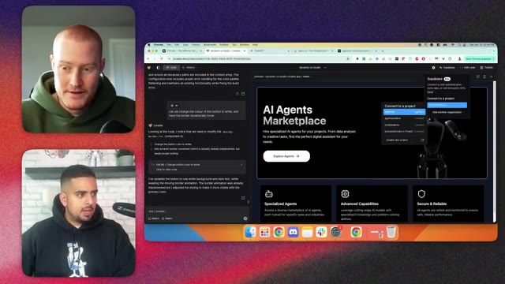
*⏱️ 00:19:02 — Capture d'écran montrant l'interface de Lovable.dev avec une page de marketplace d'agents IA, et une fenêtre contextuelle Supabase pour connecter le projet.*

---

### ⏱️ `[00:19:18 - 00:19:37]` | Segment #45

**🔊 Audio (Transcription Intégrale Mot pour Mot en Français) :**
> Mais avec Lovable, pour commencer vraiment à intégrer différentes fonctions et fonctionnalités, c’est votre moyen le plus simple de l’intégrer réellement à l’application. Donc la première étape consiste simplement à se connecter à Superbase. Et voilà. Super. Très bien. Donc on est paré maintenant. Alors vient maintenant le prochain prompt initial qui va vraiment entrer en compte dans ce qu'on essaie de construire.

**👁️ Analyse Visuelle d'Écran (gemini-3.5-flash-lite) :**
**Interface & Outils** : Navigateur web affichant la plateforme Lovable et le site web en cours de développement, aux côtés de l'application de visioconférence.

**Contenu textuel & Code** : Historique de discussion avec Lovable montrant des instructions sur le code (modification de la couleur des boutons) et la commande de connexion au projet Supabase ("Please connect my Supabase project").

**Action / Démonstration** : Connexion du projet Lovable à la base de données Supabase pour configurer les structures de tables et les paramètres de sécurité.

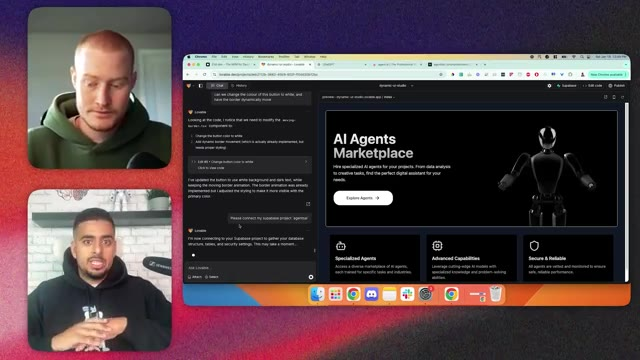
*⏱️ 00:19:23 — Capture d'écran montrant l'interface de Lovable avec un chat de l'assistant IA à gauche et la prévisualisation d'une application "AI Agents Marketplace" à droite, ainsi que les flux vidéo des deux présentateurs à gauche.*

---

### ⏱️ `[00:19:37 - 00:19:57]` | Segment #46

**🔊 Audio (Transcription Intégrale Mot pour Mot en Français) :**
> Donc ce que je vais faire, c'est que je vais aller sur le site, et ensuite je vais aller ici, et ensuite je vais faire une capture d'écran. Je vais faire quelques captures d'écran en fait. Donc prenons ceci et collons cela dans Lovable. Et ensuite, est-ce qu'il y a d'autres composants ici ? Non, montrons juste un peu plus d'exemples d'agents.

**👁️ Analyse Visuelle d'Écran (gemini-3.5-flash-lite) :**
**Interface & Outils** : Navigateur web Google Chrome affichant le site agent.ai.

**Contenu textuel & Code** : Page d'accueil d'Agent Marketplace présentant différents agents d'intelligence artificielle tels que "Competitor Analyst", "Web Page Copy Editor", "Memo Maker" et "Search Keyword Research".

**Action / Démonstration** : Navigation et présentation du site web agent.ai pour identifier des composants à intégrer ou copier.

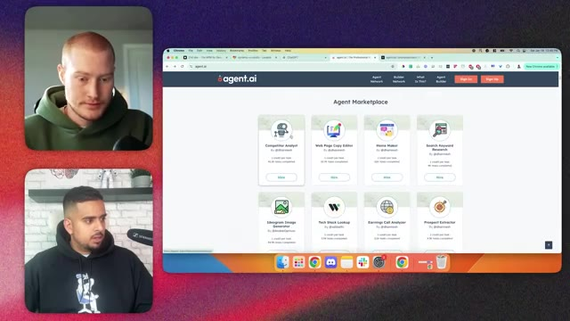
*⏱️ 00:19:42 — Capture d'écran montrant le site web agent.ai avec la marketplace d'agents IA, ainsi que deux vignettes vidéo des intervenants dans le coin supérieur gauche.*

---

### ⏱️ `[00:19:59 - 00:20:37]` | Segment #47

**🔊 Audio (Transcription Intégrale Mot pour Mot en Français) :**
> D'accord. Bon, eh bien, faites un copier-coller. Très bien. Donc quand, faisons un zoom ici. Donc quand l'utilisateur clique sur "explorer les agents", il devrait être dirigé vers une page web qui propose un marché de différents agents pour différents cas d'utilisation, de manière similaire aux images d'interface utilisateur que j'ai jointes.

**👁️ Analyse Visuelle d'Écran (gemini-3.5-flash-lite) :**
**Interface & Outils** : Navigateur web affichant une application de développement d'interface (Lovable / environnement de code low-code) avec un aperçu en direct à droite et un chat IA à gauche.

**Contenu textuel & Code** : Texte affiché dans l'interface : 'AI Agents Marketplace' et 'Hire specialized AI agents for your projects...'. Texte dans le chat décrivant la fonctionnalité attendue du bouton 'Explore Agents'.

**Action / Démonstration** : Le présentateur explique la conception d'une page web d'agents IA et discute de l'ajout d'une fonctionnalité de marché interactif.

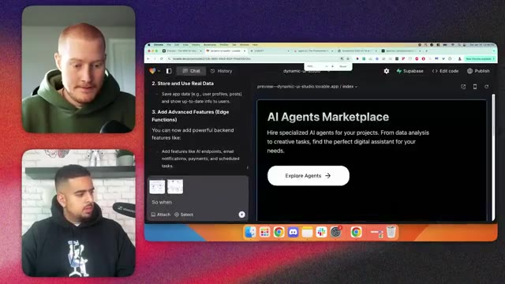
*⏱️ 00:20:08 — Aperçu d'une interface web montrant un marché d'agents IA (AI Agents Marketplace) avec un bouton 'Explore Agents' et un panneau de chat à gauche.*

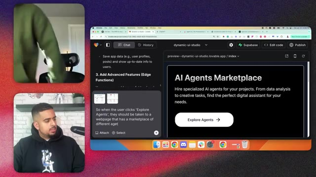
*⏱️ 00:20:27 — Aperçu similaire avec le texte de description du prompt en cours de rédaction dans le chat concernant le comportement du bouton 'Explore Agents'.*

---

### ⏱️ `[00:20:37 - 00:21:10]` | Segment #48

**🔊 Audio (Transcription Intégrale Mot pour Mot en Français) :**
> essayez de recréer environ 10 agents uniques imitant l'interface que j'ai fournie avec une icône assignée à chaque agent ainsi qu'une petite description et un bouton embauchez-moi pour chaque carte. Donc encore une fois,

**👁️ Analyse Visuelle d'Écran (gemini-3.5-flash-lite) :**
**Interface & Outils** : Navigateur web (Google Chrome) avec l'outil de création d'interface Lovable et un panneau de chat interactif.

**Contenu textuel & Code** : Interface web de test nommée "AI Agents Marketplace" avec un titre et un bouton "Explore Agents ->". Le panneau de gauche contient un prompt textuel demandant de recréer environ 10 agents uniques avec icônes, descriptions et boutons "embauchez-moi".

**Action / Démonstration** : Présentation du processus de conception d'une application de marché d'agents IA à l'aide d'un assistant conversationnel et de l'outil Lovable.

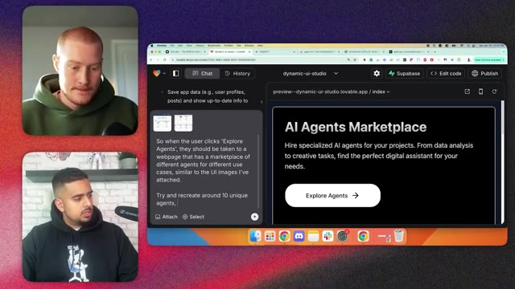
*⏱️ 00:20:45 — Capture d'écran montrant le présentateur et son invité en visioconférence à gauche, et l'interface de développement Lovable affichant un site de marché d'agents IA à droite.*

---

### ⏱️ `[00:21:10 - 00:21:33]` | Segment #49

**🔊 Audio (Transcription Intégrale Mot pour Mot en Français) :**
> Et le but de ceci est de créer maintenant la coquille de la première étape. Ce que nous allons vouloir faire, c'est évidemment rendre ces agents fonctionnels pour qu'ils fassent des choses. Nous ne allons pas nous soucier de rendre les 10 fonctionnels, mais au moins disons un ou deux juste pour vous montrer le concept général. Donc cliquons sur ceci. Et puis donner l'inspiration de agent.ai devrait aussi l'aider à réfléchir à la façon de concevoir cette interface utilisateur.

**👁️ Analyse Visuelle d'Écran (gemini-3.5-flash-lite) :**
**Interface & Outils** : Navigateur web affichant l'outil de développement et de génération d'applications Lovable.

**Contenu textuel & Code** : Prompt utilisateur demandant de créer une maquette de marché pour 10 agents IA différents avec des descriptions et des boutons 'Hire Me', et un aperçu visuel affichant le titre 'AI Agents Marketplace'.

**Action / Démonstration** : Présentation de la structure visuelle initiale (la coquille) générée pour l'application d'agents IA.

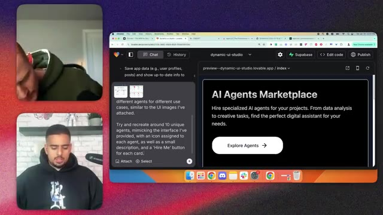
*⏱️ 00:21:16 — Capture d'écran montrant l'interface de Lovable (dynamic-ui-studio) avec à gauche un prompt textuel décrivant la création de 10 agents IA uniques, et à droite un aperçu web affichant une page 'AI Agents Marketplace'.*

---

### ⏱️ `[00:21:34 - 00:21:52]` | Segment #50

**🔊 Audio (Transcription Intégrale Mot pour Mot en Français) :**
> Intéressant. Je suis curieux de voir à quel point il va essayer de reproduire, genre, vraiment, à quoi ressemble l'interface utilisateur en ce qui concerne, genre, les couleurs et tout ça, et le thème et tout. Évidemment, si ça y ressemble trop, on va juste le changer et peut-être même utiliser 21st dev pour créer des composants d'interface utilisateur ou peu importe. Mais, ouais, je suis curieux de voir comment ça fonctionne.

**👁️ Analyse Visuelle d'Écran (gemini-3.5-flash-lite) :**
**Interface & Outils** : Navigateur web affichant Lovable (outil de développement d'interface utilisateur par IA) et les fenêtres de visioconférence des intervenants.

**Contenu textuel & Code** : Interface utilisateur générée représentant un marché d'agents IA (AI Agents Marketplace) avec un design sombre, un titre percutant, un bouton "Explore Agents" et des sections de cartes de fonctionnalités. Dans le volet de chat à gauche, des instructions textuelles adressées à l'IA pour créer des composants de cartes d'agents.

**Action / Démonstration** : Le créateur observe et analyse l'interface utilisateur en cours de génération automatique par l'outil de développement d'IA.

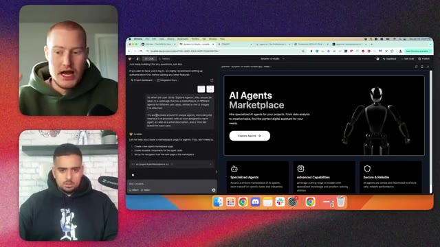
*⏱️ 00:21:39 — Capture d'écran montrant le présentateur en haut à gauche, un invité ou autre participant en bas à gauche, et sur la droite un écran d'ordinateur affichant l'interface de développement Lovable avec un aperçu de site web intitulé "AI Agents Marketplace".*

---

### ⏱️ `[00:21:52 - 00:22:13]` | Segment #51

**🔊 Audio (Transcription Intégrale Mot pour Mot en Français) :**
> Parce que généralement quand tu fais une capture d'écran, n'est-ce pas, ça le reproduit un peu, genre, autant que possible. Oui, à moins que tu ne dises inspire-toi de ou quelque chose comme ça. C'est vrai. Oui, je suppose que c'est une bonne remarque concernant le *prompt*. Oui, en jetant un œil ici. Certains de ceux-là sont tellement cool. Oui, regarde ça. Oui, curseur éclaboussure. Maintenant, que ce soit utile ou non, c'est une bonne interface utilisateur.

**👁️ Analyse Visuelle d'Écran (gemini-3.5-flash-lite) :**
**Interface & Outils** : Navigateur web Chrome sur macOS, site web de composants UI (21st.dev), outil de visioconférence.

**Contenu textuel & Code** : Galerie de composants graphiques pour le développement web, listes de catégories (Landing Pages, UI elements), aperçus animés.
[DESC_IMAGE_2] Navigation et exploration de composants graphiques et d'animations d'interface utilisateur sur le web.

**Action / Démonstration** : Explications face caméra et analyse conceptuelle des marchés.

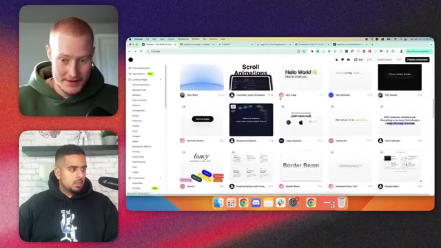
*⏱️ 00:21:58 — Capture d'écran montrant les deux présentateurs en visioconférence à gauche et le navigateur affichant le site 21st.dev avec une galerie de composants d'interface utilisateur (UI).*

*⏱️ 00:22:08 — Suite de la navigation sur le site web 21st.dev montrant d'autres exemples de composants animés et d'éléments de design (boutons, effets, bannières).*

---

### ⏱️ `[00:22:14 - 00:22:32]` | Segment #52

**🔊 Audio (Transcription Intégrale Mot pour Mot en Français) :**
> C'est une question distincte. Ouais. Mais je peux probablement même lui donner une interface comme ça et lui dire, je veux que ce soit aussi minimaliste, ce genre de truc. Ouais. Alors jetons un coup d'œil. Qu'est-ce qui se passe ici ? Donc, ouais, ouais, ouais. Donc si on clique sur Explorer les Agents, est-ce que ça fait quelque chose ?

**👁️ Analyse Visuelle d'Écran (gemini-3.5-flash-lite) :**
**Interface & Outils** : Navigateur web, outil de développement d'interface Lovable.dev, interface de composants UI.

**Contenu textuel & Code** : Composants d'interface utilisateur, maquette de marketplace d'agents IA avec des boutons, descriptions et aperçus visuels.

**Action / Démonstration** : Navigation et présentation de maquettes d'interfaces utilisateur minimalistes pour des agents IA.

*⏱️ 00:22:18 — Vue d'un navigateur affichant une bibliothèque de composants d'interface utilisateur avec plusieurs vignettes de design.*

*⏱️ 00:22:27 — Affichage d'une application web en cours de développement avec un panneau de chat à gauche et un aperçu d'une marketplace d'agents IA à droite.*

---

### ⏱️ `[00:22:32 - 00:22:56]` | Segment #53

**🔊 Audio (Transcription Intégrale Mot pour Mot en Français) :**
> Ça devrait prendre une page senior, j'espère. Rien ? très bien le bouton oh attendez attendez j'ai remarqué quelque chose nous avons maintenant un nouvel onglet explorer les agents oh c'est no bueno donc euh voyons si c'est fonctionnel j'ai l'impression que oui oh ouais d'accord eh bien mais c'est no bueno.

**👁️ Analyse Visuelle d'Écran (gemini-3.5-flash-lite) :**
**Interface & Outils** : Navigateur web (Google Chrome), interface Lovable (studio de développement no-code/IA).

**Contenu textuel & Code** : Page de prévisualisation web intitulée "AI Agents Marketplace" avec des sections sur les agents spécialisés, des boutons "Explore Agents", ainsi que le panneau de discussion Lovable avec des prompts et des étapes de création.

**Action / Démonstration** : Le présentateur examine la nouvelle interface générée, repère le bouton et l'onglet d'exploration des agents pour tester les fonctionnalités générées par l'IA.

*⏱️ 00:22:38 — Capture d'écran montrant l'interface de développement Lovable avec un aperçu web d'un "AI Agents Marketplace" à droite, un chat de génération de code à gauche, et deux vignettes vidéo des présentateurs.*

---

### ⏱️ `[00:22:56 - 00:23:15]` | Segment #54

**🔊 Audio (Transcription Intégrale Mot pour Mot en Français) :**
> Donc maintenant, nous avons deux agents Explorer sur la même page, un fonctionnel et un autre non. Faisons un zoom avant ici encore. J'ai donc remarqué quelque chose de très intéressant. Je vais en fait faire un zoom arrière une seconde.

**👁️ Analyse Visuelle d'Écran (gemini-3.5-flash-lite) :**
**Interface & Outils** : Navigateur web affichant Lovable (plateforme de développement low-code/IA) et l'application "AI Agents Marketplace".

**Contenu textuel & Code** : Interface de génération d'applications web par IA, avec des instructions textuelles pour créer une marketplace d'agents IA, et l'aperçu de la page web correspondante.

**Action / Démonstration** : Le présentateur présente et commente le résultat de la génération de l'interface utilisateur pour la marketplace d'agents IA.

*⏱️ 00:23:01 — Capture d'écran montrant l'interface d'un outil de développement web Lovable avec un panneau de chat à gauche et un aperçu d'une application de type "AI Agents Marketplace" à droite, ainsi que deux présentateurs en visioconférence sur le côté gauche.*

---

### ⏱️ `[00:23:16 - 00:23:37]` | Segment #55

**🔊 Audio (Transcription Intégrale Mot pour Mot en Français) :**
> Tu te souviens quand j'ai utilisé le bouton de sélection ? Oui. Et j'ai cliqué sur ceci. Donc ça, c'est écrit « div ». Donc pour moi, « div », en tant qu'élément, ne devrait pas désigner un bouton. Ça devrait réellement dire « button ». Quand je vais ici, c'est vraiment écrit « button ». Donc d'une certaine manière, ça a fait de ce design une partie de la page web et non fonctionnelle.

**👁️ Analyse Visuelle d'Écran (gemini-3.5-flash-lite) :**
**Interface & Outils** : Navigateur web affichant l'application Lovable.dev (éditeur de code et prévisualisation d'interface utilisateur).

**Contenu textuel & Code** : Chat IA avec des instructions de création de page, interface web avec le titre « AI Agents Marketplace », un robot humanoïde et un bouton d'action étiqueté « Explore Agents ».

**Action / Démonstration** : Inspection ou sélection d'un élément de l'interface (balise « div ») pour analyser sa structure HTML et son comportement de bouton.

*⏱️ 00:23:21 — Capture d'écran montrant l'interface d'un outil de développement web (Lovable.dev) avec le chat de l'assistant IA à gauche et la prévisualisation d'une page « AI Agents Marketplace » à droite, sur laquelle un élément cliquable (« Explore Agents ») est mis en surbrillance avec une infobulle « div ».*

---

### ⏱️ `[00:23:38 - 00:24:01]` | Segment #56

**🔊 Audio (Transcription Intégrale Mot pour Mot en Français) :**
> Alors que celui-ci reconnaît qu'il s'agit d'un bouton, ce qui signifie que lorsque vous cliquez dessus, il peut faire quelque chose. Donc, en utilisant cet indice précédent, je vais dire que le premier agent d'exploration semble être une balise div, alors qu'il devrait s'agir d'un composant de bouton comme celui en haut à droite.

**👁️ Analyse Visuelle d'Écran (gemini-3.5-flash-lite) :**
**Interface & Outils** : Navigateur web affichant l'application Lovable et l'interface de prévisualisation du site d'agents IA.

**Contenu textuel & Code** : Texte du prompt dans le chat demandant la création d'une page de marché (marketplace) pour des agents IA avec des boutons interactifs, et prévisualisation visuelle d'une page web avec le titre "AI Agents Marketplace".

**Action / Démonstration** : Analyse et modification du code de l'interface utilisateur pour intégrer correctement les boutons interactifs des agents d'exploration.

*⏱️ 00:23:44 — Capture d'écran montrant l'interface d'un outil de développement web (Lovable) avec une interface utilisateur en cours de création (AI Agents Marketplace) à droite et le chat de discussion avec l'IA à gauche, ainsi que deux flux vidéo des présentateurs dans de petites fenêtres.*

---

### ⏱️ `[00:24:02 - 00:24:23]` | Segment #57

**🔊 Audio (Transcription Intégrale Mot pour Mot en Français) :**
> Il ne devrait y avoir qu'un seul bouton et ce devrait être celui que je sélectionne maintenant. Donc je vais simplement aller sélectionner. J'ai besoin d'utiliser cette fonctionnalité de sélection plus souvent. C'est utile. D'habitude, je fais juste une capture d'écran. Ouais, mais c'est un exemple parfait de la raison pour laquelle cela pourrait être utile en l'utilisant.

**👁️ Analyse Visuelle d'Écran (gemini-3.5-flash-lite) :**
**Interface & Outils** : Navigateur web (Google Chrome) sur macOS affichant l'application Lovable et l'interface de prévisualisation d'un site.

**Contenu textuel & Code** : Interface utilisateur de création de site web avec un assistant IA textuel sur le panneau de gauche et un rendu visuel interactif sur le panneau de droite.

**Action / Démonstration** : Le présentateur explique la correction d'un composant de bouton sur l'interface et l'utilisation de l'outil de sélection.

*⏱️ 00:24:07 — Capture d'écran montrant l'interface de Lovable avec deux intervenants en visioconférence et une interface web affichant un "AI Agents Marketplace".*

---

### ⏱️ `[00:24:23 - 00:24:56]` | Segment #58

**🔊 Audio (Transcription Intégrale Mot pour Mot en Français) :**
> Je veux dire, on n'aurait pas capté ça si ça n'avait pas été pour ça. Ouais, c'était un accident complet, mais voilà. C'est bien. Un truc que je veux mentionner aussi, sans trop faire l'éloge de Lovable, mais je suis presque sûr qu'ils travaillent sur une sorte de fonctionnalité où l'on pourrait modifier automatiquement des éléments pour ne pas avoir besoin de faire de prompt et de demander à l'agent Lovable de le faire. On pourrait alors simplement aller dire que si on voulait changer le texte d'un bouton, on pourrait juste cliquer dessus, et ensuite ça nous donne une sorte d'interface utilisateur à la Wix où l'on pourrait genre vraiment modifier le texte ou quelque chose comme ça, ce qui, je pense, lorsqu'ils implémenteront un truc comme ça, sera super utile au lieu d'avoir à constamment envoyer des messages aller-retour avec un agent pour un tout petit détail.

**👁️ Analyse Visuelle d'Écran (gemini-3.5-flash-lite) :**
**Interface & Outils** : Navigateur web affichant l'interface de Lovable (lovable.dev) et un aperçu d'application (« AI Agents Marketplace »).

**Contenu textuel & Code** : Panneau de discussion textuelle avec l'intelligence artificielle Lovable, affichant des instructions de modification de composants d'interface et un aperçu visuel en direct de la page web en cours de développement.

**Action / Démonstration** : Présentation et démonstration de la plateforme de développement d'applications web propulsée par l'IA Lovable.

*⏱️ 00:24:32 — Capture d'écran montrant l'interface de Lovable avec un panneau de chat à gauche et un aperçu d'application web à droite, ainsi que les deux présentateurs en visioconférence.*

---

### ⏱️ `[00:24:57 - 00:25:17]` | Segment #59

**🔊 Audio (Transcription Intégrale Mot pour Mot en Français) :**
> Donc ça devrait être intéressant quand ça sortira. Ouais, ce serait génial. Ça rendra la vie beaucoup plus facile. Donc maintenant, nous avons cette chose qui fonctionne, formidable, mais nous ne voulons pas de ce deuxième bouton. Je vais donc simplement dire : supprime ceci. Un prompt très simple, mais ça devrait être direct maintenant que j'utilise à nouveau cette fonction de sélection. Maintenant que celui-ci fonctionne, c'est bon.

**👁️ Analyse Visuelle d'Écran (gemini-3.5-flash-lite) :**
**Interface & Outils** : Navigateur web affichant l'interface de développement Lovable et les flux vidéo de deux intervenants.

**Contenu textuel & Code** : Interface utilisateur d'un marketplace d'agents IA ("Agent Marketplace"), panneau de chat Lovable avec historique des modifications et invite de commande.

**Action / Démonstration** : Navigation et révision de la disposition des boutons de l'interface web via l'outil de génération de code Lovable.

*⏱️ 00:25:02 — Vue de l'interface de développement Lovable montrant le marketplace d'agents IA et le panneau de chat latéral de l'assistant.*

*⏱️ 00:25:07 — Affichage de la page d'accueil d'un marketplace d'agents IA avec un bouton "Explore Agents" mis en évidence dans l'interface Lovable.*

---

### ⏱️ `[00:25:17 - 00:25:36]` | Segment #60

**🔊 Audio (Transcription Intégrale Mot pour Mot en Français) :**
> Évidemment, nous pourrions passer un peu plus de temps sur la page de destination pour la rendre plus descriptive, mais concentrons-nous d'abord sur les fonctionnalités. Oui. D'accord, voilà. Très bien. Donc, nous sommes opérationnels maintenant. Ça fonctionne toujours. Et encore une fois, la raison pour laquelle je continue à faire cela n'est pas seulement parce que je suis très joueur, mais surtout parce que je vérifie toujours que nous n'avons pas cassé d'anciens composants en faisant de nouvelles choses.

**👁️ Analyse Visuelle d'Écran (gemini-3.5-flash-lite) :**
**Interface & Outils** : Navigateur web (Google Chrome) affichant l'outil de développement web Lovable et des flux vidéo de visioconférence des deux intervenants.

**Contenu textuel & Code** : Interface Lovable avec une discussion de chat modifiant le code de composants d'interface utilisateur et affichant l'aperçu du site web "AI Agents Marketplace".

**Action / Démonstration** : Développement et prévisualisation en temps réel d'une application web de place de marché d'agents IA via un assistant de code.

*⏱️ 00:25:22 — Capture d'écran montrant l'interface de Lovable avec un assistant conversationnel à gauche et un aperçu de page de destination pour un marché d'agents IA ("AI Agents Marketplace") à droite, ainsi que les deux présentateurs en haut à gauche et en bas à gauche.*

---

### ⏱️ `[00:25:36 - 00:26:13]` | Segment #61

**🔊 Audio (Transcription Intégrale Mot pour Mot en Français) :**
> Donc on clique sur Explorer les agents, et maintenant on a ça, qui a l'air pas mal. Une fois que mes tendances obsessives se manifestent, où toutes les recrues ne sont pas alignées, on a un peu trop de description ici, euh, curieusement, je pense que ça a pris les noms d'utilisateur d'ici, ouais, donc James trois, très bien, donc on peut dire qu'on ne veut pas de noms d'utilisateur, qu'est-ce qu'on peut dire d'autre, ouais, d'accord, alors faisons une liste des modifications à apporter à la place de marché des agents, j'aime bien faire ça parfois, comme je l'ai dit la dernière fois, du genre

**👁️ Analyse Visuelle d'Écran (gemini-3.5-flash-lite) :**
**Interface & Outils** : Navigateur web, Lovable.dev, agent.ai

**Contenu textuel & Code** : Cartes d'agents IA (Video Script Generator, Analytics Expert, Chat Assistant, etc.) avec noms d'utilateurs et crédits par tâche.

**Action / Démonstration** : Navigation et présentation de la marketplace d'agents IA.

*⏱️ 00:25:45 — Interface de Lovable montrant une marketplace de générateurs et assistants IA.*

*⏱️ 00:25:55 — Navigation sur le site agent.ai présentant différentes cartes d'agents IA et leurs créateurs.*

*⏱️ 00:26:04 — Autre vue de la marketplace d'agents IA dans l'application Lovable en cours de développement.*

---

### ⏱️ `[00:26:13 - 00:26:32]` | Segment #62

**🔊 Audio (Transcription Intégrale Mot pour Mot en Français) :**
> format un, deux, trois, quatre, cinq. Donc un, supprimez les noms d'utilisateur. Et je vais mettre un exemple dans chaque parenthèse pour qu'il sache exactement de quoi je parle. Par exemple, Darmesh. Supprimez les crédits par tâche. Par exemple, un crédit par tâche.

**👁️ Analyse Visuelle d'Écran (gemini-3.5-flash-lite) :**
**Interface & Outils** : Navigateur web affichant Lovable (lovable.dev) et interface de visioconférence.

**Contenu textuel & Code** : Interface d'une application web avec des cartes d'agents IA (Competitor Analyst, Web Page Copy Editor, AI Content Generator, etc.) affichant des informations telles que "By @dharmesh" et "1 credit per task".

**Action / Démonstration** : Le présentateur explique les modifications à apporter à l'application web, notamment la suppression des noms d'utilisateurs et des crédits par tâche.

*⏱️ 00:26:18 — Capture d'écran montrant l'interface de Lovable avec un panneau de chat à gauche et un aperçu de la marketplace d'agents IA à droite, ainsi que deux participants dans des fenêtres vidéo en médaillon.*

---

### ⏱️ `[00:26:33 - 00:26:56]` | Segment #63

**🔊 Audio (Transcription Intégrale Mot pour Mot en Français) :**
> D'accord, et je vais dire supprimer. Waouh, c'était rude. Supprimer les tâches terminées. Par exemple ce jour-là. D'accord, cela devrait naturellement aligner les choses. Et puis quatre, faire en sorte que les descriptions des agents ne fassent que trois à cinq.

**👁️ Analyse Visuelle d'Écran (gemini-3.5-flash-lite) :**
**Interface & Outils** : Navigateur web (Chrome), application de développement Lovable (interface de chat et aperçu).

**Contenu textuel & Code** : Interface utilisateur avec des cartes d'agents IA (Competitor Analyst, Web Page Copy Editor, AI Content Generator, etc.), affichant des descriptions, des coûts en crédits et le nombre de tâches complétées, ainsi qu'un panneau de chat interactif Lovable.

**Action / Démonstration** : Modification et prévisualisation du design de la marketplace d'agents via l'assistant conversationnel de Lovable.

*⏱️ 00:26:39 — Capture d'écran montrant l'interface d'un outil de développement web Lovable et le rendu de la marketplace d'agents IA, avec les webcams des participants à gauche.*

---

### ⏱️ `[00:26:57 - 00:27:22]` | Segment #64

**🔊 Audio (Transcription Intégrale Mot pour Mot en Français) :**
> De combien de mots est-ce que ça dépasse ? Analysez vos concurrents et obtenez, ouais, trois à cinq mots de long max. Ouais, je suis d'accord. Vous ne voudriez pas que ça ait l'air de ça parce que ça déclenche mon TOC aussi. Ouais, exactement. Et aussi, ce sont toutes des fonctionnalités qu'on devrait maintenir. Donc si vous vouliez que ça existe, vous devriez créer une fonction et une entrée de base de données dans Supabase pour stocker combien de crédits vous avez utilisés, et cetera.

**👁️ Analyse Visuelle d'Écran (gemini-3.5-flash-lite) :**
**Interface & Outils** : Navigateur web affichant Lovable.dev, interface de chat et interface d'aperçu d'application (Agent Marketplace).

**Contenu textuel & Code** : Liste de modifications demandées à l'IA : suppression des noms d'utilisateurs, suppression des crédits par tâche, suppression des tâches terminées, et limitation des descriptions à 3-5 mots maximum. Aperçu de cartes montrant "Competitor Analyst", "Web Page Copy Editor" et "AI Content Generator".

**Action / Démonstration** : Révision et modification du design de l'application via des instructions textuelles adressées à un agent conversationnel de développement.

*⏱️ 00:27:03 — Capture d'écran montrant l'interface d'un outil de développement web ou d'application (Lovable.dev) avec un panneau de chat à gauche et un aperçu d'une marketplace d'agents IA à droite, tandis que deux présentateurs apparaissent en visioconférence sur le côté gauche.*

---

### ⏱️ `[00:27:23 - 00:27:42]` | Segment #65

**🔊 Audio (Transcription Intégrale Mot pour Mot en Français) :**
> Maintenant, mon cerveau est heureux. Ça a l'air symétrique. Et maintenant, nous devons juste nous soucier de la fonctionnalité réelle, car quand vous cliquez plus haut, ça ne fait rien. Ouais. Donc ce que je voudrais faire, c'est aller sur l'un d'entre eux ici. Je pense que Meme Maker, si vous cliquez plus haut, ça vous donne une saisie.

**👁️ Analyse Visuelle d'Écran (gemini-3.5-flash-lite) :**
**Interface & Outils** : Navigateur web affichant Lovable et agent.ai lors d'une visioconférence.

**Contenu textuel & Code** : Interface utilisateur affichant une liste d'agents (Competitor Analyst, Web Page Copy Editor, Meme Maker, etc.) avec des métriques de crédit et d'utilisation.

**Action / Démonstration** : Navigation et démonstration d'une application web en cours de développement, discussion sur la fonctionnalité des éléments cliquables.

*⏱️ 00:27:28 — Aperçu d'une interface web Lovable montrant un Agent Marketplace avec des cartes de services et un panneau de chat à gauche.*

*⏱️ 00:27:37 — Navigation sur le site agent.ai présentant différentes cartes d'agents IA avec des boutons pour interagir.*

---

### ⏱️ `[00:27:42 - 00:28:03]` | Segment #66

**🔊 Audio (Transcription Intégrale Mot pour Mot en Français) :**
> D'accord, ouais. Donc, génère une réunion sur ce sujet et clique sur lancer. Donc, utilisions un peu d'inspiration. Prenons ceci. Très bien. Bon travail. Quand un utilisateur clique sur suivant, nous devrions être redirigés vers un nouvel écran.

**👁️ Analyse Visuelle d'Écran (gemini-3.5-flash-lite) :**
**Interface & Outils** : Navigateur web, plateforme Lovable.

**Contenu textuel & Code** : Interface utilisateur d'une application web avec des agents d'IA, listes de modifications, et code de prévisualisation d'une marketplace d'agents.

**Action / Démonstration** : Navigation sur une interface web de génération d'IA, modification de code et validation d'agent.

*⏱️ 00:27:47 — Capture montrant un navigateur web affichant une interface d'agent d'intelligence artificielle avec un champ de texte et un bouton de génération verts.*

*⏱️ 00:27:52 — Capture montrant l'interface de développement Lovable affichant une marketplace d'agents IA et un panneau de chat interactif avec du code.*

---

### ⏱️ `[00:28:03 - 00:28:24]` | Segment #67

**🔊 Audio (Transcription Intégrale Mot pour Mot en Français) :**
> Faisons simplement un zoom avant. un nouvel écran qui permet à l'utilisateur de fournir une certaine forme de saisie standardisée pertinente pour la tâche. Et lorsqu'il clique sur soumettre, c'est envoyé à un LLM.

**👁️ Analyse Visuelle d'Écran (gemini-3.5-flash-lite) :**
**Interface & Outils** : Navigateur web Google Chrome, plateforme Lovable.dev, interface de chat et aperçu d'application.

**Contenu textuel & Code** : Interface de "Agent Marketplace" avec barre de recherche et description de l'agent "Competitor Analyst", accompagnés d'une conversation textuelle d'instructions de développement.

**Action / Démonstration** : Le présentateur présente l'interface de l'application web en cours de développement avec l'outil d'IA Lovable.

*⏱️ 00:28:08 — Capture d'écran montrant l'interface de développement d'application web Lovable avec un chat de discussion à gauche et un aperçu d'un "Agent Marketplace" à droite, ainsi que deux flux vidéo des présentateurs à gauche.*

---

### ⏱️ `[00:28:25 - 00:28:52]` | Segment #68

**🔊 Audio (Transcription Intégrale Mot pour Mot en Français) :**
> Et je vais le formuler comme nous en avons parlé la dernière fois. Je vais faire du foreshadowing. Je préciserai quel LLM et comment plus tard. Je vais donc vous donner un petit aperçu de mon intention. Et puis je vais lui dire pour l'instant, crée la structure de la prochaine page sans te soucier de la fonctionnalité pour les agents suivants.

**👁️ Analyse Visuelle d'Écran (gemini-3.5-flash-lite) :**
**Interface & Outils** : Navigateur web affichant Lovable.dev avec une interface de chat et une fenêtre de prévisualisation d'application.

**Contenu textuel & Code** : Chat avec un assistant IA contenant un prompt relatif à l'écran 'Agent Marketplace' et l'action 'Hire', et à droite un aperçu d'interface utilisateur avec le titre 'Agent Marketplace' et 'Competitor Analyst'.

**Action / Démonstration** : Saisie d'un prompt dans l'assistant IA pour structurer et développer de nouvelles fonctionnalités pour l'application d'agents.

*⏱️ 00:28:32 — Capture d'écran montrant le présentateur à gauche et une interface de développement web Lovable à droite avec un chat IA et un aperçu d'application nommé 'Agent Marketplace'.*

---

### ⏱️ `[00:28:53 - 00:29:12]` | Segment #69

**🔊 Audio (Transcription Intégrale Mot pour Mot en Français) :**
> Prenons un peu de recul. Voyons lesquels nous voulons prioriser. Disons les premiers trois. Bien sûr. Oui, ça a l'air bien. Très bien, alors je vais dire concurrent, analyste, réviseur de pages web, et générateur de contenu par IA.

**👁️ Analyse Visuelle d'Écran (gemini-3.5-flash-lite) :**
**Interface & Outils** : Navigateur web affichant une application de développement (Lovable), avec un chat de configuration textuelle et un aperçu visuel en temps réel d'une interface utilisateur nommée "Agent Marketplace".

**Contenu textuel & Code** : Liste de modifications textuelles dans le chat ("List of changes to make to the agent marketplace...") et aperçu d'une application web listant divers agents IA tels que "Competitor Analyst", "Web Page Copy Editor" et "AI Content Generator".

**Action / Démonstration** : Configuration et visualisation en direct des modifications apportées à l'interface d'une marketplace d'agents IA en cours de développement.

*⏱️ 00:28:57 — Capture d'écran montrant l'interface d'un outil de développement web ou d'application (Lovable) avec un panneau de chat à gauche et un aperçu d'une marketplace d'agents IA à droite, tandis que les deux intervenants apparaissent en incrustation vidéo sur le côté gauche.*

---

### ⏱️ `[00:29:14 - 00:29:34]` | Segment #70

**🔊 Audio (Transcription Intégrale Mot pour Mot en Français) :**
> Maintenant, est-ce qu'on peut rendre cette page plus jolie, c'est une question que je me pose pendant que ça va charger. Ouais, et la question c'est si 24S.dev a les, tu sais, composants d'interface potentiels qu'on pourrait utiliser qui pourraient correspondre à notre application. Ouais, donc un truc cool ici, c'est que du côté de la page d'atterrissage, tu peux aussi regarder différents éléments spécifiquement.

**👁️ Analyse Visuelle d'Écran (gemini-3.5-flash-lite) :**
**Interface & Outils** : Navigateur Google Chrome affichant le site web 21st.dev, avec des vignettes de composants UI et un menu de navigation latéral.

**Contenu textuel & Code** : Catalogue de composants d'interface utilisateur pour pages de destination (Landing Pages, bannières, boutons animés, effets de texte).

**Action / Démonstration** : Navigation et exploration interactive des différents composants UI disponibles sur la plateforme 21st.dev.

*⏱️ 00:29:19 — Capture d'écran montrant le site web 21st.dev avec une grille de composants d'interface utilisateur et deux présentateurs en visioconférence.*

*⏱️ 00:29:24 — Capture d'écran montrant la navigation dans le menu latéral du site 21st.dev vers la section des composants visuels.*

*⏱️ 00:29:29 — Capture d'écran montrant le chargement de la sous-section "Features" sur le site web 21st.dev.*

---

### ⏱️ `[00:29:35 - 00:29:54]` | Segment #71

**🔊 Audio (Transcription Intégrale Mot pour Mot en Français) :**
> Donc, le chat IA, si vous allez dessus, il va vous donner quelques designs pour le chat IA. Si vous allez sur, voyons voir, badges. Voilà, des badges. C'est ce que vous voyez là. Vous voyez, j'aime ce genre de design minimaliste, mais je ne sais pas si nous serons capables de bien comprendre cela à partir de.

**👁️ Analyse Visuelle d'Écran (gemini-3.5-flash-lite) :**
**Interface & Outils** : Navigateur web (Google Chrome), site 21st.dev, application de visioconférence.

**Contenu textuel & Code** : Catalogue de composants de design d'interface utilisateur pour chat IA, avec menu latéral de navigation listant différentes catégories (Landing Pages, UI elements, AI Chat).

**Action / Démonstration** : Navigation et présentation de la bibliothèque de composants UI pour le chat IA.

*⏱️ 00:29:39 — Capture d'écran montrant le navigateur Google Chrome avec une interface de bibliothèque de composants UI (21st.dev/ai-chat), accompagnée de deux intervenants en visioconférence dans des cadres arrondis sur la gauche.*

---

### ⏱️ `[00:29:55 - 00:30:13]` | Segment #72

**🔊 Audio (Transcription Intégrale Mot pour Mot en Français) :**
> Donc ce sont des arrière-plans. La seule chose qui me vient à l'esprit, c'est que les icônes sont elles-mêmes dans Lovable. Donc ça pourrait être un casse-tête de changer ça. Ouais, ouais, je suis d'accord. Cool. Donc maintenant, il est dit que si je clique sur "embaucher", il devrait y avoir une nouvelle page. Laisse-moi voir. D'accord, celle-là n'a pas fonctionné.

**👁️ Analyse Visuelle d'Écran (gemini-3.5-flash-lite) :**
**Interface & Outils** : Navigateur web, Lovable.dev, interface de visioconférence.

**Contenu textuel & Code** : Interface utilisateur avec des cartes d'agents (Competitor Analyst, Web Page Copy Editor, AI Content Generator, Video Script Generator, etc.) et une boîte de dialogue de chat à gauche avec des instructions textuelles.

**Action / Démonstration** : Discussion sur l'interface et les fonctionnalités de l'application générée, notamment le comportement du bouton "Hire".

*⏱️ 00:29:59 — Capture d'écran montrant l'interface de Lovable avec deux présentateurs en visioconférence et un aperçu d'application nommé "Agent Marketplace" affichant des cartes d'agents IA.*

---

### ⏱️ `[00:30:14 - 00:30:33]` | Segment #73

**🔊 Audio (Transcription Intégrale Mot pour Mot en Français) :**
> Celui-là n'a pas fonctionné. Celui-là n'a pas fonctionné. Donc ça va sur une nouvelle page, mais elles sont toutes vides. Qu'est-ce qui se passe ? Où sont les champs pour la saisie ?

**👁️ Analyse Visuelle d'Écran (gemini-3.5-flash-lite) :**
**Interface & Outils** : Navigateur web affichant Lovable (lovable.dev) et l'interface de prévisualisation d'application.

**Contenu textuel & Code** : Tableau de bord « Agent Marketplace » avec plusieurs cartes d'agents (Competitor Analyst, Web Page Copy Editor, AI Content Generator) et un panneau de chat explicatif à gauche.

**Action / Démonstration** : Présentation et test de la navigation vers différentes pages de formulaires d'agents d'IA.

*⏱️ 00:30:19 — Capture d'écran montrant l'interface de développement d'application web Lovable avec un aperçu de l'Agent Marketplace et une discussion textuelle à gauche.*

---

### ⏱️ `[00:30:34 - 00:30:58]` | Segment #74

**🔊 Audio (Transcription Intégrale Mot pour Mot en Français) :**
> Hmm. Toujours. Je n'ai même encore rien cliqué. Donc. Oh, en fait ? Ouais. Donc la page entière est vide. Et ensuite, ça nous propose de refactoriser notre code parce qu'il devient trop long. Répare ça et n'hésite pas à refactoriser aussi le code.

**👁️ Analyse Visuelle d'Écran (gemini-3.5-flash-lite) :**
**Interface & Outils** : Lovable.dev (environnement de développement web par IA) et navigateur Google Chrome sur macOS.

**Contenu textuel & Code** : Texte généré par l'IA dans l'assistant expliquant les modifications apportées aux routes, aux formulaires et suggérant un refactoring du fichier AIContentGenerator.tsx (106 lignes).

**Action / Démonstration** : Revue de l'interface et lecture des suggestions de l'assistant IA concernant le code.

*⏱️ 00:30:40 — Capture d'écran montrant l'interface de Lovable.dev avec une vue de chat à gauche et un panneau de prévisualisation vide à droite, accompagnée de deux intervenants en visioconférence.*

---

### ⏱️ `[00:31:01 - 00:31:21]` | Segment #75

**🔊 Audio (Transcription Intégrale Mot pour Mot en Français) :**
> Le changement est déjà appliqué. Intéressant. Intéressant. Alors, avons-nous une sorte de problème de mise en cache ? Ils ne fonctionnent tout simplement pas ou retournent au marché des agents. D'accord. Et ensuite, rafraîchissons simplement cette page et cliquons sur engager.

**👁️ Analyse Visuelle d'Écran (gemini-3.5-flash-lite) :**
**Interface & Outils** : Navigateur web (Google Chrome) avec l'outil de développement Lovable.dev et un panneau de prévisualisation.

**Contenu textuel & Code** : Un message d'erreur dans l'interface de chat : "Error: Changes already applied. I couldn't apply your changes because the code changes I suggested were the same as the previous code."

**Action / Démonstration** : Le présentateur observe le message d'erreur et discute d'un éventuel problème de mise en cache ou de non-fonctionnement des éléments de l'interface.

*⏱️ 00:31:06 — Un écran de navigateur affichant l'interface de développement Lovable.dev avec une erreur indiquant que les changements ont déjà été appliqués, et deux présentateurs en vignette sur le côté gauche.*

---

### ⏱️ `[00:31:21 - 00:31:39]` | Segment #76

**🔊 Audio (Transcription Intégrale Mot pour Mot en Français) :**
> D'accord. Donc maintenant, d'accord. Ouais. Je pense que c'était juste mis en cache de manière incorrecte. Donc maintenant, il y a une sorte de saisie pour celui-ci. Revenons en arrière. Et aussi, une petite astuce bien pratique : si vous voulez retourner quelque part comme vous venez de me voir le faire, vous pouvez cliquer sur ce petit menu déroulant et vous pouvez naviguer vers différentes parties de l'application qui ont une autre page. Donc vous pouvez y retourner. Je ne savais même pas qu'on pouvait faire ça.

**👁️ Analyse Visuelle d'Écran (gemini-3.5-flash-lite) :**
**Interface & Outils** : Navigateur web affichant Lovable.dev (dynamic-ui-studio), interface de développement d'application avec prévisualisation et chat latéral pour les modifications de code.

**Contenu textuel & Code** : Interface utilisateur prévisualisée intitulée "Competitor Analyst" avec un champ de saisie de texte pour lister les concurrents et un bouton "Analyze Competitors", ainsi qu'un message d'erreur de cache ou de modification déjà appliquée dans le panneau de chat ("Changes already applied").

**Action / Démonstration** : Navigation et démonstration d'une interface utilisateur web interactive en cours de correction ou de mise en cache sur Lovable par les présentateurs.

*⏱️ 00:31:25 — Capture d'écran montrant l'interface d'un outil de développement web avec Lovable (Lovable.dev) affichant un agent de test "Competitor Analyst" avec une zone de saisie de texte et deux intervenants en visioconférence dans des vignettes sur le côté.*

---

### ⏱️ `[00:31:40 - 00:32:04]` | Segment #77

**🔊 Audio (Transcription Intégrale Mot pour Mot en Français) :**
> Ouais, donc c'est très pratique. C'est facile. Donc maintenant, nous allons sur rédacteur de contenu web. Ça a l'air bien. Vous mettez l'URL d'une page web. Nous allons essayer d'en faire quelque chose. C'est cool. Ensuite, le dernier, générateur de contenu IA. Oh, sympa. Ouais, d'accord, cool. Donc maintenant, nous allons essayer d'intégrer le GPT-4.0 normal dans ce modèle.

**👁️ Analyse Visuelle d'Écran (gemini-3.5-flash-lite) :**
**Interface & Outils** : Lovable.dev, navigateur web Chrome, interface de développement / application web.

**Contenu textuel & Code** : Interface utilisateur de l'outil "Web Page Copy Editor" avec des champs de saisie pour une URL de page web et du texte existant ("Existing Copy").

**Action / Démonstration** : Présentation et navigation vers l'outil de rédaction de contenu web dans l'application.

*⏱️ 00:31:46 — Capture d'écran montrant l'interface de Lovable.dev avec un panneau de prévisualisation à droite affichant l'outil "Web Page Copy Editor" (URL de page web et texte existant) et le code ou chat d'assistance à gauche.*

---

### ⏱️ `[00:32:04 - 00:32:42]` | Segment #78

**🔊 Audio (Transcription Intégrale Mot pour Mot en Français) :**
> Alors essayons simplement de le lui demander dès le départ : est-ce que tu peux intégrer le GPT-4o d'OpenAI dans l'application afin que nous puissions envoyer les données fournies à ces trois premiers agents au LLM, puis recevoir, analyser et afficher la réponse à l'utilisateur sur le

**👁️ Analyse Visuelle d'Écran (gemini-3.5-flash-lite) :**
**Interface & Outils** : Lovable.dev, navigateur web Chrome, interface de développement no-code.

**Contenu textuel & Code** : Chat de l'assistant IA affichant un message d'erreur et une zone de saisie pour le prompt utilisateur (« Can you integrate Open AI's... »), aux côtés d'une application de marketplace d'agents IA montrant différentes cartes (Competitor Analyst, Web Page Copy Editor, AI Content Generator).

**Action / Démonstration** : Saisie d'une demande d'intégration d'intelligence artificielle dans l'application via le panneau de discussion de l'outil de développement.

*⏱️ 00:32:13 — Capture d'écran montrant l'interface de Lovable.dev avec un panneau de chat à gauche et un aperçu de l'application « Agent Marketplace » à droite, ainsi que les deux intervenants en visio.*

---

### ⏱️ `[00:32:42 - 00:33:03]` | Segment #79

**🔊 Audio (Transcription Intégrale Mot pour Mot en Français) :**
> sous-pages respectives d'accord, je vais aussi toutes me demander ma clé API OpenAI, très bien, donc nous allons voir si cela fonctionne réellement. Parfois, cela utilise par défaut GPT-4, peu importe ce que vous consultez.

**👁️ Analyse Visuelle d'Écran (gemini-3.5-flash-lite) :**
**Interface & Outils** : Navigateur web affichant Lovable.dev (interface de développement assistée par IA) et un appel vidéo.

**Contenu textuel & Code** : Interface utilisateur "Agent Marketplace" avec des options comme Competitor Analyst, Web Page Copy Editor et AI Content Generator, accompagnée d'un chat de discussion textuel avec des prompts d'intégration d'API OpenAI.

**Action / Démonstration** : Le présentateur présente l'interface de développement d'une application de marché d'agents IA et discute de l'intégration des fonctionnalités d'OpenAI.

*⏱️ 00:32:48 — Capture d'écran montrant l'interface d'un outil de développement web Lovable.dev avec un panneau de chat à gauche et un aperçu d'application d'agents IA à droite, ainsi que deux participants en visio sur le côté gauche.*

---

### ⏱️ `[00:33:03 - 00:33:40]` | Segment #80

**🔊 Audio (Transcription Intégrale Mot pour Mot en Français) :**
> Il faut le contourner. Mais ajoutons simplement la clé API pour l'instant. Donc je vais juste prendre une seconde, récupérer ma clé, la placer là-dedans, et nous continuerons à partir de là. Très bien. Nous allons donc ajouter cette clé ici. Je vais l'envoyer. Ajoutons-la avec succès. Et puis il est dit de créer une fonction edge pour effectuer des appels OpenAI en toute sécurité. Le bon côté, c'est que si vous allez dans les fonctions edge ou plutôt dans les paramètres, puis dans les fonctions edge, vous verrez ici que cette clé OpenAI est stockée, donc nous savons que cela fonctionne. Très bien, alors maintenant apparemment ça fonctionne, donc allons sur l'un d'eux ici et disons simplement concurrents, disons

**👁️ Analyse Visuelle d'Écran (gemini-3.5-flash-lite) :**
**Interface & Outils** : Navigateur web affichant une application web et l'interface d'administration Supabase.

**Contenu textuel & Code** : Fenêtre modale "Add API Key" avec un champ de saisie masqué pour la clé OpenAI API.

**Action / Démonstration** : Saisie et soumission de la clé API OpenAI dans l'interface de l'application.

*⏱️ 00:33:13 — Interface web montrant une fenêtre contextuelle demandant d'ajouter une clé API OpenAI dans l'application.*

*⏱️ 00:33:22 — Tableau de bord d'un projet Supabase nommé "agentsai" montrant les options de gestion de base de données.*

---

### ⏱️ `[00:33:40 - 00:34:17]` | Segment #81

**🔊 Audio (Transcription Intégrale Mot pour Mot en Français) :**
> Brock, je vais juste voir si ça marche en général, si ça fait quelque chose, si ça l'envoie même à OpenAI, c'est bon signe, ça prend une petite seconde pour analyser, ouais, j'espère, ouais. Donc quand ça prend vraiment beaucoup de temps, oh, voilà ! Voyons si ce sont de vraies données et pas des fausses, c'est la question. Je veux dire, je lui ai seulement donné Brock, donc ouais, nous ne serions pas d'abord, ok, oui, ça, ça a l'air bien. Je vais lui poser une question, donc je vais utiliser une nouvelle fonctionnalité de Lovable en fait, donc si on y retourne.

**👁️ Analyse Visuelle d'Écran (gemini-3.5-flash-lite) :**
**Interface & Outils** : Navigateur web Google Chrome affichant Lovable.dev et une application web en prévisualisation (fenêtre macOS).

**Contenu textuel & Code** : Interface utilisateur montrant le texte "Competitor Analyst", un champ de saisie avec "Brock", et un bouton d'action affichant l'état "Analyzing...".

**Action / Démonstration** : Test en direct de l'intégration de l'IA (OpenAI) dans l'application web avec un état de chargement en cours.

*⏱️ 00:33:50 — Capture d'écran montrant l'interface d'une application web en cours de test avec Lovable.dev et un panneau de prévisualisation affichant un agent nommé "Competitor Analyst" avec un bouton en cours d'analyse ("Analyzing...").*

---

### ⏱️ `[00:34:17 - 00:34:53]` | Segment #82

**🔊 Audio (Transcription Intégrale Mot pour Mot en Français) :**
> ici je pense que c'est est-ce que c'est paramètres allons-y d'accord alors allons-y ici je pense que ça s'appelle euh labs est la nouvelle fonction je n'en avais en fait pas entendu parler ouais donc si vous allez ici et que vous et que vous allez dans lab d'accord et que vous activez ceci et que nous retournons à notre projet d'accord très bien donc maintenant ici nous pouvons en fait poser une question en mode chat uniquement où vous pouvez en fait parler au euh llm lui-même sans

**👁️ Analyse Visuelle d'Écran (gemini-3.5-flash-lite) :**
**Interface & Outils** : Lovable (plateforme de développement web et d'IA)

**Contenu textuel & Code** : Section Labs des paramètres, option de mode de chat expérimental et interface de gestion de projet.

**Action / Démonstration** : Navigation vers la section Labs et activation d'une fonctionnalité expérimentale.

*⏱️ 00:34:35 — L'écran affiche la page des paramètres de Lovable montrant la section 'Labs' avec l'option 'Chat modes' et un bouton d'activation.*

---

### ⏱️ `[00:34:53 - 00:35:14]` | Segment #83

**🔊 Audio (Transcription Intégrale Mot pour Mot en Français) :**
> changer quoi que ce soit tu es fondamentalement en train de parler à ChatGPT mais dans Lovable pendant que tu construis le contexte de ton application exactement n'est-ce pas exactement qu'est-ce que oui exactement donc je vais te demander genre um est-tu sûr que l'application utilise GPT-4o et non GPT-4 donc on dirait bien qu'elle utilise 4.0 n'est-ce pas oui je suis désolé, la faute de frappe ?

**👁️ Analyse Visuelle d'Écran (gemini-3.5-flash-lite) :**
**Interface & Outils** : Navigateur web affichant la plateforme de développement Lovable et son interface de chat interactive.

**Contenu textuel & Code** : Panneau de chat Lovable détaillant l'intégration d'OpenAI (Supabase Edge Function, modèle GPT-4o) et panneau de prévisualisation affichant une marketplace d'agents IA (Competitor Analyst, Web Page Copy Editor, AI Content Generator).

**Action / Démonstration** : Le présentateur discute de l'utilisation de modèles d'IA comme GPT-4o directement dans l'outil de développement Lovable.

*⏱️ 00:34:58 — Capture d'écran montrant le présentateur en haut à gauche, un invité en bas à gauche, et l'interface de développement Lovable avec l'aperçu d'une application "Agent Marketplace" à droite.*

---

### ⏱️ `[00:35:15 - 00:35:36]` | Segment #84

**🔊 Audio (Transcription Intégrale Mot pour Mot en Français) :**
> Waouh, maintenant j'ai un trou de mémoire, mais ça devrait être GPT-4-0, je crois. Maintenant j'ai un trou de mémoire, alors je vais simplement aller sur Perplexity. Comment appeler l'API OpenAI de GPT-4-0. Je pense qu'il devrait y avoir un tiret là, parce que c'est là que tous les modèles que vous spécifiez [vont].

**👁️ Analyse Visuelle d'Écran (gemini-3.5-flash-lite) :**
**Interface & Outils** : Navigateur web, Lovable (plateforme de développement d'applications), Perplexity AI.

**Contenu textuel & Code** : Interface Lovable avec panneau de chat de modification de code, nom du modèle GPT-4, et interface de recherche Perplexity.

**Action / Démonstration** : Le présentateur consulte Lovable puis bascule sur Perplexity pour rechercher la syntaxe correcte de l'API OpenAI pour GPT-4.

*⏱️ 00:35:20 — Vue d'écran montrant l'application Lovable affichant un "Agent Marketplace" avec un panneau de chat à gauche décrivant des modifications de code pour l'API OpenAI.*

*⏱️ 00:35:26 — Vue d'écran montrant le navigateur avec l'interface de recherche Perplexity (perplexity.ai) pour poser des questions sur l'API OpenAI.*

---

### ⏱️ `[00:35:36 - 00:36:13]` | Segment #85

**🔊 Audio (Transcription Intégrale Mot pour Mot en Français) :**
> Ouais, GPT-4-o, GPT-4-o-mini. Tout ça a l'air bien. On dirait que ça bascule automatiquement sur le 4-o-mini, ce qui, je veux dire, est très bien mais ouais c'est avec un tiret j'ai eu un blanc pendant une seconde mais je vais revenir au défaut euh non c'est bon en fait non avant même que je dise que c'est bon vérifions les autres donc celui-ci enfin je ne sais pas ce que ça va faire si je lui donne du texte publicitaire euh je suppose que c'est le texte fictif mais si je veux mettre du texte de site web salut on crée des agents pour lovable on modifie du texte

**👁️ Analyse Visuelle d'Écran (gemini-3.5-flash-lite) :**
**Interface & Outils** : Navigateur web (Chrome) affichant Perplexity.ai et une application web de type studio UI sur Lovable.dev.

**Contenu textuel & Code** : Code source en Python pour l'API OpenAI (modèle `gpt-4o`) et interface utilisateur d'un marché d'agents IA ("Agent Marketplace").

**Action / Démonstration** : Navigation et consultation de documentation de code sur Perplexity suivie d'une interaction sur un outil de développement web avec IA.

*⏱️ 00:35:45 — Perplexity AI affichant un exemple de code Python pour appeler l'API GPT-4o.*

*⏱️ 00:35:55 — Interface de développement Lovable.dev affichant un "Agent Marketplace" et un chat de modification de code.*

---

### ⏱️ `[00:36:13 - 00:36:48]` | Segment #86

**🔊 Audio (Transcription Intégrale Mot pour Mot en Français) :**
> c'est rapide ouais c'était tellement rapide oh ça l'a mis à jour en gpt-4o mini donc je veux dire euh remets-le en gpt-4o oh intéressant ouais c'était tellement rapide c'était trop rapide donc tu as aussi une idée du rythme de ces différents grands modèles de langage si c'est genre juste parfait où ça réfléchit vraiment pendant une seconde alors c'est gpt-4o oh si ça prend cinq ans c'est gpt-4o si c'est trop

**👁️ Analyse Visuelle d'Écran (gemini-3.5-flash-lite) :**
**Interface & Outils** : Navigateur web affichant Lovable (lovable.dev / preview-dynamic-ui-studio).

**Contenu textuel & Code** : Interface de développement no-code / assistant IA avec un panneau de chat montrant des modifications de modèles (GPT-4o mini vers GPT-4o) et un aperçu d'application web.

**Action / Démonstration** : Discussion avec l'assistant IA pour modifier le modèle de langage utilisé (passage de GPT-4o mini à GPT-4o).

*⏱️ 00:36:22 — Capture d'écran montrant l'interface de Lovable avec le chat à gauche et un aperçu de l'éditeur de page web à droite, ainsi que les deux participants de la vidéo en incrustation.*

---

### ⏱️ `[00:36:48 - 00:37:23]` | Segment #87

**🔊 Audio (Transcription Intégrale Mot pour Mot en Français) :**
> vite, c'est probablement mini donc si on rafraîchit cette page maintenant et qu'on refait exactement la même chose, je crée des applications avec Lovable et ensuite on envoie modifier la copie ouais ça y ressemble plus ok ça a l'air rapide mais revenons-en là maintenant on peut vérifier ça juste pour le public donc ce qu'on pourrait faire c'est qu'on pourrait modifier le code, le transférer sur GitHub, le parcourir et l'examiner à la loupe pour vérifier. Mais j'ai juste plus

**👁️ Analyse Visuelle d'Écran (gemini-3.5-flash-lite) :**
**Interface & Outils** : Navigateur web affichant la plateforme Lovable (Lovable.dev) et un outil de discussion par chat.

**Contenu textuel & Code** : Échange de messages textuels avec un assistant IA concernant le choix du modèle (gpt-4o-mini vs gpt-4o), et aperçu d'une interface de modification de copie de page web ("Web Page Copy Editor").

**Action / Démonstration** : Interaction avec l'assistant de l'application Lovable pour basculer d'un modèle d'IA à un autre et observer le rendu visuel.

*⏱️ 00:36:57 — Capture d'écran montrant l'interface de Lovable en cours d'utilisation, avec un panneau de chat à gauche et un aperçu d'application web à droite, ainsi que les deux intervenants en visioconférence.*

---

### ⏱️ `[00:37:23 - 00:37:46]` | Segment #88

**🔊 Audio (Transcription Intégrale Mot pour Mot en Français) :**
> en me fiant au toucher et au ressenti pour l'instant. Donc bref, on a la fonctionnalité principale. Maintenant qu'ils sont entre guillemets fonctionnels, essayons juste le dernier. Donc disons un article de blog, écris sur la façon d'utiliser l'IA pour les non-techniciens, plus précisément l'IA générative. D'accord. Faisons donc générer du contenu.

**👁️ Analyse Visuelle d'Écran (gemini-3.5-flash-lite) :**
**Interface & Outils** : Navigateur web (Google Chrome), Lovable (éditeur d'application web).

**Contenu textuel & Code** : Interface utilisateur avec un générateur de contenu IA ("AI Content Generator") proposant des options de type de contenu (Blog Post, Social Media Post, Email Newsletter) et un champ de saisie de sujet, accompagné d'un chat de discussion avec l'assistant Lovable.

**Action / Démonstration** : Présentation de l'application générée et test des fonctionnalités par l'utilisateur.

*⏱️ 00:37:28 — Capture d'écran montrant l'interface de Lovable avec un panneau de chat à gauche et l'application en cours de test sur la droite, ainsi que deux participants en visioconférence.*

---

### ⏱️ `[00:37:46 - 00:38:16]` | Segment #89

**🔊 Audio (Transcription Intégrale Mot pour Mot en Français) :**
> Il est en train de réfléchir donc c'est bon, ce n'est pas instantané comme le précédent, donc nous pourrions bel et bien utiliser GPT-4. Oh très bien, si nous descendons, nous avons une réponse et la prochaine chose que je veux faire, c'est que j'ai remarqué que chacune de nos réponses ici n'est pas en Markdown, donc vous avez tous les dièses, donc ça ne s'affichera pas correctement à l'écran, n'est-ce pas ? Pouvons-nous nous assurer que toutes les réponses du LLM sont correctement formatées en Markdown ?

**👁️ Analyse Visuelle d'Écran (gemini-3.5-flash-lite) :**
**Interface & Outils** : Navigateur web affichant Lovable (lovable.dev) et visioconférence avec deux intervenants.

**Contenu textuel & Code** : Chat assistant proposant de basculer vers GPT-4o, interface d'application web "AI Content Generator" en cours de génération.

**Action / Démonstration** : Interaction avec l'assistant de développement no-code pour changer le modèle d'IA (passage à GPT-4o) et visualisation du résultat.

*⏱️ 00:37:53 — Capture d'écran montrant l'interface de Lovable avec un chat de génération de contenu et l'application en cours de test sur la droite.*

---

### ⏱️ `[00:38:17 - 00:38:40]` | Segment #90

**🔊 Audio (Transcription Intégrale Mot pour Mot en Français) :**
> Très bien. Donc nous allons envoyer ça. Et la prochaine question que je vais poser est : est-on en train de stocker quoi que ce soit dans Supabase ? Mon intuition est que non, parce que nous n'avons eu aucun pop-up. Il n'y a donc pas de tables réelles là-bas. Ce qui serait bien, c'est en fait de stocker au moins le contenu utilisateur qui est soumis, même si ce n'est pas au niveau de l'utilisateur, même si nous n'avons pas encore ajouté d'authentification.

**👁️ Analyse Visuelle d'Écran (gemini-3.5-flash-lite) :**
**Interface & Outils** : Lovable, navigateur web Google Chrome, Supabase Dashboard

**Contenu textuel & Code** : Interface de développement d'application web, code d'edge function, panneau de chat Lovable, table editor Supabase vide.

**Action / Démonstration** : Navigation entre l'application Lovable et le tableau de bord Supabase pour vérifier l'absence de stockage de données.

*⏱️ 00:38:23 — Image #1 montre l'interface de Lovable affichant un générateur de contenu IA avec un aperçu du site et un chat latéral.*

*⏱️ 00:38:29 — Image #2 montre l'interface du tableau de bord Supabase (Table Editor) montrant qu'aucune table n'est encore créée.*

*⏱️ 00:38:34 — Image #3 montre de nouveau l'interface de développement de Lovable avec le panneau de prévisualisation et le chat interactif.*

---

### ⏱️ `[00:38:42 - 00:39:02]` | Segment #91

**🔊 Audio (Transcription Intégrale Mot pour Mot en Français) :**
> Exact. Très bien. Donc, essayons encore une fois ici. Peu importe. Parlons d'intelligence artificielle. D'accord. Et je vais générer du contenu. Donc, maintenant, tout ce qui m'importe, c'est que lorsque nous recevons la réponse, elle soit analysée d'une manière et formatée d'une manière telle que les en-têtes ne soient pas des dièses. Ce soient de vrais en-têtes et que ça ait l'air plus propre.

**👁️ Analyse Visuelle d'Écran (gemini-3.5-flash-lite) :**
**Interface & Outils** : Navigateur Chrome, Lovable.dev (interface de développement d'application web).

**Contenu textuel & Code** : Interface utilisateur "AI Content Generator" avec des options de type de contenu (Blog Post, Social Media Post, Email Newsletter) et un champ de texte "Topic or Brief".

**Action / Démonstration** : Saisie d'un sujet ou d'un brief dans l'application pour générer du contenu via l'intelligence artificielle.

*⏱️ 00:38:47 — Capture d'écran montrant le présentateur et son écran d'ordinateur avec une application web de génération de contenu par IA (Lovable.dev).*

---

### ⏱️ `[00:39:02 - 00:39:48]` | Segment #92

**🔊 Audio (Transcription Intégrale Mot pour Mot en Français) :**
> Donc c'est largement, largement mieux. Donc maintenant je vais demander, est-ce qu'on peut stocker tous les résultats dans Supabase provenant, le contenu généré par chaque agent et afficher une sorte d'historique des dernières générations, peut-être juste un horodatage, le résultat comme une étiquette sur chaque carte d'agent pour l'historique, donc on va voir ce qu'on obtient

**👁️ Analyse Visuelle d'Écran (gemini-3.5-flash-lite) :**
**Interface & Outils** : Navigateur web affichant l'interface Lovable (dynamic-ui-studio.lovable.app) et une application de visioconférence.

**Contenu textuel & Code** : Le chat affiche le prompt demandant si l'on peut stocker tous les résultats dans Supabase, et l'aperçu à droite montre du contenu généré lié à l'intelligence artificielle.

**Action / Démonstration** : Le présentateur formule une requête textuelle dans l'interface de chat pour ajouter un stockage de données dans Supabase.

*⏱️ 00:39:14 — Capture d'écran montrant l'interface de l'application web Lovable avec un panneau de chat à gauche et un aperçu du contenu généré par l'IA à droite, ainsi que les flux vidéo des deux présentateurs.*

---

### ⏱️ `[00:39:48 - 00:40:24]` | Segment #93

**🔊 Audio (Transcription Intégrale Mot pour Mot en Français) :**
> familiarisez-vous avec ça parce que j'ai essayé de l'expliquer d'une manière qui pourrait avoir du sens, mais il y a probablement une meilleure façon de le dire, mais voyons ce qu'il peut faire ici. Donc je m'attends à ce qu'il crée maintenant une sorte de fonction de table super sophistiquée pour stocker ces éléments. Et même si vous n'avez pas l'esprit technique, je veux juste voir ce qu'il essaie de stocker ici. Donc l'identifiant, le type d'agent, qui est le type réel d'agent, donc le commentateur IA, le prompt que j'ai utilisé et la réponse et la date de création, ce qui pour moi a l'air bien. Donc enregistrez ça. D'accord. Donc ça a fonctionné du premier coup. Donc même ceci va devenir vide

**👁️ Analyse Visuelle d'Écran (gemini-3.5-flash-lite) :**
**Interface & Outils** : Interface Lovable, navigateur Google Chrome et application web en cours de développement.

**Contenu textuel & Code** : Code SQL généré dans le chat pour créer une table de base de données ("agent_generational_history"), avec des champs ID, agent_type, prompt et response.

**Action / Démonstration** : Génération et affichage de commandes SQL par l'assistant IA pour structurer la base de données de l'application.

*⏱️ 00:39:57 — Capture d'écran montrant l'interface de Lovable avec un chat d'IA à gauche et un aperçu d'application web à droite, ainsi que deux intervenants en visioconférence.*

---

### ⏱️ `[00:40:24 - 00:41:01]` | Segment #94

**🔊 Audio (Transcription Intégrale Mot pour Mot en Français) :**
> et je le redis, parler d'IA et je vais juste attendre que ça finisse parce qu'on dirait que ce n'est toujours pas fini. Et donc la raison pour laquelle nous configurons tout cela dans Supabase avec une fonction Edge, c'est pour que lorsque nous créons une connexion pour les utilisateurs, toutes ces informations soient enregistrées dans leur profil. Sinon, vous savez, si vous n'avez jamais utilisé Lovable auparavant, que vous n'avez pas de bagage avec et bien tout serait effacé, donc nous devons pouvoir stocker cela pour les utilisateurs afin d'en faire une application aussi fonctionnelle que possible. Oui, erreur intéressante ici, exactement donc

**👁️ Analyse Visuelle d'Écran (gemini-3.5-flash-lite) :**
**Interface & Outils** : Navigateur web affichant une interface de type Lovable.dev, avec des fenêtres de code/chat et un aperçu d'application.

**Contenu textuel & Code** : Code SQL, instructions pour l'assistant IA, et interface utilisateur d'un "AI Content Generator" avec options de type de contenu et champ de saisie de texte.

**Action / Démonstration** : L'assistant exécute des requêtes de migration SQL et met à jour le code de l'application.

*⏱️ 00:40:34 — Capture d'écran montrant l'interface d'un outil de développement web avec un assistant conversationnel et un aperçu d'application.*

---

### ⏱️ `[00:41:01 - 00:41:34]` | Segment #95

**🔊 Audio (Transcription Intégrale Mot pour Mot en Français) :**
> ok c'est une super base erreur je peux juste la voir au niveau du projet ici on a quelques problemos très bien alors maintenant on va cliquer sur blog post on va dire encore parler d'IA générer du contenu je vais rafraîchir Supabase pendant que ça fait son truc juste pour voir si ça a réellement créé une table parce que c'est là idéalement que nos informations vont être stockées

**👁️ Analyse Visuelle d'Écran (gemini-3.5-flash-lite) :**
**Interface & Outils** : Navigateur web, Lovable.dev, Supabase, interface de développement full-stack.

**Contenu textuel & Code** : Messages d'erreur de runtime (No QueryClient set), console de code, interface de base de données Supabase.

**Action / Démonstration** : Navigation entre l'outil de génération de code Lovable et l'interface de base de données Supabase pour diagnostiquer une erreur de code.

*⏱️ 00:41:09 — Interface de développement affichant un rapport d'erreur "Runtime error" lié à React Query.*

*⏱️ 00:41:17 — Interface de prévisualisation de l'application affichant un écran blanc en cours de chargement.*

*⏱️ 00:41:25 — Interface Supabase affichant l'éditeur de table (Table Editor) avec une base de données vide.*

---

### ⏱️ `[00:41:34 - 00:41:53]` | Segment #96

**🔊 Audio (Transcription Intégrale Mot pour Mot en Français) :**
> par le type d'agent, donc maintenant il a quelques informations ici. Je veux aller rafraîchir cette page et voir s'il a fait quelque chose, s'il a écrit quelque chose, donc nous avons mon prompt d'origine, nous avons la réponse et vous pouvez... Et donc, ouvrez grand. Nous n'avons même pas besoin de...

**👁️ Analyse Visuelle d'Écran (gemini-3.5-flash-lite) :**
**Interface & Outils** : Navigateur web affichant Lovable.dev et Supabase Dashboard.

**Contenu textuel & Code** : Code source, interactions de chat avec l'IA et structures de base de données Supabase.

**Action / Démonstration** : Navigation et vérification des résultats générés par l'IA dans l'application web et la base de données.

*⏱️ 00:41:38 — Vue d'un éditeur de code et d'une interface de prévisualisation web, montrant les webcams des deux interlocuteurs sur le côté.*

*⏱️ 00:41:43 — Affichage d'un tableau de bord Supabase avec l'éditeur de tables SQL, montrant les webcams des deux interlocuteurs sur le côté.*

---

### ⏱️ `[00:41:53 - 00:42:11]` | Segment #97

**🔊 Audio (Transcription Intégrale Mot pour Mot en Français) :**
> Désolé de t'interrompre. On n'a même pas besoin de le sauvegarder, n'est-ce pas ? Dès qu'il est généré, il envoie automatiquement ses données vers la table Supabase, c'est bien ça ? Ouais, on n'a pas, entre guillemets, besoin de le sauvegarder pour de vrai. D'accord, j'ai compris. Je voulais... Du coup, tu vois, j'ai rafraîchi ici ? Pour avoir l'historique des générations. Comme ça, je peux vraiment voir ce qu'on a fait avant, ce qui est super cool.

**👁️ Analyse Visuelle d'Écran (gemini-3.5-flash-lite) :**
**Interface & Outils** : Navigateur web affichant Supabase et l'outil de développement Lovable, avec deux intervenants en visioconférence sur le côté gauche.

**Contenu textuel & Code** : Base de données Supabase avec des lignes de données générées et interface de l'assistant de code Lovable montrant des modifications de code.

**Action / Démonstration** : Navigation et explication du fonctionnement de la base de données et de l'intégration avec l'application générée.

*⏱️ 00:41:57 — Vue du tableau de bord Supabase montrant les tables et les données enregistrées automatiquement.*

*⏱️ 00:42:02 — Interface de Lovable affichant l'historique du chat et le panneau de prévisualisation de l'application en cours de développement.*

---

### ⏱️ `[00:42:12 - 00:42:34]` | Segment #98

**🔊 Audio (Transcription Intégrale Mot pour Mot en Français) :**
> D'accord, j'ai compris. Ouais. Donc maintenant qu'on a vu, genre, fonctionnellement, ce qu'on ferait ensuite, c'est qu'on y aller un par un pour essayer de faire fonctionner chacun d'une certaine façon, mais tu vois l'idée. C'est à peu près le concept général. Essayons de rendre ça, entre guillemets, joli, parce qu'en ce moment, on a un décalage entre notre page d'accueil, qui a l'air super belle, et ce truc, qui ressemble plutôt à de la peinture.

**👁️ Analyse Visuelle d'Écran (gemini-3.5-flash-lite) :**
**Interface & Outils** : Navigateur web affichant une application type plateforme d'assistants IA (Lovable.dev / interface de prévisualisation)

**Contenu textuel & Code** : Cartes fonctionnelles d'assistants (Analytics Expert, Chat Assistant, Code Generator, Innovation Assistant, Creative Writer, AI Trainer) avec des boutons "Hire" et un panneau de chat/code textuel à gauche.

**Action / Démonstration** : Navigation et présentation de l'interface fonctionnelle de l'application en cours de développement.

*⏱️ 00:42:17 — Capture d'écran montrant l'interface de développement d'une application web avec des cartes d'assistants IA et un panneau de code/chat sur le côté.*

---

### ⏱️ `[00:42:34 - 00:43:03]` | Segment #99

**🔊 Audio (Transcription Intégrale Mot pour Mot en Français) :**
> Comme agent.ai. Exactement. Waouh, tu veux vraiment avoir des ennuis. Donc voilà ce que je vais essayer de faire maintenant. Je vais improviser un peu. Si on retourne sur la petite page d'accueil avec le robot, laisse-moi juste voir où c'était. Une chose aussi que j'ai remarquée, c'est qu'un petit truc en plus avec 24.dev, c'est que parfois il y a un certain utilisateur qui crée certains composants d'interface.

**👁️ Analyse Visuelle d'Écran (gemini-3.5-flash-lite) :**
**Interface & Outils** : Navigateur web Chrome affichant le site 21st.dev (bibliothèque de composants UI/UX).

**Contenu textuel & Code** : Catalogue de composants web classés par catégories (Backgrounds, Announcements, Hero, etc.) avec vignettes de prévisualisation.

**Action / Démonstration** : Navigation et exploration de la bibliothèque de composants web 21st.dev.

*⏱️ 00:42:41 — Le présentateur navigue sur un site web de composants UI (21st.dev) montrant divers arrière-plans et animations.*

*⏱️ 00:42:48 — Le présentateur fait défiler la page du site web 21st.dev affichant des composants visuels supplémentaires.*

*⏱️ 00:42:56 — Le présentateur clique sur une autre catégorie (Announcements) dans le menu latéral du site web 21st.dev.*

---

### ⏱️ `[00:43:03 - 00:43:28]` | Segment #100

**🔊 Audio (Transcription Intégrale Mot pour Mot en Français) :**
> Et ils fabriquent différentes sortes de composants d'interface utilisateur d'aspect multiple, mais pour différents composants. Donc essentiellement, si vous vouliez copier le style exact, parfois si vous cliquez sur un profil, vous savez, c'est parfois tirer dans le noir. Mais parfois vous verrez de multiples choses qui ont l'air d'être en quelque sorte congruentes les unes avec les autres et, vous savez, fonctionnent bien ensemble. C'est donc un truc pour l'utilisateur parfois si vous voulez jamais donner l'impression que les choses sont, vous savez, structurées et que l'interface utilisateur a l'air un peu similaire.

**👁️ Analyse Visuelle d'Écran (gemini-3.5-flash-lite) :**
**Interface & Outils** : Navigateur web (Google Chrome sous macOS) présentant la plateforme de composants UI (21st.dev/top-authors et 21st.dev/background), ainsi qu'une interface de visioconférence affichant les deux présentateurs.

**Contenu textuel & Code** : Listes de composants UI, briques logicielles, noms d'auteurs de composants d'interface (Aceternity UI, Magic UI, Origin UI) et catégories de navigation (Landing Pages, Backgrounds, Hero, etc.).

**Action / Démonstration** : Navigation et exploration des différents profils d'auteurs et catégories de composants d'interface utilisateur sur la plateforme web.

*⏱️ 00:43:09 — Vue d'un navigateur web affichant une galerie de composants d'interface utilisateur (UI) avec divers profils d'auteurs (Aceternity UI, Magic UI, etc.) aux côtés de deux intervenants en visioconférence.*

*⏱️ 00:43:22 — Navigation dans la même plateforme web montrant cette fois des exemples de composants d'arrière-plan (Backgrounds) avec des aperçus visuels animés ou statiques.*

---

### ⏱️ `[00:43:28 - 00:43:48]` | Segment #101

**🔊 Audio (Transcription Intégrale Mot pour Mot en Français) :**
> Ouais, j'adore ça. Je ne dis pas qu'on doit faire ça pour cette vidéo parce que, selon toute vraisemblance, cet utilisateur n'a pas d'autres, tu vois, composants qu'on pourrait utiliser pour fabriquer ça. Ouais, tout à fait. Donc ce que je vais faire, c'est que je vais improviser un peu. Donc au lieu de donner le même composant à Lovable et de dire, fais ça.

**👁️ Analyse Visuelle d'Écran (gemini-3.5-flash-lite) :**
**Interface & Outils** : Navigateur web affichant l'interface Lovable (Lovable.dev) avec un panneau de chat à gauche et un aperçu d'application à droite.

**Contenu textuel & Code** : Interface d'une application web nommée "Agent Marketplace" présentant des cartes d'agents IA (Competitor Analyst, Web Page Copy Editor, AI Content Generator, Video Script Generator, Analytics Expert, Chat Assistant, Code Generator, Innovation Assistant) avec des boutons "Hire".

**Action / Démonstration** : Le présentateur discute de l'application en cours de développement et des composants disponibles sur la plateforme.

*⏱️ 00:43:33 — Vue d'écran partagée montrant les présentateurs à gauche et une interface de développement web Lovable à droite, affichant un "Agent Marketplace".*

---

### ⏱️ `[00:43:48 - 00:44:07]` | Segment #102

**🔊 Audio (Transcription Intégrale Mot pour Mot en Français) :**
> Si vous vous souvenez, ça s'est un peu retourné contre nous, c'est-à-dire, rappelez-vous, ne changez pas tous ces composants. Tout ce que je veux savoir, c'est quoi appliquer à cette page web pour qu'elle ait ce style général. Donc je vais retourner sur GPT et je vais dire, voici le code brut.

**👁️ Analyse Visuelle d'Écran (gemini-3.5-flash-lite) :**
**Interface & Outils** : Navigateur web affichant les applications Lovable et ChatGPT, avec deux flux vidéo des intervenants sur le côté gauche.

**Contenu textuel & Code** : Interface de génération d'interface utilisateur (Lovable) avec des cartes de services et code source associé, ainsi qu'une conversation ChatGPT contenant des prompts techniques sur Tailwind.

**Action / Démonstration** : Navigation entre l'outil de développement d'interface Lovable et ChatGPT pour ajuster les instructions et le code source de l'application web.

*⏱️ 00:43:53 — Capture d'écran montrant une interface de développement web avec Lovable affichant un "Agent Marketplace" sur la droite et du code avec des instructions de dépendances NPM sur la gauche.*

*⏱️ 00:44:02 — Capture d'écran montrant l'interface de ChatGPT avec une discussion en cours sur un problème d'application web et un prompt concernant Tailwind.*

---

### ⏱️ `[00:44:07 - 00:44:36]` | Segment #103

**🔊 Audio (Transcription Intégrale Mot pour Mot en Français) :**
> pour ce style encore, ce que je veux que vous fassiez, c'est de donner des instructions à notre générateur d'applications Web à partir de texte pour qu'il modifie l'interface utilisateur que je vous ai fournie dans l'image afin qu'elle soit cohérente du point de vue du style avec le style du code ci-dessous.

**👁️ Analyse Visuelle d'Écran (gemini-3.5-flash-lite) :**
**Interface & Outils** : Navigateur web (Google Chrome), interface de ChatGPT.

**Contenu textuel & Code** : Texte du prompt incluant des instructions techniques sur Tailwind v3.2, postcss.config.js, tailwind.config.js, et les directives CSS.

**Action / Démonstration** : Rédaction et affichage d'un prompt technique pour résoudre des problèmes de style et configurer l'interface utilisateur d'une application web.

*⏱️ 00:44:15 — Capture d'écran montrant l'interface de ChatGPT avec un prompt technique adressé au modèle o1 concernant la configuration de Tailwind CSS, avec deux intervenants en vignette vidéo sur le côté.*

---

### ⏱️ `[00:44:36 - 00:45:04]` | Segment #104

**🔊 Audio (Transcription Intégrale Mot pour Mot en Français) :**
> Donc je vais mettre ça ici. Et maintenant je me soucie juste d'en extraire les composants principaux. Et ensuite je vais lui montrer ce qu'on a. Comme ça, il connaît notre point de départ. D'accord. Tout en bas du prompt, je vais ajouter n'hésite pas à inclure également du code boilerplate à fournir à Lovable.

**👁️ Analyse Visuelle d'Écran (gemini-3.5-flash-lite) :**
**Interface & Outils** : Navigateur web (ChatGPT o1) et visioconférence.

**Contenu textuel & Code** : Texte de prompt technique concernant des configurations Tailwind CSS, des fichiers de configuration, et une instruction pour modifier l'interface utilisateur d'une application web multi-agents.

**Action / Démonstration** : Le présentateur rédige et ajuste un prompt technique destiné à l'assistant IA pour structurer le code et le design de l'application.

*⏱️ 00:44:43 — Capture d'écran montrant l'interface de ChatGPT o1 avec un prompt détaillé axé sur l'utilisation de Tailwind CSS et la structure d'une application web, accompagné des flux vidéo des deux intervenants dans des fenêtres séparées.*

---

### ⏱️ `[00:45:04 - 00:45:39]` | Segment #105

**🔊 Audio (Transcription Intégrale Mot pour Mot en Français) :**
> Je vais dire du texte au Web App Builder pour aider à comprendre au mieux comment modifier les couleurs de l'interface utilisateur, etc. donc je veux essayer de m'appuyer sur GPT plutôt que de dire non fais comme ça fais comme ça intelligemment et les gars remarquez à quel point les invites de Mark sont complètes lorsqu'il construit ceci, genre c'est la différence entre construire une application assez basique et une application vraiment bien fonctionnelle qui a belle allure, c'est qu'il est juste super

**👁️ Analyse Visuelle d'Écran (gemini-3.5-flash-lite) :**
**Interface & Outils** : Navigateur web (Google Chrome) affichant ChatGPT (modèle o1).

**Contenu textuel & Code** : Un prompt textuel concernant la configuration de Tailwind CSS (`tailwind.config.js`, `postcss.config.js`), ainsi que des paquets npm (`@splinetool/runtime`, `framer-motion`, `lucide-react`, etc.).

**Action / Démonstration** : Présentation d'un prompt destiné à être utilisé avec un constructeur d'applications web (Web App Builder) pour configurer les styles et les couleurs.

*⏱️ 00:45:13 — Capture d'écran montrant l'interface de ChatGPT avec un prompt technique lié à Tailwind CSS et React, ainsi que deux flux vidéo des intervenants.*

---

### ⏱️ `[00:45:39 - 00:46:10]` | Segment #106

**🔊 Audio (Transcription Intégrale Mot pour Mot en Français) :**
> Bien et c'est pourquoi j'aime l'avoir sur la chaîne parce qu'il est très doué pour tout ce qui est prompting, je veux dire c'est son entreprise Prompt Advisors, promptez ceci pour obtenir ce que vous voulez qu'il fasse parce que ces LLM peuvent vraiment faire beaucoup de choses incroyables si vous savez comment interagir avec eux correctement, ce en quoi tu es un expert dans ce domaine donc c'est juste cool à voir et c'est quelque chose que je veux savoir pour le audience, je t'apprécie donc voyons ce qu'on a là ce code passe-partout donc je vois ce qu'il essaie de faire ici c'est un peu trop verbeux idéalement ce serait plus concis.

**👁️ Analyse Visuelle d'Écran (gemini-3.5-flash-lite) :**
**Interface & Outils** : Navigateur web (Google Chrome) affichant l'interface de ChatGPT.

**Contenu textuel & Code** : Invite de commande et blocs de code (installation de dépendances NPM, Splinetool) ainsi qu'une réponse textuelle générée par l'IA concernant l'intégration de l'interface utilisateur d'une application web.

**Action / Démonstration** : Présentation et explication d'un prompt et de sa réponse générée par l'IA en lien avec le développement d'applications web.

*⏱️ 00:45:47 — Capture d'écran montrant une visioconférence avec deux intervenants à gauche et l'interface de ChatGPT o1 affichant des instructions de code et des réponses sur la droite.*

---

### ⏱️ `[00:46:11 - 00:46:31]` | Segment #107

**🔊 Audio (Transcription Intégrale Mot pour Mot en Français) :**
> Regarde comment ici il essaie d'ajouter l'effet de projecteur ou le truc 3D ? Ouais. Je n'aime pas trop ça. Donc, voyons si on peut juste s'en tirer comme ça. Je prends un risque ici. Mais je vais faire ça. Je vais faire un acte kamikaze avec ce petit prompt.

**👁️ Analyse Visuelle d'Écran (gemini-3.5-flash-lite) :**
**Interface & Outils** : Navigateur web (Google Chrome), interface ChatGPT, outil de visioconférence.

**Contenu textuel & Code** : Texte de documentation technique généré par ChatGPT concernant l'ajout d'effets de projecteur ou de scènes 3D Spline, avec des configurations Tailwind/PostCSS.

**Action / Démonstration** : Le présentateur lit et examine la réponse de ChatGPT concernant l'effet de projecteur et les scènes 3D.

*⏱️ 00:46:16 — Capture d'écran montrant l'interface de ChatGPT avec une conversation affichant du texte technique et la section « 4. (Optional) Add Spotlight or 3D Spline Scenes », ainsi que deux intervenants en visioconférence sur le côté gauche.*

---

### ⏱️ `[00:46:32 - 00:46:57]` | Segment #108

**🔊 Audio (Transcription Intégrale Mot pour Mot en Français) :**
> Et ensuite, si ça ne fonctionne pas, alors le plan B consiste à retourner sur notre page d'accueil et à essayer de dire simplement : fais-le dans ce style. Prends le format dans ce style. C'est ça. Donc, essayons ceci. Très bien, donc ça n'a pas compris ce que nous recherchons. Au lieu de simplement changer réellement la palette de couleurs, et cetera, ça a changé la prétendue ambiance générale de la police et des cartes qui, lorsque vous passez le curseur dessus, s'affichent, ce qui n'est vraiment pas ce que je recherche.

**👁️ Analyse Visuelle d'Écran (gemini-3.5-flash-lite) :**
**Interface & Outils** : Navigateur web affichant l'application Lovable et des fenêtres de webconférence pour les deux intervenants.

**Contenu textuel & Code** : Interface d'un "Agent Marketplace" avec plusieurs cartes d'agents (Competitor Analyst, Web Page Copy Editor, AI Content Generator, Video Script Generator, etc.) et panneau de discussion pour la génération de code.

**Action / Démonstration** : Présentation de la plateforme de développement et des options de l'Agent Marketplace par les présentateurs.

*⏱️ 00:46:38 — Capture d'écran montrant l'interface d'un outil de développement web ou d'IA (Lovable) avec un panneau de chat à gauche et un aperçu d'application nommé "Agent Marketplace" à droite, ainsi que les visages des deux intervenants incrustés à gauche.*

---

### ⏱️ `[00:46:57 - 00:47:33]` | Segment #109

**🔊 Audio (Transcription Intégrale Mot pour Mot en Français) :**
> Donc ce que je vais faire, c'est que je vais revenir en arrière dans l'historique ici. Je vais restaurer ce qu'on avait avant, c'est-à-dire ceci, qui, je pense, était plus agréable pour les yeux. Et ensuite, ce que je vais faire, c'est que je vais essayer de montrer une capture d'écran de ce design de page d'accueil original qu'on visait et lui faire reproduire au moins soit la palette de couleurs, soit juste les polices, ouais, très bien, alors on dirait qu'on est de retour aux affaires ici, allez un de ceux-là, oui, ça fonctionne.

**👁️ Analyse Visuelle d'Écran (gemini-3.5-flash-lite) :**
**Interface & Outils** : Navigateur web affichant une application de développement (Lovable / interface de génération de code UI).

**Contenu textuel & Code** : Panneau latéral avec historique des versions et des commits, code source React/JSX, et interface utilisateur de type 'Agent Marketplace' avec plusieurs cartes d'outils IA.

**Action / Démonstration** : Navigation dans l'historique des versions pour restaurer une configuration ou un design antérieur plus esthétique.

*⏱️ 00:47:06 — Capture d'écran montrant l'historique des modifications à gauche et un aperçu d'une interface de marketplace d'agents à droite.*

*⏱️ 00:47:15 — Capture d'écran montrant une interface de développement web avec un composant 3D interactif au centre et le code source sur le panneau de droite.*

*⏱️ 00:47:24 — Capture d'écran affichant une interface de chat avec un assistant IA à gauche et la prévisualisation d'une page 'Agent Marketplace' à droite.*

---

### ⏱️ `[00:47:33 - 00:48:18]` | Segment #110

**🔊 Audio (Transcription Intégrale Mot pour Mot en Français) :**
> Bon, j'aime bien être paranoïaque donc si on retourne ici on a toujours l'historique, c'est formidable, donc je vais simplement dire que je veux reproduire le design en noir et blanc similaire à l'image ainsi que similaire à notre page d'accueil d'origine de sorte qu'il y ait de la symétrie entre la page de destination et l'application réelle.

**👁️ Analyse Visuelle d'Écran (gemini-3.5-flash-lite) :**
**Interface & Outils** : Navigateur web, Lovable.dev, environnement de développement visuel IA.

**Contenu textuel & Code** : Interface utilisateur avec un chat de génération de code à gauche et une grille de cartes d'agents à droite.

**Action / Démonstration** : Le présentateur explique comment interagir avec l'historique et formuler un prompt pour reproduire un design spécifique.

*⏱️ 00:47:55 — Vue de l'interface de Lovable (Lovable.dev) avec un panneau de chat à gauche et un aperçu d'une marketplace d'agents IA à droite, illustrant la discussion sur la réplication d'un design en noir et blanc.*

---

### ⏱️ `[00:48:18 - 00:48:51]` | Segment #111

**🔊 Audio (Transcription Intégrale Mot pour Mot en Français) :**
> ok voyons si celle-là s'en sort un peu mieux que notre première tentative beaucoup beaucoup beaucoup mieux donc ça ressemble beaucoup plus à notre ambiance originale de cette page d'accueil qui est propre ce que j'aime bien si vous allez sur ça même celui-ci est en mode sombre donc ça a l'air propre aussi donc dans l'ensemble ça a l'air plutôt bien et euh ouais brock d'autres idées ici et ce que tu pourrais vouloir ajouter ouais je veux dire je ne veux pas trop, je ne veux pas faire quelque chose qui va juste genre complètement tout bousiller.

**👁️ Analyse Visuelle d'Écran (gemini-3.5-flash-lite) :**
**Interface & Outils** : Navigateur web affichant Lovable (éditeur d'interface utilisateur et assistant IA).

**Contenu textuel & Code** : Code CSS, instructions de modification de design (fond sombre, texte gris clair, icônes blanches) et interface d'agents IA (Competitor Analyst, Web Page Copy Editor).

**Action / Démonstration** : Test et prévisualisation d'une interface web modifiée en mode sombre avec l'outil de développement Lovable.

*⏱️ 00:48:26 — Interface Lovable avec un panneau de chat à gauche et un aperçu web de l'Agent Marketplace en mode sombre à droite.*

*⏱️ 00:48:34 — Navigation sur la page de l'outil "Competitor Analyst" avec un champ de saisie pour lister les concurrents.*

*⏱️ 00:48:43 — Affichage de l'en-tête "Agent Marketplace" avec les cartes d'outils interactives en thème sombre.*

---

### ⏱️ `[00:48:51 - 00:49:10]` | Segment #112

**🔊 Audio (Transcription Intégrale Mot pour Mot en Français) :**
> Peut-être qu'on peut juste, histoire de voir, essayer d'ajouter un bouton sympa pour le bouton du haut. Juste pour, tu vois, montrer comment on peut prendre un composant de 21st.dev pour l'ajouter à notre application Lovable. Je sais qu'on a eu un tout petit peu de problèmes tout à l'heure en essayant de faire ça. Peut-être qu'on peut juste essayer ça. Essayer une ou deux fois. Voir si c'est quelque chose de facile à implémenter.

**👁️ Analyse Visuelle d'Écran (gemini-3.5-flash-lite) :**
**Interface & Outils** : Navigateur Chrome, interface de développement Lovable, plateforme de composants 21st.dev, visioconférence à deux intervenants.

**Contenu textuel & Code** : Code généré par IA, instructions de design (fond sombre, texte gris clair, icônes blanches), composants UI 3D interactifs.

**Action / Démonstration** : Navigation entre l'application Lovable en cours de création et la bibliothèque de composants 21st.dev pour y intégrer un nouveau design.

*⏱️ 00:48:56 — Interface Lovable affichant l'aperçu d'un "Agent Marketplace" avec des boutons "Hire" et le chat de génération de code sur le panneau de gauche.*

*⏱️ 00:49:00 — Navigation sur le site 21st.dev montrant un composant UI interactif en 3D avec un robot stylisé sur fond noir.*

---

### ⏱️ `[00:49:11 - 00:49:49]` | Segment #113

**🔊 Audio (Transcription Intégrale Mot pour Mot en Français) :**
> Des avis ou pas ? Non, allons-y. Non, je ne recule devant aucun défi. Donc faisons ça. Il y avait un bouton que j'aimais vraiment, c'est si on retourne sur la page d'origine, on va tout en bas là, il y a ces boutons brillants, je les aime vraiment, ah oui les boutons dégradés, ouais les boutons dégradés, si tu le vois, ouais juste à gauche, attends, descends un peu, défile, défile, défile, ah bon œil, oui, alors voyons si on peut faire ça, j'aime bien, j'aime bien, d'accord, ouais d'accord pour tous les boutons.

**👁️ Analyse Visuelle d'Écran (gemini-3.5-flash-lite) :**
**Interface & Outils** : Navigateur web (Google Chrome) sur macOS affichant la plateforme de composants UI 21st.dev.

**Contenu textuel & Code** : Catalogue de composants web, extraits de code React/Tailwind et instructions d'installation de composants d'interface utilisateur.
[DESC_ACTION] Navigation sur la bibliothèque de composants, sélection et affichage du code source d'un bouton dégradé (gradient button).

**Action / Démonstration** : Explications face caméra et analyse conceptuelle des marchés.

*⏱️ 00:49:20 — Vue d'ensemble du site web 21st.dev affichant divers composants d'interface utilisateur, notamment des arrière-plans et des cartes de design.*

*⏱️ 00:49:30 — Navigation sur le site web 21st.dev pour localiser des composants de boutons spécifiques.*

*⏱️ 00:49:40 — Affichage d'un composant de bouton dégradé avec le code source associé et les instructions d'installation sur le site 21st.dev.*

---

### ⏱️ `[00:49:50 - 00:50:11]` | Segment #114

**🔊 Audio (Transcription Intégrale Mot pour Mot en Français) :**
> qui disent plus haut, nous voulons appliquer le style ci-dessous d'accord donc je vais auditer ça je vais enlever ça ici la chose à retenir euh ne changez pas la chose des composants créez tous les fichiers mentionnés en entier.

**👁️ Analyse Visuelle d'Écran (gemini-3.5-flash-lite) :**
**Interface & Outils** : Interface de développement Lovable.dev, navigateur web Chrome, et outil de visioconférence.

**Contenu textuel & Code** : Instructions textuelles de modification de design (fond sombre, texte gris clair, cartes de style sombre, boutons 'Hire') et aperçu de l'interface utilisateur avec des cartes d'agents.

**Action / Démonstration** : Le présentateur discute et applique des modifications de style visuel et de design sur l'application web via le chat de l'outil de développement.

*⏱️ 00:49:55 — Capture d'écran montrant l'interface de Lovable.dev avec une conversation de chat à gauche et un aperçu de l'application 'Agent Marketplace' à droite, aux côtés de deux présentateurs en visioconférence.*

---

### ⏱️ `[00:50:12 - 00:50:30]` | Segment #115

**🔊 Audio (Transcription Intégrale Mot pour Mot en Français) :**
> D'accord, c'est bon. Ça a l'air bon. Disons, allons-y pour — tu sais quoi ? Je ne vais même pas lui dire pour quoi c'est censé être. Voyons laquelle il choisit comme couleur réelle. Compris. Oh, voilà. Symbole. D'accord, on y retourne. Symbole. Ouais, donc on a ça.

**👁️ Analyse Visuelle d'Écran (gemini-3.5-flash-lite) :**
**Interface & Outils** : Lovable.dev (Dynamic UI Studio) et navigateur Google Chrome sur macOS.

**Contenu textuel & Code** : Instructions textuelles dans le panneau de chat (génération d'une interface en mode sombre "white aesthetic", tokens de couleur) et aperçu d'une marketplace d'agents IA ("Agent Marketplace").

**Action / Démonstration** : Le créateur teste et modifie l'interface utilisateur d'une application web à l'aide de prompts textuels.

*⏱️ 00:50:17 — Capture d'écran montrant l'interface d'un outil de développement web assisté par IA avec un panneau de chat à gauche et un aperçu de l'application en cours de création à droite.*

---

### ⏱️ `[00:50:31 - 00:50:50]` | Segment #116

**🔊 Audio (Transcription Intégrale Mot pour Mot en Français) :**
> Donc ça fonctionne. Maintenant, la question magique est : est-ce fonctionnel ? Encore une fois, vous développez toujours ces applications. Il ne faut pas s'enflammer. Vous voulez être paranoïaque. Donc vous voulez cliquer sur embaucher ici. Bien. Sympa. Je ne pensais pas que ça allait marcher. Bien. Donc c'est bien. Maintenant, si nous voulons être pinailleurs, l'idéal serait que ceux-ci soient aussi dans le même style.

**👁️ Analyse Visuelle d'Écran (gemini-3.5-flash-lite) :**
**Interface & Outils** : Lovable.dev (environnement de développement d'applications web) et interface utilisateur d'une application de marketplace d'agents IA.

**Contenu textuel & Code** : Interface utilisateur d'application web affichant un marketplace d'agents d'IA avec des composants interactifs, boutons et formulaires de saisie.

**Action / Démonstration** : Test de l'application web générée : navigation depuis le marketplace vers la page de l'agent "Competitor Analyst" en cliquant sur le bouton "Hire".

*⏱️ 00:50:36 — L'interface Lovable.dev montre un "Agent Marketplace" avec des boutons "Hire" sous des options comme "Competitor Analyst" et "Web Page Copy Editor".*

*⏱️ 00:50:46 — La page de l'outil "Competitor Analyst" après un clic sur "Hire", affichant un champ de texte "Enter your competitors, one per line..." et un bouton "Analyze Competitors".*

---

### ⏱️ `[00:50:51 - 00:51:09]` | Segment #117

**🔊 Audio (Transcription Intégrale Mot pour Mot en Français) :**
> Ou non. Ça pourrait être étouffant pour l'utilisateur de voir des dégradés non-stop partout, n'est-ce pas ? Ouais. D'accord. Donc c'est bien. Qu'y a-t-il d'autre sur ta liste, Brock ? Tu as dit que tu avais quelque chose. Ouais. Retourne sur 21st.dev. Ouais. J'aime l'idée d'une sorte de petit fond sympa.

**👁️ Analyse Visuelle d'Écran (gemini-3.5-flash-lite) :**
**Interface & Outils** : Navigateur web affichant Lovable.dev (dynamic-ui-studio) et application de visioconférence.

**Contenu textuel & Code** : Interface utilisateur avec des blocs de services IA (« AI Content Generator », « Video Script Generator », « Analytics Expert », « Chat Assistant ») et un panneau de chat textuel détaillant l'implémentation de composants de boutons avec dégradés.

**Action / Démonstration** : Présentation et discussion sur l'intégration visuelle de composants d'interface utilisateur et de dégradés sur l'application Lovable.

*⏱️ 00:50:55 — Capture d'écran montrant deux présentateurs en visioconférence à gauche et le navigateur Lovable.dev avec une interface de génération d'agents IA à droite.*

---

### ⏱️ `[00:51:10 - 00:51:28]` | Segment #118

**🔊 Audio (Transcription Intégrale Mot pour Mot en Français) :**
> J'aimerais peut-être placer cela derrière les éléments de l'agent. Donc peut-être faire défiler un peu ou aller dans l'arrière-plan. Je pense à quelque chose comme... vous voyez cet arrière-plan à grille carrée juste là ? Oh, zut. Ouais. Ouais. Ouais. Mais celui du milieu sur la rangée du haut. Rangée du haut du milieu, ce truc.

**👁️ Analyse Visuelle d'Écran (gemini-3.5-flash-lite) :**
**Interface & Outils** : Navigateur web affichant la plateforme de composants UI 21st.dev sur macOS, avec deux flux vidéo de présentateurs.

**Contenu textuel & Code** : Galerie de composants UI, en particulier des arrière-plans animés, des grilles, des dégradés et des éléments de design web.

**Action / Démonstration** : Navigation et défilement sur le site de composants UI pour trouver un arrière-plan à grille carrée adapté aux éléments de l'agent.

*⏱️ 00:51:14 — Capture d'écran montrant le site Web 21st.dev avec une galerie de composants d'interface utilisateur et de landing pages, tandis que deux présentateurs apparaissent en vignettes à gauche.*

*⏱️ 00:51:19 — Capture d'écran montrant la navigation dans la section "Backgrounds" du site 21st.dev, affichant divers motifs d'arrière-plan interactifs sous forme de vignettes.*

*⏱️ 00:51:23 — Capture d'écran montrant la liste des composants d'arrière-plan filtrés sur le site 21st.dev, avec des options comme "Squares Background" et "Grid Pattern".*

---

### ⏱️ `[00:51:28 - 00:51:52]` | Segment #119

**🔊 Audio (Transcription Intégrale Mot pour Mot en Français) :**
> Ouais. Ouais. Juste là. Donc peut-être quelque chose comme ça. Je ne sais pas si ça le ferait. Tu veux mettre ça, tu veux mettre ça derrière tout. Ouais. Je pensais derrière ça, genre là où ça montre le marché des agents. D'accord. Évidemment, ça ne va pas montrer ça sur les cartes, ce qu'on ne veut pas. Mais ouais, je veux voir juste si c'est faisable de faire ça. En suivant le style pour l'arrière-plan derrière.

**👁️ Analyse Visuelle d'Écran (gemini-3.5-flash-lite) :**
**Interface & Outils** : Navigateur web Chrome sur macOS, interface Lovable (dynamic-ui-studio).

**Contenu textuel & Code** : Code source React/JSX d'un composant de fond en grille, instructions de chat pour implémenter un bouton à gradient et mise à jour de l'Agent Marketplace.

**Action / Démonstration** : Consultation et intégration d'un composant UI pour l'arrière-plan de la plateforme d'agents.

*⏱️ 00:51:34 — Vue d'un navigateur affichant un composant UI avec un effet de quadrillage (squares background) et son code source associé à droite.*

*⏱️ 00:51:46 — Interface de développement Lovable affichant une section 'Agent Marketplace' avec des cartes d'agents et des boutons de gradient.*

---

### ⏱️ `[00:51:52 - 00:52:11]` | Segment #120

**🔊 Audio (Transcription Intégrale Mot pour Mot en Français) :**
> Je vais le dire derrière toutes les cartes. Et c'est important, n'est-ce pas ? C'est de comprendre comment identifier où vous voulez qu'elle soit placée. Parce que si vous dites de la placer en haut, ça va supprimer tout ce qu'on a, n'est-ce pas ? On doit s'assurer qu'elle est tout au fond de toutes ces différentes cartes.

**👁️ Analyse Visuelle d'Écran (gemini-3.5-flash-lite) :**
**Interface & Outils** : Navigateur web affichant Lovable (dynamic-ui-studio), interface de chat avec l'IA et prévisualisation d'une application web.

**Contenu textuel & Code** : Interface utilisateur "Agent Marketplace" avec des composants de cartes, un panneau de discussion montrant un prompt demandant d'appliquer un style au fond derrière toutes les cartes, et des blocs de code générés.

**Action / Démonstration** : Le présentateur explique comment positionner des éléments visuels (styles de fond) via un assistant de code IA en langage naturel pour éviter de masquer le contenu existant.

*⏱️ 00:51:57 — Capture d'écran montrant le présentateur en visioconférence à gauche et une interface de développement web Lovable à droite, avec un chat textuel et un aperçu d'une marketplace d'agents IA.*

---

### ⏱️ `[00:52:11 - 00:52:30]` | Segment #121

**🔊 Audio (Transcription Intégrale Mot pour Mot en Français) :**
> Oh, voilà. Super. Donc je vais cliquer sur le div ici parce que ce div devrait être l'arrière-plan. Donc je vais dire que je peux appliquer le style suivant à l'arrière-plan. Je vais juste dire ceci parce que maintenant je clique fondamentalement sur le div. Donc je ne veux pas risquer de dire arrière-plan et de le faire se tromper.

**👁️ Analyse Visuelle d'Écran (gemini-3.5-flash-lite) :**
**Interface & Outils** : Navigateur web (Google Chrome), outil de développement de type Lovable.dev / interface de code assisté par IA.

**Contenu textuel & Code** : Panneau de chat affichant des instructions de modification de composants (« Let's implement the gradient button... ») et un aperçu web affichant un marché d'agents avec des cartes cliquables et des boutons « Hire ».

**Action / Démonstration** : Le présentateur explique la modification du style d'arrière-plan d'un élément div et discute de l'application de styles CSS spécifiques.

*⏱️ 00:52:15 — Capture d'écran montrant l'interface de développement d'application web avec un panneau de chat à gauche et un aperçu en direct de l'interface 'Agent Marketplace' à droite.*

---

### ⏱️ `[00:52:30 - 00:52:52]` | Segment #122

**🔊 Audio (Transcription Intégrale Mot pour Mot en Français) :**
> Et laissez-moi juste enlever ce truc de mémorisation. Essayons. Oh, voilà. Génial. Ça a l'air super. Vraiment ? Je ne vois rien. Ouais, regarde, fais défiler un peu vers le bas. C'est un, Oh, voilà. Je le vois. C'est propre. OK. Ouais. Non, je pense que ça ajoute juste un petit peu de, genre, ça ajoute une fonctionnalité dynamique à ça au lieu de faire juste tout vide.

**👁️ Analyse Visuelle d'Écran (gemini-3.5-flash-lite) :**
**Interface & Outils** : Navigateur web (Google Chrome), plateforme de développement Lovable.dev, interface de visioconférence.

**Contenu textuel & Code** : Interface utilisateur affichant "Agent Marketplace" avec des sections "Competitor Analyst" et "Web Page Copy Editor", accompagnées d'un historique de chat montrant des instructions de code (ex. "Edit #24 + Add Squares background...").

**Action / Démonstration** : Présentation et vérification visuelle du rendu d'une application web en cours de développement avec l'intégration d'un arrière-plan animé par l'IA.

*⏱️ 00:52:35 — Capture d'écran montrant l'interface de l'application web Lovable avec un panneau de chat à gauche et un aperçu d'une marketplace d'agents IA à droite, ainsi que les deux intervenants en visioconférence dans des vignettes à gauche.*

---

### ⏱️ `[00:52:52 - 00:53:12]` | Segment #123

**🔊 Audio (Transcription Intégrale Mot pour Mot en Français) :**
> Ouais. Symple et facile à ajouter. Donc, est-ce que tu, est-ce que tu es à l'aise avec le fait que je publie ? Je veux jeter un œil à quoi ressemble tout ça. Alors déployons ici. On va obtenir un lien. Parce qu'une chose que j'ai remarquée, j'ai en fait construit une page de destination hier avec Lovable et 21st.dev. Parfois, genre, seuls certains aspects s'ajustent sur l'écran.

**👁️ Analyse Visuelle d'Écran (gemini-3.5-flash-lite) :**
**Interface & Outils** : Lovable (outil de développement web assisté par IA), navigateur Google Chrome, interface de visioconférence

**Contenu textuel & Code** : Panneau de chat Lovable avec des instructions de code, interface d'application web nommée "Agent Marketplace", options de déploiement et de visibilité (Public / Private)

**Action / Démonstration** : Configuration des paramètres de déploiement et de publication de l'application web sur Lovable

*⏱️ 00:52:57 — Capture d'écran montrant l'interface de Lovable avec deux intervenants en visioconférence sur le côté gauche. L'écran principal affiche un panneau de chat textuel et une interface de déploiement web intitulée "Agent Marketplace" avec des options de visibilité (Public/Private) et un bouton "Deploy".*

---

### ⏱️ `[00:53:12 - 00:53:31]` | Segment #124

**🔊 Audio (Transcription Intégrale Mot pour Mot en Français) :**
> Alors, oh non, ça marche. Ça s'adapte à tout l'écran. Je veux dire, cette partie a l'air bien. Il nous manque un gros composant ici, c'est que je ne peux pas retourner à l'accueil. Donc il faut qu'on s'assure qu'il nous faut un moyen de retourner sur la page d'atterrissage. Pour l'instant, on ne peut pas.

**👁️ Analyse Visuelle d'Écran (gemini-3.5-flash-lite) :**
**Interface & Outils** : Google Chrome / Navigateur web sur macOS, application web avec interface sombre et grilles de cartes d'agents IA.

**Contenu textuel & Code** : Page 'Agent Marketplace' présentant différentes cartes d'outils et d'agents IA (Competitor Analyst, Web Page Copy Editor, AI Content Generator, etc.) avec des boutons 'Hire'.

**Action / Démonstration** : Revue de l'interface utilisateur de l'application et discussion sur les fonctionnalités manquantes ou à ajouter, comme le bouton de retour à l'accueil.

*⏱️ 00:53:17 — Vue d'écran partagée montrant les deux participants en visioconférence à gauche et un navigateur web affichant une application web nommée 'Agent Marketplace' à droite.*

---

### ⏱️ `[00:53:32 - 00:53:57]` | Segment #125

**🔊 Audio (Transcription Intégrale Mot pour Mot en Français) :**
> Quelles sont vos réflexions sur l'ajout d'une sorte de document de 21st.dev pour naviguer entre les pages ? D'accord, il est important qu'on n'en fasse pas trop, mais voyons ce qu'on a là. Voyons voir. C'est mon travail, Mark, de... De d'en faire trop ? De repousser vos limites ici. D'accord. Mais je comprends ce que vous dites, parce qu'on pourrait l'implémenter sur l'interface utilisateur, mais le rendre fonctionnel au point qu'il montre réellement un autre...

**👁️ Analyse Visuelle d'Écran (gemini-3.5-flash-lite) :**
**Interface & Outils** : Navigateur web Google Chrome (site 21st.dev).

**Contenu textuel & Code** : Code React/TypeScript (`demo.tsx`), commande d'installation terminal (`npx shadcn@latest add...`), catalogue de composants UI de 21st.dev (catégorie Dock).

**Action / Démonstration** : Exploration et évaluation de composants d'interface utilisateur (UI) sur 21st.dev pour ajouter une barre de navigation (Dock) dans un projet web.

*⏱️ 00:53:38 — Écran partagé montrant l'interface du site 21st.dev avec la prévisualisation du composant "Squares Background" et le code React/TypeScript associé dans le panneau de droite.*

*⏱️ 00:53:44 — Écran partagé affichant la bibliothèque de composants UI sur 21st.dev, montrant les différentes options de composants "Dock" pour la navigation.*

---

### ⏱️ `[00:53:57 - 00:54:31]` | Segment #126

**🔊 Audio (Transcription Intégrale Mot pour Mot en Français) :**
> Parce que, genre, ouais, en ce moment on a juste deux options, marketplace ou home. Ouais. Donc ce serait légèrement redondant à moins que tu veuilles aussi changer ce thème, genre entre le mode sombre et le mode clair un peu dans ce genre ouais ce serait dur de juste implémenter ça et de dire ok supprime ça ça et ça et garde seulement la page d'accueil, l'onglet des agents et le truc ou c'est trop bon on va essayer mais si ça marche pas ça marche pas du premier coup disons que c'est de ta faute ok mais d'abord la première chose assurons-nous qu'on peut retourner à la page d'accueil ouais et ensuite on essaiera cette fonctionnalité expérimentale parce que pour l'instant

**👁️ Analyse Visuelle d'Écran (gemini-3.5-flash-lite) :**
**Interface & Outils** : Navigateur web, Lovable.dev, environnement de développement d'interface utilisateur.

**Contenu textuel & Code** : Code source React/JSX, composants d'interface, et interface de chat d'un assistant de développement IA.

**Action / Démonstration** : Navigation et révision du code source d'une application web en cours de développement avec l'aide d'une IA.

*⏱️ 00:54:05 — Capture montrant un navigateur web avec un composant UI interactif et du code source affiché sur le côté droit.*

*⏱️ 00:54:23 — Capture montrant une interface de développement avec un agent IA à gauche et un aperçu d'application "Agent Marketplace" à droite.*

---

### ⏱️ `[00:54:31 - 00:55:04]` | Segment #127

**🔊 Audio (Transcription Intégrale Mot pour Mot en Français) :**
> ce n'est pas bueno, l'arrière-plan a l'air sympa par contre, donc tu as fait du bon travail, du bon travail là-dessus, ok, alors on y va, de retour à l'accueil, on ne retourne pas à l'accueil maintenant, une chose qui m'inquiète, c'est que notre page d'atterrissage a disparu de la surface du code, la base de code sur laquelle nous avons si theur travaillé, en fait, de retour à l'accueil ne mène nulle part, qu'est-il arrivé à notre page d'atterrissage

**👁️ Analyse Visuelle d'Écran (gemini-3.5-flash-lite) :**
**Interface & Outils** : Navigateur Google Chrome, application web de studio d'IA, interface de visioconférence.

**Contenu textuel & Code** : Interface utilisateur avec des blocs fonctionnels comme Competitor Analyst, Web Page Copy Editor, AI Content Generator, Video Script Generator, Analytics Expert, Chat Assistant, Code Generator et Innovation Assistant.

**Action / Démonstration** : Navigation et présentation de l'interface de l'application web en cours de développement.

*⏱️ 00:54:39 — Capture d'écran montrant le navigateur Google Chrome avec une application web affichant des cartes d'assistants IA et deux intervenants en visioconférence à gauche.*

---

### ⏱️ `[00:55:04 - 00:55:35]` | Segment #128

**🔊 Audio (Transcription Intégrale Mot pour Mot en Français) :**
> ça ne montre même pas genre quand tu cliques sur l'élément d'index avec le menu déroulant non c'est pour ça que je m'inquiète aussi genre je ne lui ai jamais donné de commande pour le supprimer on voulait juste passer à autre chose oh on n'a pas de route pour la page d'accueil c'est euh c'est inquiétant euh bon donc ça ne s'en souvient pas hein euh donc on a ça va sur explorer les agents et retourne à Accueil. D'accord.

**👁️ Analyse Visuelle d'Écran (gemini-3.5-flash-lite) :**
**Interface & Outils** : Navigateur web Google Chrome avec l'application web Lovable et interface de prévision d'interface utilisateur.

**Contenu textuel & Code** : Historique de chat textuel avec l'IA mentionnant l'ajout d'un bouton 'Back to Home' et aperçu d'une page web avec des cartes de services et un lien de retour.

**Action / Démonstration** : Revue du code généré et de l'interface utilisateur pour vérifier le comportement d'un lien de navigation.

*⏱️ 00:55:11 — Interface de l'application Lovable affichant un panneau de chat avec un assistant IA à gauche et la prévisualisation de l'interface utilisateur de la page 'Agent Marketplace' à droite.*

---

### ⏱️ `[00:55:35 - 00:56:00]` | Segment #129

**🔊 Audio (Transcription Intégrale Mot pour Mot en Français) :**
> J'ai ajouté un bouton bizarre pour une correction facile. Correction facile. Maintenant qu'on sait quoi faire, laissez-moi juste enlever ça. Revenons ici. Supprimons ceci. Pas besoin. D'accord. Donc maintenant que la navigation a l'air de fonctionner. Je pensais que notre dur labeur ici avait servi à rien, mais on a toujours mon jouet adapté aux TDAH ici.

**👁️ Analyse Visuelle d'Écran (gemini-3.5-flash-lite) :**
**Interface & Outils** : Navigateur web affichant l'application Lovable (Lovable.dev) et le rendu en direct d'une page web "AI Agents Marketplace".

**Contenu textuel & Code** : Historique de chat indiquant "fix this by adding the index component as the landing page", liste des modifications apportées (mise à jour d'App.tsx, déplacement d'AgentMarketplace vers '/marketplace', ajout de boutons de navigation), et aperçu visuel de la plateforme d'agents IA.

**Action / Démonstration** : Le créateur montre le résultat de l'application générée par l'IA et discute des corrections de navigation et des composants ajoutés.

*⏱️ 00:55:41 — Vue d'écran montrant l'interface de Lovable (outil de développement d'interface par IA) avec un panneau de chat à gauche décrivant les modifications apportées (navigation, ajout du composant d'index) et un aperçu du site Web "AI Agents Marketplace" à droite, ainsi que les deux présentateurs en vignette sur le côté gauche.*

---

### ⏱️ `[00:56:04 - 00:56:46]` | Segment #130

**🔊 Audio (Transcription Intégrale Mot pour Mot en Français) :**
> D'accord. D'accord. Ça a l'air mieux. Cliquons sur Explorer les agents. D'accord. Plus haut d'accord, nous n'avons pas non plus de touche retour arrière pour revenir au marché, ce qui n'est pas bon, alors essayons ton idée de dock, très bien, donc ça va demander un peu d'amour, jeu de mots intentionnel, euh donc nous voulons pouvoir avoir le bouton d'accueil ainsi que la capacité de basculer entre le mode sombre et le mode clair en utilisant un dock similaire au design ci-dessous, il devrait être sur chaque page.

**👁️ Analyse Visuelle d'Écran (gemini-3.5-flash-lite) :**
**Interface & Outils** : Navigateur web affichant Lovable (plateforme de développement No-Code/IA) et double vue webcam des deux intervenants.

**Contenu textuel & Code** : Interface de l'application Lovable avec le panneau de chat à gauche et la prévisualisation web interactive à droite montrant les sections "Agent Marketplace", "Competitor Analyst" et "Web Page Copy Editor".

**Action / Démonstration** : Navigation et tests de l'interface utilisateur de l'application en cours de développement sur Lovable, discussion sur l'ergonomie et l'ajout d'éléments de navigation.

*⏱️ 00:56:14 — Capture d'écran montrant l'interface de développement Lovable avec une page de prévisualisation vide, les deux participants en visioconférence à gauche.*

*⏱️ 00:56:25 — Capture d'écran montrant l'interface Lovable avec la prévisualisation du marché des agents (Agent Marketplace) affichée à l'écran.*

---

### ⏱️ `[00:56:46 - 00:57:22]` | Segment #131

**🔊 Audio (Transcription Intégrale Mot pour Mot en Français) :**
> après la page d'atterrissage, donc chaque sous-page de la place de marché, d'accord, alors essayons ceci, voici le code, d'accord, et ensuite enlevons ceci, très bien, donc nous avons fait quelques essais et ce que nous avons obtenu, c'est ce dock qui apparaît au bas de l'écran, ce qui est super cool, et vous pouvez cliquer sur accueil, ça vous ramènera à l'accueil, maintenant ce mode clair change seulement les barres réelles en mode clair, ce qui m'intéresserait de voir, c'est si nous pouvons changer toute l'interface utilisateur, ça pourrait être délicat à cause de tous les éléments

**👁️ Analyse Visuelle d'Écran (gemini-3.5-flash-lite) :**
**Interface & Outils** : Lovable (éditeur d'application web), navigateur web Chrome, interface de visioconférence.

**Contenu textuel & Code** : Historique de chat avec des instructions de modification du code (suppression du bouton « Enter Marketplace ») et aperçu de la sous-page de la place de marché des agents avec des cartes de services et un dock d'applications en bas.

**Action / Démonstration** : Le présentateur discute et itère sur le code via le chat de Lovable pour modifier l'interface utilisateur de la place de marché des agents.

*⏱️ 00:56:55 — Capture d'écran montrant l'interface de Lovable avec un panneau de chat à gauche et un aperçu de l'application web « Agent Marketplace » à droite, ainsi que les deux participants dans des fenêtres vidéo séparées.*

---

### ⏱️ `[00:57:22 - 00:57:41]` | Segment #132

**🔊 Audio (Transcription Intégrale Mot pour Mot en Français) :**
> des trucs qu'on a, genre oui, hum, je pensais à la même chose quand on a initialement implémenté ça. Maintenant, ce qui peut changer, c'est que ces cartes ont une couleur unie, n'est-ce pas ? Ce ne sont donc pas des éléments, les cartes elles-mêmes, la couleur. Donc on pourrait peut-être changer ça. On va donc devoir essayer.

**👁️ Analyse Visuelle d'Écran (gemini-3.5-flash-lite) :**
**Interface & Outils** : Navigateur web Chrome affichant Lovable (dynamic-ui-studio.lovable.app) et interface de visioconférence.

**Contenu textuel & Code** : Interface utilisateur d'un marché d'agents IA (Agent Marketplace) avec des cartes pour "Competitor Analyst" et "Web Page Copy Editor", ainsi qu'un panneau de discussion latéral contenant du code et des instructions d'édition ("Edit #30 - Move Card to Top Left").

**Action / Démonstration** : Le présentateur discute de la disposition des cartes et des modifications d'interface utilisateur en direct sur l'application web.

*⏱️ 00:57:27 — Capture d'écran montrant le présentateur en haut à gauche et un autre intervenant en bas à gauche, avec au centre et à droite l'interface de Lovable affichant une application "Agent Marketplace" dotée de cartes claires et d'un panneau de chat interactif.*

---

### ⏱️ `[00:57:41 - 00:58:19]` | Segment #133

**🔊 Audio (Transcription Intégrale Mot pour Mot en Français) :**
> Et puis une dernière chose que nous pourrions ajouter, c'est que vous ne voulez pas toujours cliquer sur accueil parce que techniquement vous n'avez aucun moyen de retourner sur le marché des agents. Donc quelques changements, nous avons aussi besoin d'un bouton retour sur le dock pour nous permettre d'aller à la dernière page. À l'heure actuelle, si je clique sur le bouton d'embauche et que j'utilise l'outil, je ne peux retourner que sur la page d'accueil de destination.

**👁️ Analyse Visuelle d'Écran (gemini-3.5-flash-lite) :**
**Interface & Outils** : Lovable (plateforme de développement web par IA) et navigateur Google Chrome.

**Contenu textuel & Code** : Interface utilisateur de l'Agent Marketplace avec des cartes d'agents ("Competitor Analyst", "Web Page Copy Editor") et le panneau de chat Lovable affichant un historique de discussion et de génération de code.

**Action / Démonstration** : Présentation de l'interface et explication des modifications à apporter pour améliorer la navigation.

*⏱️ 00:57:50 — Capture d'écran montrant l'interface de développement Lovable avec un aperçu de l'application « Agent Marketplace » à droite et un panneau de chat conversationnel à gauche, tandis que deux participants apparaissent en incrustation vidéo.*

---

### ⏱️ `[00:58:19 - 00:58:56]` | Segment #134

**🔊 Audio (Transcription Intégrale Mot pour Mot en Français) :**
> pas le marché des agents, puis numéro deux, est-ce qu'on peut changer la couleur de la carte en blanc quand on change le thème de l'icône du dock du mode sombre au mode clair ? Donc je vais envoyer ça comme une question là. Oh d'accord, on a un peu de confusion ici, c'est presque ça, ouais, c'est ce que je pensais au début. D'accord, donc si on va ici, on a des problèmes d'interface utilisateur, le fait que ça, d'accord, ça remonte.

**👁️ Analyse Visuelle d'Écran (gemini-3.5-flash-lite) :**
**Interface & Outils** : Interface web Lovable (éditeur d'interface utilisateur dynamique) et navigateur Google Chrome.

**Contenu textuel & Code** : Panneau de chat avec l'historique des modifications apportées au code, une requête textuelle en cours de saisie (« Can we switch the ca... »), et la prévisualisation de l'application « Agent Marketplace ».

**Action / Démonstration** : Saisie d'une demande de modification de l'interface utilisateur (changement de couleur de la carte) dans le chat de l'assistant IA Lovable.

*⏱️ 00:58:28 — Vue d'écran de l'interface Lovable montrant le panneau de chat textuel et la prévisualisation de l'Agent Marketplace avec deux cartes (Competitor Analyst et Web Page Copy Editor).*

---

### ⏱️ `[00:58:56 - 00:59:15]` | Segment #135

**🔊 Audio (Transcription Intégrale Mot pour Mot en Français) :**
> Donc ça fonctionne. A, ok, ça fonctionne. Cool. Sympa. Maintenant, si on retourne sur ces pages, est-ce que ça fait quelque chose ici ? Ok, donc non. Tu vois comment je teste aussi pour voir où ça fonctionne et où ça ne fonctionne pas ? Je ne pense pas que le coin supérieur gauche fonctionne avec la façon dont cela fonctionne.

**👁️ Analyse Visuelle d'Écran (gemini-3.5-flash-lite) :**
**Interface & Outils** : Lovable (plateforme de développement d'applications web), navigateur Google Chrome sur macOS.

**Contenu textuel & Code** : Interface utilisateur avec panneaux de configuration et aperçu en direct de l'application 'Dynamic UI Studio', incluant des options de chat et de code.

**Action / Démonstration** : Test de l'application web et de la navigation pour vérifier le fonctionnement des boutons et des pages.

*⏱️ 00:59:01 — Vue d'ensemble de l'interface Lovable montrant le marketplace des agents avec le menu de navigation en haut à gauche et les webcams des deux intervenants.*

*⏱️ 00:59:05 — Navigation sur la page 'Competitor Analyst' dans l'application Lovable avec les contrôles de navigation positionnés dans le coin supérieur gauche.*

---

### ⏱️ `[00:59:15 - 00:59:34]` | Segment #136

**🔊 Audio (Transcription Intégrale Mot pour Mot en Français) :**
> Compris. Donc, euh, des modifications à apporter. Très bien. Donc, euh, placer le dock là où il était avant, dynamiquement en bas de l'écran visible.

**👁️ Analyse Visuelle d'Écran (gemini-3.5-flash-lite) :**
**Interface & Outils** : Navigateur web affichant Lovable.dev (Dynamic UI Studio) avec panneau de chat et aperçu en direct.

**Contenu textuel & Code** : Historique des modifications textuelles de l'IA (ajout d'un bouton de retour, déplacement du dock, mise à jour des couleurs) et affichage d'une page "Agent Marketplace" avec des cartes "Competitor Analyst" et "Web Page Copy Editor".

**Action / Démonstration** : Explication et démonstration des ajustements d'interface utilisateur en cours de modification par l'agent IA.

*⏱️ 00:59:20 — Capture d'écran montrant l'interface de développement d'application web Lovable avec un chat d'IA à gauche et un aperçu d'une marketplace d'agents IA à droite, avec les deux intervenants en visio sur le côté gauche.*

---

### ⏱️ `[00:59:34 - 00:59:58]` | Segment #137

**🔊 Audio (Transcription Intégrale Mot pour Mot en Français) :**
> Maintenant j'utilise le terme écran visible parce que je veux qu'il nous suive au fur et à mesure qu'on descend. Numéro deux, supprime le, c'était quoi ce truc ? Euh, retour à l'accueil. ça c'est déjà, waouh, déjà sur l'écran en haut à gauche vu qu'on a la fonctionnalité de dock pour ça.

**👁️ Analyse Visuelle d'Écran (gemini-3.5-flash-lite) :**
**Interface & Outils** : Navigateur web (Google Chrome) affichant Lovable (éditeur d'interface utilisateur en ligne) et des fenêtres de visioconférence.

**Contenu textuel & Code** : Historique des modifications de code dans Lovable avec des prompts listant des ajustements de l'interface utilisateur, notamment le positionnement d'un dock de navigation et le bouton de retour à l'accueil.

**Action / Démonstration** : Revue des modifications apportées par l'assistant IA sur la disposition des éléments de l'interface utilisateur (boutons de navigation et dock).

*⏱️ 00:59:40 — Capture d'écran montrant l'interface de Lovable avec un panneau de chat à gauche et un aperçu d'application "Agent Marketplace" à droite, ainsi que les flux vidéo des deux intervenants sur le côté gauche.*

---

### ⏱️ `[00:59:59 - 01:00:29]` | Segment #138

**🔊 Audio (Transcription Intégrale Mot pour Mot en Français) :**
> Trois, le mode clair et le mode sombre doivent également s'appliquer aux cartes sur les sous-pages des outils barre oblique agents. Voilà. Et évidemment pour le public, nous rencontrons tout un tas de problèmes ici, mais c'est le but de ces vidéos. Genre, nous voulons montrer les erreurs que vous rencontrez et comment nous les surmontons, surtout Mark avec ses compétences en rédaction de requêtes pour vous aider potentiellement à dépanner les applications que vous construisez, plutôt que de simplement couper tout ça, le rendre joli en disant qu'on peut construire ça en 10 minutes.

**👁️ Analyse Visuelle d'Écran (gemini-3.5-flash-lite) :**
**Interface & Outils** : Interface Lovable (éditeur de code web et preview), navigateur Google Chrome.

**Contenu textuel & Code** : Historique des modifications apportées à l'interface ('Agent Marketplace', 'Competitor Analyst', 'Web Page Copy Editor') et instructions textuelles saisies par l'utilisateur.

**Action / Démonstration** : Explication et démonstration des ajustements de design (mode clair et mode sombre, disposition des éléments) sur l'interface de l'application en cours de création.

*⏱️ 01:00:06 — Capture d'écran montrant l'interface de développement d'application web Lovable avec un volet de chat à gauche listant les modifications apportées et l'aperçu de l'Agent Marketplace à droite.*

---

### ⏱️ `[01:00:30 - 01:00:49]` | Segment #139

**🔊 Audio (Transcription Intégrale Mot pour Mot en Français) :**
> Donc ouais, j'espère même si on rencontre des problèmes, j'espère que c'est précieux pour vous de voir comment nous résolvons ces problèmes et, vous savez, de tester les limites de ces plateformes. Donc ouais. Et ils faisaient de bons progrès et nous avons appris ce qu'est un doc. Donc c'est cool. Très bien. Donc maintenant nous avons ceci en bas.

**👁️ Analyse Visuelle d'Écran (gemini-3.5-flash-lite) :**
**Interface & Outils** : Navigateur web affichant l'interface Lovable et un aperçu d'application avec des cartes d'agents.

**Contenu textuel & Code** : Code source visible dans l'éditeur (ex: `src/pages/AgentMarketplace.tsx`), instructions textuelles pour l'IA, et aperçu de la marketplace d'agents avec les sections "Competitor Analyst" et "Web Page Copy Editor".

**Action / Démonstration** : Présentation de la plateforme de développement d'interface utilisateur assistée par IA et de la configuration des fonctionnalités.

*⏱️ 01:00:35 — Capture d'écran montrant l'interface de Lovable avec deux intervenants en visioconférence à gauche et un aperçu d'application d'agents à droite.*

---

### ⏱️ `[01:00:49 - 01:01:07]` | Segment #140

**🔊 Audio (Transcription Intégrale Mot pour Mot en Français) :**
> Nous n'avons pas la fonction retour à l'accueil. Ça c'est cool. C'est plutôt sympa en fait. Ça nous suit quand on descend. Bien. On va passer au niveau supérieur. Premier test. D'accord. Échec de ce premier test. Ça ne change pas le thème du bouton à bascule. Est-ce que ça revient à la dernière page ? Oui. Laissez-moi activer ce truc de mode sombre.

**👁️ Analyse Visuelle d'Écran (gemini-3.5-flash-lite) :**
**Interface & Outils** : Lovable AI (éditeur de code et de prototypes d'interface web) et Google Chrome.

**Contenu textuel & Code** : Interface utilisateur affichant des cartes d'agents IA ('Competitor Analyst', 'Web Page Copy Editor') et un panneau de chat interactif avec des instructions de refactorisation de la navigation.

**Action / Démonstration** : Navigation et test des fonctionnalités de l'interface utilisateur pour vérifier le comportement de la barre de navigation et du bouton de retour.

*⏱️ 01:00:53 — Aperçu d'une interface de développement web sur Lovable montrant une barre de navigation flottante en bas de l'écran avec un bouton de retour et d'accueil.*

*⏱️ 01:00:58 — Navigation vers la page 'Competitor Analyst' avec la barre de navigation persistante affichant un bouton de changement de thème sombre/clair.*

---

### ⏱️ `[01:01:07 - 01:01:36]` | Segment #141

**🔊 Audio (Transcription Intégrale Mot pour Mot en Français) :**
> Cool. Si tu reviens en arrière à partir d'ici, c'est assez intelligent pour savoir que retour et accueil mènent toujours à l'accueil. Bien. Donc ce dans quoi je vais retourner, c'est ici. Je vais faire une capture d'écran de ceci en train de planter. C'est quelque chose que j'aime faire aussi. Alors remarque ici sur les sous-pages comment les cartes sous-jacentes à l'écran ne changent pas quand je clique sur le mode clair.

**👁️ Analyse Visuelle d'Écran (gemini-3.5-flash-lite) :**
**Interface & Outils** : Navigateur Web, plateforme de développement Lovable.dev, environnement macOS.

**Contenu textuel & Code** : Interface utilisateur d'une application web, composants d'agents IA (Competitor Analyst, Web Page Copy Editor), zone de chat et code associé.
[DESC_IMAGE_2] Navigation dans l'application et test des fonctionnalités de l'interface utilisateur.

**Action / Démonstration** : Explications face caméra et analyse conceptuelle des marchés.

*⏱️ 01:01:14 — Aperçu d'une application web avec Lovable montrant une place de marché d'agents et une barre de navigation flottante.*

*⏱️ 01:01:21 — Navigation dans l'application avec un menu contextuel pour téléverser des images et l'interface de l'agent 'Competitor Analyst'.*

---

### ⏱️ `[01:01:37 - 01:02:16]` | Segment #142

**🔊 Audio (Transcription Intégrale Mot pour Mot en Français) :**
> Et ensuite je pense que c'est l'un de ces cas où il pourrait être utile que je sélectionne réellement le conteneur si je le peux. Et vous pouvez remarquer une chose ici. c'est très instructif sur la façon dont votre application est conçue donc remarquez que je pensais que c'était un soi-disant composant où je peux juste cliquer sur un élément mais c'est en fait deux sous-composants donc je ne pense même pas que je devrais en sélectionner un car cela pourrait ne changer que celui-là donc je vais désélectionner ceci et idéalement je veux dire de changer tout l'écran assurez-vous que les deux divs sur l'écran changent de couleur lorsque je change de thème sur ces sous-pages donc encore une fois super utile

**👁️ Analyse Visuelle d'Écran (gemini-3.5-flash-lite) :**
**Interface & Outils** : Navigateur web affichant la plateforme Lovable.dev (outil de développement d'interface utilisateur assisté par IA) et fenêtres de visioconférence.

**Contenu textuel & Code** : Panneau de chat à gauche avec des instructions de modification d'interface, et panneau de prévisualisation à droite montrant le composant 'Competitor Analyst' avec un conteneur 'div' sélectionné.

**Action / Démonstration** : Sélection d'un conteneur d'élément dans l'interface de prévisualisation pour inspecter et modifier la structure et le design de l'application.

*⏱️ 01:01:46 — Capture d'écran montrant l'interface de développement de l'application Lovable.dev avec une vue de prévisualisation d'un agent 'Competitor Analyst' et deux participants en visio-conférence sur le côté.*

---

### ⏱️ `[01:02:16 - 01:02:50]` | Segment #143

**🔊 Audio (Transcription Intégrale Mot pour Mot en Français) :**
> pour savoir à quoi vous avez affaire quand vous avez ces éléments ouais d'accord donc ça dit que ça a fonctionné actualisons ceci cliquons là-dessus donc changer l'arrière-plan pas la carte mais je m'en contenterai c'est bien c'est parfait donc maintenant revenons ici et ce qui est cool c'est euh un autre test que je fais c'est de m'assurer que lorsque vous cliquez sur basculer le thème il hérite de ce thème sur différentes pages donc si je reviens en arrière tout cela devrait être sombre donc tout va bien alors republions cela temporairement à nouveau pour l'instant parce qu'quand nous le publions la première fois c'est là que je

**👁️ Analyse Visuelle d'Écran (gemini-3.5-flash-lite) :**
**Interface & Outils** : Navigateur web affichant la plateforme de développement Lovable.dev (Lovable UI Studio).

**Contenu textuel & Code** : Interface utilisateur de l'application en cours de création, avec des composants de cartes, un chat d'assistance textuel et des options de personnalisation de thème.

**Action / Démonstration** : Navigation et test des fonctionnalités de l'application web générée par IA, notamment la gestion des thèmes et l'affichage des différents composants de l'agent.

*⏱️ 01:02:25 — Capture montrant l'interface de Lovable.dev avec une vue de prévisualisation "Competitor Analyst" et les webcams des deux intervenants.*

*⏱️ 01:02:33 — Capture montrant l'interface de Lovable.dev avec une vue de prévisualisation "Agent Marketplace" et les webcams des deux intervenants.*

---

### ⏱️ `[01:02:50 - 01:03:23]` | Segment #144

**🔊 Audio (Transcription Intégrale Mot pour Mot en Français) :**
> on a réalisé qu'on n'avait même pas de page d'accueil donc quand on va le publier idéalement quand je rafraîchis ça devrait afficher notre page d'atterrissage et après on peut aller sur explorer les agents et naviguer à partir de là sympa très bien donc ça dit de le déployer donc si je rafraîchis ici je devrais voir notre page d'atterrissage magnifique où est mon robot voilà il est là notre robot et on va sur explorer les agents on a ça on a notre doc ça a l'air correct on a ça on peut changer ça très bien génial très bien donc c'est un peu ce qu'on a je pense qu'on a

**👁️ Analyse Visuelle d'Écran (gemini-3.5-flash-lite) :**
**Interface & Outils** : Navigateur web (Google Chrome), plateforme de développement Lovable, interface de visioconférence.

**Contenu textuel & Code** : Panneau de chat Lovable avec des instructions pour mettre à jour les couleurs des cartes, interface de prévisualisation "Agent Marketplace" et menu de déploiement affichant les options de visibilité (Public/Private) et le bouton "Re-deploy".

**Action / Démonstration** : Configuration du déploiement de l'application et révision des modifications de code dans l'interface de développement.

*⏱️ 01:02:58 — Capture d'écran montrant l'interface de Lovable avec deux intervenants en visioconférence à gauche et un panneau de déploiement et de discussion textuelle à droite.*

---

### ⏱️ `[01:03:23 - 01:03:58]` | Segment #145

**🔊 Audio (Transcription Intégrale Mot pour Mot en Français) :**
> on pendant peut-être une heure et demie, quelque chose comme ça, on a évidemment un atterrisseur plutôt sympa ici, on a une interface utilisateur vraiment géniale avec un robot interactif cool qu'on a obtenu de 21st.dev, on a eu un modèle pour un composant d'interface utilisateur collé dans notre application Lovable, c'était en fait assez simple à construire, je suis plutôt content de ça, on a même une place de marché où on pourrait voir différents agents d'IA qui sont réellement fonctionnels si on avait un peu plus de temps, Mark, je pense qu'on aurait pu ajouter des systèmes de paiement pour qu'on puisse avoir une utilisation basée sur des crédits pour ces différentes choses. Cependant, on n'a tout simplement pas eu le temps dans cette vidéo. Mais ouais, c'est quelque chose

**👁️ Analyse Visuelle d'Écran (gemini-3.5-flash-lite) :**
**Interface & Outils** : Navigateur web (Chrome sur macOS) présentant une plateforme de type application/marketplace d'agents IA (Dynamic UI Studio).

**Contenu textuel & Code** : Interface utilisateur affichant un catalogue d'agents IA spécialisés et un panneau de configuration pour l'analyse des concurrents.

**Action / Démonstration** : Navigation et démonstration d'une marketplace d'agents IA intégrée dans l'application présentée par les intervenants.

*⏱️ 01:03:32 — Vue d'un navigateur affichant l'interface d'un "Agent Marketplace" avec plusieurs cartes d'agents virtuels (Competitor Analyst, Web-Page Copy Editor, AI Content Generator, etc.).*

*⏱️ 01:03:40 — Vue de l'interface après sélection de l'agent "Competitor Analyst" avec un champ de saisie pour lister les concurrents.*

---

### ⏱️ `[01:03:58 - 01:04:30]` | Segment #146

**🔊 Audio (Transcription Intégrale Mot pour Mot en Français) :**
> que tu pourrais définitivement implémenter dans le futur. Mais oui, je suis content qu'on ait fait ça. Quelles sont tes pensées à ce sujet, Mark ? Oui, tout à fait. Je pense qu'en termes de design, c'est un grand pas en avant par rapport à ce que tu obtiens typiquement de n'importe quelle application texte vers web comme Bolt et Lovable. Et c'est évidemment ton "hack" là-bas. Et comme je l'ai dit, implémenter un système de crédits pour être très proche de agent.ai serait cool. Une chose qui vient avec ça, c'est que ce n'est pas juste comme un paiement unique que tu traiterais dans Lovable. Donc nous devrons configurer des webhooks pour l'API Stripe. Nous devrons faire beaucoup de processus de test et ensuite marier certaines fonctions Edge et Supabase pour que cela fonctionne. Donc

**👁️ Analyse Visuelle d'Écran (gemini-3.5-flash-lite) :**
**Interface & Outils** : 

**Contenu textuel & Code** : 

**Action / Démonstration** : 

---

### ⏱️ `[01:04:30 - 01:04:53]` | Segment #147

**🔊 Audio (Transcription Intégrale Mot pour Mot en Français) :**
> Cela pourrait être peut-être une future vidéo, mais pour celle-ci, je pense que c'est bien juste de montrer au public, comment pouvons-nous arriver à un point où c'est beau et fonctionnel dès le départ ? Bien sûr. Je suis d'accord à 100 %. Je suis vraiment content de ça. C'est super. Ouais, Mark, je suis content qu'on ait pu t'avoir à nouveau. Je sais qu'on a fait ça il y a quelques semaines. Mon audience a adoré. Je pense que c'est juste une super dynamique de construire des trucs sympas comme ça dans des vidéos un peu plus longues.

**👁️ Analyse Visuelle d'Écran (gemini-3.5-flash-lite) :**
**Interface & Outils** : Visioconférence (gros plan sur les intervenants)

**Contenu textuel & Code** : Aucun contenu technique, indicateur, code ou donnée chiffrée

**Action / Démonstration** : Conversation et discussion entre les intervenants sans manipulation technique à l'écran

---

### ⏱️ `[01:04:53 - 01:05:19]` | Segment #148

**🔊 Audio (Transcription Intégrale Mot pour Mot en Français) :**
> Donc si l'audience, si vous appréciez ce genre de contenu, faites-le-nous savoir et on pourrait toujours continuer à en sortir peut-être un par mois environ. Donc ouais, j'espère que vous avez retiré de la valeur. Et Mark, encore une fois, merci d'être venu. Allez voir la chaîne de Mark si ce n'est pas déjà fait. Il décortique beaucoup de choses incroyables, pas seulement des plateformes comme Lovable, mais il plonge vraiment en profondeur dans le genre de fonctionnement des LLMs et vraiment en profondeur dans le genre de l'IA elle-même et comment vous pouvez, vous savez, l'utiliser soit dans votre entreprise, votre vie personnelle, tout ça.

**👁️ Analyse Visuelle d'Écran (gemini-3.5-flash-lite) :**
**Interface & Outils** : Visioconférence (aucun outil technique, graphique ou terminal affiché)

**Contenu textuel & Code** : Aucun indicateur, code, prompt ou donnée chiffrée

**Action / Démonstration** : Discussion de fin d'émission et remerciements

---

### ⏱️ `[01:05:19 - 01:05:34]` | Segment #149

**🔊 Audio (Transcription Intégrale Mot pour Mot en Français) :**
> Donc je pense que nos deux chaînes sont de superbes chaînes pour garder une longueur d'avance sur l'IA. Aucun parti pris, aucun parti pris quel qu'il soit. Non, non, aucun parti pris, absolument aucun. C'est cool. Très bien. C'est tout pour cette vidéo. Merci d'avoir suivi et on se retrouve dans la prochaine. Merci les gars. Ouais. Salut.

**👁️ Analyse Visuelle d'Écran (gemini-3.5-flash-lite) :**
**Interface & Outils** : Visioconférence (aucun graphique, code ou interface technique).

**Contenu textuel & Code** : Aucun indicateur technique, code source, prompt ou donnée chiffrée.

**Action / Démonstration** : Conversation en visioconférence entre le présentateur et un invité.

---

