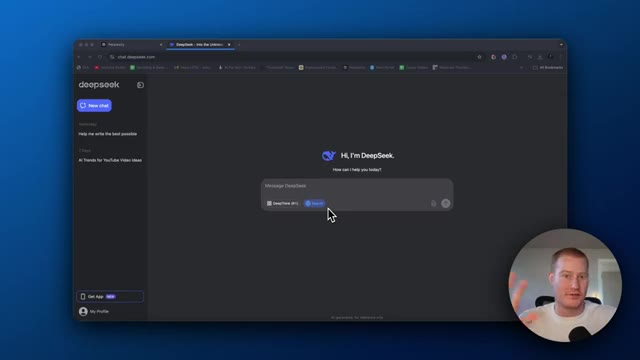
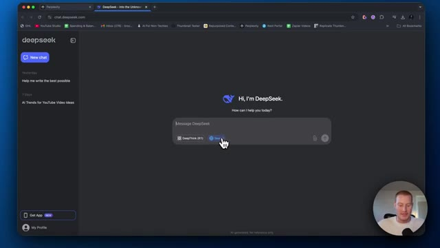
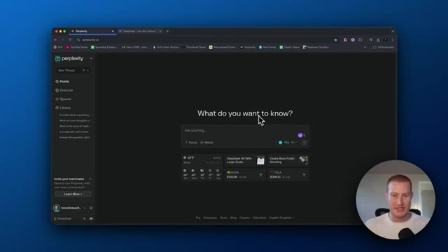
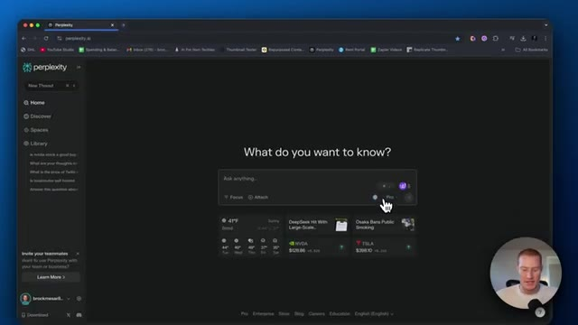
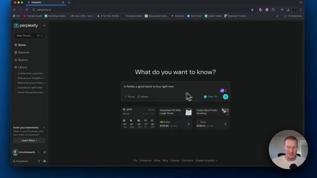
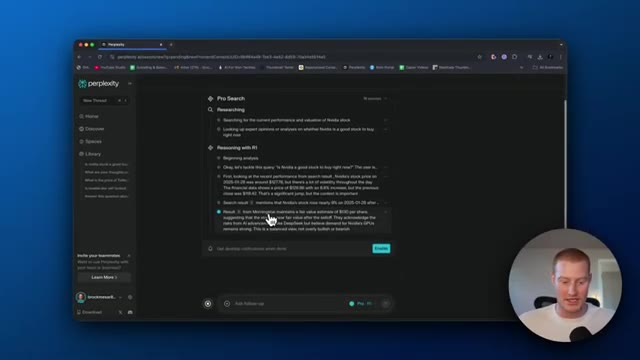
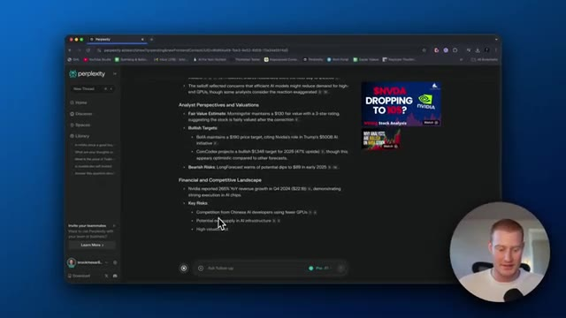
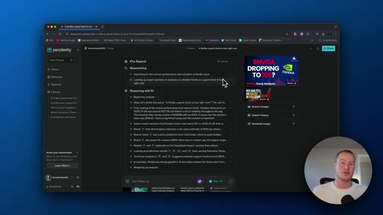
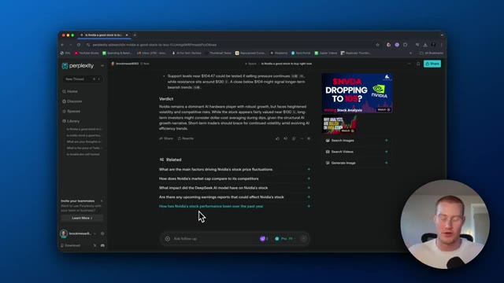

# 🎬 Use DeepSeek R1 In Perplexity (I Cancelled $200 ChatGPT)

> **Chaîne** : [Brock Mesarich | AI for Non Techies](https://www.youtube.com/@BrockMesarich)  
> **Lien YouTube** : [https://www.youtube.com/watch?v=qZ7-47ICa5A](https://www.youtube.com/watch?v=qZ7-47ICa5A)  
> **Date de publication** : 20250128  
> **Durée** : 00:04:26  
> **Identifiant vidéo** : `qZ7-47ICa5A`  
> **Transcription & Analyse** : `whisper-v3-large-turbo+gemini-3.5-flash-lite`  

---

## 📌 Synthèse Exécutive & Outils

### 💡 Résumé
Dans cette vidéo, Brock Mesarich aborde l'impact majeur du modèle DeepSeek R1 sur les marchés financiers et l'écosystème de l'intelligence artificielle, tout en proposant une alternative sécurisée et économique pour les traders et investisseurs. Alors que DeepSeek s'impose comme un LLM ultra-performant, capable de rivaliser avec OpenAI, son hébergement initial en Chine soulève des préoccupations légitimes en matière de souveraineté et de confidentialité des données. Pour contourner ce risque de cybersécurité sans compromettre la qualité analytique, l'auteur démontre comment intégrer le moteur de raisonnement R1 directement au sein de la plateforme Perplexity, hébergée aux États-Unis. 

La vidéo met en lumière une étude de cas pratique axée sur l'analyse fondamentale et technique de l'action NVIDIA. Plutôt que de s'appuyer sur des requêtes superficielles ou de payer des abonnements prohibitifs — tels que les forfaits Pro à 200 $ par mois pour accéder à ChatGPT o1 —, la configuration présentée combine la puissance de recherche en temps réel de Perplexity et les capacités de raisonnement avancé de DeepSeek R1 pour seulement 20 $ par mois. Le processus de pensée ("reasoning") étape par étape du modèle est décortiqué en direct, illustrant sa capacité à traiter la volatilité boursière, les rapports d'analystes, les valorisations et les risques macroéconomiques inhérents au secteur des semi-conducteurs.

Sur le plan stratégique, cette approche démocratise l'accès à des outils de recherche de niveau institutionnel pour les non-techniciens. L'analyse générée ne se limite pas à un simple constat, mais formule une recommandation opérationnelle concrète — en l'occurrence, l'application d'une stratégie d'accumulation par paliers (dollar cost averaging) face à la cyclicité et aux pressions concurrentielles de l'écosystème IA. Cette synergie technologique redéfinit l'optimisation des coûts opérationnels pour les investisseurs individuels cherchant à automatiser ou affiner leur veille stratégique.

### 🛠️ Outils, Modèles & Logiciels Présentés
* **DeepSeek R1** : Modèle de langage open source doté de capacités de raisonnement avancées, reconnu pour ses performances supérieures et son efficacité économique, bien que initialement hébergé en Chine.
* **Perplexity (Pro)** : Moteur de recherche conversationnel basé sur l'IA qui intègre désormais les capacités de raisonnement de DeepSeek R1 tout en garantissant un hébergement sécurisé aux États-Unis.
* **ChatGPT (OpenAI / o1)** : Modèle de référence du marché pour le raisonnement complexe, dont l'accès aux versions professionnelles haut de gamme s'avère nettement plus coûteux.
* **Make** : Plateforme d'automatisation de flux de travail (mentionnée dans l'écosystème global de la chaîne pour connecter des API et des outils d'IA).
* **n8n** : Outil d'automatisation open source et low-code utilisé pour concevoir des pipelines de données et intégrer des modèles d'IA.
* **Zapier** : Logiciel d'automatisation facilitant la liaison rapide entre différentes applications SaaS sans compétences de programmation avancées.
* **Gemini** : Modèle de langage de Google positionné sur le segment de l'analyse multimodale et de la recherche documentaire.
* **Claude** : LLM développé par Anthropic, réputé pour sa précision rédactionnelle et son analyse contextuelle approfondie.
* **Grok** : Modèle d'intelligence artificielle développé par xAI, intégré aux flux d'actualités en temps réel.
* **Prompt Engineering** : Discipline consistant à structurer et optimiser les requêtes textuelles pour maximiser la pertinence et la précision des réponses des LLM.

### 🔑 Points Clés & Enseignements Stratégiques
* **Arbitrage des coûts technologiques** : Remplacement des abonnements onéreux (ChatGPT Pro à 200 $/mois) par des solutions combinant Perplexity Pro et DeepSeek R1 à 20 $/mois, générant des économies substantielles pour les investisseurs individuels.
* **Souveraineté et sécurité des données** : Contournement des risques de fuite ou de stockage d'informations sensibles sur des serveurs en Chine (via deepseek.com) en exploitant le modèle R1 à travers une infrastructure basée aux États-Unis.
* **Capacités de raisonnement profond ("Chain of Thought")** : Utilisation d'un modèle capable d'analyser de manière itérative et structurée les requêtes financières complexes avant de formuler une conclusion.
* **Intégration de la recherche en temps réel** : Combinaison de la puissance d'extraction de données web de Perplexity et de la logique analytique de DeepSeek pour obtenir des données de marché actualisées.
* **Analyse multicritère automatisée** : Évaluation instantanée de la volatilité des cours boursiers, des perspectives des analystes, de la valorisation de l'actif et du paysage concurrentiel (illustré sur NVIDIA).
* **Identification des risques macroéconomiques et structurels** : Détection automatisée des goulots d'étranglement sectoriels, tels que les risques de surcapacité dans l'infrastructure dédiée à l'intelligence artificielle.
* **Application d'une stratégie de Dollar Cost Averaging (DCA)** : Recommandation tactique générée par l'IA suggérant un investissement progressif par paliers lors des phases de correction de marché pour lisser le prix d'entrée.
* **Exploitation de modèles open source** : Possibilité pour les utilisateurs avancés de télécharger localement DeepSeek R1 pour garantir une confidentialité absolue des données traitées.
* **Démocratisation de l'analyse quantitative pour les non-techniciens** : Simplification de l'accès aux outils de pointe sans nécessiter de compétences en programmation ou en science des données.
* **Optimisation des flux de travail (Workflow Automation)** : Intégration de ces outils d'IA dans des architectures d'automatisation (Make, n8n, Zapier) pour industrialiser la veille financière et la prise de décision.

---

## ⏱️ Chronologie & Transcription Complète Audio & Visuelle (Mot pour Mot)

### ⏱️ `[00:00:00 - 00:00:21]` | Segment #01

**🔊 Audio (Transcription Intégrale Mot pour Mot en Français) :**
> Très bien, donc DeepSeek fait actuellement sensation dans le monde de l'intelligence artificielle et même sur les marchés financiers et tout ça. Tout le monde ne parle que de ça. Donc DeepSeek, qu'est-ce que c'est ? C'est essentiellement un LLM dont les gens disent qu'il est plus performant que ChatGPT et ChatGPT. Oh, avec le raisonnement, c'est plus rapide, c'est meilleur, ça donne de meilleures réponses.

**👁️ Analyse Visuelle d'Écran (gemini-3.5-flash-lite) :**
**Interface & Outils** : Navigateur web affichant l'interface de DeepSeek (chat.deepseek.com).

**Contenu textuel & Code** : Page d'accueil du LLM DeepSeek avec la zone de saisie de message, les options "DeepThink (R1)" et "Search", ainsi que l'historique des conversations dans le panneau latéral gauche.

**Action / Démonstration** : Présentation de l'interface principale et des fonctionnalités de DeepSeek par le présentateur.

*⏱️ 00:00:06 — Capture d'écran montrant l'interface Web officielle de l'intelligence artificielle DeepSeek, avec le présentateur en médaillon dans le coin inférieur droit.*

---

### ⏱️ `[00:00:21 - 00:00:42]` | Segment #02

**🔊 Audio (Transcription Intégrale Mot pour Mot en Français) :**
> Et vous pourriez venir sur chat.deepseek.com et vous pourriez interagir avec lui ici même. Vous pourriez voir qu'il a accès à la recherche. Vous pourriez cliquer sur DeepThink R1. Cependant, le problème avec cela, c'est que c'est réellement hébergé en Chine. C'est une entreprise chinoise et les gens se montrent vraiment sceptiques à ce sujet, car vos données sont ensuite stockées en Chine et ils pourraient faire Dieu sait quoi avec ces informations.

**👁️ Analyse Visuelle d'Écran (gemini-3.5-flash-lite) :**
**Interface & Outils** : Navigateur web affichant l'interface de DeepSeek (chat.deepseek.com) avec une incrustation vidéo du présentateur en bas à droite.

**Contenu textuel & Code** : Page d'accueil du chat DeepSeek affichant le message d'accueil « Hi, I'm DeepSeek », une zone de saisie de texte avec les options « DeepThink (R1) » et « Search ».

**Action / Démonstration** : Le curseur de la souris survole le bouton de recherche (« Search ») sur l'interface de DeepSeek.

*⏱️ 00:00:26 — Capture d'écran montrant l'interface Web officielle de l'assistant IA DeepSeek avec la barre de recherche et le bouton DeepThink (R1).*

---

### ⏱️ `[00:00:42 - 00:01:15]` | Segment #03

**🔊 Audio (Transcription Intégrale Mot pour Mot en Français) :**
> Dans cette vidéo, je vais vous montrer que Perplexity vient en fait d'ajouter le raisonnement de DeepSeek R1 dans son moteur de recherche. Si vous ne savez pas ce qu'est Perplexity, c'est essentiellement un moteur de recherche basé sur un grand modèle de langage. C'est vraiment génial si vous voulez l'utiliser pour chercher sur Internet en utilisant l'IA. Et le fait qu'ils aient ajouté ce raisonnement avec notre modèle R1 de DeepSeek est vraiment génial parce que c'est honnêtement un peu mieux que ChatGPT o1, il a accès à Internet et en plus, il est en fait hébergé aux États-Unis. Donc vous n'avez pas à vous soucier que DeepSeek en Chine vole réellement vos informations comme vous le feriez

**👁️ Analyse Visuelle d'Écran (gemini-3.5-flash-lite) :**
**Interface & Outils** : Navigateur web affichant le site web de Perplexity AI (perplexity.ai)

**Contenu textuel & Code** : Page d'accueil de Perplexity AI avec la barre de recherche "Ask anything..." et des actualités/widgets en bas.

**Action / Démonstration** : Présentation de l'interface principale de Perplexity AI par le créateur de la vidéo.

*⏱️ 00:00:51 — Capture d'écran montrant l'interface du moteur de recherche Perplexity AI dans un navigateur web, avec le présentateur en médaillon en bas à droite.*

---

### ⏱️ `[00:01:15 - 00:01:33]` | Segment #04

**🔊 Audio (Transcription Intégrale Mot pour Mot en Français) :**
> devez vous inquiéter lorsque vous interagissez avec, par exemple, deepseek.com. Tout d'abord, vous allez avoir besoin du forfait pro ou vous pouvez simplement avoir l'essai, avec lequel vous obtenez trois invites pour tester cela. Ou vous pouvez vous inscrire avec Pro, ce que j'ai fait pour les besoins de cette vidéo, et vous obtenez un premier mois gratuit, puis un forfait de 20 dollars par mois.

**👁️ Analyse Visuelle d'Écran (gemini-3.5-flash-lite) :**
**Interface & Outils** : Navigateur web affichant l'interface de Perplexity AI.

**Contenu textuel & Code** : Barre de recherche "Ask anything...", options Focus et Attach, ainsi qu'un bouton "Pro" mis en valeur par le curseur de la souris.

**Action / Démonstration** : Le présentateur survole l'option "Pro" de l'interface Perplexity pour illustrer l'utilisation d'un forfait payant.

*⏱️ 00:01:20 — Capture d'écran montrant l'interface du site web de l'assistant IA Perplexity avec un curseur survolant l'option Pro.*

---

### ⏱️ `[00:01:33 - 00:01:53]` | Segment #05

**🔊 Audio (Transcription Intégrale Mot pour Mot en Français) :**
> Cela va en fait vous faire économiser beaucoup plus d'argent par rapport à l'utilisation de ChatGPT en payant pour leur formule Pro, qui coûte en réalité 200 dollars par mois afin d'accéder à O1. Cela pourrait donc vraiment être un bon investissement pour vous. Laissez-moi donc venir ici et faire un test avec ceci. Je vais simplement dire : est-ce qu'NVIDIA est une bonne action à acheter en ce moment ?

**👁️ Analyse Visuelle d'Écran (gemini-3.5-flash-lite) :**
**Interface & Outils** : Navigateur web affichant l'interface de Perplexity AI.

**Contenu textuel & Code** : Zone de texte de recherche ("Ask anything"), options "Pro" activées, et menu contextuel affichant "Pro Search", "Reasoning with R1", et "Reasoning with o1".

**Action / Démonstration** : Le curseur de la souris clique sur les options de recherche et de modèles de raisonnement avancés de l'interface Perplexity AI.

*⏱️ 00:01:38 — Capture d'écran montrant l'interface du site web Perplexity AI dans un navigateur web, avec un menu déroulant ouvert affichant les options de recherche Pro et les modèles de raisonnement, tandis que le présentateur apparaît en incrustation dans le coin inférieur droit.*

---

### ⏱️ `[00:01:53 - 00:02:26]` | Segment #06

**🔊 Audio (Transcription Intégrale Mot pour Mot en Français) :**
> Et je pourrais soit simplement faire une recherche normale, je pourrais raisonner avec O1, ou je pourrais raisonner avec R1, qui est en fait le modèle de raisonnement avancé de DeepSeek, alors laissez-moi chercher ça maintenant, c'est en train de faire des recherches, ça extrait ces sources comme le fait Perplexity, et cela va prendre un certain temps parce que ça raisonne et réfléchit réellement à la question, et cela va donner une réflexion plus approfondie avant de nous donner une réponse, donc vous pouvez voir que ça raisonne maintenant avec R1, alors ça commence l'analyse, bon, attaquons cette requête : est-ce que NVIDIA est une bonne action à acheter en ce moment ? D'abord, en regardant les récentes

**👁️ Analyse Visuelle d'Écran (gemini-3.5-flash-lite) :**
**Interface & Outils** : Navigateur web affichant l'interface de Perplexity AI.

**Contenu textuel & Code** : Champ de recherche avec la question « Is Nvidia a good stock to buy right now » et le modèle de raisonnement DeepSeek R1 sélectionné.

**Action / Démonstration** : Saisie et préparation d'une recherche avec le modèle de raisonnement avancé sur Perplexity.

*⏱️ 00:02:02 — Capture d'écran montrant l'interface du moteur de recherche IA Perplexity avec une requête sur l'action Nvidia et le modèle R1 sélectionné.*

---

### ⏱️ `[00:02:26 - 00:02:56]` | Segment #07

**🔊 Audio (Transcription Intégrale Mot pour Mot en Français) :**
> performances à partir des résultats de recherche, le cours de l'action de NVIDIA était d'environ 127 dollars, beaucoup de volatilité. D'accord. C'est donc comme si l'on effectuait des recherches à travers plusieurs résultats ici afin de réfléchir comme un être humain à travers tout cela et de ne pas se contenter de fournir un résultat très rapidement. On plonge vraiment en profondeur là-dedans. C'est plutôt cool de voir réellement chacune de ces étapes ici. Et voilà. Ça nous montre réellement le cours de l'action. Ça nous montre réellement le graphique boursier de NVIDIA. Et puis voici son raisonnement.

**👁️ Analyse Visuelle d'Écran (gemini-3.5-flash-lite) :**
**Interface & Outils** : Perplexity (moteur de recherche IA)

**Contenu textuel & Code** : Texte de recherche et de raisonnement concernant les performances de l'action Nvidia, le cours autour de 127 dollars, et des analyses financières (Morningstar).

**Action / Démonstration** : Le présentateur explique comment l'outil effectue des recherches à travers plusieurs résultats pour analyser l'action Nvidia.

*⏱️ 00:02:34 — Interface de recherche Perplexity montrant le processus de recherche et de raisonnement (Pro Search avec R1) sur l'action NVIDIA, avec une petite bulle vidéo du présentateur en bas à droite.*

---

### ⏱️ `[00:02:57 - 00:03:32]` | Segment #08

**🔊 Audio (Transcription Intégrale Mot pour Mot en Français) :**
> Donc la volatilité récente et la réaction du marché, les perspectives des analystes et les valorisations, le paysage financier et concurrentiel. Cela décompose les principaux risques ici. Une surcapacité potentielle et l'infrastructure de l'IA, ce que je suppose nous avions compris. Et je suppose que nous avons appris cela de DeepSeek et de la manière dont ils ont réellement été capables de construire un très bon modèle de langage étendu, encore meilleur que ChatGPT, pour une fraction du prix. D'accord, voici donc le verdict. NVIDIA reste un acteur dominant du matériel informatique pour l'IA avec une croissance robuste, mais fait face à une volatilité accrue et à des risques concurrentiels. Bien que l'action semble correctement valorisée autour de 130 dollars,

**👁️ Analyse Visuelle d'Écran (gemini-3.5-flash-lite) :**
**Interface & Outils** : Navigateur web affichant l'interface de Perplexity AI.

**Contenu textuel & Code** : Texte structuré sur les perspectives des analystes, les valorisations, le paysage financier et concurrentiel, et les risques clés liés à Nvidia.

**Action / Démonstration** : Le présentateur lit et commente les points clés affichés sur l'écran concernant l'analyse financière de l'IA.

*⏱️ 00:03:06 — Capture d'écran montrant l'interface du navigateur avec l'outil Perplexity AI affichant des analyses financières sur Nvidia.*

---

### ⏱️ `[00:03:34 - 00:04:07]` | Segment #09

**🔊 Audio (Transcription Intégrale Mot pour Mot en Français) :**
> les investisseurs pourraient envisager un achat périodique par dollar cost averaging lors des baisses. D'accord, voilà. Donc j'ai réfléchi à ça. C'est super. Mais les gars, je voulais juste vous montrer comment vous pouvez maintenant utiliser DeepSeek R1 dans Perplexity et ne pas avoir à vous soucier de son hébergement en Chine. C'était un gros problème avec l'utilisation de cette plateforme. Beaucoup de gens téléchargeaient en fait DeepSeek R1 localement sur leurs appareils parce qu'ils s'inquiétaient évidemment des problèmes de confidentialité. Et c'est un modèle open source. Vous pouvez donc le faire. Mais cela donne en fait à DeepSeek la possibilité

**👁️ Analyse Visuelle d'Écran (gemini-3.5-flash-lite) :**
**Interface & Outils** : Navigateur web affichant l'interface de Perplexity AI.

**Contenu textuel & Code** : Le processus de recherche ("Researching") et de raisonnement ("Reasoning with R1") sur l'action Nvidia, incluant l'analyse des performances, de la valorisation et des avis d'experts.

**Action / Démonstration** : Le présentateur démontre l'utilisation de DeepSeek R1 intégré au sein de Perplexity pour analyser un investissement boursier.

*⏱️ 00:03:42 — Capture d'écran montrant l'interface du moteur de recherche Perplexity avec le raisonnement du modèle DeepSeek R1 sur l'action Nvidia.*

---

### ⏱️ `[00:04:07 - 00:04:25]` | Segment #10

**🔊 Audio (Transcription Intégrale Mot pour Mot en Français) :**
> pour chercher sur Internet et ensuite raisonner avec le modèle R1. J'espère donc que cela vous a été utile. Dites-le-moi dans les commentaires si vous finissez par l'utiliser et assurez-vous de vous abonner à cette chaîne. Je parle d'IA pour les non-techniciens, donc je couvre toutes les nouveautés, tous les nouveaux outils et la manière dont vous pouvez les utiliser dans votre vie de tous les jours. Cela étant dit, je vous vois dans la prochaine vidéo.

**👁️ Analyse Visuelle d'Écran (gemini-3.5-flash-lite) :**
**Interface & Outils** : Navigateur web affichant l'interface de Perplexity AI.

**Contenu textuel & Code** : Texte d'analyse sur l'action Nvidia, niveaux de support et de résistance, ainsi que des suggestions de questions connexes (Related).

**Action / Démonstration** : Navigation et consultation des résultats de recherche et des recommandations générées par l'IA concernant l'investissement sur Nvidia.

*⏱️ 00:04:12 — Capture d'écran montrant l'interface du moteur de recherche Perplexity AI affichant une analyse financière et des questions associées sur Nvidia.*

---

