# 🎬 Did ChatGPT o3-mini Just Kill DeepSeek R1? (honest discussion)

> **Chaîne** : [Brock Mesarich | AI for Non Techies](https://www.youtube.com/@BrockMesarich)  
> **Lien YouTube** : [https://www.youtube.com/watch?v=cgpSYx5wa6Y](https://www.youtube.com/watch?v=cgpSYx5wa6Y)  
> **Date de publication** : 20250201  
> **Durée** : 00:35:45  
> **Identifiant vidéo** : `cgpSYx5wa6Y`  
> **Transcription & Analyse** : `whisper-v3-large-turbo+gemini-3.5-flash-lite`  

---

## 📌 Synthèse Exécutive & Outils

### 💡 Résumé

Cette discussion analytique de haut vol animée par Brock Mesarich et son invité Mark décortique le bouleversement majeur provoqué sur le marché de l'intelligence artificielle par l'émergence quasi simultanée de DeepSeek R1 et du nouveau modèle o3-mini d'OpenAI. L'épisode explore les implications techniques, économiques et stratégiques de ces innovations pour les développeurs, les entreprises et les utilisateurs non techniques, en levant le voile sur la réalité derrière le battage médiatique (« hype »).

L'analyse confronte deux visions de l'IA : d'un côté, la démocratisation agressive portée par DeepSeek grâce à l'open source et à l'apprentissage par renforcement à moindre coût, qui rabat les cartes face aux acteurs propriétaires traditionnels ; de l'autre, la suprématie technique et l'intégration fluide d'OpenAI avec l'arrivée de o3-mini. L'entretien met en lumière un tournant technologique capital : la capacité pour les agents et les systèmes automatisés de moduler dynamiquement leur niveau de raisonnement (bas, moyen, élevé) et d'accéder nativement au web, redéfinissant les standards d'efficacité pour le traitement de données à grande échelle.

Au-delà des performances brutes en programmation ou en logique, l'épisode démontre comment ces nouveaux paradigmes réduisent drastiquement les barrières financières et techniques pour le déploiement de LLM sur des millions de lignes de données, tout en posant les bases d'une architecture d'agents autonomes plus intelligente et contextuelle.

### 🛠️ Outils, Modèles & Logiciels Présentés

* **DeepSeek R1** : Modèle open source révolutionnaire imitant les performances de raisonnement d'OpenAI à une fraction du coût, accessible gratuitement et installable localement ou via le cloud.
* **ChatGPT (o3-mini / o1-mini)** : Modèle propriétaire d'OpenAI axé sur le raisonnement avancé, offrant des options de réglage de la profondeur de réflexion (« low », « medium », « high ») et des capacités de recherche web intégrées.
* **OpenAI API** : Interface de programmation robuste et hautement disponible, privilégiée par les professionnels pour la stabilité de production et la structure standardisée des charges utiles (« payloads »).
* **Make** : Plateforme d'automatisation et d'intégration de flux de travail sans code, mentionnée dans l'écosystème d'automatisation des tâches complexes.
* **n8n** : Outil d'automatisation de flux de travail open source et axé sur la vie privée, idéal pour orchestrer des appels d'API de LLM à grande échelle.
* **Zapier** : Solution pionnière d'automatisation permettant de connecter rapidement des applications cloud et des modèles d'IA sans compétences en développement.
* **Gemini** : Modèle linguistique multimodal de Google, positionné comme l'un des concurrents majeurs sur le marché des infrastructures d'IA propriétaires.
* **Claude** : Modèle conversationnel d'Anthropic réputé pour ses capacités rédactionnelles, de nuance et de sécurité dans le traitement textuel.
* **Grok** : Modèle d'intelligence artificielle développé par xAI, intégré dans le paysage concurrentiel des LLM axés sur le raisonnement et l'actualité en temps réel.
* **Prompt Engineering** : Méthodologie et art de concevoir des instructions textuelles précises pour maximiser la pertinence et la structure des réponses des grands modèles de langage.

### 🔑 Points Clés & Enseignements Stratégiques

* **Démocratisation de l'IA par l'Open Source** : L'arrivée de DeepSeek R1 permet aux startups et aux pays aux ressources limitées d'accéder à des capacités de raisonnement équivalentes à celles des géants technologiques pour une fraction du coût en dollars américains.
* **Disruption de l'avantage concurrentiel d'OpenAI** : L'érosion des barrières à l'entrée par les modèles open source bon marché force les leaders du marché à accélérer leurs cycles de sortie (comme le lancement rapide de o3-mini) pour conserver l'attention du public.
* **L'apprentissage par renforcement optimisé** : DeepSeek utilise une méthode d'apprentissage inspirée des retours d'expériences globaux (analogie de la flotte Tesla), lui permettant d'assimiler des « leçons de vie » sans avoir à les redécouvrir de manière empirique.
* **Limites de la synthèse de données** : Les modèles open source comme DeepSeek montrent parfois des lacunes dans la nuance contextuelle, trahissant une synthèse d'informations agrégées plutôt qu'une mémorisation fine et structurée des concepts.
* **Fiabilité et production industrielle** : Malgré le coût attractif des alternatives open source, les entreprises matures continuent de s'appuyer sur les API propriétaires (OpenAI) pour garantir un temps de fonctionnement (« uptime ») maximal et une stabilité de production.
* **Modularité dynamique du raisonnement** : Le modèle o3-mini introduit la possibilité d'ajuster dynamiquement le niveau de réflexion (bas, moyen, haut) selon la complexité de la requête, ouvrant la voie à des architectures d'agents intelligents auto-routés.
* **Excellence en programmation et refactorisation** : Le mode de raisonnement élevé (« high ») de o3-mini démontre des performances de pointe dans l'écriture, l'analyse et la restructuration (« refactoring ») de code informatique complexe.
* **Recherche web native et fluide** : L'intégration de la recherche Internet dans les modèles de raisonnement avancés d'OpenAI passe d'une simple agrégation brute d'articles à une recherche contextuelle et unctueuse (« smooth »).
* **Gestion des contraintes de politiques de modération** : Les nouvelles versions de modèles s'accompagnent souvent de filtres de sécurité stricts, pouvant parfois bloquer par excès de zèle des requêtes légitimes de développement ou du code de documentation officielle.
* **Optimisation des coûts pour les grands volumes de données** : Pour le traitement massif de millions de lignes de données par LLM, l'utilisation de modèles économiques open source via les clouds AWS ou Microsoft réduit les factures de milliers de dollars à des montants négligeables.
* **Anticipation des goulots d'étranglement de l'API** : Lors de l'adoption de nouveaux modèles ultra-médiatisés, la surcharge des serveurs et les pannes techniques (attaques ou pics de trafic) exigent des stratégies de basculement (« fallback ») robustes.
* **Stratégie d'hybridation technologique** : Les développeurs avisés combinent l'agilité financière des modèles open source pour le prototypage à grande échelle et la robustesse des API propriétaires pour les applications critiques destinées aux utilisateurs finaux.

---

## ⏱️ Chronologie & Transcription Complète Audio & Visuelle (Mot pour Mot)

### ⏱️ `[00:00:00 - 00:00:33]` | Segment #01

**🔊 Audio (Transcription Intégrale Mot pour Mot en Français) :**
> Ça a été une semaine absolument folle dans le monde de l'IA. Tout d'abord, nous avons eu la sortie de DeepSeek R1, et ensuite nous avons eu OpenAI qui a débarqué avec o3-mini aujourd'hui. J'ai donc invité mon bon ami Mark sur ce podcast, et nous allons analyser tous ces modèles côte à côte ensemble, et nous allons les comparer pour que vous puissiez comprendre lequel de ces modèles vous devriez utiliser. Si tout cela vaut le battage médiatique, ce que cette nouvelle technologie DeepSeek signifie et comment cela va façonner l'avenir du développement de l'IA, tout ce genre de choses. Donc, si vous êtes une personne non technique et que vous voulez rester à jour avec toutes ces informations, ce sera parfait

**👁️ Analyse Visuelle d'Écran (gemini-3.5-flash-lite) :**
**Interface & Outils** : Navigateur web affichant le site officiel d'OpenAI.

**Contenu textuel & Code** : Texte d'annonce officiel détaillant les spécificités du modèle OpenAI o3-mini (capacités STEM, coût réduit, effort de raisonnement configurable).

**Action / Démonstration** : Présentation visuelle de la sortie du nouveau modèle d'IA d'OpenAI pour introduire le sujet du podcast.

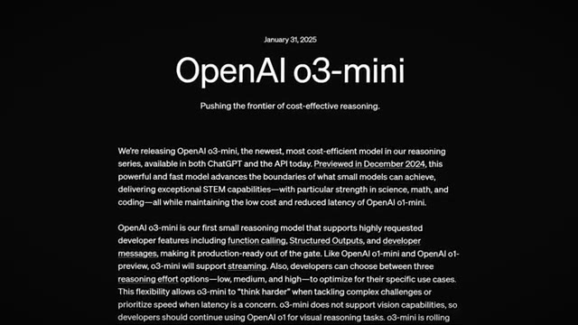
*⏱️ 00:00:08 — Capture d'écran officielle de la page de présentation d'OpenAI annonçant le modèle o3-mini avec le texte descriptif et ses fonctionnalités.*

---

### ⏱️ `[00:00:33 - 00:01:07]` | Segment #02

**🔊 Audio (Transcription Intégrale Mot pour Mot en Français) :**
> épisode pour toi de le faire. Qu'est-ce qui se passe, mec ? Ravi de te ravoir. Hé, c'est sympa d'être de retour comme d'habitude. Donc je suis motivé pour me lancer dans les dernières et meilleures nouveautés. Ouais, c'est clair. Je suis curieux, mec, parce que tu es, je veux dire, j'ai l'impression que je viens toujours te voir avec, tu sais, des actualités ou quelque chose dans le domaine et tu me ramènes toujours sur terre. Je suis du genre, mec, c'est un truc de fou. Et toi, tu es du genre, ce n'est vraiment pas aussi bien que les gens le prétendent. Donc tu es en quelque sorte l'anti-hype man, ce que j'apprécie, euh, en me ramenant sur terre, donc je suis curieux, d'abord je veux plonger rapidement dans tes réflexions sur DeepSeek, surtout genre R1, qu'est-ce que tu as vu ces derniers couples

**👁️ Analyse Visuelle d'Écran (gemini-3.5-flash-lite) :**
**Interface & Outils** : 

**Contenu textuel & Code** : 

**Action / Démonstration** : 

---

### ⏱️ `[00:01:07 - 00:01:33]` | Segment #03

**🔊 Audio (Transcription Intégrale Mot pour Mot en Français) :**
> semaines, tu penses que c'est aussi époustouflant que les gens le prétendent ? Est-ce que c'est surcoté ? Quels sont tes avis ? Je suis curieux. Oui, je pense que peu importe ce que tu fais, tout est toujours un bouleversement, tout est toujours incroyable et ça change tout tous les jours, n'est-ce pas ? Donc, euh, quand DeepSeek est sorti en tant que modèle open source, la chose la plus impressionnante à ce sujet, c'est que tu as une imitation de l'O1 mini qui est accessible gratuitement et que tu peux installer sur un bureau.

**👁️ Analyse Visuelle d'Écran (gemini-3.5-flash-lite) :**
**Interface & Outils** : 

**Contenu textuel & Code** : 

**Action / Démonstration** : 

---

### ⏱️ `[00:01:34 - 00:01:57]` | Segment #04

**🔊 Audio (Transcription Intégrale Mot pour Mot en Français) :**
> C'est la chose la plus cool qui soit sortie. Maintenant, la façon dont il pense quand il fait son raisonnement est très particulière. On dirait quelqu'un qui est sonné, qui se parle un peu à lui-même plutôt qu'un fil de pensée très cohérent. L'API est sans cesse active et inactive. Si vous allez sur le site Web en ce moment, il sera probablement encore en panne à cause des hackers ou de ce qui se passe, n'est-ce pas ?

**👁️ Analyse Visuelle d'Écran (gemini-3.5-flash-lite) :**
**Interface & Outils** : Visioconférence

**Contenu textuel & Code** : Aucun graphique, code, terminal ou élément technique affiché.

**Action / Démonstration** : Conversation entre les deux intervenants.

---

### ⏱️ `[00:01:57 - 00:02:20]` | Segment #05

**🔊 Audio (Transcription Intégrale Mot pour Mot en Français) :**
> Alors pour moi, c'est comme intéressant. Ça pourrait changer les choses dans le futur. Pour moi, ce qui a été précieux, c'est qu'au cours des dernières 24 à 48 heures, Microsoft et Amazon les ont ajoutés en tant que modèles open source à leur cloud. Donc maintenant, vous pouvez en fait accéder de manière plus fiable à ces API. Et le plus important pour beaucoup de gens, il y a beaucoup de préoccupations concernant, insérez une théorie du complot, y accéder de manière sécurisée.

**👁️ Analyse Visuelle d'Écran (gemini-3.5-flash-lite) :**
**Interface & Outils** : Application de visioconférence ou de podcast en ligne.

**Contenu textuel & Code** : Aucun graphique, code, terminal ou élément de démonstration technique visible, uniquement les deux participants.

**Action / Démonstration** : Conversation et discussion entre les deux intervenants sans support visuel technique.

---

### ⏱️ `[00:02:20 - 00:02:56]` | Segment #06

**🔊 Audio (Transcription Intégrale Mot pour Mot en Français) :**
> maintenant c'est une option donc pour moi ça ouvre la voie à beaucoup de plus grandes entreprises où vous avez des millions de lignes sur lesquelles vous aimeriez faire tourner des LLM ligne par ligne ce coûterait des milliers de dollars mais maintenant c'est comme une fraction de cela donc c'est intéressant parce que ça montre simplement où va l'open source et o3 est sorti et immédiatement les gens ont commencé à dire j'ai hâte que o3 soit copié pour pouvoir l'utiliser gratuitement. Donc c'est un peu comme cette érosion des barrières concurrentielles ces deux dernières années. C'est comme OpenAI, Anthropic, Gemini, ils ont le marché. Mais maintenant avec la capacité de

**👁️ Analyse Visuelle d'Écran (gemini-3.5-flash-lite) :**
**Interface & Outils** : Interface de visioconférence sans outil technique ni graphique.

**Contenu textuel & Code** : Aucun code, graphique, indicateur ou donnée technique affichée.

**Action / Démonstration** : Discussion entre présentateurs sans manipulation de logiciel ou de démonstration technique.

---

### ⏱️ `[00:02:56 - 00:03:29]` | Segment #07

**🔊 Audio (Transcription Intégrale Mot pour Mot en Français) :**
> des modèles bon marché utilisant la méthode de DeepSeek, le véritable changement de jeu, c'est que d'autres entreprises open source maintenant, pensez même à Facebook, peuvent commencer à envisager différentes façons de rattraper leur retard en matière de ces modèles. Exactement. Oui. C'est assez fou à penser. Je veux dire, je suppose que cela m'amène à ma prochaine question et en ce qui concerne la façon dont DeepSeek a structuré tout cela et, disons, expliquez-moi brièvement, comme pour un pitch dans un ascensseur destiné à une personne non technique, comment ils ont réussi à prendre ChatGPT et à leentraîner à leur manière, vous savez, différemment de tout autre modèle que nous avons vu, parce que

**👁️ Analyse Visuelle d'Écran (gemini-3.5-flash-lite) :**
**Interface & Outils** : Visioconférence / Podcast vidéo sans aucun graphique ni outil technique.

**Contenu textuel & Code** : Aucun code, graphique, métrique ou donnée technique visible.

**Action / Démonstration** : Discussion en direct entre les intervenants sans manipulation d'interface.

---

### ⏱️ `[00:03:29 - 00:04:04]` | Segment #08

**🔊 Audio (Transcription Intégrale Mot pour Mot en Français) :**
> c'est pour ça que c'est la grande vedette de l'actualité en ce moment c'est parce que les gens se disent oh est-ce qu'on a besoin de autant de puissance de calcul pour entraîner ces grands modèles de langage comme on le pensait évidemment l'action de Nvidia on n'a même pas besoin d'aborder le sujet ouais explique-moi ça parce que ça m'intéresse en tant que personne non technique genre explique-le-moi comme si j'étais stupide d'accord eh bien tu n'es pas stupide et ton audience non plus alors je dirais une grande couche ici il y a quelque chose qui s'appelle l'apprentissage par renforcement pour lequel on va donner une analogie si tu penses à une Tesla comment elle apprend de ses accidents ou de tout ce qui va mal et ensuite envoie cette séquence vidéo à toutes les autres Tesla alors

**👁️ Analyse Visuelle d'Écran (gemini-3.5-flash-lite) :**
**Interface & Outils** : Visioconférence (aucun graphique, terminal ou code affiché).

**Contenu textuel & Code** : Aucun indicateur technique ni donnée chiffrée.

**Action / Démonstration** : Conversation en visio, aucun élément de démonstration réelle ou graphique technique.

---

### ⏱️ `[00:04:04 - 00:04:27]` | Segment #09

**🔊 Audio (Transcription Intégrale Mot pour Mot en Français) :**
> Il apprend à ne plus refaire ça, ce modèle a ajouté ce composant, cet apprentissage un peu plus um Et une chose intéressante à ce sujet, c'est imagine que je vienne te voir, Brock, et que tu aies toutes ces leçons de vie. Et au lieu que je m'inquiète de devoir arriver aux mêmes conclusions que toi en vivant ce parcours, j'ai simplement pris ces leçons de vie comme une antisèche et j'ai appris à partir de celles-ci.

**👁️ Analyse Visuelle d'Écran (gemini-3.5-flash-lite) :**
**Interface & Outils** : 

**Contenu textuel & Code** : 

**Action / Démonstration** : 

---

### ⏱️ `[00:04:27 - 00:04:50]` | Segment #10

**🔊 Audio (Transcription Intégrale Mot pour Mot en Français) :**
> Donc DeepSeek est intéressant parce qu'on peut même deviner à travers certaines de ses réponses qu'il n'est pas parvenu de lui-même à certaines de ses conclusions sur ce qu'est le monde. C'est donc un peu comme s'il prenait la parole d'autres modèles pour savoir, vous savez, comment est l'existence, comment est la vie. Et ça se voit parce que lorsqu'il s'agit de réponses nuancées, DeepSeek manque un peu de cette nuance.

**👁️ Analyse Visuelle d'Écran (gemini-3.5-flash-lite) :**
**Interface & Outils** : Visioconférence / Podcast vidéo sans interface logicielle.

**Contenu textuel & Code** : Aucun indicateur, code source ou donnée technique.

**Action / Démonstration** : Discussion entre les intervenants.

---

### ⏱️ `[00:04:51 - 00:05:19]` | Segment #11

**🔊 Audio (Transcription Intégrale Mot pour Mot en Français) :**
> Donc je ne vais pas aller beaucoup plus loin sur ce sujet. Mais on peut voir quand la réponse d'un modèle vient de la synthèse de tonnes d'informations par rapport au moment où il mémorise en quelque sorte un fait et essaie de donner un sens à un fait après coup. J'ai compris. D'accord, ça a du sens. Ouais. Intéressant. Intéressant. Donc évidemment, probablement pour l'avenir, ça va faire, est-ce que tu penses que ça va changer la façon dont, genre, OpenAI envisage l'entraînement de ses futurs modèles ? Ou est-ce que tu penses que les gens surestiment à quel point leur stratégie était puissante ?

**👁️ Analyse Visuelle d'Écran (gemini-3.5-flash-lite) :**
**Interface & Outils** : Interface de visioconférence sans outil externe, graphique ou code affiché.

**Contenu textuel & Code** : Aucun contenu technique, graphique ou de code source n'est présent.

**Action / Démonstration** : Discussion et échange verbal entre les intervenants sur les modèles d'intelligence artificielle.

---

### ⏱️ `[00:05:19 - 00:05:53]` | Segment #12

**🔊 Audio (Transcription Intégrale Mot pour Mot en Français) :**
> Je pense qu'il y a toujours eu, qu'il y aura toujours l'open source contre le système propriétaire. Du genre, tu vas choisir un camp d'une certaine manière. Euh, je pense juste que c'est bon pour beaucoup de gens à travers le monde qui n'ont pas les moyens, là où, disons, pour toi et moi, 50 balles de coût OpenAI, c'est négligeable. Mais pour quelqu'un dans un certain pays, ça peut être beaucoup d'argent ou ça peut être prohibitif pour une startup qui essaie de démarrer dans tel ou tel pays où les dollars américains, c'est énorme, tu vois ? Je pense que c'est exceptionnel pour ces gens-là. Mais pour toi et moi, genre, j'utiliserai quand même OpenAI pour

**👁️ Analyse Visuelle d'Écran (gemini-3.5-flash-lite) :**
**Interface & Outils** : Visioconférence / Podcast vidéo sans élément graphique ou technique.

**Contenu textuel & Code** : Aucun contenu technique, graphique, code ou indicateur affiché à l'écran.

**Action / Démonstration** : Conversation en cours entre les intervenants.

---

### ⏱️ `[00:05:53 - 00:06:29]` | Segment #13

**🔊 Audio (Transcription Intégrale Mot pour Mot en Français) :**
> la plupart du temps, parce que je dépends de leur API pour qu'elle ait toujours le plus de temps de disponibilité possible, qu'elle soit aussi disponible que possible. Je suis habitué à la pile technologique. Je suis habitué à la façon dont ils structurent leur charge utile. Donc ça ne changera pas grand-chose pour beaucoup de gens, mais si vous vous lancez, si vous voulez tester une idée qui tournerait typiquement sur des milliers de lignes ou, vous savez, des milliers d'instances, c'est là que les choses vont changer à l'avenir. J'ai compris, d'accord, c'est logique, super. Eh bien, je suppose, je veux dire, nous pourrions creuser un peu plus à mesure que cette conversation avance, un peu plus dans DeepSeek, mais je veux connaître maintenant un peu votre avis sur, genre, o3, parce que, bien sûr, évidemment, Deep

**👁️ Analyse Visuelle d'Écran (gemini-3.5-flash-lite) :**
**Interface & Outils** : Visioconférence (aucun outil technique affiché).

**Contenu textuel & Code** : Aucun code, graphique ou donnée technique.

**Action / Démonstration** : Conversation entre les intervenants.

---

### ⏱️ `[00:06:29 - 00:06:52]` | Segment #14

**🔊 Audio (Transcription Intégrale Mot pour Mot en Français) :**
> Seek fait fureur ces derniers, une, deux semaines, et O3 est sorti aujourd'hui, O3 Mini, et il y a d'autres petits modèles qui ont les noms les plus bizarres. Ça devient un peu complexe, mais qu'en penses-tu ? Tout d'abord, penses-tu qu'OpenAI a sorti ceci juste pour éclipser DeepSeek aux yeux du public et lancer quelque chose de nouveau pour attirer l'attention de leur côté ? Qu'en penses-tu ?

**👁️ Analyse Visuelle d'Écran (gemini-3.5-flash-lite) :**
**Interface & Outils** : Interface de visioconférence affichant les deux interlocuteurs.

**Contenu textuel & Code** : Aucun graphique, code, terminal ou donnée technique n'est affiché.

**Action / Démonstration** : Discussion en cours entre le présentateur et son invité.

---

### ⏱️ `[00:06:52 - 00:07:15]` | Segment #15

**🔊 Audio (Transcription Intégrale Mot pour Mot en Français) :**
> Je veux en savoir un peu plus sur ton expérience après avoir testé ces modèles, et je crois que tu vas nous montrer en quelque sorte un petit test, tu sais, un peu plus loin dans la vidéo. Donc, ouais, curieux de connaître tes impressions là-dessus. Ouais, tu m'as contacté au bon moment, littéralement au moment où Brock m'a contacté. Les modèles sont sortis, et je suis, genre, en train de me dépêcher de, genre, les appeler via l'API. À première vue, ils sont meilleurs que les modèles 01, ce qui est une bonne chose.

**👁️ Analyse Visuelle d'Écran (gemini-3.5-flash-lite) :**
**Interface & Outils** : 

**Contenu textuel & Code** : 

**Action / Démonstration** : 

---

### ⏱️ `[00:07:16 - 00:07:34]` | Segment #16

**🔊 Audio (Transcription Intégrale Mot pour Mot en Français) :**
> Je remarque cependant qu'ils sont pressés, surtout sur ChatGPT, parce que des requêtes très normales que je poserais à n'importe quel autre modèle sont maintenant signalées pour des restrictions de politique. Et je fais littéralement, tout ce que je fais, c'est que j'ai essayé de faire un copier-coller de la documentation d'OpenAI pour pouvoir utiliser les modèles très facilement. Et cela a été signalé comme un problème.

**👁️ Analyse Visuelle d'Écran (gemini-3.5-flash-lite) :**
**Interface & Outils** : Application de visioconférence.

**Contenu textuel & Code** : Noms des intervenants sous chaque flux vidéo ("Brock Mesarich" et "Mark Kashef").

**Action / Démonstration** : Discussion en visioconférence entre les deux intervenants.

---

### ⏱️ `[00:07:34 - 00:07:54]` | Segment #17

**🔊 Audio (Transcription Intégrale Mot pour Mot en Français) :**
> Donc c'est arrivé plusieurs fois avec chaque modèle O3. Mais mettons cela de côté. O3 mini, je crois que ça s'appelle low ou ouais, O3 mini low et puis O3 mini high, tous ces mots. Le modèle high est en fait vraiment bon en programmation. Genre, il était capable de refactoriser du code vraiment bien, vraiment très bien plutôt.

**👁️ Analyse Visuelle d'Écran (gemini-3.5-flash-lite) :**
**Interface & Outils** : Visioconférence / Interface de podcast.

**Contenu textuel & Code** : Aucun code, graphique, terminal ou démonstration technique visible.

**Action / Démonstration** : Les intervenants discutent en direct sans aucun support visuel technique à l'écran.

---

### ⏱️ `[00:07:54 - 00:08:19]` | Segment #18

**🔊 Audio (Transcription Intégrale Mot pour Mot en Français) :**
> En termes de réflexion, son raisonnement est un peu comme celui de O1 Mini. Sauf qu'il va un peu plus loin, là où O1 Mini était juste un peu en retrait. Donc, à première vue, ils fonctionnent plutôt bien. Mais le point essentiel ici, qui nous intéresse pour les agents du futur, c'est que désormais, via le même modèle, vous pouvez indiquer à OpenAI à quel point ce modèle doit réfléchir.

**👁️ Analyse Visuelle d'Écran (gemini-3.5-flash-lite) :**
**Interface & Outils** : Visioconférence (aucun graphique, code ou interface de trading affiché).

**Contenu textuel & Code** : Aucun contenu technique, indicateur, code ou métrique.

**Action / Démonstration** : Conversation vidéo entre les deux présentateurs.

---

### ⏱️ `[00:08:19 - 00:08:54]` | Segment #19

**🔊 Audio (Transcription Intégrale Mot pour Mot en Français) :**
> Donc vous obtenez un niveau de raisonnement bas, un niveau moyen ou un niveau de raisonnement élevé, ce qui, bon, quand on pense aux applications de cela, en ce moment vous devez toujours prendre une décision, soit cet agent va être vraiment lent et utiliser un modèle de raisonnement, soit super rapide mais utiliser un niveau de raisonnement plus bas. Maintenant, comme vous pouvez l'imaginer, des systèmes où vous pourrez, de manière dynamique, en fonction de la question que vous recevez, de la requête que vous recevez, décider à quel point je dois réfléchir profondément, et ensuite vous pouvez envoyer cela au bon modèle. Mon Dieu, vous pouvez presque router ça, vous savez, selon, peu importe, vous savez, la complexité de la demande, je suppose. Intéressant. Je veux entendre vos avis aussi,

**👁️ Analyse Visuelle d'Écran (gemini-3.5-flash-lite) :**
**Interface & Outils** : Visioconférence (aucun graphique, terminal ou code affiché).

**Contenu textuel & Code** : Aucun code, indicateur ou donnée chiffrée.

**Action / Démonstration** : Conversation entre les deux intervenants.

---

### ⏱️ `[00:08:54 - 00:09:28]` | Segment #20

**🔊 Audio (Transcription Intégrale Mot pour Mot en Français) :**
> sur le fait qu'il a maintenant, a maintenant la capacité de faire des recherches. Parce que je pense que c'est le premier, euh, genre de modèle de raisonnement avancé qu'on a vu, surtout de la part d'OpenAI, qui a réellement la capacité de chercher sur Internet. Euh, surtout comme O3 mini, genre il est extrêmement rapide, le fait qu'il soit très rapide, qu'il ait ce raisonnement avancé et qu'il ait accès à Internet, ça m'épate. C'est genre, honnêtement, le truc le plus cool que j'ai vu, euh, tu sais, ces, ces derniers temps. Donc ouais, élabore un peu plus là-dessus. Et si tu penses que c'est vraiment quelque chose qui est, tu sais, bénéfique pour l'utilisateur de tous les jours. Ouais. Donc, euh, quand on l'a testé

**👁️ Analyse Visuelle d'Écran (gemini-3.5-flash-lite) :**
**Interface & Outils** : Interface de visioconférence.

**Contenu textuel & Code** : Noms des intervenants affichés sous chaque flux vidéo.

**Action / Démonstration** : Discussion en direct entre les deux participants.

---

### ⏱️ `[00:09:28 - 00:10:03]` | Segment #21

**🔊 Audio (Transcription Intégrale Mot pour Mot en Français) :**
> plusieurs fois, la recherche GPT est beaucoup plus et, genre, excusez mon vocabulaire simpliste, c'est onctueux, ce qui veut dire qu'avant, tu envoyais un terme et ça te recrachait juste un tas d'articles d'internet, formulés d'une certaine manière et de façon inclusive, mais maintenant, ça a l'air plus intégré, où la recherche est faite, c'est intégré dans la réponse de GPT, ce qui est différent d'avant où c'était très forcé, du genre "voici les réponses, voici mon petit passage pour dire que j'ai fait quelque chose basé sur" au lieu de juste obtenir la réponse, donc ouais, au niveau de l'expérience, c'est mieux et pour moi, le vrai test

**👁️ Analyse Visuelle d'Écran (gemini-3.5-flash-lite) :**
**Interface & Outils** : Application de visioconférence (type Zoom ou Google Meet)

**Contenu textuel & Code** : Deux flux vidéo montrant les interlocuteurs avec leurs noms respectifs affichés en bas ("Brock Mesarich" et "Mark Kashef").

**Action / Démonstration** : Les intervenants discutent et partagent leurs points de vue sans afficher de support graphique, de code ou d'interface technique.

---

### ⏱️ `[00:10:03 - 00:10:35]` | Segment #22

**🔊 Audio (Transcription Intégrale Mot pour Mot en Français) :**
> ça arrive du genre quand est-ce qu'on va pouvoir télécharger des fichiers et joindre des fichiers sur ChatGPT ? Pour moi, c'est ça le test. Qu'est-ce qui se passe quand on télécharge la photo d'une main avec six doigts, euh, sur le modèle par rapport à juste faire une recherche, tu vois ? Est-ce qu'il va comprendre maintenant que c'est atypique ? C'est possible, ouais, ouais, intéressant. J'ai remarqué la même chose quand je faisais des tests, parce que j'étais franchement surpris qu'ils ajoutent la recherche à ça plutôt que d'ajouter la possibilité de joindre un fichier, parce que c'était la première chose, sans le savoir, que j'ai voulu tester, genre j'étais en train d'écrire un prompt et puis je lui ai donné une capture d'écran.

**👁️ Analyse Visuelle d'Écran (gemini-3.5-flash-lite) :**
**Interface & Outils** : Visioconférence (aucun graphique ni code source affiché).

**Contenu textuel & Code** : Aucun contenu technique, graphique ou code source.

**Action / Démonstration** : Discussion en visio sans manipulation de logiciel ou de graphique.

---

### ⏱️ `[00:10:35 - 00:10:55]` | Segment #23

**🔊 Audio (Transcription Intégrale Mot pour Mot en Français) :**
> de quelque chose afin de genre fondamentalement aider avec mon aider avec la réponse et j'étais genre oh ça n'a même pas accès à ça. C'est intéressant. Mais ouvrez, c'est la partie où je pensais qu'ils s'en prenaient à DeepSeek parce que les gens louaient le fait que DeepSeek était 01. C'était gratuit et tu pouvais faire une recherche sur le web, ce qui est quelque chose sur lequel ils étaient à la traîne. Donc je pense que c'était une réplique directe à ça.

**👁️ Analyse Visuelle d'Écran (gemini-3.5-flash-lite) :**
**Interface & Outils** : Visioconférence / Interface de podcast vidéo

**Contenu textuel & Code** : Aucun graphique technique, code, terminal ou élément de démonstration non-tech n'est présent.

**Action / Démonstration** : Les intervenants parlent et échangent, sans effectuer de manipulation à l'écran.

---

### ⏱️ `[00:10:55 - 00:11:14]` | Segment #24

**🔊 Audio (Transcription Intégrale Mot pour Mot en Français) :**
> Compris. Ouais, ça a du sens. Je pense que si tu veux te lancer maintenant, je serais curieux de tester un peu tout ça. Je pense que tu as créé une sorte de modèle qui ne fonctionnera peut-être pas parfaitement pour ça, mais je pense que tu pourras au moins présenter les résultats spécifiques pour chacun de ces différents modèles. Donc je suis curieux de voir ça un peu.

**👁️ Analyse Visuelle d'Écran (gemini-3.5-flash-lite) :**
**Interface & Outils** : Visioconférence (aucun graphique ni code source visible).

**Contenu textuel & Code** : Noms des intervenants affichés sous chaque cadre vidéo ("Brock Mesarich" et "Mark Kashef").

**Action / Démonstration** : Discussion en visioconférence entre les deux intervenants.

---

### ⏱️ `[00:11:14 - 00:11:50]` | Segment #25

**🔊 Audio (Transcription Intégrale Mot pour Mot en Français) :**
> Bien sûr. Très bien. Alors allons-y. Rendons-nous sur ChatGPT. Jetons un œil au type de nouvelle interface utilisateur, aux différents modèles que vous pouvez voir dans le menu déroulant. Il y a tout un tas d'options différentes maintenant. Alors allons voir ça dès maintenant. Oui. Tout à fait. Donc je vais juste partager mon écran ici. Rien de trop inattendu quand on va sur ChatGPT. Donc si vous rafraîchissez, et qu'au moins vous êtes en Amérique du Nord, j'ai vu que certaines personnes en Europe n'ont toujours pas accès. Surprise, surprise. Vous pouvez aller sur ce menu déroulant et ensuite vous verrez o1, o3 mini, o3 mini high, et puis le reste des trucs comme GPT-4o mini qui a maintenant

**👁️ Analyse Visuelle d'Écran (gemini-3.5-flash-lite) :**
**Interface & Outils** : Navigateur web affichant l'interface de ChatGPT 4o.

**Contenu textuel & Code** : Page d'accueil de ChatGPT avec la barre de message et les options de prompts initiaux.

**Action / Démonstration** : Présentation de l'interface utilisateur de ChatGPT et des options disponibles.

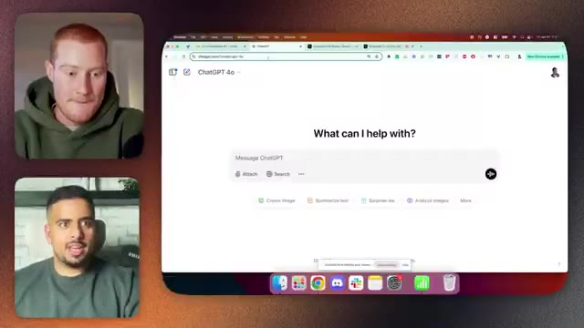
*⏱️ 00:11:32 — Capture d'écran montrant l'interface principale de ChatGPT sur un navigateur web, avec les deux intervenants visibles dans de petites vignettes sur le côté.*

---

### ⏱️ `[00:11:50 - 00:12:27]` | Segment #26

**🔊 Audio (Transcription Intégrale Mot pour Mot en Français) :**
> été réduit à la section de modèle plus petit. Mais oui, vous pouvez rapidement vérifier entre 03 mini et mini high. Si vous posez la même question à mini, disons par exemple comment résoudre le problème de la paix dans le monde, n'est-ce pas, donc celui-ci prendra généralement entre quelques secondes, genre trois secondes à cinq secondes, alors que high donnera généralement un peu plus d'amour, donc si nous allons sur high et que nous commençons une nouvelle discussion, même chose, celui-ci, je l'ai chronométré à environ huit secondes à dix secondes pour terminer ses requêtes généralement

**👁️ Analyse Visuelle d'Écran (gemini-3.5-flash-lite) :**
**Interface & Outils** : Navigateur web (Google Chrome) affichant ChatGPT (chatgpt.com/?model=o3-mini).

**Contenu textuel & Code** : Interface utilisateur de ChatGPT avec la barre de saisie de message et les options de démarrage rapide.

**Action / Démonstration** : Présentation de l'interface du modèle o3-mini de ChatGPT par les intervenants en visioconférence.

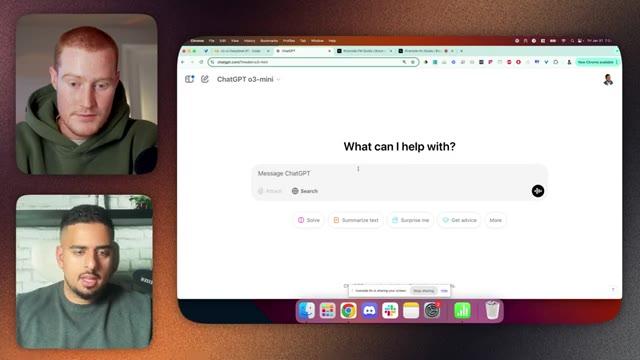
*⏱️ 00:11:59 — Capture d'écran montrant le navigateur avec l'interface de ChatGPT et le sélecteur de modèle o3-mini.*

---

### ⏱️ `[00:12:27 - 00:12:47]` | Segment #27

**🔊 Audio (Transcription Intégrale Mot pour Mot en Français) :**
> Donc un peu plus rapide mais vraiment beaucoup plus lent que le 01 low, mais vous pouvez aussi voir qu'il a réellement réfléchi par rapport à l'autre où c'était presque instantané sur place. Ouais. Je me demande quelle quantité de raisonnement se cache réellement derrière, mais ouais, j'ai fait une petite expérience ici.

**👁️ Analyse Visuelle d'Écran (gemini-3.5-flash-lite) :**
**Interface & Outils** : Navigateur web (Google Chrome) affichant l'interface de ChatGPT et une application de visioconférence (Riverside ou similaire).

**Contenu textuel & Code** : Texte généré par l'IA concernant l'autonomisation des femmes et de la jeunesse, ainsi que des solutions innovantes, avec le sélecteur de modèle "ChatGPT o3-mini-high".

**Action / Démonstration** : Le présentateur commente les résultats textuels générés par le modèle d'IA tout en partageant son écran.

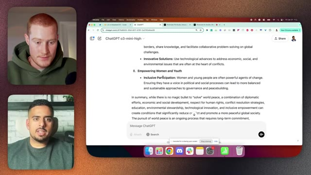
*⏱️ 00:12:32 — Capture d'écran montrant l'interface de ChatGPT (modèle o3-mini-high) affichant un texte sur la paix dans le monde, avec deux intervenants en visioconférence sur le côté gauche.*

---

### ⏱️ `[00:12:47 - 00:13:06]` | Segment #28

**🔊 Audio (Transcription Intégrale Mot pour Mot en Français) :**
> J'étais juste curieux parce qu'ils ont dit qu'à un moment donné, vous pourrez dire à GPT combien de temps il doit réfléchir. Donc en gros, j'ai dit genre : peux-tu réfléchir à la façon de résoudre la faim dans le monde en prenant exactement 20 secondes de réflexion ? Intéressant.

**👁️ Analyse Visuelle d'Écran (gemini-3.5-flash-lite) :**
**Interface & Outils** : Navigateur web affichant l'interface de ChatGPT, avec deux fenêtres de participants visibles sur le côté gauche.

**Contenu textuel & Code** : Prompt utilisateur « how to solve for world peace », bloc de réflexion « Thought about achieving world peace for 9 seconds » détaillant l'analyse de la requête et la construction d'une harmonie globale.

**Action / Démonstration** : Le présentateur présente une démonstration de l'interface de ChatGPT en montrant le processus de réflexion de l'intelligence artificielle.

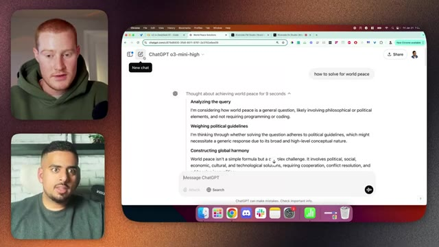
*⏱️ 00:12:52 — Capture d'écran montrant l'interface du navigateur avec ChatGPT (modèle o3-mini-high) affichant le processus de réflexion pour la requête « how to solve for world peace ».*

---

### ⏱️ `[00:13:06 - 00:13:25]` | Segment #29

**🔊 Audio (Transcription Intégrale Mot pour Mot en Français) :**
> et ils vont simplement l'acheminer vers celui qui prendrait 20 secondes. C'est en fait plutôt cool. En fait, il ne va pas faire ça. En fait, il va essayer de retarder sa réponse. Donc, quand je l'ai testé, j'ai dit 15 secondes et ça a fonctionné en retardant. Mais nous verrons s'il fait réellement la même chose ici. Donc je ne pense pas que c'était 20 secondes.

**👁️ Analyse Visuelle d'Écran (gemini-3.5-flash-lite) :**
**Interface & Outils** : Navigateur web affichant l'interface de ChatGPT.

**Contenu textuel & Code** : Prompt utilisateur demandant de résoudre la faim dans le monde en prenant exactement 20 secondes de réflexion, avec le processus de pensée (reasoning) affiché à l'écran.

**Action / Démonstration** : Test du modèle d'IA pour observer sa gestion du temps de réflexion et des délais de réponse.

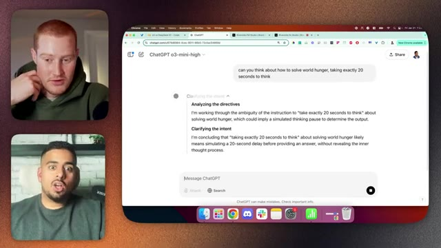
*⏱️ 00:13:10 — Capture d'écran montrant l'interface de ChatGPT avec le modèle o3-mini-high et une conversation en cours.*

---

### ⏱️ `[00:13:25 - 00:13:59]` | Segment #30

**🔊 Audio (Transcription Intégrale Mot pour Mot en Français) :**
> Tu peux voir. Donc si je dis non, 20 secondes, tu dois le faire. C'est vrai. Ça a marché une fois. C'était donc probablement une anomalie que ça ait marché. Voyons voir ici, c'est intéressant, je me demande, ouais, bizarre, je ne sais pas, plus près de 20, non, un peu plus près, mettons 15 secondes, 15 secondes, mais bref, on n'en est donc pas encore là où c'est aussi intelligent, mais euh ouais

**👁️ Analyse Visuelle d'Écran (gemini-3.5-flash-lite) :**
**Interface & Outils** : Navigateur web affichant ChatGPT (modèle o3-mini-high) et l'application d'appel vidéo (Riverside ou similaire).

**Contenu textuel & Code** : Texte de conversation avec ChatGPT contenant un prompt sur l'optimisation des chaînes d'approvisionnement et la sécurité alimentaire, ainsi qu'un message utilisateur disant « no, 20 seconds you have to ».

**Action / Démonstration** : Le présentateur discute de la réponse du modèle et interagit avec l'interface de chat.

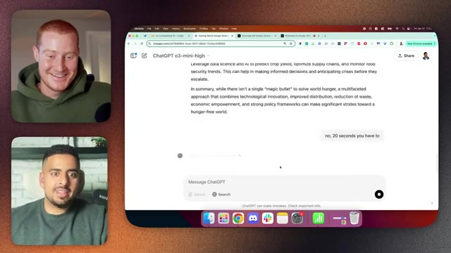
*⏱️ 00:13:33 — Capture d'écran montrant l'interface de ChatGPT o3-mini-high sur un navigateur web, avec deux intervenants en visioconférence à gauche.*

---

### ⏱️ `[00:13:59 - 00:14:35]` | Segment #31

**🔊 Audio (Transcription Intégrale Mot pour Mot en Français) :**
> Tu peux lui poser toutes les questions typiques que les gens veulent lui poser pour genre le troller, mais euh pour moi le plus grand test comme je l'ai dit sera sur les images, parce que je ne sais pas si tu sais ou si ton audience sait, il y a comme certains indices révélateurs d'une vraie compréhension, c'est est-ce que tu peux aller à l'étape suivante au-delà de tes données d'entraînement ? Donc si tu... donc est-ce que je peux donner un exemple ? Ouais, vas-y. D'accord, donc si je demande à GPT "fais-moi une photo d'une montre de luxe", OK, la majorité du temps, elle affichera l'heure.

**👁️ Analyse Visuelle d'Écran (gemini-3.5-flash-lite) :**
**Interface & Outils** : Navigateur web affichant l'interface de ChatGPT et les flux vidéo des participants.

**Contenu textuel & Code** : Texte généré par l'IA concernant la résolution de la faim dans le monde et le temps de réflexion du modèle.

**Action / Démonstration** : Présentation d'une conversation avec le modèle ChatGPT o3-mini-high.

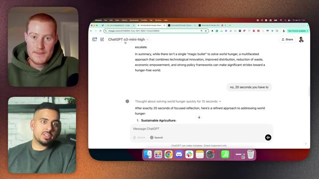
*⏱️ 00:14:08 — Capture d'écran montrant l'interface de ChatGPT avec le modèle o3-mini-high et une discussion textuelle en cours.*

---

### ⏱️ `[00:14:35 - 00:14:57]` | Segment #32

**🔊 Audio (Transcription Intégrale Mot pour Mot en Français) :**
> 10h10, parce que absolument chaque image de montre d'un détaillant sur Google indique 10h10. Intéressant. Voilà, 10h10. Et si vous lui dites littéralement, mets-la à 18h, d'accord, vous obtiendrez 10h10. Pourquoi ? Parce qu'il n'a jamais vu 18h sur une montre dans ses données d'entraînement.

**👁️ Analyse Visuelle d'Écran (gemini-3.5-flash-lite) :**
**Interface & Outils** : Navigateur web affichant l'interface de ChatGPT 4o.

**Contenu textuel & Code** : Génération d'images par IA et prompt textuel « make it 6 pm ».

**Action / Démonstration** : Interaction avec l'outil de génération d'images pour modifier l'heure affichée sur une montre.

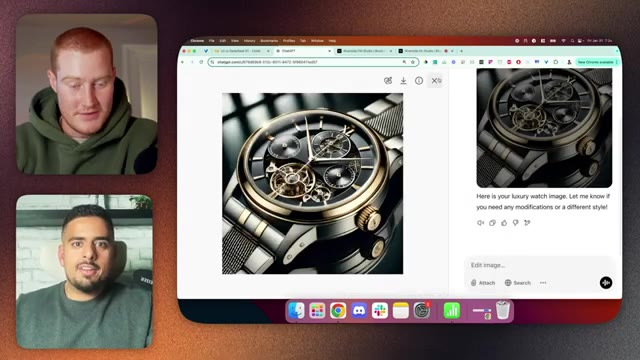
*⏱️ 00:14:46 — Interface ChatGPT affichant l'image générée d'une montre de luxe avec les aiguilles positionnées sur 10h10.*

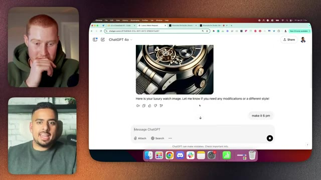
*⏱️ 00:14:51 — Interface ChatGPT montrant la saisie de la consigne textuelle « make it 6 pm » pour modifier l'heure de la montre.*

---

### ⏱️ `[00:14:57 - 00:15:31]` | Segment #33

**🔊 Audio (Transcription Intégrale Mot pour Mot en Français) :**
> Donc pour moi, c'est quelque chose entre guillemets de type-AGI. Il devrait être capable d'aller au-delà de son entraînement et d'extrapoler vers l'étape suivante de la même manière que si vous demandez à beaucoup de modèles, est-ce que vous pouvez faire un euh plombier rouge avec un chapeau rouge venant d'Italie, il va faire Mario de Mario Bros, n'est-ce pas ? Donc ouais, vous allez voir ici, je n'avais jamais vu ce euh ce test, c'est en fait assez intéressant. Ouais, donc pour moi, ils font un battage médiatique fou autour de cet o3, l'o3, le mode pro, n'est-ce pas ? C'est la première chose que je vais faire. Et puis juste après, je vais faire le petit

**👁️ Analyse Visuelle d'Écran (gemini-3.5-flash-lite) :**
**Interface & Outils** : Navigateur web affichant l'interface de ChatGPT (OpenAI) et application de visioconférence.

**Contenu textuel & Code** : Interface web de ChatGPT 4o avec une image générée représentant une montre de luxe sophistiquée de couleur noire et dorée.

**Action / Démonstration** : Présentation et illustration visuelle d'un exemple généré par une intelligence artificielle dans le cadre de la discussion sur les capacités des modèles.

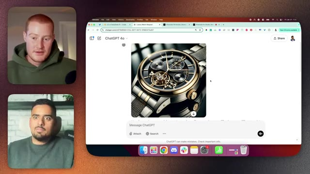
*⏱️ 00:15:06 — Capture d'écran montrant l'interface de ChatGPT 4o affichant l'image générée d'une montre de luxe avec les deux intervenants en visioconférence sur le côté gauche.*

---

### ⏱️ `[00:15:31 - 00:15:59]` | Segment #34

**🔊 Audio (Transcription Intégrale Mot pour Mot en Français) :**
> test de la main, qui est une photo de six doigts. Y a-t-il quelque chose d'atypique dans cette image ? C'est ça. Hein ? Ouais. C'est donc un petit test que nous pouvons exécuter pour vérifier à quel point nous avons progressé. Mais pour l'instant, nous ne pouvons pas le faire parce que c'est... parce que ce n'est qu'une recherche web pour l'instant, comme tu l'as dit. Pour DeepSeek en ce moment, je vais le tester pour la centième fois. Mais si vous allez sur leur API, vous obtiendrez un dauphin disant notre site web. Je n'ai donc jamais pu obtenir ma propre API, alors j'utilise ce service appelé Open Router.

**👁️ Analyse Visuelle d'Écran (gemini-3.5-flash-lite) :**
**Interface & Outils** : Navigateur web Chrome, interface de chat ChatGPT (modèles 4o et o3-mini) sur macOS.

**Contenu textuel & Code** : Interface utilisateur de ChatGPT avec des conversations et des images générées, onglets de navigation ouverts.

**Action / Démonstration** : Présentation et discussion autour de différentes versions de ChatGPT et de tests visuels d'IA.

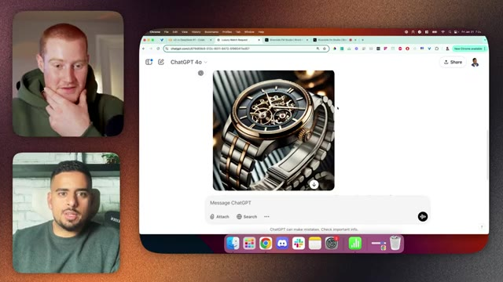
*⏱️ 00:15:38 — Vue d'un navigateur affichant l'interface de ChatGPT 4o avec une image générée d'une montre de luxe, accompagné des flux vidéo des deux intervenants.*

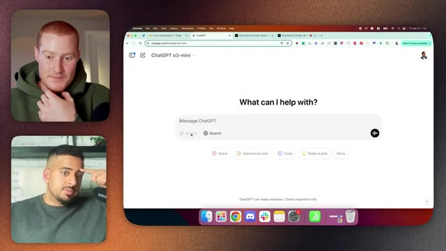
*⏱️ 00:15:45 — Vue de l'interface de ChatGPT o3-mini dans le navigateur web, avec les flux vidéo des deux intervenants dans le coin supérieur et inférieur gauche.*

---

### ⏱️ `[00:16:00 - 00:16:18]` | Segment #35

**🔊 Audio (Transcription Intégrale Mot pour Mot en Français) :**
> Et si vous n'êtes pas familiarisé avec ça, ce n'est pas gratuit. Genre, vous devez mettre des crédits, mais vous pouvez accéder à n'importe quel modèle. Genre, si je rafraîchis et que je vais dans parcourir, vous verrez qu'ils viennent d'ajouter 03 mini. Donc vous pouvez fondamentalement, via une seule API, appeler tous ces modèles. Donc ça prend environ deux jours ouvrés.

**👁️ Analyse Visuelle d'Écran (gemini-3.5-flash-lite) :**
**Interface & Outils** : Navigateur web (Google Chrome) affichant la plateforme OpenRouter (openrouter.ai/deepseek/deepseek-r1).

**Contenu textuel & Code** : Page de présentation du modèle DeepSeek R1 sur OpenRouter, affichant les détails techniques, le nombre de contextes, les coûts par million de tokens et la liste des fournisseurs disponibles.

**Action / Démonstration** : Le présentateur navigue sur la plateforme OpenRouter pour présenter les caractéristiques et les fournisseurs du modèle DeepSeek R1.

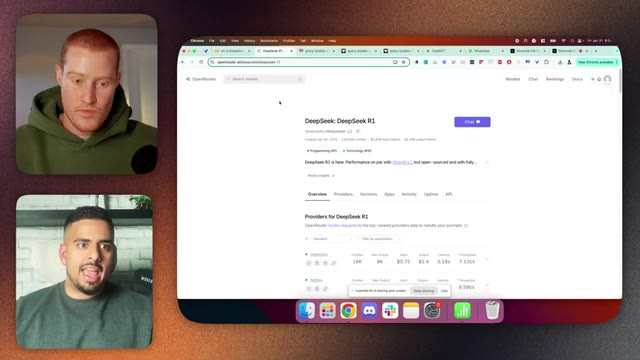
*⏱️ 00:16:04 — Capture d'écran montrant le site OpenRouter avec la page du modèle DeepSeek R1, tandis que deux intervenants apparaissent en incrustation vidéo à gauche.*

---

### ⏱️ `[00:16:20 - 00:16:39]` | Segment #36

**🔊 Audio (Transcription Intégrale Mot pour Mot en Français) :**
> J'exagère, mais vous pouvez utiliser DeepSeek de cette manière. Donc, c'est compris. D'accord. Ouais. Donc ce que j'ai fait, et je ne vais pas effrayer votre public non-technique avec tout un tas de codes. Alors laissez-moi juste cacher tout ça. En fait, laissez-moi juste montrer la partie finale. Tout ce que ça fait, c'est que ça envoie une requête à O3 Mini pour le raisonnement faible, le raisonnement moyen, le fort.

**👁️ Analyse Visuelle d'Écran (gemini-3.5-flash-lite) :**
**Interface & Outils** : Navigateur web Google Chrome affichant la plateforme OpenRouter (ou similaire) listant divers modèles d'intelligence artificielle.

**Contenu textuel & Code** : Liste de modèles d'IA tels que Mistral Small 3, DeepSeek R1 Distill Qwen 32B et Qwen 14B, avec des options de filtrage par modalité, prix et catégorie sur le panneau latéral gauche.

**Action / Démonstration** : Navigation et présentation des différents modèles d'intelligence artificielle disponibles sur la plateforme web.

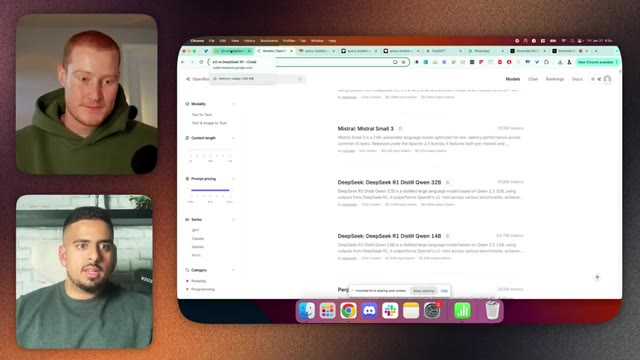
*⏱️ 00:16:25 — Capture d'écran montrant l'intervenant en visioconférence à gauche et un navigateur web à droite affichant une interface de sélection de modèles d'IA.*

---

### ⏱️ `[00:16:39 - 00:17:00]` | Segment #37

**🔊 Audio (Transcription Intégrale Mot pour Mot en Français) :**
> Et ensuite, j'envoie une question à DeepSeek via OpenRouter afin de pouvoir tester les quatre. D'accord. J'ai compris. Donc, notre question initiale que nous avons posée ici était — et je vais juste faire un zoom — : élaborez un plan complet sur la façon de créer une entreprise qui génère un million de dollars de revenus récurrents sans faire de paris, sans faire quoi que ce soit d'illégal ou d'immoral en 90 jours.

**👁️ Analyse Visuelle d'Écran (gemini-3.5-flash-lite) :**
**Interface & Outils** : Google Colab / Navigateur Web (Chrome sur macOS).

**Contenu textuel & Code** : Code Python avec dictionnaires de réponses, structure de données `model_responses` contenant OpenAI o3-mini (Low/Medium/High Reasoning) et DeepSeek-R1 (via OpenRouter), ainsi que des instructions pour générer un tableau structuré avec Pandas.

**Action / Démonstration** : Exécution d'un script Python pour récupérer et afficher les réponses de plusieurs IA à une question sur la création d'entreprise.

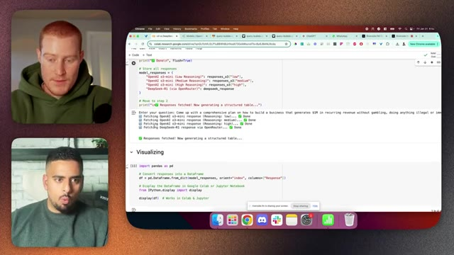
*⏱️ 00:16:44 — Vue d'un Google Colab montrant le code Python et l'exécution de requêtes auprès de différents modèles d'IA (OpenAI o3-mini et DeepSeek-R1 via OpenRouter).*

---

### ⏱️ `[00:17:00 - 00:17:20]` | Segment #38

**🔊 Audio (Transcription Intégrale Mot pour Mot en Français) :**
> Donc c'était un peu comme ma requête de test. Ensuite, j'ai simplement pris les réponses sous forme de tableau ici, et c'est moche à regarder pour votre audience. Donc jetons-y un œil ici. Donc on ne va évidemment pas lire ceci, mais vous pourrez voir que O3 Mini Low Reasoning est raisonnablement détaillé.

**👁️ Analyse Visuelle d'Écran (gemini-3.5-flash-lite) :**
**Interface & Outils** : Google Colab, navigateur web Chrome, tableur (macOS Numbers / Google Sheets).

**Contenu textuel & Code** : Texte généré par des modèles de langage (O3 Mini, DeepSeek R1) affiché sous forme de listes et tableaux détaillés.

**Action / Démonstration** : Le présentateur fait défiler et montre les réponses textuelles longues générées par les différents modèles d'IA.

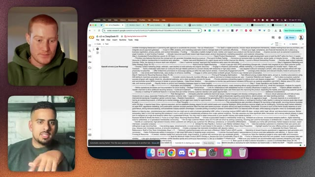
*⏱️ 00:17:05 — Capture montrant Google Colab avec du texte généré par l'IA dense et formaté en tableau ou liste.*

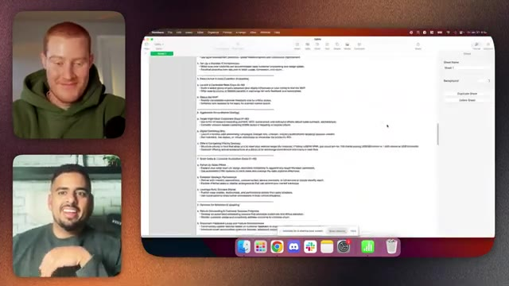
*⏱️ 00:17:10 — Capture montrant une feuille de calcul (Numbers ou Google Sheets) avec des listes textuelles générées par le modèle IA.*

---

### ⏱️ `[00:17:21 - 00:17:42]` | Segment #39

**🔊 Audio (Transcription Intégrale Mot pour Mot en Français) :**
> C'est assez conventionnel. Genre, ça dit simplement : se concentrer sur les secteurs à forte croissance actuelle. Les abonnements de type SaaS constituent une option prometteuse. Ça passe en revue ce à quoi on s'attend. C'est plus détaillé que ne le serait l'O1 Mini, c'est sûr. Une chose à savoir sur ce modèle, c'est qu'il dispose de 200 000 jetons d'entrée que l'on peut fournir, comme contexte.

**👁️ Analyse Visuelle d'Écran (gemini-3.5-flash-lite) :**
**Interface & Outils** : macOS Numbers / Logiciel de tableur

**Contenu textuel & Code** : Texte structuré contenant un plan commercial étape par étape, mentionnant notamment les tendances de marché, les modèles d'abonnement SaaS, et la validation de produit.

**Action / Démonstration** : Présentation et lecture du plan d'affaires généré par l'intelligence artificielle pour la création d'entreprise.

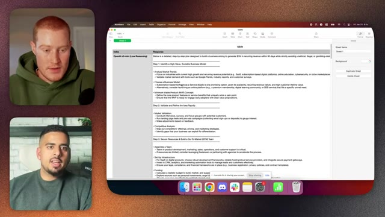
*⏱️ 00:17:26 — Capture d'écran montrant une feuille de calcul macOS Numbers avec un plan détaillé généré par l'IA, aux côtés des flux vidéo des participants.*

---

### ⏱️ `[00:17:43 - 00:18:02]` | Segment #40

**🔊 Audio (Transcription Intégrale Mot pour Mot en Français) :**
> Et il peut en produire 100 000, ce qui est en fait l'un des plus grands que vous puissiez faire en termes de taille de réponse que vous pouvez en tirer. Compris. Pour moyen, vous pouvez littéralement le remarquer. Il commence à changer tout doucement. Nous passons maintenant, au lieu de simples puces et sous-puces, à des A et B avec des sous-puces.

**👁️ Analyse Visuelle d'Écran (gemini-3.5-flash-lite) :**
**Interface & Outils** : Apple Numbers (macOS) et application de visioconférence.

**Contenu textuel & Code** : Document textuel contenant des sections sur le développement commercial ("Step 7. Scale Operations and System Growth", "Automation and Scalability", "Risk Management") et des notes de génération par IA ("OpenAI o3-mini (Medium Reasoning)").

**Action / Démonstration** : Le présentateur partage son écran pour présenter un document structuré généré par une IA de raisonnement.

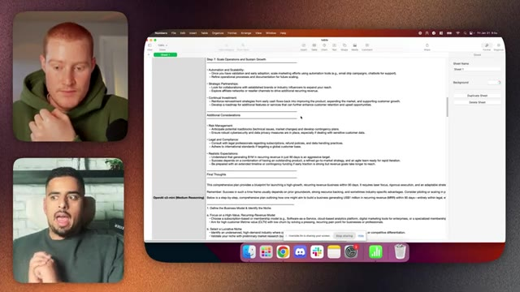
*⏱️ 00:17:48 — Capture d'écran montrant l'application Apple Numbers sur macOS avec un document texte structuré, aux côtés de deux intervenants en visio.*

---

### ⏱️ `[00:18:02 - 00:18:23]` | Segment #41

**🔊 Audio (Transcription Intégrale Mot pour Mot en Français) :**
> Il y a une sorte de forme, c'est juste de manière infime, cette élégance dans la hausse de la réponse. Intéressant. Je me demande quelle part de cela est réellement comme une information intéressante qui est précieuse par opposition à juste comme une information complémentaire. As-tu remarqué que la sortie était en fait plus informative ou était-ce juste en quelque sorte un ensemble de mots supplémentaires ?

**👁️ Analyse Visuelle d'Écran (gemini-3.5-flash-lite) :**
**Interface & Outils** : Apple Numbers / macOS

**Contenu textuel & Code** : Document textuel listant des étapes de stratégie (MVP, Go-to-Market, etc.)

**Action / Démonstration** : Partage d'écran d'un document textuel lors d'une discussion en visioconférence

---

### ⏱️ `[00:18:24 - 00:18:52]` | Segment #42

**🔊 Audio (Transcription Intégrale Mot pour Mot en Français) :**
> Non, non, c'était en fait plus réfléchi. Donc si vous revenez ici une seconde, ici nous parlons du jour 70 à 90, 30 à 70, zéro à 30, d'accord ? Dans ce cas, nous le décomposons, 8 à 25, 25 à 30, 31 à 60, 61 à 90. Donc même dans les horizons temporels et en comprenant que le rythme pourrait être plus complexe et nuancé que de simplement le diviser en plus petits pas, cela me sautait immédiatement aux yeux.

**👁️ Analyse Visuelle d'Écran (gemini-3.5-flash-lite) :**
**Interface & Outils** : Apple Numbers sur macOS, application de visioconférence (type Zoom/Google Meet) avec les participants.

**Contenu textuel & Code** : Texte structuré détaillant différentes phases de développement : "Step 4: Accelerated Product/Service Launch (0-30 Days)", "Step 5: Aggressive Marketing and Sales Strategy (Days 30-70)", et "Step 6: Optimize for Recurring Revenue (Days 70-90)".

**Action / Démonstration** : Le présentateur partage son écran pour expliquer et décomposer les différentes étapes et horizons temporels du plan stratégique affiché dans le tableur.

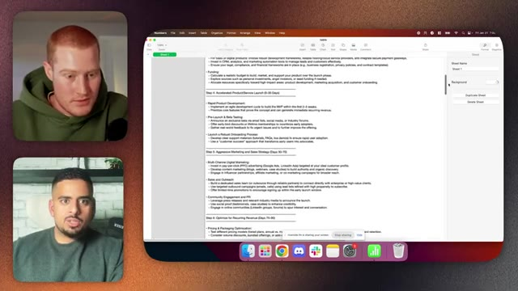
*⏱️ 00:18:31 — Un tableau ou document partagé à l'écran (sur macOS) montrant un plan d'affaires structuré par étapes et horizons temporels, avec deux intervenants visibles en vignettes vidéo sur le côté gauche.*

---

### ⏱️ `[00:18:52 - 00:19:11]` | Segment #43

**🔊 Audio (Transcription Intégrale Mot pour Mot en Français) :**
> Compris. Tout en bas ici, et je vais éviter de faire trop défiler, mais vous avez des considérations clés et des réflexions finales. Donc, il y a en gros un résumé TLDR à la fin, qui est plus significatif que le TLDR passe-partout habituel. Si vous remontez à la réponse précédente ici, allons jusqu'ici.

**👁️ Analyse Visuelle d'Écran (gemini-3.5-flash-lite) :**
**Interface & Outils** : Apple Numbers (macOS)

**Contenu textuel & Code** : Texte d'un plan d'affaires IA (« 10. Prepare for Scale Beyond 90 Days », « Secure Long-Term Contracts », « Key Considerations & Final Thoughts », « Aim High but Be Realistic: Reaching US$1M in MRR in 90 days... »).

**Action / Démonstration** : Revue et explication des réflexions finales et conseils clés figurant au bas du document de stratégie.

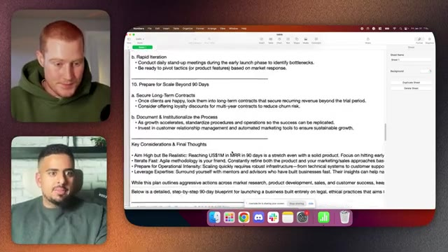
*⏱️ 00:18:57 — Document de plan stratégique ouvert dans l'application Apple Numbers, affichant la section « Key Considerations & Final Thoughts ».*

---

### ⏱️ `[00:19:12 - 00:19:35]` | Segment #44

**🔊 Audio (Transcription Intégrale Mot pour Mot en Français) :**
> Il va simplement dire réflexions finales. C'est un plan complet. Généralement la réponse normale de GPT, c'est du genre, applaudissez-moi. C'est ce que j'ai fait. Par rapport au dernier. Celui-ci me dit, tu sais quoi ? C'est ce dont j'ai parlé TLDR, n'est-ce pas ? Et puis si je vais ici, si je vais au raisonnement élevé, vous remarquerez, qu'est-ce que vous remarquez qui est légèrement différent, même dans la qualité de la réponse ici ?

**👁️ Analyse Visuelle d'Écran (gemini-3.5-flash-lite) :**
**Interface & Outils** : Apple Numbers sur macOS

**Contenu textuel & Code** : Textes et recommandations structurés : "Risk Management", "Legal and Compliance", "Realistic Expectations" et "Final Thoughts" (mentionnant un objectif de 1M$ de revenus récurrents en 90 jours).

**Action / Démonstration** : Présentation et revue des conclusions et résumés (TLDR) d'un plan d'affaires généré par GPT.

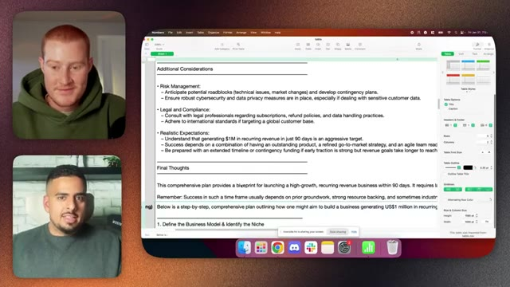
*⏱️ 00:19:18 — Document affiché dans l'application Apple Numbers contenant les sections "Additional Considerations" et "Final Thoughts" d'un plan stratégique généré par IA, à côté des deux présentateurs.*

---

### ⏱️ `[00:19:36 - 00:20:11]` | Segment #45

**🔊 Audio (Transcription Intégrale Mot pour Mot en Français) :**
> Attends, donc c'est le raisonnement le plus élevé ? Le moyen était celui qui montrait les jours. D'accord, voyons voir. Définir une niche. Je veux dire, même là-dedans, ouais. Remarque juste comment euh ça a mis tous les titres en majuscules maintenant, donc c'est genre très tape-à-l'œil, je n'ai pas, c'est ça, ouais, c'est tellement subtil, ça a quand même hérité du A et B qu'on a obtenus du raisonnement moyen, euh et maintenant on est on est à un niveau très bas, on parle de semaines, pas de jours, donc semaine un à deux, semaine un à trois, trois à huit, quatre à huit, huit à douze, donc même la façon dont ça parle de

**👁️ Analyse Visuelle d'Écran (gemini-3.5-flash-lite) :**
**Interface & Outils** : Apple Numbers sur macOS, avec deux participants en visioconférence sur le côté gauche.

**Contenu textuel & Code** : Un document structuré comprenant "OpenAI o3-mini (High Reasoning)" et des sections telles que "1. DEFINE THE NICHE & VALUE PROPOSITION" entièrement en majuscules.

**Action / Démonstration** : Le présentateur commente le formatage du texte généré par l'IA, notamment l'utilisation des majuscules sur les titres.

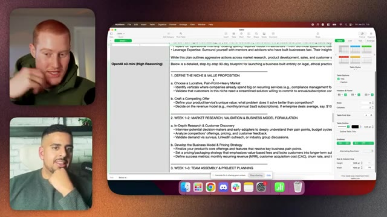
*⏱️ 00:19:45 — Capture d'écran montrant l'application Apple Numbers avec un document texte généré par OpenAI o3-mini (High Reasoning) affichant un plan d'affaires.*

---

### ⏱️ `[00:20:11 - 00:20:50]` | Segment #46

**🔊 Audio (Transcription Intégrale Mot pour Mot en Français) :**
> L'horizon temporel, la plupart des gens ne pensent pas en jours, genre je ne te dis pas « Hé Brock, tu veux faire un autre podcast dans 15 jours ? », je vais plutôt dire « probablement dans deux semaines », ouais ouais. Donc ce sont ces petites nuances ici où, pour moi, c'est comme si on faisait des progrès incrémentaux, je ne dis pas que c'est « entre guillemets » une révolution, et euh tant que je ne vois pas o3 high, ce n'est pas de l'AGI ou quoi que ce soit que les gens veulent appeler AGI, mais c'est définitivement un bond en avant. Et pour moi, genre si on regarde DeepSeek, n'est-ce pas, prenons un peu de recul une seconde. DeepSeek a eu une réponse très intéressante. Donc un plan de 90 jours pour construire ceci.

**👁️ Analyse Visuelle d'Écran (gemini-3.5-flash-lite) :**
**Interface & Outils** : Apple Numbers (tableur macOS) et interface de visioconférence.

**Contenu textuel & Code** : Texte structuré listant les étapes de lancement ("6. WEEK 8-12: OFFICIAL LAUNCH, AGGRESSIVE SALES & SCALING", "7. CRITICAL KPI TRACKING & ITERATIVE OPTIMIZATION") avec des puces détaillant les stratégies commerciales et de suivi des métriques.

**Action / Démonstration** : Partage d'écran du tableur pour illustrer la planification stratégique et les jalons temporels d'un projet.

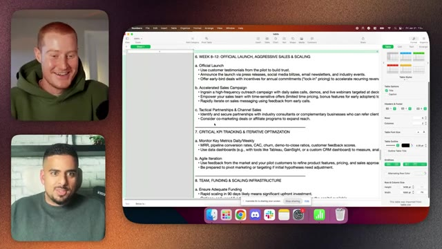
*⏱️ 00:20:21 — Capture d'écran montrant l'application Apple Numbers avec un document texte contenant des plans de lancement de projet et des indicateurs KPI, aux côtés de deux participants en visioconférence.*

---

### ⏱️ `[00:20:50 - 00:21:15]` | Segment #47

**🔊 Audio (Transcription Intégrale Mot pour Mot en Français) :**
> business, éthique, légal, sans jeux d'argent. Donc il reprend ce qui ressort de ma réponse. Il parle du choix de la niche, de la validation de l'audience et du problème. Donc, de manière très intéressante, c'est diagnostique et c'est aussi prescriptif. Il dit donc de mener des entretiens et des sondages auprès de plus de 50 entreprises pour confirmer les points de douleur, d'utiliser LinkedIn, Reddit, les forums du secteur, et de valider la disposition à payer 500 dollars par mois.

**👁️ Analyse Visuelle d'Écran (gemini-3.5-flash-lite) :**
**Interface & Outils** : macOS Numbers / Application de tableur, interface de visioconférence (type Zoom/Google Meet) avec deux participants à gauche.

**Contenu textuel & Code** : Plan détaillé intitulé "90-Day Plan to Build a $1M Recurring Revenue Business" (Ethical, Legal, Non-Gambling), divisé en phases : Phase 1 (Niche Selection, Audience & Problem Validation, Pre-Sell the MVP, Rapid MVP Development) avec des instructions textuelles et des exemples de tarification.

**Action / Démonstration** : Présentation visuelle et partage d'écran d'un document stratégique décrivant la méthodologie de création d'entreprise et de validation de produit.

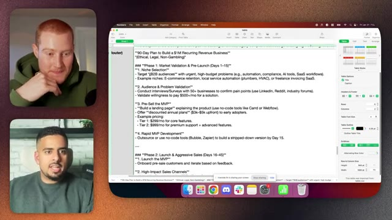
*⏱️ 00:20:56 — Capture d'écran montrant le présentateur et un plan d'affaires structuré affiché sur une feuille de calcul macOS Numbers, détaillant les étapes de validation de marché et de pré-lancement.*

---

### ⏱️ `[00:21:15 - 00:21:44]` | Segment #48

**🔊 Audio (Transcription Intégrale Mot pour Mot en Français) :**
> Personne n'a parlé de 500 dollars et plus par mois, mais c'est sa façon de parler de vente à fort montant, ce qui, selon l'objectif, si nous voulons faire un million de dollars en 90 jours avec 10 000 dollars, j'ai besoin de faire de la vente à fort montant. Ouais. Ce n'est pas si cher que ça, mais ça propose de pré-vendre le PVM. Alors, créez une page de destination. Ça vous dit quels outils utiliser, proposer des forfaits à prix réduit, faire un développement rapide de PVM sur Bubble ou Zapier. Il y a donc quelque chose d'intéressant ici.

**👁️ Analyse Visuelle d'Écran (gemini-3.5-flash-lite) :**
**Interface & Outils** : Application Numbers sur macOS / Logiciel de traitement de texte

**Contenu textuel & Code** : Texte affichant « 90-Day Plan to Build a $1M Recurring Revenue Business », détaillant la phase 1 (Market Validation & Pre-Launch) avec la sélection de niche, la validation de l'audience et la tarification (ex. : $500+/mo, $299/mo, $999/mo).

**Action / Démonstration** : Présentation et explication du plan stratégique pour atteindre un million de dollars de revenus récurrents.

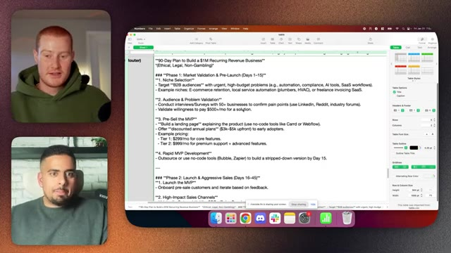
*⏱️ 00:21:22 — Un plan d'affaires détaillé sur 90 jours affiché dans une feuille de calcul ou un traitement de texte, avec les deux présentateurs visibles dans des vignettes sur le côté.*

---

### ⏱️ `[00:21:44 - 00:22:21]` | Segment #49

**🔊 Audio (Transcription Intégrale Mot pour Mot en Français) :**
> Il s'agit en fait de citer des outils où vous remarquerez que, à moins de le demander à GPT ou au modèle d'OpenAI, ils ne se contentent pas de dire comme ça au hasard, va utiliser Zapier, va utiliser Bubble. Ouais, c'est ça, donc euh c'est là encore où mon intérêt pour DeepSeek est intervenu, c'est tellement en marge que ça propose des réponses très nuancées qu'on n'obtient pas avec des réponses plus, comment dire, euh embourgeoisées d'OpenAI et d'Anthropic, donc j'ai compris, je ne vais pas tout passer en revue ici, mais ça parle par exemple des données financières, des risques et des mesures d'atténuation, c'est littéralement genre super détaillé, genre

**👁️ Analyse Visuelle d'Écran (gemini-3.5-flash-lite) :**
**Interface & Outils** : Apple Numbers (tableur macOS), interface de visioconférence (fenêtres des participants).

**Contenu textuel & Code** : Texte structuré contenant des plans de développement MVP ("Outsource or use no-code tools (Bubble, Zapier)"), des étapes de tarification et des stratégies de vente agressive ("Phase 2: Launch & Aggressive Sales").

**Action / Démonstration** : Partage d'écran du présentateur présentant un document de planification textuel généré ou préparé, avec des recommandations d'outils no-code discutées à l'oral.

*⏱️ 00:21:53 — Un écran partagé montrant une application de tableur (Apple Numbers) affichant un document texte planifié avec des outils no-code (Bubble, Zapier, Carrd, Webflow) et des stratégies de lancement, tandis que deux participants apparaissent en vidéo dans de petites fenêtres sur le côté gauche.*

---

### ⏱️ `[00:22:21 - 00:22:57]` | Segment #50

**🔊 Audio (Transcription Intégrale Mot pour Mot en Français) :**
> ce n'est pas réfléchi du tout mais tu peux voir comme il y a une énorme différence en ce moment entre le modèle haut de gamme, même le moyen, et ce que tu obtiens de DeepSeek qui, l'air de rien, a l'air d'être sponsorisé par Bubble Zapier et ouais c'est intéressant donc c'est ce que j'ai fait de ce côté-ci euh évidemment on pourrait poser une autre question si tu en as une en tête euh j'ai aussi essayé de préparer une petite euh interface sur Lovable pour que ouais ça ait l'air un peu joli et que tu puisses juste poser une question comme qu'est-ce que tu penses de l'amour et ça c'est O3-mini c'est euh le modèle de raisonnement moyen

**👁️ Analyse Visuelle d'Écran (gemini-3.5-flash-lite) :**
**Interface & Outils** : Apple Numbers, application de visioconférence.

**Contenu textuel & Code** : Document textuel structuré intitulé "90-Day Plan to Build a $1M Recurring Revenue Business" mentionnant les phases de validation de marché, d'utilisation d'outils no-code (Bubble, Zapier) et des paliers de prix.

**Action / Démonstration** : Le présentateur présente un document textuel détaillé généré par l'IA concernant le développement d'un business plan.

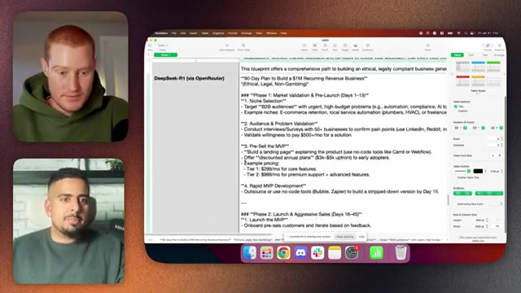
*⏱️ 00:22:30 — Capture d'écran montrant une application de tableur (Apple Numbers) affichant un plan d'affaires généré par DeepSeek-R1 (via OpenRouter), avec deux intervenants en visioconférence sur le côté gauche.*

---

### ⏱️ `[00:22:57 - 00:23:33]` | Segment #51

**🔊 Audio (Transcription Intégrale Mot pour Mot en Français) :**
> et ça c'est comme le raisonnement supérieur si on passe à celui-ci qui est quel est le sens de la vie vous verrez oh oh trois mini le raisonnement est très minime oh trois medium on commence à obtenir un raisonnement plus long que élevé comme un petit livre n'est-ce pas la vie n'est pas si profonde chatgpt mais c'est l'intention euh et puis quand vous arrivez à deepseek vous verrez ici c'est très chatgpt où vous avez le titre ou le sous-titre et ensuite une sorte de présentation ou résumé à propos de

**👁️ Analyse Visuelle d'Écran (gemini-3.5-flash-lite) :**
**Interface & Outils** : Navigateur web (Google Chrome), application Lovable App (preview-query-bubble-platform.lovable.app)

**Contenu textuel & Code** : Comparaison textuelle des réponses générées par le modèle o3-mini avec les paramètres de raisonnement faible et moyen, abordant des perspectives spirituelles, philosophiques et scientifiques.

**Action / Démonstration** : Comparaison visuelle et discussion des différentes profondeurs de raisonnement d'un modèle d'intelligence artificielle.

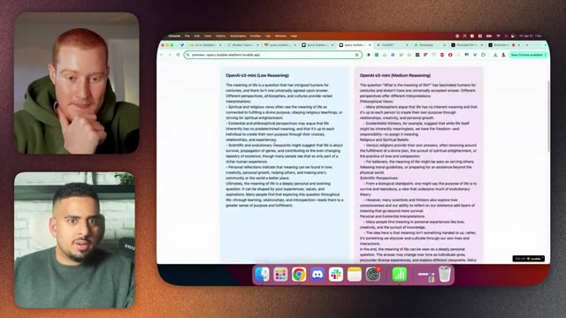
*⏱️ 00:23:06 — Capture d'écran montrant une application web avec deux colonnes comparant les réponses d'OpenAI o3-mini en mode Low Reasoning et Medium Reasoning à la question sur le sens de la vie.*

---

### ⏱️ `[00:23:33 - 00:24:04]` | Segment #52

**🔊 Audio (Transcription Intégrale Mot pour Mot en Français) :**
> ça. Donc rien de trop créatif là-dedans. Ouais. Intéressant. Intéressant. Et pour ça, euh, je veux dire, je suppose que les spectateurs n'ont même pas besoin de le savoir, mais nous allions essayer cette expérience avec cette interface utilisateur que Mark, euh, a créée, mais cependant, l'API DeepSeek ne fonctionnait pas. Donc nous n'avons pas pu, euh, c'est en fait pour cela que nous n'avons pas pu l'essayer, ce qui est dommage, mais tout va bien. Ouais. Genre, même si on pouvait demander, si vous voulez poser une question, euh, je peux en fait le demander à mon script effrayant ici. Donc tout ce que j'ai à faire, c'est juste d'exécuter ce script effrayant. C'est bon.

**👁️ Analyse Visuelle d'Écran (gemini-3.5-flash-lite) :**
**Interface & Outils** : Navigateur web (Google Chrome) affichant une application de test d'IA (interface Lovable.app) et une application de visioconférence.

**Contenu textuel & Code** : Comparaison côte à côte des réponses de deux modèles d'IA : "OpenAI o3-mini (High Reasoning)" à gauche et "DeepSeek-R1 (via OpenRouter)" à droite, répondant à la question sur le sens de la vie.

**Action / Démonstration** : Présentation de l'interface utilisateur développée pour comparer les réponses textuelles de différents modèles d'intelligence artificielle.

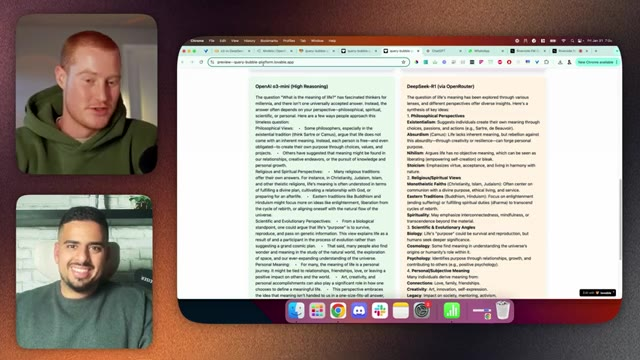
*⏱️ 00:23:40 — Capture d'écran montrant le présentateur et un invité en visioconférence à gauche, et une application web comparative de modèles d'IA à droite.*

---

### ⏱️ `[00:24:04 - 00:24:31]` | Segment #53

**🔊 Audio (Transcription Intégrale Mot pour Mot en Français) :**
> Cool. Donc en fait, on a pris les devants et on a testé ça, et on a demandé à pratiquement tous ces différents modèles ce qu'ils pensent que l'AGI est. Et ensuite, on va vous montrer maintenant une comparaison côte à côte, euh, de ces résultats de tous ces modèles. Ouais. Donc je vais partager mon écran à nouveau ici, et ensuite on a essayé de le rendre aussi lisible que possible. Donc j'ai agrandi un tout petit peu. Et sur le côté gauche, on a DeepSeek, et vous voulez avoir une petite idée de la longueur.

**👁️ Analyse Visuelle d'Écran (gemini-3.5-flash-lite) :**
**Interface & Outils** : Google Docs, navigateur Chrome sur macOS.

**Contenu textuel & Code** : Texte comparatif sur l'Intelligence Artificielle Générale (AGI) : critères clés, généralisation interdomaines, apprentissage autonome, compréhension du contexte et des nuances.

**Action / Démonstration** : Partage d'écran et présentation comparative des résultats des différents modèles sur l'AGI.

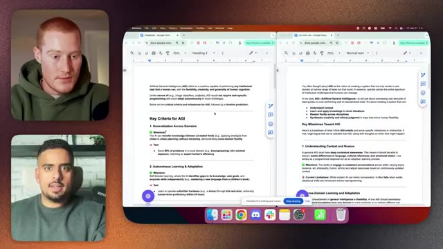
*⏱️ 00:24:24 — Brock Mesarich et Mark Kashef à gauche, et un écran partagé affichant deux documents Google Docs côte à côte comparant les définitions de l'AGI par différents modèles d'IA.*

---

### ⏱️ `[00:24:32 - 00:24:53]` | Segment #54

**🔊 Audio (Transcription Intégrale Mot pour Mot en Français) :**
> Il y a pas mal d'espaces ici, mais ça fait environ quelques pages de long. Ça c'est la réponse basse de O3-mini, aussi longue de quatre pages. Et puis évidemment, ne t'occupe pas des émojis. Ce sont les choses qu'on a imprimées avec ChatGPT, mais je ne sais pas si tu veux jeter un petit coup d'œil, Brock, à ces réponses, en comparant un peu côte à côte.

**👁️ Analyse Visuelle d'Écran (gemini-3.5-flash-lite) :**
**Interface & Outils** : Google Docs dans un navigateur Web (Chrome), macOS Finder/Dock.

**Contenu textuel & Code** : Textes portant sur l'Intelligence Artificielle Générale (AGI), notamment "Key Criteria for AGI", "Generalization Across Domains", et des émojis de validation/texte.

**Action / Démonstration** : Comparaison visuelle de deux documents textuels générés par des IA (DeepSeek et O3-mini) affichés simultanément en plein écran divisé.

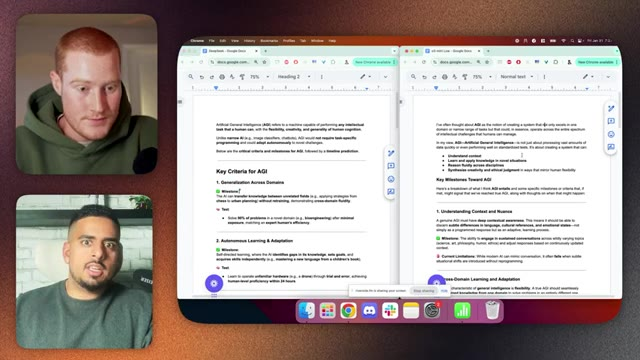
*⏱️ 00:24:37 — Capture d'écran montrant deux documents Google Docs ouverts côte à côte sur un écran d'ordinateur, avec deux personnes visibles dans des fenêtres vidéo sur le côté gauche.*

---

### ⏱️ `[00:24:53 - 00:25:14]` | Segment #55

**🔊 Audio (Transcription Intégrale Mot pour Mot en Français) :**
> Oui, bien sûr. Nous n'avons pas besoin de passer par tout cela, mais évidemment, je pense que ce serait intéressant de parcourir au moins les premiers paragraphes ou quelque chose comme ça. Allons donc sur le côté gauche. Évidemment, l'intelligence artificielle générale, l'IAG, fait référence à une machine capable d'accomplir n'importe quelle tâche intellectuelle qu'un humain peut faire avec la flexibilité, la créativité et la généralité de la cognition humaine.

**👁️ Analyse Visuelle d'Écran (gemini-3.5-flash-lite) :**
**Interface & Outils** : Navigateur web affichant deux fenêtres Google Docs en mode écran partagé.

**Contenu textuel & Code** : Texte portant sur l'IAG (Artificial General Intelligence), avec des sections intitulées 'Key Criteria for AGI', 'Generalization Across Domains', 'Autonomous Learning & Adaptation' et 'Key Milestones Toward AGI'.

**Action / Démonstration** : Le présentateur parcourt et examine le contenu des documents textuels concernant les critères et jalons de l'IAG.

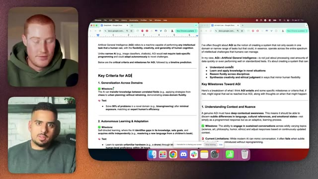
*⏱️ 00:24:59 — Capture d'écran affichant deux documents Google Docs côte à côte avec des notes sur l'Intelligence Artificielle Générale (IAG), aux côtés de deux intervenants en visioconférence.*

---

### ⏱️ `[00:25:14 - 00:25:32]` | Segment #56

**🔊 Audio (Transcription Intégrale Mot pour Mot en Français) :**
> Contrairement à l'IA étroite, par exemple, les classificateurs d'images, les chatbots, l'AGI ne nécessiterait pas de programmation spécifique à une tâche et pourrait s'adapter de manière autonome à de nouveaux défis. Ci-dessous se trouvent nos critères critiques et nos jalons pour l'AGI, suivis d'une prédiction de calendrier. Waouh, cela propose une prédiction de calendrier.

**👁️ Analyse Visuelle d'Écran (gemini-3.5-flash-lite) :**
**Interface & Outils** : Google Chrome (Google Docs), interface de visioconférence (fenêtres des intervenants).

**Contenu textuel & Code** : Texte structuré abordant les critères de l'AGI, notamment la généralisation interdomaines, l'apprentissage autonome, la compréhension du contexte et les jalons associés.

**Action / Démonstration** : Présentation et explication des concepts théoriques liés à l'intelligence artificielle générale à l'aide de notes partagées à l'écran.

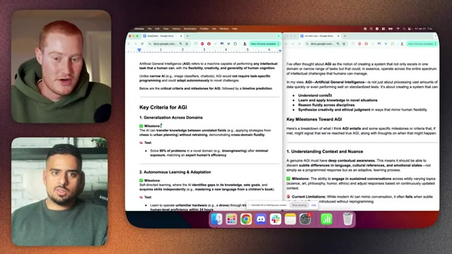
*⏱️ 00:25:19 — Capture d'écran montrant deux documents Google Docs côte à côte traitant des critères clés et des jalons de l'AGI (Artificial General Intelligence), avec deux intervenants en visioconférence sur le côté gauche.*

---

### ⏱️ `[00:25:33 - 00:25:52]` | Segment #57

**🔊 Audio (Transcription Intégrale Mot pour Mot en Français) :**
> Intéressant. Ouais, intéressant. Donc, ça passe par tous les différents domaines qu'il pense devoir être capable de réussir. Waouh, 2040 à 2070. Quoi ? Ça semble très bizarre que ça ait donné une chronologie pour ça. Matériel neuromorphique quantique, architectures hybrides, systèmes neurosymboliques.

**👁️ Analyse Visuelle d'Écran (gemini-3.5-flash-lite) :**
**Interface & Outils** : Navigateur web affichant des documents Google Docs côte à côte, avec les participants en visioconférence sur le côté gauche.

**Contenu textuel & Code** : Texte sur l'AGI (Artificial General Intelligence), sections sur les jalons ("Key Milestones Toward AGI"), l'incarnation ("Embodied Cognition") et une section visible "Timeline Prediction: 2040-2070".

**Action / Démonstration** : Partage d'écran et lecture commentée d'un document texte détaillant les prédictions et étapes clés pour l'AGI.

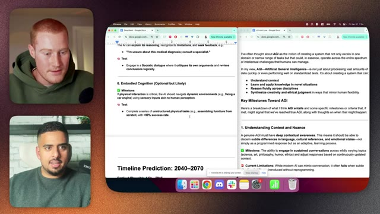
*⏱️ 00:25:38 — Capture d'écran montrant le présentateur à gauche et un document partagé à l'écran avec une chronologie de prédiction (2040-2070).*

---

### ⏱️ `[00:25:53 - 00:26:26]` | Segment #58

**🔊 Audio (Transcription Intégrale Mot pour Mot en Français) :**
> Quoi ? Non, encore une fois, c'est l'une de ces réponses qui, pour moi, est en fait assez nuancée et plus directe, alors que, vous savez, généralement OpenAI va tergiverser sur le comment, le quoi, le pourquoi, ce genre de choses, donc vous voulez lire le côté droit parce que ce côté-ci restera le même alors que nous comparons avec High, mais celui-ci va changer, ouais, c'est sûr, euh, cool, alors maintenant, en passant à o3-mini-low, j'ai pensé à l'AGI comme la notion de créer un système qui non seulement excelle dans un seul domaine ou une gamme restreinte de

**👁️ Analyse Visuelle d'Écran (gemini-3.5-flash-lite) :**
**Interface & Outils** : Google Docs dans un navigateur web sur macOS, affichage de deux fenêtres côte à côte, avec la webcam des participants à gauche.

**Contenu textuel & Code** : Textes structurés sur l'AGI (Artificial General Intelligence), "Timeline Prediction: 2040-2070", "Earliest Plausible AGI: ~2045", "Drivers", "Bottlenecks", et diverses notes analytiques.

**Action / Démonstration** : Le présentateur commente et compare les informations textuelles affichées sur les deux documents à l'écran.

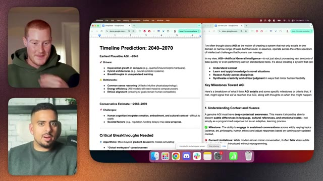
*⏱️ 00:26:01 — Capture d'écran montrant le présentateur à gauche et un écran partagé affichant deux documents Google Docs ouverts côte à côte concernant des prédictions sur l'AGI et des notes textuelles.*

---

### ⏱️ `[00:26:26 - 00:26:52]` | Segment #59

**🔊 Audio (Transcription Intégrale Mot pour Mot en Français) :**
> des tâches qui pourraient, par essence, fonctionner à travers tout un spectre de défis intellectuels que les humains peuvent gérer. Selon moi, l'AGI ne consiste pas seulement à traiter de vastes quantités de données rapidement ou même à performer lors de tests standardisés. Il s'agit de créer un système capable de comprendre le contexte, d'apprendre et d'appliquer des connaissances dans des situations inédites, de raisonner de manière fluide à travers les disciplines, de synthétiser la créativité et le jugement éthique d'une manière qui reflète la flexibilité humaine. Et ensuite, les étapes importantes vers l'AGI encore une fois.

**👁️ Analyse Visuelle d'Écran (gemini-3.5-flash-lite) :**
**Interface & Outils** : Google Docs et fenêtres du navigateur Chrome.

**Contenu textuel & Code** : Texte structuré sur l'AGI, incluant des sections sur la chronologie (Timeline Prediction: 2040–2070), les facteurs moteurs (Drivers), les goulets d'étranglement (Bottlenecks) et les étapes clés (Key Milestones Toward AGI).

**Action / Démonstration** : Le document à l'écran défile ou met en évidence les définitions et les critères de l'intelligence artificielle générale abordés dans la discussion audio.

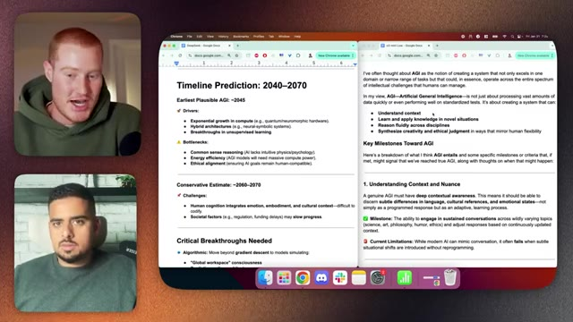
*⏱️ 00:26:32 — Capture d'écran montrant le présentateur à gauche et un document Google Docs ouvert à droite détaillant une prévision de calendrier pour l'AGI (Artificial General Intelligence).*

---

### ⏱️ `[00:26:52 - 00:27:20]` | Segment #60

**🔊 Audio (Transcription Intégrale Mot pour Mot en Français) :**
> Ouais, pareil. Chronologie, évidemment. Quand nous pourrions atteindre ces jalons temporels, donc à court terme, dans les 10 à 20 prochaines années, donc c'est à peu près cohérent là-dessus. C'est ça. À moyen terme, de 20 à 40 ans. Maintenant, un élément qui manque, c'est que ça ne va pas à l'étape suivante, c'est-à-dire qu'ici, ça a généré ce que ça pense dont nous pourrions avoir besoin, par exemple en termes de technologie, pour y arriver.

**👁️ Analyse Visuelle d'Écran (gemini-3.5-flash-lite) :**
**Interface & Outils** : Navigateur Google Chrome affichant des documents Google Docs partagés, interface macOS.

**Contenu textuel & Code** : Texte structuré listant les estimations temporelles : 'Timeline Prediction: 2040–2070', 'Earliest Plausible AGI: ~2045', 'Near-term (Next 10–20 years)', 'Mid-term (20–40 years)' et 'Long-term (40–60+ years)'.

**Action / Démonstration** : Le présentateur commente et analyse les différentes étapes et prédictions de la chronologie affichée à l'écran.

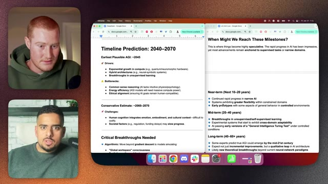
*⏱️ 00:26:59 — Capture d'écran montrant deux documents Google Docs côte à côte avec des prédictions de chronologie pour l'AGI, ainsi que les deux participants de la visioconférence sur le côté gauche.*

---

### ⏱️ `[00:27:21 - 00:27:42]` | Segment #61

**🔊 Audio (Transcription Intégrale Mot pour Mot en Français) :**
> Ici, nous sommes encore conceptuels dans le sens où nous devons passer des versions précoces d'un test de Turing d'intelligence générale tout en restant perspicace, mais c'est encore formulaïque. Il n'y a rien de super spécifique. C'est vrai. Ouais. Cela laisse la situation assez ouverte encore, honnêtement. Ouais. Alors, est-ce que tu veux passer à la version haute 03 ?

**👁️ Analyse Visuelle d'Écran (gemini-3.5-flash-lite) :**
**Interface & Outils** : Navigateur web affichant des documents Google Docs, macOS (Dock visible en bas).

**Contenu textuel & Code** : Texte structuré sur les prédictions d'AGI (Timeline Prediction: 2040–2070, Near-term, Mid-term, Long-term, General Intelligence Turing Test).

**Action / Démonstration** : Les intervenants discutent et parcourent un document de synthèse conceptuel sur l'intelligence artificielle générale.

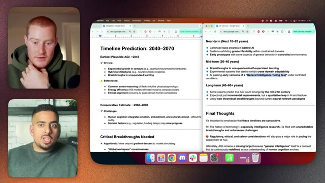
*⏱️ 00:27:26 — Capture d'écran montrant les deux présentateurs en visioconférence à gauche et un document partagé de type Google Docs divisé en deux fenêtres à droite, listant des prédictions de calendrier pour l'AGI de 2040 à 2070.*

---

### ⏱️ `[00:27:42 - 00:28:16]` | Segment #62

**🔊 Audio (Transcription Intégrale Mot pour Mot en Français) :**
> Ouais, faisons ça. On n'a pas besoin de passer par tout ça, évidemment. Très bien. Très bien. Donc allons sur la gauche ici. Même réponse de ce côté-ci à laquelle nous sommes habitués et maintenant nous avons celle-ci maintenant je veux juste faire une petite observation pour le public c'est l'une des premières fois que j'ai vu une réponse revenir avec "j'ai" comme une réponse à la première personne donc encore une fois de petites nuances ici que j'ai remarquées alors que je voyais différentes réponses ouais j'ai un peu remarqué ça quand je lisais j'étais du genre je vois ouais ça faisait un peu bizarre de lire ça à haute voix ouais celle-ci a l'air

**👁️ Analyse Visuelle d'Écran (gemini-3.5-flash-lite) :**
**Interface & Outils** : Google Docs, navigateur Chrome, macOS.

**Contenu textuel & Code** : Texte sur l'intelligence artificielle générale (AGI) avec des sections telles que « Artificial General Intelligence (AGI) refers to... » et « Key Criteria for AGI ».

**Action / Démonstration** : Comparaison visuelle de deux documents textuels affichés simultanément à l'écran par l'intervenant.

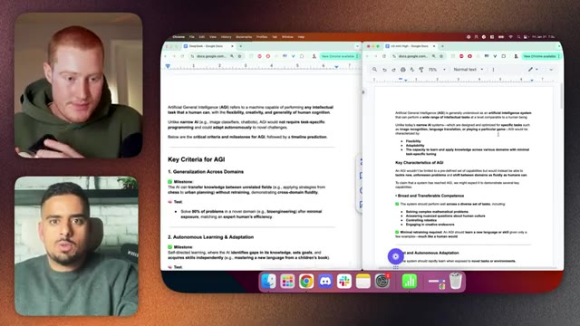
*⏱️ 00:27:51 — Capture d'écran montrant l'écran de l'ordinateur partagé avec deux documents Google Docs ouverts côte à côte, ainsi que les webcams des participants dans des vignettes à gauche.*

---

### ⏱️ `[00:28:16 - 00:28:48]` | Segment #63

**🔊 Audio (Transcription Intégrale Mot pour Mot en Français) :**
> structurellement très similaire pour moi, du genre ce qui m'importe c'est ce qui est tout à la fin, c'est-à-dire que quand on parle de calendriers, ce serait un peu un saut en avant, alors est-ce que ça va si on y va ? Ouais, allons-y, on n'a pas besoin de passer par les... donc on a des défis ici, donc je veux comparer, on a des défis ici parce qu'ici on vient de parler de goulots d'étranglement sur le côté gauche, mais tu avais des goulots d'étranglement ici, mais en termes de faible réponse, on avait juste les critères, on n'avait pas nécessairement de défis.

**👁️ Analyse Visuelle d'Écran (gemini-3.5-flash-lite) :**
**Interface & Outils** : Navigateur web (Google Chrome), Google Docs, appel vidéo montrant deux participants.

**Contenu textuel & Code** : Documents texte intitulés « Artificial General Intelligence (AGI) », détaillant des critères comme « Generalization Across Domains » et « Autonomous Learning & Adaptation ».

**Action / Démonstration** : Le présentateur discute du contenu des documents textuels affichés à l'écran concernant l'AGI et ses prédictions calendaires.

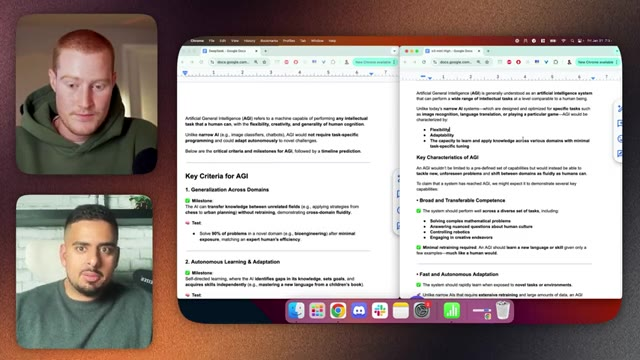
*⏱️ 00:28:24 — Capture d'écran montrant le présentateur à gauche et deux fenêtres de Google Docs divisées à l'écran, affichant du texte sur l'Intelligence Artificielle Générale (AGI), ses critères clés et caractéristiques.*

---

### ⏱️ `[00:28:48 - 00:29:11]` | Segment #64

**🔊 Audio (Transcription Intégrale Mot pour Mot en Français) :**
> Donc maintenant avec high, il considère les différents défis qui surgissent. Intéressant. Donc des avis d'experts divers. Maintenant, quand pourrions-nous l'atteindre ? Donc encore une fois, cela n'a pas changé grand-chose à son évaluation du timing. Rien de trop spécifique sur la technologie, du moins d'après ce que je peux voir ici.

**👁️ Analyse Visuelle d'Écran (gemini-3.5-flash-lite) :**
**Interface & Outils** : Navigateur Google Chrome affichant des documents Google Docs sur macOS.

**Contenu textuel & Code** : Texte structuré sur l'AGI avec des sections comme "Key Criteria for AGI", "Diverse Expert Opinions" et "When Might We Reach AGI?".

**Action / Démonstration** : Le présentateur discute et commente le contenu textuel affiché à l'écran concernant les prédictions et critères de l'AGI.

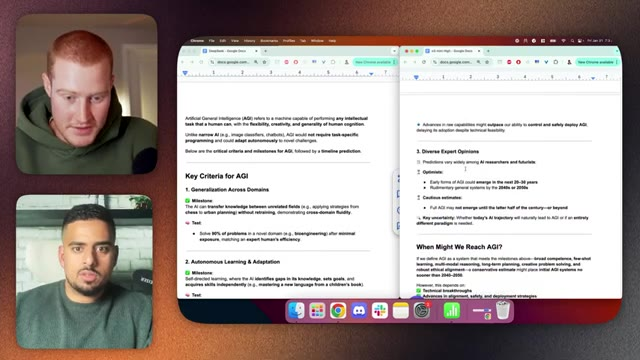
*⏱️ 00:28:54 — Capture d'écran montrant le présentateur à gauche et deux fenêtres Google Docs ouvertes côte à côte sur l'écran principal, affichant du texte sur l'AGI (Artificial General Intelligence).*

---

### ⏱️ `[00:29:12 - 00:29:30]` | Segment #65

**🔊 Audio (Transcription Intégrale Mot pour Mot en Français) :**
> Corrigez-moi si je me trompe. Ouais, je ne sais pas. Quand même, je veux dire, ça a quand même l'air un peu ouvert par rapport à Deep Seek. Ouais.

**👁️ Analyse Visuelle d'Écran (gemini-3.5-flash-lite) :**
**Interface & Outils** : Google Docs, navigateur web Chrome, interface de visioconférence.

**Contenu textuel & Code** : Documents texte sur l'AGI (Artificial General Intelligence), abordant les critères clés comme la généralisation entre domaines, l'apprentissage autonome et les prévisions de calendrier (« When Might We Reach AGI? »).

**Action / Démonstration** : Partage d'écran de documents de recherche ou de notes pendant une discussion en direct entre les deux intervenants.

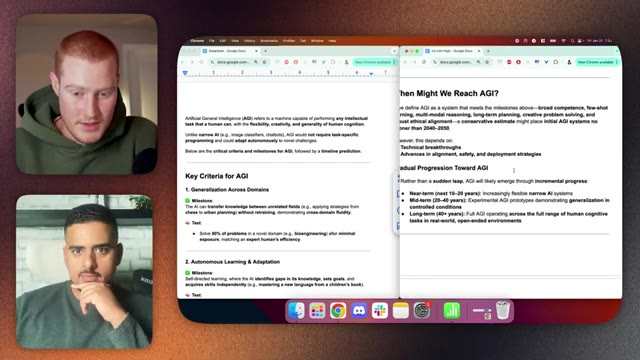
*⏱️ 00:29:16 — Capture d'écran montrant à gauche les deux présentateurs en visioconférence et à droite deux fenêtres de navigateur côte à côte affichant des documents Google Docs sur l'intelligence artificielle générale (AGI).*

---

### ⏱️ `[00:29:30 - 00:29:50]` | Segment #66

**🔊 Audio (Transcription Intégrale Mot pour Mot en Français) :**
> Donc encore une fois, ça dépend de ce que vous cherchez. Par exemple, Deep Seek était relativement assez court et direct. Donc même si vous regardez ici, le raisonnement de bon sens, la compréhension intuitive du monde physique et social, comme la glace fond quand elle est chauffée, le sarcasme dans la conversation.

**👁️ Analyse Visuelle d'Écran (gemini-3.5-flash-lite) :**
**Interface & Outils** : Navigateur Google Chrome affichant Google Docs, interface de visioconférence.

**Contenu textuel & Code** : Texte sur l'AGI, définitions des jalons (Milestones), créativité, innovation, méta-cognition et tests associés.

**Action / Démonstration** : Le présentateur commente le texte affiché à l'écran concernant les critères de l'AGI et les tests de performance.

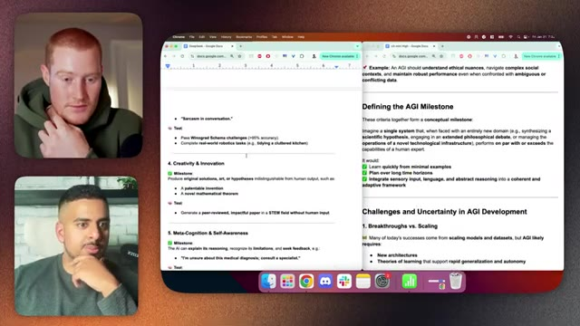
*⏱️ 00:29:35 — Capture d'écran montrant deux fenêtres Google Docs côte à côte avec des notes sur l'AGI et DeepSeek, ainsi que deux présentateurs en visioconférence sur le côté gauche.*

---

### ⏱️ `[00:29:50 - 00:30:26]` | Segment #67

**🔊 Audio (Transcription Intégrale Mot pour Mot en Français) :**
> Il vous donne même des tests ou des défis spécifiques. Donc en disant qu'il devrait être précis à plus de 95 % c'est pourquoi je ne rejette pas entièrement DeepSeek en tant que modèle, car, n'est-ce pas, il offre, à mon avis, un regard plus percutant sur certaines de vos questions que quelque chose de plus formaté. Enfin, je veux en quelque sorte vous poser la question directement, genre, pour une personne non technique, est-il nécessaire de rester à jour, par exemple avec DeepSeek et d'apprendre tout ce que vous devez savoir sur la façon d'utiliser DeepSeek, ou devriez-vous en rester aux modèles traditionnels de ChatGPT ? Paieriez-vous même pour quelque chose comme ChatGPT Pro ? Je suis curieux de connaître votre avis là-dessus.

**👁️ Analyse Visuelle d'Écran (gemini-3.5-flash-lite) :**
**Interface & Outils** : Google Docs ouvert dans le navigateur Chrome sur macOS.

**Contenu textuel & Code** : Texte documentant les critères clés de l'AGI (généralisation inter-domaines, apprentissage autonome, résolution de 90 % des problèmes dans un domaine spécifique).

**Action / Démonstration** : Présentation à l'écran de notes textuelles structurées sur l'AGI pour illustrer la discussion sur les capacités et les tests des modèles d'intelligence artificielle.

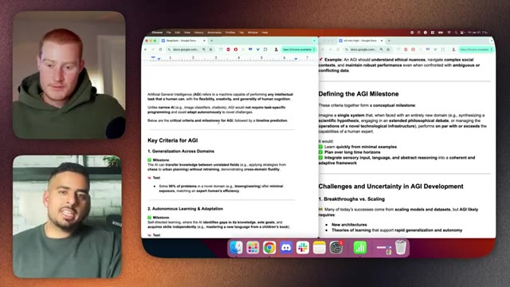
*⏱️ 00:29:59 — Vue partagée montrant à gauche les deux présentateurs et au centre l'écran d'un ordinateur affichant des documents Google Docs liés aux critères et jalons de l'AGI (Artificial General Intelligence).*

---

### ⏱️ `[00:30:26 - 00:30:56]` | Segment #68

**🔊 Audio (Transcription Intégrale Mot pour Mot en Français) :**
> Genre, est-ce que c'est juste genre plonger trop profondément dans ce truc ? Si t'es pas genre, si tu l'utilises juste pour genre t'aider à rendre ta, à rendre ta vie un petit peu plus efficace et productive ? Ouais, c'est une question incroyable. C'est aussi genre une question sur laquelle je ne peux pas être catégorique, mais ça dépend vraiment. Ouais. Ça dépend de l'objectif, non ? Donc si tu es une entreprise et que tu essaies de maximiser ton expérience consommateur, ton expérience de fonctionnalités tout en minimisant les coûts, tu dois en quelque sorte te tenir au courant des choses, non ?

**👁️ Analyse Visuelle d'Écran (gemini-3.5-flash-lite) :**
**Interface & Outils** : Visioconférence / Interface de podcast standard.

**Contenu textuel & Code** : Aucun graphique, code, terminal ou indicateur technique affiché.

**Action / Démonstration** : Conversation en cours entre les deux participants.

---

### ⏱️ `[00:30:56 - 00:31:17]` | Segment #69

**🔊 Audio (Transcription Intégrale Mot pour Mot en Français) :**
> Si vous cherchez à utiliser ce genre de choses dans votre vie de tous les jours, n'est-ce pas, vous pouvez avoir un modèle qui est, entre guillemets, assez bon, ce qui signifie qu'en ce moment, beaucoup de personnes pourraient probablement prendre DeepSeek, télécharger le 14B ou le 32B sur leur ordinateur et faire pas mal de tâches en local assez bien et sans avoir à payer pour quoi que ce soit, n'est-ce pas ?

**👁️ Analyse Visuelle d'Écran (gemini-3.5-flash-lite) :**
**Interface & Outils** : 

**Contenu textuel & Code** : 

**Action / Démonstration** : 

---

### ⏱️ `[00:31:17 - 00:31:36]` | Segment #70

**🔊 Audio (Transcription Intégrale Mot pour Mot en Français) :**
> Il faut donc être très intentionnel quant aux raisons pour lesquelles vous tenez à suivre tout cela. Est-ce que vous tenez à le faire parce que vous voulez faire une vidéo YouTube ? Est-ce que vous tenez à le faire parce que vous voulez économiser des fractions de centime par requête parce que vous avez des millions de requêtes ? Ou simplement par enthousiasme, vous avez envie d'être à la page, n'est-ce pas ?

**👁️ Analyse Visuelle d'Écran (gemini-3.5-flash-lite) :**
**Interface & Outils** : 

**Contenu textuel & Code** : 

**Action / Démonstration** : 

---

### ⏱️ `[00:31:36 - 00:32:13]` | Segment #71

**🔊 Audio (Transcription Intégrale Mot pour Mot en Français) :**
> Mais cela peut être écrasant. Donc tant que vous posez la question, pourquoi est-ce que je me soucie de cette chose qui sort ou comment cela va-t-il changer quoi que ce soit ? si par exemple si o3-mini devient un expert en reconnaissance d'image ou en compréhension, cela va fondamentalement changer beaucoup d'entreprises, imaginez des cas d'utilisation médicale, la radiologie, ce sont des choses qui changent la donne, n'est-ce pas, c'est sûr, si quelque chose est juste meilleur pour aller plus en profondeur comme nous l'avons vu aujourd'hui, nous avons eu des réponses plus profondes, des réponses plus réfléchies, un peu plus de nuance, c'est cool, mais cela ne devrait pas fondamentalement changer quoi que ce soit à ce que vous faites. Ouais, je suis d'accord. Parce que honnêtement,

**👁️ Analyse Visuelle d'Écran (gemini-3.5-flash-lite) :**
**Interface & Outils** : Application de visioconférence ou de podcast en ligne.

**Contenu textuel & Code** : Aucun graphique, code, terminal ou élément technique affiché ; uniquement les intervenants.

**Action / Démonstration** : Discussion entre les intervenants sans démonstration technique ni support visuel pertinent.

---

### ⏱️ `[00:32:13 - 00:32:46]` | Segment #72

**🔊 Audio (Transcription Intégrale Mot pour Mot en Français) :**
> quand nous enregistrions cette vidéo, j'étais encore sur la réserve. Je me dis juste que, une partie de moi, je vois une légère différence dans ces réponses, mais c'est genre, ce n'est pas suffisant pour me faire bondir de mon siège et me dire, eh bien, c'est un truc de fou. Euh, à part comme tu l'as dit, tu sais, ces petits tests, comme quand il peut comprendre et genre réellement générer l'image d'une montre, pas sur dix, dix. Genre, c'est un petit détail où l'on se dit, ok, ça a du sens qu'il y ait un truc qu'il a dû attraper qui n'était pas là avant pour genre ouais ça, ouais et genre pour l'instant ça ne, tu sais, pour moi ça ne me souffle pas l'esprit et peut-être que je ne suis tout simplement pas

**👁️ Analyse Visuelle d'Écran (gemini-3.5-flash-lite) :**
**Interface & Outils** : Visioconférence (aucun graphique, terminal ou code affiché).

**Contenu textuel & Code** : Aucun indicateur technique, code source ou donnée chiffrée.

**Action / Démonstration** : Discussion en visio entre le présentateur et son invité.

---

### ⏱️ `[00:32:46 - 00:33:04]` | Segment #73

**🔊 Audio (Transcription Intégrale Mot pour Mot en Français) :**
> assez technique pour en comprendre les détails, mais ce sont juste mes pensées sur tout ça. Non, je suis d'accord, je pense que le plus grand test sera le vrai modèle o3, comme la version pro. Pour moi, ça se résume toujours aux mathématiques, au codage : est-ce qu'on peut lui donner un problème de mathématiques incroyablement difficile qu'il n'a jamais vu auparavant ? Exactement. Et qu'il le résolve parfaitement.

**👁️ Analyse Visuelle d'Écran (gemini-3.5-flash-lite) :**
**Interface & Outils** : Visioconférence (aucun graphique ni code source affiché).

**Contenu textuel & Code** : Aucun contenu technique, graphique, code ou métrique visible.

**Action / Démonstration** : Conversation entre les intervenants sans manipulation d'interface ou démonstration.

---

### ⏱️ `[00:33:05 - 00:33:24]` | Segment #74

**🔊 Audio (Transcription Intégrale Mot pour Mot en Français) :**
> Mais comme tu l'as dit, je vois toujours ces modèles et de toute façon, petit fait de geek, ces choses s'appellent des transformers à leur niveau le plus bas. Ce sont des perroquets. Ils répètent des choses qu'ils ont déjà vues de différentes manières. Une fois que le perroquet passe à quelque chose qui a sa propre voix et sa propre façon de formuler les choses, c'est là que nous avons une conversation différente.

**👁️ Analyse Visuelle d'Écran (gemini-3.5-flash-lite) :**
**Interface & Outils** : Visioconférence avec cadres de présentation et étiquettes de nom.

**Contenu textuel & Code** : Aucun graphique, indicateur technique ou code source visible.

**Action / Démonstration** : Conversation en direct entre les deux intervenants.

---

### ⏱️ `[00:33:24 - 00:33:51]` | Segment #75

**🔊 Audio (Transcription Intégrale Mot pour Mot en Français) :**
> C'est là qu'on peut utiliser les mots "époustouflant" sans être un vendeur de tapis. Ouais. À 100 %. Ouais, non, c'est génial. Bon, super. Je crois qu'on a fait le tour de tout. Je suis ravi qu'on ait pu t'avoir avec nous et que tu nous expliques tout ça. Je sais que beaucoup de gens se sentent dépassés quand il s'agit de tous ces nouveaux modèles qui sortent. J'espère donc que ça a été une conversation rafraîchissante pour voir au moins quelles sont les différences, si c'est quelque chose dans lequel vous devriez vraiment vous lancer et si ça vaut le coup d'apprendre pour n'importe quel cas d'usage pour lequel vous avez besoin de l'IA dans votre vie.

**👁️ Analyse Visuelle d'Écran (gemini-3.5-flash-lite) :**
**Interface & Outils** : Visioconférence (logiciel d'enregistrement/streaming).

**Contenu textuel & Code** : Aucun graphique, code, terminal ou élément technique visible.

**Action / Démonstration** : Discussion de fin d'entretien entre le présentateur et son invité.

---

### ⏱️ `[00:33:52 - 00:34:10]` | Segment #76

**🔊 Audio (Transcription Intégrale Mot pour Mot en Français) :**
> Tu sais, c'est cool que maintenant nous ayons un modèle de raisonnement avancé avec ChatGPT qui est genre gratuit à utiliser. Je pense que c'est cool. Mais, tu sais, je ne pense probablement pas que ça va changer la vie de plein de gens à l'heure actuelle, tu sais ? Ouais. Mais c'est cool de voir où vont les choses et c'est cool de voir à quelle vitesse ce paysage évolue. Mais ouais. Ouais.

**👁️ Analyse Visuelle d'Écran (gemini-3.5-flash-lite) :**
**Interface & Outils** : Visioconférence (aucun graphique ni code source visible).

**Contenu textuel & Code** : Aucun indicateur technique ou code source présent.

**Action / Démonstration** : Discussion entre les intervenants sans manipulation d'outils techniques.

---

### ⏱️ `[00:34:10 - 00:34:44]` | Segment #77

**🔊 Audio (Transcription Intégrale Mot pour Mot en Français) :**
> Et la dernière chose à mettre sur le radar des gens, c'est qu'on n'a pas entendu parler d'Anthropic depuis longtemps. On n'a pas entendu parler de Meta depuis longtemps. Donc, personnellement, je m'attends à ce que dans les un à deux prochains mois, on voie débarquer Claude 4 ou Meta 4... ou Llama 4 plutôt. Donc ça ne va faire que devenir de plus en plus écrasant à partir de maintenant, parce que la course aux armements est vraiment devenue du du pareil au même maintenant. C'est sûr. Et personnellement, j'adore toujours Claude 3.5 Sonnet pour vous aider à rédiger du contenu et des choses comme ça. C'est mon outil de prédilection ces derniers temps. Donc, je ne sais pas. Ça va être intéressant quand ils vont sortir, vous savez, le quatre potentiellement. Ouais. Et on sera là pour ça. On le sera.

**👁️ Analyse Visuelle d'Écran (gemini-3.5-flash-lite) :**
**Interface & Outils** : Application de visioconférence ou interface vidéo en écran partagé.

**Contenu textuel & Code** : Aucun graphique, code, terminal ou élément technique visible.

**Action / Démonstration** : Conversation vidéo entre les intervenants.

---

### ⏱️ `[00:34:44 - 00:35:21]` | Segment #78

**🔊 Audio (Transcription Intégrale Mot pour Mot en Français) :**
> Super, Mark. On a fait quelques podcasts ensemble. Je suis sûr qu'on va continuer à en faire. Je pense que c'est rafraîchissant pour mon audience d'avoir un expert sur la chaîne pour nous guider à travers ces différents concepts. Où est-ce que les gens peuvent te trouver, tu sais, parce que si les gens aiment le type de contenu que tu fais, euh, la façon dont tu parles dans ces épisodes de podcast, peut-être qu'ils ont envie d'en savoir plus sur toi. Alors, donne-nous un bref aperçu de l'endroit où ils peuvent te trouver. J'en doute. Mais, euh, si tu veux vraiment aller plus loin, alors oui, tu peux me suivre sur Mark underscore cash sur YouTube. Euh, si tu es un leader d'entreprise, un propriétaire d'entreprise, un cadre dirigeant, j'ai une communauté qui va sortir. C'est une communauté payante, euh, principalement

**👁️ Analyse Visuelle d'Écran (gemini-3.5-flash-lite) :**
**Interface & Outils** : Visioconférence

**Contenu textuel & Code** : Aucun graphique, code ou élément technique affiché.

**Action / Démonstration** : Discussion de fin de podcast entre l'animateur et son invité.

---

### ⏱️ `[00:35:21 - 00:35:39]` | Segment #79

**🔊 Audio (Transcription Intégrale Mot pour Mot en Français) :**
> pour les propriétaires d'entreprise qui sont hyper sérieux à l'idée de, vous savez, non seulement regarder tout ça, mais de l'intégrer dans leur entreprise. Ça s'appelle la communauté des early AI doctors, jeu de mots voulu. Donc ouais, si ça vous intéresse, allez jeter un œil, c'est sûr. J'adorerais vous compter parmi nous et ouais, rejoignez la liste d'attente si ça vous intéresse. Cool. Cool. C'est génial, Mark.

**👁️ Analyse Visuelle d'Écran (gemini-3.5-flash-lite) :**
**Interface & Outils** : Visioconférence

**Contenu textuel & Code** : Aucun graphique, code, terminal ou élément technique visible.

**Action / Démonstration** : Conversation et présentation des intervenants sans démonstration technique.

---

### ⏱️ `[00:35:39 - 00:35:45]` | Segment #80

**🔊 Audio (Transcription Intégrale Mot pour Mot en Français) :**
> Je suis ravi de t'avoir reçu à nouveau. J'apprécie que tu aies pris le temps, mec. Et on se revoit bientôt. À bientôt. Ouais. Salut.

**👁️ Analyse Visuelle d'Écran (gemini-3.5-flash-lite) :**
**Interface & Outils** : Visioconférence avec cadres arrondis et étiquettes nominatives.

**Contenu textuel & Code** : Aucun graphique, code, terminal ou élément technique n'est présent.

**Action / Démonstration** : Conversation finale et salutations de fin d'épisode entre le présentateur et l'invité.

---

