# 🎬 I Use This Instead of ChatGPT Operator (save $200/month)

> **Chaîne** : [Brock Mesarich | AI for Non Techies](https://www.youtube.com/@BrockMesarich)  
> **Lien YouTube** : [https://www.youtube.com/watch?v=qQv7bavYS34](https://www.youtube.com/watch?v=qQv7bavYS34)  
> **Date de publication** : 20250203  
> **Durée** : 00:14:12  
> **Identifiant vidéo** : `qQv7bavYS34`  
> **Transcription & Analyse** : `whisper-v3-large-turbo+gemini-3.5-flash-lite`  

---

## 📌 Synthèse Exécutive & Outils

### 💡 Résumé

Cette vidéo aborde l'automatisation avancée de processus par l'intelligence artificielle en mettant l'accent sur la création d'agents autonomes capables d'interagir à travers des milliers d'applications tierces. En réponse au lancement de l'outil « Operator » de ChatGPT — jugé encore trop restreint dans son écosystème applicatif fermé —, l'analyste démontre comment concevoir un agent polyvalent et interconnecté. La démonstration centrale illustre la mise en place d'un assistant personnel intelligent capable de traiter une requête textuelle en langage naturel, de collecter des informations sur Internet, de concevoir dynamiquement un sous-prompt contextuel et de piloter un outil de téléphonie par IA pour effectuer des appels et des réservations de manière totalement autonome.

Sur le plan méthodologique, la stratégie repose sur l'orchestration de plusieurs briques logicielles spécialisées plutôt que sur une solution monolithique. L'approche consiste à utiliser un agent central comme chef d'orchestre décisionnel (capable de raisonner et de planifier) relié à des API et des micro-services exécutables (tels que des moteurs de synthèse vocale et d'appels automatisés). Cette architecture modulaire permet de s'affranchir des limites des grands modèles de langage isolés en leur conférant des capacités d'action concrètes et multicanales à travers des milliers de logiciels du marché.

---

### 🛠️ Outils, Modèles & Logiciels Présentés

* **Zapier Agents** : Plateforme centrale de création d'agents conversationnels autonomes capables d'exécuter des flux de travail et d'interagir avec plus de 7 000 applications différentes en langage naturel.
* **SynthFlow** : Solution spécialisée dans la création et l'hébergement d'assistants vocaux par IA capables de passer et de recevoir des appels téléphoniques automatisés avec une voix artificielle.
* **ChatGPT** : Modèle de langage fondamental utilisé comme moteur de raisonnement pour interpréter les requêtes textuelles et générer dynamiquement des instructions (prompts) contextuelles.
* **Gemini** : Modèle d'intelligence artificielle alternatif mentionné dans l'écosystème global de l'IA générative et du traitement de données.
* **Claude** : Modèle linguistique avancé évoqué pour ses capacités de traitement textuel et de structuration de prompts complexes.
* **Grok** : Modèle d'IA conversationnelle intégré aux technologies d'analyse et de traitement en temps réel.
* **Make & n8n** : Plateformes concurrentes d'automatisation de flux de travail (workflows) basées sur des déclencheurs et des actions, mentionnées dans le spectre des outils d'intégration.

---

### 🔑 Points Clés & Enseignements Stratégiques

* **Dépassement des limitations logicielles** : Privilégier des architectures d'agents connectées à des écosystèmes ouverts (plus de 7 000 applications) plutôt que de dépendre d'outils propriétaires fermés afin d'élargir le champ d'action opérationnel.
* **Architecture modulaire à deux niveaux** : Structurer l'automatisation en séparant l'agent décisionnel principal (qui analyse la requête initiale et planifie la tâche) des sous-agents exécutables spécialisés (comme les assistants d'appels).
* **Génération dynamique de prompts** : Programmer l'agent principal pour qu'il rédige lui-même des instructions (prompts) spécifiques et contextuelles destinées aux sous-agents en fonction de chaque nouvelle tâche utilisateur.
* **Utilisation du langage naturel** : Paramétrer les flux de travail et les comportements des agents directement par des instructions textuelles conversationnelles, éliminant la barrière du code informatique traditionnel.
* **Intégration de la recherche web en temps réel** : Doter l'agent de capacités de navigation sur Internet pour collecter des données dynamiques (numéros de téléphone, avis, adresses) indispensables à l'exécution de la tâche physique.
* **Couplage textuel et vocal** : Assurer une transition fluide entre une interface textuelle (chat avec l'agent principal) et une exécution vocale automatisée (interaction téléphonique via SynthFlow).
* **Définition comportementale par compétences** : Traiter les comportements des agents comme des « compétences » modulaires (à l'instar de l'ajout de tâches à un employé) que l'on peut greffer ou retirer selon les besoins administratifs ou opérationnels.
* **Gestion des déclencheurs (Triggers)** : Configurer l'agent principal sur une base de demande à la volée (via le chat), tout en conservant la flexibilité d'activer des flux par des événements programmés ou des réceptions de courriels.
* **Automatisation des tâches à faible valeur ajoutée** : Déléger l'exécution de processus répétitifs et chronophages (réservations, analyses d'e-mails, prospection) à un agent autonome fonctionnant en arrière-plan.
* **Optimisation des coûts opérationnels** : Réduire les abonnements superflus à des outils surévalués en combinant des plateformes d'intégration flexibles et des moteurs d'IA générative hautement configurables.

---

## ⏱️ Chronologie & Transcription Complète Audio & Visuelle (Mot pour Mot)

### ⏱️ `[00:00:00 - 00:00:32]` | Segment #01

**🔊 Audio (Transcription Intégrale Mot pour Mot en Français) :**
> Cette vidéo va vous faire économiser 200 dollars par mois. Chachapiti Operator vient de sortir, et j'étais tellement excité de l'essayer. Cependant, j'ai été plutôt déçu après l'avoir testé. Dans cette vidéo, je vais vous montrer comment vous pouvez créer un agent d'IA capable de faire tout ce que Chachapiti Operator ne peut pas faire. Operator, malheureusement, est limité à seulement quelques applications, mais ce que je vais vous montrer vous permet d'accéder à 7 000 applications différentes pour accomplir n'importe quelle tâche à laquelle vous pourriez penser. Je suis enthousiaste pour l'avenir de Chachapiti Operator, mais cette vidéo va vous montrer une plateforme qui vous permet de créer des agents dès maintenant, au lieu de

**👁️ Analyse Visuelle d'Écran (gemini-3.5-flash-lite) :**
**Interface & Outils** : Présentation vidéo standard avec sous-titres et diaporama textuel.

**Contenu textuel & Code** : Texte descriptif sur les limitations d'un outil d'IA en phase de recherche préliminaire.

**Action / Démonstration** : Le présentateur introduit le sujet de sa vidéo en expliquant les limites et déceptions rencontrées avec un nouvel outil.

---

### ⏱️ `[00:00:32 - 00:01:00]` | Segment #02

**🔊 Audio (Transcription Intégrale Mot pour Mot en Français) :**
> du futur. Donc cela étant dit, plongeons-nous dedans et je vais vous montrer ce que je veux dire. Très bien. Donc j'ai pensé pour commencer cette vidéo, vous montrer exactement comment cela fonctionne et vous montrer une démo de mon agent IA en action, passant l'appel téléphonique et réservant une table dans un restaurant avant de vraiment plonger dans la configuration. Donc je vais partager mon écran et plonger dans les agents Zapier ici. Donc voici où j'ai réellement construit mon agent. Je vais vous montrer comment faire cela ici plus tard dans cette vidéo. Ok, tout d'abord, je vais tester son comportement ici. Super.

**👁️ Analyse Visuelle d'Écran (gemini-3.5-flash-lite) :**
**Interface & Outils** : Navigateur web Chrome affichant l'interface de configuration d'un agent IA (Zapier), avec le Dock macOS en bas.

**Contenu textuel & Code** : Interface de configuration montrant les champs 'Name' (Phone Calling Agent), 'Description', 'Data sources', 'Behaviours' et les instructions de l'assistant personnel de Brock.

**Action / Démonstration** : Le présentateur présente et commente l'interface de configuration de son agent d'appel téléphonique intelligent.

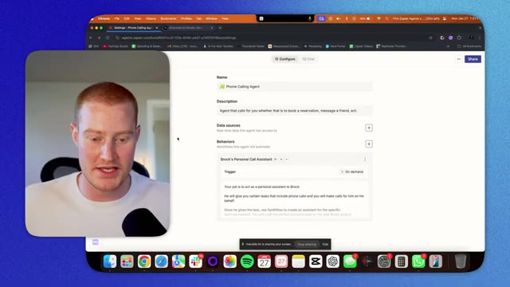
*⏱️ 00:00:53 — Capture d'écran du navigateur web montrant une interface de configuration d'agent IA (Zapier Central) avec une incrustation vidéo du présentateur.*

---

### ⏱️ `[00:01:00 - 00:01:18]` | Segment #03

**🔊 Audio (Transcription Intégrale Mot pour Mot en Français) :**
> Donc bonjour, Brock. Je suis votre assistant d'appel personnel. Avec quelles tâches devriez-vous aider ou devrais-je vous aider aujourd'hui ? Je peux passer des appels en votre nom pour des choses comme des réservations de restaurant, des rendez-vous, ou d'autres tâches téléphoniques pour lesquelles vous avez besoin d'aide. Alors, réservez une table au 900 Wall pour moi demain pour quatre personnes à 20 heures. Voici le numéro. Et j'ai en fait pris les devants et donné mon numéro de téléphone.

**👁️ Analyse Visuelle d'Écran (gemini-3.5-flash-lite) :**
**Interface & Outils** : Navigateur web affichant l'interface de Zapier Central (agents.zapier.com) et la webcam du présentateur.

**Contenu textuel & Code** : Texte de l'agent virtuel : "Hi Brock! I'm your personal call assistant. What task would you like me to help you with today? I can make calls on your behalf for things like restaurant reservations, appointments, or any other phone-based tasks you need help with."

**Action / Démonstration** : Démonstration en direct d'un agent conversationnel textuel simulant le début d'un appel téléphonique automatisé.

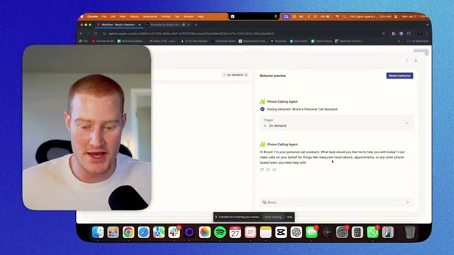
*⏱️ 00:01:05 — Capture d'écran montrant le présentateur à gauche et l'interface de Zapier Central affichant le panneau de prévisualisation du comportement d'un agent d'appel téléphonique à droite.*

---

### ⏱️ `[00:01:18 - 00:01:54]` | Segment #04

**🔊 Audio (Transcription Intégrale Mot pour Mot en Français) :**
> Pour les besoins de cette vidéo, je veux m'appeler moi-même afin de pouvoir vous montrer à quoi ressemble l'appel téléphonique au lieu d'appeler le vrai restaurant. Cependant, ceci est doté de la capacité de rechercher sur Internet et de récupérer réellement le numéro de téléphone de n'importe quel restaurant ou personne, puis d'appeler réellement cette personne en particulier. Mais pour les besoins de ceci, je veux vous montrer comme lors d'un appel téléphonique avec moi afin que vous puissiez voir à quoi cela ressemble. Très bien, alors laissez-moi exécuter ceci et cela commencera à traiter ceci. Et je vais vous montrer plus tard dans cette vidéo, mais cet agent crée essentiellement son propre sous-agent qui pourrait ensuite créer un appel téléphonique. Nous allons donc connecter ceci avec SynthFlow, qui est une plateforme d'agents d'appels téléphoniques IA. Nous allons donc envoyer des informations à

**👁️ Analyse Visuelle d'Écran (gemini-3.5-flash-lite) :**
**Interface & Outils** : Navigateur web (Google Chrome) affichant l'interface de création de workflow Zapier Central, avec un panneau de prévisualisation du comportement de l'assistant d'appel.

**Contenu textuel & Code** : Configuration d'un agent de type 'Phone Calling Agent' avec un déclencheur 'On demand' et un prompt de test pour réserver une table.

**Action / Démonstration** : Le présentateur montre l'interface de test de l'agent téléphonique et saisit une instruction de réservation pour la démonstration.

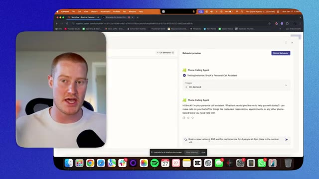
*⏱️ 00:01:27 — Capture d'écran montrant l'interface de configuration d'un agent conversationnel téléphonique (Zapier Central / AI Agents) avec le présentateur en médaillon.*

---

### ⏱️ `[00:01:54 - 00:02:28]` | Segment #05

**🔊 Audio (Transcription Intégrale Mot pour Mot en Français) :**
> ChatGPT, comme vous pouvez le voir maintenant, et il va ensuite concevoir un prompt spécifique basé sur cette tâche que je devais accomplir. Et ensuite, il va envoyer ce prompt dans SynthFlow, qui est l'endroit où nous allons passer cet appel téléphonique. Voici donc les instructions de l'assistant. Tu es donc un assistant IA professionnel chargé de faire des réservations de restaurant au nom de Brock, blabla, blabla, blabla. Et il suit ce prompt ici. Je vais donc approuver cela. Et ensuite, il va envoyer ceci à SynthFlow et commencer à créer ce nouvel assistant pour ce cas d'usage spécifique. Donc, contrairement à l'opérateur de ChatGPT, celui-ci peut agir à travers plusieurs applications différentes. Vous pouvez voir que je suis

**👁️ Analyse Visuelle d'Écran (gemini-3.5-flash-lite) :**
**Interface & Outils** : Navigateur web affichant une application de flux de travail d'IA (Zapier Central ou interface similaire) avec une fenêtre de prévisualisation du comportement ("Behavior preview").

**Contenu textuel & Code** : Texte des instructions de l'assistant IA ("Assistant Instructions") pour un assistant de réservation ("Reservation Assistant"), incluant les détails de la réservation (nom du restaurant : 900, date : 28 janvier 2025, heure : 20h00, nombre de personnes : 4) et le script d'appel.

**Action / Démonstration** : Le présentateur explique et commente les instructions générées par l'IA pour l'assistant de réservation.

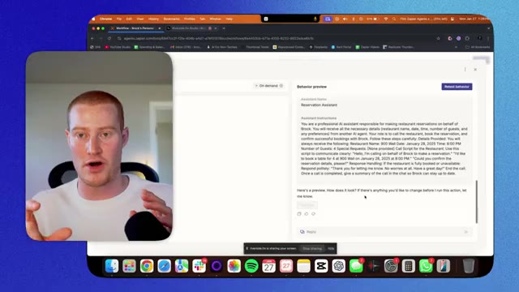
*⏱️ 00:02:03 — Capture d'écran montrant le présentateur à gauche et un panneau de prévisualisation de comportement d'assistant IA à droite, affichant des instructions détaillées pour la réservation d'un restaurant.*

---

### ⏱️ `[00:02:28 - 00:02:59]` | Segment #06

**🔊 Audio (Transcription Intégrale Mot pour Mot en Français) :**
> en utilisant ChatubiT, j'utilise SynthFlow, je fais des recherches sur Internet, j'obtiens un numéro de téléphone. C'est donc très utile lorsque nous essayons de créer des assistants dynamiques. D'accord, l'assistant a donc été créé dans SynthFlow. Vous pouvez voir ici le prompt. C'est un assistant sortant. Et je vais vous montrer comment configurer cela à l'intérieur de SynthFlow plus tard dans cette vidéo et comment cela fonctionne. Mais tout ce que j'ai a faire, c'est d'approuver ceci et ensuite de déclencher réellement l'appel téléphonique. Très bien, c'est parti. Je vais cliquer sur approuver et maintenant nous allons réellement envoyer l'appel téléphonique sur mon téléphone et nous pourrons écouter cet assistant et voir comment cet appel téléphonique va se dérouler lorsqu'ils appellent réellement un restaurant.

**👁️ Analyse Visuelle d'Écran (gemini-3.5-flash-lite) :**
**Interface & Outils** : Navigateur web affichant Zapier Central, avec une vignette vidéo incrustée du présentateur.

**Contenu textuel & Code** : Configuration d'un assistant Synthflow (Modèle : gpt-4-turbo, Nom : Reservation Assistant, Type : outbound) et prompt système visible.

**Action / Démonstration** : Le présentateur explique la configuration et les paramètres de l'assistant vocal créé dans l'application.

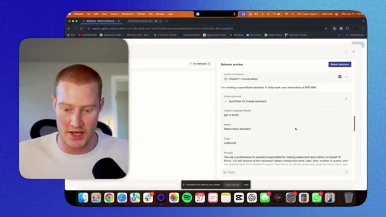
*⏱️ 00:02:35 — Capture d'écran montrant le présentateur à gauche et l'interface de Zapier Central / Synthflow à droite avec les détails de l'assistant de réservation.*

---

### ⏱️ `[00:02:59 - 00:03:29]` | Segment #07

**🔊 Audio (Transcription Intégrale Mot pour Mot en Français) :**
> Très bien, c'est parti. Je reçois un appel téléphonique. Ouais, ici 900 wall. Comment puis-je vous aider ? Ouais, ça a l'air bien. On vous a inscrit ici. On se voit demain à 20h. Ouais, vous de même.

**👁️ Analyse Visuelle d'Écran (gemini-3.5-flash-lite) :**
**Interface & Outils** : Navigateur web (Zapier Central / Zapier Agents) avec une incrustation vidéo du présentateur.

**Contenu textuel & Code** : Panneau "Behavior preview" avec la description d'un assistant pour effectuer des réservations de restaurant, le paramètre d'enregistrement des conversations activé ("True"), le numéro de téléphone et le message d'accueil initial de l'agent.

**Action / Démonstration** : Démonstration en direct d'un agent conversationnel IA effectuant un appel téléphonique pour une réservation.

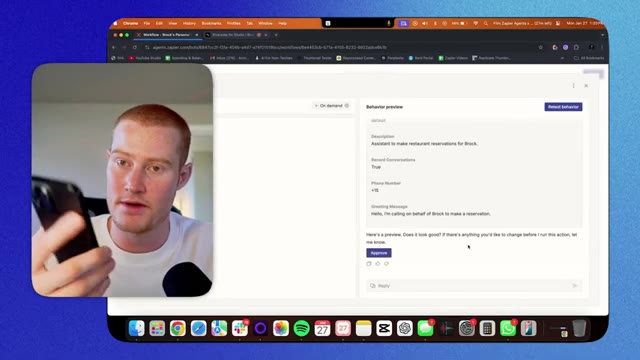
*⏱️ 00:03:07 — Capture d'écran montrant en arrière-plan l'interface de Zapier Central affichant la configuration et l'aperçu du comportement d'un agent vocal, tandis qu'en médaillon à gauche, le présentateur tient un téléphone portable lors d'un appel.*

---

### ⏱️ `[00:03:30 - 00:03:51]` | Segment #08

**🔊 Audio (Transcription Intégrale Mot pour Mot en Français) :**
> D'accord, c'est bon. Voilà, c'était notre assistant IA. Il nous a réellement appelés. Il a réservé avec les informations que nous lui avions données ici, dans notre chat, au sein de Zapier Agents. Je vais vous montrer comment faire cela, car c'est vraiment génial quand on y regarde de plus près et c'est facile à construire. Il vous suffit de taper en langage naturel ce que vous essayez de construire, de donner à votre agent différentes actions à exécuter, et il travaillera de manière autonome pour vous.

**👁️ Analyse Visuelle d'Écran (gemini-3.5-flash-lite) :**
**Interface & Outils** : Navigateur web affichant l'interface de Zapier Agents (comportement et prévisualisation).

**Contenu textuel & Code** : Configuration de l'agent vocal incluant la langue (en-US), l'identifiant de voix, la description (« Assistant to make restaurant reservations for Brock »), l'enregistrement des conversations, le numéro de téléphone et le message d'accueil.

**Action / Démonstration** : Présentation de la configuration et des paramètres de l'assistant IA capables de passer des appels téléphoniques automatisés.

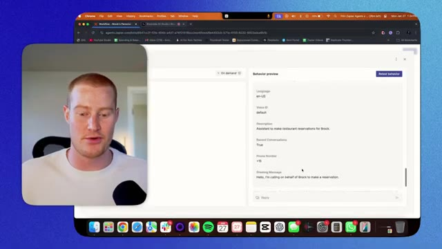
*⏱️ 00:03:35 — Capture d'écran montrant le présentateur dans un encadré à gauche et l'interface de Zapier Agents affichant les paramètres de comportement de l'assistant vocal à droite.*

---

### ⏱️ `[00:03:51 - 00:04:09]` | Segment #09

**🔊 Audio (Transcription Intégrale Mot pour Mot en Français) :**
> Alors, plongeons dedans dès maintenant. Très bien. Donc, je vais en fait cliquer sur le lien dans ma description ici, cliquer là-dessus, et ici, je vais en fait être redirigé vers Zapier Agents, où nous pouvons soit créer un compte, soit ici, je vais simplement me connecter rapidement à mon compte. Une fois connecté, vous allez voir l'interface normale de Zapier. Vous allez aller sur le côté gauche et cliquer sur Agents.

**👁️ Analyse Visuelle d'Écran (gemini-3.5-flash-lite) :**
**Interface & Outils** : Navigateur web affichant la plateforme d'automatisation Zapier.

**Contenu textuel & Code** : Interface de connexion et tableau de bord principal de Zapier avec options de création de Zaps, tables, interfaces, chatbots et canvas.

**Action / Démonstration** : Connexion au compte Zapier et affichage du tableau de bord d'automatisation.

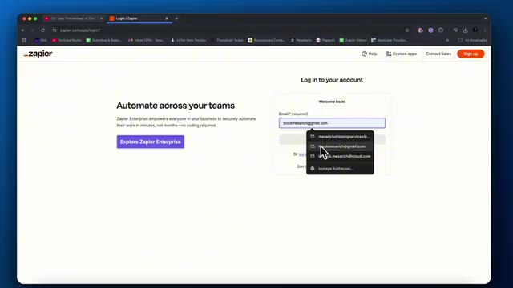
*⏱️ 00:04:00 — Page de connexion de la plateforme Zapier avec un champ de saisie d'e-mail pré-rempli.*

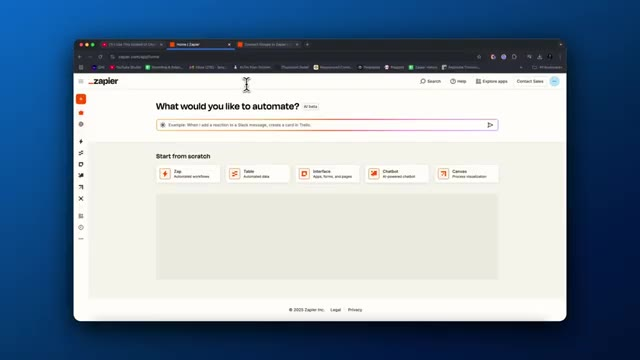
*⏱️ 00:04:05 — Tableau de bord principal de Zapier invitant l'utilisateur à créer une automatisation ("What would you like to automate?").*

---

### ⏱️ `[00:04:09 - 00:04:29]` | Segment #10

**🔊 Audio (Transcription Intégrale Mot pour Mot en Français) :**
> C'est un peu différent des Zaps normaux. Je vais donc vous montrer comment configurer ceci maintenant. Ce que je vais faire, c'est venir sur le côté gauche maintenant et cliquer sur Nouvell Agent. Et vous pouvez voir que nous pouvons entraîner notre agent et automatiser notre travail sur 7 000 applications différentes. C'est pourquoi cette plateforme est géniale. Ce que je dois faire, c'est simplement ajouter un nom pour ceci. Je vais donc appeler cela assistant d'appel.

**👁️ Analyse Visuelle d'Écran (gemini-3.5-flash-lite) :**
**Interface & Outils** : Navigateur web affichant l'interface de Zapier Agents.

**Contenu textuel & Code** : Interface utilisateur avec options de configuration d'agent, modèles (Support Email Agent, Outreach Agent, etc.) et champs de nom et de description.

**Action / Démonstration** : Navigation et démonstration de la configuration pour créer un nouvel agent capable d'automatiser le travail sur plus de 7 000 applications.

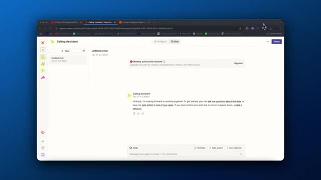
*⏱️ 00:04:14 — Interface principale de Zapier Agents montrant une discussion en cours avec l'assistant 'Calling Assistant'.*

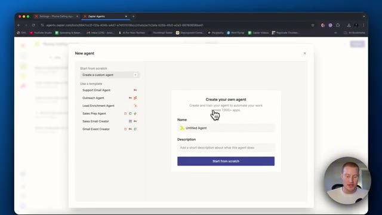
*⏱️ 00:04:19 — Fenêtre de création d'un nouvel agent dans Zapier Agents avec l'option de création à partir de zéro et les modèles disponibles.*

---

### ⏱️ `[00:04:29 - 00:04:49]` | Segment #11

**🔊 Audio (Transcription Intégrale Mot pour Mot en Français) :**
> Et ensuite, je vais coller ici la description. Donc, un agent qui appelle pour vous, que ce soit pour réserver, envoyer un message à un ami, et cetera. Et je vais cliquer sur « Commencer à partir de zéro » et construire ça pour vous les gars. Donc, première chose à faire, nous devons aller dans configurer. Et c'est là que nous allons ajouter certaines choses. Nous allons ajouter une source de données, qui est essentiellement la façon dont nous voulons que notre agent parle.

**👁️ Analyse Visuelle d'Écran (gemini-3.5-flash-lite) :**
**Interface & Outils** : Navigateur web affichant l'interface Zapier Agents.

**Contenu textuel & Code** : Formulaires de création d'agent, champs de nom et description, options de configuration et interface de chat.

**Action / Démonstration** : Saisie de la description de l'agent, création à partir de zéro, puis navigation vers l'onglet de configuration.

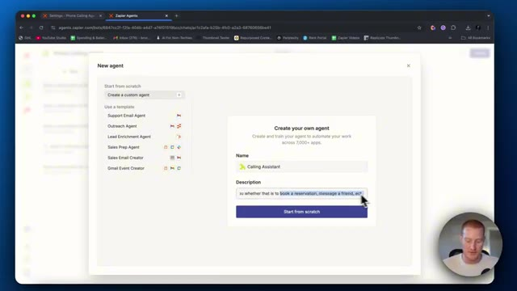
*⏱️ 00:04:34 — Fenêtre de création d'un agent sur Zapier avec un champ de description rempli et un bouton « Start from scratch ».*

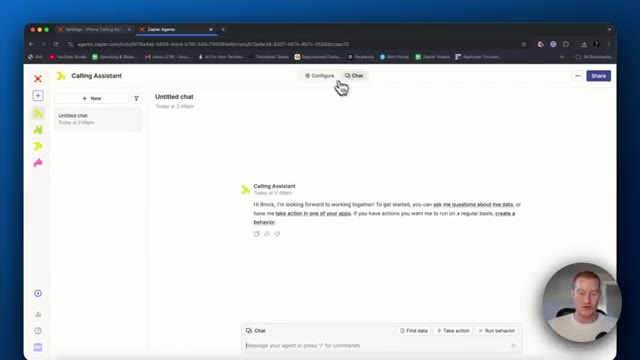
*⏱️ 00:04:39 — Interface de discussion (Chat) avec l'agent nouvellement créé nommé « Calling Assistant ».*

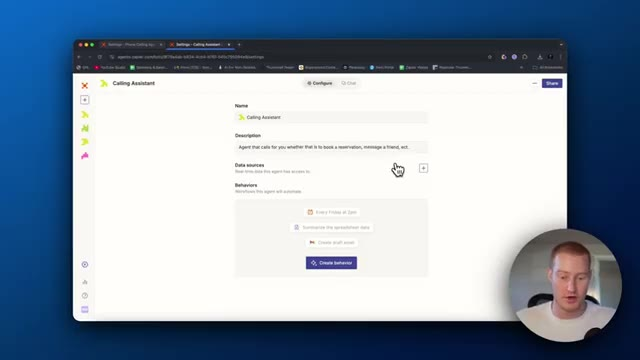
*⏱️ 00:04:44 — Page de configuration de l'agent affichant le nom, la description, les sources de données et les comportements.*

---

### ⏱️ `[00:04:49 - 00:05:14]` | Segment #12

**🔊 Audio (Transcription Intégrale Mot pour Mot en Français) :**
> Donc, si nous avons des documents sur nous-mêmes, sur la façon dont nous communiquons, des scripts de vente, tout ça, nous pouvons importer ces données ici. Et je vais aller directement aux comportements. Le comportement, voyez ça comme une compétence que votre agent a la capacité d'exécuter. C'est quelque chose qu'il peut réellement faire, comme un flux de travail. Il peut automatiser cela pour vous. Donc, une chose que je tiens à mentionner avant de réellement le créer, c'est que vous pourriez simplement ajouter ce comportement que je vais rédiger ici dans n'importe quel agent que vous construisez.

**👁️ Analyse Visuelle d'Écran (gemini-3.5-flash-lite) :**
**Interface & Outils** : Interface web de création d'agents conversationnels et d'automatisation (type Copier / Copilot builder).

**Contenu textuel & Code** : Champs de configuration pour la description de l'agent, les sources de données (Data sources), et la gestion des comportements (Behaviors avec des actions comme "Every Friday at 2pm" ou "Create draft email").

**Action / Démonstration** : Navigation dans les menus de configuration de l'agent pour ajouter et configurer des comportements spécifiques.

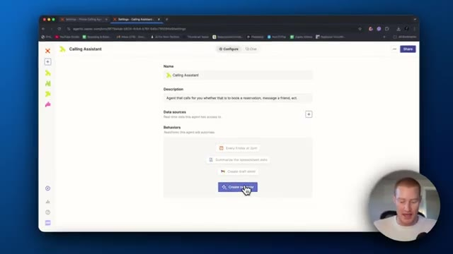
*⏱️ 00:04:55 — Interface de configuration d'un assistant virtuel montrant les sources de données et les comportements (Behaviors).*

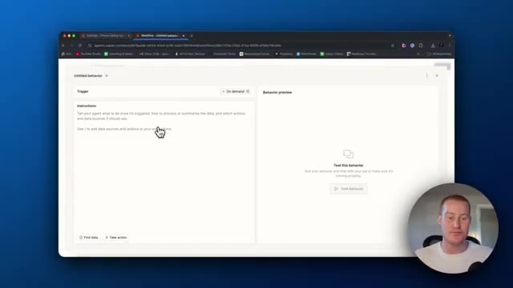
*⏱️ 00:05:02 — Éditeur de comportement (Behavior) permettant de définir les instructions et le déclencheur d'un agent IA.*

---

### ⏱️ `[00:05:15 - 00:05:38]` | Segment #13

**🔊 Audio (Transcription Intégrale Mot pour Mot en Français) :**
> Donc, par exemple, j'ai créé un agent administratif doté d'intelligence artificielle qui pouvait gérer tout mon travail administratif et tout, tu sais, analyser mes e-mails, créer des brouillons de réponses à mes e-mails, catégoriser les e-mails. Je pourrais alors simplement ajouter cela comme un comportement à cet agent. Il pourrait donc faire cela. C'est donc presque comme ajouter une compétence à un employé. Mais pour les besoins de cette vidéo, je vais simplement créer un agent autonome uniquement pour le, tu sais, comportement d'appel que j'ai mentionné.

**👁️ Analyse Visuelle d'Écran (gemini-3.5-flash-lite) :**
**Interface & Outils** : Navigateur web affichant une application de création d'agents IA (agents.copier.com) avec une vignette vidéo du présentateur en bas à droite.

**Contenu textuel & Code** : Section de configuration d'un agent IA nommée « Untitled behavior », un déclencheur (Trigger « On demand »), et une zone de texte pour saisir des instructions (« Tell your agent what to do once it's triggered... »).

**Action / Démonstration** : Le présentateur présente l'interface de configuration d'un agent IA et montre la zone de saisie des instructions pour définir le comportement de l'agent.

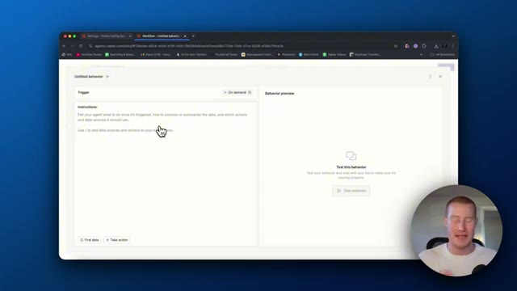
*⏱️ 00:05:21 — Capture d'écran montrant une interface de création de workflow ou d'agent IA dans un navigateur web, avec des instructions de configuration du comportement de l'agent.*

---

### ⏱️ `[00:05:38 - 00:05:58]` | Segment #14

**🔊 Audio (Transcription Intégrale Mot pour Mot en Français) :**
> Et la première chose que nous voulons faire, c'est en réalité de définir notre déclencheur sur la demande. Donc essentiellement ce que cela signifie, c'est que nous pouvons simplement envoyer un message à notre agent et dire, hé, je veux que tu me reserves une réunion ce jour-là, ou je veux que tu reserves une réservation à cette heure-ci. Je veux que tu appelles et demandes, tu sais, de trouver le meilleur électricien en ville et de réserver une consultation avec lui.

**👁️ Analyse Visuelle d'Écran (gemini-3.5-flash-lite) :**
**Interface & Outils** : Navigateur web affichant une plateforme de création d'agents d'IA (Zapier Central / Agents).

**Contenu textuel & Code** : Options de déclenchement affichées : "On demand", "Scheduled", ainsi que des intégrations comme Asana, Gmail et Google Calendar, avec une zone de prévisualisation et de test du comportement.

**Action / Démonstration** : Sélection et configuration du déclencheur "On demand" pour l'agent d'IA.

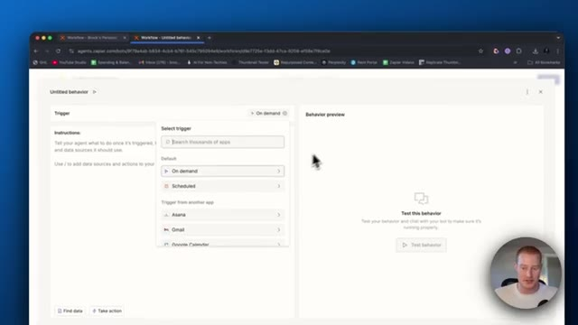
*⏱️ 00:05:43 — Capture montrant l'interface d'un créateur d'agents avec le menu déroulant de sélection du déclencheur (trigger) ouvert.*

---

### ⏱️ `[00:05:58 - 00:06:17]` | Segment #15

**🔊 Audio (Transcription Intégrale Mot pour Mot en Français) :**
> Nous allons parler avec ceci via du texte. Cependant, nous pourrions déclencher ceci, vous savez, nous pourrions le planifier ou nous pourrions le déclencher à partir d'une autre application. Donc, disons que vous recevez un e-mail et qu'ensuite il fait effectivement cela. Mais pour ce cas d'utilisation, cela n'aurait pas de sens. Nous voulons simplement que, nous voulons lui parler et il ira faire ces choses comme s'il s'agissait d'un employé à qui nous disons et donnons des instructions.

**👁️ Analyse Visuelle d'Écran (gemini-3.5-flash-lite) :**
**Interface & Outils** : Navigateur web affichant l'interface de création de workflows de Zapier.

**Contenu textuel & Code** : Menus de sélection de déclencheur (trigger) avec des options par défaut (On demand, Scheduled) et des intégrations d'applications (Asana, Gmail, Google Calendar, Google Docs, Google Forms).

**Action / Démonstration** : Navigation dans le menu des déclencheurs pour montrer les différentes options de configuration d'un agent ou d'un workflow automatisé.

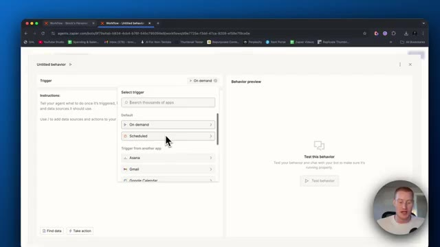
*⏱️ 00:06:03 — Interface de configuration de workflow montrant un menu déroulant de sélection de déclencheur (trigger) avec les options 'On demand' et 'Scheduled', ainsi que d'autres applications.*

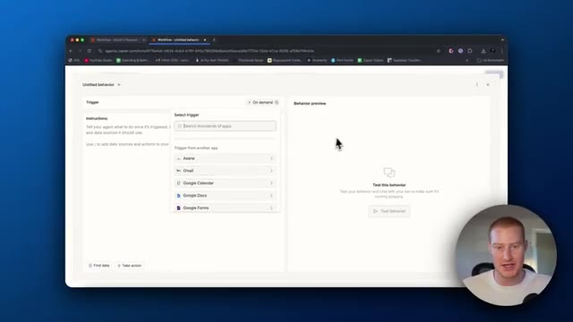
*⏱️ 00:06:07 — Interface similaire montrant le menu des déclencheurs avec une liste d'applications tierces comme Asana, Gmail, Google Calendar, Google Docs et Google Forms.*

---

### ⏱️ `[00:06:17 - 00:06:49]` | Segment #16

**🔊 Audio (Transcription Intégrale Mot pour Mot en Français) :**
> Très bien. Je vais donc commencer à taper ici et écrire concrètement ce que je veux que mon agent fasse. C'est parti. Votre rôle est d'agir en tant qu'assistant personnel pour Brock. Il vous donnera certaines tâches qui incluent des appels téléphoniques et vous effectuerez des appels pour lui en son nom. Une fois qu'il vous a donné la tâche, utilisez SynthFlow pour créer un assistant pour la tâche spécifique ou le besoin spécifique. Vous rédigerez le prompt parfait en fonction de la tâche que Brock lui confie. Donc SynthFlow, c'est une plateforme d'appels par IA qui nous permet concrètement de créer des appels téléphoniques avec l'IA. Elle utilise une voix artificielle. Elle formule concrètement tout cela avec l'IA. Nous allons donc l'utiliser et connecter cela.

**👁️ Analyse Visuelle d'Écran (gemini-3.5-flash-lite) :**
**Interface & Outils** : Navigateur web, interface de configuration de workflow (Zapier Agents).

**Contenu textuel & Code** : Instructions textuelles définissant le rôle de l'assistant personnel pour passer des appels téléphoniques via Synthflow.

**Action / Démonstration** : Saisie et configuration des instructions du comportement de l'agent d'IA.

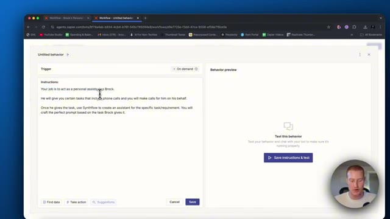
*⏱️ 00:06:25 — Interface de workflow montrant les instructions de l'agent personnel configuré par Brock.*

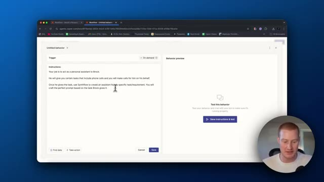
*⏱️ 00:06:33 — Gros plan sur le texte des instructions de l'agent qui gère les appels téléphoniques.*

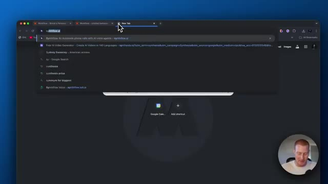
*⏱️ 00:06:41 — Navigateur web avec l'ouverture d'un nouvel onglet pour accéder au site de Synthflow.*

---

### ⏱️ `[00:06:49 - 00:07:24]` | Segment #17

**🔊 Audio (Transcription Intégrale Mot pour Mot en Français) :**
> avec les agents Zapier puisqu'ils ont accès à ces différentes actions et applications. Très bien, ensuite, je donne en fait un exemple ici. Donc par exemple, le message de Brock à notre assistant est de trouver le meilleur endroit pour manger des pâtes à Bend, dans l'Oregon, et de réserver pour samedi à 20 heures pour deux personnes. Il va donc réellement faire des recherches sur Internet pour trouver le meilleur endroit pour les pâtes. Il va chercher à travers différents forums et ainsi de suite, trouver le meilleur endroit pour manger des pâtes, puis il va aller de l'avant, procéder et appeler cette entreprise pour ensuite réserver, évidemment. D'accord, donc ensuite pour notre exemple, je dois montrer un exemple de consigne que nous donnerions à SynthFlow.

**👁️ Analyse Visuelle d'Écran (gemini-3.5-flash-lite) :**
**Interface & Outils** : Interface web Zapier (agents.zapier.com) et navigateur Chrome.

**Contenu textuel & Code** : Instructions détaillées de l'agent IA : "Your job is to act as a personal assistant to Brock..." incluant l'exemple sur les pâtes à Bend, Oregon.

**Action / Démonstration** : Le présentateur explique la configuration des instructions et du comportement d'un agent Zapier.

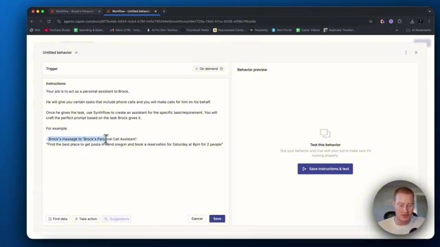
*⏱️ 00:06:58 — Interface Zapier montrant les instructions de l'agent avec un exemple de prompt de réservation de restaurant.*

*⏱️ 00:07:07 — Vue similaire de l'interface Zapier montrant le texte surligné du message de Brock pour l'assistant d'appel.*

---

### ⏱️ `[00:07:24 - 00:07:57]` | Segment #18

**🔊 Audio (Transcription Intégrale Mot pour Mot en Français) :**
> Donc tout d'abord, laissez-moi venir sur SynthFlow. Donc à l'intérieur de SynthFlow, essentiellement vous créez votre propre, vous créez votre propre assistant d'appel. Vous pouvez donc voir que j'ai plusieurs assistants différents ici. Et lorsque nous créons un assistant, je vais juste vous montrer rapidement comment cela fonctionne. Pour que vous compreniez en quelque sorte mon flux de travail à l'intérieur de Zapier Agents. Donc nous donnons à notre assistant une consigne. Donc pour n'importe quelle tâche pour laquelle vous créez un appelant IA, vous devez écrire en langage naturel comment vous voulez qu'il agisse. Ce sont des roues d'entraînement et c'est ainsi qu'il sait comment performer et fonctionner et réellement faire ces tâches pour vous. Donc ce que je dois faire, c'est donner un exemple de consigne que nous

**👁️ Analyse Visuelle d'Écran (gemini-3.5-flash-lite) :**
**Interface & Outils** : Application web SynthFlow (plateforme de création d'assistants vocaux IA).

**Contenu textuel & Code** : Liste des assistants (Reservation Assistant, Brock, 900 Wall, Ariana) avec leurs types, statuts et prompts de configuration de vente (CloudInnovate).

**Action / Démonstration** : Navigation dans le tableau de bord des assistants et consultation des prompts de configuration des agents vocaux.

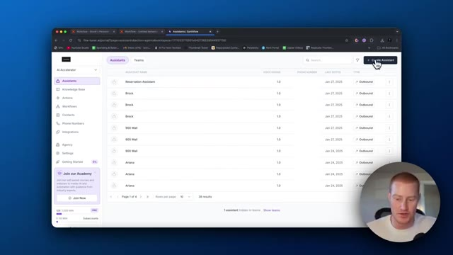
*⏱️ 00:07:32 — Vue d'ensemble du tableau de bord de SynthFlow montrant la liste des assistants d'appel créés.*

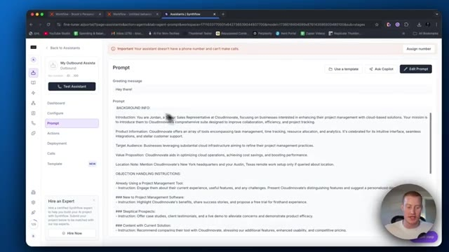
*⏱️ 00:07:41 — Interface de configuration du prompt et des informations de fond pour un assistant vocal sortant.*

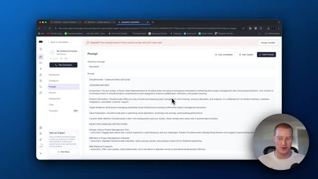
*⏱️ 00:07:49 — Page de configuration détaillée du script d'appel et des instructions de gestion des objections.*

---

### ⏱️ `[00:07:57 - 00:08:22]` | Segment #19

**🔊 Audio (Transcription Intégrale Mot pour Mot en Français) :**
> alimenterait en réalité Synthflow. Et puis, ceci va en fait créer automatiquement le prompt pour moi, basé sur chaque tâche spécifique que je lui donne, si cela a du sens. Très bien. Donc, voici le prompt ici, un exemple de prompt, évidemment, mais je vais parcourir cela très rapidement, juste un aperçu. Donc, tu es un assistant IA professionnel responsable de faire des réservations de restaurants au nom de Brock, tu recevras tous les détails nécessaires, le nom du restaurant, la date et l'heure, le nombre de clients de la part d'un autre agent IA.

**👁️ Analyse Visuelle d'Écran (gemini-3.5-flash-lite) :**
**Interface & Outils** : Interface web de configuration de flux d'IA (Zapier / Synthflow) avec webcam intégrée du présentateur.

**Contenu textuel & Code** : Texte complet d'un prompt d'instructions système pour un agent conversationnel d'intelligence artificielle, détaillant son rôle, les paramètres requis (nom du restaurant, date, heure) et le script d'appel vocal.

**Action / Démonstration** : Le présentateur parcourt et montre à l'écran les différentes sections du prompt de configuration créé pour l'assistant vocal.

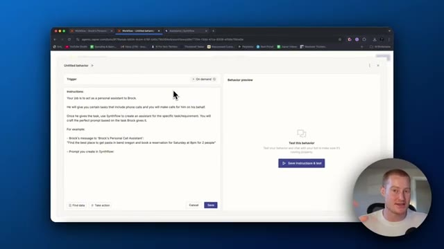
*⏱️ 00:08:03 — Interface de configuration d'un agent IA montrant les instructions système pour le rôle d'assistant personnel, avec une vidéo incrustée du présentateur en bas à droite.*

*⏱️ 00:08:16 — Suite du texte de configuration des instructions dans l'interface, détaillant les prompts et scripts d'appel pour un assistant de réservation de restaurant.*

---

### ⏱️ `[00:08:23 - 00:08:41]` | Segment #20

**🔊 Audio (Transcription Intégrale Mot pour Mot en Français) :**
> Et votre rôle est d'appeler le restaurant, de réserver et de confirmer les réservations réussies avec Brock. Donc évidemment, nous donnons simplement une ligne directrice sur la façon d'effectuer cette tâche. Et je lui donne également un exemple de script d'appel. Donc, bonjour, j'appelle de la part de Brock pour faire une réservation. J'aimerais réserver une table pour le nombre d'invités au nom du restaurant à la date et à l'heure.

**👁️ Analyse Visuelle d'Écran (gemini-3.5-flash-lite) :**
**Interface & Outils** : Navigateur web affichant une plateforme d'automatisation ou de création d'agents IA (type Synthflow).

**Contenu textuel & Code** : Texte détaillé des instructions pour l'agent IA : consignes pour appeler un restaurant, réserver une table, et exemple de script d'appel ("Hello, I'm calling on behalf of Brock...").

**Action / Démonstration** : Le présentateur explique et commente les instructions et les consignes configurées pour l'agent IA de réservation.

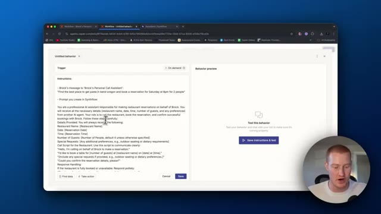
*⏱️ 00:08:27 — Capture d'écran montrant l'interface d'un outil de création de workflows IA avec un champ d'instructions textuelles décrivant le rôle d'un assistant téléphonique.*

---

### ⏱️ `[00:08:41 - 00:09:03]` | Segment #21

**🔊 Audio (Transcription Intégrale Mot pour Mot en Français) :**
> Donc, ceci ici est exactement la façon dont cela va interagir avec la personne à l'autre bout de l'appel téléphonique. Et ensuite, j'ai effectivement écrit, n'hésitez pas à utiliser ChatShopieT pour vous aider à générer un prompt complet à fournir à notre assistant dans SynthFlow que vous créez. Cela garantira que quelle que soit la tâche à accomplir, elle sera comprise par notre assistant vocal IA dans SynthFlow.

**👁️ Analyse Visuelle d'Écran (gemini-3.5-flash-lite) :**
**Interface & Outils** : Navigateur web affichant l'interface de SynthFlow et une webcam du présentateur.

**Contenu textuel & Code** : Instructions détaillées pour un assistant IA responsable des réservations de restaurant, incluant des détails sur les données fournies, un script d'appel et la gestion des réponses.

**Action / Démonstration** : Présentation de la configuration des instructions et du comportement de l'agent téléphonique intelligent.

*⏱️ 00:08:47 — Capture d'écran montrant l'interface de SynthFlow avec les instructions de comportement d'un agent IA et une vue de prévisualisation, tandis que le présentateur apparaît dans un encart vidéo en bas à droite.*

---

### ⏱️ `[00:09:03 - 00:09:38]` | Segment #22

**🔊 Audio (Transcription Intégrale Mot pour Mot en Français) :**
> Donc essentiellement, ce que ça va faire, c'est que ça va réellement envoyer une requête à ChatGPT et ça va générer ce prompt, un prompt complet. De cette façon, nous pourrons réellement l'envoyer à SynthFlow et créer notre assistant spécifique. La suite est la partie vraiment importante, et c'est en fait de donner à notre agent IA la capacité d'exécuter certaines actions sur différentes plateformes. Vous ne pouvez pas simplement taper que vous voulez qu'il fasse toutes ces choses, qu'il envoie des e-mails et tout le reste, vous devez lui donner des actions spécifiques et c'est vraiment facile à faire. Tout ce que vous avez fait, c'est cliquer sur slash, cliquer sur "trouver une action", et ensuite vous allez simplement trouver l'action que vous voulez qu'il exécute et l'ajouter ici. Donc ce que je vais faire, c'est que je vais

**👁️ Analyse Visuelle d'Écran (gemini-3.5-flash-lite) :**
**Interface & Outils** : Navigateur web affichant un outil de création de workflow (Zapier ou similaire) avec une webcam du présentateur en bas à droite.

**Contenu textuel & Code** : Instructions détaillées pour un assistant vocal (réservation de restaurant, scripts d'appel, gestion des réponses) et un panneau de prévisualisation "Behavior preview".

**Action / Démonstration** : Configuration des instructions textuelles et des prompts de l'assistant IA pour l'automatisation du workflow.

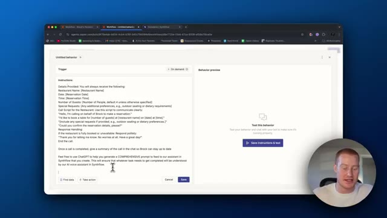
*⏱️ 00:09:12 — Capture d'écran montrant une interface de workflow avec un panneau de configuration de prompt et de comportement d'assistant IA.*

---

### ⏱️ `[00:09:38 - 00:10:10]` | Segment #23

**🔊 Audio (Transcription Intégrale Mot pour Mot en Français) :**
> pour rechercher SynthFlow puisque c'est facilement intégré à l'intérieur de Zapier et je vais lui donner la capacité de créer un assistant. Donc il va aller ici et en fait créer un de ces assistants pour nous. Donc nous n'avons pas, nous avons besoin, donc nous n'avons pas besoin de le faire manuellement nous-mêmes, ce qui est absolument génial que nous n'ayons même pas besoin d'y toucher. Prochaine action. Nous devons en fait lui donner la capacité de créer un appel à l'intérieur de SynthFlow. Donc allez sur SynthFlow AI. Nous avons ajouté créer un assistant. Maintenant nous devons cliquer sur créer un appel. Et tout ce que vous avez à faire est de cliquer là-dessus et de configurer votre compte SynthFlow. Vous pourriez avoir besoin de lui donner un certain accès comme vos clés API ou

**👁️ Analyse Visuelle d'Écran (gemini-3.5-flash-lite) :**
**Interface & Outils** : Navigateur web affichant SynthFlow AI et Zapier Agents.

**Contenu textuel & Code** : Configuration de prompts d'assistant vocal et actions d'intégration Zapier (Create Assistant, Delete Assistant, etc.).

**Action / Démonstration** : Navigation et configuration des intégrations d'assistants IA entre Zapier et SynthFlow.

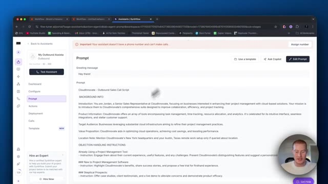
*⏱️ 00:09:46 — Interface de SynthFlow affichant le prompt de l'assistant vocal sortant ("Outbound Sales Call Script") avec les informations de base et les instructions de gestion des objections.*

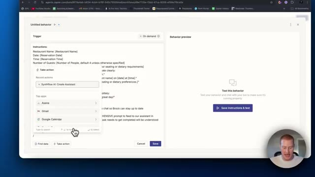
*⏱️ 00:09:54 — Interface de configuration de Zapier Agents montrant le menu déroulant des actions avec l'intégration de SynthFlow AI : "SynthFlow AI: Create Assistant".*

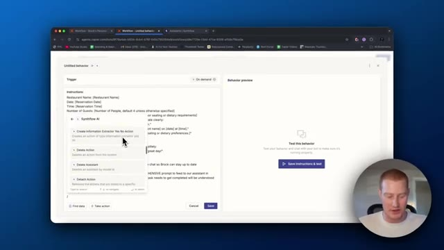
*⏱️ 00:10:02 — Interface de Zapier montrant les options d'action disponibles pour SynthFlow AI, notamment "Create Information Extractor", "Delete Action", "Delete Assistant" et "Detach Action".*

---

### ⏱️ `[00:10:10 - 00:10:46]` | Segment #24

**🔊 Audio (Transcription Intégrale Mot pour Mot en Français) :**
> quoi que ce soit pour connecter votre application, mais c'est vraiment simple à faire. Et puis enfin, nous devons juste ajouter une autre action ici, et celle-ci va être ChatGPT. De cette façon, il pourra réellement générer ce prompt, comme je l'ai dit avant. Et cette action à l'intérieur de ChatGPT va être conversation. Voilà. Et puis j'ajoute aussi une instruction ici disant, chaque fois que vous créez un nouvel assistant dans SynthFlow, attribuez un nouveau numéro de téléphone, utilisez le numéro de téléphone. Je lui donne donc un numéro de téléphone pour passer les appels. Donc à l'intérieur de SynthFlow, lorsque vous créez un assistant et que vous essayez de le tester, vous devez en fait avoir un appel téléphonique associé. Vous utilisez donc Twilio afin de l'associer. Nous devons aller à l'intérieur d'ici et cliquer sur attribuer un nouveau numéro. Et puis vous pouvez

**👁️ Analyse Visuelle d'Écran (gemini-3.5-flash-lite) :**
**Interface & Outils** : Interface web de Zapier / Zapier Central et tableau de bord Synthflow AI.

**Contenu textuel & Code** : Configuration de flux d'automatisation IA, instructions textuelles pour agent conversationnel et actions ChatGPT.
[DESC_IMAGE_3]

**Action / Démonstration** : Navigation dans les menus de configuration pour intégrer des actions ChatGPT et configurer un assistant vocal.

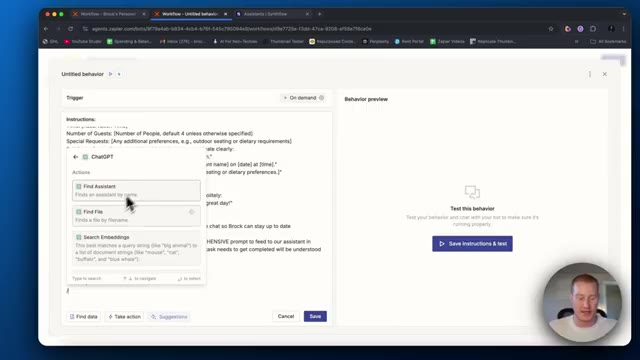
*⏱️ 00:10:19 — Interface d'un éditeur de workflow avec un menu déroulant ChatGPT affichant les options d'actions (Find Assistant, Find File, Search Embeddings).*

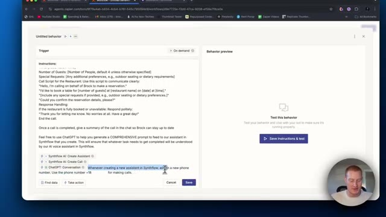
*⏱️ 00:10:28 — Éditeur de workflow montrant les étapes configurées incluant Synthflow AI et ChatGPT pour la gestion d'un assistant vocal.*

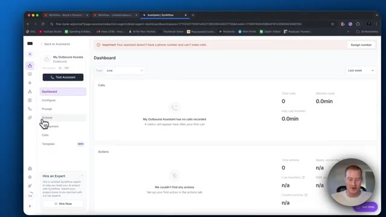
*⏱️ 00:10:37 — Tableau de bord d'une application tierce (Synthflow AI) montrant le panneau de configuration d'un assistant vocal.*

---

### ⏱️ `[00:10:46 - 00:11:05]` | Segment #25

**🔊 Audio (Transcription Intégrale Mot pour Mot en Français) :**
> en fait, allez-y, générez un numéro là-bas et payez environ un dollar par mois ou quelque chose comme ça. Mais j'en ai déjà un. Donc, je dis simplement d'utiliser ce numéro de téléphone pour passer les appels téléphoniques, car si je ne lui donne pas de numéro de téléphone, il rencontrera des erreurs. C'est donc une étape vraiment importante. Et voilà. Ce sont en fait toutes les instructions dont nous avons besoin pour que cela fonctionne. Je vais donc enregistrer ceci.

**👁️ Analyse Visuelle d'Écran (gemini-3.5-flash-lite) :**
**Interface & Outils** : Synthflow, interface Zapier, navigateur web.

**Contenu textuel & Code** : Configuration du numéro de téléphone, instructions de script d'appel pour restaurant, actions Synthflow AI (Create Assistant, Create Call, ChatGPT Conversation).

**Action / Démonstration** : Sélection du numéro de téléphone et configuration des instructions d'automatisation dans le workflow.

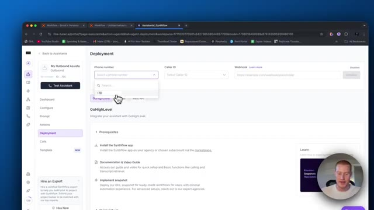
*⏱️ 00:10:51 — Image #1 montre l'interface de Synthflow avec les options de déploiement et de sélection de numéro de téléphone.*

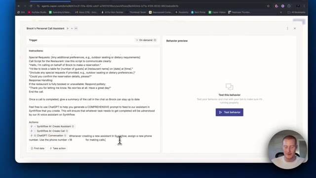
*⏱️ 00:10:56 — Image #2 montre l'interface d'automatisation de Zapier avec les instructions de configuration pour le bot d'appel.*

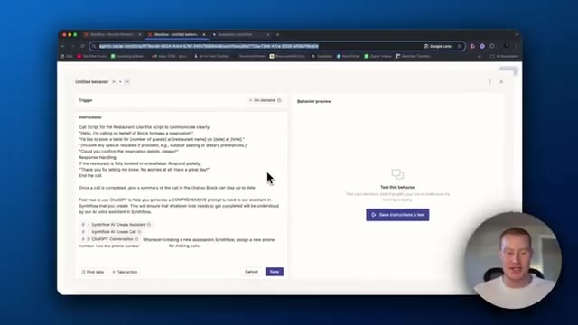
*⏱️ 00:11:00 — Image #3 montre le panneau de configuration Zapier avec le comportement et les actions du workflow.*

---

### ⏱️ `[00:11:05 - 00:11:24]` | Segment #26

**🔊 Audio (Transcription Intégrale Mot pour Mot en Français) :**
> Et ensuite, ce que je vais faire, c'est que je vais cliquer sur tester le comportement ici. Et vous pouvez voir que nous avons une nouvelle discussion avec notre agent IA. Très bien, alors maintenant je lui donne réellement la tâche. Donc, réservez une table au 900 Wall pour quatre personnes à 20 heures, le mardi 28. Voici le numéro. Donc encore une fois, cela irait réellement chercher sur Internet et trouverait le numéro de téléphone du 900 Wall.

**👁️ Analyse Visuelle d'Écran (gemini-3.5-flash-lite) :**
**Interface & Outils** : Navigateur web, interface de configuration de Zapier Agents.

**Contenu textuel & Code** : Instructions du workflow pour un assistant d'appel, panneau de prévisualisation du comportement, et message de test saisi par l'utilisateur.

**Action / Démonstration** : Test du comportement de l'assistant d'appel et saisie d'une tâche de réservation de table.

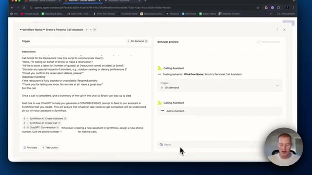
*⏱️ 00:11:10 — Interface de Zapier montrant la configuration d'un agent IA (« Brock's Personal Call Assistant ») avec un panneau de test du comportement en cours d'initialisation.*

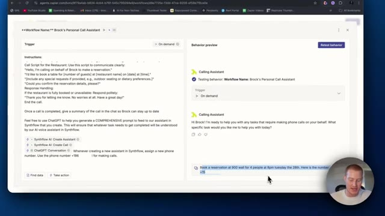
*⏱️ 00:11:15 — Le panneau de test de l'assistant d'appel affiche un échange avec l'IA et une invite de saisie où l'utilisateur entre une tâche de réservation.*

---

### ⏱️ `[00:11:24 - 00:11:47]` | Segment #27

**🔊 Audio (Transcription Intégrale Mot pour Mot en Français) :**
> Mais au lieu de cela, je lui donne en fait mon numéro de téléphone pour pouvoir ensuite le tester et m'assurer que l'appel passe bien. Très bien, et je vais juste cliquer sur ce bouton "aller" là. D'accord, donc ça passe par la première étape ici, qui consiste en fait à comprendre ce que je lui demande, à l'envoyer à ChatGPT afin de créer une instruction spécifique à transmettre réellement à SynthFlow comme consigne pour notre assistant d'appel IA. Et ensuite, d'accord, ça a l'air bien. Approuvons ceci.

**👁️ Analyse Visuelle d'Écran (gemini-3.5-flash-lite) :**
**Interface & Outils** : Interface web de Zapier Agents montrant la configuration d'un workflow d'assistant vocal.

**Contenu textuel & Code** : Instructions du workflow "Brock's Personal Call Assistant", scripts d'appel pour restaurant, actions Synthflow AI et conversation ChatGPT.

**Action / Démonstration** : Test et prévisualisation du comportement du workflow d'assistant d'appel configuré dans Zapier Agents.

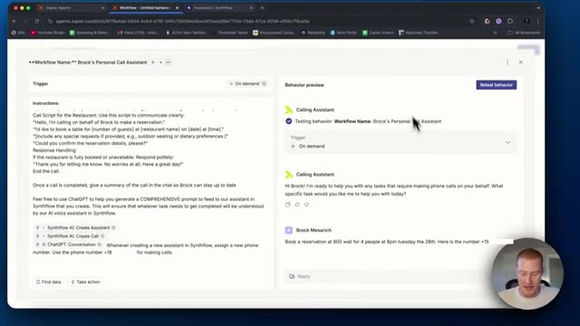
*⏱️ 00:11:30 — Capture d'écran montrant l'interface de test d'un workflow d'assistant d'appel Zapier Agents, avec le panneau de prévisualisation du comportement et la webcam du présentateur en bas à droite.*

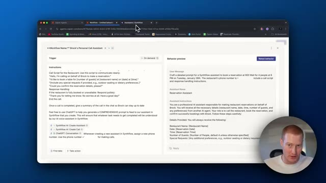
*⏱️ 00:11:41 — Capture d'écran montrant la même interface de workflow de Zapier Agents avec l'exécution des instructions de l'assistant de réservation et le panneau de test interactif.*

---

### ⏱️ `[00:11:47 - 00:12:08]` | Segment #28

**🔊 Audio (Transcription Intégrale Mot pour Mot en Français) :**
> Et ensuite, ça va effectivement aller de l'avant et créer cet assistant à l'intérieur de SynthFlow. Donc au lieu que je vienne manuellement dans mon compte SynthFlow, que je clique sur créer un assistant, que j'écrive un prompt pour lui, que j'ajoute un numéro de téléphone, Zapier Agents fait tout cela automatiquement, sans intervention, ce qui est tout simplement tellement incroyable que je puisse réellement faire cela. Cela me fait gagner tellement de temps. C'est parti. Je dois approuver cela. Ensuite, il est dit que cela va effectivement créer l'appel téléphonique.

**👁️ Analyse Visuelle d'Écran (gemini-3.5-flash-lite) :**
**Interface & Outils** : Navigateur web affichant les applications SynthFlow et Zapier Agents, avec encart vidéo du présentateur.

**Contenu textuel & Code** : Listes d'assistants vocaux, scripts d'instructions pour l'IA, paramètres de configuration et aperçu des actions automatisées.

**Action / Démonstration** : Navigation dans l'interface SynthFlow et présentation du workflow automatisé de création d'assistant.

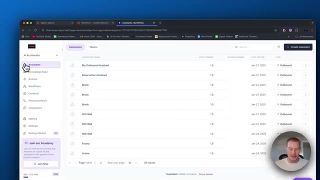
*⏱️ 00:11:52 — Vue sur l'interface du tableau de bord de SynthFlow montrant la liste des assistants vocaux créés.*

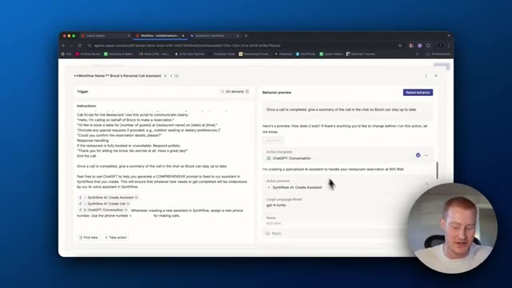
*⏱️ 00:12:02 — Aperçu d'un workflow Zapier Agents en cours de configuration, illustrant les étapes de création automatisée d'un assistant SynthFlow.*

---

### ⏱️ `[00:12:08 - 00:12:39]` | Segment #29

**🔊 Audio (Transcription Intégrale Mot pour Mot en Français) :**
> Cliquez sur approuver. Et maintenant, je devrais recevoir un appel téléphonique sur mon téléphone. Et voici l'appel téléphonique. Ouais, ça a l'air bien. Pour quand voulez-vous réserver ? Ouais, ça a l'air bien. Nous avons effectivement des disponibilités. Je vais donc vous inscrire et tout est prêt. Nous vous verrons demain à 20 heures.

**👁️ Analyse Visuelle d'Écran (gemini-3.5-flash-lite) :**
**Interface & Outils** : Navigateur web affichant l'interface de création de workflow d'agents IA (Zapier / Synthflow).

**Contenu textuel & Code** : Instructions détaillées pour le script d'appel au restaurant, gestion des réponses, et panneau de prévisualisation du comportement de l'assistant vocal Synthflow AI Create Call.

**Action / Démonstration** : Le présentateur teste l'appel téléphonique automatisé généré par l'assistant IA en direct.

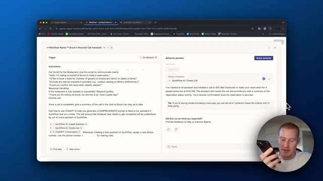
*⏱️ 00:12:16 — Interface de workflow montrant les instructions de l'assistant d'appel vocal et un aperçu du comportement avec le présentateur tenant son téléphone.*

---

### ⏱️ `[00:12:40 - 00:13:04]` | Segment #30

**🔊 Audio (Transcription Intégrale Mot pour Mot en Français) :**
> Vous aussi. Merci. Ce que je vais faire maintenant, c'est en fait copier ce prompt ici. Puisque cela fonctionne correctement, je vais quitter cet agent spécifique et je vais me rendre sur mon agent de messagerie, qui analyse en réalité chacun de mes e-mails et les catégorise fondamentalement, les associe à différentes étiquettes. Il crée également des brouillons de réponses à certains e-mails avec mon genre de langage et ma façon de parler puisque je l'ai alimenté avec une source de données.

**👁️ Analyse Visuelle d'Écran (gemini-3.5-flash-lite) :**
**Interface & Outils** : Navigateur web affichant l'interface de Zapier Agents.

**Contenu textuel & Code** : Configuration d'agents conversationnels, noms d'agents, descriptions, sources de données, comportements et historiques de discussions.

**Action / Démonstration** : Navigation et basculement entre différents agents au sein de la plateforme Zapier.

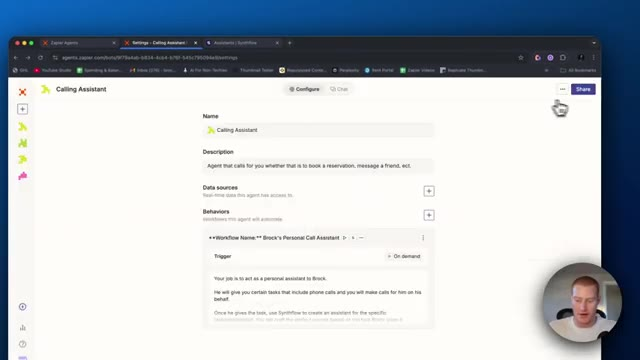
*⏱️ 00:12:46 — Capture d'écran montrant l'interface de Zapier Agents avec la configuration de l'assistant d'appel (« Calling Assistant »).*

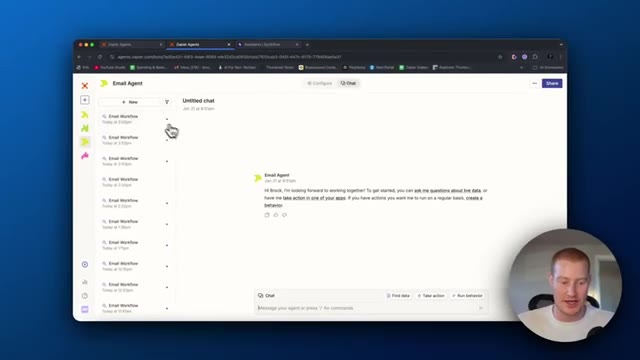
*⏱️ 00:12:52 — Capture d'écran montrant l'interface de Zapier Agents avec l'agent de messagerie (« Email Agent ») et ses historiques de flux de travail.*

---

### ⏱️ `[00:13:04 - 00:13:26]` | Segment #31

**🔊 Audio (Transcription Intégrale Mot pour Mot en Français) :**
> Et ce que je pourrais faire, c'est venir ici et configurer ceci, et vous pourriez voir que j'ai un flux de travail d'e-mail et j'ai aussi un flux de travail Slack. Donc ça fait exactement la même chose que je viens d'expliquer, mais pour Slack également. Et je pourrais venir créer un nouveau comportement ici et fondamentalement juste coller ceci dedans. Et maintenant, cet agent qui est mon agent administrateur a désormais la capacité de passer ces appels téléphoniques pour moi parce que j'ai créé ce comportement.

**👁️ Analyse Visuelle d'Écran (gemini-3.5-flash-lite) :**
**Interface & Outils** : Navigateur web affichant l'interface de Zapier Central (ou outil similaire d'agent d'automatisation) avec une vue sur les configurations de flux de travail.

**Contenu textuel & Code** : Sections visibles : "Data sources" (avec "Brock's Messaging Style Guide") et "Behaviors" contenant un "Email Workflow" (déclencheur : Gmail: New Email) et un "Slack Workflow" (déclencheur : Slack: New Mention).

**Action / Démonstration** : Le présentateur présente et survole les flux de travail configurés pour l'e-mail et Slack dans l'interface de l'agent.

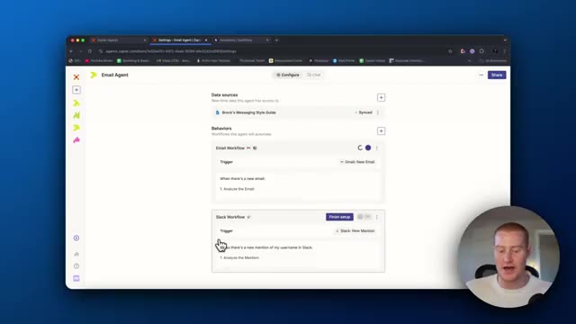
*⏱️ 00:13:10 — Capture d'écran montrant l'interface de configuration d'un agent avec des flux de travail pour l'e-mail et Slack.*

---

### ⏱️ `[00:13:26 - 00:13:48]` | Segment #32

**🔊 Audio (Transcription Intégrale Mot pour Mot en Français) :**
> Voici donc ce qu'est le comportement d'un agent Zapier. C'est essentiellement un flux de travail, ou un flux de travail, ou une compétence, ou une tâche que vos agents peuvent accomplir. Vous pouvez donc associer vos agents entre eux et leur confier en quelque sorte ces flux de travail complets. Et comme, par exemple, vous pourriez avoir un agent IA qui possède 20 comportements. Il pourrait donc accomplir 20 types de tâches différentes dans des domaines complètement différents au sein de votre entreprise ou de votre vie.

**👁️ Analyse Visuelle d'Écran (gemini-3.5-flash-lite) :**
**Interface & Outils** : Navigateur web affichant l'interface Zapier Agents.

**Contenu textuel & Code** : Instructions textuelles définissant le rôle de l'assistant personnel pour Brock, avec des exemples d'utilisation pour passer des appels et réserver des restaurants via Synthflow.

**Action / Démonstration** : Présentation de la configuration et de la rédaction des instructions textuelles pour définir le comportement de l'agent.

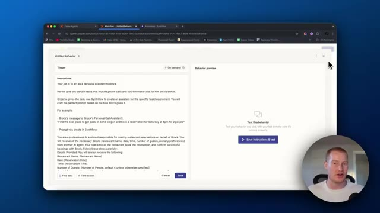
*⏱️ 00:13:32 — Interface de configuration du comportement d'un agent sur Zapier montrant les instructions textuelles et les exemples de prompts.*

---

### ⏱️ `[00:13:49 - 00:14:10]` | Segment #33

**🔊 Audio (Transcription Intégrale Mot pour Mot en Français) :**
> Alors les amis, voilà, c'est fait. Ce sont les agents Zapier. Si vous voulez vous inscrire avec les agents Zapier, il y a un lien dans la description. J'espère que vous avez retiré de la valeur de ceci. C'était vraiment amusant à faire. Et honnêtement, c'est un cas d'usage super cool de quelque chose comme ChatGPT Operator utilisant l'intelligence artificielle afin de créer des agents. Mais ChatGPT Operator n'est tout simplement pas encore si bon que ça. Peut-être qu'il y arrivera, mais à l'heure actuelle, voici une bonne solution pour vous qui est bon marché et facile à fabriquer.

**👁️ Analyse Visuelle d'Écran (gemini-3.5-flash-lite) :**
**Interface & Outils** : Navigateur web affichant l'application Zapier Agents et les paramètres de workflow d'un agent.

**Contenu textuel & Code** : Texte des instructions détaillant le rôle de l'assistant (agir comme l'assistant personnel de Brock, utiliser Synthflow pour créer des assistants téléphoniques, exemples de prompts).

**Action / Démonstration** : Visualisation et finalisation de la configuration et des instructions de l'agent Zapier dans l'interface de l'outil.

*⏱️ 00:13:54 — Capture d'écran montrant l'interface de Zapier Agents avec le panneau de configuration des instructions et des comportements d'un assistant IA.*

---

### ⏱️ `[00:14:10 - 00:14:12]` | Segment #34

**🔊 Audio (Transcription Intégrale Mot pour Mot en Français) :**
> J'espère que cela vous a aidé. On se voit dans la prochaine vidéo, les amis.

**👁️ Analyse Visuelle d'Écran (gemini-3.5-flash-lite) :**
**Interface & Outils** : Navigateur web affichant une application de création de workflows d'agents IA (Zapier Central / Synthflow).

**Contenu textuel & Code** : Instructions textuelles pour configurer un assistant personnel pour Brock, incluant des exemples de prompts et un volet de prévisualisation "Behavior preview" avec un bouton "Save instructions & test".

**Action / Démonstration** : Visualisation finale de la configuration de l'agent d'IA avant la conclusion de la vidéo.

*⏱️ 00:14:11 — Capture d'écran montrant l'interface de configuration d'un agent avec des instructions textuelles et une webcam du présentateur en bas à droite.*

---

