# 🎬 I Asked ChatGPT Deep Research “How to Make $1 Million”

> **Chaîne** : [Brock Mesarich | AI for Non Techies](https://www.youtube.com/@BrockMesarich)  
> **Lien YouTube** : [https://www.youtube.com/watch?v=zNN3Kjl0JXg](https://www.youtube.com/watch?v=zNN3Kjl0JXg)  
> **Date de publication** : 20250203  
> **Durée** : 00:10:51  
> **Identifiant vidéo** : `zNN3Kjl0JXg`  
> **Transcription & Analyse** : `whisper-v3-large-turbo+gemini-3.5-flash-lite`  

---

## 📌 Synthèse Exécutive & Outils

### 💡 Résumé
Dans cette vidéo, Brock Mesarich analyse l'utilisation et le comportement du nouvel agent IA de ChatGPT, « Deep Research », à travers un défi ambitieux et pragmatique : obtenir un plan structuré et exécutable pour générer un million de dollars en partant de zéro capital et en l'espace d'une année. Face à une telle requête, l'agent ne se contente pas de cracher des généralités ; il initie une phase de questionnement itératif pour cerner les contraintes de l'utilisateur (cadre temporel, tolérance au risque, absence de capital initial) avant d'entamer une session de recherche autonome approfondie. 

Pendant environ dix minutes, l'agent ratisse le web, croisant des données issues de plateformes spécialisées (comme *Starter Story* ou *CrazyLister*) et analysant des études de cas réels, à l'instar de la réussite d'Erwin Dominguez en dropshipping. Le processus met en lumière une approche agentique où l'IA simule une véritable due diligence : elle formule des hypothèses, évalue la viabilité de modèles économiques à fort effet de levier (dropshipping, marketing d'affiliation, infoproduits, agences de services) et synthétise des volumes massifs d'informations pour structurer une roadmap opérationnelle en plusieurs phases temporelles.

L'expérience démontre le fossé qualitatif entre les assistants traditionnels et ces nouveaux agents autonomes capables de naviguer sur le web en arrière-plan pendant que l'utilisateur délégue ses tâches. Bien que le plan final combine des classiques du business en ligne (recherche de niche, acquisition organique, scaling progressif), la capacité de l'outil à auditer des sources tierces, à documenter son parcours de recherche en temps réel et à structurer un plan d'action à 12 mois redéfinit les standards de l'assistance décisionnelle et de l'automatisation stratégique pour des porteurs de projets non-techniques.

### 🛠️ Outils, Modèles & Logiciels Présentés
* **ChatGPT Deep Research** : Nouvel agent autonome d'OpenAI capable de mener des recherches web itératives complexes, d'analyser des dizaines de sources et de synthétiser des plans stratégiques complets en quelques minutes.
* **ChatGPT (Modèles o3-mini / o3 high)** : Versions de modèles de raisonnement avancés d'OpenAI, le premier étant optimisé pour la vitesse d'exécution et le second pour la logique et le code.
* **Starter Story** : Plateforme d'études de cas et d'analyses de modèles économiques en ligne utilisée par l'IA pour valider la rentabilité d'entreprises à sept chiffres.
* **CrazyLister** : Outil d'optimisation et de création d'annonces e-commerce référencé par l'agent pour auditer la viabilité du dropshipping sur des places de marché comme Amazon et eBay.
* **Make** : Plateforme d'automatisation de workflows no-code mentionnée dans l'écosystème d'IA et d'ingénierie des processus.
* **n8n** : Outil d'automatisation et d'orchestration de flux de travail open-source/low-code prisé pour connecter des agents IA et des API.
* **Zapier** : Solution pionnière d'automatisation cloud permettant de relier des applications tierces entre elles.
* **Gemini** : Modèle linguistique multimodal de Google, concurrent direct dans l'écosystème des grands modèles de langage.
* **Claude** : Assistant conversationnel et modèle d'intelligence artificielle développé par Anthropic, reconnu pour ses capacités rédactionnelles et d'analyse.
* **Grok** : Modèle conversationnel d'IA développé par xAI, intégré à l'écosystème de données en temps réel.

### 🔑 Points Clés & Enseignements Stratégiques
1. **Évolution vers l'agentivité autonome** : Le passage d'une IA conversationnelle passive à un agent de type « Deep Research » démontre une rupture technologique, où l'outil exécute des boucles de recherche, de vérification et de synthèse sans intervention humaine continue.
2. **Phase de questionnement contextuel** : Avant de générer un plan, l'agent exige des balises claires (horizon temporel d'un an, départ de zéro, appétence au risque), prouvant qu'un prompt initial trop vague (« comment faire 1 million ») nécessite un cadrage précis pour produire des résultats actionnables.
3. **Arbitrage entre vitesse et profondeur** : Le choix d'utiliser le modèle o3-mini plutôt que la version high illustre un compromis tactique entre la rapidité d'exécution et la complexité logique, privilégiant un retour rapide pour un cas d'usage business généraliste.
4. **Audit et traçabilité des sources** : La possibilité de cliquer sur les sources consultées par l'agent (comme *Starter Story*) garantit une transparence totale et permet à l'utilisateur de vérifier la véracité et la fraîcheur des données collectées sur le web.
5. **Synthèse de la data vs création ex nihilo** : L'IA agit principalement comme un super-synthétiseur de connaissances existantes, agrégeant des méthodes éprouvées (dropshipping, marketing d'affiliation) plutôt que d'inventer de nouveaux paradigmes financiers.
6. **Validation par l'étude de cas empirique** : L'intégration par l'agent d'exemples concrets de réussite (comme les 1 million de bénéfices d'Erwin Dominguez en huit mois) renforce la crédibilité et le réalisme opérationnel de la roadmap générée.
7. **Filtrage des modèles économiques à fort effet de levier** : L'élimination des barrières à l'entrée par l'IA se traduit par le ciblage d'activités à faible capital initial : e-commerce sans stock, infoproduits, monétisation d'audience et prestations de services scalables.
8. **Découpage séquentiel de l'exécution (Roadmap à 12 mois)** : Le plan s'articule autour de jalons temporels stricts : des mois 1 à 2 dédiés aux fondations et au choix de la niche, suivis par la prise d'élan (mois 3-5), le scaling opérationnel (mois 6-9) et l'optimisation finale pour atteindre l'objectif (mois 10-12).
9. **Gestion de l'asymétrie capital/temps** : Pour compenser une absence totale de capital de départ, la stratégie de l'agent repose entièrement sur l'acquisition organique, le marketing de contenu et l'exploitation des plateformes numériques à forte marge.
10. **Délégation et automatisation du travail de recherche** : L'expérience montre qu'une IA de recherche approfondie peut accomplir en 10 minutes un travail de veille stratégique et de benchmarking qui aurait pris des heures à un opérateur humain.
11. **Nécessité d'une exécution humaine active** : Bien que l'agent structure le plan directeur, le constat met en évidence que l'utilisateur conserve la responsabilité de l'implémentation opérationnelle, l'IA ne pouvant exécuter physiquement les tâches de vente ou de création de contenu à la place du porteur de projet.

---

## ⏱️ Chronologie & Transcription Complète Audio & Visuelle (Mot pour Mot)

### ⏱️ `[00:00:00 - 00:00:33]` | Segment #01

**🔊 Audio (Transcription Intégrale Mot pour Mot en Français) :**
> Très bien, donc ChatGPT vient de sortir un nouvel agent hier appelé Deep Research. Et dans cette vidéo, je vais lui demander comment gagner 1 million de dollars. Et il va me donner un plan sur la façon de le faire. Et je lui demande cela parce que je veux voir les coulisses de la façon dont il réfléchit à cela. Et honnêtement, cela lui a pris environ 10 minutes pour y réfléchir, faire des recherches et me répondre. Donc c'est vraiment très complet. Et je veux présenter cela dans cette vidéo parce que je pourrais me voir utiliser ceci chaque jour, même si j'ai critiqué Operator et que je ne pensais pas que c'était si génial. C'est un peu différent. Donc dans cette vidéo, je vais passer en revue cela et

**👁️ Analyse Visuelle d'Écran (gemini-3.5-flash-lite) :**
**Interface & Outils** : Interface web de ChatGPT, navigateur web.

**Contenu textuel & Code** : Texte de conversation avec l'IA concernant des stratégies de business pour atteindre 1 million de dollars de capital en partant de zéro, et documentation officielle de lancement de Deep Research.

**Action / Démonstration** : Navigation et affichage des interactions de l'utilisateur avec l'agent IA Deep Research.

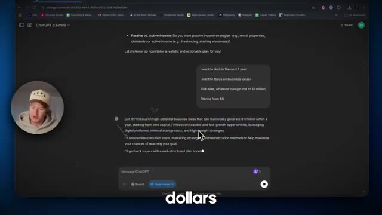
*⏱️ 00:00:08 — Interface ChatGPT montrant les prompts utilisateur pour gagner 1 million de dollars et la réponse de l'agent Deep Research avec incrustation du présentateur.*

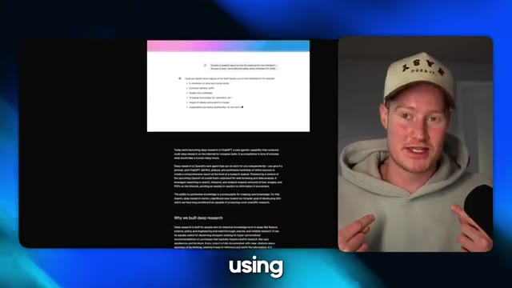
*⏱️ 00:00:25 — Présentation d'un article ou rapport de recherche OpenAI concernant la sortie de la fonctionnalité Deep Research, avec incrustation du présentateur.*

---

### ⏱️ `[00:00:33 - 00:01:10]` | Segment #02

**🔊 Audio (Transcription Intégrale Mot pour Mot en Français) :**
> Plongeons-nous dedans dès maintenant. Très bien. Donc, pour commencer cette vidéo, je vais évidemment tester "Deep Research" sur ChatGPT et lui demander concrètement comment gagner un million de dollars. Après avoir fait ça, je vais vous montrer d'autres cas d'utilisation sympas que j'ai vus, juste pour tester cela et voir à quel point cet agent IA que ChatGPT vient de lancer est réellement performant. Donc, je teste ça sur l'abonnement à 200 dollars par mois, pour que vous n'ayez pas à le faire. Assurez-vous donc de laisser un "j'aime" si, vous savez, vous appréciez cette vidéo. Alors, laissez-moi simplement venir ici et lui demander tout simplement : "Donne-moi un plan sur la façon de gagner un million de dollars, détaille-le." En fait, vous savez quoi, pour le bien de

**👁️ Analyse Visuelle d'Écran (gemini-3.5-flash-lite) :**
**Interface & Outils** : Navigateur web affichant l'interface de ChatGPT.

**Contenu textuel & Code** : Champ de texte "Message ChatGPT" avec les boutons de recherche et "Deep research", ainsi que le texte d'accueil "What can I help with?".

**Action / Démonstration** : Présentation de l'interface de ChatGPT en vue de tester la fonctionnalité de recherche approfondie ("Deep Research").

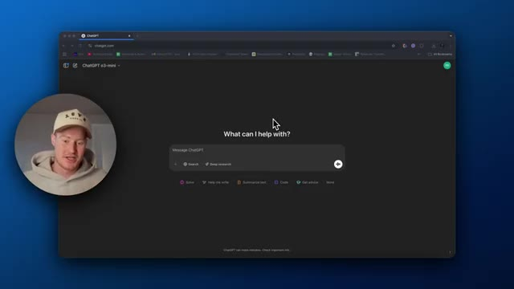
*⏱️ 00:00:42 — Capture d'écran montrant l'interface sombre de ChatGPT avec le modèle o3-mini sélectionné et l'option Deep Research visible dans la barre de saisie.*

---

### ⏱️ `[00:01:10 - 00:01:39]` | Segment #03

**🔊 Audio (Transcription Intégrale Mot pour Mot en Français) :**
> cette vidéo, je vais en fait littéralement en rester là et voir ce que ça donne. Allons-y donc, cliquons sur recherche approfondie ici. Vous pouvez voir que ce nouveau bouton est là avec le bouton de recherche. En gros, je vais juste cliquer sur envoyer. Et maintenant, il va continuer, en fait, me poser quelques questions supplémentaires. On dirait, alors pourriez-vous partager plus de détails sur vos préférences et vos contraintes, voici quelques points clés à considérer. Cadre temporel. Quelle est votre date limite spécifique ? Investissement. Recherchez-vous des stratégies d'investissement, des actions, de l'immobilier, des cryptos ou des idées d'entreprise ? Êtes-vous ouvert à des stratégies à haut risque et haute récompense ou préférez-vous le faible risque ?

**👁️ Analyse Visuelle d'Écran (gemini-3.5-flash-lite) :**
**Interface & Outils** : Interface web de ChatGPT (chatgpt.com) avec le modèle o3-mini sélectionné.

**Contenu textuel & Code** : Invite de texte : « Give me a plan, on how to make $1 million » et boutons d'options incluant la recherche et la recherche approfondie (« Deep research »).

**Action / Démonstration** : Le présentateur survole ou s'apprête à cliquer sur le bouton de recherche approfondie dans l'interface de ChatGPT avant de lancer la requête.

*⏱️ 00:01:17 — Capture d'écran de l'interface de ChatGPT montrant le curseur pointant sur le bouton de recherche approfondie, avec la question « Give me a plan, on how to make $1 million » saisie dans le champ de texte, et une pastille vidéo du présentateur en bas à gauche.*

---

### ⏱️ `[00:01:40 - 00:02:17]` | Segment #04

**🔊 Audio (Transcription Intégrale Mot pour Mot en Français) :**
> D'accord. C'est intéressant. Je ne pensais pas qu'il poserait toutes ces questions de suivi. Je voulais initialement juste demander, comment puis-je faire un million de dollars ? Je vais lui donner quelques précisions ici, juste ce qui, je pense, rendra cela plus pratique pour cette vidéo afin de nous donner un plan au lieu de simplement deviner comment faire un million de dollars. Disons donc que je veux le faire dans l'année qui vient, juste parce que je pense que beaucoup de gens veulent faire un million de dollars en un an. Donc je pense que cela ferait une conversation intéressante ici. Stratégie d'entreprise. Alors, cherchons-nous des stratégies d'investissement ou des idées d'entreprise ? Je veux me concentrer sur des idées d'entreprise parce que c'est un peu plus pratique. Et puis la tolérance au risque. Êtes-vous ouvert au risque élevé ? Côté risque, tout ce qui peut m'amener à

**👁️ Analyse Visuelle d'Écran (gemini-3.5-flash-lite) :**
**Interface & Outils** : Navigateur web affichant l'interface de ChatGPT.

**Contenu textuel & Code** : Question initiale "Give me a plan, on how to make $1 million" et réponse de ChatGPT listant plusieurs critères à clarifier (Timeframe, Investment vs. Business, Risk Tolerance, Starting Capital, Skills & Experience, Passive vs. Active Income).

**Action / Démonstration** : L'utilisateur visualise les questions de suivi de l'IA pour affiner le plan financier.

*⏱️ 00:01:49 — Capture d'écran montrant l'interface de ChatGPT (modèle o3-mini) dans un navigateur web avec la réponse de l'IA posant des questions de suivi après la requête "Give me a plan, on how to make $1 million". Le visage du présentateur apparaît en médaillon circulaire dans le coin inférieur gauche.*

---

### ⏱️ `[00:02:17 - 00:02:50]` | Segment #05

**🔊 Audio (Transcription Intégrale Mot pour Mot en Français) :**
> 1 million de dollars. ChachiPT, fais de moi un millionnaire. C'est tout ce que je te demande. Capital de départ, est-ce que tu as un capital initial à investir ? Nous allons dire en partant de zéro. Et ensuite, est-ce que tu as une expertise dans un domaine particulier que tu aimerais exploiter ? Et est-ce que tu veux des stratégies de revenus passifs ? D'accord. Laisse-moi m'arrêter là-dessus. Laisse cette chose faire le travail. D'accord. Je vais donc me concentrer sur des opportunités de croissance évolutives et rapides, en tirant parti des plateformes numériques, avec des coûts de démarrage minimes et des stratégies à forte marge. Je vais également décrire les étapes d'exécution, les stratégies marketing et les méthodes de monétisation pour t'aider à maximiser tes chances d'atteindre ton

**👁️ Analyse Visuelle d'Écran (gemini-3.5-flash-lite) :**
**Interface & Outils** : Navigateur web affichant l'interface de ChatGPT.

**Contenu textuel & Code** : Invite de discussion avec les questions posées par l'IA concernant le capital de départ, la tolérance au risque, et les réponses de l'utilisateur.

**Action / Démonstration** : Interaction avec l'interface de l'intelligence artificielle pour configurer le plan de génération de revenus.

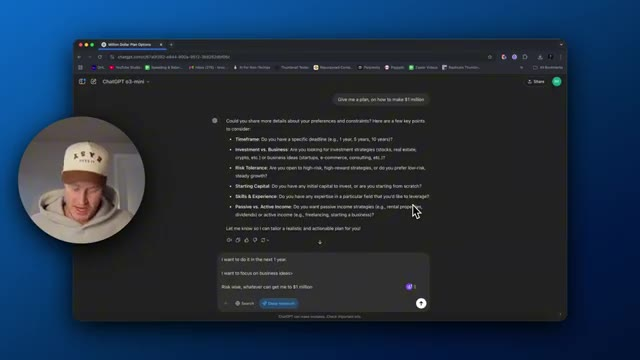
*⏱️ 00:02:25 — Capture d'écran montrant l'interface de ChatGPT avec le modèle o3-mini en cours de conversation pour générer un plan vers le million de dollars.*

---

### ⏱️ `[00:02:50 - 00:03:26]` | Segment #06

**🔊 Audio (Transcription Intégrale Mot pour Mot en Français) :**
> objectif. Je reviendrai vers vous bientôt avec un plan bien structuré. C'est parti. Une chose que je voulais mentionner, c'est qu'en fait j'utilise ChatGPT o3-mini au lieu de ChatGPT o3 high. Cela va réellement nous donner une réponse plus rapide et ça ne va pas, vous savez, c'est leur modèle à faible raisonnement par opposition à leur o3-mini high, qui est meilleur pour la codification et la logique. Donc je ne veux pas que cela me prenne une heure pour élaborer un plan. Je veux m'enrichir rapidement maintenant, ChatGPT. Alors j'espère que cela, vous savez, ne prendra pas trop de temps. Très bien. Donc c'est en train de faire le processus. Maintenant vous pouvez voir que ça teste l'accessibilité, ça cherche comment gagner 1 million de dollars sur Internet. Et si je clique là-dessus

**👁️ Analyse Visuelle d'Écran (gemini-3.5-flash-lite) :**
**Interface & Outils** : Interface web de ChatGPT dans un navigateur, avec une vignette vidéo du présentateur en bas à gauche.

**Contenu textuel & Code** : Texte de la conversation avec ChatGPT concernant la recherche d'idées de business pour générer un million de dollars à partir de zéro capital, et mention du modèle "ChatGPT o3-mini".

**Action / Démonstration** : Le présentateur montre l'interface de ChatGPT et explique le choix d'utiliser le modèle o3-mini pour obtenir une réponse plus rapide.

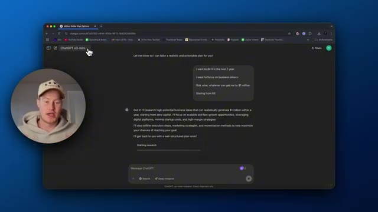
*⏱️ 00:02:59 — Capture d'écran montrant l'interface de ChatGPT avec la sélection du modèle o3-mini et la conversation en cours sur le plan d'affaires.*

---

### ⏱️ `[00:03:26 - 00:04:01]` | Segment #07

**🔊 Audio (Transcription Intégrale Mot pour Mot en Français) :**
> Ici, vous pouvez ensuite voir toutes ces activités qu'il est en train d'exécuter. Donc vous pouvez voir, encore une fois, qu'il a cherché à gagner 1 million de dollars grâce au marketing d'affiliation en dropshipping. Je rassemble des informations sur les tendances du contenu TikTok à partir d'un article Medium, j'ai cherché comment gagner 1 million de dollars en ligne, j'ai cherché à gagner un million de dollars en faisant du dropshipping en un an. Donc il prend ceci directement ici, toutes les spécifications sur la façon de gagner un million de dollars. Et on dirait qu'il fait des recherches sur chacune d'elles, genre pour comprendre quelle industrie ou quel modèle commercial je devrais même envisager afin de gagner ce million de dollars. D'accord. Donc il examine en fait des réussites impressionnantes comme celle d'Erwin Dominguez.

**👁️ Analyse Visuelle d'Écran (gemini-3.5-flash-lite) :**
**Interface & Outils** : Navigateur web affichant l'interface de ChatGPT.

**Contenu textuel & Code** : Texte de conversation avec ChatGPT o3-mini concernant un plan pour gagner 1 million de dollars en partant de zéro, et panneau latéral affichant les recherches en cours ("Searched for making $1 million dropshipping affiliate", "I'm gathering insights on trending TikTok content...").

**Action / Démonstration** : Le curseur de la souris survole les activités de recherche de l'assistant IA dans le panneau latéral.

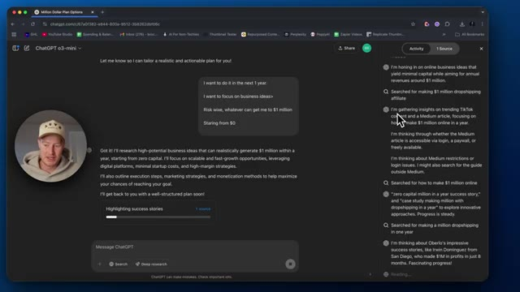
*⏱️ 00:03:35 — Capture d'écran montrant l'interface de ChatGPT o3-mini avec un panneau latéral droit affichant l'historique des activités et des recherches de l'agent IA.*

---

### ⏱️ `[00:04:01 - 00:04:30]` | Segment #08

**🔊 Audio (Transcription Intégrale Mot pour Mot en Français) :**
> de San Diego qui a réalisé 1 million de dollars de bénéfices en seulement huit mois. Un progrès fascinant. Il est intéressant que Chachapiti ait dit cela. D'accord, donc on dirait qu'il a peut-être trouvé le modèle économique basé en quelque sorte sur les recherches qu'il a effectuées ou les recherches approfondies, devrais-je dire, sur la façon de gagner un million de dollars sur Internet. D'accord, il envisage donc le dropshipping et le marketing d'affiliation et met l'accent sur la croissance organique et les plans étape par étape, y compris le marketing et les prévisions de revenus, en explorant des projets numériques comme des livres électroniques ou des cours comme des voies viables.

**👁️ Analyse Visuelle d'Écran (gemini-3.5-flash-lite) :**
**Interface & Outils** : Navigateur web affichant l'interface de ChatGPT avec le modèle o3-mini.

**Contenu textuel & Code** : Texte de conversation avec des prompts de l'utilisateur sur la création d'entreprise et le panneau latéral "Activity" et "Sources" détaillant les recherches web effectuées.

**Action / Démonstration** : Le modèle analyse les données de recherche et génère un plan détaillé sur les opportunités de commerce en ligne et de marketing d'affiliation.

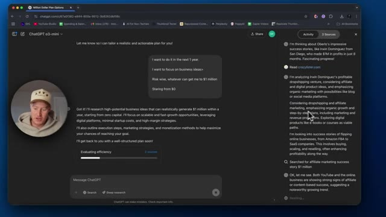
*⏱️ 00:04:08 — Capture d'écran de l'interface de ChatGPT o3-mini montrant une conversation sur un plan de génération d'un million de dollars et le panneau latéral de recherche web en cours.*

---

### ⏱️ `[00:04:30 - 00:04:50]` | Segment #09

**🔊 Audio (Transcription Intégrale Mot pour Mot en Français) :**
> Les gars, je suis vraiment très impressionné par la profondeur avec laquelle il creuse et fait des recherches. C'est comme s'il avait une idée, faisait des recherches sur cette idée, voyait si c'était une option viable, et l'ajoutait en quelque sorte à une liste en se disant, ok, c'est une option potentielle. Et ensuite, il continue ses recherches. Donc il fait vraiment des recherches approfondies, sans jeu de mots, mais c'est vrai. C'est plutôt cool.

**👁️ Analyse Visuelle d'Écran (gemini-3.5-flash-lite) :**
**Interface & Outils** : Navigateur web affichant l'interface de ChatGPT.

**Contenu textuel & Code** : Historique de discussion sur un plan d'affaires pour générer 1 million de dollars, avec un volet latéral détaillant les requêtes de recherche textuelles et la progression de l'analyse.

**Action / Démonstration** : Le modèle effectue des recherches approfondies (Deep Research) sur des idées de business en ligne et analyse des sources web.

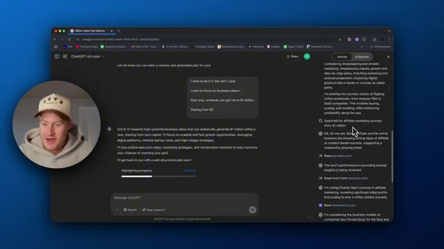
*⏱️ 00:04:35 — Capture d'écran montrant l'interface de ChatGPT o3-mini avec un panneau latéral affichant les recherches approfondies (Deep Research) en cours et le visage du présentateur en médaillon.*

---

### ⏱️ `[00:04:50 - 00:05:19]` | Segment #10

**🔊 Audio (Transcription Intégrale Mot pour Mot en Français) :**
> C'est la première fois que je vois quelque chose de Chachabuti à un niveau agentique où je me dis, ok, ça, c'est, c'est plutôt pas mal. C'est un peu mieux qu'Operator, vous savez, qui prend une éternité à cliquer sur un certain bouton de votre écran. Là, ça fait vraiment de vraies recherches, et je me vois déjà l'utiliser dans ma vie de tous les jours. Donc les gars, j'ai hâte de donner une conclusion sur ce que j'en pense, mais ouais, c'est plutôt cool jusqu'à présent. Ok. Donc un truc que je veux aussi souligner, c'est qu'on peut venir cliquer sur les sources qu'il a réellement consultées. Donc on dirait qu'il est allé sur starterstory.com, pour débloquer les secrets des entreprises à sept chiffres en ligne.

**👁️ Analyse Visuelle d'Écran (gemini-3.5-flash-lite) :**
**Interface & Outils** : Interface web de ChatGPT (navigateur web)

**Contenu textuel & Code** : Historique des recherches agentiques et des sources consultées dans le volet latéral (recherches sur le dropshipping, le marketing d'affiliation et les stratégies pour générer un million de dollars).

**Action / Démonstration** : Démonstration de l'agent effectuant des recherches complexes en arrière-plan et affichant son processus de réflexion ("Opening new pages").

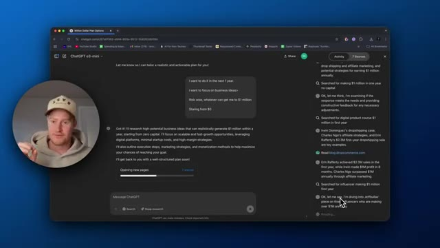
*⏱️ 00:04:58 — Capture d'écran montrant l'interface du navigateur avec l'application ChatGPT o3-mini en cours d'utilisation, affichant un panneau latéral avec des requêtes de recherche et des sources.*

---

### ⏱️ `[00:05:20 - 00:05:54]` | Segment #11

**🔊 Audio (Transcription Intégrale Mot pour Mot en Français) :**
> Donc, on dirait que c'est juste une plateforme avec tout un tas d'histoires différentes sur la façon dont, tu sais, différentes personnes ont gagné de l'argent en ligne. Et puis, allons sur crazylister.com. La façon la plus simple de créer des annonces sur Amazon et eBay. D'accord. Donc, on dirait que ça a utilisé ceci parce que ça a découvert que peut-être le dropshipping sur Amazon était une bonne option potentielle. Et puis, c'était peut-être en train d'utiliser ceci pour voir si c'est vraiment, tu sais, fondamentalement juste pour obtenir, rassembler plus d'informations sur le dropshipping et ce modèle commercial en général. D'accord. Donc, ça s'est bloqué juste ici. Je ne dirais pas bloqué, mais ça faisait des recherches jusqu'ici de manière très approfondie. C'est comme si ça regardait probablement ça pendant environ deux ou trois minutes.

**👁️ Analyse Visuelle d'Écran (gemini-3.5-flash-lite) :**
**Interface & Outils** : Navigateur web, site e-commerce (CrazyLister), interface ChatGPT.

**Contenu textuel & Code** : Page d'accueil de CrazyLister pour la vente sur Amazon et eBay ; interface de chat avec des prompts sur des idées de business.

**Action / Démonstration** : Navigation sur le site web CrazyLister pour présenter une solution de création d'annonces en ligne.

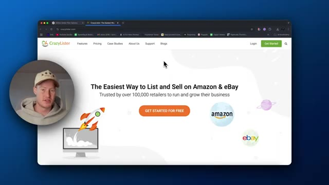
*⏱️ 00:05:37 — La page d'accueil du site crazylister.com avec le slogan "The Easiest Way to List and Sell on Amazon & eBay".*

---

### ⏱️ `[00:05:54 - 00:06:27]` | Segment #12

**🔊 Audio (Transcription Intégrale Mot pour Mot en Français) :**
> Maintenant, il est en train de dire : « Je réfléchis à un plan de reprise structuré, comprenant des modèles commerciaux, comme le dropshipping et le marketing d'affiliation, l'exécution, les méthodes de marketing, les prévisions de revenus, les défis et des études de cas. » Il utilise donc manifestement l'étude de cas d'Erwin Dominguez où il a fait un million de dollars de bénéfices grâce au dropshipping. D'accord. Il semble donc que potentiellement, le dropshipping et le marketing d'affiliation soient ce que Chachapiti pense qui va faire de nous des millionnaires, ce qui est très intéressant parce que j'ai l'impression qu'il y a beaucoup de gens, quand on pense initialement à une entreprise en ligne ou à la façon de gagner de l'argent en ligne, j'ai l'impression qu'on se tourne d'abord vers le dropshipping. C'est donc intéressant parce qu'il s'agit d'un modèle de recherche approfondie.

**👁️ Analyse Visuelle d'Écran (gemini-3.5-flash-lite) :**
**Interface & Outils** : Navigateur web, interface ChatGPT o3-mini.

**Contenu textuel & Code** : Texte de la conversation avec ChatGPT incluant des prompts utilisateur sur le démarrage d'une entreprise sans capital et la réponse de l'IA détaillant un plan de recherche de modèles commerciaux (dropshipping, marketing d'affiliation) et le panneau latéral de recherche web.

**Action / Démonstration** : Interaction avec l'interface de ChatGPT et affichage de la recherche en cours (Deep research).

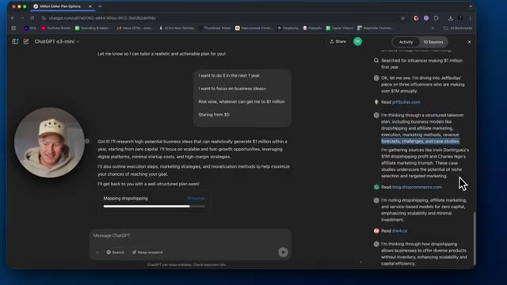
*⏱️ 00:06:02 — Capture d'écran de l'interface de ChatGPT o3-mini montrant la génération d'un plan commercial détaillé avec un panneau latéral affichant les sources de recherche.*

---

### ⏱️ `[00:06:27 - 00:06:45]` | Segment #13

**🔊 Audio (Transcription Intégrale Mot pour Mot en Français) :**
> Donc, il prend probablement cette information. Et comme l'a dit Sam Altman, il synthétise l'information. Il ne peut pas encore nécessairement tirer ses propres conclusions ou quoi que ce soit. Il prend simplement cette information et la condense essentiellement. Donc, cela a du sens parce qu'il y a tellement d'informations disponibles sur la façon de gagner de l'argent avec le dropshipping. C'est donc quelque chose que je voulais savoir, juste quelque chose qui me traversait l'esprit en observant l'activité ici.

**👁️ Analyse Visuelle d'Écran (gemini-3.5-flash-lite) :**
**Interface & Outils** : Navigateur web affichant l'interface de ChatGPT o3-mini avec le présentateur incrusté en bas à gauche.

**Contenu textuel & Code** : Interface de chat avec un historique des sources lues et analysées affiché dans le panneau latéral droit, et une barre de progression indiquant « Reading businessinsider.com » dans le corps de la discussion.

**Action / Démonstration** : Le modèle effectue des recherches en temps réel et synthétise les données provenant de plusieurs sources web pour répondre au prompt.

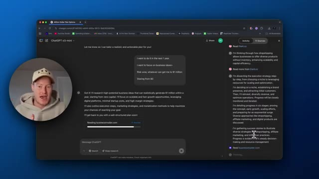
*⏱️ 00:06:31 — Capture d'écran montrant l'interface de ChatGPT o3-mini en cours de recherche et de synthèse d'informations sur le web avec un panneau latéral affichant les sources consultées.*

---

### ⏱️ `[00:06:45 - 00:07:04]` | Segment #14

**🔊 Audio (Transcription Intégrale Mot pour Mot en Français) :**
> Très bien, je vais en fait me lever, aller aux toilettes. J'ai besoin d'aller pisser et ça va continuer à travailler pour moi en pilotage automatique. C'est un agent autonome. C'est quand même super. Donc je vais faire ça maintenant et je serai de retour. Bon, alors pendant que j'étais aux toilettes, j'ai en fait obtenu la réponse ici. Et c'est un gros, genre, c'est un gros document, ou si vous voulez l'appeler ainsi. Il y a beaucoup d'informations ici.

**👁️ Analyse Visuelle d'Écran (gemini-3.5-flash-lite) :**
**Interface & Outils** : Navigateur web affichant l'interface de ChatGPT.

**Contenu textuel & Code** : Historique textuel de recherche, messages de prompt utilisateur demandant un plan pour atteindre un million de dollars à partir de zéro, et panneau latéral affichant les étapes de réflexion et de recherche en cours ("Reading businessinsider.com", "Thinking...").

**Action / Démonstration** : Démonstration de l'utilisation d'un agent IA autonome effectuant des recherches approfondies en arrière-plan.

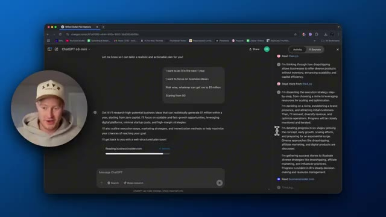
*⏱️ 00:06:50 — Capture d'écran montrant l'interface du navigateur avec ChatGPT (mode Deep Research) en train de générer un plan d'affaires, avec le présentateur en médaillon.*

---

### ⏱️ `[00:07:04 - 00:07:22]` | Segment #15

**🔊 Audio (Transcription Intégrale Mot pour Mot en Français) :**
> Alors ça va être intéressant à explorer. Donc voyons voir. Plan stratégique, gagner 1 million de dollars en un an à partir de zéro capital. Donc évidemment l'objectif, c'est en quelque sorte de reformuler cette information qu'on lui a initialement donnée. On veut faire un million de dollars en 12 mois. En chiffre d'affaires, ce qui est intéressant parce que je suppose que je n'ai pas spécifié de bénéfice. Donc voilà. Modèle commercial à fort potentiel.

**👁️ Analyse Visuelle d'Écran (gemini-3.5-flash-lite) :**
**Interface & Outils** : Navigateur web affichant l'interface de l'intelligence artificielle ChatGPT (mode sombre).

**Contenu textuel & Code** : Texte du plan stratégique : titre "Strategic Plan: Earning $1 Million in One Year from Zero Capital", objectif de construction d'entreprise sans capital initial sur 12 mois, et section sur les modèles commerciaux à fort potentiel (Dropshipping, Affiliate Marketing).

**Action / Démonstration** : Le présentateur présente et commente le plan stratégique généré par l'IA affiché à l'écran.

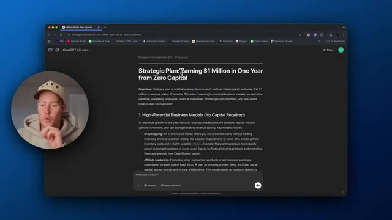
*⏱️ 00:07:09 — Capture d'écran montrant l'interface de ChatGPT affichant le plan stratégique généré pour gagner un million de dollars à partir de zéro capital, avec la webcam du présentateur incrustée à gauche.*

---

### ⏱️ `[00:07:23 - 00:07:42]` | Segment #16

**🔊 Audio (Transcription Intégrale Mot pour Mot en Français) :**
> Nous ne voulons aucun capital requis. Donc, il semble que la liste qu'il nous a donnée pour cela sans capital requis était le dropshipping, le marketing d'affiliation, les entreprises de services, la monétisation des réseaux sociaux, qui est le modèle d'influenceur, les produits numériques ou les cours en ligne. Intéressant. Donc, cela a du sens. Ce sont beaucoup de choses avec lesquelles les gens disent que l'on peut gagner beaucoup d'argent en partant de zéro.

**👁️ Analyse Visuelle d'Écran (gemini-3.5-flash-lite) :**
**Interface & Outils** : Interface web de ChatGPT dans un navigateur, avec une vignette vidéo du présentateur.

**Contenu textuel & Code** : Texte généré par l'IA détaillant les modèles commerciaux nécessitant peu ou pas de capital initial (Dropshipping, Affiliate Marketing, Service-Based Business).

**Action / Démonstration** : Le présentateur présente à l'écran la liste des modèles commerciaux générée par l'intelligence artificielle.

*⏱️ 00:07:28 — Capture d'écran montrant l'interface d'un navigateur avec une conversation ChatGPT listant des modèles commerciaux à fort potentiel sans capital requis (dropshipping, marketing d'affiliation, etc.), avec la webcam du présentateur incrustée en bas à gauche.*

---

### ⏱️ `[00:07:42 - 00:08:05]` | Segment #17

**🔊 Audio (Transcription Intégrale Mot pour Mot en Français) :**
> D'accord. Donc, stratégie d'exécution, plan d'action sur 12 mois, atteindre 1 million de dollars en 12 mois demande de la discipline, mois un à deux, fondation et lancement. Donc, recherche et sélection d'une niche. Bon, ChatGPT, si j'utilise une recherche approfondie, tu devrais faire ça pour moi. C'est donc intéressant. Voyons si cela nous a même donné une piste à suivre ou si c'est juste en train de synthétiser cette information et de nous faire faire le plan nous-mêmes.

**👁️ Analyse Visuelle d'Écran (gemini-3.5-flash-lite) :**
**Interface & Outils** : Navigateur web affichant l'interface de ChatGPT (modèle o3-mini).

**Contenu textuel & Code** : Texte détaillé du plan d'action incluant la stratégie d'exécution sur 12 mois, les mois 1 à 2 sur la fondation et le lancement, la recherche et la sélection de niche, et le choix du modèle économique.

**Action / Démonstration** : Le présentateur commente le plan d'action généré par l'intelligence artificielle affiché à l'écran.

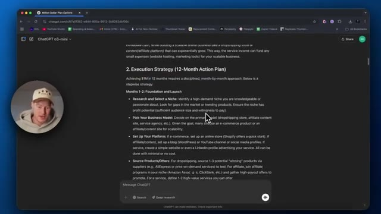
*⏱️ 00:07:48 — Capture d'écran montrant l'interface de ChatGPT avec une stratégie d'exécution sur 12 mois pour atteindre 1 million de dollars.*

---

### ⏱️ `[00:08:05 - 00:08:24]` | Segment #18

**🔊 Audio (Transcription Intégrale Mot pour Mot en Français) :**
> D'accord. Donc, les mois trois et cinq, prise d'élan, montée en puissance de six à neuf mois, de dix à douze mois, atteindre les objectifs d'un million de dollars. Donc, doubler la mise sur ce qui fonctionne, étendre la portée du marketing, affiner, mettre à l'échelle les opérations, suivre et progresser, pivoter si nécessaire, assurer la victoire. D'accord. Donc, stratégies marketing. Donc, le marketing de contenu et le référencement, les réseaux sociaux et le marketing viral.

**👁️ Analyse Visuelle d'Écran (gemini-3.5-flash-lite) :**
**Interface & Outils** : Navigateur web affichant l'interface de ChatGPT.

**Contenu textuel & Code** : Texte généré par l'IA détaillant les étapes des mois 10 à 12 : doubler la mise sur ce qui fonctionne, étendre la portée du marketing et affiner les opérations.

**Action / Démonstration** : Le présentateur survole ou met en surbrillance le texte du plan stratégique affiché dans le navigateur.

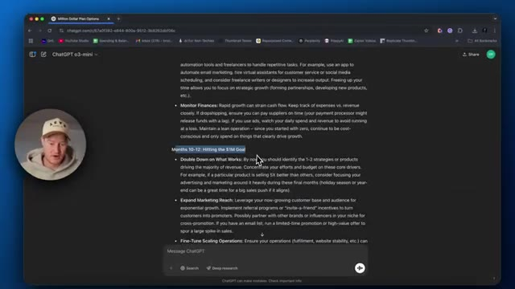
*⏱️ 00:08:10 — Capture d'écran montrant l'interface de ChatGPT (modèle o3-mini) affichant un plan stratégique détaillé pour atteindre un million de dollars sur 12 mois, avec la section "Months 10-12: Hitting the $1M Goal" mise en surbrillance.*

---

### ⏱️ `[00:08:24 - 00:08:42]` | Segment #19

**🔊 Audio (Transcription Intégrale Mot pour Mot en Français) :**
> Les gars, on plonge vraiment très profondément là-dedans. C'est beaucoup d'informations pour moi à passer en revue dans cette vidéo. Genre, lire tout ça serait un peu pénible. Peut-être que ce que je vais faire, c'est qu'en fait je vais copier cette information. Je vais l'ajouter à mes ressources gratuites. Je mettrai un lien dans la description et vous pourrez simplement voir essentiellement le résultat que ça m'a donné si vous voulez parcourir toute cette information.

**👁️ Analyse Visuelle d'Écran (gemini-3.5-flash-lite) :**
**Interface & Outils** : Navigateur web, interface de ChatGPT

**Contenu textuel & Code** : Texte détaillé d'un plan marketing et publicitaire généré par l'IA (parties sur les partenariats d'influenceurs et la publicité payante).

**Action / Démonstration** : Le présentateur consulte la longue réponse textuelle générée par l'IA à l'écran.

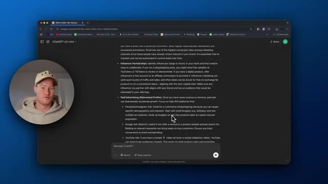
*⏱️ 00:08:28 — Capture d'écran montrant l'interface du navigateur affichant ChatGPT (modèle o3-mini) avec du texte généré sur un plan d'affaires, et la webcam du présentateur dans un cercle en bas à gauche.*

---

### ⏱️ `[00:08:42 - 00:09:18]` | Segment #20

**🔊 Audio (Transcription Intégrale Mot pour Mot en Français) :**
> Donc, assurez-vous de faire ça. D'accord. Donc, il s'agit de décomposer les projections de revenus et les étapes clés mois par mois. Donc, mois un à deux, mise en place et pré-ventes. Donc, peut-être de zéro à 5 000 dollars de revenus totaux, mois trois, peut-être 5 à 10 000 dollars, mois cinq, 20 000 dollars, mois six, 50 000 dollars, mise à l'échelle et expansion. D'accord, donc une fois qu'on a 50 000 dollars, il sait que, d'accord, on peut réellement commencer à investir dans l'entreprise, à embaucher des gens ou autre. Donc, ces 50 000 dollars passent à 80 à 100 000 dollars, mois 10 à 11, en poussant vers les sept chiffres, 150 à 200 000. D'accord, intéressant. Il a noté que 1 million de dollars de revenus, c'est différent du profit, évidemment. D'accord, donc

**👁️ Analyse Visuelle d'Écran (gemini-3.5-flash-lite) :**
**Interface & Outils** : Navigateur web affichant l'interface de ChatGPT.

**Contenu textuel & Code** : Texte détaillé sur les projections de revenus : "4. Revenue Projections and Milestones" avec des détails pour le mois 1-2 (Revenue: ~$0–$5,000 total), le mois 3 et les mois 4-5.

**Action / Démonstration** : Le présentateur survole ou sélectionne du texte dans le plan de revenus généré par l'IA.

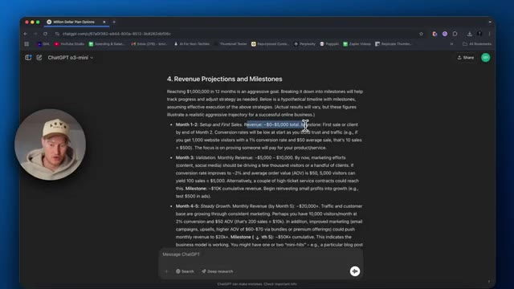
*⏱️ 00:08:51 — Capture d'écran montrant l'interface de ChatGPT avec le modèle o3-mini affichant un plan de développement avec des projections de revenus et des étapes clés.*

---

### ⏱️ `[00:09:18 - 00:09:51]` | Segment #21

**🔊 Audio (Transcription Intégrale Mot pour Mot en Français) :**
> enfin, ce qu'il a fait, c'est qu'il a réellement écrit toutes ces sources ici d'études de cas de personnes passant de zéro à un million de dollars en environ un an, je crois, donc il ne nous a pas vraiment donné de plan exact, il dit toujours que nous devons sélectionner une niche, il nous a donné un tas d'informations sur ces différents modèles commerciaux que nous pourrions parcourir, donc c'est logique, c'est un modèle de recherche approfondie, ce n'est pas, vous savez, j'aurais pu être plus précis avec mon prompt, vous savez, mais pour les besoins de cette vidéo, je voulais demander comment puis-je gagner un million de dollars en un an, je voulais que ce soit simple. Donc maintenant, nous avons un tas d'options différentes ici et il est en train de tracer une stratégie de

**👁️ Analyse Visuelle d'Écran (gemini-3.5-flash-lite) :**
**Interface & Outils** : Navigateur web affichant l'interface de ChatGPT.

**Contenu textuel & Code** : Texte généré listant des études de cas (ex. Katie Fenney, Pat Flynn) détaillant le passage de zéro à plus d'un million de dollars de revenus.

**Action / Démonstration** : Présentation visuelle des sources textuelles et des études de cas générées par l'IA pour illustrer les exemples de réussite.

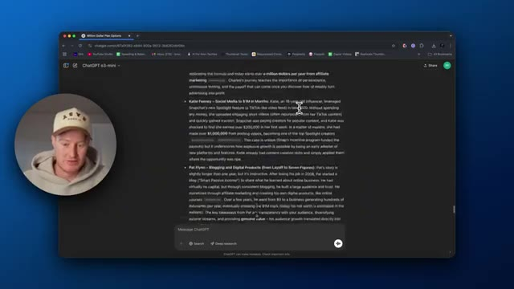
*⏱️ 00:09:26 — Capture d'écran montrant l'interface de ChatGPT (modèle o3-mini) affichant des études de cas textuelles sur des réussites financières, avec une incrustation vidéo du présentateur dans un cercle à gauche.*

---

### ⏱️ `[00:09:51 - 00:10:24]` | Segment #22

**🔊 Audio (Transcription Intégrale Mot pour Mot en Français) :**
> ce que nous aimons les obstacles que nous pourrions potentiellement rencontrer et tout ça. Donc voici nos options. Et peut-être que ce que nous pourrions faire c'est poser une question de suivi et dire, Hé, je veux que tu ailles plus en profondeur sur le dropshipping et comment je pourrais passer de zéro à 1 million de dollars en un an avec ce modèle commercial. Donc voilà. C'est notre résultat. Je voulais montrer ça dans cette vidéo. Je pense que ça va vraiment en profondeur. C'est vraiment cool. Je pense que ça vaudrait peut-être la peine de demander à ChatGPT maintenant de juste résumer cette information pour que ce ne soit pas si long voyons ce que ça nous donne d'accord voilà il rend ça un peu plus concis ce qui est bien mieux d'accord voilà ça rend les choses un peu

**👁️ Analyse Visuelle d'Écran (gemini-3.5-flash-lite) :**
**Interface & Outils** : Navigateur web affichant l'interface de ChatGPT (modèle o3-mini).

**Contenu textuel & Code** : Texte structuré listant des modèles commerciaux : Dropshipping, Affiliate Marketing, Service-Based Business, et Social Media Monetization. Le curseur clique sur le bouton "Deep research".

**Action / Démonstration** : Le présentateur présente les résultats générés par l'IA et interagit avec l'interface pour lancer une recherche approfondie.

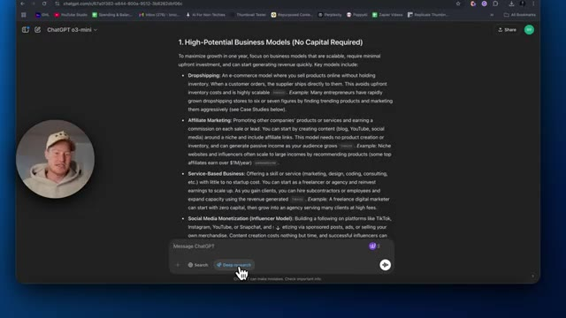
*⏱️ 00:10:00 — Capture d'écran montrant l'interface de ChatGPT avec une réponse générée concernant les modèles commerciaux à fort potentiel sans capital requis.*

---

### ⏱️ `[00:10:24 - 00:10:47]` | Segment #23

**🔊 Audio (Transcription Intégrale Mot pour Mot en Français) :**
> moins intimidant euh mais les gars, ça plonge très profondément là-dedans, c'est super cool, je pense que c'est tout ce que je vais couvrir dans cette vidéo. Je vais couvrir d'autres cas d'utilisation que je trouve pour ceci, de sorte que vous sachiez, vous n'ayez potentiellement pas à investir vous-même 200 dollars pour utiliser cette plateforme. Voilà, c'est tout les gars, merci d'avoir suivi. Je pensais que ça allait être une question cool à poser à ChatGPT. Évidemment, ce n'est peut-être pas facile de gagner un million de dollars en un an, mais je voulais voir ce que ça allait nous donner.

**👁️ Analyse Visuelle d'Écran (gemini-3.5-flash-lite) :**
**Interface & Outils** : Navigateur web affichant ChatGPT (chatgpt.com)

**Contenu textuel & Code** : Texte généré par l'IA détaillant des études de cas de réussite (Erin Rafferty avec 2.3M$ en e-commerce, Charles Ngo en marketing d'affiliation) et le sélecteur de mode de recherche (Search, Deep research).

**Action / Démonstration** : Le présentateur survole le texte et navigue dans l'interface de ChatGPT.

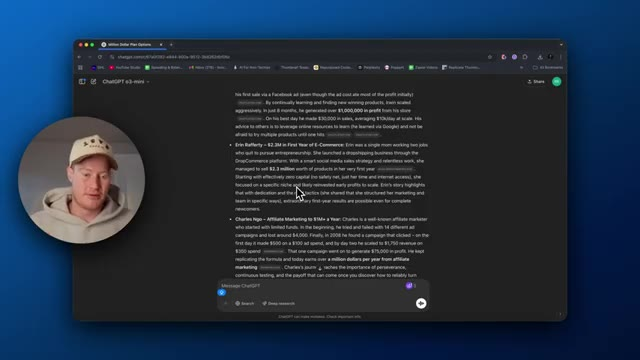
*⏱️ 00:10:30 — Capture d'écran montrant l'interface du navigateur avec ChatGPT (modèle o3-mini) affichant des exemples de réussite en e-commerce et marketing d'affiliation, avec la webcam du présentateur incrustée dans un cercle à gauche.*

---

### ⏱️ `[00:10:47 - 00:10:51]` | Segment #24

**🔊 Audio (Transcription Intégrale Mot pour Mot en Français) :**
> Voilà qui est fait, les gars. Abonnez-vous à cette chaîne. Laissez un pouce bleu, laissez un commentaire, et je vous dis à la prochaine dans une prochaine vidéo.

**👁️ Analyse Visuelle d'Écran (gemini-3.5-flash-lite) :**
**Interface & Outils** : Navigateur web affichant l'interface de ChatGPT (o3-mini) avec une pastille vidéo incrustée du présentateur.

**Contenu textuel & Code** : Texte généré par l'IA concernant des stratégies d'e-commerce et de marketing d'affiliation (ex: Erin Rafferty, Charles Ngo).

**Action / Démonstration** : Le présentateur conclut la vidéo en incrustation pendant que le navigateur affiche la page ChatGPT.

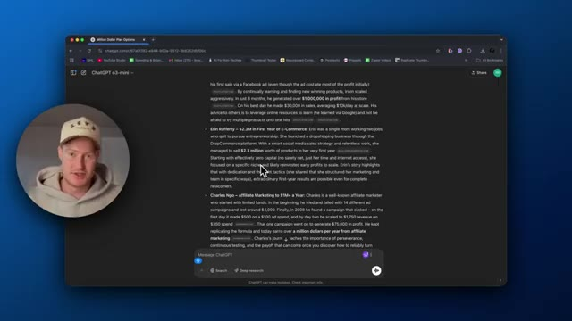
*⏱️ 00:10:48 — Capture d'écran montrant le navigateur avec l'interface de ChatGPT o3-mini affichant du texte généré, avec une incrustation vidéo du présentateur en bas à gauche.*

---

