# 🎬 I Cancelled THIS Software and Built My Own With AI (Lovable)

> **Chaîne** : [Brock Mesarich | AI for Non Techies](https://www.youtube.com/@BrockMesarich)  
> **Lien YouTube** : [https://www.youtube.com/watch?v=SfiuqWImfWs](https://www.youtube.com/watch?v=SfiuqWImfWs)  
> **Date de publication** : 20250206  
> **Durée** : 00:40:42  
> **Identifiant vidéo** : `SfiuqWImfWs`  
> **Transcription & Analyse** : `whisper-v3-large-turbo+gemini-3.5-flash-lite`  

---

## 📌 Synthèse Exécutive & Outils

### 💡 Résumé

Cette vidéo immersive de Brock Mesarich (chaîne *Brock Mesarich | AI for Non Techies*) illustre le passage à l'échelle du no-code et du développement assisté par IA pour éliminer les abonnements logiciels superflus (*SaaS stripping*). Le créateur y entreprend de recréer de zéro, via la plateforme de génération « texte-à-application » Lovable, un outil payant d'A/B testing et de prévisualisation de miniatures YouTube (facturé initialement 27 $ par mois, soit 324 $ par an). La démonstration met en lumière la puissance disruptive de la création de logiciels sur mesure, adaptés aux préférences exactes de l'utilisateur, tout en exposant de manière brute et sans filtre les frictions inhérentes au processus de développement itératif assisté par IA.

L'expérimentation démontre la capacité des générateurs d'applications actuels à concevoir des architectures web fonctionnelles tout en révélant leurs limites face à des exigences de design extrêmement granulares — telles que la réplication pixel-perfect des algorithmes de césure de texte et d'habillage des polices d'une plateforme tierce comme YouTube. Au-delà de l'exercice d'optimisation des coûts personnels, la vidéo aborde l'opportunité entrepreneuriale de monétiser ces micro-SaaS construits par IA, notamment grâce à l'intégration future de solutions de paiement comme Stripe, transformant un simple utilitaire personnel en un actif commercial scalable.

### 🛠️ Outils, Modèles & Logiciels Présentés

*   **Lovable** : Plateforme de développement no-code de type « text-to-web-app » utilisée pour concevoir et itérer l'application de test de miniatures YouTube.
*   **ChatGPT (Deep Research)** : Assistant conversationnel avancé mobilisé pour générer des concepts de titres et de recherches stratégiques axés sur la viralité.
*   **Grok** : Modèle d'intelligence artificielle conversationnelle mentionné dans l'écosystème d'automatisation et de veille stratégique.
*   **Claude** : Grand modèle de langage de pointe souvent exploité pour l'analyse de code complexe et le prompt engineering avancé.
*   **Gemini** : Modèle d'IA de Google intégré dans les flux de travail de productivité et de recherche de contenu.
*   **n8n** : Outil d'automatisation de flux de travail open-source et auto-hégeable pour connecter des applications complexes.
*   **Make** : Plateforme d'intégration visuelle avancée pour automatiser des processus métiers et synchroniser des bases de données.
*   **Zapier** : Logiciel d'automatisation no-code standard servant à relier rapidement des services cloud entre eux.
*   **Stripe** : Solution de paiement en ligne évoquée pour monétiser et intégrer un système d'abonnement au micro-SaaS développé.

### 🔑 Points Clés & Enseignements Stratégiques

*   **Stratégie de réduction des coûts logiciels (SaaS Arbitrage)** : Remplacer des abonnements mensuels récurrents par des applications construites par IA permet d'éliminer les frictions budgétaires à long terme pour les créateurs et les entreprises.
*   **Personnalisation extrême des interfaces** : Les plateformes de type text-to-web-app permettent de concevoir des outils taillés sur mesure pour un flux de travail personnel, surpassant parfois les fonctionnalités rigides des SaaS généralistes.
*   **Défis du design *Pixel-Perfect*** : Répliquer exactement l'interface utilisateur d'une plateforme tierce (comme le rendu typographique et la césure des titres YouTube) nécessite des instructions de prompt engineering extrêmement précises et itératives.
*   **Gestion des erreurs de code en direct** : L'utilisation de Lovable implique d'analyser les logs d'erreurs générés lors des premiers prompts pour ajuster progressivement la logique front-end et back-end de l'application.
*   **Importance des captures d'écran contextuelles** : Fournir des retours visuels comparatifs (capture de la source originale versus capture de la sortie générée) s'avère indispensable pour guider l'IA vers les corrections graphiques attendues.
*   **Itération par essais-erreurs** : Le développement assisté par IA moderne demande de la résilience face aux instructions ignorées ou mal interprétées par le modèle, exigeant des relances ciblées et des questions de vérification (« *Êtes-vous sûr d'avoir implémenté ce format ?* »).
*   **Scalabilité et monétisation des micro-SaaS** : Un outil développé initialement pour un usage personnel peut être transformé, via l'ajout de passerelles de paiement, en une source de revenus SaaS alternative.
*   **Intégration de briques de paiement (Stripe)** : L'architecture de ces applications générées par IA intègre des logiques de monétisation permettant de transformer un prototype interne en produit commercialisable.
*   **Transparence des processus de construction (*Build in Public*)** : Partager les bugs, les impasses techniques et les résolutions en temps réel renforce l'engagement de l'audience et démystifie l'utilisation des technologies no-code.
*   **Optimisation des tests A/B de miniatures** : Centraliser le test visuel des miniatures et des titres dans une interface dédiée permet d'anticiper le taux de clics (CTR) avant la mise en ligne effective sur YouTube.
*   **Retour sur investissement à long terme** : Le calcul de rentabilité (dans l'exemple, l'économie de 324 $ par an) justifie l'investissement en temps initial nécessaire pour prompter et stabiliser une application sur mesure.

---

## ⏱️ Chronologie & Transcription Complète Audio & Visuelle (Mot pour Mot)

### ⏱️ `[00:00:00 - 00:00:40]` | Segment #01

**🔊 Audio (Transcription Intégrale Mot pour Mot en Français) :**
> In this video, I'm actually going to recreate a SaaS that I pay for and actually build it in lovable so I can actually cancel my subscription. So let me go ahead and share my screen and explain exactly kind of the software I'm trying to recreate. So what I'm going to do, I'm going to come over to this thumbnail editor here. So this is called test my thumbnails. And essentially what this software does is it allows you to upload your thumbnails and test it compared to others to see what it would look like. So you can see I upload this. You could see this in the feed here, and then I could write in the title. So I asked chat GBT deep research, how to make $1 million.

**👁️ Analyse Visuelle d'Écran (gemini-3.5-flash-lite) :**
**Interface & Outils** : Présentation ou face-caméra explicatif du trader sans interface logicielle partagée.

**Contenu textuel & Code** : Explications orales des stratégies et mise en contexte méthodologique du marché.

**Action / Démonstration** : Explications face caméra et analyse conceptuelle des marchés.

---

### ⏱️ `[00:00:41 - 00:01:16]` | Segment #02

**🔊 Audio (Transcription Intégrale Mot pour Mot en Français) :**
> If you haven't seen that video, go ahead and check it out. It's a good one, but there we go. So we can now see what our thumbnail looks like inside of this feed. And I use this every single day. And currently I'm paying $27 every single month to access this software. So I thought to myself, why don't I just try recreating this in lovable? It seems easy enough to do. I could probably even build a better version of this that is customized to myself. So that is where platforms like lovable, where you could go from text to web app are so powerful and they're going to be powerful in the future because we're all going to have customizable SaaS based on our

**👁️ Analyse Visuelle d'Écran (gemini-3.5-flash-lite) :**
**Interface & Outils** : Présentation ou face-caméra explicatif du trader sans interface logicielle partagée.

**Contenu textuel & Code** : Explications orales des stratégies et mise en contexte méthodologique du marché.

**Action / Démonstration** : Explications face caméra et analyse conceptuelle des marchés.

---

### ⏱️ `[00:01:16 - 00:01:50]` | Segment #03

**🔊 Audio (Transcription Intégrale Mot pour Mot en Français) :**
> preferences instead of having to pay other people to use their services. So I could click random. You could see, I could, you know, just see if my thumbnail stands out. That's a really good thumbnail and title, in my opinion, compared to these others. So there we go. That this is what we're going to try to emulate is this app right here. So next up, what I'm going to do is I'm going to come into lovable and let me just try to explain what I'm trying to build with this first initial prompt. I'm going to get really, I'm going to dive in deep and kind of give a full layout of, okay, I'm trying to build an app that does this and this and this, maybe even give a screenshot of this so I could kind of potentially try to replicate it in some form of way. So let's just

**👁️ Analyse Visuelle d'Écran (gemini-3.5-flash-lite) :**
**Interface & Outils** : Présentation ou face-caméra explicatif du trader sans interface logicielle partagée.

**Contenu textuel & Code** : Explications orales des stratégies et mise en contexte méthodologique du marché.

**Action / Démonstration** : Explications face caméra et analyse conceptuelle des marchés.

---

### ⏱️ `[00:01:50 - 00:02:27]` | Segment #04

**🔊 Audio (Transcription Intégrale Mot pour Mot en Français) :**
> say, help me build a web app that allows you to test YouTube thumbnails and titles in order to see what they will look like when posted to the feed on YouTube. And then let's just come here and say, notice all uploaded thumbnails and titles need to fit the exact format of YouTube. The entire purpose of the app is to see what the format will look like when live on YouTube. Okay. So what I'm

**👁️ Analyse Visuelle d'Écran (gemini-3.5-flash-lite) :**
**Interface & Outils** : Présentation ou face-caméra explicatif du trader sans interface logicielle partagée.

**Contenu textuel & Code** : Explications orales des stratégies et mise en contexte méthodologique du marché.

**Action / Démonstration** : Explications face caméra et analyse conceptuelle des marchés.

---

### ⏱️ `[00:02:27 - 00:03:05]` | Segment #05

**🔊 Audio (Transcription Intégrale Mot pour Mot en Français) :**
> saying here is we need it to look exactly like YouTube. So if I come over to YouTube, it needs to look exactly like this. It needs to be like the same size thumbnail. The title needs to be exactly the same, like same font. And for example, like we don't want this title to be all on the same line. It needs to look exactly how it would look on YouTube. So that is why I specified that. And then let's go ahead and just say, here are some of the key features, ability to number this one ability to upload thumbnail photos to ability to add titles, three show mock

**👁️ Analyse Visuelle d'Écran (gemini-3.5-flash-lite) :**
**Interface & Outils** : Présentation ou face-caméra explicatif du trader sans interface logicielle partagée.

**Contenu textuel & Code** : Explications orales des stratégies et mise en contexte méthodologique du marché.

**Action / Démonstration** : Explications face caméra et analyse conceptuelle des marchés.

---

### ⏱️ `[00:03:05 - 00:03:41]` | Segment #06

**🔊 Audio (Transcription Intégrale Mot pour Mot en Français) :**
> YouTube videos to create a fake feed in order to see what our video will look like and if it will stand out compared to others. Okay. So I think that's a good initial prompt. What I'm going to do is I'm actually going to give this a screenshot here and I don't want to necessarily like completely recreate this exactly, but I want it to get a sense of kind of what we want the feed to look like maybe have the bar and the navigation bar on the left-hand side where we upload our thumbnail and add our title and whatnot. So let's go ahead and go through this. Also, one thing I want to

**👁️ Analyse Visuelle d'Écran (gemini-3.5-flash-lite) :**
**Interface & Outils** : Présentation ou face-caméra explicatif du trader sans interface logicielle partagée.

**Contenu textuel & Code** : Explications orales des stratégies et mise en contexte méthodologique du marché.

**Action / Démonstration** : Explications face caméra et analyse conceptuelle des marchés.

---

### ⏱️ `[00:03:41 - 00:04:10]` | Segment #07

**🔊 Audio (Transcription Intégrale Mot pour Mot en Français) :**
> mention guys is this video is probably going to be a bit more of a raw and uncut video like my others where I build with lovable. So you could see like me kind of breaking this because it's not going to be pretty perfect. You know, it won't be as simple as giving it this prompt and then having it done. So bear with me. And one thing I want to mention is I know you guys seem to be enjoying that type of content because you want to see like how I fix an error and whatnot. The videos I've had with Mark previously on the channel, make sure to check those out if you haven't already. But yeah, I think it's fun just diving in deeply, showing you exactly the problems I run into.

**👁️ Analyse Visuelle d'Écran (gemini-3.5-flash-lite) :**
**Interface & Outils** : Présentation ou face-caméra explicatif du trader sans interface logicielle partagée.

**Contenu textuel & Code** : Explications orales des stratégies et mise en contexte méthodologique du marché.

**Action / Démonstration** : Explications face caméra et analyse conceptuelle des marchés.

---

### ⏱️ `[00:04:11 - 00:04:47]` | Segment #08

**🔊 Audio (Transcription Intégrale Mot pour Mot en Français) :**
> And yeah. All right. So after our first initial prompt, it looks like we ran into an error here. So let's go ahead and show the log and then try to fix this. So interesting. Honestly, I don't even know what any of this is. I think it's trying to recreate the user interface of that screenshot I gave it. So I think that's maybe what's causing the errors here. So let's try to fix this. And then I'm going to come over here to our actual app that we're trying to recreate. I'm going to show you the pricing. So here we go. I pay monthly and I've used the pro plan because I need unlimited title thumbnail ideas up to three thumbnail AB tests at once, whatnot. So $27 per month, that's how much I am paying. So I'm going to be saving myself $27 per month, which adds up to,

**👁️ Analyse Visuelle d'Écran (gemini-3.5-flash-lite) :**
**Interface & Outils** : Présentation ou face-caméra explicatif du trader sans interface logicielle partagée.

**Contenu textuel & Code** : Explications orales des stratégies et mise en contexte méthodologique du marché.

**Action / Démonstration** : Explications face caméra et analyse conceptuelle des marchés.

---

### ⏱️ `[00:04:47 - 00:05:24]` | Segment #09

**🔊 Audio (Transcription Intégrale Mot pour Mot en Français) :**
> let's see here, $27 times 12, $324 per year. And not only that, but I could then go ahead and sell this to other people and actually make money from this, which I'm going to show you later on the video. I'm going to show you how to add Stripe payments. So guys, this is going to be a valuable one for you. Okay, here we go. Looks like this is what it gave us. Let's go ahead and test the functionality here, which is always really important to do at the beginning. So it looks like this file upload works. Image must be exactly 1280, 720 pixels. Let's see. Interesting. So first of all, I'm running into an error inside of the app for whatever reason. I think because I mentioned that

**👁️ Analyse Visuelle d'Écran (gemini-3.5-flash-lite) :**
**Interface & Outils** : Présentation ou face-caméra explicatif du trader sans interface logicielle partagée.

**Contenu textuel & Code** : Explications orales des stratégies et mise en contexte méthodologique du marché.

**Action / Démonstration** : Explications face caméra et analyse conceptuelle des marchés.

---

### ⏱️ `[00:05:24 - 00:05:50]` | Segment #10

**🔊 Audio (Transcription Intégrale Mot pour Mot en Français) :**
> it needs to be the exact thumbnail as, or it needs to be the exact dimensions as YouTube. Maybe like that's why this upload is not working. So let me go ahead and just ask here. Doesn't need to be 1280 times 720. I just need the output that shows in the preview in feed to be the exact size of YouTube.

**👁️ Analyse Visuelle d'Écran (gemini-3.5-flash-lite) :**
**Interface & Outils** : Présentation ou face-caméra explicatif du trader sans interface logicielle partagée.

**Contenu textuel & Code** : Explications orales des stratégies et mise en contexte méthodologique du marché.

**Action / Démonstration** : Explications face caméra et analyse conceptuelle des marchés.

---

### ⏱️ `[00:05:50 - 00:06:12]` | Segment #11

**🔊 Audio (Transcription Intégrale Mot pour Mot en Français) :**
> Okay, so hopefully it understands what I'm saying here. All right, for some reason, the upload is not working. Let me open it up in a new tab, maybe for whatever reason. It only allows one upload and we already used that. So here we go. Okay, so that worked. Now let me go ahead and give it a title here. So I asked chat GPT deep research how to make $1 million.

**👁️ Analyse Visuelle d'Écran (gemini-3.5-flash-lite) :**
**Interface & Outils** : Présentation ou face-caméra explicatif du trader sans interface logicielle partagée.

**Contenu textuel & Code** : Explications orales des stratégies et mise en contexte méthodologique du marché.

**Action / Démonstration** : Explications face caméra et analyse conceptuelle des marchés.

---

### ⏱️ `[00:06:13 - 00:06:52]` | Segment #12

**🔊 Audio (Transcription Intégrale Mot pour Mot en Français) :**
> Okay, there we go. So this is cool. Obviously it's now working. The question is if this is correctly showing the format of how it would look on YouTube. So let me come back over here and we'll just test it inside of this obviously because we're testing we're trying to recreate this site here So let's just make sure that it looks the exact same as this software here And then let me fully expand this so you could see what I mean by this is maybe I could try to do a side-by-side comparison or something But okay, I need to make sure that like the title looks exactly the same So on this the top the the first line says I asked chachviti deep research how to and then the bottom line is actually make 1 million dollars

**👁️ Analyse Visuelle d'Écran (gemini-3.5-flash-lite) :**
**Interface & Outils** : Présentation ou face-caméra explicatif du trader sans interface logicielle partagée.

**Contenu textuel & Code** : Explications orales des stratégies et mise en contexte méthodologique du marché.

**Action / Démonstration** : Explications face caméra et analyse conceptuelle des marchés.

---

### ⏱️ `[00:06:52 - 00:07:31]` | Segment #13

**🔊 Audio (Transcription Intégrale Mot pour Mot en Français) :**
> So let me see. All right. So it's almost it's slightly there. It's not fully formatted correctly We'll uh, go ahead and fix this here here shortly All right So actually what i'm gonna do i'm gonna go to my youtube page here and i'm gonna screenshot this and just give it a Like I wanted to know what this is actually supposed to look like So might as well give it a real world example. This screenshot is what what the preview of my specific thumbnail I tested should look like. I took this directly from YouTube. The second screenshot is what you currently

**👁️ Analyse Visuelle d'Écran (gemini-3.5-flash-lite) :**
**Interface & Outils** : Présentation ou face-caméra explicatif du trader sans interface logicielle partagée.

**Contenu textuel & Code** : Explications orales des stratégies et mise en contexte méthodologique du marché.

**Action / Démonstration** : Explications face caméra et analyse conceptuelle des marchés.

---

### ⏱️ `[00:07:31 - 00:08:05]` | Segment #14

**🔊 Audio (Transcription Intégrale Mot pour Mot en Français) :**
> gave me as the output. You can see that the title isn't fully displayed how it would be on YouTube. Let me explain. And then I'm going to basically explain that. I basically just need to explain why it doesn't look correct. In the YouTube example, the title is formatted like this in the user interface. Basically the first line says, I asked chat GPT deep research, how to,

**👁️ Analyse Visuelle d'Écran (gemini-3.5-flash-lite) :**
**Interface & Outils** : Présentation ou face-caméra explicatif du trader sans interface logicielle partagée.

**Contenu textuel & Code** : Explications orales des stratégies et mise en contexte méthodologique du marché.

**Action / Démonstration** : Explications face caméra et analyse conceptuelle des marchés.

---

### ⏱️ `[00:08:05 - 00:08:39]` | Segment #15

**🔊 Audio (Transcription Intégrale Mot pour Mot en Français) :**
> let me put this in quotations. And then the second line says, make $1 million. So I'm just basically explaining to it that I need to format this exactly how it is formatted on YouTube right here. Obviously, you could see that this is slightly different. The second line here is a bit different than this one. We need to say make one million dollars because this is exactly what it'll look like once it's actually live on YouTube. So and then I'm going to screenshot this. So the output you gave me is formatted like this. And then basically I'm going to say first line. I asked

**👁️ Analyse Visuelle d'Écran (gemini-3.5-flash-lite) :**
**Interface & Outils** : Présentation ou face-caméra explicatif du trader sans interface logicielle partagée.

**Contenu textuel & Code** : Explications orales des stratégies et mise en contexte méthodologique du marché.

**Action / Démonstration** : Explications face caméra et analyse conceptuelle des marchés.

---

### ⏱️ `[00:08:39 - 00:09:12]` | Segment #16

**🔊 Audio (Transcription Intégrale Mot pour Mot en Français) :**
> ChatGPT, Deep Research, comment gagner un million de dollars par ligne. Vous pouvez voir que le format n'est pas correct. Veuillez corriger cela pour que ce soit exactement comme sur YouTube. D'accord. Donc, je ne sais pas si cela va réellement régler le problème ici. C'est peut-être un peu plus difficile que je ne le pensais initialement pour obtenir un format exactement identique à celui de YouTube, mais allons-y et commençons avec ça. D'accord. Donc, il a dit qu'en regardant la capture d'écran de YouTube, je pouvais voir que nous devions ajuster l'habillage du texte et la ligne

**👁️ Analyse Visuelle d'Écran (gemini-3.5-flash-lite) :**
**Interface & Outils** : Navigateur web affichant l'application Lovable et l'interface de chat de l'assistant IA de code.

**Contenu textuel & Code** : Interface utilisateur avec des aperçus de miniatures YouTube, des champs de titre et un panneau de discussion textuel pour corriger des erreurs CSS et ajuster le formatage.

**Action / Démonstration** : Le créateur examine le code et l'interface pour rectifier un problème de formatage d'affichage simulant le rendu YouTube.

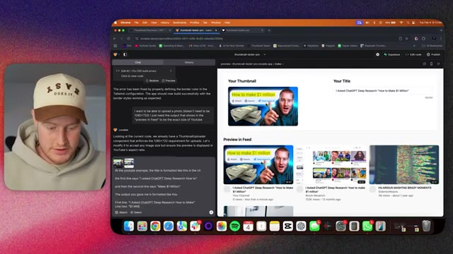
*⏱️ 00:08:47 — Le présentateur discute tout en montrant son écran avec l'interface de l'application de test de miniatures (Lovable) et le chat de développement.*

---

### ⏱️ `[00:09:12 - 00:09:35]` | Segment #17

**🔊 Audio (Transcription Intégrale Mot pour Mot en Français) :**
> hauteur pour correspondre au formatage exact de YouTube. Modifions le composant de vidéo factice pour y parvenir. Je me demande donc si cela contient réellement les informations de YouTube pour pouvoir formater cela correctement, ou si je dois aller sur YouTube et obtenir réellement ces informations. Comme par exemple, je ne sais pas si c'est écrit dans le code sur YouTube et YouTube, genre le code de YouTube est accessible pour que les gens, pour que les gens puissent voir, peut-être que Lovable sera capable de comprendre cela tout seul.

**👁️ Analyse Visuelle d'Écran (gemini-3.5-flash-lite) :**
**Interface & Outils** : Navigateur Google Chrome, interface de développement Lovable.dev, macOS.

**Contenu textuel & Code** : Code source édité, chat avec l'IA expliquant la modification du composant MocksVideo pour ajuster l'habillage du texte et la hauteur de ligne afin de correspondre au format YouTube, prévisualisation de vignettes et de titres "I Asked ChatGPT Deep Research 'How to Make $1 Million'".

**Action / Démonstration** : Présentation du processus de développement d'une application de test de miniatures YouTube assistée par IA.

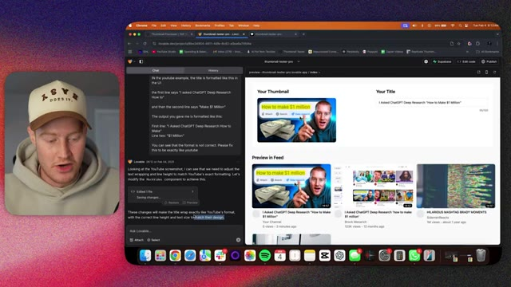
*⏱️ 00:09:18 — Capture d'écran montrant le présentateur à gauche et une interface de développement web Lovable sur la droite, affichant un chat avec l'IA et une prévision de miniatures et de titres YouTube.*

---

### ⏱️ `[00:09:35 - 00:10:08]` | Segment #18

**🔊 Audio (Transcription Intégrale Mot pour Mot en Français) :**
> Donc allons-y et voyons juste si c'est capable de le faire, donc ça dit que les changements sont en place. Cependant, je ne les vois pas. Donc, laissez-moi essayer encore une fois. Donc c'est... je vois toujours la même chose. Tu n'as rien changé. C'est tellement bizarre. Ça n'a même pas exécuté de code ni rien. Donc je me demande si ça a simplement ignoré mon message ou quelque chose comme ça. Donc allons-y et donnons une seconde à ça. Laissez-moi lancer dans un nouvel onglet. Peut-être que ça, ça va être pris en compte ici. Toujours pas. D'accord. Donc je ne sais pas pourquoi ça dit ça si ça ne fonctionne toujours pas correctement.

**👁️ Analyse Visuelle d'Écran (gemini-3.5-flash-lite) :**
**Interface & Outils** : Navigateur web Google Chrome, application Lovable (plateforme de développement web par IA) et macOS.

**Contenu textuel & Code** : Interface de chat Lovable avec messages d'interaction et prévisualisations de vignettes YouTube de style feed.

**Action / Démonstration** : Le créateur discute avec l'assistant IA dans l'interface de développement pour tenter d'appliquer des modifications sur le format des titres.

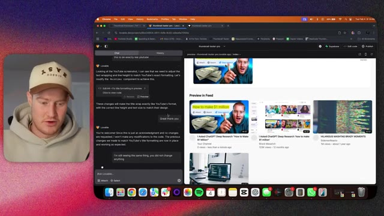
*⏱️ 00:09:52 — Le présentateur interagissant avec le chat de l'application Lovable et testant des prévisualisations de vignettes YouTube.*

---

### ⏱️ `[00:10:08 - 00:10:46]` | Segment #19

**🔊 Audio (Transcription Intégrale Mot pour Mot en Français) :**
> Même problème. Ce n'est pas formaté comme YouTube. Laissez-moi poser une question. Donc, parfois, c'est bien de poser une question à Lovable quand on ne voit pas vraiment quelque chose, vous savez. Laissez-moi donc dire : êtes-vous sûr d'avoir implémenté ce nouveau format ? Et ensuite, j'espère qu'il reconnaîtra qu'il ne l'a pas fait en réalité. Et qu'il passera ensuite à l'action pour le faire. Mais voyons voir. J'ai donc mis à jour le formatage du titre pour qu'il corresponde au comportement exact de YouTube en ajustant la hauteur de ligne à 20 pixels et en ajoutant des propriétés CSS spécifiques pour contrôler la césure des mots et le retour à la ligne. Cela devrait désormais correspondre plus précisément au format d'affichage des titres de YouTube. Laissez-moi donc rafraîchir. C'est là que l'utilisation de Lovable peut être un

**👁️ Analyse Visuelle d'Écran (gemini-3.5-flash-lite) :**
**Interface & Outils** : Navigateur Google Chrome, interface de développement web Lovable.

**Contenu textuel & Code** : Panneau de chat avec l'historique des échanges, instructions textuelles pour modifier le format du titre pour qu'il corresponde à celui de YouTube, et aperçu en direct de l'application (« YouTube Thumbnail & Title Tester »).

**Action / Démonstration** : Le présentateur interagit avec l'assistant IA de Lovable dans le chat pour corriger le formatage du texte et s'assurer qu'il imite exactement l'affichage de YouTube.

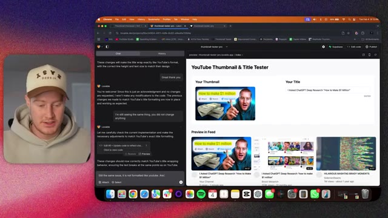
*⏱️ 00:10:18 — Capture d'écran montrant le présentateur à gauche et l'interface de Lovable (navigateur web) à droite, affichant le projet « YouTube Thumbnail & Title Tester » avec le panneau de chat interactif et la prévisualisation de l'application.*

---

### ⏱️ `[00:10:46 - 00:11:23]` | Segment #20

**🔊 Audio (Transcription Intégrale Mot pour Mot en Français) :**
> un peu frustrant parce que vraiment, je, je ne comprends pas comment vraiment, vous savez, faire fonctionner ça correctement ici. D'accord. Donc j'ai toujours le même problème. Jusqu'à présent notre application a l'air super et nous pourrions facilement rendre cette interface utilisateur tellement plus belle, mais c'est tout simplement obtenir ce formatage pour qu'il fonctionne correctement qui est important ici. Le format de rupture de texte ne fonctionne toujours pas. Voici à quoi ça ressemble. Laissez-moi faire une capture d'écran de ceci. Ça devrait être formaté comme ça. Et laissez-moi aller ici et puis fondamentalement dire, d'accord, donc la première ligne devrait dire, j'ai demandé à ChatGPT DP de faire des recherches sur la façon de, et puis la deuxième ligne dit gagner 1 million de dollars. D'accord. Donc pour une raison quelconque, ça ne fonctionne pas. Allons

**👁️ Analyse Visuelle d'Écran (gemini-3.5-flash-lite) :**
**Interface & Outils** : Navigateur Chrome, interface de Lovable (application "thumbnail-tester-pro"), macOS Finder.

**Contenu textuel & Code** : Application web "YouTube Thumbnail & Title Tester", interface avec prévisualisation des miniatures et titres YouTube, panneau de chat interactif avec un assistant IA.

**Action / Démonstration** : Test et correction de l'interface utilisateur pour correspondre au format exact de YouTube, avec des échanges dans le chat de l'assistant de programmation.

*⏱️ 00:11:04 — L'application web avec un panneau de chat sur la gauche affichant des messages de correction de code et l'interface de test à droite.*

---

### ⏱️ `[00:11:23 - 00:12:01]` | Segment #21

**🔊 Audio (Transcription Intégrale Mot pour Mot en Français) :**
> passons à autre chose pour l'instant et puis nous reviendrons corriger cela plus tard. Nous devons simplement, nous devons faire en sorte que cette interface utilisateur ait l'air un peu plus, vous savez, plus propre à l'œil essentiellement. D'accord. Alors vous savez quoi ? Je pense que la raison pour laquelle nous n'arrivons pas à faire fonctionner correctement ce formatage est que le format sera toujours différent. Donc, par exemple, si vous êtes sur YouTube et que nous réduisons la taille de notre écran, le format ne sera pas exactement correct à chaque fois. Donc, allons-y. Je ne sais pas. Je vais simplement ne pas m'inquiéter de ça pour l'instant, une seconde. Passons à la suite, à la prochaine étape ici. Créons donc un mode clair et un mode sombre pour imiter exactement le mode sombre de YouTube.

**👁️ Analyse Visuelle d'Écran (gemini-3.5-flash-lite) :**
**Interface & Outils** : Navigateur web, YouTube, outil de test de miniatures, application web Lovable.

**Contenu textuel & Code** : Interface utilisateur de prévisualisation de miniatures YouTube, panneau de discussion pour modifications de code ou d'UI.

**Action / Démonstration** : Le créateur navigue et ajuste l'interface utilisateur de son application de test de miniatures.

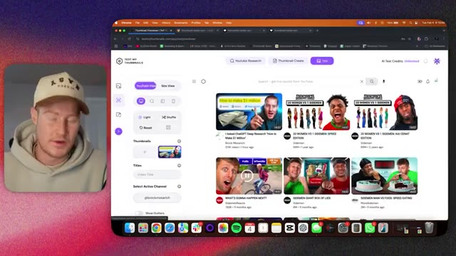
*⏱️ 00:11:32 — Vue d'un outil de test de miniatures YouTube affichant des aperçus de vidéos sur le web.*

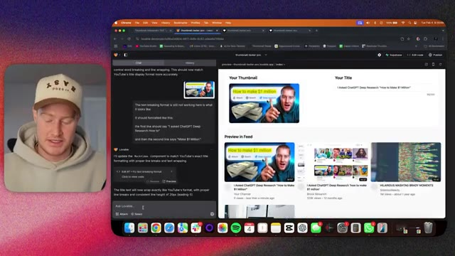
*⏱️ 00:11:51 — Interface de développement web montrant un panneau de chat à gauche et un aperçu de miniature YouTube à droite.*

---

### ⏱️ `[00:12:01 - 00:12:33]` | Segment #22

**🔊 Audio (Transcription Intégrale Mot pour Mot en Français) :**
> on dirait. Très bien. Donc maintenant, nous avons un mode sombre ici pour pouvoir tester cela, voir à quoi ça ressemble sur YouTube en mode sombre. Donc voilà. Super. Ça a l'air bien. Ça ressemble exactement, vous savez, à YouTube et au mode sombre de YouTube. Donc c'est super. Laissez-moi remettre cela en mode clair. Alors, que devrions-nous ajouter d'autre maintenant ? C'est bon. Donc maintenant, allons-y. Et ce que je vais dire, c'est que je vais essayer de copier ce composant d'interface utilisateur ici. Je n'ai pas besoin qu'il lui ressemble exactement, évidemment. Genre, je ne veux pas, je ne veux pas copier complètement ceci, mais allons-y.

**👁️ Analyse Visuelle d'Écran (gemini-3.5-flash-lite) :**
**Interface & Outils** : Navigateur web sur macOS, application web « Test My Thumbnails » / Lovable.

**Contenu textuel & Code** : Interface utilisateur simulant l'affichage de miniatures et de titres YouTube dans un flux de recommandations.

**Action / Démonstration** : Navigation et démonstration de l'outil de test de miniatures et de son interface.

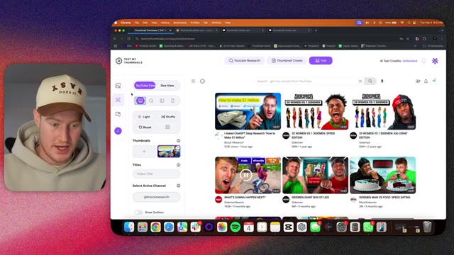
*⏱️ 00:12:25 — Le navigateur affiche l'interface complète de l'application « Test My Thumbnails » avec une liste de vidéos YouTube et un panneau de configuration latéral.*

---

### ⏱️ `[00:12:33 - 00:12:52]` | Segment #23

**🔊 Audio (Transcription Intégrale Mot pour Mot en Français) :**
> il suffit de dire ajoutons un composant d'interface utilisateur comme celui-ci afin de trier les différents formats pour voir l'aperçu, il suffit d'ajouter le composant d'interface utilisateur et ensuite j'expliquerai comment ajouter la fonctionnalité réelle.

**👁️ Analyse Visuelle d'Écran (gemini-3.5-flash-lite) :**
**Interface & Outils** : Navigateur web Google Chrome, application Lovable, interface de chat de l'assistant IA.

**Contenu textuel & Code** : Interface utilisateur affichant "YouTube Thumbnail & Title Tester", un panneau de chat à gauche avec des instructions et des blocs de code, et un aperçu en temps réel d'une application web avec des miniatures et des titres YouTube.

**Action / Démonstration** : Le présentateur utilise l'interface de l'outil de développement Lovable pour ajouter et tester des composants d'interface utilisateur destinés à un testeur de miniatures YouTube.

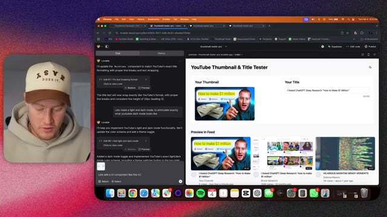
*⏱️ 00:12:38 — Capture d'écran montrant le navigateur Google Chrome avec l'application web Lovable (outil de développement d'interface) pour un testeur de miniatures YouTube, avec le présentateur incrusté à gauche.*

---

### ⏱️ `[00:12:52 - 00:13:11]` | Segment #24

**🔊 Audio (Transcription Intégrale Mot pour Mot en Français) :**
> Donc je ne veux pas trop lui donner de travail pour l'instant. Je veux simplement implémenter quelque chose comme ça. Comme ça, nous avons réellement un moyen de basculer entre ceux-ci. Et ensuite, à partir de là, nous ferons, vous savez, un ajustement. Ok, super. Donc ça a effectivement ajouté ce bouton bascule ici. Donc c'est plutôt bien. Évidemment, on dirait que ça bascule entre le bureau, l'iPad et l'iPhone. Alors voyons voir.

**👁️ Analyse Visuelle d'Écran (gemini-3.5-flash-lite) :**
**Interface & Outils** : Navigateur web, interface Lovable (environnement de développement) et application de test de miniatures.

**Contenu textuel & Code** : Interface utilisateur pour tester des miniatures et des titres YouTube avec des options de prévisualisation et des blocs de code interactifs.

**Action / Démonstration** : Navigation et explication de l'implémentation d'un composant de bascule d'affichage pour les miniatures.

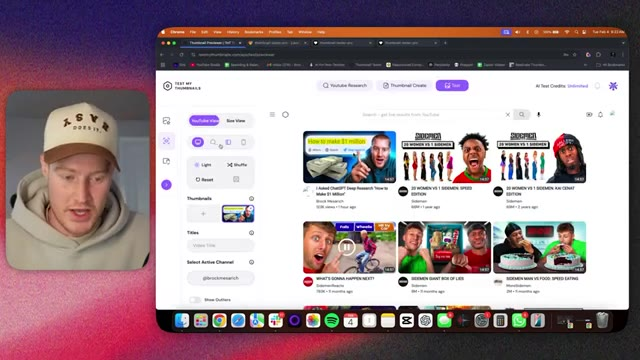
*⏱️ 00:12:57 — Vue générale de l'application de test de miniatures YouTube avec le présentateur à gauche et un navigateur affichant l'interface web principale.*

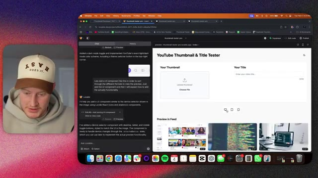
*⏱️ 00:13:02 — Gros plan sur l'interface de développement Lovable montrant le code et la configuration des composants de test de miniatures YouTube.*

---

### ⏱️ `[00:13:11 - 00:13:43]` | Segment #25

**🔊 Audio (Transcription Intégrale Mot pour Mot en Français) :**
> Je ne pense pas que cela va vraiment fonctionner correctement parce que nous devrons ajouter la fonctionnalité, mais laisse-moi juste essayer. D'accord. Ouais. Donc maintenant, allons-y et ajoutons la fonctionnalité à ceci. Super. Ça a l'air bien. Maintenant, ajoutons-lui de la fonctionnalité afin que nous puissions voir à quoi cela ressemblera sur ordinateur, sur iPad ou tablette et sur téléphone. Très bien. Donc, allons-y et testons cela ici. Donc le formatage n'a pas l'air parfait. Évidemment, tu peux voir ici que c'est un peu décalé. Alors allons-y simplement et faisons les ajustements nécessaires ici.

**👁️ Analyse Visuelle d'Écran (gemini-3.5-flash-lite) :**
**Interface & Outils** : Navigateur web affichant l'application Lovable (Lovable.dev) et le système macOS Finder.

**Contenu textuel & Code** : Interface de développement no-code Lovable, prévisualisation d'une application web pour tester des vignettes YouTube, et boîte de dialogue de sélection de fichiers.

**Action / Démonstration** : Développement et test d'une application web en direct avec intégration de composants d'interface utilisateur et sélection de fichiers.

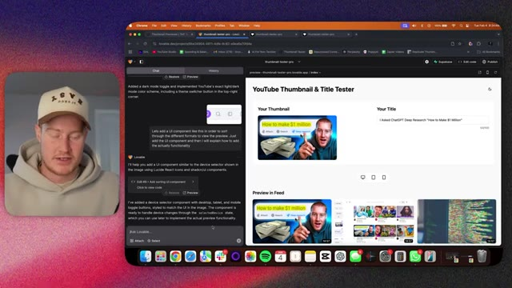
*⏱️ 00:13:19 — Vue générale de l'application 'YouTube Thumbnail & Testeur' avec l'interface de chat Lovable sur le côté gauche et l'aperçu de l'interface utilisateur à droite.*

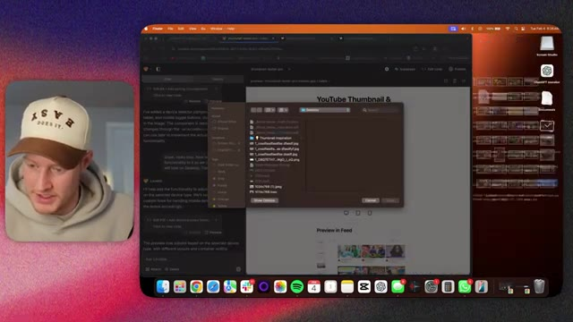
*⏱️ 00:13:35 — Le présentateur interagissant avec une fenêtre de sélection de fichiers système macOS par-dessus l'application web.*

---

### ⏱️ `[00:13:43 - 00:14:03]` | Segment #26

**🔊 Audio (Transcription Intégrale Mot pour Mot en Français) :**
> On dirait que la mise en forme est un peu défectueuse. Veuillez corriger cela et vous assurer que tous les composants de l'interface utilisateur s'ajustent correctement sur l'écran et ne se recouvrent pas. Et puis aussi, je vais ajouter que nous voulons que la disposition de notre application soit intuitive. D'accord, espérons que cela résoudra le problème.

**👁️ Analyse Visuelle d'Écran (gemini-3.5-flash-lite) :**
**Interface & Outils** : Navigateur web affichant Lovable (plateforme de développement d'applications par IA).

**Contenu textuel & Code** : Interface de chat avec l'IA à gauche et prévisualisation de l'application web « YouTube Thumbnail & Title Tester » à droite, incluant du code et des composants d'interface.

**Action / Démonstration** : Le présentateur discute avec l'outil d'IA pour corriger la mise en forme de l'application et ajuster les composants de l'interface utilisateur.

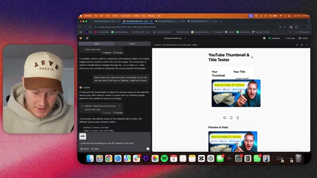
*⏱️ 00:13:48 — Capture d'écran montrant le présentateur à gauche et l'interface de l'application de test de miniatures YouTube sur le navigateur à droite.*

---

### ⏱️ `[00:14:03 - 00:14:42]` | Segment #27

**🔊 Audio (Transcription Intégrale Mot pour Mot en Français) :**
> Ça devrait être un problème facile à régler cependant. Et puis évidemment, ce qu'on va devoir faire, c'est qu'on va devoir corriger les images de stock ici pour utiliser réellement de vraies miniatures ou quelque chose comme ça, juste comme ça, afin que ça, vous savez, ait l'air un peu mieux. Ça ne marche toujours pas, laissez-moi aller partager une autre capture d'écran. Ça n'a toujours pas l'air terrible. Ok, ça a l'air un peu mieux, mais honnêtement, pourquoi est-ce qu'on ne garderait pas simplement ça pareil, le même format, et ensuite la seule chose qui change, c'est l'aperçu et le flux ? Donc je vais aller mentionner ça. Alors, que diriez-vous si on gardait votre partie miniature et titre de l'application pareille pour la tablette et pour le téléphone ?

**👁️ Analyse Visuelle d'Écran (gemini-3.5-flash-lite) :**
**Interface & Outils** : Navigateur web affichant l'interface de test de miniatures YouTube et Lovable.

**Contenu textuel & Code** : Application web pour tester des miniatures et des titres YouTube avec des prévisualisations de flux.

**Action / Démonstration** : Le présentateur présente l'interface utilisateur de l'application de test de miniatures.

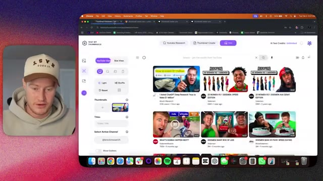
*⏱️ 00:14:13 — Le présentateur à gauche et une application web affichant une interface de test de miniatures YouTube avec des exemples de vidéos à droite.*

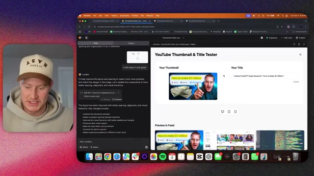
*⏱️ 00:14:23 — Le présentateur à gauche et l'interface de l'application Lovable affichant un outil de test de miniatures et de titres YouTube à droite.*

---

### ⏱️ `[00:14:42 - 00:15:04]` | Segment #28

**🔊 Audio (Transcription Intégrale Mot pour Mot en Français) :**
> aperçu. Cependant, il suffit de changer l'aperçu et le fil d'actualité pour montrer correctement à quoi cela ressemblera sur ces appareils. D'accord, parfait. Ouais, c'est exactement ce que je voulais dire, car ceci en haut pourrait être grand, mais la seule chose qui doit changer, c'est à quoi cela ressemblera sur l'iPhone. C'est cool. Alors imaginez que vous faites défiler votre téléphone. C'est un peu à quoi ressemblera notre fil d'actualité là-bas.

**👁️ Analyse Visuelle d'Écran (gemini-3.5-flash-lite) :**
**Interface & Outils** : Navigateur Google Chrome affichant une application web de test de miniatures (Lovable / YouTube Thumbnail & Title Tester).

**Contenu textuel & Code** : Interface utilisateur avec des sections "Your Thumbnail", "Your Title", et "Preview in Feed" affichant des miniatures de vidéos YouTube.

**Action / Démonstration** : Le créateur interagit avec l'interface pour modifier la mise en page et l'affichage des aperçus selon les appareils.

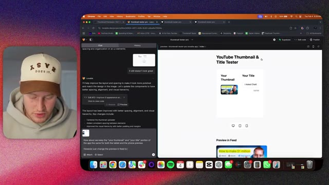
*⏱️ 00:14:48 — Le présentateur discute de l'application de test de miniatures YouTube affichée à l'écran, montrant la section d'aperçu.*

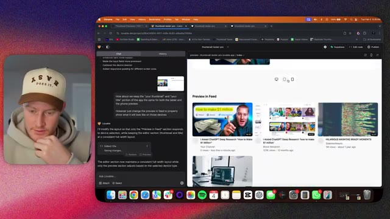
*⏱️ 00:14:53 — Vue de l'interface montrant le fil d'actualité mis à jour avec les miniatures en cours de modification.*

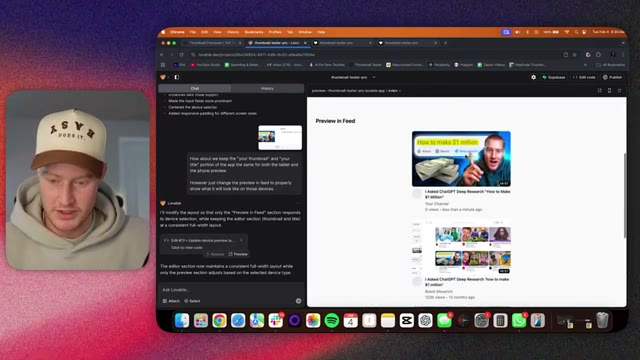
*⏱️ 00:14:59 — Gros plan sur la section "Preview in Feed" de l'application web en cours d'ajustement.*

---

### ⏱️ `[00:15:04 - 00:15:22]` | Segment #29

**🔊 Audio (Transcription Intégrale Mot pour Mot en Français) :**
> Comme vous pouvez le voir, ça ressemble beaucoup à ça. C'est tellement bien. Je suppose que je devrais réfléchir à quelles devraient être nos prochaines étapes ici afin de donner à cette application une meilleure apparence. Parce que niveau fonctionnalités, vous savez, ça commence à être un peu mieux ici. OK, c'est super. Bon travail. Parfois, il faut féliciter notre IA un petit peu.

**👁️ Analyse Visuelle d'Écran (gemini-3.5-flash-lite) :**
**Interface & Outils** : Navigateur web affichant l'interface de développement Lovable et l'application en cours de création.

**Contenu textuel & Code** : Interface utilisateur d'une application de test de miniatures YouTube, panneau de chat d'assistant IA Lovable avec historique des modifications et aperçu visuel en temps réel.

**Action / Démonstration** : Présentation de l'application en cours de développement et discussion sur les améliorations du design et des fonctionnalités à apporter.

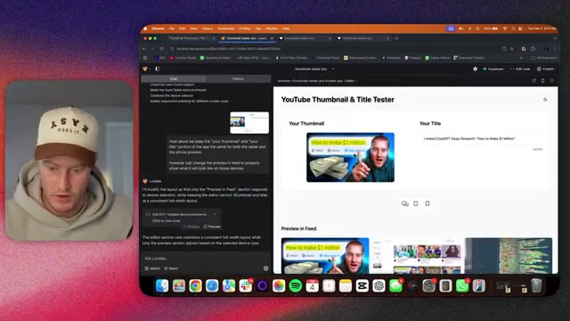
*⏱️ 00:15:09 — Vue de l'interface Lovable montrant le constructeur d'application « YouTube Thumbnail & Title Tester » avec les sections de prévisualisation et l'historique des modifications dans le panneau latéral gauche.*

*⏱️ 00:15:13 — Vue de l'application Lovable montrant la modification du design avec le bouton de téléchargement d'une miniature et les options de prévisualisation responsive.*

---

### ⏱️ `[00:15:22 - 00:15:45]` | Segment #30

**🔊 Audio (Transcription Intégrale Mot pour Mot en Français) :**
> Et ensuite, mentionnons simplement que nous devons utiliser de vraies données fictives. Utilisons de vraies données fictives afin de récupérer de vraies vidéos. Ou utilisons de vraies données afin de récupérer de vraies vidéos au lieu de données fictives, au lieu de données fictives provenant de YouTube. Aide-moi à ajouter cette fonctionnalité pour afficher les vraies vidéos de YouTube.

**👁️ Analyse Visuelle d'Écran (gemini-3.5-flash-lite) :**
**Interface & Outils** : Navigateur web affichant l'interface de Lovable (lovable.dev) et un aperçu en direct de l'application "thumbnail-tester-pro".

**Contenu textuel & Code** : Interface de chat avec un assistant IA montrant des modifications de code, un espace pour télécharger des miniatures et un aperçu d'un fil d'actualité vidéo avec des exemples de miniatures et de titres.

**Action / Démonstration** : Le présentateur discute de la structure de l'application et de l'utilisation de données fictives pour l'affichage des vidéos dans le testeur de miniatures.

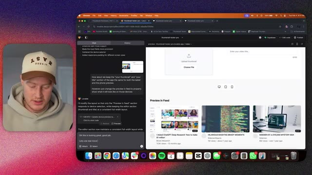
*⏱️ 00:15:28 — Capture d'écran montrant le présentateur à gauche et une interface de développement web Lovable à droite, avec une zone de chat et un aperçu d'application.*

---

### ⏱️ `[00:15:45 - 00:16:23]` | Segment #31

**🔊 Audio (Transcription Intégrale Mot pour Mot en Français) :**
> Je me demande si ce sera trop difficile à faire parce que je ne sais même pas si cela montre, genre, je ne sais pas si ce sont de vraies vidéos YouTube qui sont récupérées depuis YouTube ou si ce sont juste des images statiques et des titres qui ont été téléchargés dans le système et ensuite, vous savez, juste laissés comme ça, donc on pourrait bien finir par faire ça si c'est plus facile. Très bien, alors ensuite, j'ai pris les devants, j'ai essayé d'ajouter ma clé API pour YouTube afin de récupérer de vraies données depuis YouTube, mais je dois en fait me connecter à un compte Supabase afin de stocker ma clé API, donc ce que je vais faire, c'est que je vais cliquer sur Supabase. Supabase est essentiellement la plateforme que nous utilisons afin de créer une base de données sur le backend pour

**👁️ Analyse Visuelle d'Écran (gemini-3.5-flash-lite) :**
**Interface & Outils** : Navigateur web affichant une application web de test de miniatures YouTube et un assistant de code (Lovable).

**Contenu textuel & Code** : Interface utilisateur montrant des listes de vidéos YouTube, des options de test de miniatures, des champs de titre et un panneau de discussion pour ajouter des fonctionnalités via API.

**Action / Démonstration** : Présentation et test d'une application web conçue pour prévisualiser des miniatures et titres YouTube.

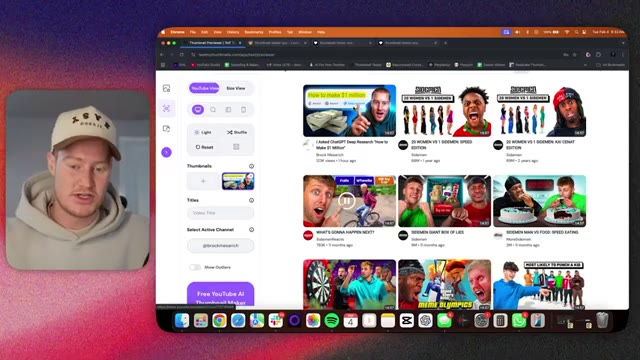
*⏱️ 00:15:55 — Vue d'une application web affichant une interface de prévisualisation de miniatures YouTube avec plusieurs exemples de vidéos et vignettes.*

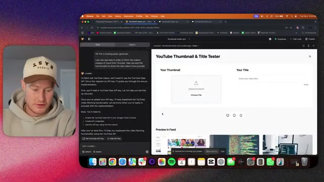
*⏱️ 00:16:04 — Interface de développement avec un panneau de chat (Lovable) sur la gauche et l'application "YouTube Thumbnail & Title Tester" sur la droite.*

---

### ⏱️ `[00:16:23 - 00:17:00]` | Segment #32

**🔊 Audio (Transcription Intégrale Mot pour Mot en Français) :**
> notre application. Donc je n'ai pas besoin d'entrer trop dans les détails pour l'instant, mais c'est aussi de cette façon que nous allons créer des paiements Stripe, que nous allons ajouter des comptes utilisateurs et tout le reste, ce qui nous permettra de stocker des données. Donc, je vais simplement nommer ceci. Disons simplement miniature. Voilà. Créer un nouveau projet. Et ensuite, je vais laisser charger un moment et tout devrait être prêt d'ici peu. Notre projet Supabase devrait être entièrement configuré maintenant. Je vais donc venir sur nos clés API d'ajout. Je vais ajouter une clé API ici. Et maintenant, cela va stocker ces informations à l'intérieur de notre compte Supabase sur le backend. D'accord. Donc, cela n'a en fait pas fonctionné parce que nous devons venir ici en haut et configurer cela. Je dois donc ajouter ceci, connecter mon application de miniatures

**👁️ Analyse Visuelle d'Écran (gemini-3.5-flash-lite) :**
**Interface & Outils** : Supabase, Lovable.dev (Interface de développement d'application web).

**Contenu textuel & Code** : Paramètres de création de projet de base de données, instructions de l'assistant IA pour l'intégration de l'API YouTube Data, champ de saisie de clé API masquée.

**Action / Démonstration** : Configuration d'un nouveau projet Supabase et ajout d'une clé API YouTube dans l'application web.

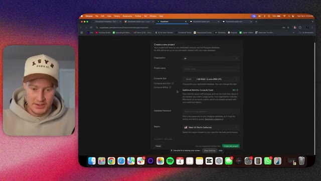
*⏱️ 00:16:32 — Interface de configuration Supabase affichant l'écran de création d'un nouveau projet avec les champs pour la base de données.*

*⏱️ 00:16:41 — Interface d'une application de test de miniatures YouTube avec un volet de chat à gauche et l'aperçu de l'interface utilisateur à droite.*

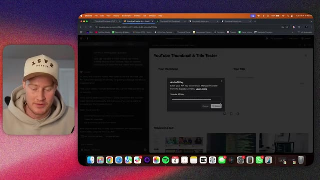
*⏱️ 00:16:50 — Fenêtre modale de saisie d'une clé API YouTube par-dessus l'interface de l'application.*

---

### ⏱️ `[00:17:00 - 00:17:33]` | Segment #33

**🔊 Audio (Transcription Intégrale Mot pour Mot en Français) :**
> ici. Et puis maintenant, ça devrait être bon. D'accord. Donc maintenant, je devrais pouvoir ajouter ma clé API. On dirait que la clé API a bien été ajoutée. Super. J'ai ajouté la clé API. Maintenant, aidez-moi. D'accord. Donc super, maintenant que nous avons ajouté la clé YouTube, la clé API YouTube stockée de manière sécurisée dans Supabase, implémentons la fonctionnalité de récupération de vidéos YouTube. Tout d'abord, nous devons créer une table pour mettre en cache les réponses YouTube afin d'éviter d'atteindre les limites de l'API. C'est donc intéressant, il va créer une table pour mettre en cache les résultats de recherche YouTube. D'accord, appliquons ces changements. Une chose que je viens de réaliser, c'est que si je devais lancer

**👁️ Analyse Visuelle d'Écran (gemini-3.5-flash-lite) :**
**Interface & Outils** : Navigateur web affichant l'interface Lovable (lovable.dev) et l'application en cours de développement.

**Contenu textuel & Code** : Panneau de chat avec des instructions et des messages utilisateur confirmant l'ajout des clés API, ainsi qu'une zone de prévision de flux vidéo YouTube.

**Action / Démonstration** : Le présentateur discute avec l'assistant IA de Lovable et saisit un message pour indiquer que la clé API a été ajoutée.

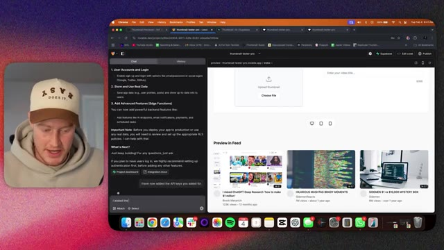
*⏱️ 00:17:08 — Capture d'écran montrant l'interface de l'application web Lovable avec un panneau de chat à gauche et un aperçu de l'interface utilisateur à droite, ainsi que le présentateur à l'écran.*

---

### ⏱️ `[00:17:33 - 00:18:06]` | Segment #34

**🔊 Audio (Transcription Intégrale Mot pour Mot en Français) :**
> cette application, à chaque fois que quelqu'un récupérerait des données YouTube en direct, cela facturerait mes clés API YouTube. C'est donc quelque chose que je ne voudrais vraiment pas faire. Mais tout d'abord, voyons si c'est seulement possible. Je devrais peut-être juste télécharger mes propres fausses miniatures ici et ensuite définir cela comme paramètre par défaut dans mon application. D'accord. Donc on dirait qu'elle essaie réellement de charger ce flux ici. On dirait qu'elle essaie vraiment de récupérer les données depuis YouTube. Je me demande donc si elle sera réellement capable de récupérer ceci. Très bien. Donc elle ne récupère pas de vraies données ici. Je vais donc simplement dire, en fait, laissez-moi télécharger des images de stock et des titres et des titres.

**👁️ Analyse Visuelle d'Écran (gemini-3.5-flash-lite) :**
**Interface & Outils** : Navigateur web, Lovable.dev, interface de développement d'application, Google Chrome.

**Contenu textuel & Code** : Commandes SQL pour créer une table de cache YouTube, code de configuration d'API, aperçu d'application web de test de miniatures.

**Action / Démonstration** : Configuration d'une table SQL de cache pour les données YouTube et implémentation de la fonctionnalité de récupération de l'API.

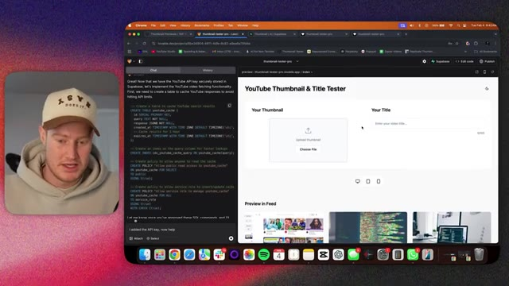
*⏱️ 00:17:41 — Vue d'un navigateur affichant l'interface de développement Lovable avec un chat de code SQL à gauche et un aperçu de l'application YouTube Thumbnail & Title Tester à droite.*

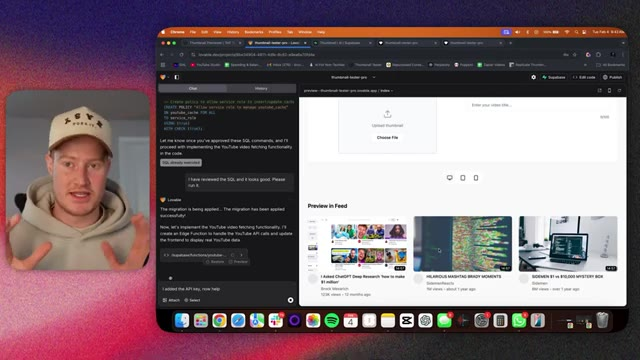
*⏱️ 00:17:49 — Vue de l'interface Lovable montrant le chat avec l'application de migration SQL réussie et la mise en place de la fonction pour récupérer les données YouTube.*

---

### ⏱️ `[00:18:06 - 00:18:24]` | Segment #35

**🔊 Audio (Transcription Intégrale Mot pour Mot en Français) :**
> En fait, laissez-moi télécharger quelques images de stock et des titres à utiliser comme aperçu de préréglage pour le flux. Nous pouvons simplement utiliser ces photos pour tout ou toujours utiliser ces photos pour le flux, à part celles que je veux tester.

**👁️ Analyse Visuelle d'Écran (gemini-3.5-flash-lite) :**
**Interface & Outils** : Navigateur web affichant l'interface de Lovable (outil de développement no-code/IA) avec une fenêtre de chat à gauche et un panneau de prévisualisation à droite.

**Contenu textuel & Code** : Code source, explications de l'assistant IA sur la résolution d'une erreur TypeScript, et aperçu visuel d'une vignette YouTube avec le texte « How to make $1 million ».

**Action / Démonstration** : Le présentateur discute avec l'assistant IA dans l'interface de Lovable pour corriger des erreurs et configurer l'application de test de miniatures.

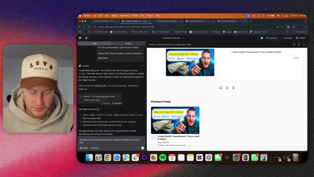
*⏱️ 00:18:10 — Capture d'écran montrant le présentateur à gauche et l'interface de l'application Lovable à droite, affichant un assistant de chat et l'aperçu d'une miniature de vidéo YouTube.*

---

### ⏱️ `[00:18:25 - 00:19:02]` | Segment #36

**🔊 Audio (Transcription Intégrale Mot pour Mot en Français) :**
> D'accord. Très bien. Donc c'est en train de configurer le code SQL à l'intérieur de Supabase. Donc créer un compartiment de stockage pour les images de stock. Créer une politique pour autoriser l'accès public en lecture. Créer une politique pour autoriser les utilisateurs authentifiés à télécharger des images de stock. D'accord. Appliquons ces changements ici. La migration a été appliquée avec succès. Maintenant, je peux vous aider à mettre en œuvre les modifications de code pour utiliser des miniatures de stock pour les titres et les miniatures, aimeriez-vous que je procède à la mise en œuvre de cette fonctionnalité ? Oui, procédez. Si c'est le cas, vous devrez d'abord télécharger certaines images de stock dans le compartiment des miniatures de stock et ensuite je pourrai vous aider à les télécharger dans le fil d'actualité. D'accord, donc il semble qu'il va y avoir une sorte de compartiment à l'intérieur d'ici, ce que je ne

**👁️ Analyse Visuelle d'Écran (gemini-3.5-flash-lite) :**
**Interface & Outils** : Navigateur web avec l'application "YouTube Thumbnail & Test" et un assistant de code.

**Contenu textuel & Code** : Commandes SQL pour créer un bucket de stockage et des politiques de sécurité pour l'accès aux images.

**Action / Démonstration** : Explication et configuration du code SQL pour Supabase.

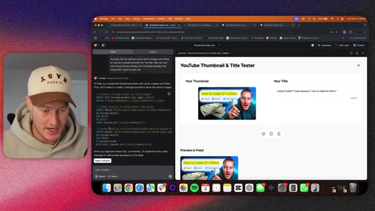
*⏱️ 00:18:34 — Le présentateur à gauche et l'écran de son ordinateur affichant une interface de développement avec du code SQL.*

---

### ⏱️ `[00:19:02 - 00:19:37]` | Segment #37

**🔊 Audio (Transcription Intégrale Mot pour Mot en Français) :**
> sais où trouver encore et je vais en fait avoir besoin de les ajouter manuellement, je pense, ces images et ces titres pour que nous puissions les utiliser. Très bien. Donc on dirait qu'il a effectivement ajouté ce dossier de stockage ici. Donc si je clique dessus, ça m'amène ici où je dois effectivement déposer les fichiers. Donc ce que je vais faire, c'est que je vais aller chercher quelques miniatures qui, selon moi, seront bien à ajouter. Et ensuite, je reviendrai une fois que tout cela sera fait. Très bien, les gars. Donc j'ai en fait pris les devants, j'ai téléchargé quelques miniatures que j'aimais bien. Et comme vous pouvez le voir, nous avons maintenant un flux bien sélectionné ici, ce qui est génial. Donc vous pouvez voir que nous avons toutes ces différentes miniatures que j'ai téléchargées. Un grand merci,

**👁️ Analyse Visuelle d'Écran (gemini-3.5-flash-lite) :**
**Interface & Outils** : Lovable (plateforme de développement web par IA) et Supabase (gestionnaire de stockage de base de données).

**Contenu textuel & Code** : Code source généré par IA, tableau de bord de stockage cloud et prévisualisation d'une application web de test de miniatures YouTube.

**Action / Démonstration** : Navigation entre l'outil de développement Lovable et le stockage cloud Supabase pour configurer l'ajout manuel d'images et de titres.

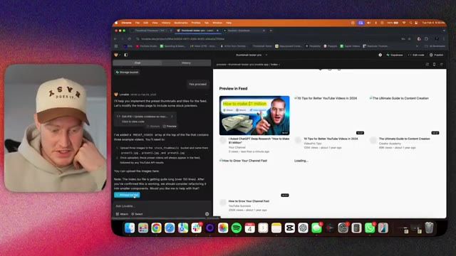
*⏱️ 00:19:11 — Interface de développement Lovable affichant un aperçu de flux vidéo et un message de l'assistant IA avec un bouton de stockage.*

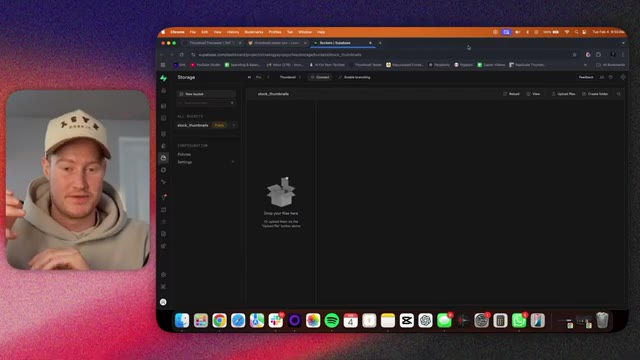
*⏱️ 00:19:19 — Interface de gestion de stockage Supabase montrant un dossier vide nommé « stock_thumbnails » pour y glisser des fichiers.*

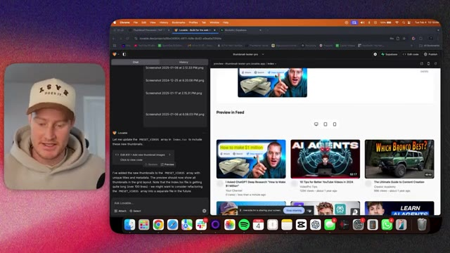
*⏱️ 00:19:28 — Interface de Lovable montrant le code mis à jour avec de nouvelles miniatures affichées dans l'aperçu du flux.*

---

### ⏱️ `[00:19:37 - 00:20:11]` | Segment #38

**🔊 Audio (Transcription Intégrale Mot pour Mot en Français) :**
> Un grand coucou à mon ami Lee Motley. Un grand coucou à mon ami Dave Ebelar. Un grand coucou à Alex Hermozzi. C'est parti. Ça a l'air super, les gars. On fait vraiment beaucoup de progrès ici. Alors, qu'est-ce qu'on devrait faire maintenant ? Si vous regardez, je peux en fait venir sur mobile et vous pouvez voir à quoi ça ressemblerait sur mobile. Je pense qu'on doit maintenant ajouter la possibilité de remixer ceci ou de mélanger tout ça. Donc je veux non seulement avoir mon aperçu et mon fil d'actualité juste ici en haut, mais j'aimerais qu'ils soient mélangés au hasard pour que je puisse vraiment voir si c'est assez accrocheur.

**👁️ Analyse Visuelle d'Écran (gemini-3.5-flash-lite) :**
**Interface & Outils** : Lovable (plateforme de développement web AI), navigateur Chrome, MacOS.

**Contenu textuel & Code** : Code source TypeScript, interface de chat Lovable, prévisualisation de miniatures YouTube, titres et dispositions de feed.

**Action / Démonstration** : Le créateur montre et commente les progrès de l'application de test de miniatures en cours de développement.

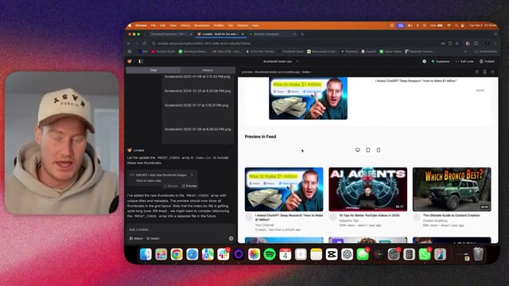
*⏱️ 00:19:45 — Le présentateur présente l'interface de développement d'une application web sur Lovable avec un aperçu de miniatures YouTube et un panneau de code/chat à gauche.*

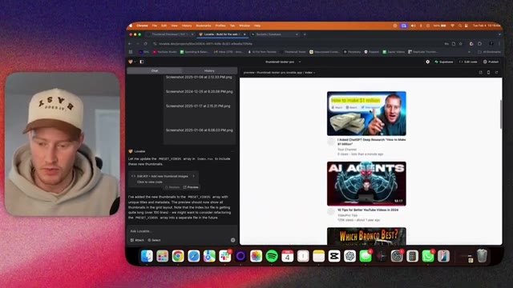
*⏱️ 00:19:54 — Vue similaire montrant l'application web en cours de test avec le fil d'actualité et les vidéos miniatures affichées à l'écran.*

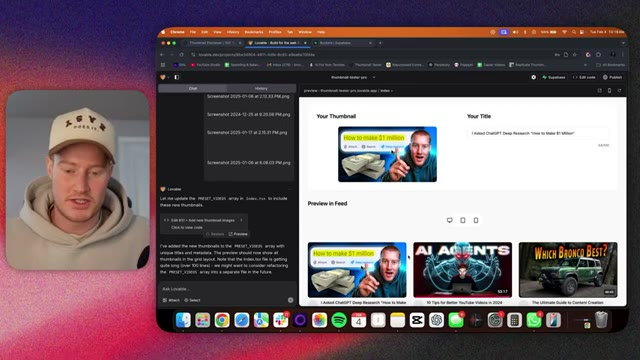
*⏱️ 00:20:02 — Gros plan sur l'interface Lovable montrant les options de prévisualisation des miniatures et des titres dans le générateur d'application.*

---

### ⏱️ `[00:20:11 - 00:20:48]` | Segment #39

**🔊 Audio (Transcription Intégrale Mot pour Mot en Français) :**
> pour que je puisse le repérer. Donc allons-y et faisons cela maintenant. Ajoutons maintenant un bouton de mélange ou de randomisation qui randomise les miniatures. Ainsi, ma miniature d'aperçu que j'ai créée se trouve quelque part au hasard. Et ensuite, je vais juste expliquer pourquoi je veux cette fonction ou pourquoi je veux l'ajouter. De cette façon, il comprendra mieux ce que j'essaie d'expliquer. De cette façon, je peux voir si ma miniature se démarque lorsqu'elle est mélangée au hasard. D'accord. Donnons-lui cela. Et j'espère que cela devrait fonctionner.

**👁️ Analyse Visuelle d'Écran (gemini-3.5-flash-lite) :**
**Interface & Outils** : Lovable (IDE web de développement par IA), Google Chrome, interface de prévisualisation web.

**Contenu textuel & Code** : Code source généré automatiquement et instructions textuelles dans l'interface de chat ("Let me update the PRESET_VIDEOS array in Index.tsx..."), prévisualisation en grille de plusieurs miniatures de vidéos YouTube simulées.

**Action / Démonstration** : Développement et mise à jour itérative d'une application web de test de miniatures à l'aide d'un assistant de code IA.

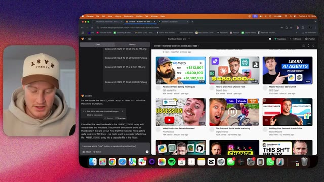
*⏱️ 00:20:20 — Capture d'écran montrant l'interface du générateur d'applications Lovable avec une vue divisée entre le panneau de chat textuel à gauche et l'aperçu d'une grille de miniatures YouTube à droite, ainsi que le présentateur en incrustation à l'extrême gauche.*

---

### ⏱️ `[00:20:48 - 00:21:14]` | Segment #40

**🔊 Audio (Transcription Intégrale Mot pour Mot en Français) :**
> Ensuite, je pense qu'on approche de la possibilité d'ajouter des connexions d'utilisateurs avec Supabase ainsi que d'ajouter des paiements Stripe pour que je puisse réellement facturer pour cela. Boum. Et voilà. Donc maintenant, vous pouvez voir que c'est randomisé. Donc si je clique sur randomiser le fil, ça va me montrer tout en haut maintenant. Oh, on dirait que je suis toujours tout en haut à chaque fois. Quand je clique sur le bouton de randomisation, randomise aussi l'endroit où se trouve ma vignette dans le fil.

**👁️ Analyse Visuelle d'Écran (gemini-3.5-flash-lite) :**
**Interface & Outils** : Navigateur web (Google Chrome), plateforme de développement Lovable.dev, interface utilisateur de test de miniatures YouTube.

**Contenu textuel & Code** : Interface de l'application "YouTube Thumbnail & Title Tester", code source généré par l'IA dans le panneau de chat Lovable, intégration de Supabase et boutons de navigation/test.

**Action / Démonstration** : Développement et test d'une application web avec Lovable, ajout de fonctionnalités de randomisation de miniatures et préparation pour l'intégration de Supabase et Stripe.

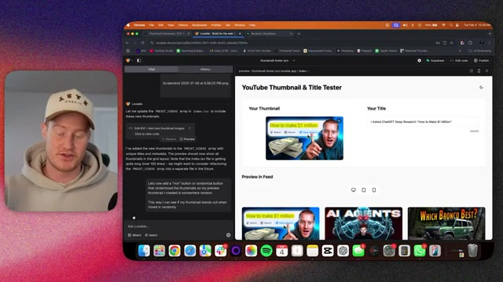
*⏱️ 00:20:55 — Image montrant le tableau de bord de l'application web Lovable avec l'interface de test de miniatures YouTube et le panneau de chat de l'assistant IA.*

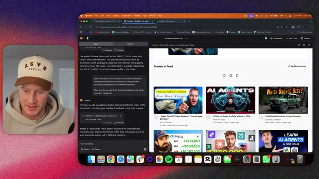
*⏱️ 00:21:01 — Image montrant l'application web avec la section "Preview in Feed" et le bouton "Randomize Feed" ajouté dans l'interface.*

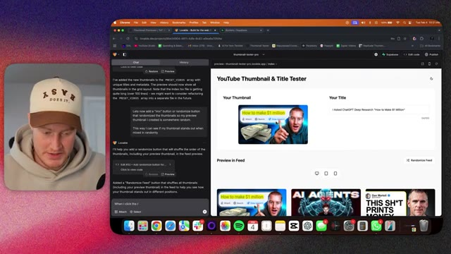
*⏱️ 00:21:08 — Image montrant l'interaction en cours dans le chat Lovable pour tester la fonctionnalité de randomisation des miniatures YouTube.*

---

### ⏱️ `[00:21:15 - 00:21:35]` | Segment #41

**🔊 Audio (Transcription Intégrale Mot pour Mot en Français) :**
> Donc ça randomise le flux, mais évidemment ça ne randomise pas ma miniature. Oh, maintenant ça le fait sur celui-ci. Donc, ok, voilà. Maintenant ça fonctionne correctement. Les gars, ça s'avère être une super petite application ici et ça fonctionne exactement aussi bien que je pouvais l'espérer. Donc ça a l'air super. Qu'est-ce qu'on pourrait ajouter d'autre ici qui pourrait être assez intéressant ?

**👁️ Analyse Visuelle d'Écran (gemini-3.5-flash-lite) :**
**Interface & Outils** : Navigateur web affichant l'application de test de miniatures "Thumbnail Tester Pro" construite avec l'outil de développement Lovable.

**Contenu textuel & Code** : Code source JavaScript gérant la fonction de randomisation (algorithme de mélange des tableaux) et interface utilisateur de test de miniatures.

**Action / Démonstration** : Test et vérification de la fonctionnalité de randomisation des miniatures dans le flux simulé de l'application.

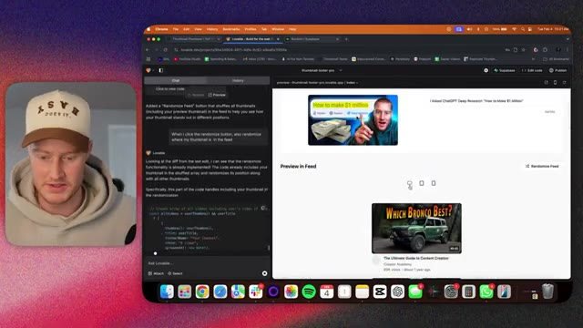
*⏱️ 00:21:20 — Vue d'ensemble de l'interface de l'application de test de miniatures, montrant le code source à gauche et un aperçu minimaliste du fil d'actualité à droite.*

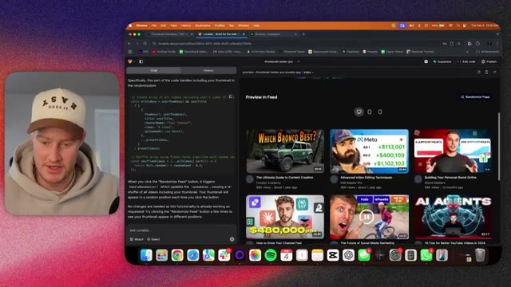
*⏱️ 00:21:25 — Affichage de l'interface de prévisualisation du fil d'actualité après un clic sur le bouton de randomisation, affichant une grille de miniatures YouTube.*

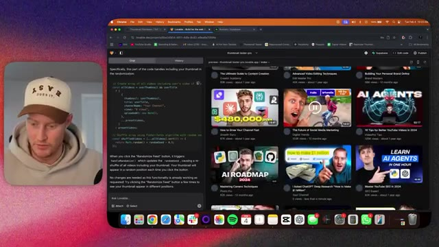
*⏱️ 00:21:30 — Mise à jour de la grille de prévisualisation montrant le positionnement aléatoire de la miniature personnalisée de l'utilisateur parmi d'autres vidéos.*

---

### ⏱️ `[00:21:35 - 00:21:54]` | Segment #42

**🔊 Audio (Transcription Intégrale Mot pour Mot en Français) :**
> Très bien. Donc maintenant, je vais ajouter la possibilité d'ajouter ma chaîne. Donc vous pouvez voir juste ici, je pourrais effectivement ajouter une chaîne active et cela affichera mon nom sous ma, vous savez, ma vignette. Donc de cette façon, cela pourra montrer, vous savez, au lieu que ce soit écrit votre chaîne, cela affichera réellement ma chaîne YouTube sous la section de votre titre.

**👁️ Analyse Visuelle d'Écran (gemini-3.5-flash-lite) :**
**Interface & Outils** : Navigateur web affichant l'application web 'Test My Thumbnails' et l'IDE de développement Lovable.

**Contenu textuel & Code** : Code JavaScript de gestion des miniatures, fonctions de randomisation et interface utilisateur de test de miniatures YouTube.

**Action / Démonstration** : Navigation et démonstration de l'interface de test de miniatures et de l'intégration de la chaîne active dans l'application web.

*⏱️ 00:21:40 — Interface web 'Test My Thumbnails' montrant l'option de sélection de chaîne active `@brockmesarich` à côté d'un aperçu de flux YouTube.*

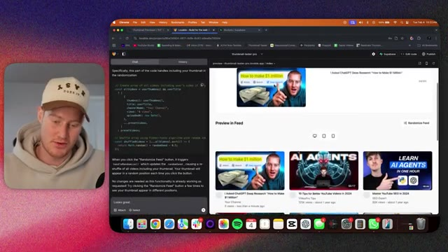
*⏱️ 00:21:44 — Interface de développement Lovable affichant du code JavaScript dans le panneau de gauche et l'aperçu du projet YouTube Thumbnail & Title Tester à droite.*

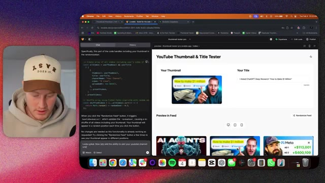
*⏱️ 00:21:49 — Interface Lovable affichant le panneau de code source et l'application active avec un test de miniature YouTube intégrée.*

---

### ⏱️ `[00:21:54 - 00:22:27]` | Segment #43

**🔊 Audio (Transcription Intégrale Mot pour Mot en Français) :**
> De cette façon, vous pouvez voir à quoi cela ressemblera avec le nom de votre chaîne sous vos vignettes. Voici un exemple. Donc ensuite, je vais faire comme ça et ensuite, oups, faire une capture d'écran pour que je puisse voir de quoi je parle. D'accord. Voilà. Donc idéalement, nous allons avoir une zone de texte juste ici où nous pourrions réellement ajouter l'identifiant de notre chaîne pour notre chaîne et cela l'affichera toujours. Bon, pendant que ça charge, laissez-moi ouvrir ceci et voir à quoi cela ressemble réellement dans un vrai onglet. Boum. Voilà. Ça a l'air vraiment bien, les gars. D'accord. Maintenant, j'ajoute mon titre

**👁️ Analyse Visuelle d'Écran (gemini-3.5-flash-lite) :**
**Interface & Outils** : Navigateur web affichant Lovable (outil de développement d'applications web) et une application de test de vignettes YouTube.

**Contenu textuel & Code** : Code source JavaScript/TypeScript, interface de chat d'assistant IA, aperçus de vignettes YouTube avec titres et métriques de vues.

**Action / Démonstration** : Le créateur présente l'application en cours de développement et discute des modifications à apporter pour afficher le nom de la chaîne sous les vignettes.

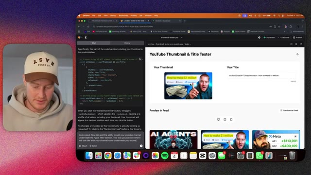
*⏱️ 00:22:02 — Vue rapprochée de l'interface de test de vignettes YouTube avec aperçu de la vignette et du titre.*

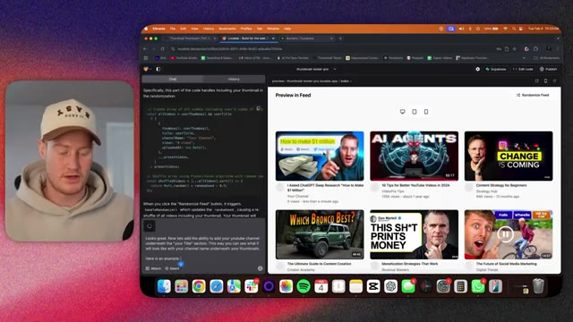
*⏱️ 00:22:10 — Affichage du flux complet de prévisualisation avec plusieurs vignettes YouTube et le chat de développement visible à gauche.*

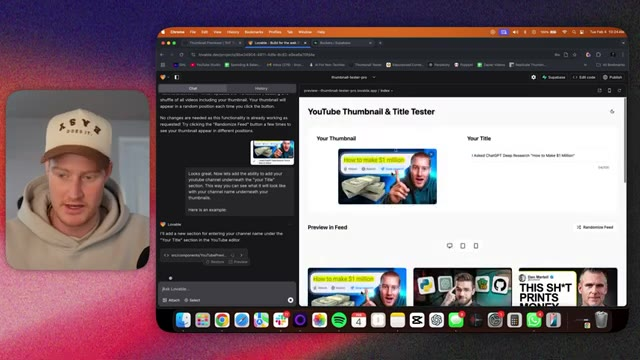
*⏱️ 00:22:19 — Visualisation du code et des composants en cours de modification dans l'interface de l'application de test.*

---

### ⏱️ `[00:22:27 - 00:22:47]` | Segment #44

**🔊 Audio (Transcription Intégrale Mot pour Mot en Français) :**
> ou le nom de ma chaîne, en ajoutant une miniature. Ça fonctionne vraiment très bien. Boum, voilà. Les gars, voilà. Je pense que c'est tout ce qu'on a besoin de faire pour l'instant. La fonctionnalité fonctionne exactement de la même manière que pour cette application ici, ce qui est exactement ce qu'on essayait, vous savez, d'émuluer. Donc ce que je vais faire maintenant, c'est en fait ajouter la possibilité d'ajouter des connexions d'utilisateurs et des paiements.

**👁️ Analyse Visuelle d'Écran (gemini-3.5-flash-lite) :**
**Interface & Outils** : Navigateur web affichant l'interface de développement Lovable et l'application de test de miniatures YouTube.

**Contenu textuel & Code** : Interface utilisateur d'une application web avec des champs de saisie pour les miniatures, les titres et le nom de chaîne, ainsi qu'un panneau de chat conversationnel.

**Action / Démonstration** : Le présentateur démontre l'utilisation de l'application web créée avec Lovable pour prévisualiser des miniatures et titres YouTube.

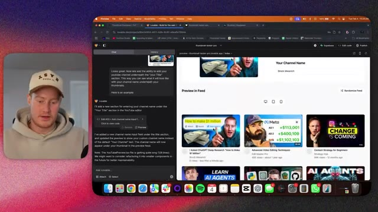
*⏱️ 00:22:32 — Capture montrant le présentateur à gauche et l'application Lovable affichant un outil de test de miniatures YouTube avec un aperçu dans un flux de vidéos.*

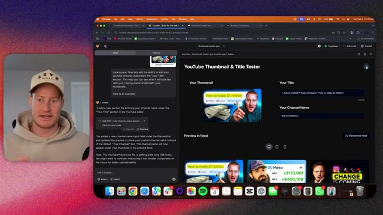
*⏱️ 00:22:37 — Capture montrant l'interface complète de Lovable avec le chat textuel de génération d'application à gauche et l'outil interactif de test de miniatures YouTube à droite.*

---

### ⏱️ `[00:22:47 - 00:23:22]` | Segment #45

**🔊 Audio (Transcription Intégrale Mot pour Mot en Français) :**
> Donc, allons-y et faisons ça maintenant. Tout cela a l'air incroyable. Maintenant, ajoutons la connexion utilisateur, afin que je puisse ensuite implémenter Stripe pour que les gens aient accès à l'utilisation de l'application. Très bien, donc il est en train d'écrire le code SQL ici, en créant essentiellement une table de profils à l'intérieur de Supabase. Nous aurons donc une nouvelle base de données ici, qui ajoutera tous les comptes d'utilisateurs et ainsi de suite, activera la sécurité au niveau des lignes, créera des politiques. C'est donc génial. Si vous n'avez pas vu mes vidéos précédentes sur Lovable, il écrit littéralement le code pour construire une base de données pour nous, ce que je n'aurais absolument aucune idée de la façon de faire moi-même. Donc le fait qu'il soit capable de faire ça

**👁️ Analyse Visuelle d'Écran (gemini-3.5-flash-lite) :**
**Interface & Outils** : Navigateur web Google Chrome affichant Lovable.dev et un aperçu en direct de l'application web.

**Contenu textuel & Code** : Interface utilisateur avec des champs de test pour les miniatures et titres YouTube, panneau de discussion IA montrant les échanges de code et de modifications, et barre de tâches macOS en bas.

**Action / Démonstration** : L'assistant IA génère du code pour l'application et l'utilisateur discute pour ajouter des fonctionnalités comme la connexion et Stripe.

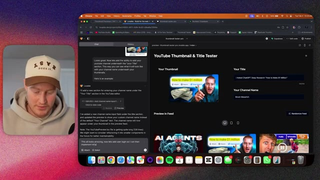
*⏱️ 00:22:56 — Capture d'écran montrant l'interface du créateur d'applications Lovable.dev avec à gauche le panneau de chat de l'assistant IA et à droite la prévisualisation de l'application 'YouTube Thumbnail & Title Tester'.*

---

### ⏱️ `[00:23:22 - 00:23:41]` | Segment #46

**🔊 Audio (Transcription Intégrale Mot pour Mot en Français) :**
> et construire une application avec une apparence incroyable comme celle-ci, c'est vraiment génial. Allons-y donc, tout ce que nous avons à faire est de cliquer sur appliquer ces changements, et ensuite cela commencera à tout configurer sur le backend ici. Ainsi, nous pourrons ensuite commencer à implémenter la possibilité pour les utilisateurs de se connecter. Très bien, donc maintenant nous avons une partie connexion et inscription de l'application ici. On dirait qu'il faut s'inscrire d'abord. D'accord, il y a donc une erreur. Nous y reviendrons.

**👁️ Analyse Visuelle d'Écran (gemini-3.5-flash-lite) :**
**Interface & Outils** : Navigateur web affichant la plateforme de développement Lovable.dev avec intégration de Supabase et module de prévisualisation en direct.

**Contenu textuel & Code** : Scripts SQL, instructions de configuration de base de données, interface utilisateur d'authentification (connexion/inscription) et aperçu d'application web.

**Action / Démonstration** : Application des modifications de base de données et génération automatique du système d'authentification par l'assistant IA.

*⏱️ 00:23:27 — Vue d'ensemble de l'interface Lovable montrant le code SQL généré dans le panneau de chat à gauche et un aperçu d'application web de test de miniatures YouTube à droite.*

*⏱️ 00:23:36 — Affichage de l'interface Lovable avec la confirmation de l'application de la migration et un écran de connexion (Welcome) généré automatiquement sur l'aperçu à droite.*

---

### ⏱️ `[00:23:41 - 00:24:16]` | Segment #47

**🔊 Audio (Transcription Intégrale Mot pour Mot en Français) :**
> Très bien, nous sommes de retour et nous avons effectivement ajouté nos miniatures ici. Vous pouvez donc voir que j'ai un tas de miniatures différentes et aléatoires qui, je trouve, rendent plutôt bien ici. À l'intérieur de notre fil d'actualité, ainsi que notre page pour tablettes qui fonctionne. Donc ce que ça donne sur une tablette ainsi que sur mobile. Vous pouvez voir c'est exactement à quoi ça ressemblerait. Les gars, notre application a l'air incroyable jusqu'à présent. Nous pouvons aussi basculer en mode sombre et allons-y, je vais télécharger une miniature pour tester ça rapidement. Boum, c'est parti. Et ensuite, j'ai demandé à ChatGPT, Deep Research, comment gagner 1 million de dollars et nous avons

**👁️ Analyse Visuelle d'Écran (gemini-3.5-flash-lite) :**
**Interface & Outils** : Navigateur web affichant l'application de test de miniatures Lovable.

**Contenu textuel & Code** : Interface utilisateur avec des grilles de miniatures YouTube de démonstration et des blocs de code de chat d'assistant IA.

**Action / Démonstration** : Navigation et démonstration du rendu des miniatures et des titres dans le fil d'actualité simulé.

*⏱️ 00:23:50 — Vue générale de l'application web de test de miniatures avec un panneau de chat à gauche et un aperçu du fil d'actualité YouTube à droite.*

*⏱️ 00:23:59 — Gros plan sur l'interface de test montrant les zones de téléchargement de miniatures et de saisie de titres.*

*⏱️ 00:24:08 — Illustration de l'ajout d'une miniature personnalisée ("How to make $1 million") dans l'interface de test.*

---

### ⏱️ `[00:24:16 - 00:24:51]` | Segment #48

**🔊 Audio (Transcription Intégrale Mot pour Mot en Français) :**
> allons-y. Donc ça fonctionne maintenant. Ça fonctionne sans problème. Oups. On dirait que pour une raison quelconque, ça a échoué. Bon. Je vais tester ça vite fait. J'ai demandé à la recherche approfondie de Chachabiti, comment gagner un million de dollars. Laisse-moi copier et coller ceci. Je n'ai pas besoin de continuer à taper ça. D'accord. Donc ça a l'air super. Évidemment, on pourrait basculer entre le mode clair et le mode sombre. Je pense qu'ensuite, ce que je veux faire, c'est ajouter une fonctionnalité pour qu'on puisse randomiser ceci. De cette façon, je n'ai pas cette vignette directement ici. Je la veux au milieu de ce fil d'actualité. Comme ça, je pourrais voir si elle se démarque. Et je pense que c'est un bon test aussi bien que notre application de test de vignettes que nous

**👁️ Analyse Visuelle d'Écran (gemini-3.5-flash-lite) :**
**Interface & Outils** : Navigateur web affichant une application de test de miniatures et de titres YouTube ("YouTube Thumbnail & Title Tester").

**Contenu textuel & Code** : Interface utilisateur avec des champs de texte pour les titres, des aperçus de miniatures de vidéos YouTube et un panneau de code/chat latéral.

**Action / Démonstration** : Présentation et test en direct de l'application web de création et prévisualisation de miniatures YouTube.

*⏱️ 00:24:25 — Le présentateur ajuste sa casquette tout en montrant l'application web de test de miniatures YouTube sur son écran.*

*⏱️ 00:24:34 — Le présentateur retire sa casquette en montrant l'interface de prévisualisation des miniatures et des titres YouTube.*

*⏱️ 00:24:42 — Le présentateur remet sa casquette et commente le flux d'affichage des différentes vidéos et miniatures sur l'application.*

---

### ⏱️ `[00:24:51 - 00:25:11]` | Segment #49

**🔊 Audio (Transcription Intégrale Mot pour Mot en Français) :**
> essaie d'émuler possède cette même fonctionnalité. Donc, laissez-moi l'ajouter maintenant. Ajoutons un bouton de randomisation qui... qui... voyons voir, qui randomise le fil d'actualité pour me permettre de voir à quoi ressemblera l'aperçu de la vignette une fois randomisé. Vous devriez à peu près comprendre ce que j'essaye de dire ici.

**👁️ Analyse Visuelle d'Écran (gemini-3.5-flash-lite) :**
**Interface & Outils** : Google Chrome, Lovable app (interface de développement no-code)

**Contenu textuel & Code** : Panneau de chat Lovable avec historique des modifications et aperçu d'un site web simulant un flux de vignettes vidéo.

**Action / Démonstration** : Le présentateur explique et démontre l'ajout d'une fonctionnalité de randomisation pour le fil d'actualité.

*⏱️ 00:24:56 — Capture d'écran montrant le navigateur Google Chrome avec l'interface de l'application Lovable ouverte, affichant un panneau de chat à gauche et un aperçu d'un fil d'actualité vidéo type YouTube à droite.*

---

### ⏱️ `[00:25:11 - 00:25:45]` | Segment #50

**🔊 Audio (Transcription Intégrale Mot pour Mot en Français) :**
> Laissons-lui une seconde. Et les gars, je pense que jusqu'à présent, c'est super. Ça peut faire tout ce dont l'autre application avait besoin. Franchement, je pourrais annuler mon abonnement à ce stade-ci, ce que je vais probablement faire d'ailleurs, et utiliser ça à la place. Donc maintenant, ce que je veux faire, c'est vraiment passer à autre chose après avoir réglé ce bouton de randomisation, tu vois, tu vois. Je veux vraiment ajouter Supabase, ajouter la possibilité pour les utilisateurs de se connecter à un compte, de créer des comptes, ainsi que de s'inscrire avec Stripe. C'est donc le test ultime. Est-ce qu'on peut vraiment facturer de l'argent pour ça ? Je vais vous montrer exactement comment je vais faire ça maintenant. Essayons donc encore une fois.

**👁️ Analyse Visuelle d'Écran (gemini-3.5-flash-lite) :**
**Interface & Outils** : Navigateur Google Chrome affichant l'interface web de Lovable (plateforme de développement No-Code/AI) pour l'application Thumbnail Tester Pro.

**Contenu textuel & Code** : Code source textuel, interface de chat d'assistant IA, et aperçu d'une application web simulant un testeur de vignettes et de titres pour YouTube.

**Action / Démonstration** : Le créateur présente l'application qu'il vient de générer via l'IA et commente ses fonctionnalités de test de vignettes YouTube.

*⏱️ 00:25:20 — Capture montrant le présentateur à gauche et l'interface de développement Lovable à droite avec un aperçu de l'application 'Thumbnail Tester Pro' affichant un flux de vignettes YouTube.*

*⏱️ 00:25:28 — Capture similaire avec le panneau de prévisualisation montrant les sections 'Your Thumbnail' et 'Your Title' de l'application en cours de test.*

---

### ⏱️ `[00:25:45 - 00:26:04]` | Segment #51

**🔊 Audio (Transcription Intégrale Mot pour Mot en Français) :**
> temps. Ça devrait être bon. Donc je dois télécharger le titre et ensuite randomiser le flux. D'accord, donc ça randomise toutes les autres miniatures, mais ça ne randomise pas ma, tu sais, celle que j'ai ajoutée ici. Donc je veux aussi randomiser ma miniature également. Pour qu'elle ne soit pas toujours la première dans le flux.

**👁️ Analyse Visuelle d'Écran (gemini-3.5-flash-lite) :**
**Interface & Outils** : Navigateur Chrome affichant une application web de test de miniatures (Lovable.dev / interface de développement).

**Contenu textuel & Code** : Interface utilisateur avec un chat de développement, un panneau de prévisualisation "Preview in Feed" et des vignettes de vidéos YouTube factices.

**Action / Démonstration** : Le présentateur clique sur le bouton "Randomize Feed" pour mélanger les miniatures de la grille de prévisualisation.

*⏱️ 00:25:50 — Vue d'ensemble de l'interface de l'application web avec un panneau de chat à gauche et un aperçu de fil d'actualité vidéo à droite, montrant le bouton "Randomize Feed".*

*⏱️ 00:25:54 — Vue de l'interface montrant le fil d'actualité après un clic sur le bouton de randomisation, où les miniatures des autres vidéos ont changé de position.*

---

### ⏱️ `[00:26:04 - 00:26:37]` | Segment #52

**🔊 Audio (Transcription Intégrale Mot pour Mot en Français) :**
> Bon, ça devrait être assez simple. Aussi, je suis plutôt fier de cette miniature. Si vous voulez aller voir cette vidéo, c'est en fait l'une de mes dernières vidéos que j'ai créées. Donc c'est une plutôt bonne. ChatGPT Deep Research est vraiment sympa. Très bien, ça devrait être bon. Donc je pourrais ajouter ce flux aléatoire. D'accord. Maintenant, ça le met complètement de manière aléatoire. Donc je pourrais en fait aller de l'avant et cliquer sur aléatoire, puis faire défiler, faire défiler, et voir si je pense que celle-ci se démarque, ce qui, je pense, est le cas de cette miniature. Donc c'est vraiment cool les gars, ainsi que nous pouvons tester sur mobile, cela fonctionne aussi. Vous savez, ça le rend aléatoire

**👁️ Analyse Visuelle d'Écran (gemini-3.5-flash-lite) :**
**Interface & Outils** : Navigateur web affichant l'application de test de miniatures Lovable.dev.

**Contenu textuel & Code** : Interface utilisateur avec un chat de développement, du code, et une grille de prévisualisation de vidéos YouTube avec des miniatures variées.

**Action / Démonstration** : Le présentateur explique et démontre l'utilisation de la fonctionnalité de randomisation des miniatures dans son application.

*⏱️ 00:26:12 — Image #1 montrant l'interface de l'application de test de miniatures avec un panneau de chat à gauche et un aperçu du flux vidéo à droite.*

*⏱️ 00:26:20 — Image #2 montrant le défilement de l'aperçu du flux vidéo dans l'application avec plusieurs vignettes YouTube simulées.*

*⏱️ 00:26:29 — Image #3 montrant l'utilisation de la fonction de randomisation des vignettes dans l'application de prévisualisation.*

---

### ⏱️ `[00:26:37 - 00:26:56]` | Segment #53

**🔊 Audio (Transcription Intégrale Mot pour Mot en Français) :**
> quelque part dans le fil d'actualité ici. Donc les gars, cette application fonctionne exactement comme je le voulais, du mieux que, vous savez, cela fonctionne fondamentalement exactement comme l'autre application que j'essaye de reconstruire. Donc je pense que ce que je dois faire maintenant, tout ce que je dois faire, c'est ajouter la possibilité pour les utilisateurs de se connecter, de créer un compte, et ensuite d'ajouter également Stripe pour pouvoir facturer de l'argent pour cela.

**👁️ Analyse Visuelle d'Écran (gemini-3.5-flash-lite) :**
**Interface & Outils** : Navigateur web (Google Chrome) affichant une application web de test de miniatures et titres YouTube avec une interface de type IDE ou assistant de code.

**Contenu textuel & Code** : Interface utilisateur affichant une miniature YouTube de test, un titre modifiable, et un aperçu du fil d'actualité avec des vignettes de vidéos populaires.

**Action / Démonstration** : Le présentateur démontre le fonctionnement de l'application web qu'il est en train de construire, en montrant l'aperçu du fil d'actualité et les composants de test.

*⏱️ 00:26:42 — Image #1 montrant l'interface complète de l'application web de test de miniatures YouTube avec le volet de chat à gauche et une grille de vidéos préconfigurées à droite.*

*⏱️ 00:26:47 — Image #2 montrant l'application web avec la section "Your Thumbnail", "Your Title" et l'aperçu dans le fil d'actualité ("Preview in Feed").*

---

### ⏱️ `[00:26:57 - 00:27:22]` | Segment #54

**🔊 Audio (Transcription Intégrale Mot pour Mot en Français) :**
> Donc ce que je vais faire, c'est que je vais venir ici et dire, allons-y maintenant pour ajouter l'authentification des utilisateurs. Je peux donc ensuite commencer ou de sorte que je puisse ensuite ajouter des paiements Stripe afin d'accéder à l'application. Je vais donc ouvrir mon Supabase ici. Et ce qu'il est en train de faire, c'est qu'il écrit réellement le code SQL, qui sera ensuite écrit à l'intérieur de Supabase, à l'intérieur des fonctions edge ici.

**👁️ Analyse Visuelle d'Écran (gemini-3.5-flash-lite) :**
**Interface & Outils** : Navigateur web Google Chrome (macOS), interface Lovable / Supabase, et flux vidéo du présentateur.

**Contenu textuel & Code** : Interface de l'application web avec un panneau de chat textuel à gauche et un aperçu interactif de l'application à droite (« YouTube Thumbnail & Title Tester »). Le champ de saisie du chat montre le prompt pour ajouter l'authentification des utilisateurs.

**Action / Démonstration** : Le présentateur utilise l'interface de Lovable pour concevoir l'application et s'apprête à ajouter l'authentification des utilisateurs via Supabase.

*⏱️ 00:27:03 — Capture d'écran montrant le navigateur Google Chrome avec l'interface de développement Lovable affichant l'application « YouTube Thumbnail & Title Tester » et le présentateur à gauche.*

---

### ⏱️ `[00:27:22 - 00:27:41]` | Segment #55

**🔊 Audio (Transcription Intégrale Mot pour Mot en Français) :**
> Donc je ne sais pas comment écrire ce code, mais il le fait en fait pour moi. Donc tout ce que j'ai à faire est d'appliquer cette modification et ça devrait fonctionner. Il semble qu'il y ait eu en fait une erreur. Essayons de corriger cette erreur. Très bien. Donc il dit qu'il y avait déjà... D'accord. Donc maintenant il va en fait procéder à l'implémentation de l'interface utilisateur d'authentification maintenant. Donc cela va inclure les composants de connexion et d'inscription.

**👁️ Analyse Visuelle d'Écran (gemini-3.5-flash-lite) :**
**Interface & Outils** : Navigateur web affichant Lovable.dev (éditeur de code IA) et l'aperçu d'une application web ("YouTube Thumbnail & Title Tester").

**Contenu textuel & Code** : Code SQL généré par l'IA dans le panneau de chat (commandes de création de politiques et de fonctions pour l'authentification et les utilisateurs), interface de prévisualisation avec vignettes YouTube et champ de titre.

**Action / Démonstration** : Le présentateur discute de la génération de code par l'IA et de l'application des modifications demandées au projet.

*⏱️ 00:27:27 — Capture d'écran montrant l'interface de Lovable (assistant de code) à gauche avec des commandes SQL, et un aperçu d'application de test de miniatures YouTube à droite. Le présentateur apparaît dans une incrustation à gauche.*

---

### ⏱️ `[00:27:41 - 00:28:02]` | Segment #56

**🔊 Audio (Transcription Intégrale Mot pour Mot en Français) :**
> Donc, essentiellement, je dois me connecter ou créer un compte avant d'avoir accès à l'authentification de l'application, à la gestion des états, puis aux routes protégées pour les utilisateurs abonnés. Je vais donc simplement dire : allons de l'avant avec ça. D'accord. On dirait que nous avons maintenant une page d'inscription. Je vais donc cliquer sur s'inscrire. Je vais ensuite simplement taper mon e-mail, rock arobase gmail point com.

**👁️ Analyse Visuelle d'Écran (gemini-3.5-flash-lite) :**
**Interface & Outils** : Navigateur web (Google Chrome), interface Lovable (Lovable.dev) et application web de test de miniatures YouTube.

**Contenu textuel & Code** : Panneau de discussion affichant une conversation sur l'authentification, la gestion des états et les routes protégées pour les utilisateurs abonnés, avec un aperçu de l'application web.

**Action / Démonstration** : Le présentateur explique les étapes suivantes concernant l'implémentation de l'authentification et de la gestion des états dans l'application web.

*⏱️ 00:27:46 — Capture d'écran montrant l'interface de Lovable avec un chat textuel à gauche et l'application "YouTube Thumbnail & Title Tester" en prévisualisation à droite, ainsi que le présentateur en médaillon.*

---

### ⏱️ `[00:28:02 - 00:28:29]` | Segment #57

**🔊 Audio (Transcription Intégrale Mot pour Mot en Français) :**
> Et ensuite allons-y, créons un compte. D'accord. Donc il semble qu'il y ait quelques problèmes ici et allons-y essayons de régler ça. Je ne suis pas sûr de ce qu'est cette erreur. Il semblait que j'avais essayé d'appeler cette URL à l'intérieur de Supabase. Il y a eu une sorte d'erreur puisque c'est indéfini. Très bien, donc ce que je vais faire c'est que je suis venu à l'intérieur de Supabase. Je viens dans l'authentification à l'intérieur de mon projet et je vais désactiver la confirmation par email puis le changement d'email sécurisé parce que cela va en fait juste causer des problèmes par la suite lorsque les utilisateurs essaieront de se connecter.

**👁️ Analyse Visuelle d'Écran (gemini-3.5-flash-lite) :**
**Interface & Outils** : Navigateur web affichant l'interface de développement Lovable et Supabase.

**Contenu textuel & Code** : Message d'erreur JSON avec un code de statut 400 indiquant une erreur de format d'adresse e-mail ("email address... is invalid").

**Action / Démonstration** : Le créateur examine l'erreur de l'API d'authentification pour tenter de corriger le problème de création de compte.

*⏱️ 00:28:09 — Capture d'écran montrant l'interface de Lovable avec un message d'erreur HTTP client error lié à l'API Supabase, tandis que le présentateur apparaît en médaillon à gauche.*

---

### ⏱️ `[00:28:29 - 00:29:02]` | Segment #58

**🔊 Audio (Transcription Intégrale Mot pour Mot en Français) :**
> Ils vont devoir confirmer leur adresse e-mail. On ne veut pas faire ça. C'est juste un peu pénible. Alors essayons encore une fois. D'accord, donc vous pouvez voir que j'ai été frustré. J'ai dit, tu ne comprends pas. Ça me demande toujours de confirmer mon e-mail. autorisez simplement les utilisateurs à accéder à l'application lorsqu'ils cliquent sur créer un compte et j'ai dit oh je comprends maintenant nous devons modifier le composant d'authentification pour connecter automatiquement les utilisateurs après leur inscription sans attendre de confirmation par e-mail alors déconnectons-nous inscrivons-nous à nouveau disons simplement que nous devons essayer un autre e-mail et voilà créer un compte d'accord donc ça fonctionne réellement

**👁️ Analyse Visuelle d'Écran (gemini-3.5-flash-lite) :**
**Interface & Outils** : Navigateur web affichant l'interface de développement Lovable et l'application prévisualisée.

**Contenu textuel & Code** : Historique de discussion textuel avec l'assistant IA, affichant un prompt utilisateur exprimant sa frustration concernant la confirmation d'e-mail, et un formulaire d'inscription (« Create Account ») avec les champs Email et Password.

**Action / Démonstration** : Interaction avec l'assistant de l'application Lovable pour ajuster le composant d'authentification et résoudre le problème de confirmation d'e-mail.

*⏱️ 00:28:37 — Capture d'écran montrant l'interface de l'application Lovable avec le panneau de chat à gauche et un formulaire de création de compte à droite.*

---

### ⏱️ `[00:29:02 - 00:29:39]` | Segment #59

**🔊 Audio (Transcription Intégrale Mot pour Mot en Français) :**
> C'est super, nous pourយើង po… nous pouvons aussi nous déconnecter, nous pouvons maintenant télécharger nos miniatures, boum, ça fonctionne parfaitement, c'est incroyable. C'est super. Donc maintenant, ce que nous devons faire, c'est simplement revenir dans Lovable et lui demander en gros de nous aider à configurer Stripe et dire : ok, super, maintenant configurons Stripe, pour que seuls les utilisateurs qui paient puissent accéder à l'application. D'accord. Donc, il nous donne en fait toutes ces étapes ici. D'abord, nous devons nous assurer que toutes les conditions requises sont réunies. Le projet Supabase est donc configuré, c'est prêt. L'authentification fonctionne. Nous avons besoin d'un compte Stripe et d'une configuration de produit. Nous avons besoin d'une clé secrète Stripe, de Supabase et d'un ID de prix pour l'abonnement. Donc, quand nous arrivons à

**👁️ Analyse Visuelle d'Écran (gemini-3.5-flash-lite) :**
**Interface & Outils** : Navigateur web affichant l'interface de développement Lovable et l'application web "YouTube Thumbnail & Title Tester".

**Contenu textuel & Code** : Interface utilisateur avec des champs pour les miniatures et les titres YouTube, un panneau de discussion à gauche avec des instructions et des modifications de code générées par l'IA, et une barre des tâches macOS en bas.

**Action / Démonstration** : Navigation et démonstration de l'application web en cours de développement avec l'outil Lovable.

*⏱️ 00:29:11 — Capture d'écran montrant le présentateur à gauche et l'interface de l'application Lovable à droite, affichant un testeur de miniatures et de titres YouTube avec une zone de chat et un panneau de prévisualisation.*

---

### ⏱️ `[00:29:39 - 00:30:11]` | Segment #60

**🔊 Audio (Transcription Intégrale Mot pour Mot en Français) :**
> Stripe. Très bien. Je suis donc dans Stripe ici. Je dois maintenant ajouter un abonnement ou nous devons ajouter, euh, un produit. On arrive à, euh, la facturation, j'imagine. Comment est-ce que j'ajoute un produit ? D'accord. Alors, créer, créer un lien de paiement. Appelons ça testeur de miniatures. Et ensuite, nous allons en faire un paiement récapitulatif – récurrent. Et puis, allons-y et disons simplement pour les besoins de la cause, facturons simplement 10 $ au lieu des 27 $ par mois qu'on me facture actuellement, créer le lien. Et ensuite, voyons ce dont nous avons besoin. Nous avons donc besoin d'un compte Stripe et de la configuration d'un produit, d'une clé secrète Stripe.

**👁️ Analyse Visuelle d'Écran (gemini-3.5-flash-lite) :**
**Interface & Outils** : Google Chrome affichant le tableau de bord de la plateforme Stripe (dashboard.stripe.com).

**Contenu textuel & Code** : Interface d'administration Stripe affichant le mode test (« Test mode »), le solde à zéro, le volume brut et net des ventes sur les 3 derniers mois, ainsi que le menu de navigation (Home, Balances, Transactions, Customers, Product catalog, Subscriptions, Payment Links).

**Action / Démonstration** : Le présentateur navigue sur l'interface de Stripe pour configurer ou ajouter un produit/lien de paiement.

*⏱️ 00:29:47 — Capture d'écran montrant le tableau de bord Stripe du présentateur avec le menu latéral et les statistiques de paiement en mode test.*

---

### ⏱️ `[00:30:11 - 00:30:30]` | Segment #61

**🔊 Audio (Transcription Intégrale Mot pour Mot en Français) :**
> dans Supabase. Donc voici l'identifiant de prix. Et ensuite, là où vous allez trouver l'identifiant de prix, c'est en cliquant juste ici sur le produit, en cliquant à nouveau sur ceci, et l'identifiant de prix est juste ici. Donc laissez-moi le lui donner. D'accord. Donc maintenant, ça va réellement créer des fonctions Edge à l'intérieur de Supabase, ce sur quoi je n'ai pas besoin de m'attarder pour l'instant, mais pour l'essentiel, ça va créer comme exécuter.

**👁️ Analyse Visuelle d'Écran (gemini-3.5-flash-lite) :**
**Interface & Outils** : Navigateur web, tableau de bord Stripe, interface Supabase.

**Contenu textuel & Code** : URL de lien de paiement Stripe, détails du produit, paramètres d'authentification Supabase.

**Action / Démonstration** : Navigation entre Stripe et Supabase pour configurer les liens de paiement et l'authentification des utilisateurs.

*⏱️ 00:30:16 — Vue du tableau de bord Stripe montrant un lien de paiement pour un produit nommé 'Thumbnail Tester' à 10,00 USD par mois.*

*⏱️ 00:30:25 — Vue de l'interface Supabase montrant la section d'authentification et les fournisseurs de connexion.*

---

### ⏱️ `[00:30:30 - 00:31:03]` | Segment #62

**🔊 Audio (Transcription Intégrale Mot pour Mot en Français) :**
> Ça va essentiellement exécuter du code dans Supabase afin de s'assurer que, tu sais, ça vérifie et s'assure que les utilisateurs paient réellement pour avoir effectivement accès à leur compte. Très bien, alors jetons un œil ici. Donc je vais demander, est-ce que je dois ajouter ma clé secrète Stripe ? Parce qu'en fait ça ne l'a pas fait, genre ça ne dit pas que j'ai besoin de ça, même si là-haut ça disait que j'avais besoin d'ajouter ça. D'accord, donc on dirait que ma clé secrète Stripe est déjà configurée dans mes fonctions edge de Supabase. Alors c'est quoi cette erreur ? Essayons de corriger ça. D'accord, pour les besoins de la cause, essayons

**👁️ Analyse Visuelle d'Écran (gemini-3.5-flash-lite) :**
**Interface & Outils** : Navigateur web affichant l'interface de développement Lovable avec panneau de chat IA et prévisualisation d'application.

**Contenu textuel & Code** : Instructions d'implémentation de Stripe, Price ID, Edge Functions pour la gestion des abonnements, et messages d'erreur de l'application.

**Action / Démonstration** : Configuration et test de l'intégration des paiements Stripe et des vérifications d'abonnement utilisateur dans l'application.

*⏱️ 00:30:39 — Le présentateur explique l'intégration du système d'abonnement Stripe, avec l'interface de l'application affichant l'outil de test de miniatures YouTube et un chat interactif à gauche.*

*⏱️ 00:30:47 — L'interface montre l'application demandant à l'utilisateur de s'abonner pour accéder aux fonctionnalités, avec un message d'erreur en bas à droite et le chat IA en cours de conversation.*

---

### ⏱️ `[00:31:03 - 00:31:26]` | Segment #63

**🔊 Audio (Transcription Intégrale Mot pour Mot en Français) :**
> pour s'abonner maintenant. Très bien. Donc, ça ne se présente pas très bien pour l'instant. Ça ne fonctionne pas du tout. Donc, ce que je vais faire, c'est que je vais cliquer sur le bouton de sélection. Je vais cliquer sur ce bouton et fondamentalement dire que lorsque je clique sur ce bouton, rien ne se passe à part une erreur. Donc, cela devrait normalement nous amener vers un lien de paiement Stripe à chaque fois que nous cliquons dessus. Mais à la place, nous obtenons une erreur pour une raison quelconque. Donc, il semble que l'erreur se trouve en fait à l'intérieur de la fonction edge.

**👁️ Analyse Visuelle d'Écran (gemini-3.5-flash-lite) :**
**Interface & Outils** : Navigateur web affichant l'interface de développement Lovable avec un aperçu en temps réel d'une page d'abonnement.

**Contenu textuel & Code** : Panneau de chat Lovable expliquant un problème lié à l'API Stripe dans une Edge Function, avec un aperçu montrant un écran de souscription comportant les textes « Subscribe to Access », « Please subscribe to access the application » et le bouton « Subscribe Now ».

**Action / Démonstration** : Le présentateur analyse l'interface de développement et prépare une action sur le bouton de sélection pour corriger un problème de fonctionnement du bouton d'abonnement.

*⏱️ 00:31:09 — Le présentateur est visible à gauche dans un petit encadré vidéo, tandis que le reste de l'écran montre l'interface de l'application Lovable avec un panneau de chat à gauche et un aperçu de page web à droite affichant "Subscribe to Access" et un bouton "Subscribe Now".*

---

### ⏱️ `[00:31:26 - 00:32:01]` | Segment #64

**🔊 Audio (Transcription Intégrale Mot pour Mot en Français) :**
> Donc c'est la raison pour laquelle cela ne fonctionne pas. Très bien. Encore une erreur. Les gars, il n'y a rien de pire dans Lovable ou n'importe lequel de ces constructeurs d'applications texte vers web quand vous voyez une erreur parce que vous ne savez pas parfois vous n'avez aucune idée de la façon de la réparer et c'est juste pénible, alors abonnez-vous maintenant essayons ceci laissez-moi montrer ce journal je euh je ne sais pas quoi faire ici les gars alors laissez-moi essayer ceci une fois de plus et cliquez simplement sur essayer de réparer c'est tout ce qu'on peut faire ici très bien donc je pense que j'ai réellement besoin d'aller à l'intérieur de Supabase et peut-être d'ajouter ma clé secrète. D'accord. Ajoutez votre clé Stripe à la fonction edge de Supabase

**👁️ Analyse Visuelle d'Écran (gemini-3.5-flash-lite) :**
**Interface & Outils** : Interface de développement Lovable, navigateur Chrome sur macOS.

**Contenu textuel & Code** : Messages d'erreur de Supabase Edge Function (statut 500, 'Stripe secret key not found'), panneau de chat text-to-web de Lovable, codes et explications de correction de bugs.

**Action / Démonstration** : Le présentateur commente une erreur rencontrée lors de l'utilisation de l'application web générée par IA et examine les logs pour comprendre le problème de clé Stripe.

*⏱️ 00:31:34 — Vue d'ensemble de l'interface Lovable montrant l'application en cours de prévisualisation avec un message d'erreur en bas de l'écran et le présentateur à gauche.*

*⏱️ 00:31:43 — Gros plan sur le panneau de chat et de logs de l'application Lovable affichant un détail d'erreur Supabase Edge Function avec un statut 500.*

---

### ⏱️ `[00:32:01 - 00:32:35]` | Segment #65

**🔊 Audio (Transcription Intégrale Mot pour Mot en Français) :**
> fonctions. Donc laissez-moi l'ajouter ici. Copiez-collez cette clé secrète Stripe. Créons-la. D'accord. Je l'ai ajoutée. J'espère donc que c'était le problème ici. Le fait que ça n'avait tout simplement pas sauvegardé ma clé API Stripe. D'accord. S'abonner maintenant. Ça me redirige maintenant vers Stripe. C'même un bon signe jusqu'à présent, même si ça indique que j'ai rencontré une erreur. Oh, d'accord. Nous devons en fait tester cela dans le navigateur. J'oublie que si on le teste dans Lovable, ça ne fonctionne pas pour une raison quelconque. Donc cliquons simplement sur s'abonner maintenant. Et ce que nous pourrions faire, c'est en fait aller de l'avant et, euh, entrer nos informations de carte.

**👁️ Analyse Visuelle d'Écran (gemini-3.5-flash-lite) :**
**Interface & Outils** : Lovable.dev, navigateur Chrome sous macOS, application web de prévisualisation.

**Contenu textuel & Code** : Instructions textuelles de l'assistant IA concernant la configuration des secrets Stripe, interface de paiement "Subscribe to Access", et messages d'erreur.

**Action / Démonstration** : Configuration et résolution de bugs liés à l'intégration de la clé secrète Stripe et test de l'interface d'abonnement.

*⏱️ 00:32:09 — Vue d'ensemble de l'interface Lovable avec les instructions de l'IA pour ajouter la clé secrète Stripe dans Supabase, et la prévisualisation de l'application affichant l'écran d'abonnement.*

*⏱️ 00:32:26 — Aperçu en plein écran de l'application web Lovable avec le mode sombre activé et le bouton "Subscribe Now".*

---

### ⏱️ `[00:32:35 - 00:33:12]` | Segment #66

**🔊 Audio (Transcription Intégrale Mot pour Mot en Français) :**
> Mettons juste de fausses informations pour deux, quatre, deux, quatre, deux, quatre, deux, quatre, deux. D'accord. Et disons simplement, fournissons-lui de fausses informations. Disons simplement Brock, boum. Donc, ceci va juste tester, puisque c'est en mode test. Ça va juste tester un faux, essentiellement juste un faux numéro de carte. D'accord, cliquons sur s'abonner, ça devrait maintenant passer, boum, et ensuite nous devrions maintenant avoir accès à notre application. Comme vous pouvez le voir, tout fonctionne sans problème. Nous pourrions ensuite télécharger notre application ici. Boum. C'est génial. Testons juste ceci

**👁️ Analyse Visuelle d'Écran (gemini-3.5-flash-lite) :**
**Interface & Outils** : Navigateur web Chrome affichant un formulaire de paiement Stripe et une interface SaaS de test de miniatures YouTube.

**Contenu textuel & Code** : Formulaire de paiement Stripe avec numéro de carte fictif (4342...) et interface de test de miniatures YouTube avec aperçu dans le fil d'actualité.

**Action / Démonstration** : Saisie de fausses informations de paiement dans Stripe pour tester le mode de paiement de l'application.

*⏱️ 00:32:44 — Page de paiement Stripe affichant un formulaire pour un abonnement à 10,00 $ avec des champs de carte bancaire pré-remplis de fausses données.*

*⏱️ 00:33:02 — Interface de l'application "YouTube Thumbnail & Title Tester" montrant les options pour importer une miniature et entrer un titre de vidéo.*

---

### ⏱️ `[00:33:12 - 00:33:45]` | Segment #67

**🔊 Audio (Transcription Intégrale Mot pour Mot en Français) :**
> dehors une fois de plus et ça fonctionne. La randomisation fonctionne. Donc tout là-dessus fonctionne réellement super bien. C'est génial. Une autre chose qu'on pourrait faire les gars, c'est qu'on pourrait en fait aller de l'avant et y ajouter une page de destination. Donc peut-être pour les besoins de la cause, allons effectivement de l'avant et retournons sur Lovable. Et au lieu que ça ait l'air de ça, allons de l'avant et créons une page de destination. Et ce que je vais faire, je vais venir sur 21st.dev. J'ai en fait déjà fait ça dans une vidéo précédente. Je pourrais donc en fait prendre des trucs, comme prendre des composants d'interface utilisateur à partir de ceci. Et c'est un hack génial que je veux vous montrer les gars si vous ne l'avez pas déjà vu.

**👁️ Analyse Visuelle d'Écran (gemini-3.5-flash-lite) :**
**Interface & Outils** : Navigateur Chrome, interface de développement Lovable, catalogue de composants web.

**Contenu textuel & Code** : Application web "YouTube Thumbnail & Title Tester", instructions de configuration Stripe Edge Functions, composants d'interface utilisateur.

**Action / Démonstration** : Navigation et présentation du site web en cours de développement, vérification des fonctionnalités.

*⏱️ 00:33:20 — Interface d'une application de test de miniatures et titres YouTube avec prévisualisation des vidéos.*

*⏱️ 00:33:28 — Interface de développement Lovable avec des instructions pour configurer la clé secrète Stripe et vérifier la vérification d'abonnement.*

*⏱️ 00:33:36 — Catalogue de composants web de design et d'interface utilisateur pour la création de pages.*

---

### ⏱️ `[00:33:45 - 00:34:20]` | Segment #68

**🔊 Audio (Transcription Intégrale Mot pour Mot en Français) :**
> Donc nous pourrions examiner n'importe lequel de ces types de composants d'interface utilisateur et essentiellement les ajouter à notre application et c'est super facile à faire. Donc cherchons simplement des pages de destination ou je suppose appelons ça simplement des héros. D'accord donc ça a l'air bien ici. Allons-y et copions et collons ceci. Je veux recréer ceci et l'ajouter comme ma page de destination devant mon application. Donc copions ce prompt et vous pouvez voir que vous pouvez en fait copier le prompt pour lovable ce qui est super cool et ce qu'il fera c'est essentiellement que nous pourrions juste coller ceci ici mais avant de faire ça

**👁️ Analyse Visuelle d'Écran (gemini-3.5-flash-lite) :**
**Interface & Outils** : Navigateur web Chrome sur macOS affichant la plateforme de composants UI 21st.dev.

**Contenu textuel & Code** : Catalogue de composants d'interface utilisateur (Backgrounds, Badges, Borders, Buttons, Hero, etc.) et code source React/Tailwind.

**Action / Démonstration** : Sélection et recherche de composants de type 'hero' pour les intégrer dans une application.

*⏱️ 00:33:53 — Vue générale du site web 21st.dev affichant une galerie de composants d'interface utilisateur avec le présentateur à gauche.*

*⏱️ 00:34:02 — Navigation dans la section 'Hero' du site 21st.dev pour sélectionner des composants de page de destination.*

*⏱️ 00:34:11 — Visualisation détaillée d'un composant 'Hero Section' sélectionné avec son code source React/Tailwind et les options d'exportation pour IA.*

---

### ⏱️ `[00:34:20 - 00:34:55]` | Segment #69

**🔊 Audio (Transcription Intégrale Mot pour Mot en Français) :**
> Ce que je dois faire, c'est que je dis sur la page d'abonnement pour y accéder, utilisons ce composant d'interface utilisateur pour la page de destination. Et ensuite, je vais coller ceci juste ici. Et ensuite maintenant, ça devrait réellement créer une page de destination qui ressemble à ceci. Et puis évidemment, je vais la personnaliser, tu vois, avec le bon texte et tout le reste. Donc c'est personnalisé pour notre application, mais ouais, voyons, voyons si ça fonctionne. D'accord. Donc tu peux voir, ça a l'air bien juste ici, évidemment, mais ça a ajouté cette miniature aléatoire, euh, un clin d'œil à mon ami Liam Motley, mais ça l'a aussi personnalisé. Donc déverrouiller

**👁️ Analyse Visuelle d'Écran (gemini-3.5-flash-lite) :**
**Interface & Outils** : Navigateur web affichant Lovable (outil de développement d'applications) et 21st.dev (bibliothèque de composants UI).

**Contenu textuel & Code** : Composants d'interface utilisateur (React, Tailwind CSS), code source frontend, instructions de configuration Stripe et prévisualisation de page d'abonnement.

**Action / Démonstration** : Sélection et intégration d'un composant de page de destination pour ajouter une section héroïque ("Hero Section") à la page d'abonnement d'une application.

*⏱️ 00:34:28 — Image #1 montre l'interface de développement Lovable avec une page de prévisualisation affichant un écran "Subscribe to Access".*

*⏱️ 00:34:37 — Image #2 montre un site de composants d'interface utilisateur (21st.dev) affichant une section "Hero Section" avec son code source en React/Tailwind.*

*⏱️ 00:34:46 — Image #3 montre l'éditeur Lovable avec l'intégration d'une nouvelle "Hero Section" personnalisée intitulée "Unlock Premium Features" sur la page d'abonnement.*

---

### ⏱️ `[00:34:55 - 00:35:29]` | Segment #70

**🔊 Audio (Transcription Intégrale Mot pour Mot en Français) :**
> des fonctionnalités premium, obtenez l'accès à des outils de test de miniatures avancés et à des analyses pour améliorer votre contenu YouTube. Donc en gros, disons simplement que pour le texte principal hero, disons quel serait un bon texte à utiliser ici pour cela, donc testez vos miniatures pour augmenter votre portée sur YouTube et la prochaine étape, je vais en fait aller de l'avant et supprimer cette photo ici. Aussi les gars, je tiens à mentionner que je vais en fait aller de l'avant et essayer d'ajouter quelques fonctionnalités supplémentaires de 21st.dev afin de rendre tout cela un peu plus joli, je sais que ça fonctionne exactement comme nous en avons besoin, mais je vais juste

**👁️ Analyse Visuelle d'Écran (gemini-3.5-flash-lite) :**
**Interface & Outils** : Navigateur Chrome, interface de développement Lovable.dev, et site de composants UI 21st.dev.

**Contenu textuel & Code** : Code source de composant React, instructions d'installation npm, et interface de prévisualisation web.

**Action / Démonstration** : Développement d'une page d'abonnement web et recherche de composants UI pour l'application.

*⏱️ 00:35:03 — Aperçu du site web en développement montrant la section 'Unlock Premium Features' avec une interface Lovable.dev.*

*⏱️ 00:35:20 — Navigation sur le site 21st.dev affichant un composant 'Flickering Grid' avec du code source React/TypeScript.*

---

### ⏱️ `[00:35:29 - 00:36:04]` | Segment #71

**🔊 Audio (Transcription Intégrale Mot pour Mot en Français) :**
> fais ça comme un petit extra pour les besoins de cette vidéo et je ferai ça plus dans de futures vidéos en créant une interface utilisateur vraiment cool et esthétique. Mais honnêtement, j'essayais juste de copier l'autre logiciel de miniatures et c'était très basique, mais allons-y et essayons d'y apporter une petite touche personnelle. Pour que vous puissiez voir à quel point c'est facile à faire. Et avec 21st.dev, copier ces composants d'interface utilisateur dans Lovable. Donc ça a l'air cool jusqu'ici. Testez vos miniatures pour augmenter la portée sur YouTube, obtenez un accès à des outils avancés de test de miniatures et à des analyses pour améliorer votre contenu YouTube. D'accord. Il y a un bouton S'abonner maintenant. Maintenant disons simplement, débarrassons-nous de cette image

**👁️ Analyse Visuelle d'Écran (gemini-3.5-flash-lite) :**
**Interface & Outils** : Navigateur Google Chrome, Lovable (éditeur de code no-code/IA) et 21st.dev (bibliothèque de composants UI).

**Contenu textuel & Code** : Code source React/Tailwind, scripts de composants UI (Flickering Grid) et interfaces d'applications web.

**Action / Démonstration** : Navigation entre différents onglets du navigateur pour présenter l'interface utilisateur de l'application de test de miniatures et une bibliothèque de composants.

*⏱️ 00:35:38 — Interface d'un testeur de miniatures YouTube avec aperçu des vidéos et titres.*

*⏱️ 00:35:47 — Navigation sur le site 21st.dev affichant un composant UI interactif avec son code source.*

*⏱️ 00:35:55 — Éditeur Lovable montrant le code source d'une application web à gauche et sa prévisualisation à droite.*

---

### ⏱️ `[00:36:04 - 00:36:40]` | Segment #72

**🔊 Audio (Transcription Intégrale Mot pour Mot en Français) :**
> sur la page de destination. Donc faisons une capture d'écran de ça ou voyons si nous pouvons simplement le sélectionner. Oui. Nous pourrions juste sélectionner l'image. D'accord. Donc cette image n'est plus là. Cependant, elle ne, elle n'a pas, euh, gardé cette lueur orange que nous voulions. Euh, alors allons-y et restaurons ceci. Je restaure en revenant à vous savez celle-ci juste ici, supprimons l'image que tu as ajoutée mais gardons l'effet de lueur orange d'accord donc pour une raison quelconque cette fonctionnalité orange ne fonctionne en fait pas donc je vais venir par ici, j'aime en fait mieux ce design de toute façon alors allons-y

**👁️ Analyse Visuelle d'Écran (gemini-3.5-flash-lite) :**
**Interface & Outils** : Navigateur web Chrome sur macOS, Lovable (interface de développement no-code/AI), interface de prévisualisation web.

**Contenu textuel & Code** : Interface de chat de développement Lovable, code source, et aperçu de page web ("Thumbnail Tester Pro") avec des boutons "Subscribe Now" et "Sign Out".

**Action / Démonstration** : Modification de l'interface utilisateur de la page de destination (ajout/suppression d'une image et ajustement du design).

*⏱️ 00:36:13 — Vue d'un navigateur affichant l'interface de développement Lovable avec un aperçu de page web sans image centrale ("Test Your Thumbnails to Increase Youtube Reach"), et la webcam du présentateur à gauche.*

*⏱️ 00:36:31 — Vue de l'interface Lovable montrant cette fois une image de miniature YouTube ("AI AGENTS") intégrée sous les boutons de la page de destination, avec le présentateur à l'écran.*

---

### ⏱️ `[00:36:40 - 00:37:13]` | Segment #73

**🔊 Audio (Transcription Intégrale Mot pour Mot en Français) :**
> Copie ce prompt, disons plutôt, faisons de ceci le héros, supprime ce que tu as actuellement, fais en sorte que le texte principal du héros dise : "teste ta vignette, bla, bla, bla". Et puis encore une fois, copions ce prompt ici, collons-le dans Lovable. D'accord. Donc je ne vois pas le nouveau héros. En fait, je ne vois pas la nouvelle page du héros. C'est ce que c'était avant que je ne te demande de le changer. Ajoute ceci, ou bien je vais

**👁️ Analyse Visuelle d'Écran (gemini-3.5-flash-lite) :**
**Interface & Outils** : Navigateur Chrome, éditeur de code Lovable, plateforme de composants 21st.dev

**Contenu textuel & Code** : Interface utilisateur web, code source en cours d'édition, instructions de prompt pour l'IA, aperçu d'application React

**Action / Démonstration** : Modification d'un composant de section héros (hero-section) via le chat d'IA de Lovable et intégration de code externe

*⏱️ 00:36:48 — Aperçu du site web de test de miniatures avec l'éditeur Lovable à gauche et le rendu de la page "Test Your Thumbnails to Increase Youtube Reach" à droite.*

*⏱️ 00:37:05 — Visualisation similaire dans Lovable montrant le processus d'intégration de code pour la page de test de miniatures YouTube.*

---

### ⏱️ `[00:37:13 - 00:37:48]` | Segment #74

**🔊 Audio (Transcription Intégrale Mot pour Mot en Français) :**
> disons remplace-le par ça encore je vais copier ce prompt ah voilà ça a l'air génial teste tes miniatures pour augmenter la portée sur YouTube testeur de miniatures YouTube crée des expériences numériques exceptionnelles grâce à un design innovant et ok changeons ça pour en gros disons changeons ce texte changeons-le pour teste ta miniature pour voir comment elle se compare aux créateurs concurrents. Ok. Nous pourrions, je veux dire, évidemment personnaliser un peu plus le texte comme nous

**👁️ Analyse Visuelle d'Écran (gemini-3.5-flash-lite) :**
**Interface & Outils** : Navigateur Google Chrome, interface de développement web (Livable).

**Contenu textuel & Code** : Texte de code et instructions d'installation des dépendances npm (lucide-react, framer-motion) dans le volet de chat, et aperçu graphique du site avec les textes 'Test Your Thumbnails to Increase YouTube Reach' et des boutons 'Subscribe Now' et 'Sign Out'.

**Action / Démonstration** : Le présentateur discute et présente la création et la modification d'un composant de page d'accueil pour l'application de test de miniatures YouTube.

*⏱️ 00:37:22 — Capture d'écran montrant l'interface de l'application web 'thumbnail-tester-pro' sur un navigateur Chrome, avec un panneau de chat à gauche et un aperçu du site web à droite présentant le titre 'Test Your Thumbnails to Increase YouTube Reach'.*

---

### ⏱️ `[00:37:48 - 00:38:15]` | Segment #75

**🔊 Audio (Transcription Intégrale Mot pour Mot en Français) :**
> pourrait être un peu plus réfléchi avec ça, mais pour les besoins de ceci, je veux juste mettre ça en marche et fonctionnel. Ça a l'air bien. Lons-le et pour que nous puissions conclure cette vidéo ici sous peu. D'accord. C'est bon. Vous pouvez cliquer sur s'abonner. Ça nous mènerait ensuite vers Stripe. Je dois dire, retire le bouton de déconnexion. Et puis maintenant, ce que nous allons faire une fois que ceci sera mis en place et fonctionnel, parce que allons de l'avant trouver d'autres composants d'interface utilisateur que nous aimons à l'intérieur de 21st.dev et ensuite commençons à les implémenter. Je ne vais pas en ajouter trop, mais peut-être juste en ajouter quelques-uns.

**👁️ Analyse Visuelle d'Écran (gemini-3.5-flash-lite) :**
**Interface & Outils** : Navigateur web affichant l'interface de développement Lovable et une bibliothèque de composants UI (21st.dev).

**Contenu textuel & Code** : Interface utilisateur générée montrant le titre "Test Your Thumbnails to Increase YouTube Reach" et divers composants web disponibles.

**Action / Démonstration** : Présentation du rendu final d'une application web et exploration de composants graphiques complémentaires.

*⏱️ 00:37:54 — Aperçu d'une application web de test de miniatures YouTube en cours de développement avec un panneau de chat IA sur Lovable.*

*⏱️ 00:38:08 — Navigation sur un site de composants web affichant une galerie de blocs d'interface utilisateurs (UI components).*

---

### ⏱️ `[00:38:15 - 00:38:51]` | Segment #76

**🔊 Audio (Transcription Intégrale Mot pour Mot en Français) :**
> J'aime cette grille clignotante ici. Donc peut-être qu'on va ajouter ça comme derrière, comme en gros pour l'arrière-plan. Abonnez-vous. D'accord. Très bien. Donc on dirait qu'on a un petit peu une erreur parce que ce bouton de connexion et d'inscription ou cette page là est en fait devant ceci. Alors allons-y et disons que la page de connexion barre oblique d'inscription est avant la section héroïque qui dit abonnez-vous. Faisons en sorte que la section héroïque soit la première page et ensuite on peut éliminer ou disons simplement qu'on peut

**👁️ Analyse Visuelle d'Écran (gemini-3.5-flash-lite) :**
**Interface & Outils** : Navigateur web Google Chrome affichant l'application Lovable et le site web en cours de création.

**Contenu textuel & Code** : Interface utilisateur de Lovable avec historique de chat, modifications de code et aperçu en direct de la page web 'Thumbnail Tester Pro'.

**Action / Démonstration** : Le créateur navigue entre les différentes vues de l'application Lovable pour ajuster les éléments visuels et corriger les erreurs de mise en page.

*⏱️ 00:38:24 — Capture montrant l'interface du site web 'Thumbnail Tester Pro' en cours de développement avec un design sombre et des boutons de connexion.*

*⏱️ 00:38:33 — Capture montrant l'interface de l'outil Lovable avec le panneau de chat à gauche et l'aperçu du site à droite.*

---

### ⏱️ `[00:38:51 - 00:39:26]` | Segment #77

**🔊 Audio (Transcription Intégrale Mot pour Mot en Français) :**
> ajoute les informations d'authentification sur cette page aussi. Donc je suppose que ce n'est pas une très bonne explication de ce que j'essaie de construire, mais jetons juste un œil ici. Très bien. Donc teste tes miniatures. S'abonner maintenant nous amène à l'abonnement. Jetons un œil à ceci. S'abonner et voyons comment le parcours de ceci fonctionne. D'accord. Donc maintenant nous avons réellement accès à notre compte. Donc voilà. Ça a l'air bien. Très bien, les gars. Donc maintenant ce que nous allons faire, c'est que je vais venir sur 21st.dev et cherchons certains de ces composants d'interface utilisateur que je

**👁️ Analyse Visuelle d'Écran (gemini-3.5-flash-lite) :**
**Interface & Outils** : Navigateur web affichant Lovable, Stripe Checkout et l'application web en développement.

**Contenu textuel & Code** : Interface utilisateur d'une application web, code source, interface de chat d'un assistant de développement et formulaire de paiement sécurisé.

**Action / Démonstration** : Navigation et démonstration des différentes pages de l'application SaaS en cours de construction, de l'interface de test jusqu'au paiement.

*⏱️ 00:39:00 — Interface de l'outil de développement Lovable affichant l'éditeur de code et la prévisualisation d'une application en construction.*

*⏱️ 00:39:09 — Page de paiement Stripe affichant le récapitulatif d'abonnement à 10,00 $ par mois pour l'application Thumbnail Tester.*

*⏱️ 00:39:17 — Interface principale de l'application 'YouTube Thumbnail & Title Tester' permettant d'importer une miniature et de tester des titres.*

---

### ⏱️ `[00:39:26 - 00:40:01]` | Segment #78

**🔊 Audio (Transcription Intégrale Mot pour Mot en Français) :**
> comme ça que je pourrais ensuite ajouter à notre application juste pour faire en sorte qu'elle ait l'air un tout petit peu mieux, tu vois ? Donc j'aime bien cette grille clignotante. Peut-être qu'on pourrait l'ajouter, tu vois, derrière en tant qu'arrière-plan ou quelque chose comme ça. Allons-y tout de suite pour copier ça. Et ensuite, je vais aller de l'avant et dire, ajoutons ce composant d'interface utilisateur à l'arrière-plan de notre application. Et ensuite, je vais coller ça. Ce prompt est en fait optimisé pour Lovable, comme tu peux le voir, évidemment. Et comme nous l'avons discuté pour notre page de présentation, notre page d'atterrissage. Très bien. Donc tu peux voir qu'il a ajouté ce genre de motif texturé ici et ça bouge aussi en fait, je crois. Donc ça a l'air plutôt cool. Voyons s'il y a autre chose qu'on pourrait

**👁️ Analyse Visuelle d'Écran (gemini-3.5-flash-lite) :**
**Interface & Outils** : Navigateur web affichant un site de composants d'interface utilisateur (21st.dev) et un environnement de développement d'application (Lovable).

**Contenu textuel & Code** : Code source React/JSX d'un composant de grille clignotante (FlickeringGrid) et instructions d'installation via npm.

**Action / Démonstration** : Navigation sur le site de composants pour sélectionner et copier un élément d'interface utilisateur destiné à l'arrière-plan de l'application.

*⏱️ 00:39:35 — Présentation d'un composant visuel de type grille clignotante (Flickering Grid) sur un site de composants web, avec le code source affiché à droite.*

*⏱️ 00:39:52 — Vue similaire à l'image 1 montrant la documentation et le code du composant de grille clignotante sur le navigateur.*

---

### ⏱️ `[00:40:01 - 00:40:35]` | Segment #79

**🔊 Audio (Transcription Intégrale Mot pour Mot en Français) :**
> ajouter ici qui pourrait juste, tu sais, pimenter un peu tout ça. Je vais peut-être en rester là puisque cela fonctionne exactement comme nous en avons besoin. Oh, ça a l'air plutôt cool en mode sombre aussi. Très bien, les gars, voilà, c'est fait. Je vais m'arrêter là. Nous avons effectivement construit un logiciel que j'utilisais. Je l'ai recréé, j'y ai apporté ma touche personnelle. Et honnêtement, je pourrais rendre ça bien plus beau aussi, ce que je ferai probablement dans les jours à venir. Et peut-être que je montrerai ça dans une autre vidéo. Mais les gars, si vous avez tiré de la valeur de ceci, laissez un pouce bleu, laissez un commentaire. C'étit vraiment amusant à faire. Je vais en fait l'utiliser et annuler mon abonnement à mon autre service, ce qui est absolument génial. Et c'est un peu le futur du développement logiciel.

**👁️ Analyse Visuelle d'Écran (gemini-3.5-flash-lite) :**
**Interface & Outils** : Navigateur web (Google Chrome), application web Lovable / Lovable.dev.

**Contenu textuel & Code** : Code source en cours d'édition sur le panneau latéral gauche et interface utilisateur de test de miniatures vidéo sur la partie droite, avec options pour uploader une miniature et un titre.

**Action / Démonstration** : Présentation et démonstration de l'interface de l'application web et de son code source.

*⏱️ 00:40:10 — Capture d'écran montrant l'interface d'une application web de test de miniatures YouTube ("YouTube Thumbnail & Title Tester") avec un panneau de code source à gauche.*

---

### ⏱️ `[00:40:35 - 00:40:42]` | Segment #80

**🔊 Audio (Transcription Intégrale Mot pour Mot en Français) :**
> Vous savez, nous serons capables de personnaliser notre propre logiciel avec des plateformes comme Lovable. J'espère donc que vous avez aimé cette vidéo et je vous vois dans la prochaine.

**👁️ Analyse Visuelle d'Écran (gemini-3.5-flash-lite) :**
**Interface & Outils** : Navigateur web affichant l'interface de développement Lovable (code source à gauche et prévisualisation de l'application web à droite).

**Contenu textuel & Code** : Code source JavaScript/TypeScript visible dans le panneau de chat de Lovable et interface utilisateur de l'application de test de miniatures YouTube.

**Action / Démonstration** : Présentation finale de l'application web développée sur Lovable lors de la conclusion de la vidéo.

*⏱️ 00:40:37 — Capture d'écran montrant l'interface de la plateforme Lovable avec le présentateur à gauche et l'application 'YouTube Thumbnail & Title Tester' en cours de prévisualisation à droite.*

---

