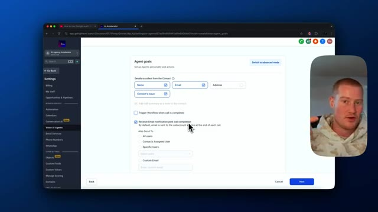

# 🎬 How to Easily Sell AI Employees in 20 Minutes (GoHighLevel)

> **Chaîne** : [Brock Mesarich | AI for Non Techies](https://www.youtube.com/@BrockMesarich)  
> **Lien YouTube** : [https://www.youtube.com/watch?v=bqUB2mFQg4A](https://www.youtube.com/watch?v=bqUB2mFQg4A)  
> **Date de publication** : 20250224  
> **Durée** : 00:19:53  
> **Identifiant vidéo** : `bqUB2mFQg4A`  
> **Transcription & Analyse** : `whisper-v3-large-turbo+gemini-3.5-flash-lite`  

---

## 📌 Synthèse Exécutive & Outils

### 💡 Résumé
Dans cette vidéo intitulée **Comment vendre facilement des employés IA en 20 minutes (GoHighLevel)**, Alex Carter détaille une approche stratégique et pratique du trading et de l'automatisation par agents IA.

### 🛠️ Outils, Modèles & Logiciels Présentés
- **TradingView & Claude Code** : Analyse technique avancée et automatisation algorithmique.

### 🔑 Points Clés & Enseignements Stratégiques
- Respect rigoureux du ratio risque/rendement et du money management.
- Automatisation méthodique des déclencheurs d'ordres via des agents intelligents.

---

## ⏱️ Chronologie & Transcription Complète Audio & Visuelle (Mot pour Mot)

### ⏱️ `[00:00:00 - 00:00:33]` | Segment #01

**🔊 Audio (Transcription Intégrale Mot pour Mot en Français) :**
> In this video, I'm going to show you everything you need to know about Go High Level's new AI employee. This new AI employee is their suite of AI features that are offered inside of their platform that make it really easy for you to implement AI as a business or to sell it to other businesses as an agency. In this video, I'm going to be touching on what this product is and diving deep into how we can actually build something amazing with the new Go High Level AI employee. So you're probably asking yourself, what is the Go High Level AI employee? Or you might even be asking yourself what even is GoHighLevel. So GoHighLevel is essentially an

**👁️ Analyse Visuelle d'Écran (gemini-3.5-flash-lite) :**
**Interface & Outils** : Présentation ou face-caméra explicatif du trader sans interface logicielle partagée.

**Contenu textuel & Code** : Explications orales des stratégies et mise en contexte méthodologique du marché.

**Action / Démonstration** : Explications face caméra et analyse conceptuelle des marchés.

---

### ⏱️ `[00:00:33 - 00:01:08]` | Segment #02

**🔊 Audio (Transcription Intégrale Mot pour Mot en Français) :**
> all-in-one marketing and automation platform that also includes a CRM. So think about if you own an agency or you run a business and you want to convert your leads into customers, you want to manage your customers, all these different things. So that is essentially what GoHighLevel is. But in this video, I'm going to be touching on GoHighLevel AI employee, obviously. So what does this include? This includes a voice AI. There is a funnel and website AI. There's a reviews AI, conversational ai content ai and workflow ai these are all included in the ai employee however in this video i'm simply going to be touching on the voice ai side of things because i think this is

**👁️ Analyse Visuelle d'Écran (gemini-3.5-flash-lite) :**
**Interface & Outils** : Présentation ou face-caméra explicatif du trader sans interface logicielle partagée.

**Contenu textuel & Code** : Explications orales des stratégies et mise en contexte méthodologique du marché.

**Action / Démonstration** : Explications face caméra et analyse conceptuelle des marchés.

---

### ⏱️ `[00:01:08 - 00:01:29]` | Segment #03

**🔊 Audio (Transcription Intégrale Mot pour Mot en Français) :**
> going to be really interesting and useful for you guys in this video all right so first things first i'm actually going to click on this this will actually take me to a link that will allow me to sign up with a 30-day free trial with go high level so if you'd like to do that make sure to sign up right here what i need to do i actually need to sign into my account and then i'm going to show you how to use the high level employee. And then I'm going to show you how to use the AI employee.

**👁️ Analyse Visuelle d'Écran (gemini-3.5-flash-lite) :**
**Interface & Outils** : Présentation ou face-caméra explicatif du trader sans interface logicielle partagée.

**Contenu textuel & Code** : Explications orales des stratégies et mise en contexte méthodologique du marché.

**Action / Démonstration** : Explications face caméra et analyse conceptuelle des marchés.

---

### ⏱️ `[00:01:29 - 00:01:54]` | Segment #04

**🔊 Audio (Transcription Intégrale Mot pour Mot en Français) :**
> So as you can see, I'm now inside my agency dashboard. And the first thing we need to do when we're inside of here is actually enable the AI employee inside the sub accounts that we're looking to give access to. So I'm going to come over to settings. I'm going to come over to AI employee. And what I'm going to do is I'm going to click on this and I'm going to then enable the AI employee, click on this enable here. And next step, I should be able to sign into my sub account and then access this.

**👁️ Analyse Visuelle d'Écran (gemini-3.5-flash-lite) :**
**Interface & Outils** : Présentation ou face-caméra explicatif du trader sans interface logicielle partagée.

**Contenu textuel & Code** : Explications orales des stratégies et mise en contexte méthodologique du marché.

**Action / Démonstration** : Explications face caméra et analyse conceptuelle des marchés.

---

### ⏱️ `[00:01:54 - 00:02:22]` | Segment #05

**🔊 Audio (Transcription Intégrale Mot pour Mot en Français) :**
> So let me go ahead and do that now. Great. So now inside of my sub account, I could come over to the settings over here. You could see I have multiple different things. So I have conversational AI. I have the voice agents AI. And what I'm gonna be focusing on this video is the voice AI agents. So we're gonna be building an AI agent that could actually work for our business, have context inside of our CRM, make phone calls for us, take inbound phone calls, and actually create and perform certain actions with inside of GoHighLevel.

**👁️ Analyse Visuelle d'Écran (gemini-3.5-flash-lite) :**
**Interface & Outils** : Présentation ou face-caméra explicatif du trader sans interface logicielle partagée.

**Contenu textuel & Code** : Explications orales des stratégies et mise en contexte méthodologique du marché.

**Action / Démonstration** : Explications face caméra et analyse conceptuelle des marchés.

---

### ⏱️ `[00:02:22 - 00:02:41]` | Segment #06

**🔊 Audio (Transcription Intégrale Mot pour Mot en Français) :**
> So the first thing I'm going to do is I'm actually going to come up here and click on create agent, this blue button. And this is where we're going to configure our voice calling agent. Let's go ahead and give this a name. Let's call this outbound AI caller. And I'm going to add my business name, which is the AI agency accelerator. And then right here, we could actually choose the voice that we want for our AI assistant.

**👁️ Analyse Visuelle d'Écran (gemini-3.5-flash-lite) :**
**Interface & Outils** : Présentation ou face-caméra explicatif du trader sans interface logicielle partagée.

**Contenu textuel & Code** : Explications orales des stratégies et mise en contexte méthodologique du marché.

**Action / Démonstration** : Explications face caméra et analyse conceptuelle des marchés.

---

### ⏱️ `[00:02:41 - 00:03:07]` | Segment #07

**🔊 Audio (Transcription Intégrale Mot pour Mot en Français) :**
> So just like any other voice platform, we could go ahead and search through these. Let's listen to a couple of these. Before you put on a frown, make absolutely sure there are no smiles available. Okay, so that's teen. That's Samantha. She's a teen and she's focused. I think I need a little bit older sounding voice. I don't want her calling for our business when she sounds like a little younger. So let me go ahead and listen to some of these other ones. If you don't know where you are going, you will probably end up somewhere else. Failure doesn't mean you are a failure.

**👁️ Analyse Visuelle d'Écran (gemini-3.5-flash-lite) :**
**Interface & Outils** : Présentation ou face-caméra explicatif du trader sans interface logicielle partagée.

**Contenu textuel & Code** : Explications orales des stratégies et mise en contexte méthodologique du marché.

**Action / Démonstration** : Explications face caméra et analyse conceptuelle des marchés.

---

### ⏱️ `[00:03:08 - 00:03:44]` | Segment #08

**🔊 Audio (Transcription Intégrale Mot pour Mot en Français) :**
> It just means you haven't succeeded yet. Cool. So Paula, I like this one a lot. Let's go ahead and move forward with that one. And we're going to be doing this actually for inbound calls. So changes to inbound caller. As of now, they do not have outbound calls with inside of Go High Level. This is a feature they're actually working on building out, but let's go ahead and set this up for inbound calls. And here is where we could actually change the initial message for our AI agents. So basically right now it's going to say, hey, you've reached AI agency accelerator. How can I help you today? That sounds good. We could obviously customize this however we want. Let's move on now. And next up is our agent goals here. So you could see we could actually collect certain

**👁️ Analyse Visuelle d'Écran (gemini-3.5-flash-lite) :**
**Interface & Outils** : Présentation ou face-caméra explicatif du trader sans interface logicielle partagée.

**Contenu textuel & Code** : Explications orales des stratégies et mise en contexte méthodologique du marché.

**Action / Démonstration** : Explications face caméra et analyse conceptuelle des marchés.

---

### ⏱️ `[00:03:44 - 00:04:18]` | Segment #09

**🔊 Audio (Transcription Intégrale Mot pour Mot en Français) :**
> details with our AI agent. So we could collect a name, we could collect an email, we could collect the address and the contacts issue. So what I'm going to do is let's just grab the name, the email and the contacts issue that they're running into. And then this will actually store this information inside of the user's profile inside of our Go High Level CRM. So what we could do is we could actually trigger a workflow when the call is completed. For this use case, I don't need to actually connect this to any of our workflows. You can see we have existing triggers here and workflows that we could actually send it down. So I'm going to leave that blank for now. One thing I am going to do is I'm going to click this box here where it says receive email notifications,

**👁️ Analyse Visuelle d'Écran (gemini-3.5-flash-lite) :**
**Interface & Outils** : Présentation ou face-caméra explicatif du trader sans interface logicielle partagée.

**Contenu textuel & Code** : Explications orales des stratégies et mise en contexte méthodologique du marché.

**Action / Démonstration** : Explications face caméra et analyse conceptuelle des marchés.

---

### ⏱️ `[00:04:19 - 00:04:52]` | Segment #10

**🔊 Audio (Transcription Intégrale Mot pour Mot en Français) :**
> post call completion. So when this phone call is finished, it will then send me an email to my personal email, letting me know who the AI spoke to, how the conversational went with a transcript and whatnot. So that's, that's pretty cool. We could also send this to different specific users if we want. So something important that I want to note is if we just basically click on this here and we don't click on switch to advanced mode for our agent goals, this will essentially only be an AI answering system. And the whole goal of it will be to collect the user's name, collect the user's email, collect the contacts issue or the address as well. Basically any of this information that we

**👁️ Analyse Visuelle d'Écran (gemini-3.5-flash-lite) :**
**Interface & Outils** : GoHighLevel (app.gohighlevel.com) — Voice AI Agents / Settings / Agent goals.

**Contenu textuel & Code** : Paramètres "Agent goals" : champs d'informations à collecter (Name, Email, Contact's issue), option cochée "Receive Email notification post call completion", et options d'envoi d'e-mail ("Also Send To": All users, Contact's Assigned User, Specific Users, Custom Email).

**Action / Démonstration** : Configuration des notifications e-mail post-appel pour recevoir le résumé et la transcription de la conversation gérée par l'agent IA.

*⏱️ 00:04:27 — Interface de configuration des objectifs d'un agent IA vocal dans GoHighLevel, montrant l'option d'envoi de notification par e-mail après l'appel.*

---

### ⏱️ `[00:04:52 - 00:05:11]` | Segment #11

**🔊 Audio (Transcription Intégrale Mot pour Mot en Français) :**
> select here. If we want this to have context on our business and be able to answer questions that are business related or give insights to the caller, then what we're going to need to do is come over and click on switch to advanced voice mode. So this right here is an easy to ship product that you could actually sell within your agency in order to answer phone calls, collect user information.

**👁️ Analyse Visuelle d'Écran (gemini-3.5-flash-lite) :**
**Interface & Outils** : Présentation ou face-caméra explicatif du trader sans interface logicielle partagée.

**Contenu textuel & Code** : Explications orales des stratégies et mise en contexte méthodologique du marché.

**Action / Démonstration** : Explications face caméra et analyse conceptuelle des marchés.

---

### ⏱️ `[00:05:11 - 00:05:30]` | Segment #12

**🔊 Audio (Transcription Intégrale Mot pour Mot en Français) :**
> It's almost like a lead form, but with an AI voice instead of like a form that you fill out on a website. So what we wanna do is we wanna come and click to switch to advanced voice mode. And then now we need to actually give this a prompt here. This is where essentially we need to structure exactly how we want our AI voice agent to interact with the different users.

**👁️ Analyse Visuelle d'Écran (gemini-3.5-flash-lite) :**
**Interface & Outils** : Présentation ou face-caméra explicatif du trader sans interface logicielle partagée.

**Contenu textuel & Code** : Explications orales des stratégies et mise en contexte méthodologique du marché.

**Action / Démonstration** : Explications face caméra et analyse conceptuelle des marchés.

---

### ⏱️ `[00:05:30 - 00:05:54]` | Segment #13

**🔊 Audio (Transcription Intégrale Mot pour Mot en Français) :**
> So what I'm gonna do is I'm gonna go ahead and write a prompt right now for myself and for this specific use case with inside of my go high level. And then you could kind of see exactly how you could prompt this for yourself. All right, so first of all, what I'm gonna do before writing the prompt is I'm actually gonna come back and change the initial message here because what I'm gonna do is I'm gonna actually build an AI caller for an electrical company in order to help book consultations in order to service them for their electrical needs.

**👁️ Analyse Visuelle d'Écran (gemini-3.5-flash-lite) :**
**Interface & Outils** : Présentation ou face-caméra explicatif du trader sans interface logicielle partagée.

**Contenu textuel & Code** : Explications orales des stratégies et mise en contexte méthodologique du marché.

**Action / Démonstration** : Explications face caméra et analyse conceptuelle des marchés.

---

### ⏱️ `[00:05:54 - 00:06:12]` | Segment #14

**🔊 Audio (Transcription Intégrale Mot pour Mot en Français) :**
> So I'm gonna say, hey, this is, or let's say, hey, you have reached Bend Electrical. How may I help you today? So that's a good initial message there. and then let's change this to bend electrical. Great, now we can move on. So we're gonna then click on all of these for the goals again.

**👁️ Analyse Visuelle d'Écran (gemini-3.5-flash-lite) :**
**Interface & Outils** : Présentation ou face-caméra explicatif du trader sans interface logicielle partagée.

**Contenu textuel & Code** : Explications orales des stratégies et mise en contexte méthodologique du marché.

**Action / Démonstration** : Explications face caméra et analyse conceptuelle des marchés.

---

### ⏱️ `[00:06:12 - 00:06:35]` | Segment #15

**🔊 Audio (Transcription Intégrale Mot pour Mot en Français) :**
> We're gonna do name, email, let's do address and the contacts issue. And then let's go ahead and switch to advanced mode where we're actually gonna write our prompt. All right, so I wrote a prompt here and let me just show you kind of high level of exactly what it is. So you could use this to formulate your prompts. So foundational information. I like to give some context on what our company is So that way our AI voice agent knows how to respond accordingly.

**👁️ Analyse Visuelle d'Écran (gemini-3.5-flash-lite) :**
**Interface & Outils** : Présentation ou face-caméra explicatif du trader sans interface logicielle partagée.

**Contenu textuel & Code** : Explications orales des stratégies et mise en contexte méthodologique du marché.

**Action / Démonstration** : Explications face caméra et analyse conceptuelle des marchés.

---

### ⏱️ `[00:06:35 - 00:06:57]` | Segment #16

**🔊 Audio (Transcription Intégrale Mot pour Mot en Français) :**
> So company information, Bend Electrical, providing comprehensive electrical services to residential clients. The role of the assistant is to handle inbound calls to schedule appointments. The target audience is going to be residential customers seeking electrical services. I explain my unique value proposition. And then also I go over objection handling. So pricing concerns, discuss available service plans, fitting various budgets.

**👁️ Analyse Visuelle d'Écran (gemini-3.5-flash-lite) :**
**Interface & Outils** : Présentation ou face-caméra explicatif du trader sans interface logicielle partagée.

**Contenu textuel & Code** : Explications orales des stratégies et mise en contexte méthodologique du marché.

**Action / Démonstration** : Explications face caméra et analyse conceptuelle des marchés.

---

### ⏱️ `[00:06:57 - 00:07:16]` | Segment #17

**🔊 Audio (Transcription Intégrale Mot pour Mot en Français) :**
> And here are some other things. Urgency of the service, service scope questions. So clarifying comprehensive residential service offerings, competitive comparisons, excessive information requests. And then here is the script here. So first of all, we're going to introduce and greet the caller. So greet the caller and state the purpose, offering a friendly state to the interaction.

**👁️ Analyse Visuelle d'Écran (gemini-3.5-flash-lite) :**
**Interface & Outils** : Présentation ou face-caméra explicatif du trader sans interface logicielle partagée.

**Contenu textuel & Code** : Explications orales des stratégies et mise en contexte méthodologique du marché.

**Action / Démonstration** : Explications face caméra et analyse conceptuelle des marchés.

---

### ⏱️ `[00:07:17 - 00:07:36]` | Segment #18

**🔊 Audio (Transcription Intégrale Mot pour Mot en Français) :**
> And then we're going to gather information. So whether that is asking the name, verifying their contact information, including their email, and then also understanding what the reason for the call is. So it's going through all these different steps. You can see that I have different objection handlings. We have conclusion and next steps. So we want to confirm appointment details. Thank the caller for reaching out and mention any follow-up actions.

**👁️ Analyse Visuelle d'Écran (gemini-3.5-flash-lite) :**
**Interface & Outils** : Présentation ou face-caméra explicatif du trader sans interface logicielle partagée.

**Contenu textuel & Code** : Explications orales des stratégies et mise en contexte méthodologique du marché.

**Action / Démonstration** : Explications face caméra et analyse conceptuelle des marchés.

---

### ⏱️ `[00:07:37 - 00:07:57]` | Segment #19

**🔊 Audio (Transcription Intégrale Mot pour Mot en Français) :**
> So this prompt here is essentially the guidelines for our AI agent or AI employee to follow in order to conduct these AI phone calls as perfectly as possible. Next up, what we want to focus on is the ability to set up actions inside of Go High Level, which is really awesome being able to do this. So we could either create a call transfer, which essentially will transfer this phone call to an actual person.

**👁️ Analyse Visuelle d'Écran (gemini-3.5-flash-lite) :**
**Interface & Outils** : Présentation ou face-caméra explicatif du trader sans interface logicielle partagée.

**Contenu textuel & Code** : Explications orales des stratégies et mise en contexte méthodologique du marché.

**Action / Démonstration** : Explications face caméra et analyse conceptuelle des marchés.

---

### ⏱️ `[00:07:57 - 00:08:16]` | Segment #20

**🔊 Audio (Transcription Intégrale Mot pour Mot en Français) :**
> So let's say if the AI is having trouble or if the user asks to speak with a person, we could set up that call transfer right here. So let's go ahead and just name this human handoff. And I'm going to add a phone number here that we want to transfer this phone call to. And then we need to specify when this transfer should take place.

**👁️ Analyse Visuelle d'Écran (gemini-3.5-flash-lite) :**
**Interface & Outils** : Présentation ou face-caméra explicatif du trader sans interface logicielle partagée.

**Contenu textuel & Code** : Explications orales des stratégies et mise en contexte méthodologique du marché.

**Action / Démonstration** : Explications face caméra et analyse conceptuelle des marchés.

---

### ⏱️ `[00:08:16 - 00:08:52]` | Segment #21

**🔊 Audio (Transcription Intégrale Mot pour Mot en Français) :**
> So let's just say if the user asks to speak with a human or with the actual business itself. and we could get as like technical with that as we want but I think that should be able to identify like I should I think that yeah I should be able to identify when it needs to actually initiate this call transfer and then let's say please wait while I transfer you to someone to help there we go so this is what it's going to say while or like right before it transfers us so let's go ahead and add that action and then let's take a look at these other actions that we'd like to give to our AI agent to perform so we could actually trigger a workflow like I said before if we have a specific

**👁️ Analyse Visuelle d'Écran (gemini-3.5-flash-lite) :**
**Interface & Outils** : Présentation ou face-caméra explicatif du trader sans interface logicielle partagée.

**Contenu textuel & Code** : Explications orales des stratégies et mise en contexte méthodologique du marché.

**Action / Démonstration** : Explications face caméra et analyse conceptuelle des marchés.

---

### ⏱️ `[00:08:52 - 00:09:18]` | Segment #22

**🔊 Audio (Transcription Intégrale Mot pour Mot en Français) :**
> workflow that we want this to trigger, whether that is send them down a specific email marketing campaign or whatnot. If you've used GoHighLevel before, you've used their workflow builders. They're awesome for creating automations, especially with like AI in the loop using ChattoBT or whatever the case may be. So you could go ahead, use that and send them down a text message campaign, a email campaign. You could send them down retargeting ads. All this stuff is within GoHighLevel. It's a very comprehensive platform with so many different things to offer.

**👁️ Analyse Visuelle d'Écran (gemini-3.5-flash-lite) :**
**Interface & Outils** : Présentation ou face-caméra explicatif du trader sans interface logicielle partagée.

**Contenu textuel & Code** : Explications orales des stratégies et mise en contexte méthodologique du marché.

**Action / Démonstration** : Explications face caméra et analyse conceptuelle des marchés.

---

### ⏱️ `[00:09:18 - 00:09:50]` | Segment #23

**🔊 Audio (Transcription Intégrale Mot pour Mot en Français) :**
> And I'm not going to go over all of it in this video. For the sake of this, I'm not going to click on that. But what we're going to do is we're going to update the contact field. So what we need to do is let's just call this update contact. And then we're going to name this right here. Let's just add. Okay. So we could update any of these contact fields that we would like. So let's go ahead and name this budget. So this right here is going to extract your budget based on the prompt within the phone call. And then it will then save this as an action into their contact. And then we'll save this as budget. So it'll update their contact and then what to update in the field.

**👁️ Analyse Visuelle d'Écran (gemini-3.5-flash-lite) :**
**Interface & Outils** : Présentation ou face-caméra explicatif du trader sans interface logicielle partagée.

**Contenu textuel & Code** : Explications orales des stratégies et mise en contexte méthodologique du marché.

**Action / Démonstration** : Explications face caméra et analyse conceptuelle des marchés.

---

### ⏱️ `[00:09:50 - 00:10:14]` | Segment #24

**🔊 Audio (Transcription Intégrale Mot pour Mot en Français) :**
> Let's just say budget of the caller and then we'll overwrite existing contact field. And then let's just say their budget is $5,000. And then we could add other ones right here just so we could get a sense of what one of their responses will be for the AI to identify. There we go. So let's save that. And now if this user already has a contact, this will now update that contact with their budget if they actually discuss it on the phone call.

**👁️ Analyse Visuelle d'Écran (gemini-3.5-flash-lite) :**
**Interface & Outils** : Présentation ou face-caméra explicatif du trader sans interface logicielle partagée.

**Contenu textuel & Code** : Explications orales des stratégies et mise en contexte méthodologique du marché.

**Action / Démonstration** : Explications face caméra et analyse conceptuelle des marchés.

---

### ⏱️ `[00:10:14 - 00:10:49]` | Segment #25

**🔊 Audio (Transcription Intégrale Mot pour Mot en Français) :**
> All right. And then what I actually did is I changed this in the prompt to ask the user what their budget for the project is. And then it will now create this action and update the contact field, just like what I added. And then we can also send an SMS text message. So we could basically send an SMS to this user after the phone call and say, Hey, thanks for the phone call. We customize it however we want. We could use an SMS template, whatever we would like to do, but I'm just, I'm just going to leave it there for now. All right. So we're almost done setting up on our AI agent inside of go high level that actually could create phone calls for us and update contact information inside of our CRM. What we need to do now is we need to assign a phone number to our

**👁️ Analyse Visuelle d'Écran (gemini-3.5-flash-lite) :**
**Interface & Outils** : Présentation ou face-caméra explicatif du trader sans interface logicielle partagée.

**Contenu textuel & Code** : Explications orales des stratégies et mise en contexte méthodologique du marché.

**Action / Démonstration** : Explications face caméra et analyse conceptuelle des marchés.

---

### ⏱️ `[00:10:49 - 00:11:26]` | Segment #26

**🔊 Audio (Transcription Intégrale Mot pour Mot en Français) :**
> agent for it to actually make calls for us, obviously. So what we could do is we could either select a phone number. You could see I already purchased one. However, what we could do is we could actually click on buy a new phone number and this will use Go High Levels lead connector. And then essentially we could just click add number and we could select a different country. And basically what we could do is we could choose any phone number here in different locations and we basically we'll just click on this and we will buy it and we'll pay $1.15 per month for this phone number. But I already have a phone number here. So let me go back. All I need to do is select this phone number and then we could also set working hours for the agent. However,

**👁️ Analyse Visuelle d'Écran (gemini-3.5-flash-lite) :**
**Interface & Outils** : Présentation ou face-caméra explicatif du trader sans interface logicielle partagée.

**Contenu textuel & Code** : Explications orales des stratégies et mise en contexte méthodologique du marché.

**Action / Démonstration** : Explications face caméra et analyse conceptuelle des marchés.

---

### ⏱️ `[00:11:26 - 00:11:54]` | Segment #27

**🔊 Audio (Transcription Intégrale Mot pour Mot en Français) :**
> like I'm just going to have this 24 seven. Why not? So this could actually take calls for us. Even when we're not working overnight or something. And then what I'm going to do now is I'm going to go ahead and test this out and I should be receiving a phone call on my phone. All right, there we go. We actually have our phone call coming in. Let me go ahead and answer this. Hey, what's going on? Hey, you have reached Bend Electrical. How may I help you today?

**👁️ Analyse Visuelle d'Écran (gemini-3.5-flash-lite) :**
**Interface & Outils** : Présentation ou face-caméra explicatif du trader sans interface logicielle partagée.

**Contenu textuel & Code** : Explications orales des stratégies et mise en contexte méthodologique du marché.

**Action / Démonstration** : Explications face caméra et analyse conceptuelle des marchés.

---

### ⏱️ `[00:11:55 - 00:12:23]` | Segment #28

**🔊 Audio (Transcription Intégrale Mot pour Mot en Français) :**
> Yeah, I just had some questions. I need to get something fixed, like with my electrical in my house. I wanted to speak more about it. Could you tell me a bit more about the issue you're experiencing? That way I can help you better. Yeah. So for whatever reason, one of my outlets just is not working and I've tried resetting the breaker. It's just not working. So I needed some help. So I figured I'd call you guys. Sounds frustrating. We can definitely help with that.

**👁️ Analyse Visuelle d'Écran (gemini-3.5-flash-lite) :**
**Interface & Outils** : Présentation ou face-caméra explicatif du trader sans interface logicielle partagée.

**Contenu textuel & Code** : Explications orales des stratégies et mise en contexte méthodologique du marché.

**Action / Démonstration** : Explications face caméra et analyse conceptuelle des marchés.

---

### ⏱️ `[00:12:24 - 00:12:56]` | Segment #29

**🔊 Audio (Transcription Intégrale Mot pour Mot en Français) :**
> Can I get your name and contact information to set up an appointment for you? Yeah, sure. What contact information do you need for me? I'll need your full name, phone number, and email address. Could you please spell out your email for me? Yeah. So my full name is Brock Messerich. My email address is Brock Messerich at gmail.com. And my phone number is this one. Do you have any specific days or times that work best? Yeah. Do you guys have any availability next Monday at like

**👁️ Analyse Visuelle d'Écran (gemini-3.5-flash-lite) :**
**Interface & Outils** : Présentation ou face-caméra explicatif du trader sans interface logicielle partagée.

**Contenu textuel & Code** : Explications orales des stratégies et mise en contexte méthodologique du marché.

**Action / Démonstration** : Explications face caméra et analyse conceptuelle des marchés.

---

### ⏱️ `[00:12:56 - 00:13:16]` | Segment #30

**🔊 Audio (Transcription Intégrale Mot pour Mot en Français) :**
> 10 a.m. or something? Yes, we do have an opening next Monday at 10 a.m. Shall I book that for you? Yeah, let's go ahead and book it, please. For next Monday at 10 a.m., thanks for choosing Bend Electrical, Brock. If you have any other questions before then, feel free to reach out.

**👁️ Analyse Visuelle d'Écran (gemini-3.5-flash-lite) :**
**Interface & Outils** : Présentation ou face-caméra explicatif du trader sans interface logicielle partagée.

**Contenu textuel & Code** : Explications orales des stratégies et mise en contexte méthodologique du marché.

**Action / Démonstration** : Explications face caméra et analyse conceptuelle des marchés.

---

### ⏱️ `[00:13:16 - 00:13:53]` | Segment #31

**🔊 Audio (Transcription Intégrale Mot pour Mot en Français) :**
> Have a great day. You too. Thank you. All right, there we go. That was our phone call via our Go High Level AI employee. All right, so next up inside of the AI employee, what I'm going to do is I'm going to show you the automation. So you obviously, if you've used Go High Level before, you know about the workflow automations, but if you don't, I'm going to show you what it is. So right here is an automation slash workflow that we could actually have inside of our Go High Level account. So we could create a new trigger where say if a new contact is created via contact form, it then is sent down this specific workflow. And what I want to touch on is I actually want to come down here and right here is actually the workflow AI. This is another piece

**👁️ Analyse Visuelle d'Écran (gemini-3.5-flash-lite) :**
**Interface & Outils** : Présentation ou face-caméra explicatif du trader sans interface logicielle partagée.

**Contenu textuel & Code** : Explications orales des stratégies et mise en contexte méthodologique du marché.

**Action / Démonstration** : Explications face caméra et analyse conceptuelle des marchés.

---

### ⏱️ `[00:13:53 - 00:14:18]` | Segment #32

**🔊 Audio (Transcription Intégrale Mot pour Mot en Français) :**
> of the AI employee product. As you know, there was voice AI, there's conversation AI, there's workflow AI, content AI, all of these different products all tied together. So what we could do is we could click assist with building and then let's just write out what we're trying to build and it will actually assist us doing this. So let's just say when a new lead fills out a form, trigger the conversational AI to then send them a text or something like that.

**👁️ Analyse Visuelle d'Écran (gemini-3.5-flash-lite) :**
**Interface & Outils** : Présentation ou face-caméra explicatif du trader sans interface logicielle partagée.

**Contenu textuel & Code** : Explications orales des stratégies et mise en contexte méthodologique du marché.

**Action / Démonstration** : Explications face caméra et analyse conceptuelle des marchés.

---

### ⏱️ `[00:14:18 - 00:14:38]` | Segment #33

**🔊 Audio (Transcription Intégrale Mot pour Mot en Français) :**
> And I'm not gonna go ahead and build an automation here, but I just want to show you how the workflow AI works. So that way you could begin using it inside of your account. And this pairs great with the voice AI and the conversational AI. All right, there we go. So now it's actually giving us all the steps. So first of all, we need to choose the trigger and that will be the form submitted trigger. Then we need to specify the trigger settings.

**👁️ Analyse Visuelle d'Écran (gemini-3.5-flash-lite) :**
**Interface & Outils** : Présentation ou face-caméra explicatif du trader sans interface logicielle partagée.

**Contenu textuel & Code** : Explications orales des stratégies et mise en contexte méthodologique du marché.

**Action / Démonstration** : Explications face caméra et analyse conceptuelle des marchés.

---

### ⏱️ `[00:14:38 - 00:15:09]` | Segment #34

**🔊 Audio (Transcription Intégrale Mot pour Mot en Français) :**
> We need to add the action, which is conversations AI and then send SMS action. So that'll actually help us walk through and set up all of those. But what I want to do now is I want to go back and I want to actually focus on the conversational AI. and how we could actually create an AI that texts with our customers or our leads. It has context on our business. And I'm going to show you how to configure that now. So you're going to click on settings and then come to conversational AI. Next up, what we're going to do is we're just going to click a new one. So there's these different templates here. We have general Q&A.

**👁️ Analyse Visuelle d'Écran (gemini-3.5-flash-lite) :**
**Interface & Outils** : Présentation ou face-caméra explicatif du trader sans interface logicielle partagée.

**Contenu textuel & Code** : Explications orales des stratégies et mise en contexte méthodologique du marché.

**Action / Démonstration** : Explications face caméra et analyse conceptuelle des marchés.

---

### ⏱️ `[00:15:09 - 00:15:45]` | Segment #35

**🔊 Audio (Transcription Intégrale Mot pour Mot en Français) :**
> So if you just want to simplify customer interactions by answering common questions, this is a great option. We also have the appointment booking option, which is pretty cool as well. For this, let's just go ahead with general Q&A. And so this should save you or your sales team time where instead of having to text back and forth with the lead, you know, this already has context on your AI and it's essentially a chatbot that has the ability to text and is really easy to set up. So let's just say, let's call this Q&A agent, say Q&A agent. And then so we could obviously set the status here of our bot. So we want to turn this on autopilot. So that means that

**👁️ Analyse Visuelle d'Écran (gemini-3.5-flash-lite) :**
**Interface & Outils** : Présentation ou face-caméra explicatif du trader sans interface logicielle partagée.

**Contenu textuel & Code** : Explications orales des stratégies et mise en contexte méthodologique du marché.

**Action / Démonstration** : Explications face caméra et analyse conceptuelle des marchés.

---

### ⏱️ `[00:15:45 - 00:16:20]` | Segment #36

**🔊 Audio (Transcription Intégrale Mot pour Mot en Français) :**
> the bot will reply automatically based on training data. Great. Here we go. We could change any of this information here. So let's just say then the electrical, here we are, click save. And then next up, what I want to focus on is the bot training. So what we could do is we could actually add a URL here. So if you have a website that you would like to scrape, we could then scrape that and it will get that data and we'll understand everything about your business. So that way it could actually respond to customers as any other AI chatbot would function. So let's test this out. I know this is not the BendElectric website that I was referring to in this video, but let's just use

**👁️ Analyse Visuelle d'Écran (gemini-3.5-flash-lite) :**
**Interface & Outils** : Présentation ou face-caméra explicatif du trader sans interface logicielle partagée.

**Contenu textuel & Code** : Explications orales des stratégies et mise en contexte méthodologique du marché.

**Action / Démonstration** : Explications face caméra et analyse conceptuelle des marchés.

---

### ⏱️ `[00:16:20 - 00:16:54]` | Segment #37

**🔊 Audio (Transcription Intégrale Mot pour Mot en Français) :**
> the Apple website and because there's a lot of information here that we could extract and then let's test it and actually see how it works. You can see it's fetching these pages. It's going to crawl all these different URLs on the website and actually get that data. All right, so I'm going to click all URLs in this domain because this actually just took this landing page here. So I want something that actually shows the entire website. So it's going to crawl the entire apple.com site now. All right. So that took a couple minutes, but you could see it now crawled this entire website and there were 751 pages. So now our bot has contacts on all of this information. So if you

**👁️ Analyse Visuelle d'Écran (gemini-3.5-flash-lite) :**
**Interface & Outils** : Présentation ou face-caméra explicatif du trader sans interface logicielle partagée.

**Contenu textuel & Code** : Explications orales des stratégies et mise en contexte méthodologique du marché.

**Action / Démonstration** : Explications face caméra et analyse conceptuelle des marchés.

---

### ⏱️ `[00:16:54 - 00:17:16]` | Segment #38

**🔊 Audio (Transcription Intégrale Mot pour Mot en Français) :**
> have a big website, believe me, you should be able to train it on all that information. So next up, I just needed to click train because it fetched all of these, but now I need to actually train it on all of these pages. So let's go ahead and let it do that. And then we'll dive back into this. So the last part we need to do in order to configure our conversational AI is come over to the block goals. Similar to what we did with the AI voice agent, we need to actually write a prompt.

**👁️ Analyse Visuelle d'Écran (gemini-3.5-flash-lite) :**
**Interface & Outils** : Présentation ou face-caméra explicatif du trader sans interface logicielle partagée.

**Contenu textuel & Code** : Explications orales des stratégies et mise en contexte méthodologique du marché.

**Action / Démonstration** : Explications face caméra et analyse conceptuelle des marchés.

---

### ⏱️ `[00:17:16 - 00:17:40]` | Segment #39

**🔊 Audio (Transcription Intégrale Mot pour Mot en Français) :**
> So if you want a resource on how to actually generate your prompts, here is a resource that GHL actually added. It's called AI prompting 101. So this will walk through exactly how you should prompt your conversational AI agent. You can also add custom values here. So you could address user by their name. You could, you know, pull any information, whether that is like a payment link, whether that is an appointment that they booked, all this stuff.

**👁️ Analyse Visuelle d'Écran (gemini-3.5-flash-lite) :**
**Interface & Outils** : Présentation ou face-caméra explicatif du trader sans interface logicielle partagée.

**Contenu textuel & Code** : Explications orales des stratégies et mise en contexte méthodologique du marché.

**Action / Démonstration** : Explications face caméra et analyse conceptuelle des marchés.

---

### ⏱️ `[00:17:40 - 00:18:00]` | Segment #40

**🔊 Audio (Transcription Intégrale Mot pour Mot en Français) :**
> We could add all those custom values there. And then we want to come down and look at the action. So again, same thing with the voice AI. We could actually configure a few different actions here. So we could add automatic appointment booking. We could also add trigger a workflow. We could add contact information or we could then stop the bot.

**👁️ Analyse Visuelle d'Écran (gemini-3.5-flash-lite) :**
**Interface & Outils** : Présentation ou face-caméra explicatif du trader sans interface logicielle partagée.

**Contenu textuel & Code** : Explications orales des stratégies et mise en contexte méthodologique du marché.

**Action / Démonstration** : Explications face caméra et analyse conceptuelle des marchés.

---

### ⏱️ `[00:18:00 - 00:18:34]` | Segment #41

**🔊 Audio (Transcription Intégrale Mot pour Mot en Français) :**
> So for whatever reason, if it's going off the guardrails, we could just stop the bot there. So guys, this is the conversational AI inside of the AI employee. Next up on the list of the AI employee is the funnels. So if you come over to sites, you could then click on create a new funnel. And there's this thing called funnel AI. So we could basically write out what it is we're trying to build and it will build a funnel for us with AI, almost like its own website generator. So let's just call this Bend Electrical, Electrician. Basically we put in all these preferences. So I'm looking for a funnel for my electrical company business to generate more leads and content should feel friendly. So we could

**👁️ Analyse Visuelle d'Écran (gemini-3.5-flash-lite) :**
**Interface & Outils** : Présentation ou face-caméra explicatif du trader sans interface logicielle partagée.

**Contenu textuel & Code** : Explications orales des stratégies et mise en contexte méthodologique du marché.

**Action / Démonstration** : Explications face caméra et analyse conceptuelle des marchés.

---

### ⏱️ `[00:18:34 - 00:19:09]` | Segment #42

**🔊 Audio (Transcription Intégrale Mot pour Mot en Français) :**
> like obviously customize this however we want literally click generate and it will begin building this funnel for us and make it super simple for people if you're not technical don't know how to use ghl these ai employee features make it really simple to give yourself a starting point as well as like build some really amazing things leveraging ai and here we go just off one simple prompt that took literally like two minutes like that took literally like 30 seconds now we have beginning of a website here or a funnel that we could then create we can then preview this or we can you know, make some additional edits to it. So that is the AI funnel builder inside of the AI employee.

**👁️ Analyse Visuelle d'Écran (gemini-3.5-flash-lite) :**
**Interface & Outils** : Présentation ou face-caméra explicatif du trader sans interface logicielle partagée.

**Contenu textuel & Code** : Explications orales des stratégies et mise en contexte méthodologique du marché.

**Action / Démonstration** : Explications face caméra et analyse conceptuelle des marchés.

---

### ⏱️ `[00:19:09 - 00:19:41]` | Segment #43

**🔊 Audio (Transcription Intégrale Mot pour Mot en Français) :**
> All right, guys, there we have it. There is the go high level AI employee. I know I touched on a couple of those features little briefly. We dove deep into how to build an AI voice agent using the voice AI feature inside of high levels AI employee. So I hope you guys got some value from this video. This is a really cool product and there's so many different use cases for you. If you're a business owner, if you're an agency looking to resell this software as your own CRM system or whatever the case may be. So they were actually kind enough to give you a 30-day free trial of the platform. So make sure to click the link in the description and sign up for a free

**👁️ Analyse Visuelle d'Écran (gemini-3.5-flash-lite) :**
**Interface & Outils** : Présentation ou face-caméra explicatif du trader sans interface logicielle partagée.

**Contenu textuel & Code** : Explications orales des stratégies et mise en contexte méthodologique du marché.

**Action / Démonstration** : Explications face caméra et analyse conceptuelle des marchés.

---

### ⏱️ `[00:19:41 - 00:19:53]` | Segment #44

**🔊 Audio (Transcription Intégrale Mot pour Mot en Français) :**
> trial. Or if you're already a high-level user and you want access to the high-level employee, you could do that as well. So thank you guys so much for tuning into this video. I'd like to thank High Level for sponsoring this video. Hope this was valuable to you guys and I'll see you guys in the next one.

**👁️ Analyse Visuelle d'Écran (gemini-3.5-flash-lite) :**
**Interface & Outils** : Présentation ou face-caméra explicatif du trader sans interface logicielle partagée.

**Contenu textuel & Code** : Explications orales des stratégies et mise en contexte méthodologique du marché.

**Action / Démonstration** : Explications face caméra et analyse conceptuelle des marchés.

---

