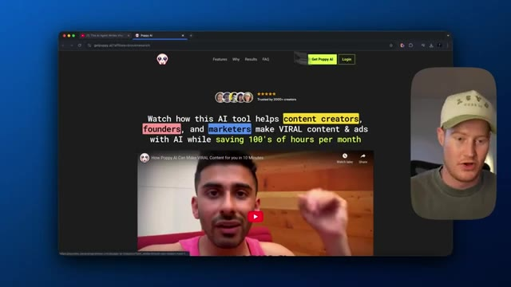
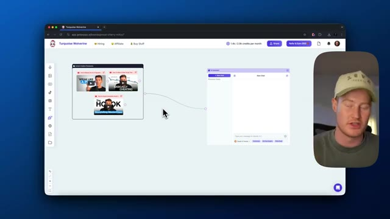

# 🎬 The Most Powerful Way to Use Claude 3.7 Sonnet (Tutorial)

> **Chaîne** : [Brock Mesarich | AI for Non Techies](https://www.youtube.com/@BrockMesarich)  
> **Lien YouTube** : [https://www.youtube.com/watch?v=cDih5VGufhY](https://www.youtube.com/watch?v=cDih5VGufhY)  
> **Date de publication** : 20250228  
> **Durée** : 00:07:38  
> **Identifiant vidéo** : `cDih5VGufhY`  
> **Transcription & Analyse** : `whisper-v3-large-turbo+gemini-3.5-flash-lite`  

---

## 📌 Synthèse Exécutive & Outils

### 💡 Résumé
Dans cette vidéo intitulée **La façon la plus puissante d'utiliser Claude 3.7 Sonnet (Tutoriel)**, Alex Carter détaille une approche stratégique et pratique du trading et de l'automatisation par agents IA.

### 🛠️ Outils, Modèles & Logiciels Présentés
- **TradingView & Claude Code** : Analyse technique avancée et automatisation algorithmique.

### 🔑 Points Clés & Enseignements Stratégiques
- Respect rigoureux du ratio risque/rendement et du money management.
- Automatisation méthodique des déclencheurs d'ordres via des agents intelligents.

---

## ⏱️ Chronologie & Transcription Complète Audio & Visuelle (Mot pour Mot)

### ⏱️ `[00:00:00 - 00:00:32]` | Segment #01

**🔊 Audio (Transcription Intégrale Mot pour Mot en Français) :**
> In this video, I'm going to show you how you can use Claude 3.7 Sonnet, but with a powerful twist that nobody's talking about. I was already using Claude 3.5 to help me write scripts for my newsletter, LinkedIn posts, and YouTube shorts. But Claude 3.7 Sonnet takes it to an entirely different level. But the secret isn't using just Claude. It's combining it with an external tool that makes your writing process 10 times more effective. I personally use this to help me create content. If we haven't met yet, my name is Brock Messerich, and this YouTube channel is AI for non-techies. I showcase how you can use AI every single day to make your life easier and

**👁️ Analyse Visuelle d'Écran (gemini-3.5-flash-lite) :**
**Interface & Outils** : Présentation ou face-caméra explicatif du trader sans interface logicielle partagée.

**Contenu textuel & Code** : Explications orales des stratégies et mise en contexte méthodologique du marché.

**Action / Démonstration** : Explications face caméra et analyse conceptuelle des marchés.

---

### ⏱️ `[00:00:32 - 00:01:08]` | Segment #02

**🔊 Audio (Transcription Intégrale Mot pour Mot en Français) :**
> plus efficace. Le tout expliqué pour des personnes non techniques comme moi. Ceci étant dit, c'est parti. Très bien. Alors tout d'abord, nous ne allons pas vraiment utiliser Claude 3.7 Sonnet sur le site web de Claude ou quoi que ce soit de ce genre. Nous allons utiliser un outil externe afin d'exploiter la technologie derrière Claude 3.7. Donc au lieu de venir ici, fermons ceci. Nous allons plutôt aller dans la description. Nous allons prendre ce lien ici et cela va nous amener sur Poppy. Et en gros, nous allons simplement créer un compte, nous connecter, faire tout ce dont nous avons besoin ici pour créer un compte. La première chose que nous devons faire maintenant, c'est venir ici et cliquer sur « new board ». Et tout d'abord, nous allons voir une toile vierge ici. La première chose dont nous avons besoin

**👁️ Analyse Visuelle d'Écran (gemini-3.5-flash-lite) :**
**Interface & Outils** : Navigateur web, site officiel de Claude, YouTube, site web Poppy AI

**Contenu textuel & Code** : Interface utilisateur de Claude avec message d'accueil et barre de recherche, interface de lecture vidéo YouTube avec statistiques de chaîne, page d'atterrissage Poppy AI avec accroche marketing et vidéo intégrée.
[DESC_IMAGE_3] Navigation et présentation de l'outil Poppy AI pour la création de contenu viral par le présentateur.

**Action / Démonstration** : Explications face caméra et analyse conceptuelle des marchés.

*⏱️ 00:00:59 — Page d'accueil du site Web de l'outil Poppy AI présentant une interface sombre avec une vidéo de démonstration et du texte promotionnel.*

---

### ⏱️ `[00:01:08 - 00:01:40]` | Segment #03

**🔊 Audio (Transcription Intégrale Mot pour Mot en Français) :**
> to do is actually go ahead and drop some information here. I'm going to pull up this AI chat right here. And as you could see, we could either choose between Claude 3.5 Sonnet, which is what I used to use, or we could use O3 Mini, but we're going to focus on obviously Claude 3.7 Sonnet for this video. And you're probably asking, okay, you could chat with Claude 3.7 Sonnet here. What's the big deal about that? And the big deal about that is the information we could tie into our AI assistant that leverages Claude 3.5 Sonnet. So basically, I'm going to show you how I use this to help me write specific newsletters. I use it to write content for me. So I'm personally going

**👁️ Analyse Visuelle d'Écran (gemini-3.5-flash-lite) :**
**Interface & Outils** : Présentation ou face-caméra explicatif du trader sans interface logicielle partagée.

**Contenu textuel & Code** : Explications orales des stratégies et mise en contexte méthodologique du marché.

**Action / Démonstration** : Explications face caméra et analyse conceptuelle des marchés.

---

### ⏱️ `[00:01:40 - 00:02:02]` | Segment #04

**🔊 Audio (Transcription Intégrale Mot pour Mot en Français) :**
> to show you how I use this every single day to help me write content, whether that's my newsletter, whether this is posted to my school community, whether this is writing out scripts for videos, or even just synthesizing information for me to digest. So the first thing I wanna touch on is we could actually go ahead and paste in a YouTube video to the canvas. So I just pasted in the first video here, and this is essentially a video from one of my favorite creators, Kane Calloway.

**👁️ Analyse Visuelle d'Écran (gemini-3.5-flash-lite) :**
**Interface & Outils** : Présentation ou face-caméra explicatif du trader sans interface logicielle partagée.

**Contenu textuel & Code** : Explications orales des stratégies et mise en contexte méthodologique du marché.

**Action / Démonstration** : Explications face caméra et analyse conceptuelle des marchés.

---

### ⏱️ `[00:02:02 - 00:02:27]` | Segment #05

**🔊 Audio (Transcription Intégrale Mot pour Mot en Français) :**
> It is titled, How to Write a Killer Script That Keeps Viewers Hooked. So essentially, we're gonna be leveraging all the concepts he talks about in this like 10, 15 minute video and tying that into our chat here using Claude 3.7 Sonnet. So we could do this with any context. We could come over, we could drop in a YouTube video, we could drop in recordings, images, texts, documents, websites, as many things as we could think of and use that as the brain of our assistant.

**👁️ Analyse Visuelle d'Écran (gemini-3.5-flash-lite) :**
**Interface & Outils** : Présentation ou face-caméra explicatif du trader sans interface logicielle partagée.

**Contenu textuel & Code** : Explications orales des stratégies et mise en contexte méthodologique du marché.

**Action / Démonstration** : Explications face caméra et analyse conceptuelle des marchés.

---

### ⏱️ `[00:02:28 - 00:03:04]` | Segment #06

**🔊 Audio (Transcription Intégrale Mot pour Mot en Français) :**
> So this is essentially giving Claw 3.7 Sonnet specific information we want it to use. Let me go ahead and get a few more videos that I actually want to give to our knowledge base. All right, so I added two more videos, how to master the art of speaking and then how to create irresistible hooks. So if we want to create content, these are the three best videos I've ever found on how to actually craft your scripts and how to speak when you're creating content. Next up, I'm actually going to add these into a group here. And remember, we could add any information here we want. We could add a website, we could add Instagram videos and whatnot, but this is good to go. I'm going to name this folder content creation frameworks, because these are frameworks we want to follow when we're

**👁️ Analyse Visuelle d'Écran (gemini-3.5-flash-lite) :**
**Interface & Outils** : Présentation ou face-caméra explicatif du trader sans interface logicielle partagée.

**Contenu textuel & Code** : Explications orales des stratégies et mise en contexte méthodologique du marché.

**Action / Démonstration** : Explications face caméra et analyse conceptuelle des marchés.

---

### ⏱️ `[00:03:04 - 00:03:39]` | Segment #07

**🔊 Audio (Transcription Intégrale Mot pour Mot en Français) :**
> en fait créer du contenu avec Claude 3.7 Sonnet. Ensuite, nous allons attacher ça à notre nœud de chat. Et cela peut sembler compliqué. Croyez-moi, c'est tellement simple. Et c'est pour ça qu'en fait j'adore utiliser cet outil. Donc la prochaine chose que je vais faire ici, c'est aller sur Claude 3.7 Sonnet et je vais lui demander de condenser essentiellement toutes ces informations issues de ces vidéos dans un document. D'accord, donc en gros je fais un prompt à Claude 3.7 en disant : décompose les informations de ces vidéos que j'ai fournies qui abordent les techniques de Callaway pour concevoir le contenu le plus captivant possible. Je veux connaître tous les modèles mentaux qu'il suit. Considère ce résultat que tu vas me donner comme le plan directeur sur la façon de créer le meilleur contenu. C'est parti, donnons cela à Claude 3.7.

**👁️ Analyse Visuelle d'Écran (gemini-3.5-flash-lite) :**
**Interface & Outils** : Application web de workflow / chatbot (interface type nœuds connectés).

**Contenu textuel & Code** : Un nœud contenant des vidéos YouTube connectées par un lien à un nœud de chat IA.

**Action / Démonstration** : Le présentateur explique la connexion entre le contenu créatif et le nœud de chat.

*⏱️ 00:03:13 — Capture d'écran montrant une interface de workflow textuel et visuel avec des nœuds connectés, et la vidéo du présentateur en incrustation.*

---

### ⏱️ `[00:03:39 - 00:03:58]` | Segment #08

**🔊 Audio (Transcription Intégrale Mot pour Mot en Français) :**
> and see what it gives us. All right, so actually wrote out all of the core concepts that he covers in these three videos. And the reason this is so amazing is because we could add any information here and we could speak to it with Claw 3.7 and it will condense this information for us, speed up the learning process and whatnot. And this is amazing. What I'm gonna do, however, this isn't the end.

**👁️ Analyse Visuelle d'Écran (gemini-3.5-flash-lite) :**
**Interface & Outils** : Présentation ou face-caméra explicatif du trader sans interface logicielle partagée.

**Contenu textuel & Code** : Explications orales des stratégies et mise en contexte méthodologique du marché.

**Action / Démonstration** : Explications face caméra et analyse conceptuelle des marchés.

---

### ⏱️ `[00:03:58 - 00:04:17]` | Segment #09

**🔊 Audio (Transcription Intégrale Mot pour Mot en Français) :**
> I'm going to copy and paste this. I'm gonna come over to a text document here. I'm gonna paste all this information here. I'm going to also connect this here. So what it will do is it will now use these and always write my scripts based on these core concepts that he touches on. One thing I wanna say as well is this output here is much better than I have seen with Claude 3.5.

**👁️ Analyse Visuelle d'Écran (gemini-3.5-flash-lite) :**
**Interface & Outils** : Présentation ou face-caméra explicatif du trader sans interface logicielle partagée.

**Contenu textuel & Code** : Explications orales des stratégies et mise en contexte méthodologique du marché.

**Action / Démonstration** : Explications face caméra et analyse conceptuelle des marchés.

---

### ⏱️ `[00:04:17 - 00:04:52]` | Segment #10

**🔊 Audio (Transcription Intégrale Mot pour Mot en Français) :**
> So I'm super stoked to be using Claude 3.7 because it was already the best. So next up, what I'm gonna do is I'm gonna add my own YouTube videos so that way it could understand the type of content I like to create so it could kind of replicate that same style. All right, so I added three of my videos here so we can get a sense of how I speak and the type of content that I create. And one more thing I need to do, actually two more things. So I'm going to connect this here. So now this is connected to our chat here using this as a knowledge base. So then what I just did is I pasted a link to a video about a new topic, or this is a video on Claude 3.7 sonnet summarized in eight minutes. So I could either

**👁️ Analyse Visuelle d'Écran (gemini-3.5-flash-lite) :**
**Interface & Outils** : Présentation ou face-caméra explicatif du trader sans interface logicielle partagée.

**Contenu textuel & Code** : Explications orales des stratégies et mise en contexte méthodologique du marché.

**Action / Démonstration** : Explications face caméra et analyse conceptuelle des marchés.

---

### ⏱️ `[00:04:52 - 00:05:25]` | Segment #11

**🔊 Audio (Transcription Intégrale Mot pour Mot en Français) :**
> watch this video and basically take notes myself, or I could speak with this and use this as context to help me write content. So the reason I'm using this Claude 3.7 sonnet video here is because I'm actually going to use our chat here to actually write me a script for a video about Claude 3.7 Sonnet based on my type of videos that I make, as well as using Kane Calloway's script writing and storytelling formulas. So as you can see, it's not just leveraging Claude 3.7 Sonnet to write something out for us. We're leveraging other data sources and tying it all in with using this

**👁️ Analyse Visuelle d'Écran (gemini-3.5-flash-lite) :**
**Interface & Outils** : Présentation ou face-caméra explicatif du trader sans interface logicielle partagée.

**Contenu textuel & Code** : Explications orales des stratégies et mise en contexte méthodologique du marché.

**Action / Démonstration** : Explications face caméra et analyse conceptuelle des marchés.

---

### ⏱️ `[00:05:25 - 00:05:59]` | Segment #12

**🔊 Audio (Transcription Intégrale Mot pour Mot en Français) :**
> platform Poppy. And I personally love using this to help me write ideas for LinkedIn, newsletter, all these different platforms in order to help synthesize information, especially when a new tool comes out, like something like Claude 3.7. I'm going to click on new chat. Next up, I'm just going to say using the video I added about. All right. So here's my prompt using the video I added about Claude 3.7 Sonnet, as well as the Callaway videos explaining how to create the best content along with my content, create an engaging YouTube video intro where I cover Claude 3.7 Sonnet. So let's give it that. And then let's see what it's able to give us using Claude 3.7

**👁️ Analyse Visuelle d'Écran (gemini-3.5-flash-lite) :**
**Interface & Outils** : Présentation ou face-caméra explicatif du trader sans interface logicielle partagée.

**Contenu textuel & Code** : Explications orales des stratégies et mise en contexte méthodologique du marché.

**Action / Démonstration** : Explications face caméra et analyse conceptuelle des marchés.

---

### ⏱️ `[00:05:59 - 00:06:30]` | Segment #13

**🔊 Audio (Transcription Intégrale Mot pour Mot en Français) :**
> and all of this context here. All right, so here is the script. Today, we're talking about Cloud 3.7 Sonnet, Anthropik's most intelligent model to date, blah, blah, blah. But here's the thing, this isn't just another incremental update. Cloud 3.7 Sonnet is what Anthropik calls a hybrid reasoning model. So it's using, this right here is an example of what Kane Calloway talks about in these blueprint videos. So you can see if I come up here, it's actually using this three-step hook formula. So it's using the context lean, which establishes the purpose and the techniques.

**👁️ Analyse Visuelle d'Écran (gemini-3.5-flash-lite) :**
**Interface & Outils** : Présentation ou face-caméra explicatif du trader sans interface logicielle partagée.

**Contenu textuel & Code** : Explications orales des stratégies et mise en contexte méthodologique du marché.

**Action / Démonstration** : Explications face caméra et analyse conceptuelle des marchés.

---

### ⏱️ `[00:06:30 - 00:07:04]` | Segment #14

**🔊 Audio (Transcription Intégrale Mot pour Mot en Français) :**
> It adds a stop scroll, the scroll stop interjection, which acts as a stun gun to stop the viewers from scrolling, adding a but however, or yet, which it actually did right here. But here's the thing. And then it gives kind of contrary take. And then it uses a contrarian snapback, which the purpose of it is to redirect the viewer's attention in an unexpected direction. So you could actually see if we analyze this script that it's utilizing those frameworks that it pulled from those Callaway videos. So there we go. That's how I could use this to help me with content. I could then pull in different LinkedIn posts if I wanted to kind of use my LinkedIn post as reference and context

**👁️ Analyse Visuelle d'Écran (gemini-3.5-flash-lite) :**
**Interface & Outils** : Présentation ou face-caméra explicatif du trader sans interface logicielle partagée.

**Contenu textuel & Code** : Explications orales des stratégies et mise en contexte méthodologique du marché.

**Action / Démonstration** : Explications face caméra et analyse conceptuelle des marchés.

---

### ⏱️ `[00:07:04 - 00:07:25]` | Segment #15

**🔊 Audio (Transcription Intégrale Mot pour Mot en Français) :**
> or other people's that have performed well. This is a great way for you to leverage Claude 3.7 Sonnet, which is already good at helping you write out content, whether that's written content or spoken content, as well as pulling in different contexts, whether that's videos or blog posts or whatnot. So this tool is something I use personally every single day to help me learn whenever there is a new topic in the space.

**👁️ Analyse Visuelle d'Écran (gemini-3.5-flash-lite) :**
**Interface & Outils** : Présentation ou face-caméra explicatif du trader sans interface logicielle partagée.

**Contenu textuel & Code** : Explications orales des stratégies et mise en contexte méthodologique du marché.

**Action / Démonstration** : Explications face caméra et analyse conceptuelle des marchés.

---

### ⏱️ `[00:07:25 - 00:07:38]` | Segment #16

**🔊 Audio (Transcription Intégrale Mot pour Mot en Français) :**
> However, there's so many different use cases that you could personalize this for and I wanted to cover it in this video. With that being said, if you guys enjoyed this video, make sure to leave a like, comment, and subscribe. I appreciate you tuning in and I'm super excited to see what you guys can build and write with Claude 3.7.

**👁️ Analyse Visuelle d'Écran (gemini-3.5-flash-lite) :**
**Interface & Outils** : Présentation ou face-caméra explicatif du trader sans interface logicielle partagée.

**Contenu textuel & Code** : Explications orales des stratégies et mise en contexte méthodologique du marché.

**Action / Démonstration** : Explications face caméra et analyse conceptuelle des marchés.

---

