# 🎬 Building an App with AI as a Beginner (Vibe Coding)

> **Chaîne** : [Brock Mesarich | AI for Non Techies](https://www.youtube.com/@BrockMesarich)  
> **Lien YouTube** : [https://www.youtube.com/watch?v=k3iqPqdYcUc](https://www.youtube.com/watch?v=k3iqPqdYcUc)  
> **Date de publication** : 20250320  
> **Durée** : 00:13:33  
> **Identifiant vidéo** : `k3iqPqdYcUc`  
> **Transcription & Analyse** : `whisper-v3-large-turbo+gemini-3.5-flash-lite`  

---

## 📌 Synthèse Exécutive & Outils

### 💡 Résumé
Dans cette vidéo intitulée **Créer une application avec l'IA en tant que débutant (Vibe Coding)**, Alex Carter détaille une approche stratégique et pratique du trading et de l'automatisation par agents IA.

### 🛠️ Outils, Modèles & Logiciels Présentés
- **TradingView & Claude Code** : Analyse technique avancée et automatisation algorithmique.

### 🔑 Points Clés & Enseignements Stratégiques
- Respect rigoureux du ratio risque/rendement et du money management.
- Automatisation méthodique des déclencheurs d'ordres via des agents intelligents.

---

## ⏱️ Chronologie & Transcription Complète Audio & Visuelle (Mot pour Mot)

### ⏱️ `[00:00:00 - 00:00:32]` | Segment #01

**🔊 Audio (Transcription Intégrale Mot pour Mot en Français) :**
> Dans cette vidéo, je vais vous montrer comment l'intelligence artificielle révolutionne le développement d'applications pour les personnes non techniques comme moi, mais avec une approche que je n'ai encore jamais montrée sur cette chaîne. Vous allez voir comment n'importe qui peut créer des applications impressionnantes simplement en exprimant ses idées à voix haute, littéralement. Je vais utiliser deux outils puissants qui fonctionnent ensemble de manière transparente. D'abord, nous allons utiliser DataButton, qui est un créateur d'applications web textuel transformant le langage naturel en applications fonctionnelles sans aucune connaissance en programmation. Le second est AquaVoice, un outil de conversion de la voix en texte qui convertit mes paroles directement dans l'interface, éliminant ainsi le besoin de tout taper

**👁️ Analyse Visuelle d'Écran (gemini-3.5-flash-lite) :**
**Interface & Outils** : Navigateur web affichant la plateforme Databutton.

**Contenu textuel & Code** : Page d'accueil du site Databutton montrant le titre "Built with Databutton", des témoignages utilisateurs et des visuels d'interfaces de tableaux de bord.

**Action / Démonstration** : Le présentateur introduit l'outil Databutton pour le développement d'applications assisté par IA.

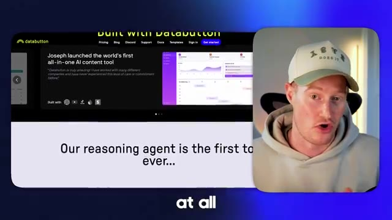
*⏱️ 00:00:24 — Présentation de la plateforme web Databutton avec des captures d'interface et le texte de présentation sur son agent de raisonnement.*

---

### ⏱️ `[00:00:32 - 00:01:09]` | Segment #02

**🔊 Audio (Transcription Intégrale Mot pour Mot en Français) :**
> manuellement. Ensemble, ces outils créent un flux de travail puissant qui permet à n'importe qui de créer des applications sophistiquées à une vitesse incroyable, quel que soit votre bagage technique. Très bien, j'ai assez parlé, passons aux choses sérieuses. Très bien, les gars, je suis donc dans Data Button, et commençons à coder aux vibrations notre application ici. Littéralement, je vais fondamentalement parler dans mon ordinateur et expliquer ce que je veux construire, et Data Button va commencer à élaborer un plan basé sur cela, et nous pourrons commencer à construire notre application à partir de là. Laissez-moi donc simplement appuyer sur F5 sur mon clavier et commencer à parler. Nous allons en fait utiliser Aqua Voice afin de capturer notre voix, puis de la transformer en texte et de rendre la création de nos applications vraiment simple

**👁️ Analyse Visuelle d'Écran (gemini-3.5-flash-lite) :**
**Interface & Outils** : Interface web de Databutton (databutton.com/new).

**Contenu textuel & Code** : Page d'accueil de création d'application avec le champ de description "Describe your app, what it does, and who it's for" et les étapes de configuration (Description, Requirements, Inspiration, Integrations).

**Action / Démonstration** : Présentation de la plateforme de développement d'applications par IA Databutton.

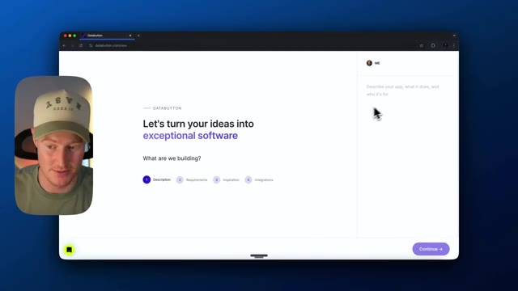
*⏱️ 00:00:51 — Capture d'écran montrant l'interface du site web Databutton avec le texte "Let's turn your ideas into exceptional software", avec une incrustation vidéo du présentateur sur le côté gauche.*

---

### ⏱️ `[00:01:09 - 00:01:28]` | Segment #03

**🔊 Audio (Transcription Intégrale Mot pour Mot en Français) :**
> en faisant du vibe coding, en disant ce que nous voulons. Je veux donc créer une application où les créateurs de contenu peuvent déposer des notes vocales. Et lorsqu'ils déposent la note vocale, cela la décompose essentiellement en plusieurs éléments. Je veux la résumer automatiquement avec l'intelligence artificielle. Je veux l'améliorer avec l'intelligence artificielle, peut-être en utilisant l'API d'OpenAI.

**👁️ Analyse Visuelle d'Écran (gemini-3.5-flash-lite) :**
**Interface & Outils** : Navigateur web affichant l'interface de la plateforme Databutton.

**Contenu textuel & Code** : Texte affiché : « Let's turn your ideas into exceptional software », « What are we building? » avec les étapes 1. Description, 2. Requirements, 3. Inspiration, 4. Integrations, et un encadré « Describe your app, what it does, and who it's for ».

**Action / Démonstration** : Le présentateur explique comment utiliser la plateforme de vibe coding pour concevoir une application de gestion de notes vocales pour créateurs de contenu en décrivant le projet.

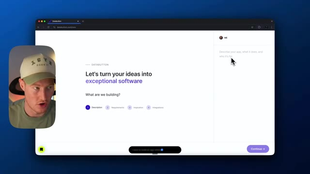
*⏱️ 00:01:14 — Capture d'écran montrant l'interface du site web Databutton avec un champ pour décrire l'application à créer, accompagnée d'une incrustation vidéo du présentateur.*

---

### ⏱️ `[00:01:28 - 00:01:47]` | Segment #04

**🔊 Audio (Transcription Intégrale Mot pour Mot en Français) :**
> Et ensuite, je veux que les utilisateurs puissent les enregistrer sur leur profil. Donc, pensez au moment où un utilisateur ou un créateur de contenu a une idée, il peut simplement laisser une note vocale et cela capture automatiquement celle-ci ainsi que toutes les informations clés qui peuvent être résumées, tout en développant cela et en l'améliorant avec l'IA. Donc maintenant, ce que AcoVoice va faire, c'est que ça va maintenant coller ceci.

**👁️ Analyse Visuelle d'Écran (gemini-3.5-flash-lite) :**
**Interface & Outils** : Navigateur web affichant la plateforme Databutton (databutton.com/new).

**Contenu textuel & Code** : Page de création de logiciel avec le texte "Let's turn your ideas into exceptional software" et un champ de saisie pour décrire l'application.

**Action / Démonstration** : Saisie ou affichage de la description textuelle d'un projet d'application pour créateurs de contenu.

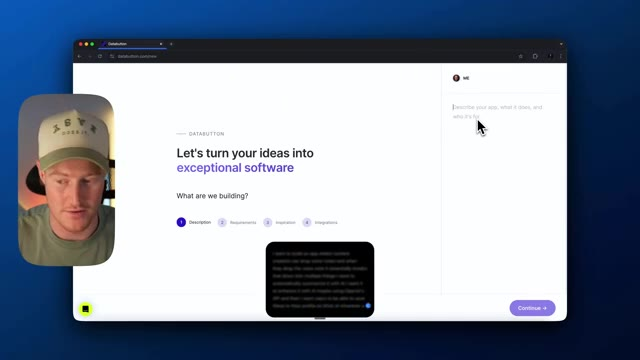
*⏱️ 00:01:33 — Capture d'écran montrant l'interface de l'outil de développement Databutton avec le présentateur incrusté à gauche.*

---

### ⏱️ `[00:01:47 - 00:02:21]` | Segment #05

**🔊 Audio (Transcription Intégrale Mot pour Mot en Français) :**
> Tout cela a l'air formidable. C'est incroyablement bien formaté et je pourrais tout à fait continuer ainsi. C'anniksi sera donc ma façon d'interagir avec ceci. Je vais littéralement me contenter d'utiliser ma voix pour dicter ce que je veux construire. C'est ça, le « vibe coding ». Alors allons-y et continuons. Je pourrais donner à notre agent ici dans Data Button autant d'informations que possible. Cependant, je vais me contenter de commencer avec ça. Sautons cette étape. Sautons toutes les inspirations de sites web, les inspirations de design. Et maintenant, nous pouvons choisir les intégrations que nous voulons ajouter à notre application. Nous pouvons donc ajouter l'authentification Firebase. C'est une intégration native, Firestore pour stocker ces informations. Nous pouvons ajouter les paiements Stripe pour réellement facturer nos

**👁️ Analyse Visuelle d'Écran (gemini-3.5-flash-lite) :**
**Interface & Outils** : Navigateur web affichant l'application Databutton.

**Contenu textuel & Code** : Texte « Let's turn your ideas into exceptional software » et étapes de configuration (1. Description, 2. Requirements, 3. Inspiration, 4. Integrations).

**Action / Démonstration** : Navigation dans l'interface de l'outil de développement assisté par IA.

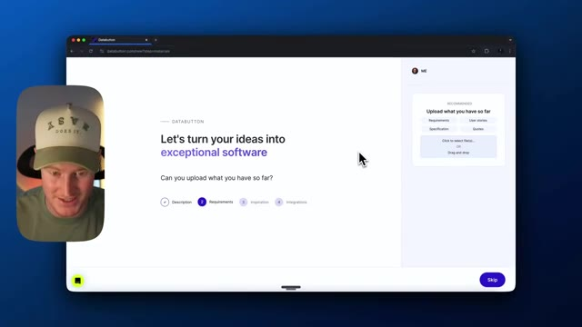
*⏱️ 00:01:56 — Interface web de Databutton invitant à transformer les idées en logiciels, avec le présentateur visible en incrustation à gauche.*

---

### ⏱️ `[00:02:21 - 00:02:54]` | Segment #06

**🔊 Audio (Transcription Intégrale Mot pour Mot en Français) :**
> application et nous pourrions utiliser Firebase pour notre stockage. Il y a toutes ces plates-formes différentes qu'ils pourraient utiliser. Cependant, c'est ce que je vais choisir dans cette vidéo. Cliquez sur "commencer" et maintenant, il va commencer à élaborer un produit MVP pour nous et cela va créer un plan structuré à suivre afin de construire notre application que nous lui avons donnée en parlant à DataButton. C'est donc là que DataButton et les plates-formes comme AquaVoice deviennent vraiment incroyables lorsqu'elles sont combinées, car fondamentalement, je formule simplement en anglais simple ce que je veux construire avec AquaVoice, puis cela élabore un plan avec DataButton. DataButton est un peu plus structuré

**👁️ Analyse Visuelle d'Écran (gemini-3.5-flash-lite) :**
**Interface & Outils** : Présentation ou face-caméra explicatif du trader sans interface logicielle partagée.

**Contenu textuel & Code** : Explications orales des stratégies et mise en contexte méthodologique du marché.

**Action / Démonstration** : Explications face caméra et analyse conceptuelle des marchés.

---

### ⏱️ `[00:02:54 - 00:03:16]` | Segment #07

**🔊 Audio (Transcription Intégrale Mot pour Mot en Français) :**
> que certaines de ces autres plateformes. J'adore la façon dont il crée réellement ces tâches pour nous et analyse réellement ce sur quoi nous pensons devoir travailler à l'intérieur de ces tâches. Donc chacune de ces tâches a maintenant une description claire et détaillée, et il va commencer à assembler ces tâches en sous-tâches. Et je vais vous montrer exactement comment cela fonctionne à l'intérieur de DataButton. Donc en gros, il suggère que nous commencions par la tâche numéro un, qui est la création d'une page de destination.

**👁️ Analyse Visuelle d'Écran (gemini-3.5-flash-lite) :**
**Interface & Outils** : Interface web de Databutton, outil de développement d'applications assisté par IA.

**Contenu textuel & Code** : Liste des tâches du projet Vocapture (MYA-1 à MYA-7), chat de l'assistant IA et descriptions détaillées des tâches.

**Action / Démonstration** : Navigation et consultation des tâches générées par l'IA pour la construction du MVP de l'application.

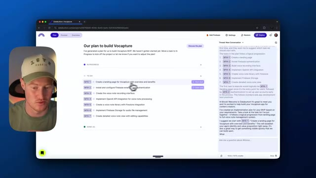
*⏱️ 00:02:59 — Vue d'ensemble de la plateforme de développement Databutton montrant le plan de construction pour le projet Vocapture avec une liste de tâches détaillées.*

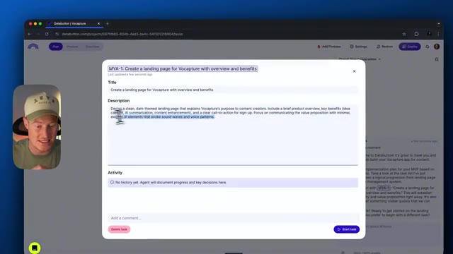
*⏱️ 00:03:05 — Gros plan sur une fenêtre modale affichant la description détaillée de la tâche MYA-1 pour la création d'une page d'atterrissage.*

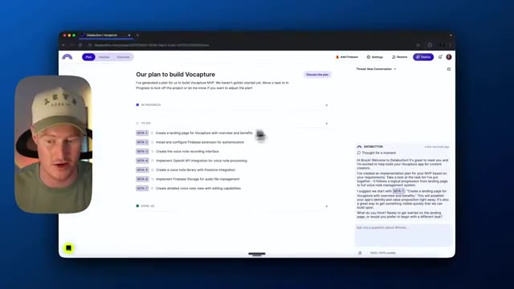
*⏱️ 00:03:10 — Retour à la vue principale du plan de projet sur Databutton avec le volet de conversation de l'assistant IA actif sur la droite.*

---

### ⏱️ `[00:03:16 - 00:03:50]` | Segment #08

**🔊 Audio (Transcription Intégrale Mot pour Mot en Français) :**
> Allons-y et créons ceci, cliquons sur démarrer la tâche, et laissons tourner. Une chose que je tiens à mentionner, c'est que le lien pour utiliser ces deux plateformes, à la fois Aquavoice et DataButton, se trouve dans la description. Ces plateformes se marient vraiment très bien ensemble. Assurez-vous donc de consulter les deux si vous êtes intéressés et que vous trouvez cette vidéo utile. D'accord. Donc, une chose à propos de DataButton, c'est qu'il réfléchit vraiment à la meilleure façon d'aborder chacune de ces tâches. Donc, si vous venez ici, vous pouvez voir qu'il est en train de réfléchir. Si je clique sur réfléchir un instant, il est en train de passer en revue, de créer une observation, d'élaborer un plan et de concevoir les prochaines étapes. Ensuite, il va de l'avant, il apporte ces modifications, puis il réobserve et réfléchit : est-ce que cela fonctionne correctement ? Y a-t-il des erreurs ici ? Donc, si vous y allez et que vous

**👁️ Analyse Visuelle d'Écran (gemini-3.5-flash-lite) :**
**Interface & Outils** : Interface web de DataButton (plateforme de développement d'applications par IA).

**Contenu textuel & Code** : Plan du projet découpé en tâches ("Our plan to build Vocapture") avec des éléments en cours (MVP-1 : création d'une landing page) et à faire (MVP-2 à MVP-7), ainsi qu'une conversation avec l'assistant IA dans le volet droit.

**Action / Démonstration** : Le curseur clique sur un élément de la liste des tâches pour lancer le développement de la fonctionnalité correspondante.

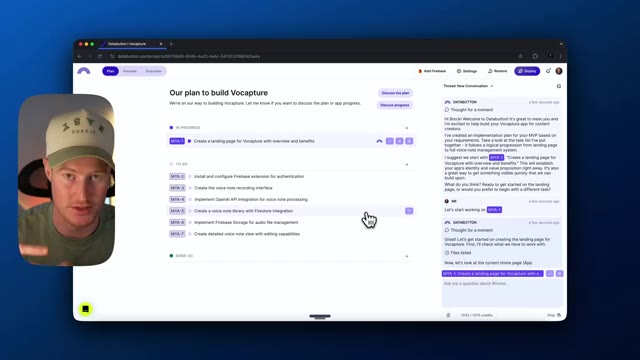
*⏱️ 00:03:24 — Capture d'écran montrant l'interface de la plateforme DataButton avec le plan de développement du projet 'Vocapture' et un panneau de discussion latéral.*

---

### ⏱️ `[00:03:50 - 00:04:23]` | Segment #09

**🔊 Audio (Transcription Intégrale Mot pour Mot en Français) :**
> on veut voir exactement de quoi il parle ou ce qu'il est en train de penser, c'est vraiment détaillé donc vous pouvez voir les observations ici, vous pouvez voir le plan, il est effectivement allé de l'avant et a coché tout cela du plan dans cette sous-tâche donc il a fait ces quatre tâches et ensuite il y a les tâches qu'il doit encore accomplir donc ici il semble que l'écriture du code a échoué cependant il est en train de réévaluer pourquoi cela n'a pas fonctionné et il s'attaque à cette tâche sans que nous ayons à faire des allers-retours pour le relancer, très bien, alors voici la page de destination réelle qu'il a conçue pour nous, c'est plutôt cool les gars. Donc capturer la voix, libérer les idées, transformer des pensées spontanées en un contenu organisé et amélioré par l'IA

**👁️ Analyse Visuelle d'Écran (gemini-3.5-flash-lite) :**
**Interface & Outils** : Interface web de développement Databutton, éditeur de code et outil de génération de projets par IA.

**Contenu textuel & Code** : Plan de construction de l'application Vocapture, sous-tâches, code généré par l'IA et aperçu de la landing page.
[DESC_IMAGE_1] L'interface de Databutton montre la liste des tâches à droite avec le plan en cours de lecture et de vérification.

**Action / Démonstration** : Examen des étapes du plan et validation des tâches réalisées pour la création de la landing page.

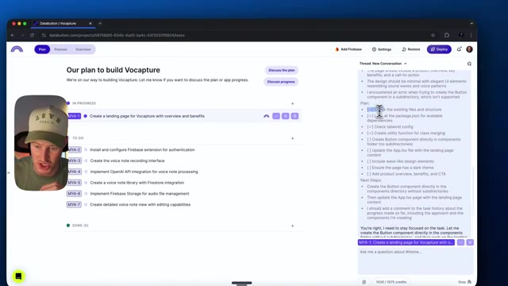
*⏱️ 00:03:58 — L'interface de Databutton montre la liste des tâches à droite avec le plan en cours de lecture et de vérification.*

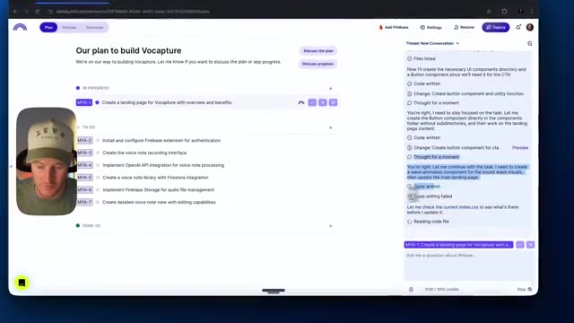
*⏱️ 00:04:06 — Le volet de droite affiche la progression des sous-tâches avec le texte sélectionné par l'assistant IA.*

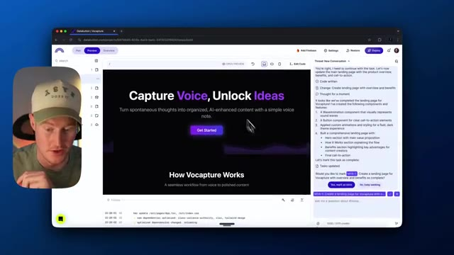
*⏱️ 00:04:15 — L'onglet 'Preview' affiche la page d'accueil de l'application 'Vocapture' avec le titre 'Capture Voice, Unlock Ideas'.*

---

### ⏱️ `[00:04:23 - 00:04:56]` | Segment #10

**🔊 Audio (Transcription Intégrale Mot pour Mot en Français) :**
> content with a simple voice note. For whatever reason, it looks like this little like voice wave here. It doesn't look great. It's not exactly how we would want it to look. So let's just maybe vibe with this and see if it's able to fix this. So the landing page looks great. I love what you tried to do with the little like voice indicator with the waves. However, it doesn't look fully put together. It seems a bit odd and it's not functioning exactly how we want it to. Can we fix this and just make this look better so it actually looks like a voice wave because we're going to give it that using aqua voice now it's going to just go ahead and try to code this out

**👁️ Analyse Visuelle d'Écran (gemini-3.5-flash-lite) :**
**Interface & Outils** : Navigateur web, interface de développement de type Bolt.new / Databutton, panneau de discussion latéral (chat).

**Contenu textuel & Code** : Page de présentation affichant le titre 'Capture Voice, Unlock Ideas', un bouton violet 'Get Started', une section 'How Vocapture Works' et un panneau de chat avec l'historique des modifications de code.

**Action / Démonstration** : Le présentateur examine la landing page générée et discute de l'animation de l'onde vocale affichée à l'écran.

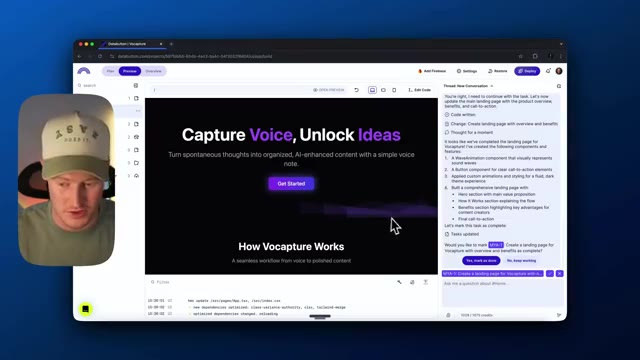
*⏱️ 00:04:32 — Capture d'écran montrant l'interface d'un outil de développement web avec une vue de prépondérance d'une landing page pour un projet nommé 'Vocapture', accompagnée d'un panneau de chat latéral et de la vidéo incrustée du présentateur.*

---

### ⏱️ `[00:04:56 - 00:05:24]` | Segment #11

**🔊 Audio (Transcription Intégrale Mot pour Mot en Français) :**
> for us so guys this is technically i guess what vibe coding is it's just speaking with our voice and then having ai code it for us very interesting the fact that i'm not even typing i don't even need to a i don't need to write code but b i don't even have to type on my keyboard pretty crazy times we live in if you have to ask me nice okay this looks much better here this is actually a pretty sweet looking landing page. Let me open the full preview so we can take a look at our application. Wow. That's, that's great. Before using AI, imagine making a landing page like this.

**👁️ Analyse Visuelle d'Écran (gemini-3.5-flash-lite) :**
**Interface & Outils** : Databutton (plateforme de développement web assistée par IA) et navigateur web.

**Contenu textuel & Code** : Aperçu d'une landing page ("Capture Voice, Unlock Ideas") et panneau de discussion/planification de l'IA détaillant les observations et les étapes de codage.

**Action / Démonstration** : Présentation du processus de développement assisté par IA ("vibe coding") sans écriture de code manuelle.

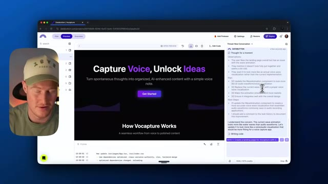
*⏱️ 00:05:03 — Interface de développement Databutton affichant un aperçu de la landing page "Vocapture" avec un volet latéral d'assistant IA.*

---

### ⏱️ `[00:05:24 - 00:05:51]` | Segment #12

**🔊 Audio (Transcription Intégrale Mot pour Mot en Français) :**
> Cela prendrait des heures, surtout si vous n'avez aucune base en programmation ou autre. C'est absolument génial. C'est un excellent début pour notre application. Évidemment, nous devons construire un peu plus et ajouter réellement des fonctionnalités à notre application. Alors allons-y et passons à la suite. Marquons cette tâche comme terminée. Donc je vais simplement revenir sur notre page de tâches ou notre page de plan ici, et je vais marquer ceci comme fait. Alors, marquez cela comme fait. C'est maintenant passé de l'onglet en cours à notre onglet fait ici. Ensuite, nous pouvons simplement aller sur notre liste de tâches et créer ces autres fonctions ici.

**👁️ Analyse Visuelle d'Écran (gemini-3.5-flash-lite) :**
**Interface & Outils** : Interface web de développement (Databutton) avec panneau de discussion et gestionnaire de tâches.

**Contenu textuel & Code** : Liste des fonctionnalités à développer (authentification Firebase, interface d'enregistrement, intégration API OpenAI, etc.).

**Action / Démonstration** : Navigation dans l'interface de gestion de projet et discussion avec l'assistant IA pour le développement de l'application.

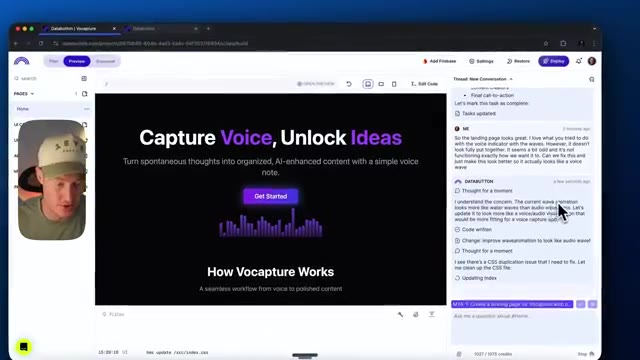
*⏱️ 00:05:31 — Capture d'écran montrant l'interface de l'application Vocapture avec la page d'accueil en aperçu et le panneau de discussion de l'IA à droite.*

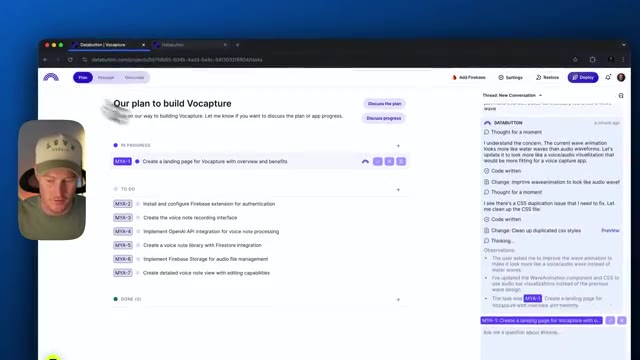
*⏱️ 00:05:38 — Capture d'écran affichant le plan de construction de l'application Vocapture avec la liste des tâches à accomplir (In progress / To do).*

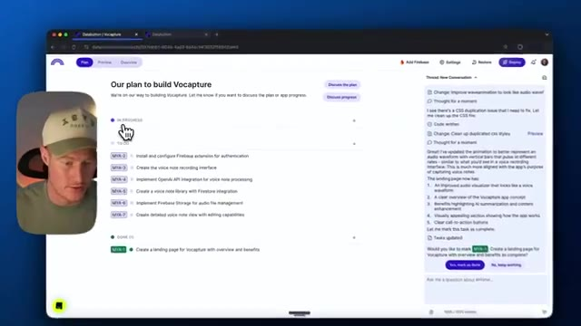
*⏱️ 00:05:45 — Capture d'écran montrant le déplacement du curseur de la souris sur le plan de construction de l'application dans l'interface de développement.*

---

### ⏱️ `[00:05:52 - 00:06:24]` | Segment #13

**🔊 Audio (Transcription Intégrale Mot pour Mot en Français) :**
> So I want to create the voice note recording interface. Let's go ahead and move forward with that. So I'm just going to click on start task here, preview this, and let's let this thing run. I'll come back when this actually is finished. Whoa. Okay. So it's not done writing this code. However, this is the recording interface that data button actually built us so capture your voice notes with our little wave like kind of ui element here so this actually this user interface looks super clean this looks better than i thought it was going to whoa nice okay here we go let's actually try this

**👁️ Analyse Visuelle d'Écran (gemini-3.5-flash-lite) :**
**Interface & Outils** : Databutton (application web de développement assisté par IA) et navigateur web.

**Contenu textuel & Code** : Interface utilisateur d'une application nommée "Vocapture" avec des éléments de code, un panneau de discussion avec l'IA et des instructions pour créer une interface d'enregistrement vocal.

**Action / Démonstration** : Le créateur montre la génération de code par l'IA pour l'interface d'enregistrement vocal et navigue dans les options de prévisualisation de l'application.

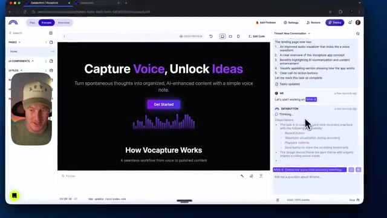
*⏱️ 00:06:00 — Interface de l'outil de développement AI (Databutton), montrant une application de note vocale avec un assistant virtuel sur le panneau latéral droit.*

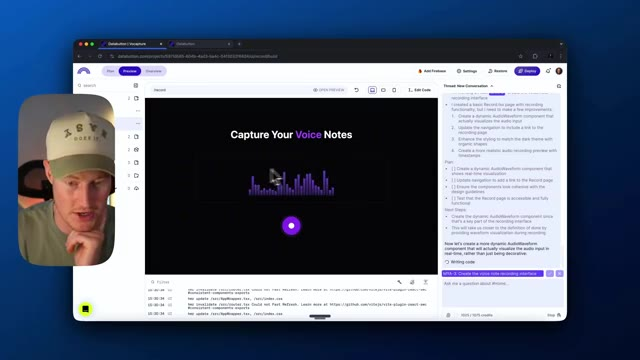
*⏱️ 00:06:08 — Suite de la démonstration sur Databutton, montrant le code en cours de rédaction et l'interface de prévisualisation d'enregistrement vocal.*

---

### ⏱️ `[00:06:24 - 00:06:42]` | Segment #14

**🔊 Audio (Transcription Intégrale Mot pour Mot en Français) :**
> sorti maintenant après qu'il a terminé sa pensée juste ici donc très bien c'est parti voici l'interface ça a l'air absolument génial allons-y et testons-la hey donc j'ai une idée de vidéo YouTube où j'utilise réellement data button et vibe code pour construire une application. Ouais. D'accord, donc voilà. Nous avons l'interface utilisateur de ceci qui est construite.

**👁️ Analyse Visuelle d'Écran (gemini-3.5-flash-lite) :**
**Interface & Outils** : Présentation ou face-caméra explicatif du trader sans interface logicielle partagée.

**Contenu textuel & Code** : Explications orales des stratégies et mise en contexte méthodologique du marché.

**Action / Démonstration** : Explications face caméra et analyse conceptuelle des marchés.

---

### ⏱️ `[00:06:43 - 00:07:02]` | Segment #15

**🔊 Audio (Transcription Intégrale Mot pour Mot en Français) :**
> Cependant, il semble que nous n'ayons pas réellement sa fonctionnalité. Donc cela n'enregistre pas réellement cette note vocale ici. Cela a seulement construit l'interface utilisateur. Retournons donc à notre plan. Assurons-nous que tout cela a été complété avant de passer à autre chose. C'est vraiment important lors de l'utilisation de Data Button. Assurez-vous qu'avant de marquer une tâche comme terminée, tout ce qui se trouve ici est complété. Sinon, nous risquons de perturber le déroulement de la construction de notre application.

**👁️ Analyse Visuelle d'Écran (gemini-3.5-flash-lite) :**
**Interface & Outils** : Databutton (interface de développement d'application web).

**Contenu textuel & Code** : Liste des fonctionnalités du projet Vocapture, tâches accomplies et plan de développement ("Our plan to build Vocapture").

**Action / Démonstration** : Navigation et révision des fonctionnalités de l'interface utilisateur avant de retourner au plan de développement.

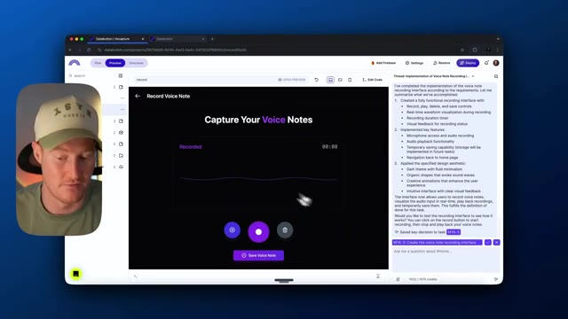
*⏱️ 00:06:47 — Interface de prévisualisation de l'application Vocapture montrant l'écran d'enregistrement de notes vocales.*

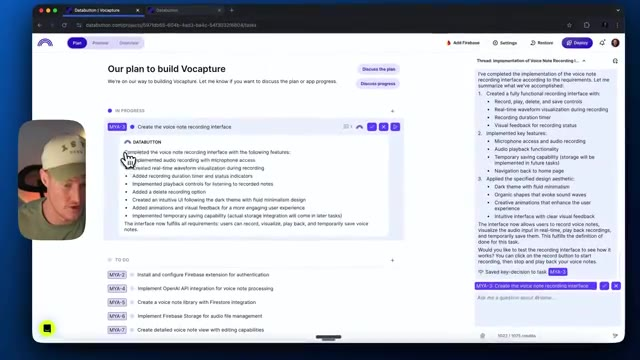
*⏱️ 00:06:52 — Vue du plan de construction (roadmap) de l'application Vocapture avec les tâches en cours et à venir.*

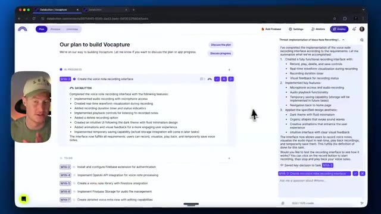
*⏱️ 00:06:57 — Vue du plan de développement de Vocapture avec un curseur pointant sur les différentes étapes du projet.*

---

### ⏱️ `[00:07:02 - 00:07:31]` | Segment #16

**🔊 Audio (Transcription Intégrale Mot pour Mot en Français) :**
> Alors, terminez l'interface d'enregistrement de notes vocales avec les fonctionnalités suivantes. Revenons à notre truc d'enregistrement. J'ai une idée de vidéo où j'utilise un bouton de données pour créer une application. D'accord. Donc, on dirait que ce n'est pas vraiment, j'ai une idée de vidéo. D'accord. Donc, ça enregistre bien cela. On dirait que tout est prêt. Alors allons-y et marquons cela comme fait. Tout a l'air de bien se passer là. Ensuite, ce que nous voulons faire, c'est passons réellement à l'étape numéro sept et créons une vue détaillée de note vocale avec des capacités d'édition après avoir ajouté l'intégration de l'API OpenAI pour le traitement des notes vocales.

**👁️ Analyse Visuelle d'Écran (gemini-3.5-flash-lite) :**
**Interface & Outils** : Databutton (plateforme de développement d'applications sans code / IA).

**Contenu textuel & Code** : Interface utilisateur de Vocapture, plan de projet (tâches MYA-1 à MYA-7), récapitulatif des fonctionnalités d'enregistrement vocal et panneau de discussion avec l'assistant IA.

**Action / Démonstration** : Navigation dans l'application Databutton pour examiner l'interface d'enregistrement vocal et le plan du projet Vocapture.

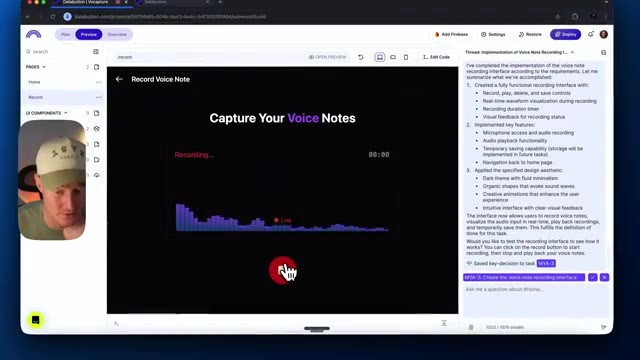
*⏱️ 00:07:09 — Interface de prévisualisation de l'application Vocapture avec un panneau d'enregistrement vocal en cours d'utilisation et une barre de discussion latérale.*

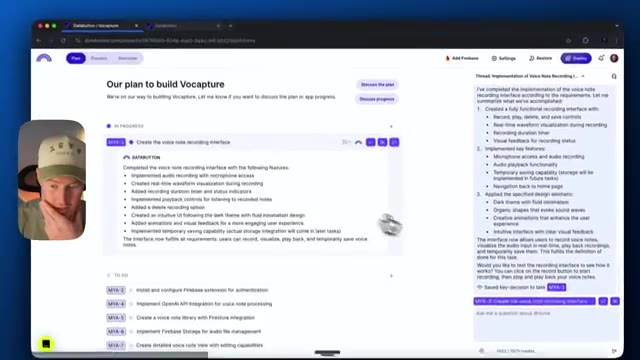
*⏱️ 00:07:17 — Vue du plan de développement "Our plan to build Vocapture" montrant les tâches "In Progress" et "To do" sur la plateforme Databutton.*

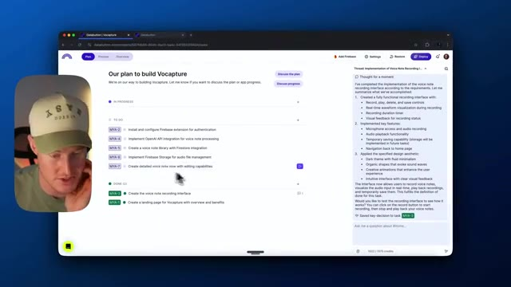
*⏱️ 00:07:24 — Vue détaillée du tableau de bord de gestion de projet avec les tâches terminées ("Done") et les prochaines étapes de développement.*

---

### ⏱️ `[00:07:31 - 00:07:49]` | Segment #17

**🔊 Audio (Transcription Intégrale Mot pour Mot en Français) :**
> So we need to add OpenAI API, which essentially will allow us to take this voice memo or this voice message and then transcribe that using AI and then even give us a summary based on the key points with AI. So that's an important step. I need to go to OpenAI and actually grab my API key. So let me go ahead and do that now. All right, I got my key.

**👁️ Analyse Visuelle d'Écran (gemini-3.5-flash-lite) :**
**Interface & Outils** : Navigateur web affichant l'interface Databutton (planification et panneau de discussion latéral).

**Contenu textuel & Code** : Plan de développement listant les tâches en cours ("Implement OpenAI API integration for voice note processing") et à faire (Firebase, storage, bibliothèque de notes).

**Action / Démonstration** : Le présentateur explique la prochaine étape consistant à intégrer l'API OpenAI pour la transcription des mémos vocaux tout en naviguant dans le plan du projet.

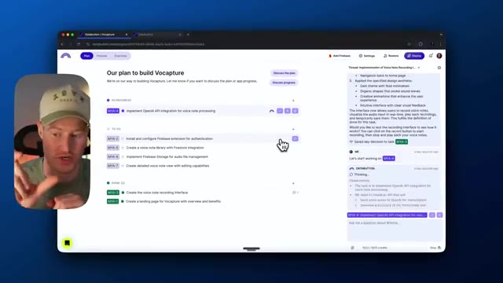
*⏱️ 00:07:36 — Capture d'écran montrant l'interface de l'application de développement no-code Databutton avec un plan de projet listant les tâches pour l'application Vocapture, et la webcam du présentateur incrustée à gauche.*

---

### ⏱️ `[00:07:49 - 00:08:08]` | Segment #18

**🔊 Audio (Transcription Intégrale Mot pour Mot en Français) :**
> Je vais le coller ici. Cliquons sur envoyer. Et ce que ça va faire, ça va en fait aller dans nos paramètres ici et ça va stocker le nouveau secret. Donc voici le secret de l'API OpenAI que je viens d'intégrer dans notre application. Donc personne ne pouvait voir ça. Nous pourrions aller, si nous voulons, nous pourrions en fait créer des instructions personnalisées pour notre agent. Je suis juste dans l'onglet des paramètres ici. Donc il y a beaucoup de choses cool que nous pouvons faire ici.

**👁️ Analyse Visuelle d'Écran (gemini-3.5-flash-lite) :**
**Interface & Outils** : Présentation ou face-caméra explicatif du trader sans interface logicielle partagée.

**Contenu textuel & Code** : Explications orales des stratégies et mise en contexte méthodologique du marché.

**Action / Démonstration** : Explications face caméra et analyse conceptuelle des marchés.

---

### ⏱️ `[00:08:08 - 00:08:43]` | Segment #19

**🔊 Audio (Transcription Intégrale Mot pour Mot en Français) :**
> Mais cela étant dit, revenons simplement à notre aperçu et voyons comment cela progresse ici. Très bien. Donc, si je regarde ce que notre agent Data Button fait réellement en arrière-plan, il fait quelque chose qui est en fait assez technique. Il crée réellement un point de terminaison d'API post et un point de terminaison d'API get qui récupère la note de traitement. Donc, essentiellement, il va envoyer cette note vocale à ChatGPT ou à l'API d'OpenAI qui va ensuite la transcrire avec Whisper. Et ensuite, il va utiliser ce point de terminaison pour l'importer à nouveau dans notre application. Donc, si vous voulez vous plonger dans les aspects techniques de ce que Data Button fait en arrière-plan, c'est en fait assez incroyable, mais étant une personne non technique et

**👁️ Analyse Visuelle d'Écran (gemini-3.5-flash-lite) :**
**Interface & Outils** : Navigateur web affichant l'interface de l'outil de développement sans code / IA Data Button.

**Contenu textuel & Code** : Plan du projet Vocapture, tâches en cours liées à l'intégration de l'API OpenAI pour le traitement des notes vocales (Whisper, GPT-4o-mini), et journal d'activité de l'agent.

**Action / Démonstration** : Le présentateur commente le plan d'exécution et les détails techniques de l'agent IA en arrière-plan.

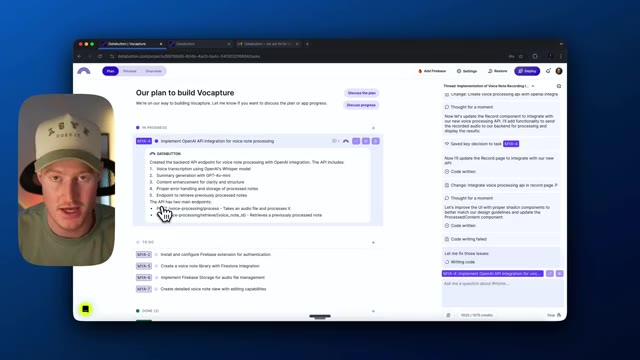
*⏱️ 00:08:17 — Capture d'écran montrant l'interface de Data Button avec le plan de construction de l'application Vocapture et le panneau de discussion de l'agent IA à droite.*

---

### ⏱️ `[00:08:43 - 00:09:18]` | Segment #20

**🔊 Audio (Transcription Intégrale Mot pour Mot en Français) :**
> Pas forcément besoin de tout comprendre, je ne sais pas nécessairement tout ce qui se passe en arrière-plan, mais quand on y regarde de plus près, c'est en fait assez incroyable de voir à quel point cet agent est complexe ou à quel point la tâche que cet agent peut réellement accomplir est complexe. Très bien. Donc, il indique que cela fonctionne maintenant, nous devrions donc maintenant avoir le résumé et la transcription par IA avec l'API d'ouverture que nous avons effectivement incluse, alors maintenant nous pouvons venir ici et nous pouvons réellement enregistrer et testons pour voir si cela fonctionne réellement, donc j'ai une idée de vidéo où j'utilise un bouton de données pour créer une application en utilisant l'IA, mais je le fais en faisant du « vibe coding » avec Aqua Voice, simplement en parlant et en créant une application.

**👁️ Analyse Visuelle d'Écran (gemini-3.5-flash-lite) :**
**Interface & Outils** : Présentation ou face-caméra explicatif du trader sans interface logicielle partagée.

**Contenu textuel & Code** : Explications orales des stratégies et mise en contexte méthodologique du marché.

**Action / Démonstration** : Explications face caméra et analyse conceptuelle des marchés.

---

### ⏱️ `[00:09:18 - 00:09:54]` | Segment #21

**🔊 Audio (Transcription Intégrale Mot pour Mot en Français) :**
> Très bien, donc ça devrait être enregistré, cliquons maintenant sur ce bouton de traitement de note vocale et oh maintenant nous avons cette chose dans l'interface utilisateur maintenant qui donne l'impression que ça se remplit et se génère réellement, alors donnons-lui une seconde et voyons ensuite si cela nous donne réellement une sorte de résultat ici au lieu de simplement enregistrer l'enregistrement vocal et rien d'autre. Très bien, alors voilà, nous avons la transcription juste ici, c'est fondamentalement exactement ce que j'ai dit comme on pouvait s'y attendre et si nous venons dans résumé, vous pouvez maintenant voir les points clés, donc le orateur a une idée de vidéo ou il va utiliser le bouton de données pour créer une application, le plan d'incorporer AquaVoice et de démontrer le processus par le codage en direct en parlant simplement à l'application. Donc

**👁️ Analyse Visuelle d'Écran (gemini-3.5-flash-lite) :**
**Interface & Outils** : Présentation ou face-caméra explicatif du trader sans interface logicielle partagée.

**Contenu textuel & Code** : Explications orales des stratégies et mise en contexte méthodologique du marché.

**Action / Démonstration** : Explications face caméra et analyse conceptuelle des marchés.

---

### ⏱️ `[00:09:54 - 00:10:30]` | Segment #22

**🔊 Audio (Transcription Intégrale Mot pour Mot en Français) :**
> il y a un résumé. Évidemment, c'est une note vocale très basique et elle n'est pas longue. Si nous devions déposer une note vocale de quelques minutes, ce résumé aurait l'air un peu différent. Et puis il y a aussi cette fonction améliorée qui montre le contenu poli. Donc, elle a en fait même trouvé une idée de vidéo potentielle, créer une application avec l'IA en utilisant DataButton et AquaVoice. Elle a trouvé une introduction ici. Elle a presque trouvé comme un script entier pour nous pour la vidéo. Donc, elle nous donne quelques idées, quelques introductions à DataButton exploitant AquaVoice, et elle nous donne même la structure de la vidéo pour que nous puissions évidemment personnaliser cela autant que nous voulons, car tout cela a à voir avec ChatGPT et l'API d'OpenAI en arrière-plan, donc nous pourrions juste avec quelques

**👁️ Analyse Visuelle d'Écran (gemini-3.5-flash-lite) :**
**Interface & Outils** : Présentation ou face-caméra explicatif du trader sans interface logicielle partagée.

**Contenu textuel & Code** : Explications orales des stratégies et mise en contexte méthodologique du marché.

**Action / Démonstration** : Explications face caméra et analyse conceptuelle des marchés.

---

### ⏱️ `[00:10:30 - 00:11:07]` | Segment #23

**🔊 Audio (Transcription Intégrale Mot pour Mot en Français) :**
> simple prompting optimize this to get it to format whatever we want for the output however this is pretty cool i just want to showcase this in this video we could refine it but i think this is actually pretty cool with the time that we spent on this so far all right so now that we got the main user interface and the functionality of our app built with the voice recording as well as the kind of note enhancement features and summarization with AI. Let's go ahead and just make some changes here. Like I'm just going to try to change up this landing page just a little bit. Let's just make this user interface look a little bit nicer. And I'm just going to literally come back over here, use AquaVoice, speak with this and come up with different cool ideas. I'm not going to be building

**👁️ Analyse Visuelle d'Écran (gemini-3.5-flash-lite) :**
**Interface & Outils** : Présentation ou face-caméra explicatif du trader sans interface logicielle partagée.

**Contenu textuel & Code** : Explications orales des stratégies et mise en contexte méthodologique du marché.

**Action / Démonstration** : Explications face caméra et analyse conceptuelle des marchés.

---

### ⏱️ `[00:11:07 - 00:11:40]` | Segment #24

**🔊 Audio (Transcription Intégrale Mot pour Mot en Français) :**
> l'application entièrement fonctionnelle dans cette vidéo. Si ça vous intéresse, je couvrirai ça dans une autre où je présenterai Data Button et où je construirai réellement des bases de données backend, la connexion des utilisateurs avec authentification, ainsi que l'ajout de paiements Stripe. Cependant, pour cette vidéo, je ne veux pas aller aussi loin. C'est plutôt juste pour les personnes qui s'intéressent à voir ce dont cette plateforme est capable. Mais laissez-moi aller de l'avant et venir ici pour, en gros, donner un retour à ceci. Très bien. Donc, je veux que tu travailles maintenant sur l'interface utilisateur de notre application. Je veux que tu ajoutes des fonctionnalités de dégradé, quelque chose, je ne sais même pas, quelque chose d'un peu futuriste, je suppose, en arrière-plan. J'aime la vue noire que nous avons en arrière-plan, mais si nous pouvions ajouter peut-être des

**👁️ Analyse Visuelle d'Écran (gemini-3.5-flash-lite) :**
**Interface & Outils** : Présentation ou face-caméra explicatif du trader sans interface logicielle partagée.

**Contenu textuel & Code** : Explications orales des stratégies et mise en contexte méthodologique du marché.

**Action / Démonstration** : Explications face caméra et analyse conceptuelle des marchés.

---

### ⏱️ `[00:11:40 - 00:12:15]` | Segment #25

**🔊 Audio (Transcription Intégrale Mot pour Mot en Français) :**
> des accents violets avec quelques nuances de dégradé ou quelque chose comme ça, ce serait super. Bon, alors maintenant nous allons utiliser cette invite, l'envoyer et donnons une seconde à data button ici pour voir ce qu'il en ressort, même si cette page d'atterrissage est plutôt minimale et a un look plutôt sympa, mais je pense qu'on pourrait faire un peu plus de changements ici si on veut chipoter avec tout ça. Bon, pour une raison quelconque, cela n'a pas apporté beaucoup de changements ici à notre interface utilisateur, c'est peut-être quelque chose en arrière-plan qu'on ne peut pas vraiment voir parce que c'est tellement sombre en arrière-plan, alors allons-y et je vais faire un changement et lui demander d'ajouter également un mode clair, donc je veux que tu ajoutes réellement un mode clair à notre application qui contraste avec les couleurs que nous avons pour le thème que nous avons actuellement

**👁️ Analyse Visuelle d'Écran (gemini-3.5-flash-lite) :**
**Interface & Outils** : Présentation ou face-caméra explicatif du trader sans interface logicielle partagée.

**Contenu textuel & Code** : Explications orales des stratégies et mise en contexte méthodologique du marché.

**Action / Démonstration** : Explications face caméra et analyse conceptuelle des marchés.

---

### ⏱️ `[00:12:15 - 00:12:37]` | Segment #26

**🔊 Audio (Transcription Intégrale Mot pour Mot en Français) :**
> have with the white, the black, and the purple text and whatnot. I want you to add some purple gradients to the white or to the light mode. Okay, so let's give it that and let's wait a sec. All right, so now there's this toggle button in the right hand corner, so we can now toggle to light mode. So that actually looks pretty cool. It's keeping the same theme with the black, the white, and the purple text that we have here. If we go to the record section of our application as well, Let's take a look at this.

**👁️ Analyse Visuelle d'Écran (gemini-3.5-flash-lite) :**
**Interface & Outils** : Présentation ou face-caméra explicatif du trader sans interface logicielle partagée.

**Contenu textuel & Code** : Explications orales des stratégies et mise en contexte méthodologique du marché.

**Action / Démonstration** : Explications face caméra et analyse conceptuelle des marchés.

---

### ⏱️ `[00:12:37 - 00:13:03]` | Segment #27

**🔊 Audio (Transcription Intégrale Mot pour Mot en Français) :**
> So same thing. That's actually looking pretty great. So this isn't a very detailed application. Like we can get way more complex as this. We could charge money for it or we with Stripe payments, or we could even add our Firebase authentication. So it allows users to sign into their profiles as well as store these voice notes to their profiles. However, I wanted to show you just basically what we could build when we combine data button along with AquaVoice and literally just vibe coding, if you want to call it that, whatever people call that nowadays.

**👁️ Analyse Visuelle d'Écran (gemini-3.5-flash-lite) :**
**Interface & Outils** : Présentation ou face-caméra explicatif du trader sans interface logicielle partagée.

**Contenu textuel & Code** : Explications orales des stratégies et mise en contexte méthodologique du marché.

**Action / Démonstration** : Explications face caméra et analyse conceptuelle des marchés.

---

### ⏱️ `[00:13:03 - 00:13:32]` | Segment #28

**🔊 Audio (Transcription Intégrale Mot pour Mot en Français) :**
> But this is something that we built with no coding experience. I have no coding background. And if you're not a technical person, you can honestly build some pretty cool things with these two platforms together So hope you guys enjoyed this if you guys want more content like this Make sure to subscribe to this channel as well as if you want more in-depth videos on data button I have one in the past a couple of them actually and I will be continuing to make these these types of videos So if you want me to dive deeper into this platform, let me know what you'd like to learn And i'll make sure to showcase that later on but yeah, thanks for staying to the end of this video Appreciate it and i'll see you guys in the next one

**👁️ Analyse Visuelle d'Écran (gemini-3.5-flash-lite) :**
**Interface & Outils** : Présentation ou face-caméra explicatif du trader sans interface logicielle partagée.

**Contenu textuel & Code** : Explications orales des stratégies et mise en contexte méthodologique du marché.

**Action / Démonstration** : Explications face caméra et analyse conceptuelle des marchés.

---

