# 🎬 I Recreated the Ugliest Website With AI (Lovable Vibe Coding)

> **Chaîne** : [Brock Mesarich | AI for Non Techies](https://www.youtube.com/@BrockMesarich)  
> **Lien YouTube** : [https://www.youtube.com/watch?v=23Pih_V_nKE](https://www.youtube.com/watch?v=23Pih_V_nKE)  
> **Date de publication** : 20250324  
> **Durée** : 00:17:11  
> **Identifiant vidéo** : `23Pih_V_nKE`  
> **Transcription & Analyse** : `whisper-v3-large-turbo+gemini-3.5-flash-lite`  

---

## 📌 Synthèse Exécutive & Outils

### 💡 Résumé

Dans cette vidéo, la chaîne *Brock Mesarich | AI for Non Techies* explore le concept du « vibe coding » en démontrant comment une personne non-technique, n'ayant jamais écrit une seule ligne de code de sa vie, peut réinventer de fond en comble une interface web obsolète. L'objectif est de transformer le design austère, daté et purement textuel de la célèbre place de marché Craigslist (qui génère pourtant 250 millions de visiteurs mensuels) en une application moderne, épurée et futuriste dotée d'un design professionnel rehaussé d'accents en dégradé, tout en commentant chaque étape par la simple voix.

La méthodologie s'appuie sur une stack d'intelligence artificielle générative textuelle et d'outils d'assistance vocale pour concevoir dynamiquement l'architecture front-end et l'expérience utilisateur. En combinant la capture d'écran de l'interface d'origine, des composants d'interface de pointe et une intégration de base de données relationnelle en arrière-plan, la démonstration prouve qu'il est possible de passer d'une idée brute à un prototype interactif hautement fonctionnel en moins de dix minutes, démystifiant ainsi la création d'applications web complexes pour les profils non-techniques.

### 🛠️ Outils, Modèles & Logiciels Présentés

* **Lovable** : Créateur d'applications web textuel piloté par l'IA permettant de générer du code front-end et de concevoir des sites web complets à partir de simples instructions textuelles ou vocales.
* **AquaVoice** : Modèle de transcription vocale en temps réel (speech-to-text) qui injecte instantanément les paroles de l'utilisateur dans l'interface de prompt de l'application.
* **21st.dev** : Plateforme de composants d'interface utilisateur (UI) modernes et élégants, permettant de récupérer et d'intégrer facilement des sections visuelles haut de gamme (comme des bannières hero section à effets de lumière) dans les projets web.
* **Supabase** : Service de base de données relationnelle backend-as-a-service (BaaS) utilisé pour stocker durablement les données applicatives (telles que les annonces de produits) et rendre l'application pleinement fonctionnelle et collaborative.
* **Claude** : Modèle de langage avancé souvent mobilisé pour la génération de code et la compréhension contextuelle dans les environnements de développement augmentés par l'IA.
* **ChatGPT** : Modèle conversationnel d'intelligence artificielle de pointe utilisé pour le prompt engineering et l'assistance à la conception.
* **Grok** : Assistant conversationnel et modèle d'intelligence artificielle intégré aux écosystèmes d'analyse en temps réel.
* **Gemini** : Modèle multimodal de Google performant dans l'analyse contextuelle et textuelle.
* **Make** : Plateforme d'automatisation de flux de travail (workflows) pour interconnecter des applications web sans coder.
* **Zapier** : Outil d'automatisation no-code leader permettant de relier des applications et d'exécuter des tâches répétitives.
* **n8n** : Outil d'automatisation de flux de travail open-source et extensible, axé sur la gestion de données et l'intégration d'API.

### 🔑 Points Clés & Enseignements Stratégiques

* **Démocratisation du développement (« Vibe Coding »)** : Le paradigme du codage par la voix et l'intention (« vibe coding ») permet aux entrepreneurs non-techniques de bâtir des applications sophistiquées uniquement en dialoguant naturellement avec des agents conversationnels.
* **Prototypage visuel instantané** : L'utilisation d'une capture d'écran d'un site web existant (comme Craigslist) injectée dans l'IA permet d'établir en quelques secondes un point de départ visuel pour une refonte complète.
* **Optimisation de l'expérience utilisateur (UX)** : La réorganisation d'une interface monolithique et textuelle en catégories structurées, cliquables et visuellement distinctes améliore radicalement l'ergonomie et le taux de conversion perçu d'une place de marché.
* **Intégration de composants UI de pointe** : L'emprunt de sections graphiques pré-stylisées (comme les arrière-plans animés à faisceaux lumineux issus de bibliothèques spécialisées) confère instantanément un aspect premium et moderne aux applications générées.
* **Transition du design vers la fonctionnalité** : Un prototype visuel séduisant doit rapidement être couplé à une logique fonctionnelle (gestion des flux de publication et navigation par catégorie) pour valider l'utilisabilité réelle du produit.
* **Persistance des données avec Supabase** : L'intégration d'une base de données relationnelle en arrière-plan est indispensable pour transformer une interface locale volatile en une application collaborative où les annonces créées sont partagées et visibles par l'ensemble des utilisateurs.
* **Connexion simplifiée des environnements** : Les plateformes modernes de création d'applications par IA intègrent des procédures d'authentification et de liaison en un clic avec des infrastructures backend comme Supabase.
* **Évolutivité vers des fonctionnalités avancées** : Une fois la base de données connectée, l'architecture autorise l'implémentation de fonctionnalités complexes telles que l'authentification des utilisateurs, la gestion des comptes et le stockage de données dynamiques.
* **Exploitation des fonctions Edge (Edge Functions)** : Le couplage d'applications no-code/IA avec des fonctions serveur distantes permet d'intégrer des points de terminaison d'IA, des notifications par email, des passerelles de paiement et des tâches planifiées.
* **Accessibilité du code source** : Bien que l'interface repose entièrement sur le langage naturel, les créateurs gardent la possibilité d'accéder au code sous-jacent et aux différents composants pour des modifications manuelles ou une revue technique approfondie.
* **Stratégie deMVP (Produit Minimum Viable) ultra-rapide** : La méthode démontre qu'il est possible de valider un concept de marché en moins de dix minutes de travail effectif, réduisant drastiquement le coût et le temps de mise sur le marché.

---

## ⏱️ Chronologie & Transcription Complète Audio & Visuelle (Mot pour Mot)

### ⏱️ `[00:00:00 - 00:00:20]` | Segment #01

**🔊 Audio (Transcription Intégrale Mot pour Mot en Français) :**
> Dans cette vidéo, je vais recréer l'un des sites web les plus laids que j'aie jamais vus grâce à l'IA. Mais je ne sais pas coder. Je vais simplement parler à l'IA et le construire en utilisant ma voix. C'est aussi ce qu'on appelle le « vibe coding ». Pour ceux qui connaissent, cette place de marché s'appelle Craigslist. Il y a environ 250 millions d'utilisateurs par mois qui utilisent cette plateforme, et elle a l'air absolument horrible.

**👁️ Analyse Visuelle d'Écran (gemini-3.5-flash-lite) :**
**Interface & Outils** : Interface web de Lovable.dev et site web de Craigslist.

**Contenu textuel & Code** : Interface utilisateur de Lovable.dev (champ de saisie de prompt, slogan « Idea to app in seconds ») et page d'accueil textuelle de Craigslist.
[DESC_IMAGE_1] Illustration contextuelle du présentateur.
[DESC_IMAGE_2] Navigation sur la plateforme de développement par IA Lovable.
[DESC_IMAGE_3] Affichage de l'interface du site web mentionné dans l'introduction (Craigslist).

**Action / Démonstration** : Explications face caméra et analyse conceptuelle des marchés.

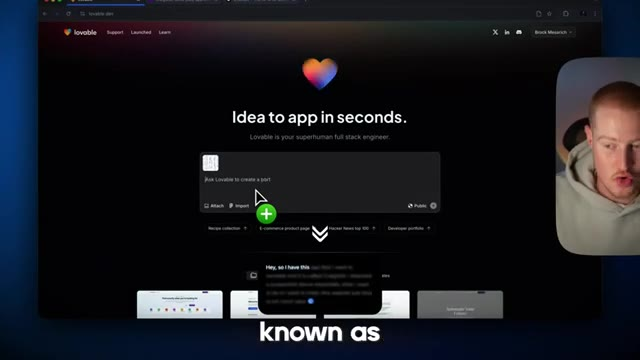
*⏱️ 00:00:10 — Capture d'écran du site Lovable.dev montrant l'interface de création d'application par IA avec une boîte de dialogue centrale et la webcam du présentateur en médaillon.*

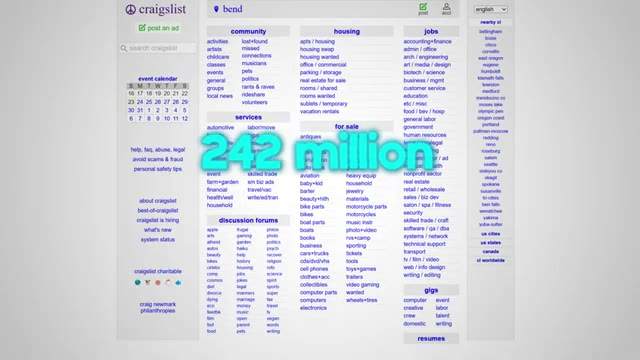
*⏱️ 00:00:15 — Capture d'écran de la page d'accueil du site web Craigslist avec le texte animé « 242 million » au premier plan.*

---

### ⏱️ `[00:00:20 - 00:00:43]` | Segment #02

**🔊 Audio (Transcription Intégrale Mot pour Mot en Français) :**
> Je vais transformer ça pour que ça ressemble à ça grâce à l'IA, tout en le rendant fonctionnel. Si vous restez jusqu'à la fin, je vais vous montrer comment vous pouvez faire exactement la même chose et créer de superbes sites web et applications pour vous-même. Bon, assez bavardé, entrons dans le vif du sujet. Très bien, les gars, je suis vraiment enthousiaste pour cette vidéo. Je pense que ça va être amusant. Donc tout d'abord, nous allons utiliser Lovable, qui est un créateur d'applications web textuel qui utilise l'IA pour créer des applications et des sites web pour nous.

**👁️ Analyse Visuelle d'Écran (gemini-3.5-flash-lite) :**
**Interface & Outils** : Navigateur web affichant une application web en cours de développement via l'outil Lovable.dev.

**Contenu textuel & Code** : Interface utilisateur d'un site web inspiré de Craigslist modernisé, avec code et interactions de l'assistant IA.

**Action / Démonstration** : Présentation d'une refonte visuelle d'un site web existant généré par intelligence artificielle.

*⏱️ 00:00:26 — Aperçu du site web 'The new craigslist' redessiné avec une interface moderne et épurée, accompagné du panneau de l'outil de génération d'IA sur le côté gauche.*

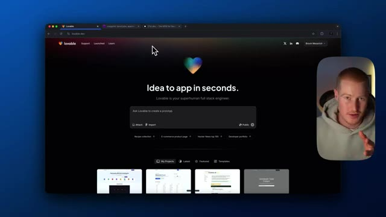
*⏱️ 00:00:37 — Page d'accueil de la plateforme Lovable (lovable.dev) avec le slogan 'Idea to app in seconds' et une barre de prompt pour créer un prototype.*

---

### ⏱️ `[00:00:43 - 00:01:02]` | Segment #03

**🔊 Audio (Transcription Intégrale Mot pour Mot en Français) :**
> Même en tant que personne non technique, je n'ai jamais codé de ma vie, mais je vais utiliser cette plateforme pour le faire. Deuxièmement, nous allons recréer cet horrible site web qu'est Craigslist. La plupart des gens ont probablement déjà entendu parler de Craigslist, mais si ce n'est pas le cas, c'est essentiellement un endroit où l'on peut aller pour acheter des choses. C'est une place de marché, mais elle a l'air terrible. On dirait qu'elle a littéralement été faite en 1963 ou quelque chose comme ça.

**👁️ Analyse Visuelle d'Écran (gemini-3.5-flash-lite) :**
**Interface & Outils** : Navigateur web affichant Lovable.dev et le site web Craigslist.

**Contenu textuel & Code** : Interfaces web de développement d'applications sans code et pages de petites annonces en ligne.
[DESC_IMAGE_1] Navigation sur la plateforme de création d'applications et présentation du site Craigslist.
[DESC_IMAGE_2] Navigation sur la plateforme de création d'applications et présentation du site Craigslist.
[DESC_IMAGE_3] Navigation sur la plateforme de création d'applications et présentation du site Craigslist.

**Action / Démonstration** : Explications face caméra et analyse conceptuelle des marchés.

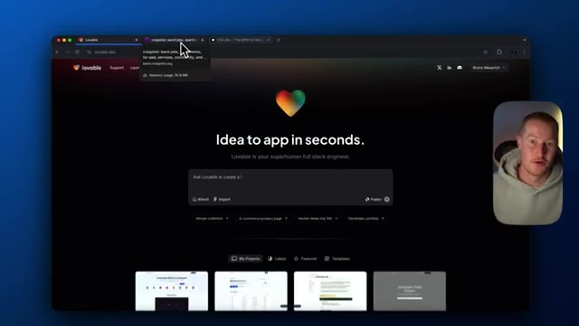
*⏱️ 00:00:48 — Vue de la plateforme Lovable (lovable.dev) affichant le slogan 'Idea to app in seconds' avec une zone de texte centrale.*

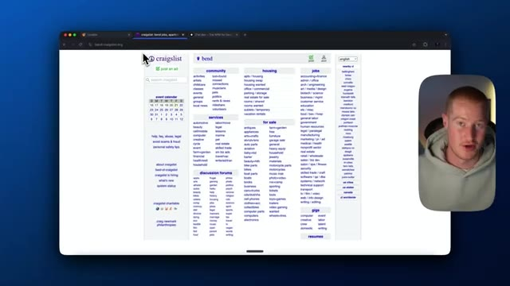
*⏱️ 00:00:53 — Affichage de la page d'accueil du site web Craigslist pour la région de Bend avec sa mise en page textuelle traditionnelle.*

*⏱️ 00:00:57 — Vue d'une page de résultats de recherche sur Craigslist dans la catégorie 'activity partners'.*

---

### ⏱️ `[00:01:03 - 00:01:37]` | Segment #04

**🔊 Audio (Transcription Intégrale Mot pour Mot en Français) :**
> So what I'm going to do is I'm going to use AI to make this look so much better, like make it look like an actual website that somebody would pay money for. So let's go ahead and do that now. Basically, I'm going to take a screenshot here. I'm going to screenshot this. And what I'm going to do is I'm just going to paste this inside of Lovable. and I'm actually using AquaVoice, which is a voice to text model that essentially just pastes whatever I speak into the user interface. So instead of having to type this out and giving my thoughts doing that, I could literally just like talk to my computer and it will build it for me. So we are going to be doing that. All I need to do is click F5 on my computer and just begin

**👁️ Analyse Visuelle d'Écran (gemini-3.5-flash-lite) :**
**Interface & Outils** : Présentation ou face-caméra explicatif du trader sans interface logicielle partagée.

**Contenu textuel & Code** : Explications orales des stratégies et mise en contexte méthodologique du marché.

**Action / Démonstration** : Explications face caméra et analyse conceptuelle des marchés.

---

### ⏱️ `[00:01:37 - 00:02:12]` | Segment #05

**🔊 Audio (Transcription Intégrale Mot pour Mot en Français) :**
> En train de parler. Hé, donc j'ai cette application que je veux recréer et elle s'appelle Craigslist. J'ai joint la capture d'écran ci-dessus. Essentiellement, ce que je veux faire, c'est rendre ce site Web beaucoup plus propre, neuf et futuriste. Je veux que tu ajoutes des accents en dégradé. Je veux que tu classes par catégorie de sorte que ça ne montre pas juste une liste entière de chaque article répertorié sur cette page. Et je veux juste que ce soit facile à utiliser et à regarder. Très bien, donc tu peux voir que

**👁️ Analyse Visuelle d'Écran (gemini-3.5-flash-lite) :**
**Interface & Outils** : Présentation ou face-caméra explicatif du trader sans interface logicielle partagée.

**Contenu textuel & Code** : Explications orales des stratégies et mise en contexte méthodologique du marché.

**Action / Démonstration** : Explications face caméra et analyse conceptuelle des marchés.

---

### ⏱️ `[00:02:12 - 00:02:45]` | Segment #06

**🔊 Audio (Transcription Intégrale Mot pour Mot en Français) :**
> J'ai en fait juste collé ça dans notre invite ici. Tout ce que j'ai à faire, c'est de cliquer sur soumettre et ça va commencer à écrire notre code ici. Donc je vais lui donner une minute pendant qu'il fait ça et ensuite on fera le point après ça. Super. D'accord. Donc c'est en fait ce qu'il nous a donné du premier coup. Ça a l'air plutôt génial. Donc le nouveau Craigslist, un marché réinventé où la communauté locale se rassemble pour acheter, vendre, échanger et tisser des liens. Nous avons nos catégories ici en bas. Donc on a logement, on a emplois, on a à vendre. Voyons si c'est cliquable. Donc il semble que ce ne soit pas cliquable. Et ensuite, nous avons des annonces en vedette ainsi qu'un emplacement populaire.

**👁️ Analyse Visuelle d'Écran (gemini-3.5-flash-lite) :**
**Interface & Outils** : Lovable (plateforme de développement web par IA) et navigateur web.

**Contenu textuel & Code** : Interface utilisateur de Lovable avec panneau de chat à gauche, prévisualisation de l'application au centre et vignette vidéo du présentateur.

**Action / Démonstration** : Le système charge la prévisualisation du code généré, puis affiche la page web interactive avec une erreur à corriger.

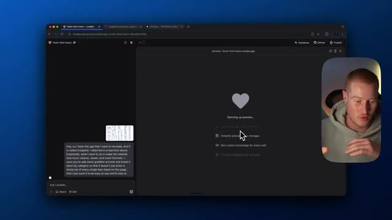
*⏱️ 00:02:21 — L'interface de l'application Lovable affichant un écran de chargement "Spinning up preview..." avec la webcam du présentateur en incrustation à droite.*

*⏱️ 00:02:29 — L'interface de Lovable montrant le résultat généré, une nouvelle version de Craigslist, avec une notification d'erreur en bas et la webcam du présentateur.*

---

### ⏱️ `[00:02:45 - 00:03:05]` | Segment #07

**🔊 Audio (Transcription Intégrale Mot pour Mot en Français) :**
> Alors ça, tout d'abord, ça a l'air super. Ce n'est pas très fonctionnel. Nous devons y apporter des modifications, mais j'aime ce que ça nous a donné jusqu'à présent. Ça a déjà l'air mieux que ça avec l'intelligence artificielle en moins de trois minutes environ. Donc c'est génial. Mais allons de l'avant et continuons avec ça. Très bien. Donc ensuite, ce que je vais faire, c'est que je vais aller sur 21st.dev, ce qui est un truc absolument génial.

**👁️ Analyse Visuelle d'Écran (gemini-3.5-flash-lite) :**
**Interface & Outils** : Présentation ou face-caméra explicatif du trader sans interface logicielle partagée.

**Contenu textuel & Code** : Explications orales des stratégies et mise en contexte méthodologique du marché.

**Action / Démonstration** : Explications face caméra et analyse conceptuelle des marchés.

---

### ⏱️ `[00:03:05 - 00:03:24]` | Segment #08

**🔊 Audio (Transcription Intégrale Mot pour Mot en Français) :**
> If you have used lovable or these text web app builders, this is a great way for you to actually to get user interface components that look absolutely amazing. And you could add them easily to your websites or to your applications that you're building. So I'm going to click on this and I want to copy this. I think this just looks really clean. So I'm going to copy this prompt.

**👁️ Analyse Visuelle d'Écran (gemini-3.5-flash-lite) :**
**Interface & Outils** : Navigateur web affichant la plateforme de composants d'interface utilisateur 21st.dev.

**Contenu textuel & Code** : Galerie de composants visuels (Grid Pattern, Tiles, Hero Highlight, Beams Background, Canvas Reveal Effect) et boutons d'interaction ("Copy prompt", "Open component").

**Action / Démonstration** : Navigation et sélection d'un composant d'interface utilisateur pour l'intégrer dans des applications web.

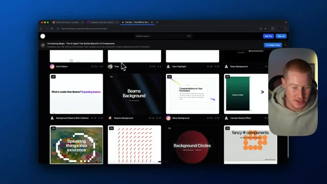
*⏱️ 00:03:10 — Vue d'ensemble d'une bibliothèque de composants d'interface utilisateur (UI) sur le site 21st.dev, avec le présentateur en incrustation vidéo.*

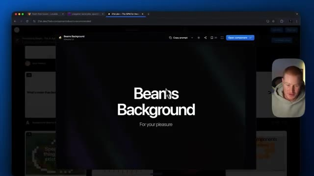
*⏱️ 00:03:19 — Gros plan sur un composant spécifique ("Beams Background") sélectionné dans la bibliothèque UI, affichant les options de copie et d'ouverture.*

---

### ⏱️ `[00:03:24 - 00:04:02]` | Segment #09

**🔊 Audio (Transcription Intégrale Mot pour Mot en Français) :**
> I could open the component to see what it looks like. Like I would love if this could be a highlight of our website here. So what I'm going to do is I'm just going to click paste and then I'm going to come up to the top here and then I'm going to speak with Aka voice and then just explain what I want to do. I think what you created looks really good so far. However, I want you to implement this hero section to our app at the top of our website. Let's also maintain this theme and style across the rest of our website and landing page. I'm just going to let that run and let's

**👁️ Analyse Visuelle d'Écran (gemini-3.5-flash-lite) :**
**Interface & Outils** : Lovable.dev (outil de développement d'applications web par IA) et navigateur web.

**Contenu textuel & Code** : Messages d'erreur de React Router, instructions de code et interface utilisateur générée avec des composants de style Craigslist.

**Action / Démonstration** : Le créateur interagit avec le chat de l'IA pour corriger des erreurs de code et prévisualiser le rendu du site web.

*⏱️ 00:03:34 — Interface Lovable.dev montrant un panneau de chat à gauche et un aperçu d'application vide à droite.*

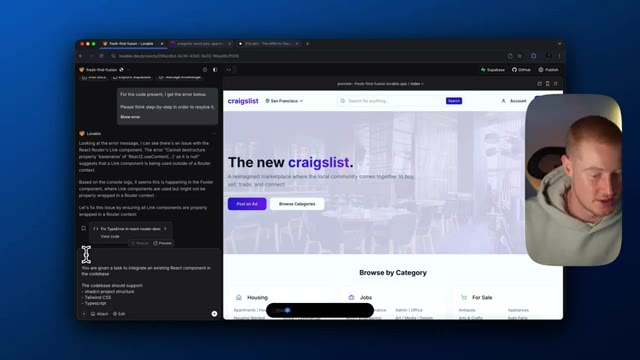
*⏱️ 00:03:43 — Interface Lovable.dev affichant l'aperçu complet d'un site web inspiré de Craigslist (« The new craigslist »).*

---

### ⏱️ `[00:04:02 - 00:04:35]` | Segment #10

**🔊 Audio (Transcription Intégrale Mot pour Mot en Français) :**
> let it do its thing. All right, here we go. So now we have this little beams background in the hero section of our website here. This looks great. The new critics as well. That's just like such a fire punchline for our website here. So next up, what I want to do is I want to actually make this like these categories here clickable because we want to be able to actually click on these and see, you know, each of these like individual listings and whatnot. So this looks great. Now for the browse by category section, I want this to be expansive. So when I view all of the categories,

**👁️ Analyse Visuelle d'Écran (gemini-3.5-flash-lite) :**
**Interface & Outils** : Navigateur web affichant Lovable.dev et l'application en cours de prévisualisation.

**Contenu textuel & Code** : Interface utilisateur d'un site web inspiré de Craigslist, avec panneau de code et explications de l'assistant IA sur la gauche.

**Action / Démonstration** : Navigation et démonstration du rendu visuel de la section hero et des catégories du site web généré.

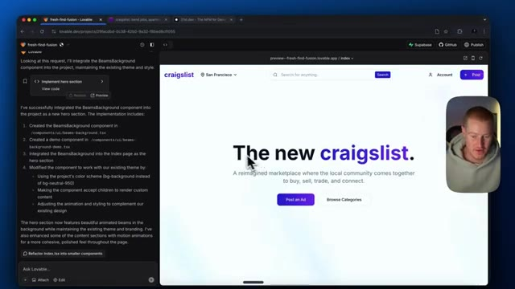
*⏱️ 00:04:11 — Aperçu du site web recréant Craigslist avec un arrière-plan animé 'beams' dans la section hero.*

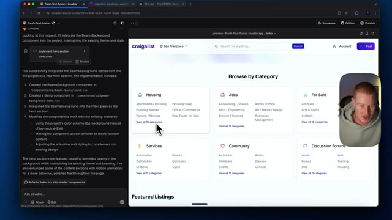
*⏱️ 00:04:19 — Défilement vers le bas de la page montrant la section 'Browse by Category' avec différentes rubriques (Housing, Jobs, For Sale, etc.).*

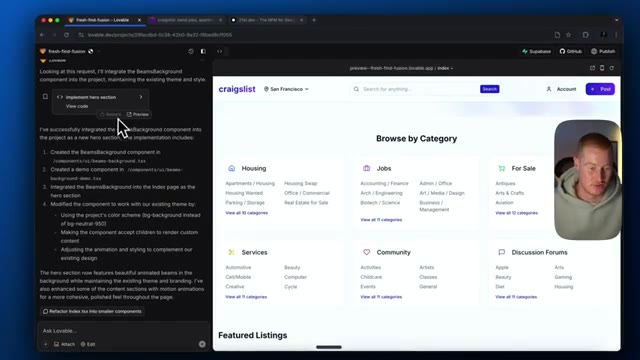
*⏱️ 00:04:27 — Vue similaire de la page web avec l'interface de l'éditeur de code Lovable visible sur le panneau de gauche.*

---

### ⏱️ `[00:04:35 - 00:05:12]` | Segment #11

**🔊 Audio (Transcription Intégrale Mot pour Mot en Français) :**
> Je veux que cela me montre réellement toutes les catégories ainsi que, lorsque je clique sur une catégorie, je veux que cela m'amène vers une page séparée avec toutes les annonces pour cette catégorie. Aussi les gars, je tiens à mentionner que pour les besoins de cette vidéo, je veux simplement montrer comment vous pourriez créer d'incroyables interfaces utilisateur avec cette plateforme. Je ne vais pas aller construire réellement un Craigslist complet et tout le tralala. Cela prendrait un peu trop de temps. Cependant, je veux juste montrer ce qu'il est possible de faire en codant avec l'IA pour créer des sites web plutôt sympas. Et je me suis dit que ce serait un cas d'usage intéressant, de prendre quelque chose que la plupart des gens connaissent, quelque chose comme Craigslist, et de lui donner une autre tournure, de s'appuyer là-dessus et de construire réellement quelque chose.

**👁️ Analyse Visuelle d'Écran (gemini-3.5-flash-lite) :**
**Interface & Outils** : Présentation ou face-caméra explicatif du trader sans interface logicielle partagée.

**Contenu textuel & Code** : Explications orales des stratégies et mise en contexte méthodologique du marché.

**Action / Démonstration** : Explications face caméra et analyse conceptuelle des marchés.

---

### ⏱️ `[00:05:12 - 00:05:41]` | Segment #12

**🔊 Audio (Transcription Intégrale Mot pour Mot en Français) :**
> Ça a l'air vraiment super. Très bien. Donc on dirait que ça a effectivement terminé. Et maintenant, si je clique sur ces catégories, si je clique sur afficher les 10 catégories, ça affiche toutes les catégories ici. Donc si je veux aller sur échange de maison, ça m'amène maintenant dans cette section avec des annonces pour ces échanges de maison et compagnie. Donc bien sûr, il n'y a pas encore de vrais détails ici pour de vraies annonces, mais c'est une excellente mise en page pour Craigslist, par opposition à quelque chose qui ressemble à ça, où on arrive ici et puis c'est juste, je veux dire, ça a l'air absolument terrible.

**👁️ Analyse Visuelle d'Écran (gemini-3.5-flash-lite) :**
**Interface & Outils** : Présentation ou face-caméra explicatif du trader sans interface logicielle partagée.

**Contenu textuel & Code** : Explications orales des stratégies et mise en contexte méthodologique du marché.

**Action / Démonstration** : Explications face caméra et analyse conceptuelle des marchés.

---

### ⏱️ `[00:05:41 - 00:06:00]` | Segment #13

**🔊 Audio (Transcription Intégrale Mot pour Mot en Français) :**
> So let's go ahead and try to build upon this. All right, let's do something a little bit crazy here. Let's see if we could actually add a listing. So I'm gonna basically come to Lovable and ask how we could set that up. We might need to use Supabase, which is a place where we actually store information in a database. Let me see what we need to do first. Let me just ask Lovable. All right, this is looking absolutely awesome.

**👁️ Analyse Visuelle d'Écran (gemini-3.5-flash-lite) :**
**Interface & Outils** : Présentation ou face-caméra explicatif du trader sans interface logicielle partagée.

**Contenu textuel & Code** : Explications orales des stratégies et mise en contexte méthodologique du marché.

**Action / Démonstration** : Explications face caméra et analyse conceptuelle des marchés.

---

### ⏱️ `[00:06:00 - 00:06:23]` | Segment #14

**🔊 Audio (Transcription Intégrale Mot pour Mot en Français) :**
> However, I want to now add actual products and featured listings. How can we go ahead and implement something like that where we actually allow users to upload an item and save that item on the platform? All right, I'm going to run with that. Let's see. It's probably going to give me some instructions on how to set up Superbase, but I want to see what it says first before I actually go ahead and try to do that.

**👁️ Analyse Visuelle d'Écran (gemini-3.5-flash-lite) :**
**Interface & Outils** : Lovable (outil de développement d'applications par IA) et navigateur web affichant l'aperçu d'un site web similaire à Craigslist ("fresh-find-fusion").

**Contenu textuel & Code** : Interface de génération d'applications avec des boîtes de dialogue de chat ("Ask Lovable..."), des blocs de code générés ("implement category browsing feature") et un aperçu visuel en direct d'une page web avec des sections "Featured Listings" et des prix en dollars.

**Action / Démonstration** : Le présentateur consulte l'aperçu de l'application générée et interagit avec l'outil de développement Lovable pour modifier ou ajouter des fonctionnalités au site.

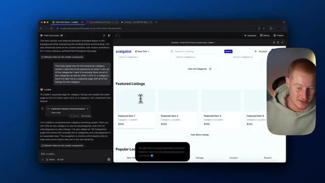
*⏱️ 00:06:06 — Capture d'écran montrant l'interface de l'outil Lovable avec un panneau de chat à gauche et un aperçu web d'une plateforme de petites annonces à droite, ainsi que la webcam du présentateur.*

---

### ⏱️ `[00:06:23 - 00:06:57]` | Segment #15

**🔊 Audio (Transcription Intégrale Mot pour Mot en Français) :**
> Also, one thing to mention, if you are a coder and you want to see all of the code, you can come and edit the code. You can see all these different like pages that have been added, all of the components and whatnot. So I'm not a coder. I can't really do much with this, but if you are a coder, this might be useful. All right, let's take a look now and see if this is now working properly. So what I'm going to do, I'm going to come over, might as well just come over to a brand new full tab here. So this looks great. The new Craigslist. I mean, guys, this looks clean not to gas myself up here, but let's go ahead and play around with this. So I'm

**👁️ Analyse Visuelle d'Écran (gemini-3.5-flash-lite) :**
**Interface & Outils** : Présentation ou face-caméra explicatif du trader sans interface logicielle partagée.

**Contenu textuel & Code** : Explications orales des stratégies et mise en contexte méthodologique du marché.

**Action / Démonstration** : Explications face caméra et analyse conceptuelle des marchés.

---

### ⏱️ `[00:06:57 - 00:07:31]` | Segment #16

**🔊 Audio (Transcription Intégrale Mot pour Mot en Français) :**
> going to click on new post. Let's describe what we're selling. Let's just say MacBook Pro, $1,500. I'm going to say I'm in Bend. We're going to put this for sale, subcategory, electronics. I'm going to say brand new MacBook Pro taken out of the box. However, has not been used. Okay. And let's just upload some files here. So I'm going to select this image. Here we are. Boom. Open it. And let's go ahead and post the listing. And now this should be somewhere on our page. Okay, here we go. So now

**👁️ Analyse Visuelle d'Écran (gemini-3.5-flash-lite) :**
**Interface & Outils** : Présentation ou face-caméra explicatif du trader sans interface logicielle partagée.

**Contenu textuel & Code** : Explications orales des stratégies et mise en contexte méthodologique du marché.

**Action / Démonstration** : Explications face caméra et analyse conceptuelle des marchés.

---

### ⏱️ `[00:07:31 - 00:08:06]` | Segment #17

**🔊 Audio (Transcription Intégrale Mot pour Mot en Français) :**
> dernière annonce, vous pouvez voir que nous avons un MacBook Pro ici. Ça a l'air super. Ça fonctionne. Cependant, je ne pense pas que cela s'enregistre réellement sur la plateforme. Laissez-moi donc rafraîchir. Si je rafraîchis ceci et que ce n'est pas là, nous allons devoir ajouter des intégrations Supabase. Vous savez quoi ? C'est en train de charger, en fait. C'est donc plutôt cool. Laissez-moi revenir à l'intérieur de Lovable. Voir si ça s'enregistre aussi ici. Très bien. Vous pouvez donc voir que ça s'enregistre sur cette interface utilisateur ici. Cependant, ça ne s'enregistre pas dans ce navigateur. Nous devons donc procéder à l'enregistrement de ceci dans Supabase, ce que je vais vous montrer comment faire. Pour que vous puissiez réellement enregistrer des articles ou quoi que ce soit dans le

**👁️ Analyse Visuelle d'Écran (gemini-3.5-flash-lite) :**
**Interface & Outils** : Navigateur web affichant l'application clone de Craigslist, avec une incrustation vidéo du présentateur et un volet de développement Lovable.

**Contenu textuel & Code** : Annonces en ligne, image de MacBook Pro, et trace d'erreur de pile (stack trace) indiquant une erreur "Maximum update depth exceeded".

**Action / Démonstration** : Navigation sur la plateforme, test de publication et constatation d'un bug de rafraîchissement avec un message d'erreur de boucle infinie.

*⏱️ 00:07:39 — Vue d'une application web de type petites annonces affichant une annonce pour un MacBook Pro avec son prix.*

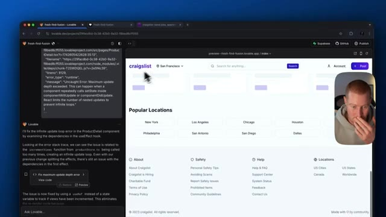
*⏱️ 00:07:48 — Affichage de l'application web avec un panneau latéral de débogage montrant une erreur liée aux boucles infinies de mise à jour React.*

---

### ⏱️ `[00:08:06 - 00:08:38]` | Segment #18

**🔊 Audio (Transcription Intégrale Mot pour Mot en Français) :**
> une base de données réelle pour rendre vos applications réellement pleinement fonctionnelles. Ça a l'air super. Je suis maintenant capable d'ajouter des produits ici et d'ajouter des annonces. Cependant, je veux qu'elles soient stockées dans une base de données. Comme ça, n'importe qui qui a accès à notre application slash site web peut voir toutes les publications qui ont été créées. Boum. Et voilà.

**👁️ Analyse Visuelle d'Écran (gemini-3.5-flash-lite) :**
**Interface & Outils** : Navigateur web affichant l'interface de développement Lovable et l'application web.

**Contenu textuel & Code** : Page web inspirée de Craigslist avec des boutons pour poster des annonces, et un panneau d'assistance textuel expliquant la résolution d'erreurs de code (infinite update loop error).

**Action / Démonstration** : Présentation de l'interface utilisateur de l'application web en cours de création et explication du fonctionnement de l'outil de développement.

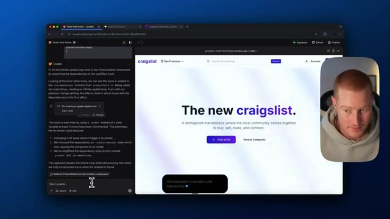
*⏱️ 00:08:14 — Capture d'écran montrant l'interface de l'application "The new craigslist" en cours de développement, avec un panneau de code/assistant Lovable sur la gauche et la webcam du présentateur incrustée en haut à droite.*

---

### ⏱️ `[00:08:38 - 00:09:15]` | Segment #19

**🔊 Audio (Transcription Intégrale Mot pour Mot en Français) :**
> Les gars, nous faisons des progrès ici. Donc si vous appréciez cette vidéo, assurez-vous de vous abonner à cette chaîne. C'est AI for non-techies. Je couvre tout ce qui concerne les personnes non techniques et la manière dont elles peuvent utiliser l'IA dans leur vie de tous les jours, en particulier en utilisant des plateformes comme Lovable pour créer des applications plutôt cool sans aucune formation technique. Très bien. Donc ici, ça me donne des étapes. Nous devons implémenter cette fonctionnalité avec Supabase, connecter votre projet Lovable à Supabase, créer une table de produits dans Supabase. Très bien. J'ai pris les devants. J'ai en fait créé une base de données à l'intérieur de Supabase ou j'ai créé un nouveau projet. Donc tout ce que j'ai à faire maintenant, c'est de venir, de venir sur Supabase, de cliquer sur Connecter Supabase. Je dois autoriser Lovable. Super. Donc tout est configuré maintenant.

**👁️ Analyse Visuelle d'Écran (gemini-3.5-flash-lite) :**
**Interface & Outils** : Navigateur web affichant Lovable et Supabase.

**Contenu textuel & Code** : Documentation technique, code et interface de gestion de base de données Supabase.

**Action / Démonstration** : Navigation et présentation des étapes d'intégration d'une base de données Supabase dans une application web.

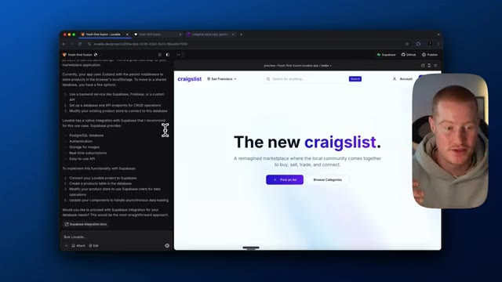
*⏱️ 00:08:47 — Interface de prévisualisation web montrant une application inspirée de Craigslist avec le présentateur en médaillon.*

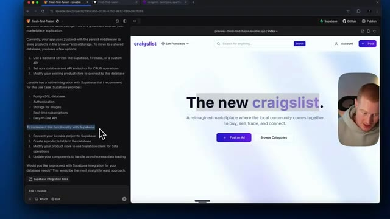
*⏱️ 00:08:56 — Interface web avec du texte sélectionné à l'écran concernant l'intégration de Supabase pour l'application.*

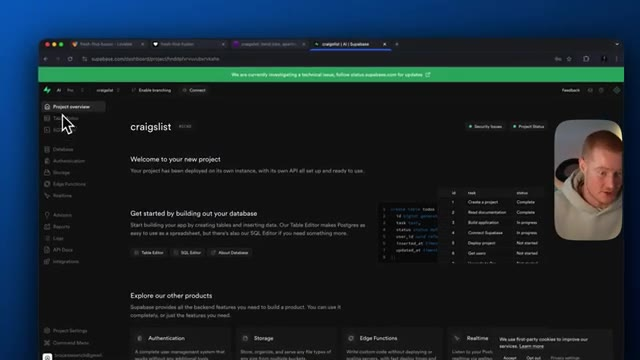
*⏱️ 00:09:06 — Tableau de bord Supabase montrant la vue d'ensemble du projet 'craigslist'.*

---

### ⏱️ `[00:09:15 - 00:09:35]` | Segment #20

**🔊 Audio (Transcription Intégrale Mot pour Mot en Français) :**
> I just need to pick and choose which project. So Craigslist is the project that we're going to be using. Looks like that is all connected. So let me go back here. All right. So it shows our app is now connected to Supabase. You can now work with a fully featured backend to add powerful features to make your app fully functional. So we could add user logins and accounts.

**👁️ Analyse Visuelle d'Écran (gemini-3.5-flash-lite) :**
**Interface & Outils** : Présentation ou face-caméra explicatif du trader sans interface logicielle partagée.

**Contenu textuel & Code** : Explications orales des stratégies et mise en contexte méthodologique du marché.

**Action / Démonstration** : Explications face caméra et analyse conceptuelle des marchés.

---

### ⏱️ `[00:09:35 - 00:10:14]` | Segment #21

**🔊 Audio (Transcription Intégrale Mot pour Mot en Français) :**
> We could store and use real data. So for example, whenever a user makes a post, it actually stores that information somewhere inside of a database that our user interface can reflect. And we could use advanced features, which are edge functions like AI endpoints, email notifications, payments, and scheduled tasks. So that is all good to go. Let's go ahead now and test something. I'm going to see if we now store all of our posts in our database. Bike. Used bike in great condition, has both wheels intact. Let's just upload a photo. Bike. Here is our bike. How amazing is that? Okay.

**👁️ Analyse Visuelle d'Écran (gemini-3.5-flash-lite) :**
**Interface & Outils** : Navigateur web affichant l'interface de développement Lovable et la prévisualisation de l'application web.

**Contenu textuel & Code** : Instructions et panneaux de configuration de l'intégration Supabase, fonctionnalités avancées (edge functions, authentification, stockage de données).

**Action / Démonstration** : Présentation de la connexion à la base de données et de la création dynamique d'une nouvelle annonce utilisateur.

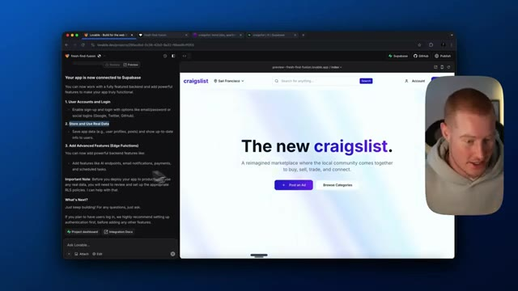
*⏱️ 00:09:45 — Aperçu d'une application web inspirée de Craigslist connectée à Supabase avec le panneau de chat de Lovable.*

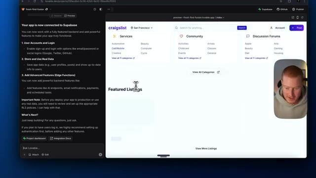
*⏱️ 00:09:55 — Navigation sur la page d'accueil de l'application affichant les différentes catégories et annonces en vedette.*

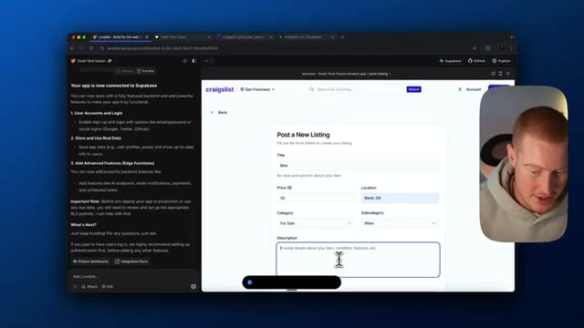
*⏱️ 00:10:04 — Formulaire de création d'une nouvelle annonce ("Post a New Listing") avec les champs Titre, Prix, Localisation et Description.*

---

### ⏱️ `[00:10:14 - 00:10:49]` | Segment #22

**🔊 Audio (Transcription Intégrale Mot pour Mot en Français) :**
> Donc sélectionnons des fichiers. Vélo d'occasion en super état, les deux roues sont intactes. Très bien, je peux donc publier notre annonce. Appelons ce vélo d'occasion. D'accord, publions-le. Il est indiqué que notre annonce a été publiée avec succès. Nous pouvons maintenant voir une publication ici en bas. Cependant, afin de s'assurer que cela est bien stocké dans notre base de données, nous devons venir sur Supabase et nous devons vérifier notre projet ici. Donc l'éditeur de tables, il semble que nous n'ayons aucune table pour cela. Nous devons donc revenir sur Lovable et faire savoir à Lovable, hé, donc j'ai en fait pris lesdevants et j'ai essayé d'ajouter une nouvelle publication.

**👁️ Analyse Visuelle d'Écran (gemini-3.5-flash-lite) :**
**Interface & Outils** : Présentation ou face-caméra explicatif du trader sans interface logicielle partagée.

**Contenu textuel & Code** : Explications orales des stratégies et mise en contexte méthodologique du marché.

**Action / Démonstration** : Explications face caméra et analyse conceptuelle des marchés.

---

### ⏱️ `[00:10:49 - 00:11:22]` | Segment #23

**🔊 Audio (Transcription Intégrale Mot pour Mot en Français) :**
> ici dans notre application quakelis cependant je ne vois pas cela se refléter dans notre projet superbase donc configurons-le pour que chaque fois qu'il y a un nouveau message sur la plateforme il soit ensuite stocké dans une base de données superbase et de cette façon nous pourrions euh genre toujours afficher tous les messages qui ont été créés par les utilisateurs même si nous rafraîchissons la page. Les gars, j'adore utiliser AquaVoice. C'est tellement simple. Le fait que je n'écrive plus rien. Je le dis simplement dans mon ordinateur. Et c'est, je pense, là

**👁️ Analyse Visuelle d'Écran (gemini-3.5-flash-lite) :**
**Interface & Outils** : Présentation ou face-caméra explicatif du trader sans interface logicielle partagée.

**Contenu textuel & Code** : Explications orales des stratégies et mise en contexte méthodologique du marché.

**Action / Démonstration** : Explications face caméra et analyse conceptuelle des marchés.

---

### ⏱️ `[00:11:22 - 00:11:57]` | Segment #24

**🔊 Audio (Transcription Intégrale Mot pour Mot en Français) :**
> we're going with the future of the user interface of computers. What's the point of typing when we could speak faster and use AI to break that down and paste it into the UI? So, okay. So, looks like now what it's going to do is it's creating some form of rules. We need to create a product's table in Superbase. So I could see us potentially running into issues here. We don't want this policy here to be too strict. All right, this looks good. However, I don't want our policy to be too strict. Let's just make it very seamless so basically anybody can make changes to this table. So the reason I say that is if we're actually launching this as a website and a

**👁️ Analyse Visuelle d'Écran (gemini-3.5-flash-lite) :**
**Interface & Outils** : Navigateur web affichant un outil de développement (Lovable.dev / Supabase) et un aperçu d'interface utilisateur.

**Contenu textuel & Code** : Code SQL de création de table (CREATE TABLE public.products) et de politiques de sécurité (Row Level Security).

**Action / Démonstration** : Le système génère automatiquement du code SQL et des règles pour configurer la base de données de l'application.

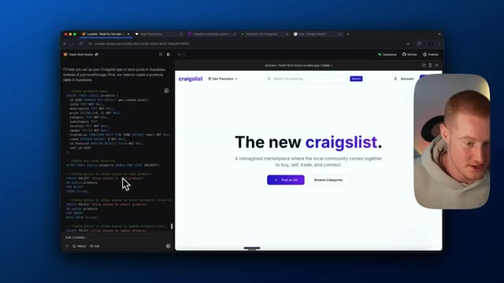
*⏱️ 00:11:30 — Capture d'écran montrant une interface de développement web avec un volet de code SQL à gauche et un aperçu d'application web "The new craigslist" à droite, ainsi qu'une incrustation vidéo du présentateur.*

---

### ⏱️ `[00:11:57 - 00:12:20]` | Segment #25

**🔊 Audio (Transcription Intégrale Mot pour Mot en Français) :**
> plateforme que les gens vont réellement utiliser, vous pourriez vouloir qu'elle soit un peu plus stricte quant aux personnes qui peuvent réellement apporter des modifications à la base de données. Cependant, je pense que cela devrait aller pour l'instant simplement parce que j'utilise ceci essentiellement pour une démonstration pour cette vidéo. Allons donc de l'avant avec cela. Ainsi qu'ici, c'est la table des produits. Elle va donc stocker toutes ces informations. Assurons-nous de stocker les informations que nous recevons sur l'interface utilisateur.

**👁️ Analyse Visuelle d'Écran (gemini-3.5-flash-lite) :**
**Interface & Outils** : Présentation ou face-caméra explicatif du trader sans interface logicielle partagée.

**Contenu textuel & Code** : Explications orales des stratégies et mise en contexte méthodologique du marché.

**Action / Démonstration** : Explications face caméra et analyse conceptuelle des marchés.

---

### ⏱️ `[00:12:20 - 00:12:39]` | Segment #26

**🔊 Audio (Transcription Intégrale Mot pour Mot en Français) :**
> So if there's something that we don't have the user add to the post, make sure not to actually save that in the table. Vibe coding at its absolute finest. For whatever reason, like vibe coding is a trendy word right now. and the name just kind of annoys me. It's just triggering for whatever reason. However, I guess I'm vibe coding, so whatever.

**👁️ Analyse Visuelle d'Écran (gemini-3.5-flash-lite) :**
**Interface & Outils** : Présentation ou face-caméra explicatif du trader sans interface logicielle partagée.

**Contenu textuel & Code** : Explications orales des stratégies et mise en contexte méthodologique du marché.

**Action / Démonstration** : Explications face caméra et analyse conceptuelle des marchés.

---

### ⏱️ `[00:12:40 - 00:13:03]` | Segment #27

**🔊 Audio (Transcription Intégrale Mot pour Mot en Français) :**
> All right, let's apply these changes, run with this, and then it should now be creating a table in here. So you can see we have a new products table in here with the UID or of the ID of the user, the title, description, we got the price, the category, subcategory, location, images, time, views is featured, blah, blah, blah. So all this stuff that goes into actually creating a post is now going to be stored in the backend using Supabase.

**👁️ Analyse Visuelle d'Écran (gemini-3.5-flash-lite) :**
**Interface & Outils** : Présentation ou face-caméra explicatif du trader sans interface logicielle partagée.

**Contenu textuel & Code** : Explications orales des stratégies et mise en contexte méthodologique du marché.

**Action / Démonstration** : Explications face caméra et analyse conceptuelle des marchés.

---

### ⏱️ `[00:13:04 - 00:13:23]` | Segment #28

**🔊 Audio (Transcription Intégrale Mot pour Mot en Français) :**
> Let's try to go ahead and give this a go. Let me go ahead and add a post and then we'll go from there. All right, so that's now working. You would see I actually went ahead and I posted this. So new iPhone, obviously that is not a picture of an iPhone, but I did this just for the sake of this, doesn't really matter. Featured listings, new iPhone, $500 for sale. Electronics is a category.

**👁️ Analyse Visuelle d'Écran (gemini-3.5-flash-lite) :**
**Interface & Outils** : Présentation ou face-caméra explicatif du trader sans interface logicielle partagée.

**Contenu textuel & Code** : Explications orales des stratégies et mise en contexte méthodologique du marché.

**Action / Démonstration** : Explications face caméra et analyse conceptuelle des marchés.

---

### ⏱️ `[00:13:23 - 00:13:49]` | Segment #29

**🔊 Audio (Transcription Intégrale Mot pour Mot en Français) :**
> Et si je reviens sur notre projet Supabase, vous pouvez voir que toutes ces informations sont désormais répercutées dans nos produits ici. Donc en gros, ce que je peux faire, c'est que je vais voir si je peux publier notre application. Et si je publie ceci et que je vais ensuite sur cette application dans un autre navigateur, cela devrait maintenant y être stocké, car toute personne qui a accès à notre application ou à notre site Web, Craigslist, peut réellement voir cela parce que c'est stocké dans notre base de données ici, ce qui se reflète sur l'interface utilisateur de notre application.

**👁️ Analyse Visuelle d'Écran (gemini-3.5-flash-lite) :**
**Interface & Outils** : Présentation ou face-caméra explicatif du trader sans interface logicielle partagée.

**Contenu textuel & Code** : Explications orales des stratégies et mise en contexte méthodologique du marché.

**Action / Démonstration** : Explications face caméra et analyse conceptuelle des marchés.

---

### ⏱️ `[00:13:50 - 00:14:22]` | Segment #30

**🔊 Audio (Transcription Intégrale Mot pour Mot en Français) :**
> Donc juste ici se trouve un lien vers notre application et on dirait que pour une raison quelconque, ça ne s'enregistre pas. J'ai donc besoin de revenir sur Lovable et d'essayer de comprendre ça. Très bien. Cela nous permet réellement d'ajouter un produit et ça l'enregistre dans notre table Supabase. Cependant, quand je vais sur un nouveau navigateur et que j'accède à notre application, ça ne montre pas tous les produits qui ont été listés. Nous devons faire en sorte que n'importe qui ayant accès à notre application puisse voir tous les produits dans les listes qui proviennent de Supabase et qui sont stockés dans notre

**👁️ Analyse Visuelle d'Écran (gemini-3.5-flash-lite) :**
**Interface & Outils** : Présentation ou face-caméra explicatif du trader sans interface logicielle partagée.

**Contenu textuel & Code** : Explications orales des stratégies et mise en contexte méthodologique du marché.

**Action / Démonstration** : Explications face caméra et analyse conceptuelle des marchés.

---

### ⏱️ `[00:14:22 - 00:14:56]` | Segment #31

**🔊 Audio (Transcription Intégrale Mot pour Mot en Français) :**
> database there. All right. Okay. So what I did is I actually checked here. Looks like this is loading. So we have the new iPhone. And if I come over here, I come to a new browser. We have our new Craigslist app. And now this listing is now being stored here. So that's absolutely great because now anybody that has access to viewing our app or our website will now see all of the posts that are created. Guys, our functionality of our app is coming together. This is actually like turning into a real Craigslist. I didn't think I was going to dive in and actually add functionality to our app. I was just thinking I was going to change the interface. However,

**👁️ Analyse Visuelle d'Écran (gemini-3.5-flash-lite) :**
**Interface & Outils** : Navigateur web affichant l'application Craigslist personnalisée.

**Contenu textuel & Code** : Page d'accueil de l'application web avec le titre "The new craigslist." et des boutons de navigation.

**Action / Démonstration** : Navigation et présentation de la nouvelle version de l'application Craigslist dans le navigateur.

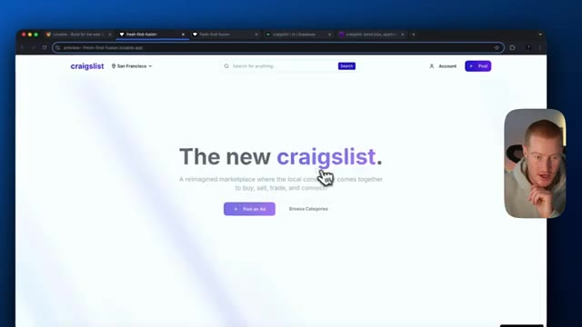
*⏱️ 00:14:30 — Capture d'écran montrant l'application Craigslist repensée dans un navigateur web.*

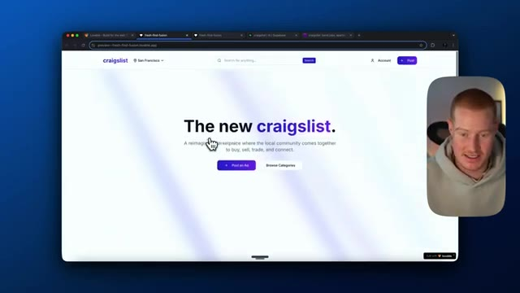
*⏱️ 00:14:39 — Capture d'écran montrant l'interface web de la nouvelle application Craigslist avec le présentateur en incrustation vidéo.*

---

### ⏱️ `[00:14:56 - 00:15:32]` | Segment #32

**🔊 Audio (Transcription Intégrale Mot pour Mot en Français) :**
> might as well continue on and see how far we could go with this. All right, let's play around now. And right here, I'm going to add just another post. Used tennis racket, paid $100 for a brand new less than a year ago. All right, let's post our listing. Listing posted successfully. If we want to come back and make sure this is working, we go to Supabase. We have our new amazing. We got our tennis racket, descriptions there, prices there, categories are there. Everything is being

**👁️ Analyse Visuelle d'Écran (gemini-3.5-flash-lite) :**
**Interface & Outils** : Navigateur web, Craigslist, interface Supabase Table Editor.

**Contenu textuel & Code** : Formulaire de publication d'annonce (titre, prix, description) et table de base de données relationnelle affichant des données structurées.

**Action / Démonstration** : Remplissage d'un formulaire pour poster une nouvelle annonce et consultation de la base de données associée.

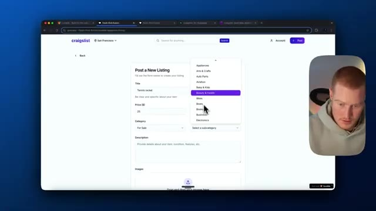
*⏱️ 00:15:05 — Vue d'un navigateur affichant le formulaire de création d'annonce sur Craigslist, avec un menu déroulant pour sélectionner la catégorie de l'objet.*

*⏱️ 00:15:23 — Vue de l'interface Supabase (Table Editor) montrant la table "products" avec des enregistrements de données et les détails de l'annonce enregistrée.*

---

### ⏱️ `[00:15:32 - 00:16:01]` | Segment #33

**🔊 Audio (Transcription Intégrale Mot pour Mot en Français) :**
> stored here. And then what I want to do is I'm going to come back again. I'm going to open up a new tab and this should now show our tennis rack. Okay, perfect guys. This is, this is working smoothly. Everything is working exactly how we want it to. All right, here's another layer that's actually working as well. So if we want to come and check our categories, let's check our categories here. We have for sale and then subcategory beauty and health is where our tennis racket is. So if we want to make sure this is working properly, what we're going to do is we're going to come here.

**👁️ Analyse Visuelle d'Écran (gemini-3.5-flash-lite) :**
**Interface & Outils** : Navigateur web affichant une application web personnalisée et l'interface d'administration de Supabase.

**Contenu textuel & Code** : Base de données contenant des entrées textuelles telles que des articles à vendre (raquette de tennis, téléphone), avec leurs prix et catégories respectifs.

**Action / Démonstration** : Navigation entre les onglets du navigateur pour montrer le rendu visuel de l'application et la structure de la base de données sous-jacente.

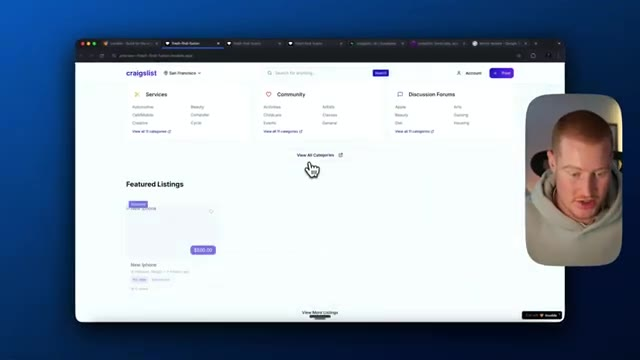
*⏱️ 00:15:39 — Vue d'un site web de type petite annonce inspiré de Craigslist avec des catégories de services et des listes en vedette.*

*⏱️ 00:15:54 — Interface de gestion de base de données Supabase montrant un tableau avec des descriptions d'articles, des prix et des catégories.*

---

### ⏱️ `[00:16:01 - 00:16:19]` | Segment #34

**🔊 Audio (Transcription Intégrale Mot pour Mot en Français) :**
> You can see our tennis racket is still there. We're going to now come to for sale and I'm going to click on beauty and health. And you can see our tennis racket is now listed here because it is flagged underneath this section here. So let's go to Craigslist and take a look at what we were dealing with before.

**👁️ Analyse Visuelle d'Écran (gemini-3.5-flash-lite) :**
**Interface & Outils** : Navigateur web affichant une application web inspirée de Craigslist.

**Contenu textuel & Code** : Annonces classées par catégories, prix de la raquette de tennis (25,00 $), filtres de tri (Newest, Price: Low to High, Price: High to Low).

**Action / Démonstration** : Navigation sur le site Web pour consulter les catégories et vérifier l'affichage de l'annonce de la raquette de tennis dans la section "Beauty & Health".

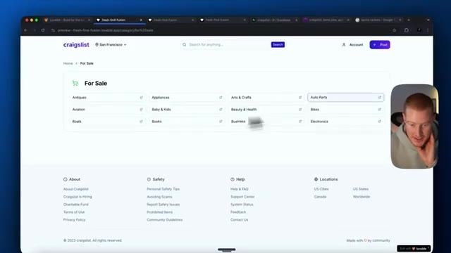
*⏱️ 00:16:06 — Page d'accueil du site Web de type Craigslist montrant les différentes catégories de vente.*

*⏱️ 00:16:10 — Page de la catégorie "Beauty & Health" affichant une annonce unique pour une raquette de tennis à 25,00 $.*

*⏱️ 00:16:15 — Vue similaire de la catégorie "Beauty & Health" avec la raquette de tennis répertoriée.*

---

### ⏱️ `[00:16:20 - 00:16:54]` | Segment #35

**🔊 Audio (Transcription Intégrale Mot pour Mot en Français) :**
> We're going to for sale. Like, let's say we're going to auto parts. I mean, this just looks so awful and hideous. look at what we have created with AI in under like 30 minutes or something 45 minutes maybe so guys there we have it I think I'm gonna leave it there I hope you guys got some value from this video I wanted to see if we could recreate Craigslist with AI using lovable as well as using aqua voice to just speak this out and build it and I think we did pretty well I want to know what your guys thoughts are in the comments below I hope you guys enjoyed this if you guys are new to the channel make sure to subscribe I cover all things AI for non-techies so if you're not a

**👁️ Analyse Visuelle d'Écran (gemini-3.5-flash-lite) :**
**Interface & Outils** : Présentation ou face-caméra explicatif du trader sans interface logicielle partagée.

**Contenu textuel & Code** : Explications orales des stratégies et mise en contexte méthodologique du marché.

**Action / Démonstration** : Explications face caméra et analyse conceptuelle des marchés.

---

### ⏱️ `[00:16:54 - 00:17:10]` | Segment #36

**🔊 Audio (Transcription Intégrale Mot pour Mot en Français) :**
> technical person like myself, I'm going to show you how you could either code with AI, build amazing things with AI, automate things in your life, and a whole bunch more so you could stay ahead of the curve in this world that's growing so fast. So if you guys got some value from this, make sure to leave a like, leave a comment, subscribe to the channel. That being said, I'll see you guys in the next video.

**👁️ Analyse Visuelle d'Écran (gemini-3.5-flash-lite) :**
**Interface & Outils** : Navigateur web affichant une application web ("The new craigslist") et flux vidéo du présentateur.

**Contenu textuel & Code** : Page web avec barre de recherche, titre "The new craigslist", boutons de publication et d'exploration des catégories.

**Action / Démonstration** : Navigation et présentation de l'application web créée ou démontrée par le présentateur.

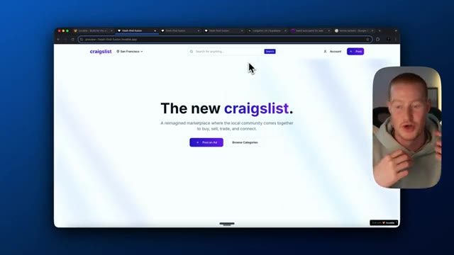
*⏱️ 00:16:58 — Capture d'écran montrant un navigateur web affichant une application web inspirée de Craigslist, avec le présentateur en médaillon vidéo à droite.*

---

