# 🎬 Zapier's MCP Just Changed AI Agents Forever (Here's Why)

> **Chaîne** : [Brock Mesarich | AI for Non Techies](https://www.youtube.com/@BrockMesarich)  
> **Lien YouTube** : [https://www.youtube.com/watch?v=3OhGZ-KmwI0](https://www.youtube.com/watch?v=3OhGZ-KmwI0)  
> **Date de publication** : 20250325  
> **Durée** : 00:10:37  
> **Identifiant vidéo** : `3OhGZ-KmwI0`  
> **Transcription & Analyse** : `whisper-v3-large-turbo+gemini-3.5-flash-lite`  

---

## 📌 Synthèse Exécutive & Outils

### 💡 Résumé

La vidéo présente une avancée majeure dans l'écosystème de l'intelligence artificielle et de l'automatisation : le lancement du serveur MCP (Model Context Protocol) par Zapier. Cette innovation permet de connecter plus de 8 000 applications directement à des assistants IA et environnements de développement tels que Claude Desktop et Cursor, transformant de simples chatbots conversationnels en agents d'exécution autonomes capables d'agir concrètement sur une stack technologique complète sans nécessiter de compétences en programmation.

L'analyste démontre pas à pas la configuration technique simplifiée de ce serveur MCP. En copiant un extrait de code et un point de terminaison sécurisé fournis par Zapier dans l'interface de l'éditeur de code Cursor, l'utilisateur active instantanément un pont sécurisé vers des milliers d'actions automatisées. Contrairement aux configurations traditionnelles d'API ou d'outils comme n8n, l'authentification et les intégrations complexes sont court-circuitées, offrant une fluidité d'exécution sans précédent pour le pilotage d'applications tierces.

La démonstration en direct illustre la puissance de ces agents autonomes : à travers de simples instructions en langage naturel, l'IA génère et envoie un e-mail via Gmail, planifie des rendez-vous détaillés dans Google Calendar, et alimente séquentiellement une feuille de calcul Google Sheets en temps réel. Cette synergie entre les grands modèles de langage et les plateformes d'automatisation redéfinit les standards de productivité, ouvrant la voie à des flux de travail entièrement automatisés et pilotés par la voix ou le texte.

### 🛠️ Outils, Modèles & Logiciels Présentés

* **Zapier MCP** : Serveur de protocole de contexte de modèle développé par Zapier, permettant de connecter instantanément plus de 8 000 applications à des agents IA via un point de terminaison sécurisé.
* **Cursor** : Plateforme de développement et client MCP de choix utilisée dans la vidéo pour configurer et interagir directement avec l'agent IA par le biais de commandes textuelles.
* **Claude / Claude Desktop** : Assistant conversationnel et client MCP majeur pris en charge par l'écosystème pour exécuter des tâches complexes et contextuelles.
* **ChatGPT** : Modèle de langage conversationnel de référence capable d'intégrer des protocoles de contexte similaires.
* **Grok** : Assistant conversationnel avancé doté de capacités d'analyse et de traitement de données en temps réel.
* **Gemini** : Modèle d'intelligence artificielle de Google intégré dans les flux d'analyse et d'automatisation modernes.
* **Make** : Plateforme d'automatisation alternative pour la gestion de flux de travail complexes entre différentes applications web.
* **n8n** : Outil d'automatisation de flux de travail open-source et autohébergé, mentionné pour sa complexité de configuration initiale comparée à Zapier MCP.
* **Gmail** : Outil de messagerie automatisé par l'agent IA pour l'envoi de notifications, de blagues ou de rapports synthétiques.
* **Google Calendar** : Application de calendrier exploitée pour la création et la planification automatisée d'événements et de podcasts.
* **Google Sheets** : Tableur cloud mis à jour en temps réel ligne par ligne par l'agent IA à partir de requêtes textuelles.
* **Stripe** : Solution de paiement en ligne mentionnée parmi les actions activables pour la création de prix et d'abonnements automatisés.

### 🔑 Points Clés & Enseignements Stratégiques

* **Révolution du MCP (Model Context Protocol)** : Le protocole de contexte de modèle relie les interfaces utilisateurs d'IA (clients MCP) à des serveurs tiers pour fournir du contexte ou exécuter des actions directes au nom de l'utilisateur.
* **Suppression des barrières techniques** : L'utilisation du serveur MCP de Zapier s'affranchit du code complexe et des configurations d'API fastidieuses, démocratisant l'accès aux agents d'IA autonomes pour les profils non techniques.
* **Sécurité des points de terminaison** : Le point de terminaison (endpoint) du serveur MCP agit comme un mot de passe hautement sensible ; sa confidentialité est impérative pour éviter l'accès non autorisé à l'ensemble de la pile applicative de l'utilisateur.
* **Écosystème de 8 000+ applications** : L'accès direct à la vaste bibliothèque d'intégrations de Zapier permet à l'agent IA d'interagir avec pratiquement l'ensemble des logiciels professionnels du marché (CRM, messageries, outils de facturation).
* **Processus d'installation simplifié dans Cursor** : La configuration s'exécute en quelques clics : récupération de l'extrait de code sur Zapier, ajout d'un serveur MCP global dans les paramètres de Cursor, et insertion du jeton sécurisé.
* **Activation granulaire des actions** : L'utilisateur conserve le contrôle total en sélectionnant précisément les actions (ex: envoyer un e-mail, créer un événement, ajouter une ligne) que l'agent IA est autorisé à exécuter.
* **Flexibilité des modes d'exécution** : Les actions configurées peuvent exiger un aperçu et une validation humaine avant d'être exécutées par l'IA, ou basculer en mode entièrement autonome.
* **Exécution en temps réel** : La démonstration prouve la capacité d'un agent intégré à Cursor à traiter des listes de données complexes et à les injecter séquentiellement et de manière fiable dans des outils comme Google Sheets.
* **Multicanalité et polyvalence** : Un seul prompt textuel complexe permet à l'IA d'enchaîner plusieurs actions hétérogènes (créer une blague, l'envoyer par e-mail, planifier un calendrier et remplir un tableau).
* **Gain de productivité exponentiel** : Le passage d'une simple discussion textuelle à une exécution automatisée d'actions concrètes réduit drastiquement le temps passé sur les tâches administratives répétitives.
* **Perspective d'intégration élargie** : Bien que démontré principalement sur Cursor, le système est conçu pour s'étendre à d'autres clients lourds comme Claude Desktop, ouvrant de nouvelles perspectives d'automatisation multi-plateforme.

---

## ⏱️ Chronologie & Transcription Complète Audio & Visuelle (Mot pour Mot)

### ⏱️ `[00:00:00 - 00:00:27]` | Segment #01

**🔊 Audio (Transcription Intégrale Mot pour Mot en Français) :**
> Les gars, Zapier a lancé une fonctionnalité énorme qui va changer les agents IA pour toujours. Ils ont sorti leur serveur MCP, qui vous permet de vous connecter à 8 000 de leurs différentes applications directement dans vos assistants IA comme ChatGPT, Claude et Cursor. Pensez-y de cette façon. Vous pourriez parler avec Claude et lui demander d'envoyer des e-mails pour vous, de mettre à jour des feuilles de calcul, de vérifier votre Google Agenda, tout ça, et il peut maintenant réellement créer ces différentes actions et exécuter des tâches dans toutes vos applications.

**👁️ Analyse Visuelle d'Écran (gemini-3.5-flash-lite) :**
**Interface & Outils** : Navigateur web affichant le site officiel de Zapier (zapier.com/mcp) et interface vidéo du présentateur.

**Contenu textuel & Code** : Présentation textuelle des fonctionnalités du serveur MCP de Zapier (« Go from AI chat to AI action », « 8,000+ apps and 30,000+ actions »).

**Action / Démonstration** : Navigation et présentation visuelle de la page web du serveur MCP de Zapier par le créateur de contenu.

---

### ⏱️ `[00:00:27 - 00:01:03]` | Segment #02

**🔊 Audio (Transcription Intégrale Mot pour Mot en Français) :**
> Zapier rend cela extrêmement facile à utiliser en copiant et collant une URL de point de terminaison et en activant simplement ces actions, le tout sans aucune expérience en programmation. Dans cette vidéo, je vais vous montrer exactement à quel point cela change la donne et comment vous pouvez le configurer vous-même. Très bien, les gars, je vais vous expliquer le protocole MCP en tant que personne non technique. Et tout d'abord, excusez-moi, je suis malade. Donc, si j'ai la voix très nasillarde, ne m'en voulez pas. Ce monde va vite. Donc, je dois quand même travailler pendant que je suis malade. Bref, le protocole de contexte de modèle. C'est ce que signifie MCP. Essentiellement, il y a des clients MCP, qui sont fondamentalement comme les interfaces utilisateur avec lesquelles vous allez interagir avec votre agent IA. Il y a donc quelques-uns d'entre eux, tels que

**👁️ Analyse Visuelle d'Écran (gemini-3.5-flash-lite) :**
**Interface & Outils** : Schéma explicatif / Architecture logicielle (Model Context Protocol).

**Contenu textuel & Code** : Diagramme d'architecture illustrant le fonctionnement des flux de données entre les clients MCP et les serveurs MCP.

**Action / Démonstration** : Présentation et explication schématique du fonctionnement du Model Context Protocol (MCP).

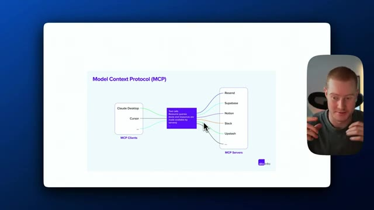
*⏱️ 00:00:45 — Schéma explicatif du Model Context Protocol (MCP) montrant les clients MCP (Claude Desktop, Cursor) connectés à des serveurs MCP (Resend, Supabase, Notion, Slack, Upstash).*

---

### ⏱️ `[00:01:03 - 00:01:39]` | Segment #03

**🔊 Audio (Transcription Intégrale Mot pour Mot en Français) :**
> comme Claw Desktop ou Cursor, qui est essentiellement une plateforme de codage. Et ceci est maintenant connecté à quelque chose appelé un serveur MCP. Et cela vous permet essentiellement d'interagir avec tout un tas d'applications différentes. Vous pouvez donc soit obtenir du contexte, comme extraire des informations de différentes sources, ou vous pouvez même utiliser des outils que vous avez créés sur mesure afin que votre agent IA puisse réellement agir en votre nom. Pensez donc à vous-même interagissant avec Claude, parlant avec Claude Desktop et disant, hé, je veux que tu m'écrives un e-mail et que tu l'ajoutes à une Google Sheet et que tu envoie également un message Slack en mon nom. Et ce qu'il va faire, c'est qu'il va maintenant utiliser le serveur MCP,

**👁️ Analyse Visuelle d'Écran (gemini-3.5-flash-lite) :**
**Interface & Outils** : Schéma/diagramme conceptnel affiché à l'écran, avec la webcam du présentateur incrustée à droite.

**Contenu textuel & Code** : Architecture du protocole MCP : "MCP Clients" reliés à des "Tool calls/Resource queries" connectés aux "MCP Servers".

**Action / Démonstration** : Le présentateur explique le fonctionnement et l'interconnexion des applications via le protocole MCP en pointant du curseur le schéma.

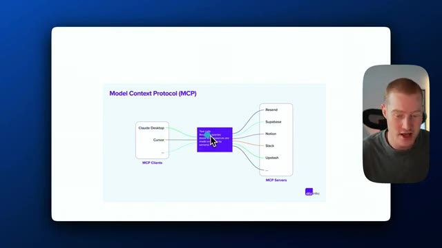
*⏱️ 00:01:12 — Schéma explicatif du Model Context Protocol (MCP) montrant la connexion entre les clients MCP (Claude Desktop, Cursor) et les serveurs MCP (Resend, Supabase, Notion, Slack, Upstash).*

---

### ⏱️ `[00:01:39 - 00:02:11]` | Segment #04

**🔊 Audio (Transcription Intégrale Mot pour Mot en Français) :**
> ce qui vous permet de vous connecter à Gmail et Google Sheets et à toutes ces applications. Et cela vous permet d'interagir directement avec lui pour qu'il puisse effectivement aller de l'avant et envoyer cet e-mail. Cependant, il y a ici quelques problèmes différents. Ainsi, avec ces outils, ces serveurs sont créés par un tiers et vous devez authentifier toutes vos applications via un tiers. Cela peut être un peu risqué car vous faites fondamentalement confiance à la personne qui a créé le serveur pour qu'elle ne vole pas vos informations. C'est donc là que Zapier entre en jeu et cela va changer complètement la donne en ce qui concerne les MCP. Et je vais vous expliquer cela très rapidement. Donc, juste ici, nous avons

**👁️ Analyse Visuelle d'Écran (gemini-3.5-flash-lite) :**
**Interface & Outils** : Schéma conceptuel / Présentation visuelle

**Contenu textuel & Code** : Architecture du Model Context Protocol (MCP) illustrant les flux de données entre les clients, un bloc central de traitement des appels d'outils et de requêtes de ressources, et les différents serveurs d'applications.

**Action / Démonstration** : Le présentateur explique le fonctionnement et l'architecture du protocole MCP et sa capacité à connecter différentes applications.

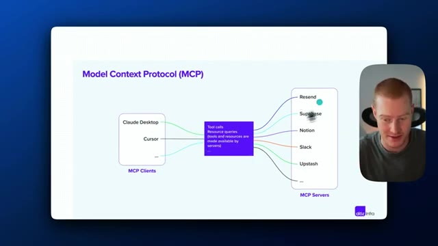
*⏱️ 00:01:47 — Schéma explicatif du Model Context Protocol (MCP) montrant la connexion entre les clients MCP (Claude Desktop, Cursor) et les serveurs MCP (Resend, Supabase, Notion, Slack, Upstash) avec le présentateur en médaillon.*

---

### ⏱️ `[00:02:11 - 00:02:46]` | Segment #05

**🔊 Audio (Transcription Intégrale Mot pour Mot en Français) :**
> Claude et nous avons Cursor, nos clients MCP, tout comme nous l'avions vu ci-dessus. Cependant, ceci se connecte maintenant au serveur MCP de Zapier, qu'ils ont réellement créé et nous pourrions créer nos propres serveurs. Donc en gros, ce que cela nous permet de faire, c'est que si vous avez déjà utilisé Zapier auparavant, c'est une plateforme d'automatisation qui a accès à 8 000 applications différentes que vous pouvez voir ici. Et nous pourrions créer n'importe quelle automatisation à laquelle nous pourrions penser, comme par exemple envoyer des e-mails, ajouter des données à des feuilles de calcul Google, mettre à jour notre CRM, extraire des informations de notre CRM, tout ce genre de choses. Donc maintenant, nous avons la capacité de relier toutes ces applications au MCP de Zapier, qui est un serveur sécurisé que nous pouvons

**👁️ Analyse Visuelle d'Écran (gemini-3.5-flash-lite) :**
**Interface & Outils** : Présentation visuelle et schéma conceptuel.

**Contenu textuel & Code** : Schéma d'architecture MCP affichant les clients MCP (Claude Desktop, Cursor), un bloc central de requêtes, et des serveurs MCP (Resend, Supabase, Notion, Slack, Upstash), annoté par le présentateur avec "Claude/Cursor" connectés à "Zapier MCP" lui-même relié à "8,000 Apps".

**Action / Démonstration** : Le présentateur explique l'architecture et les connexions du protocole MCP avec Zapier en dessinant des annotations à l'écran.

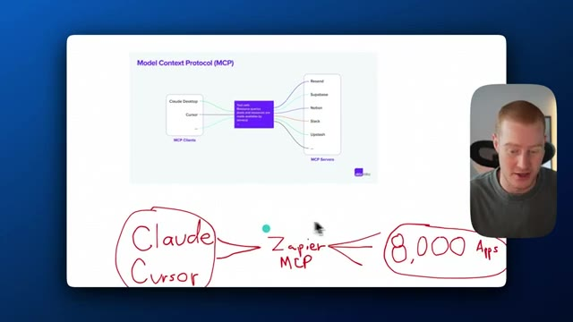
*⏱️ 00:02:20 — Schéma explicatif du Model Context Protocol (MCP) avec des annotations manuscrites en rouge montrant la connexion entre Claude/Cursor, Zapier MCP et 8,000 Apps.*

---

### ⏱️ `[00:02:46 - 00:03:06]` | Segment #06

**🔊 Audio (Transcription Intégrale Mot pour Mot en Français) :**
> littéralement configuré en un seul clic, au lieu de devoir passer par toutes ces authentifications OAuth pour configurer nos applications. Cela rend tout ce processus tellement, tellement fluide. Et le fait qu'il dispose de 8 000 applications auxquelles il se connecte change absolument la donne, car nous pouvons interagir avec pratiquement toute notre pile technologique, étant donné qu'ils ont un si grand nombre d'applications avec lesquelles ils s'intègrent.

**👁️ Analyse Visuelle d'Écran (gemini-3.5-flash-lite) :**
**Interface & Outils** : Présentation visuelle et schéma technique illustratif.

**Contenu textuel & Code** : Schéma du Model Context Protocol (MCP) reliant des clients (Claude Desktop, Cursor) à des serveurs (Resend, Supabase, Notion, Slack, Upstash) via une boîte centrale de traitement, annoté avec les termes "Claude / Cursor", "Zapier MCP" et "8 000 Apps".

**Action / Démonstration** : Le présentateur explique le fonctionnement du Model Context Protocol et l'intégration avec Zapier pour connecter de multiples applications.

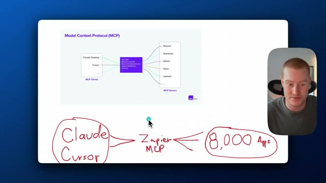
*⏱️ 00:02:51 — Schéma explicatif du Model Context Protocol (MCP) avec des annotations manuscrites en rouge montrant la connexion entre Claude/Cursor, Zapier MCP et 8 000 applications.*

---

### ⏱️ `[00:03:06 - 00:03:42]` | Segment #07

**🔊 Audio (Transcription Intégrale Mot pour Mot en Français) :**
> Très bien, les amis, c'est parti. Voici donc la page d'accueil de Zapier MCP. Connectez votre IA à n'importe quelle application avec Zapier MCP. Il y a ici une petite vidéo sympa qui explique comment nous pourrions réellement activer cela. Passer d'une discussion avec l'IA à une action de l'IA. Donc encore une fois, nous allons utiliser le MCP Zapier pour interagir avec notre assistant IA qui peut réellement effectuer des actions pour nous maintenant. C'est donc vraiment simple. Nous devons générer notre point de terminaison MCP, configurer nos actions à l'intérieur de Zapier et connecter notre assistant IA. Laissez-moi donc commencer. Je vais vous montrer exactement comment faire si vous n'êtes pas une personne technique. Tout d'abord, ce que nous devons faire, c'est venir sur Cursor ici. Cliquez donc sur la plateforme, les plateformes Cursor ici, et nous devons

**👁️ Analyse Visuelle d'Écran (gemini-3.5-flash-lite) :**
**Interface & Outils** : Navigateur web affichant le site officiel de Zapier MCP et son panneau de configuration (AI Actions).

**Contenu textuel & Code** : Texte descriptif des fonctionnalités de Zapier MCP, étapes d'installation et URL de serveur MCP masquée avec avertissement de sécurité.

**Action / Démonstration** : Navigation sur le site web de Zapier pour présenter la transition entre la discussion avec l'IA et l'exécution d'actions concrètes.

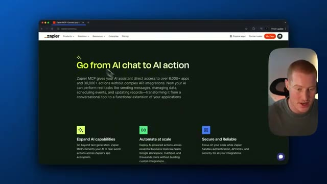
*⏱️ 00:03:15 — Page d'accueil du site Zapier MCP avec le titre principal "Go from AI chat to AI action".*

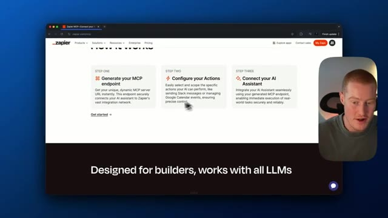
*⏱️ 00:03:24 — Section "How it works" du site Zapier décrivant les trois étapes de configuration.*

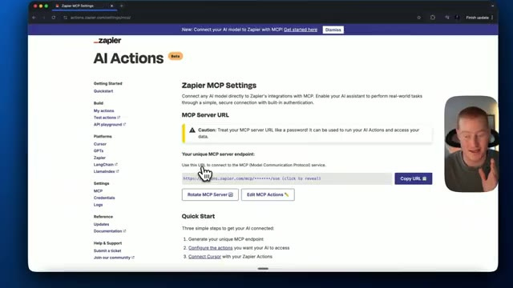
*⏱️ 00:03:33 — Page de paramètres "AI Actions" sur Zapier affichant l'URL unique du serveur MCP et les options de configuration.*

---

### ⏱️ `[00:03:42 - 00:04:16]` | Segment #08

**🔊 Audio (Transcription Intégrale Mot pour Mot en Français) :**
> pour copier ceci, ce petit extrait de code ici. Ne vous inquiétez pas si vous ne savez pas coder, ça va être très simple. Nous avons juste besoin de coller ceci dans Cursor. Ensuite, nous allons venir dans Cursor et nous allons cliquer sur l'onglet des paramètres et nous devons descendre jusqu'à MCP et nous allons ajouter un nouveau serveur MCP global. Ce que nous allons faire ici, c'est que nous allons coller ce code que je suis effectivement allé chercher sur le site web de Zapier. Nous devons faire autre chose maintenant, donc ce que nous allons faire, c'est que nous allons venir sur le MCP juste ici, nous allons copier ce point de terminaison du serveur également. C'est fondamentalement comme un mot de passe, donc ne partagez cela avec personne, sinon ils auront accès à toutes vos intégrations, à toutes vos applications, et c'est juste

**👁️ Analyse Visuelle d'Écran (gemini-3.5-flash-lite) :**
**Interface & Outils** : Interface du logiciel Cursor et navigateur web affichant Zapier AI Actions.

**Contenu textuel & Code** : Paramètres MCP de Cursor et URL de serveur MCP Zapier avec options de configuration.

**Action / Démonstration** : Navigation vers l'onglet MCP dans Cursor, puis copie de l'URL du serveur MCP depuis la page web de Zapier.

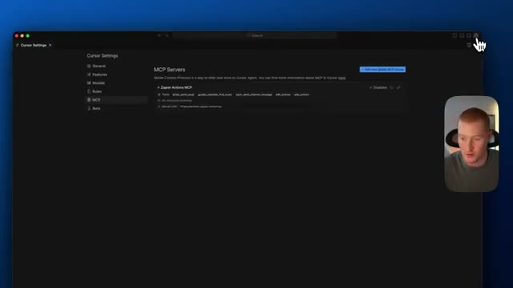
*⏱️ 00:03:50 — L'écran affiche les paramètres du logiciel Cursor, avec l'onglet MCP sélectionné dans le menu de gauche et la section des serveurs MCP affichée au centre.*

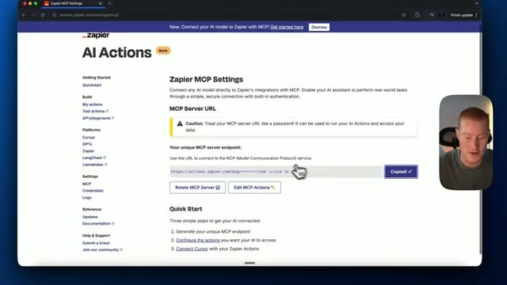
*⏱️ 00:04:08 — Le navigateur web affiche la page des paramètres Zapier AI Actions, montrant l'URL du serveur MCP unique avec un bouton pour copier l'URL.*

---

### ⏱️ `[00:04:16 - 00:04:47]` | Segment #09

**🔊 Audio (Transcription Intégrale Mot pour Mot en Français) :**
> Pas bon. Nous allons prendre ça. Nous allons revenir sur Cursor et nous allons coller ceci juste ici. Très bien. Ensuite, ce que nous allons faire, nous allons cliquer sur fermer, fermer cette fenêtre parce que nous allons enregistrer cela. Si nous revenons à MCP, nous pouvons désormais voir nos actions Zapier. MCP est désormais activé. Et ensuite, ce que nous devons faire, c'est que nous allons venir sur nos actions IA ici et cliquer sur éditer les actions MCP. Ainsi, maintenant que la configuration est en place et que cela fonctionne à l'intérieur de Cursor, nous devons maintenant activer ces actions spécifiques que nous voulons que notre agent IA soit réellement capable d'exécuter.

**👁️ Analyse Visuelle d'Écran (gemini-3.5-flash-lite) :**
**Interface & Outils** : Éditeur de code Cursor et navigateur web affichant l'interface Zapier MCP.

**Contenu textuel & Code** : Fichier de configuration JSON (mcp.json) et liste des actions MCP enregistrées incluant "Gmail: Send Email" et des actions incomplètes.

**Action / Démonstration** : Sauvegarde du fichier de configuration dans l'éditeur de code, puis retour sur l'interface du navigateur pour visualiser les actions MCP configurées.

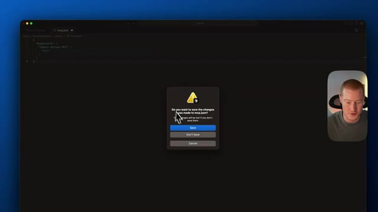
*⏱️ 00:04:24 — Fenêtre contextuelle d'enregistrement des modifications dans un éditeur de code (Cursor), avec le texte "Do you want to save the changes you made to mcp.json?".*

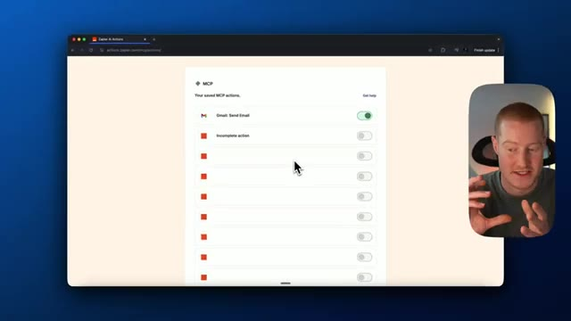
*⏱️ 00:04:39 — Interface web montrant la page des actions MCP enregistrées sur Zapier avec différentes options et bascules.*

---

### ⏱️ `[00:04:47 - 00:05:08]` | Segment #10

**🔊 Audio (Transcription Intégrale Mot pour Mot en Français) :**
> Donc vous pouvez voir que j'ai réellement créé une tâche d'envoi de message Gmail ici. J'ai ajouté un message de canal d'envoi, trouver un événement Google Agenda. Si vous avez déjà utilisé Zapier auparavant, il y a littéralement plus de 30 000 actions différentes que nous pourrions entreprendre à travers 8 000 applications différentes. Soyons donc créatifs et trouvons quelque chose. Donc par exemple, nous pourrions réellement créer un paiement Stripe, créer un nouveau prix, créer un nouvel abonnement.

**👁️ Analyse Visuelle d'Écran (gemini-3.5-flash-lite) :**
**Interface & Outils** : Présentation ou face-caméra explicatif du trader sans interface logicielle partagée.

**Contenu textuel & Code** : Explications orales des stratégies et mise en contexte méthodologique du marché.

**Action / Démonstration** : Explications face caméra et analyse conceptuelle des marchés.

---

### ⏱️ `[00:05:09 - 00:05:41]` | Segment #11

**🔊 Audio (Transcription Intégrale Mot pour Mot en Français) :**
> C'est l'une des tâches que nous pourrions faire. Nous pourrions créer un événement Google Calendar, que je vais d'ailleurs activer ici. C'est parti. Créer un événement détaillé. Maintenant, c'est en train de se faire, tout ce que nous avons à faire est fondamentalement de connecter notre compte, ce qui est littéralement aussi simple que de cliquer sur un ou deux boutons. C'est ce qui rend Zapier MCP si spécial, parce que ces intégrations sont tellement fluides puisque l'API est entièrement configurée pour cette plateforme, au lieu d'utiliser quelque chose comme N8N, où c'est juste une galère de la configurer, surtout si vous n'êtes pas une personne technique. Nous pourrions donc choisir tous ces champs. Je vais laisser notre IA deviner pour tous ces champs. Nous pourrions soit exiger un aperçu avant d'exécuter l'action de l'IA, soit nous pourrions

**👁️ Analyse Visuelle d'Écran (gemini-3.5-flash-lite) :**
**Interface & Outils** : Navigateur web affichant l'interface de configuration Zapier AI Actions / MCP.

**Contenu textuel & Code** : Formulaire de configuration pour "Google Calendar: Create Detailed Event" avec liaison de compte Gmail.

**Action / Démonstration** : Connexion du compte Google Calendar dans l'outil d'automatisation Zapier pour permettre à l'IA de créer des événements.

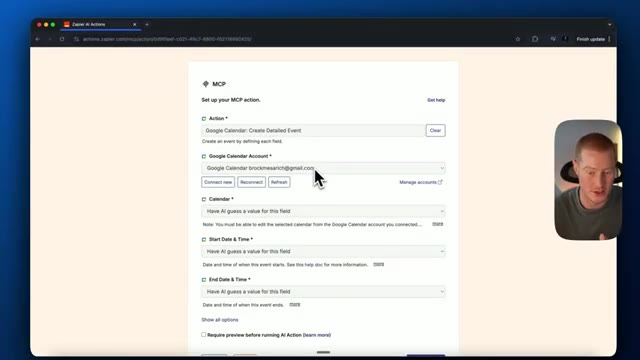
*⏱️ 00:05:17 — Interface de configuration Zapier MCP montrant l'action de création d'un événement Google Calendar détaillé.*

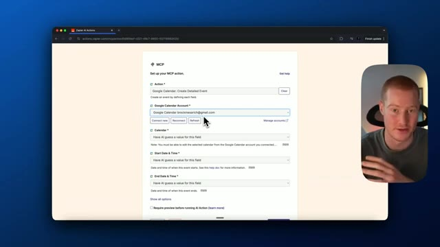
*⏱️ 00:05:25 — Vue similaire montrant la configuration du compte Google Calendar avec le curseur sur le bouton de connexion.*

---

### ⏱️ `[00:05:41 - 00:06:16]` | Segment #12

**🔊 Audio (Transcription Intégrale Mot pour Mot en Français) :**
> laissons cette chose tourner en mode automatique. Donc ça créerait réellement cet événement d'action pour nous. Et regardons quelques-unes des autres actions et partons simplement d'ici et testons et voyons si cela fonctionne. Disons donc Google Spreadsheet. Je veux pouvoir ajouter comme une ligne à une feuille de calcul Google spécifique. Alors voilà. C'est connecté à mon compte Google. Je dois choisir à quelle feuille de calcul je veux que cela ait réellement accès. Très bien. Je vais donc cliquer sur Zapier MCP puisque c'est réellement la feuille Google ici. Choisir une feuille de travail. Je pourrais soit laisser l'IA déterminer cela, soit nous pourrions choisir une feuille de travail spécifique. Je vais juste cliquer sur Feuille 1. Je peux donc maintenant activer ceci et nous pourrons désormais apporter des modifications à cette feuille de calcul Google.

**👁️ Analyse Visuelle d'Écran (gemini-3.5-flash-lite) :**
**Interface & Outils** : Navigateur web affichant l'interface de configuration de Zapier AI Actions (actions.zapier.com) avec vignette vidéo du présentateur.

**Contenu textuel & Code** : Formulaires de configuration d'action MCP pour Google Sheets ("Google Sheets: Create Spreadsheet Row"), champs de compte, sélection de tableur et options d'intelligence artificielle.

**Action / Démonstration** : Configuration et paramétrage d'une action Zapier pour l'intégration de Google Sheets dans un flux automatisé.

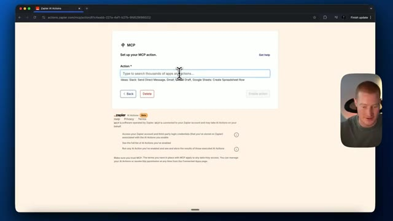
*⏱️ 00:05:50 — Interface de configuration Zapier AI Actions montrant le champ de recherche d'action pour le MCP.*

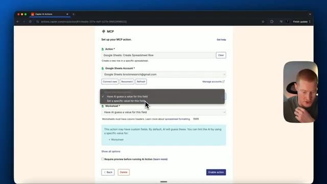
*⏱️ 00:05:59 — Configuration de l'action Google Sheets avec un menu déroulant permettant de choisir si l'IA doit deviner la valeur ou utiliser une valeur spécifique.*

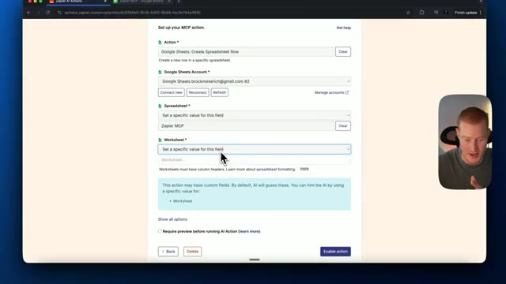
*⏱️ 00:06:08 — Paramétrage détaillé d'une action Google Sheets avec sélection du compte, du tableur et de la feuille de calcul.*

---

### ⏱️ `[00:06:16 - 00:06:54]` | Segment #13

**🔊 Audio (Transcription Intégrale Mot pour Mot en Français) :**
> juste en interagissant avec notre agent sur Cursor. Cependant, nous pourrions également implémenter cela avec Claude si nous utilisons Claude Desktop. Cependant, je couvrirai cela dans une prochaine vidéo parce que ce n'est pas aussi simple à faire. Revenons donc à notre serveur MCP à l'intérieur de Cursor. Ensuite, je vais créer un nouveau chat ici en cliquant sur Commande I, puis parlons simplement avec lui et faisons en sorte qu'il crée réellement une action pour nous. Hé, je veux que tu inventes une blague et que tu l'envoies réellement par e-mail à brockmeserich@gmail.com. En plus de cela, je veux que tu crées un événement pour demain, mardi à 8 heures, appelé Mark Podcast. Très bien. Maintenant que j'ai donné quelques actions à notre agent ici,

**👁️ Analyse Visuelle d'Écran (gemini-3.5-flash-lite) :**
**Interface & Outils** : Interface de l'éditeur de code Cursor (Cursor Settings > MCP).

**Contenu textuel & Code** : Liste des serveurs MCP configurés, notamment "Zapier Actions MCP" avec ses outils associés et le statut "Enabled".

**Action / Démonstration** : Consultation de la configuration des serveurs MCP dans l'éditeur Cursor.

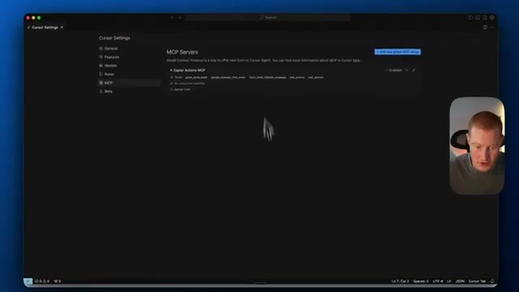
*⏱️ 00:06:26 — Fenêtre des paramètres de Cursor affichant la configuration des serveurs MCP avec Zapier Actions MCP activé.*

---

### ⏱️ `[00:06:54 - 00:07:20]` | Segment #14

**🔊 Audio (Transcription Intégrale Mot pour Mot en Français) :**
> let's now send this and it should now begin generating this and calling these tools. So let's take a look here. Okay. So it called this MCP tool, which is that tool we just enabled inside of Zapier. This is my first time trying this out. I'm actually blown away at this. This is going to be so beneficial when we implement this into something like Claude. Boom, guys, here we go. It actually just sent this email to me. So here's a joke to brighten your day. Why don't programmers like nature? It has too many bugs. Hope this made you smile. That's great.

**👁️ Analyse Visuelle d'Écran (gemini-3.5-flash-lite) :**
**Interface & Outils** : Cursor, Gmail, navigateur web

**Contenu textuel & Code** : Configuration des serveurs MCP, outils activés (Zapier Actions MCP), instructions de prompt et e-mail reçu ("Here's a Joke to Brighten Your Day").

**Action / Démonstration** : Démonstration de l'utilisation d'un outil MCP pour exécuter une action automatisée (envoi d'e-mail via Zapier depuis l'éditeur Cursor).

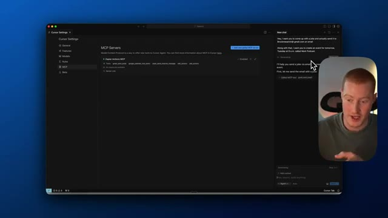
*⏱️ 00:07:01 — Interface de l'application Cursor montrant la configuration des serveurs MCP (Zapier Actions MCP) et un panneau de chat en cours d'exécution.*

*⏱️ 00:07:14 — Interface de Gmail affichant un e-mail généré et envoyé automatiquement par l'agent IA via l'outil MCP.*

---

### ⏱️ `[00:07:20 - 00:07:52]` | Segment #15

**🔊 Audio (Transcription Intégrale Mot pour Mot en Français) :**
> Très bien, les amis, ensuite, je veux vraiment tester et vraiment ajouter quelque chose à notre feuille de calcul Google ici. Je veux donc remplir ceci avec environ huit ou dix lignes d'informations. Laissez-moi juste revenir à Cursor, parler avec notre agent. Hé, je veux que tu ajoutes ces informations à notre feuille de calcul Google appelée Zapier MCP. C'est parti. Collez ces informations. Il y a la date. Il y a le nom et ensuite la description de la demande. Tout ce que j'ai à faire est de cliquer sur envoyer. Vous pouvez voir que c'est en train de générer. Il devrait appeler cet outil de feuille de calcul Google. Très bien. C'est parti. Il appelle l'outil MCP ici et nous devrions, espérons-le, voir cela se remplir en temps réel. D'accord, c'est parti. Donc

**👁️ Analyse Visuelle d'Écran (gemini-3.5-flash-lite) :**
**Interface & Outils** : Google Sheets, éditeur de code Cursor

**Contenu textuel & Code** : Tableau Google Sheets avec colonnes (Date, Name, Description) ; panneau de chat de l'agent IA dans Cursor avec des instructions de saisie de données.

**Action / Démonstration** : Navigation de la feuille de calcul vers l'éditeur de code Cursor pour interagir avec l'agent IA et automatiser l'ajout de données.

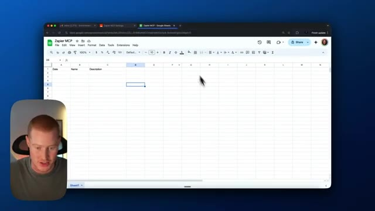
*⏱️ 00:07:28 — Vue d'une feuille de calcul Google Sheets vide intitulée « Zapier MCP » avec des en-têtes de colonnes Date, Name et Description, et le présentateur visible en incrustation.*

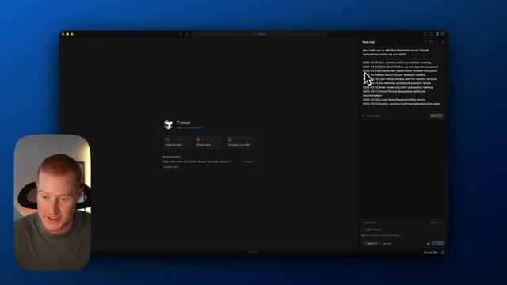
*⏱️ 00:07:36 — Interface de l'éditeur de code Cursor montrant le panneau de chat latéral avec un prompt demandant d'ajouter des informations au Google Spreadsheet, avec le présentateur en incrustation.*

---

### ⏱️ `[00:07:52 - 00:08:26]` | Segment #16

**🔊 Audio (Transcription Intégrale Mot pour Mot en Français) :**
> Le prénom a été ajouté. Donc nous avons la date. Nous avons Alex Johnson, réunion de consultation initiale, et il semble que cela va parcourir chacun d'eux sur la liste ici un par un. Donc il va devoir appeler cet outil à chaque fois. Donc il a rappelé l'outil, Olivia Smith, donnons-lui une seconde et cela devrait ajouter son nom au tableur également. Donc notre agent en temps réel alimente notre tableur Google via Cursor parce que nous avons configuré le serveur MCP pour avoir cela, pour avoir la capacité d'accéder à ces actions à l'intérieur de notre agent. Et voilà. Ethan Brown. C'est intéressant que cela s'alimente un par un, mais je suppose que c'est logique. Et puis enfin, cela a ajouté Mia Davis.

**👁️ Analyse Visuelle d'Écran (gemini-3.5-flash-lite) :**
**Interface & Outils** : Google Sheets, éditeur de code Cursor (avec interface d'agent IA), et webcam du présentateur.

**Contenu textuel & Code** : Tableau Google Sheets avec colonnes Date, Nom et Description. Journal d'interaction client avec listes de dates (2025-03-01 Alex Johnson, 2025-03-03 Olivia Smith, etc.) et appels d'outils MCP.

**Action / Démonstration** : L'agent IA automatise le remplissage d'un tableau Google Sheets en appelant successivement l'outil MCP pour chaque entrée de la liste.

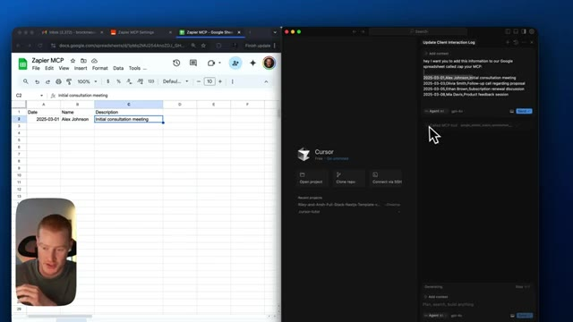
*⏱️ 00:08:01 — Vue partagée montrant Google Sheets sur la gauche avec la première ligne remplie (Alex Johnson) et l'éditeur Cursor sur la droite avec l'appel de l'outil Zapier MCP en cours.*

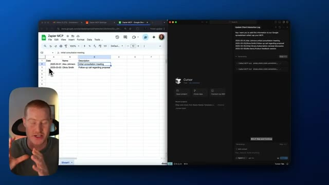
*⏱️ 00:08:09 — Vue partagée similaire montrant Google Sheets sur la gauche avec une deuxième ligne ajoutée (Olivia Smith) et l'éditeur Cursor sur la droite pendant l'exécution successive.*

---

### ⏱️ `[00:08:26 - 00:08:44]` | Segment #17

**🔊 Audio (Transcription Intégrale Mot pour Mot en Français) :**
> Nous avons donc maintenant quatre de ces différentes lignes que notre agent a réellement ajoutées. Développons cela. Je vais voir si je peux envoyer un e-mail avec ces informations. Super. Peux-tu maintenant envoyer un e-mail à Brock avec toutes ces informations pour qu'il sache ce qui a été ajouté à notre tableur ? Je vais ajouter mon adresse e-mail ici. Très bien.

**👁️ Analyse Visuelle d'Écran (gemini-3.5-flash-lite) :**
**Interface & Outils** : Google Sheets, éditeur de code Cursor (panneau latéral Agent / MCP).

**Contenu textuel & Code** : Données de journal d'interaction client : dates (2025-03-01 à 2025-03-08), noms (Alex Johnson, Olivia Smith, Ethan Brown, Mia Davis) et descriptions de réunions.

**Action / Démonstration** : L'utilisateur observe les données générées et ajoutées automatiquement par l'agent dans le tableur avant de préparer une nouvelle commande pour envoyer un e-mail.

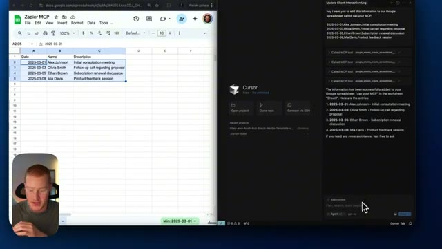
*⏱️ 00:08:30 — Vue partagée montrant un tableau Google Sheets à gauche avec quatre lignes de données remplies et l'éditeur Cursor à droite avec l'agent IA affichant les détails des entrées ajoutées.*

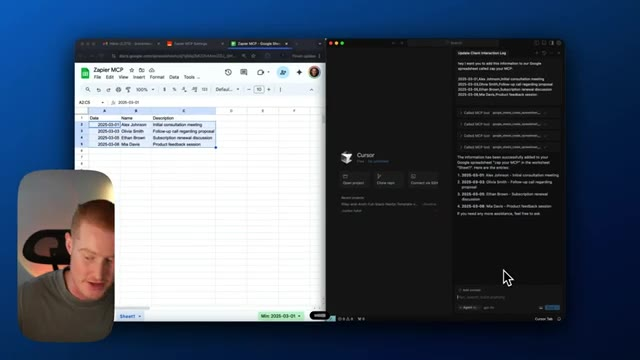
*⏱️ 00:08:35 — Vue similaire montrant le tableau Google Sheets mis à jour à gauche et le panneau de chat de l'agent Cursor à droite où l'utilisateur s'apprête à envoyer une nouvelle instruction.*

---

### ⏱️ `[00:08:44 - 00:09:20]` | Segment #18

**🔊 Audio (Transcription Intégrale Mot pour Mot en Français) :**
> Il devrait donc maintenant appeler notre outil MCP d'envoi d'e-mail. Et voilà. Les gars, c'est tellement génial. Genre, jouer avec ça en temps réel me bluffe. C'est, j'ai hâte de jouer avec ça davantage, de trouver quelques cas d'usage différents. Et nous y voilà. Voici l'e-mail que je viens de recevoir : nouvelles entrées ajoutées à la feuille de calcul Zapier MCP. Je n'ai pas bien choisi le nom. Cependant, il a bien envoyé toutes ces informations. Donc voilà. C'est fou. Allons-y et essayons un autre cas d'usage. Très bien. Alors ensuite, testons notre outil d'événement Google Calendar Zapier MCP. Donc essentiellement, nous allons essayer de créer un événement Google Calendar, puis d'envoyer des informations à l'e-mail de quelqu'un. Hé, donc je veux que tu crées un Google

**👁️ Analyse Visuelle d'Écran (gemini-3.5-flash-lite) :**
**Interface & Outils** : Google Sheets, Gmail, et l'éditeur de code Cursor (avec intégration MCP).

**Contenu textuel & Code** : Tableau de données Google Sheets avec des entrées de clients et un e-mail Gmail récapitulant ces entrées généré automatiquement via MCP.

**Action / Démonstration** : Exécution d'un outil MCP pour envoyer un e-mail récapitulatif à partir des données d'un tableur et affichage du résultat dans Gmail.

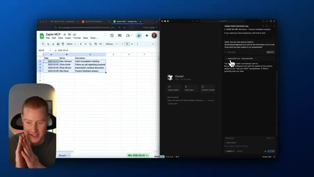
*⏱️ 00:08:53 — Vue partagée montrant Google Sheets à gauche et l'éditeur Cursor à droite, où l'outil MCP d'e-mail est exécuté.*

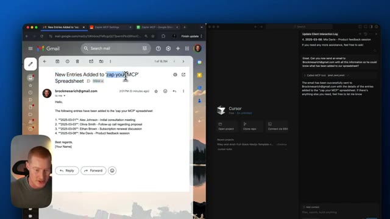
*⏱️ 00:09:02 — Vue partagée montrant Gmail à gauche avec l'e-mail reçu contenant les entrées du tableur, et l'éditeur Cursor à droite.*

---

### ⏱️ `[00:09:20 - 00:09:48]` | Segment #19

**🔊 Audio (Transcription Intégrale Mot pour Mot en Français) :**
> Événement dans le calendrier pour demain à 10 heures. Et je veux que tu envoie réellement ces informations à Brock par e-mail avec quelques informations sur la réunion. Cette réunion va s'appeler Mark Podcast et envoie-lui ces informations. Très bien, c'est parti. Donc je dois ajouter l'adresse e-mail. Donc brockmessage arobase gmail point com. Voyons s'il est capable de gérer cela. Ce sont deux actions dans un seul petit prompt ici. Donc c'est tout d'abord, l'appel de l'outil MCP, Google Agenda, créer un événement détaillé.

**👁️ Analyse Visuelle d'Écran (gemini-3.5-flash-lite) :**
**Interface & Outils** : Éditeur de code Cursor (interface sombre avec panneau de chat latéral).

**Contenu textuel & Code** : Page d'accueil de Cursor avec les options pour ouvrir un projet, cloner un dépôt ou se connecter en SSH, ainsi qu'un panneau de chat latéral actif.

**Action / Démonstration** : Le présentateur navigue dans l'éditeur Cursor pour configurer ou exécuter une tâche d'automatisation.

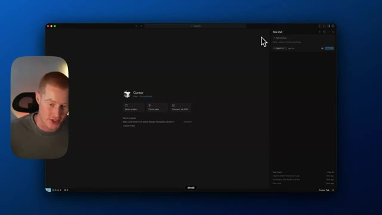
*⏱️ 00:09:27 — Capture d'écran montrant l'interface sombre de l'éditeur de code Cursor avec le présentateur en médaillon à gauche.*

---

### ⏱️ `[00:09:48 - 00:10:07]` | Segment #20

**🔊 Audio (Transcription Intégrale Mot pour Mot en Français) :**
> Now it is calling the MCP tool, Google or Gmail, send email, and I should be receiving an email and that information here shortly. All right, so the event has been successfully created. Let me go ahead and check my email. Boom, here we go. Hi, Brock, I wanna let you know the meeting title and mark podcast has been scheduled for tomorrow at 10 a.m. The meeting will last for one hour.

**👁️ Analyse Visuelle d'Écran (gemini-3.5-flash-lite) :**
**Interface & Outils** : IDE Cursor, Gmail, navigateur web.

**Contenu textuel & Code** : Appels d'outils MCP (google_calendar_create_event, gmail_send_email) et contenu de l'e-mail de confirmation.

**Action / Démonstration** : Le présentateur vérifie que l'e-mail généré automatiquement par l'agent IA a bien été reçu dans sa boîte de réception.

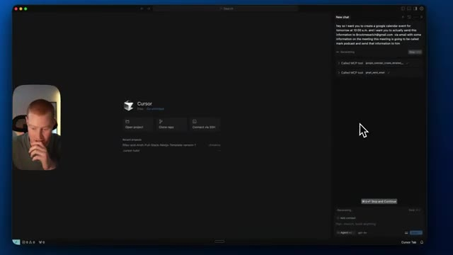
*⏱️ 00:09:53 — L'éditeur Cursor affiche le panneau de chat latéral avec l'exécution des outils MCP Google Calendar et Gmail.*

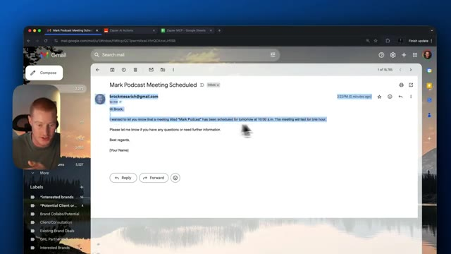
*⏱️ 00:10:02 — Interface de Gmail affichant un e-mail reçu confirmant la création de la réunion 'Mark Podcast'.*

---

### ⏱️ `[00:10:07 - 00:10:30]` | Segment #21

**🔊 Audio (Transcription Intégrale Mot pour Mot en Français) :**
> Les gars, voilà. Nous utilisons le MCP de Zapier pour donner concrètement des actions à nos assistants IA dans Cursor. Nous pourrions faire cela dans Claude Desktop. Cependant, il n'y a pas de moyen simple de le faire à l'heure qu'il est. Si vous voulez voir cela sur la chaîne, assurez-vous de vous abonner. Je vais couvrir beaucoup de choses sur ce MCP de Zapier, car c'est absolument révolutionnaire lorsqu'il s'agit de construire des agents IA, en particulier si vous n'êtes pas une personne technique comme moi.

**👁️ Analyse Visuelle d'Écran (gemini-3.5-flash-lite) :**
**Interface & Outils** : Éditeur de code Cursor (macOS)

**Contenu textuel & Code** : Panneau latéral affichant l'historique d'une conversation avec l'IA et l'appel d'outils MCP (Google Calendar, e-mail).

**Action / Démonstration** : Démonstration de l'utilisation du MCP de Zapier pour exécuter des actions concrètes depuis l'éditeur Cursor.

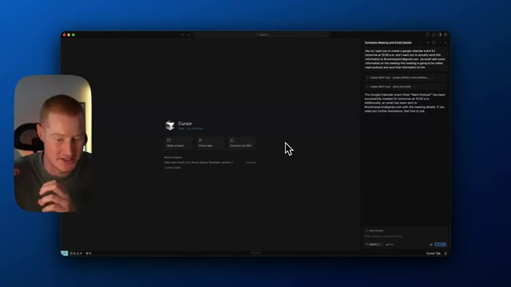
*⏱️ 00:10:13 — Capture d'écran montrant l'interface de l'éditeur Cursor sur macOS, avec le présentateur incrusté en médaillon à gauche et des interactions avec des outils MCP dans le panneau latéral droit.*

---

### ⏱️ `[00:10:30 - 00:10:37]` | Segment #22

**🔊 Audio (Transcription Intégrale Mot pour Mot en Français) :**
> Alors, si cela vous semble intéressant, assurez-vous de vous abonner à cette chaîne, de laisser un pouce bleu sur cette vidéo, de me faire part de vos réflexions, et je vous dis à très bientôt dans la prochaine.

**👁️ Analyse Visuelle d'Écran (gemini-3.5-flash-lite) :**
**Interface & Outils** : IDE Cursor, fenêtre principale avec l'écran d'accueil et le panneau latéral de chat.

**Contenu textuel & Code** : Commandes de l'éditeur Cursor (Open project, Clone repo, Connect via SSH) et historique de chat dans le panneau latéral droit.

**Action / Démonstration** : Présentation de l'interface principale de l'éditeur de code Cursor.

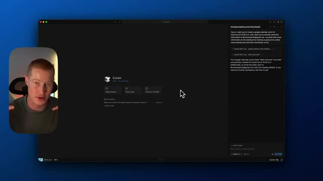
*⏱️ 00:10:32 — Capture d'écran montrant l'interface de l'éditeur Cursor au centre et une incrustation vidéo du présentateur en bas à gauche.*

---

