# 🎬 The EASIEST Way to Build and Host n8n Agents (For Non-Techies)

> **Chaîne** : [Brock Mesarich | AI for Non Techies](https://www.youtube.com/@BrockMesarich)  
> **Lien YouTube** : [https://www.youtube.com/watch?v=cayngY9kP0U](https://www.youtube.com/watch?v=cayngY9kP0U)  
> **Date de publication** : 20250330  
> **Durée** : 00:10:46  
> **Identifiant vidéo** : `cayngY9kP0U`  
> **Transcription & Analyse** : `whisper-v3-large-turbo+gemini-3.5-flash-lite`  

---

## 📌 Synthèse Exécutive & Outils

### 💡 Résumé

Cette vidéo, présentée par la chaîne *Brock Mesarich | AI for Non Techies*, s'attaque à l'un des plus grands goulets d'étranglement de l'automatisation moderne par l'intelligence artificielle : le coût prohibitif et la complexité technique de l'hébergement d'agents IA et de workflows sur des plateformes telles que n8n. L'analyste démontre qu'en combinant l'infrastructure cloud VPS de Hostinger avec le moteur d'automatisation n8n, il est possible de concevoir une architecture robuste et clé en main tout en réduisant les coûts d'hébergement d'environ 70 %. Cette approche s'adresse directement aux profils non techniques cherchant à s'affranchir des barrières de l'auto-hébergement complexe.

Sur le plan pratique, la démonstration se focalise sur l'implémentation d'un cas d'usage hautement reproductible : la qualification automatisée de prospects (leads) collectés via un formulaire et centralisés dans Google Sheets, avant d'être analysés et notés par un modèle de langage (OpenAI ChatGPT). À travers un tutoriel pas à pas, la vidéo détaille l'ensemble des configurations requises, depuis le provisionnement du serveur virtuel jusqu'à l'authentification OAuth 2.0 sur la console Google Cloud, en passant par le paramétrage des invites (*prompt engineering*) décisionnelles.

L'enseignement stratégique majeur réside dans la standardisation et la reproductibilité des flux de travail autonomes. En automatisant la lecture périodique des bases de données de prospects et leur enrichissement par IA, les structures commerciales éliminent les tâches répétitives à faible valeur ajoutée. L'utilisation de structures de données au format JSON garantit une interopérabilité fluide entre les outils de bureautique cloud et les grands modèles de langage, ouvrant la voie à une scalabilité opérationnelle immédiate pour des entrepreneurs ou des équipes agiles.

### 🛠️ Outils, Modèles & Logiciels Présentés

* **n8n** : Plateforme d'automatisation de workflows open-source et visuelle permettant de connecter des applications et d'orchestrer des agents IA complexes.
* **Hostinger** : Hébergeur cloud fournissant des instances VPS préconfigurées avec n8n, permettant de réduire drastiquement les coûts par rapport aux solutions natives.
* **OpenAI (ChatGPT / GPT-4)** : Modèle de langage grand public utilisé ici comme moteur décisionnel pour analyser, noter et qualifier les prospects entrants.
* **Google Sheets** : Outil de tableur cloud servant de base de données initiale pour centraliser les soumissions de formulaires et stocker les résultats de qualification.
* **Google Cloud Console** : Interface de gestion des services Google requise pour configurer les accès API (Google Drive, Sheets) et l'authentification OAuth 2.0.
* **Claude** : Modèle linguistique avancé d'Anthropic mentionné dans l'écosystème global de l'IA pour l'assistance à la conception.
* **Make** : Alternative d'automatisation no-code concurrente de n8n et Zapier.
* **Zapier** : Pionnier des plateformes d'intégration et d'automatisation de tâches entre applications web.
* **Grok** : Modèle d'intelligence artificielle conversationnelle développé par xAI.
* **Gemini** : Suite de modèles d'intelligence artificielle multimodal développée par Google.

### 🔑 Points Clés & Enseignements Stratégiques

* **Optimisation des coûts d'infrastructure** : Le recours à un VPS Hostinger configuré spécifiquement pour n8n permet de faire chuter la facture annuelle de 215 $ à 86 $ (grâce à un code promotionnel), représentant une économie d'environ 70 % par rapport aux solutions infonuagiques traditionnelles.
* **Alternative à l'auto-hébergement complexe** : L'utilisation d'une image VPS pré-installée élimine la nécessité de compétences techniques avancées en administration système pour déployer des environnements d'automatisation souverains.
* **Importation rapide de modèles préconçus** : L'exploitation de templates natifs au sein de n8n permet d'amorcer instantanément des architectures complexes, comme le pontage entre Google Sheets et OpenAI, sans repartir d'une page blanche.
* **Architecture de déclenchement temporel** : Le paramétrage du nœud Google Sheets pour s'exécuter à intervalles réguliers (toutes les heures) assure une synchronisation asynchrone et un traitement par lots fluide des nouveaux flux de données.
* **Sécurisation des accès API Google** : La mise en place rigoureuse d'un projet sur la Google Cloud Console exige l'activation explicite des API Google Drive et Google Sheets pour éviter les erreurs de lecture et d'écriture de données.
* **Configuration de l'écran de consentement OAuth** : L'établissement d'une application externe, la définition d'utilisateurs test et l'association d'URL de redirection autorisées garantissent la conformité et la sécurité des liaisons de comptes.
* **Injection dynamique de variables** : Le passage de données contextuelles (nom, e-mail, domaine d'activité, taille de l'équipe) depuis les lignes du tableur vers le modèle de langage permet d'obtenir des réponses hautement personnalisées et structurées.
* **Standardisation des sorties au format JSON** : Le traitement des données par le modèle d'IA est configuré pour renvoyer des structures normalisées, facilitant la réinjection automatique des statuts de qualification (qualifié / non qualifié) dans la feuille de calcul.
* **Prompt engineering décisionnel** : L'intégration d'instructions comportementales claires dans le nœud OpenAI permet d'imposer des critères stricts (ex: le prospect doit être un décideur) pour filtrer objectivement l'entrée des leads.
* **Test et validation incrémentaux** : L'exécution manuelle des étapes de test (*fetch test event*) à chaque palier du workflow permet d'isoler immédiatement les erreurs de syntaxe, de mapping de données ou d'authentification avant le passage en production.

---

## ⏱️ Chronologie & Transcription Complète Audio & Visuelle (Mot pour Mot)

### ⏱️ `[00:00:00 - 00:00:23]` | Segment #01

**🔊 Audio (Transcription Intégrale Mot pour Mot en Français) :**
> Très bien, les gars, si vous avez cliqué sur cette vidéo, vous voulez apprendre à créer des agents IA avec N8N. Cependant, si nous faisons cela, nous allons rencontrer quelques problèmes. Et ces problèmes sont que l'hébergement de vos agents sur N8N peut devenir cher. Vous avez donc besoin d'un endroit pour exécuter votre agent IA et le faire sur N8N coûte un peu cher. L'autre chose que vous pourriez faire est de l'auto-héberger, mais c'est hautement technique et vraiment difficile à faire si vous êtes une personne non technique comme moi.

**👁️ Analyse Visuelle d'Écran (gemini-3.5-flash-lite) :**
**Interface & Outils** : Navigateur web avec l'application de dessin Excalidraw, incrustation vidéo du présentateur.

**Contenu textuel & Code** : Texte manuscrit listant les problèmes : "Problem:", "1. Hosting on n8n can get expensive", "2. You can self host it but that is highly technical and hard to do".

**Action / Démonstration** : Le présentateur explique les inconvénients de l'hébergement sur N8N et de l'auto-hébergement, en pointant les éléments écrits à l'écran.

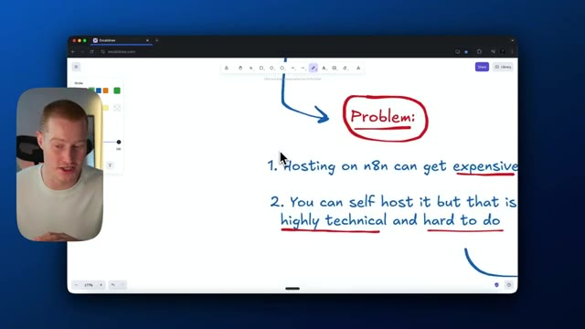
*⏱️ 00:00:06 — Un tableau blanc virtuel (Excalidraw) présente les problèmes liés à l'hébergement d'agents IA, avec le présentateur incrusté en médaillon.*

---

### ⏱️ `[00:00:23 - 00:00:47]` | Segment #02

**🔊 Audio (Transcription Intégrale Mot pour Mot en Français) :**
> C'est un peu hors de question. Voici la solution. Je vais vous montrer un moyen très simple d'héberger vos propres agents IA. Et c'est une configuration unique. C'est donc très simple. Faites cela pour tous vos agents après l'avoir configuré une seule fois. En plus de cela, cela va coûter 70 % de moins que l'hébergement sur N8N. Vous allez donc économiser beaucoup d'argent en faisant cela. Si cela vous intéresse, je vais vous présenter cette solution maintenant et ensuite commencer à construire notre agent IA avec N8N.

**👁️ Analyse Visuelle d'Écran (gemini-3.5-flash-lite) :**
**Interface & Outils** : Navigateur web avec l'application Excalidraw et une incrustation vidéo (webcam).

**Contenu textuel & Code** : Texte manuscrit sur le tableau blanc : "Solution:", "I will show you a VERY EASY way to host your agents", et "One time setup".

**Action / Démonstration** : Le présentateur parle en pointant l'écran, tandis que le tableau blanc illustre visuellement la solution d'hébergement d'agents IA.

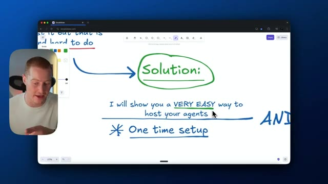
*⏱️ 00:00:29 — Un écran d'ordinateur affichant un tableau blanc numérique avec des notes manuscrites, et une incrustation vidéo du présentateur dans le coin inférieur gauche.*

---

### ⏱️ `[00:00:47 - 00:01:07]` | Segment #03

**🔊 Audio (Transcription Intégrale Mot pour Mot en Français) :**
> Très bien. Donc, nous allons utiliser Hostinger pour héberger réellement notre N8N. Et je vais vous montrer exactement comment configurer cela dans cette vidéo. Ils ont la gentillesse de parrainer ceci, mais je pense que cela va vraiment vous faire économiser tellement d'argent. C'est tellement simple à configurer par rapport à un auto-hébergement ou à un hébergement sur N8N. Cliquez donc sur le lien dans la description. Vous allez voir ce plan d'hébergement VPS ici. Je vais donc cliquer sur choisir votre plan. Nous allons choisir le plan KVM2.

**👁️ Analyse Visuelle d'Écran (gemini-3.5-flash-lite) :**
**Interface & Outils** : Navigateur web affichant le site Hostinger VPS.

**Contenu textuel & Code** : Offre VPS à 6.99$/mois, aperçu du panneau de configuration VPS, templates Linux et emplacements de data centers.

**Action / Démonstration** : Le présentateur introduit la plateforme d'hébergement VPS Hostinger pour N8N.

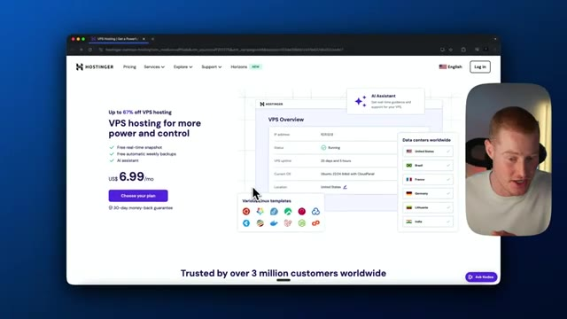
*⏱️ 00:00:52 — Le présentateur présente la page d'accueil d'Hostinger pour le VPS hosting à 6.99$/mois.*

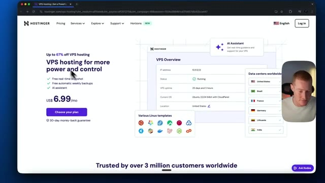
*⏱️ 00:01:02 — Vue similaire sur le site web d'Hostinger montrant les options de VPS et les templates Linux.*

---

### ⏱️ `[00:01:07 - 00:01:27]` | Segment #04

**🔊 Audio (Transcription Intégrale Mot pour Mot en Français) :**
> Cela devrait être plus que suffisant pour nous. Ensuite, je vais simplement cliquer sur 12 mois ici, ce qui a l'air de coûter 8 dollars par mois. Je vais ajouter un code promo ici, qui sera simplement Brock en majuscules. Cela va faire passer notre total de 215 dollars ici à 86 dollars pour toute une année d'hébergement. Ensuite, nous allons passer à l'application. Nous allons sélectionner N8N, puis cliquer sur continuer.

**👁️ Analyse Visuelle d'Écran (gemini-3.5-flash-lite) :**
**Interface & Outils** : Navigateur web affichant la plateforme d'hébergement Hostinger.

**Contenu textuel & Code** : Détails du panier d'achat : plan KVM 2, option 12 mois à 7,99 $/mois, sous-total de 95,88 $ et réduction de 120 $.

**Action / Démonstration** : Sélection de l'abonnement de 12 mois pour le plan d'hébergement.

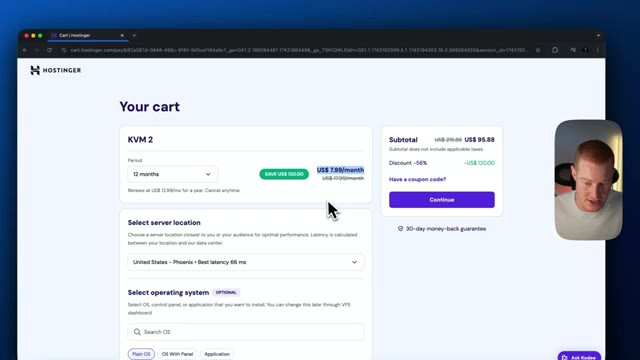
*⏱️ 00:01:12 — Page de paiement Hostinger montrant le panier d'achat avec l'abonnement KVM 2 sélectionné pour 12 mois à 7,99 $/mois.*

---

### ⏱️ `[00:01:27 - 00:02:01]` | Segment #05

**🔊 Audio (Transcription Intégrale Mot pour Mot en Français) :**
> et nous allons veiller à enregistrer notre compte. Ensuite, nous allons évidemment saisir nos informations de facturation ici. Ici, nous allons simplement ajouter les informations de notre carte. Je vais donc ajouter mon nom, j'ajouterais mon numéro ici, puis je cliquerais simplement sur soumettre le paiement. Et ensuite, vous devriez avoir accès à votre compte. Très bien. Une fois que c'est fait, nous obtiendrons ce message ici. On dirait que c'est fait. Je vais cliquer sur gérer le VPS. Comme vous pouvez le voir, voici le plan VPS N8N juste ici. Gestionons notre application. Et cela va nous amener directement à l'interface utilisateur de N8N, mais celle-ci est hébergée sur le cloud Hostinger. Comme vous pouvez le voir ici, nous devons simplement ajouter nos informations. Assurez-vous de vous inscrire avec votre compte si vous en avez déjà un

**👁️ Analyse Visuelle d'Écran (gemini-3.5-flash-lite) :**
**Interface & Outils** : Navigateur web affichant le panneau de paiement et d'administration Hostinger, ainsi que l'interface d'installation de n8n.

**Contenu textuel & Code** : Formulaires de paiement (carte bancaire), informations de connexion SSH, et champs de création de compte propriétaire (email, nom, mot de passe).
[COMPTE_RENDU] Saisie des informations de paiement pour l'hébergement, finalisation de la configuration du VPS et première initialisation de l'application n8n.

**Action / Démonstration** : Explications face caméra et analyse conceptuelle des marchés.

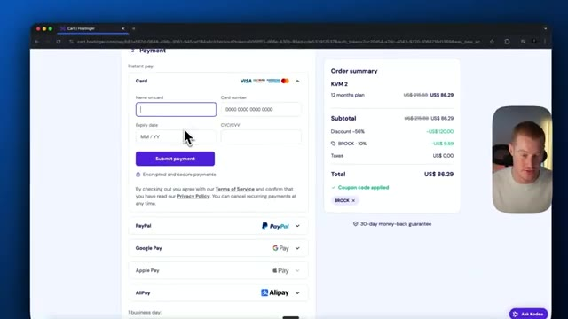
*⏱️ 00:01:35 — Page de paiement Hostinger avec le formulaire de saisie des informations de carte bancaire et le récapitulatif de la commande.*

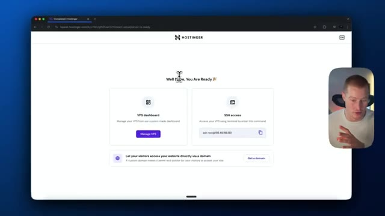
*⏱️ 00:01:44 — Écran de confirmation Hostinger indiquant que le VPS est prêt ("Well Done, You Are Ready") avec les options d'accès SSH et le tableau de bord.*

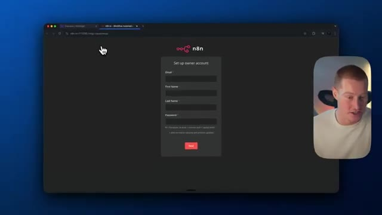
*⏱️ 00:01:52 — Page de configuration du compte administrateur sur l'interface n8n ("Set up owner account").*

---

### ⏱️ `[00:02:01 - 00:02:34]` | Segment #06

**🔊 Audio (Transcription Intégrale Mot pour Mot en Français) :**
> Un. Si vous ne vous inscrivez pas, ce sera vraiment très simple de le faire. Et voilà. Ensuite, ce que nous allons faire, c'est que je vais cliquer sur « Commencer à zéro » où nous allons commencer à créer notre agent IA. Et comme vous pouvez le voir, c'est la plateforme n8n complète maintenant à l'intérieur de Hostinger. Donc maintenant, nous n'avons plus rien à toucher. Tout est prêt à l'emploi. Grâce à Hostinger. Donc une chose formidable avec n8n, c'est que j'ai réellement de superbes modèles. Donc ce que je vais faire, c'est que je vais venir vers ces modèles ici et je vais en sélectionner un qui, selon moi, serait plutôt utile pour un cas d'usage spécifique pour moi-même, puis m'appuyer là-dessus. C'est un modèle plutôt pratique que, je pense, tout le monde pourrait utiliser. Donc, qualifier de nouveaux prospects dans des feuilles de calcul Google via OpenAI.

**👁️ Analyse Visuelle d'Écran (gemini-3.5-flash-lite) :**
**Interface & Outils** : Interface web de la plateforme d'automatisation n8n et navigateur Chrome.

**Contenu textuel & Code** : Espace de travail vide de workflow n8n avec les options d'ajout d'étapes et panneau latéral de navigation.

**Action / Démonstration** : Le présentateur présente l'interface principale vide de n8n pour démarrer la création d'un agent IA à partir de zéro.

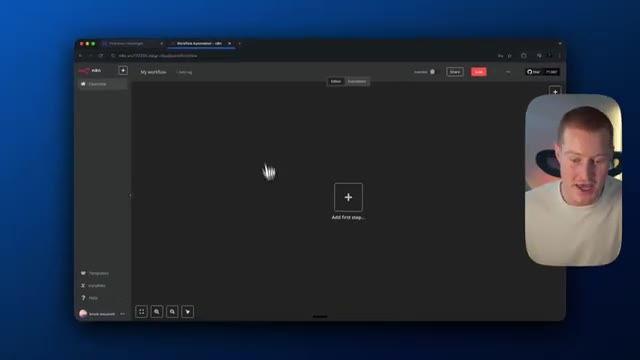
*⏱️ 00:02:09 — Interface principale de l'éditeur n8n affichant un espace de travail vide avec le bouton central « Add first step » et la webcam du présentateur incrustée en bas à droite.*

---

### ⏱️ `[00:02:34 - 00:02:54]` | Segment #07

**🔊 Audio (Transcription Intégrale Mot pour Mot en Français) :**
> ChatDBT4. Alors, utilisons ce modèle gratuit. Je vais essentiellement copier le modèle. Je vais venir ici. Je vais littéralement me contenter de coller dans cette interface utilisateur. Et maintenant, nous avons ce flux de travail prédéfini au sein de notre plateforme N8N. Cependant, nous devons maintenant faire quelques démarches et connecter ces identifiants afin de les relier à nos applications réelles.

**👁️ Analyse Visuelle d'Écran (gemini-3.5-flash-lite) :**
**Interface & Outils** : Navigateur web affichant la plateforme d'automatisation de flux de travail N8N.

**Contenu textuel & Code** : Un canevas de flux de travail avec des blocs textuels et des nœuds d'intégration (Google Sheets, configuration de messages système).

**Action / Démonstration** : Le présentateur importe ou colle un modèle prédéfini de flux de travail dans l'interface N8N pour l'expliquer.

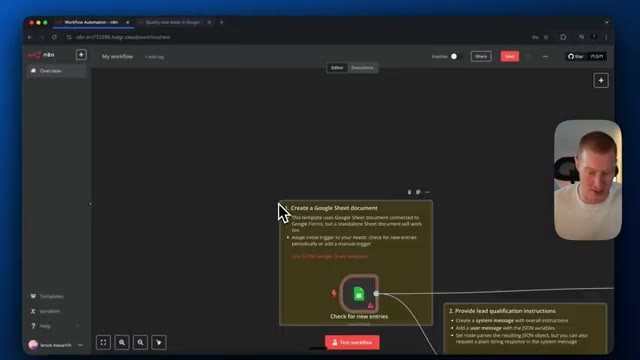
*⏱️ 00:02:39 — Interface du logiciel N8N affichant un flux de travail d'automatisation avec un nœud Google Sheets ("Check for new entries") et une petite incrustation vidéo du présentateur en haut à droite.*

---

### ⏱️ `[00:02:54 - 00:03:29]` | Segment #08

**🔊 Audio (Transcription Intégrale Mot pour Mot en Français) :**
> Très bien les gars, avant que je ne configure réellement ces identifiants, expliquons rapidement ce qu'est cette automatisation et comment fonctionne cette progression. Donc, c'est lorsqu'une nouvelle ligne est ajoutée à une feuille de calcul Google. Donc, essentiellement, nous avons une automatisation existante selon laquelle chaque fois que quelqu'un remplit un formulaire, comme un formulaire de qualification de prospect, cela remplit ensuite une feuille de calcul Google avec ces informations. À partir de là, une fois qu'une nouvelle ligne est ajoutée avec un nouveau prospect, cela passe ensuite à l'étape de chatgpt d'OpenAI, qui va alors réellement prendre ce contenu ici et ensuite effectuer des recherches basées sur cet utilisateur. À partir de là, cela va extraire la réponse au format JSON. Cela va maintenant fusionner et ensuite cela va

**👁️ Analyse Visuelle d'Écran (gemini-3.5-flash-lite) :**
**Interface & Outils** : n8n (éditeur de flux de travail d'automatisation)

**Contenu textuel & Code** : Un diagramme montrant un déclencheur Google Sheets ("Check for new rows"), des nœuds de traitement OpenAI ("Qualify leads with GPT"), un nœud de fusion ("Merge") et une mise à jour de statut ("Update lead status").

**Action / Démonstration** : Le présentateur explique la logique du flux d'automatisation et le parcours des données entre les différents nœuds.

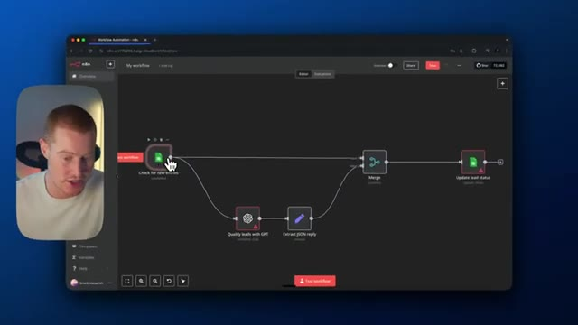
*⏱️ 00:03:03 — Une vue d'ensemble d'un flux de travail d'automatisation sur n8n, avec le présentateur en médaillon à gauche.*

---

### ⏱️ `[00:03:29 - 00:03:47]` | Segment #09

**🔊 Audio (Transcription Intégrale Mot pour Mot en Français) :**
> en fait, remplir ceci avec le statut du prospect ici. Donc ça dira s'il est qualifié, s'il n'est pas qualifié en fonction de la configuration ici à l'intérieur de l'étape chatubit. Très bien. Donc maintenant, nous devons configurer notre authentification. Alors laissez-moi faire ça rapidement. Ne vous inquiétez pas. Je vais vous expliquer cela très simplement. Une fois que c'est configuré, c'est prêt. Alors ne vous inquiétez pas pour ça.

**👁️ Analyse Visuelle d'Écran (gemini-3.5-flash-lite) :**
**Interface & Outils** : Présentation ou face-caméra explicatif du trader sans interface logicielle partagée.

**Contenu textuel & Code** : Explications orales des stratégies et mise en contexte méthodologique du marché.

**Action / Démonstration** : Explications face caméra et analyse conceptuelle des marchés.

---

### ⏱️ `[00:03:48 - 00:04:07]` | Segment #10

**🔊 Audio (Transcription Intégrale Mot pour Mot en Français) :**
> Ce que je vais faire, c'est que je vais venir ici. Je vais cliquer sur créer un nouvel identifiant à l'intérieur de nos Google Sheets. Et à partir d'ici, je vais venir sur Google Cloud Console. Donc, cherchez simplement Google Cloud Console et cela vous mènera ici. Vous allez créer un nouveau projet. Donc, je vais créer un nouveau projet ici. Appelons ça simplement N8N Build. Allez cliquer sur Créer. Et ensuite, vous pouvez voir ici que cela va créer ce projet.

**👁️ Analyse Visuelle d'Écran (gemini-3.5-flash-lite) :**
**Interface & Outils** : n8n, Google Cloud Console (navigateur web)

**Contenu textuel & Code** : URL de redirection OAuth, champs Client ID et Client Secret, paramètres de projet Google Cloud (nom, compte de facturation, emplacement).
[DESC_IMAGE_1] Configuration des identifiants API Google Sheets dans n8n et navigation vers Google Cloud Console.

**Action / Démonstration** : Explications face caméra et analyse conceptuelle des marchés.

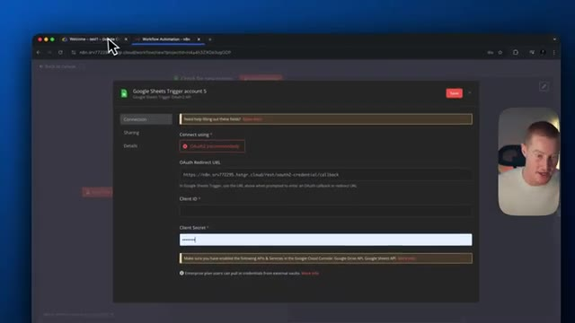
*⏱️ 00:03:52 — Interface n8n montrant la configuration d'un identifiant pour un déclencheur Google Sheets avec les champs Client ID et Client Secret.*

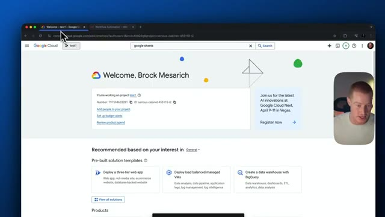
*⏱️ 00:03:57 — Tableau de bord d'accueil de la console Google Cloud affichant le nom du projet et les options de recherche.*

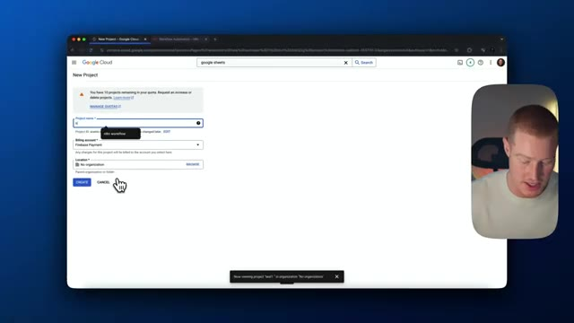
*⏱️ 00:04:02 — Formulaire de création d'un nouveau projet sur la console Google Cloud avec les champs de nom et de localisation.*

---

### ⏱️ `[00:04:07 - 00:04:26]` | Segment #11

**🔊 Audio (Transcription Intégrale Mot pour Mot en Français) :**
> Donc cliquons sur Sélectionner un projet ou vous pouvez venir ici et le sélectionner. À partir d'ici, il y a certaines choses que nous devons configurer. Donc venions-nous en... En fait, tout d'abord, nous allons chercher l'API Google Drive. Nous devons l'activer. Donc j'ai oublié de faire cela et j'essayais de comprendre quel était le problème. Et c'était à cause de ça, je ne l'avais pas activée. Donc activons notre API Google Drive.

**👁️ Analyse Visuelle d'Écran (gemini-3.5-flash-lite) :**
**Interface & Outils** : Console Google Cloud Web Interface.

**Contenu textuel & Code** : Page d'accueil Google Cloud, barre de recherche, interface de gestion des API et services.

**Action / Démonstration** : Navigation et recherche de l'API Google Drive dans la console Google Cloud pour l'activer.

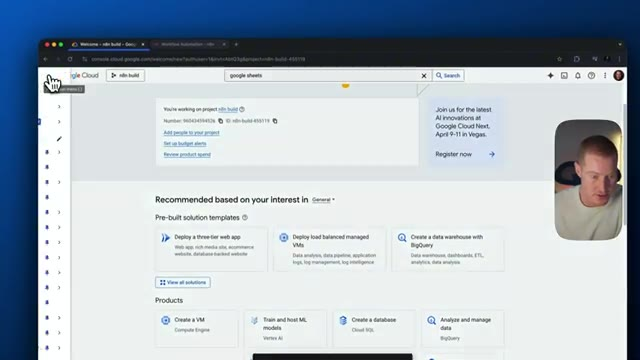
*⏱️ 00:04:12 — Image #1 montrant le tableau de bord Google Cloud Console avec la barre de recherche et un terme saisi.*

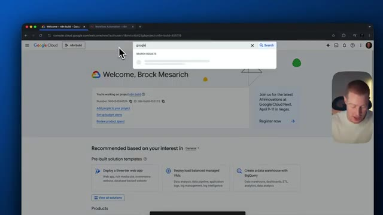
*⏱️ 00:04:16 — Image #2 montrant la barre de recherche en cours d'utilisation dans la console Google Cloud.*

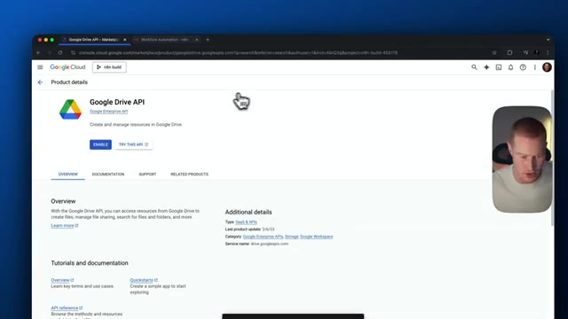
*⏱️ 00:04:21 — Image #3 montrant la page de détails du produit Google Drive API avec le bouton "Enable".*

---

### ⏱️ `[00:04:26 - 00:04:58]` | Segment #12

**🔊 Audio (Transcription Intégrale Mot pour Mot en Français) :**
> Assez simple. Ça devrait être bon. Ensuite, nous allons activer notre API Google Sheets. Donc, cela vous permet d'accéder à l'API de Google Sheets, évidemment. Revenons maintenant. Et ensuite, nous allons aller dans API et services. Allons à l'écran de consentement OAuth. Cliquez sur "commencer" ici, et donnons un nom à notre application, puis ajoutons notre e-mail de support, donc n'importe quel e-mail que vous utilisez. Nous allons cliquer sur "externe" pour notre audience et, encore une fois, ajoutons un autre e-mail ici et acceptons, continuons, cliquez sur créer. Tout a l'air bien jusqu'à présent. Ensuite, nous devons en fait ajouter un

**👁️ Analyse Visuelle d'Écran (gemini-3.5-flash-lite) :**
**Interface & Outils** : Console Google Cloud, navigateur web.

**Contenu textuel & Code** : Page de l'API Google Sheets et formulaires de configuration de l'écran de consentement OAuth (App Information, Contact Information).

**Action / Démonstration** : Navigation vers l'API Google Sheets et configuration de l'écran de consentement OAuth sur Google Cloud.

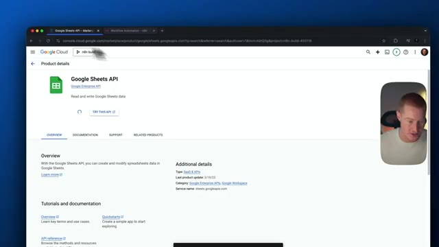
*⏱️ 00:04:34 — Vue de la console Google Cloud affichant la page de détails de l'API Google Sheets.*

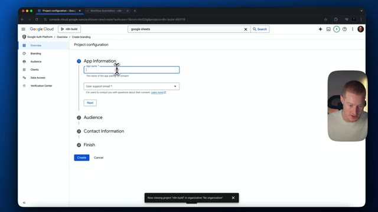
*⏱️ 00:04:42 — Écran de configuration du projet Google Cloud montrant le formulaire de nom d'application pour l'écran de consentement OAuth.*

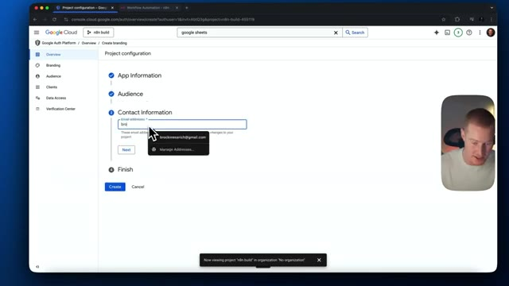
*⏱️ 00:04:50 — Écran de configuration de l'écran de consentement OAuth montrant le champ de saisie des informations de contact.*

---

### ⏱️ `[00:04:58 - 00:05:30]` | Segment #13

**🔊 Audio (Transcription Intégrale Mot pour Mot en Français) :**
> testeur afin d'accéder à ceci et de modifier donc venez ici cliquez sur audience nous allons ajouter un testeur ou en fait nous devons d'abord configurer un identifiant client donc cliquez sur type d'application client. Allons-y application web, donnez-lui un nom. Et ajoutons maintenant une URL de redirection autorisée. Et ceci est à l'intérieur de notre flux de travail N8N à l'intérieur de Hostinger où il est hébergé. Nous allons fondamentalement coller cela là puis cliquer sur créer. Ensuite, nous allons être invités à fournir notre identifiant client et notre secret client. Donc collez votre identifiant client dans nos identifiants Google N8N ici.

**👁️ Analyse Visuelle d'Écran (gemini-3.5-flash-lite) :**
**Interface & Outils** : Google Cloud Console (Google Auth Platform)

**Contenu textuel & Code** : Configuration d'un identifiant client OAuth 2.0 (Application type: Web application, Name, Authorized redirect URIs)

**Action / Démonstration** : Le présentateur clique sur le bouton de création de client puis configure les paramètres de l'application web et les URL de redirection.

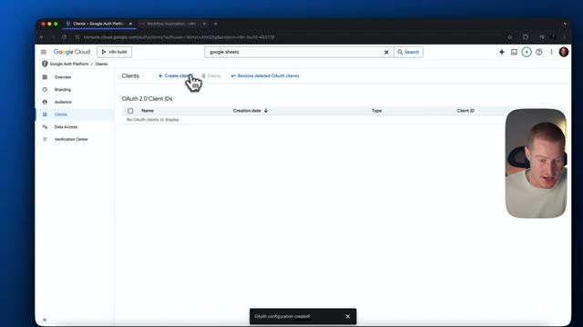
*⏱️ 00:05:06 — Vue de la console Google Cloud montrant la section des clients OAuth 2.0 avec le curseur sur le bouton "+ Create client".*

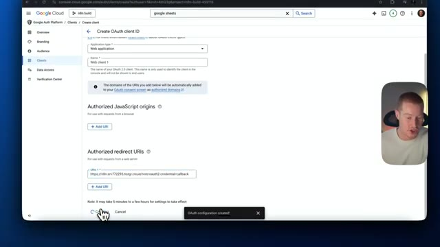
*⏱️ 00:05:22 — Formulaire de création d'un identifiant client OAuth dans Google Cloud, avec les champs pour le type d'application, le nom et les URI de redirection autorisées.*

---

### ⏱️ `[00:05:30 - 00:06:02]` | Segment #14

**🔊 Audio (Transcription Intégrale Mot pour Mot en Français) :**
> Faites de même pour votre secret. C'est bon. Nous pourrions cliquer sur enregistrer. Ensuite, ce que nous voulons faire, c'est cliquer sur se connecter avec Google. En fait, ce que nous allons faire, c'est venir dans audience, nous devons ajouter un utilisateur test. Je vais donc venir ici. Je vais ajouter une adresse e-mail pour mon compte NNN. Voilà. Je vais maintenant me connecter avec Google. Je vais me connecter avec ce compte ici. Cliquez sur continuer. Et nous devons sélectionner l'accès à tout cela. Pour que NNN puisse y avoir accès. Et maintenant, il est indiqué que notre connexion a réussi. Maintenant, nous devons tester cela et voir si cela fonctionne réellement. Ce que je vais faire, c'est donc cliquer sur le document.

**👁️ Analyse Visuelle d'Écran (gemini-3.5-flash-lite) :**
**Interface & Outils** : Google Cloud Console (Google Auth Platform), n8n.

**Contenu textuel & Code** : OAuth 2.0 Client IDs, identifiant Client ID, redirection OAuth, permissions d'accès Google Drive / Sheets, adresse email de test utilisateur.

**Action / Démonstration** : Ajout d'un utilisateur de test dans la console Google Cloud et validation du processus d'authentification OAuth 2.0 ("Sign in with Google") pour l'intégration dans n8n.

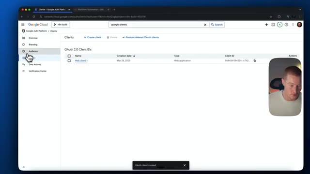
*⏱️ 00:05:38 — Console Google Cloud dans la section Google Auth Platform affichant l'identifiant Client OAuth 2.0 "Web client 1" créé.*

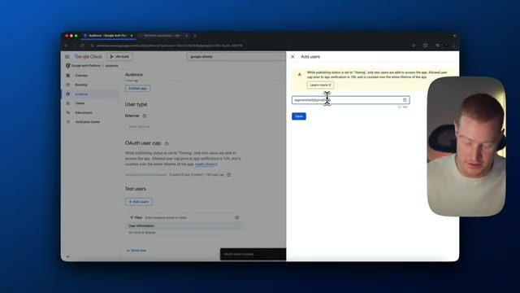
*⏱️ 00:05:46 — Interface Google Cloud Console dans le menu Audience, avec le panneau latéral "Add users" permettant de saisir une adresse email de test.*

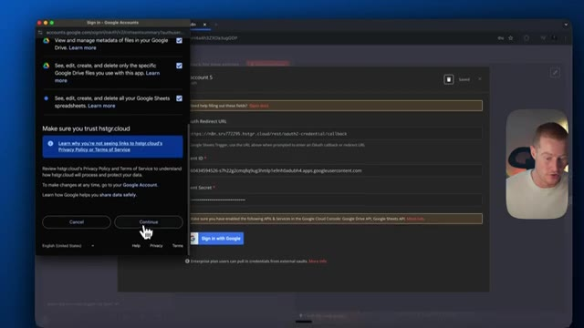
*⏱️ 00:05:54 — Pop-up d'autorisation Google OAuth pour accorder les accès Google Drive et Google Sheets à l'application n8n.*

---

### ⏱️ `[00:06:02 - 00:06:34]` | Segment #15

**🔊 Audio (Transcription Intégrale Mot pour Mot en Français) :**
> here and it should now populate our Google spreadsheets we have. So that is fantastic. You can see I created a spreadsheet called Google Sheets. And let me show you this exact Google Sheet I am talking about. So we titled this leads. And this is essentially just a leads list here that has been auto populated from when people sign up, fill out a Google form with the name, email, business area, size of the team. So we're now going to qualify these leads here with this next step in Chachaviti. And then we will be pasting that back into our Google Sheets here.

**👁️ Analyse Visuelle d'Écran (gemini-3.5-flash-lite) :**
**Interface & Outils** : Google Sheets, navigateur web (Chrome)

**Contenu textuel & Code** : Tableau de données "Table1" contenant des colonnes Name, Email, Business area, et Size of the team, avec des exemples fictifs de prospects.

**Action / Démonstration** : Présentation et explication du contenu de la feuille de calcul remplie automatiquement par le workflow.

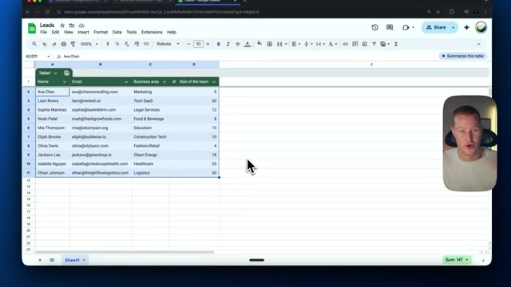
*⏱️ 00:06:18 — Feuille de calcul Google Sheets intitulée "Leads" montrant un tableau rempli de données de prospects (noms, e-mails, secteurs d'activité, taille d'équipe).*

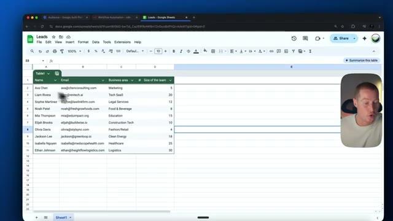
*⏱️ 00:06:26 — Vue rapprochée de la même feuille Google Sheets "Leads" avec un curseur survolant les données.*

---

### ⏱️ `[00:06:34 - 00:06:53]` | Segment #16

**🔊 Audio (Transcription Intégrale Mot pour Mot en Français) :**
> Donc passons maintenant à l'étape ChatGPT. Je vais double-cliquer ici. Nous devons ajouter nos identifiants ici, ce qui est simple. Nous devons juste récupérer notre clé API d'OpenAI. Donc laissez-moi faire ça. Je vais venir faire, en fait juste chercher ChatGPT ou chercher l'API OpenAI. Venez ici et vous devriez pouvoir trouver ceci sur cette page ici si vous cliquez sur la référence de l'API.

**👁️ Analyse Visuelle d'Écran (gemini-3.5-flash-lite) :**
**Interface & Outils** : Navigateur web Chrome et interface d'automatisation de type workflow (n8n).

**Contenu textuel & Code** : Champs de configuration pour un compte OpenAI, notamment 'API Key', 'Organization ID' et 'Base URL'.

**Action / Démonstration** : Saisie des identifiants et recherche web pour trouver l'API OpenAI.

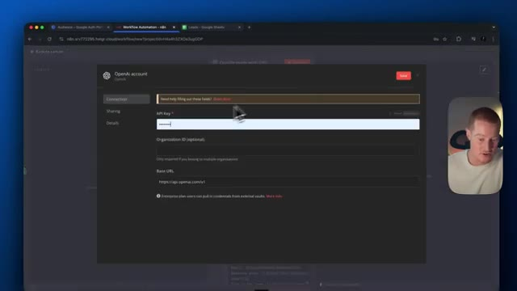
*⏱️ 00:06:39 — Interface de configuration d'un nœud d'automatisation demandant la saisie d'une clé API OpenAI.*

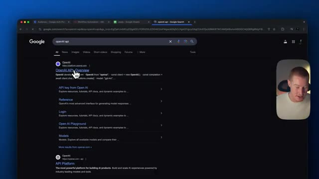
*⏱️ 00:06:48 — Page de résultats de recherche Google pour la requête 'openai api' montrant les liens vers la plateforme OpenAI.*

---

### ⏱️ `[00:06:53 - 00:07:26]` | Segment #17

**🔊 Audio (Transcription Intégrale Mot pour Mot en Français) :**
> Donc, laissez-moi coller le mien maintenant. Évidemment, ne montrez votre clé API à personne. Collons-la ici, enregistrons. Et donc maintenant, elle devrait avoir accès à notre ChatGPT pour que nous puissions commencer à utiliser cette étape. Et puisque nous avons collé ce modèle, nous avons déjà ce contenu ici, qui est essentiellement notre invite pour ChatDBT. Nous pouvons donc utiliser n'importe quel ChatDBT que nous voulons, ChatDBT4, ChatDBT4O, celui que nous voulons. Mais prenons simplement ChatDBT pour ce cas d'utilisation spécifique ici. Et en gros, nous devons configurer un tout petit peu d'information ici. Donc voici les informations d'Elite. Et cela va être collé dans ChatDBT. De cette façon, nous obtenons un

**👁️ Analyse Visuelle d'Écran (gemini-3.5-flash-lite) :**
**Interface & Outils** : Interface web d'automatisation (n8n ou similaire), navigateur web avec onglets, et incrustation vidéo du présentateur en bas à droite.

**Contenu textuel & Code** : Paramètres de configuration du nœud GPT : modèle sélectionné (gpt-4-turbo-preview), champs de prompt avec les rôles "System" et "User", et notification de succès de création d'identifiants.

**Action / Démonstration** : Le présentateur configure les paramètres d'un nœud d'automatisation pour intégrer le modèle d'intelligence artificielle OpenAI.

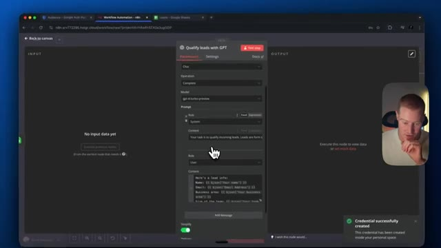
*⏱️ 00:07:01 — Interface d'un outil d'automatisation de flux de travail montrant la configuration d'une étape d'IA pour qualifier des leads avec GPT.*

---

### ⏱️ `[00:07:26 - 00:08:02]` | Segment #18

**🔊 Audio (Transcription Intégrale Mot pour Mot en Français) :**
> réponse spécifique. Donc nous avons ajouté le nom. Cependant, nous devons supprimer toutes ces étapes ici parce que c'est des données fictives. Voilà. Ensuite, ce que nous devons faire, c'est en fait, j'ai oublié que nous devons revenir à notre étape Google Sheets. Nous devons cliquer ici pour notre temps. Faisons toutes les heures. Donc ça va interroger cette feuille toutes les heures. Et ce que nous devons faire maintenant, nous devons cliquer sur quelle feuille et cliquons sur récupérer l'événement de test. Et ça devrait maintenant extraire cette information de la feuille Google. Donc vous pouvez voir que c'est rempli à partir d'ici. C'est tout à fait prêt. Et nous pouvons maintenant revenir à notre étape OpenAI. Nous devons maintenant, ou vous pouvez voir que l'entrée de nos étapes précédentes est ici maintenant. Donc allons

**👁️ Analyse Visuelle d'Écran (gemini-3.5-flash-lite) :**
**Interface & Outils** : Navigateur web, outil d'automatisation de workflow (n8n), Google Sheets, webcam du présentateur.

**Contenu textuel & Code** : Paramètres d'un nœud GPT avec des champs de prompt (System et User), tableau de données Google Sheets avec des entrées fictives (Ava Chen, Liam Rivera, etc.).

**Action / Démonstration** : Suppression d'étapes contenant des données fictives dans le workflow, puis navigation vers l'étape Google Sheets pour configurer la source de données.

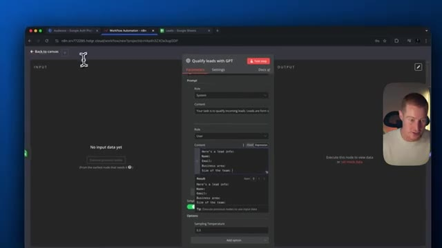
*⏱️ 00:07:35 — Interface d'un outil d'automatisation de workflow affichant le panneau de configuration du nœud 'Qualify leads with GPT'.*

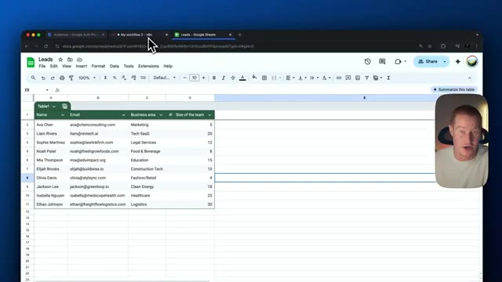
*⏱️ 00:07:53 — Feuille de calcul Google Sheets intitulée 'Leads' montrant un tableau avec des données fictives de prospects (nom, e-mail, domaine d'activité, taille de l'équipe).*

---

### ⏱️ `[00:08:02 - 00:08:35]` | Segment #19

**🔊 Audio (Transcription Intégrale Mot pour Mot en Français) :**
> remplir ceci avec cette information. Donc je vais glisser et déposer ce nom JSON dynamique, ainsi que le domaine d'activité de l'e-mail, et ensuite la taille de l'équipe. Tout est prêt. Ensuite, tout ce que nous avons à faire est en fait de cliquer sur l'étape de test et cela devrait nous donner un résultat ici. Le voilà donc. Voici un message ici. Il donne donc notre explication de notation ici. Il est donc qualifié. Voici l'explication : le lead Eva Chen remplit le critère principal d'être un décideur, donc comme vous pouvez le voir ici, c'est le prompt que nous lui avons donné, vous pouvez donc le spécifier comme vous voulez afin de pouvoir

**👁️ Analyse Visuelle d'Écran (gemini-3.5-flash-lite) :**
**Interface & Outils** : Interface du logiciel d'automatisation n8n, navigateur web affichant un workflow de qualification de leads.

**Contenu textuel & Code** : Nœud de configuration "Qualify leads with GPT", modèle gpt-4-turbo-preview, prompt structuré avec des variables dynamiques ($json.Name, $json.Email, $json.Business area, $json.Size of the team) et résultats JSON de sortie ("qualified", explications).

**Action / Démonstration** : Configuration et test d'un nœud d'IA dans un workflow d'automatisation n8n, puis examen des données de sortie générées.

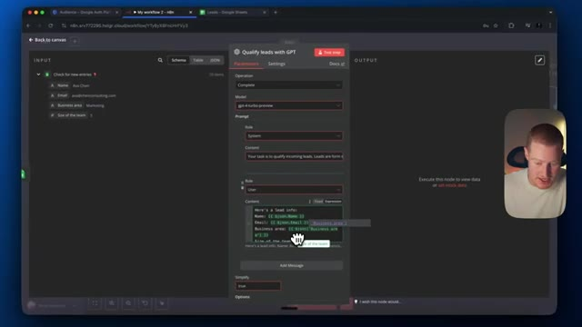
*⏱️ 00:08:10 — Configuration d'un nœud d'automatisation n8n pour qualifier des leads avec GPT, montrant le prompt utilisateur avec des variables JSON dynamiques.*

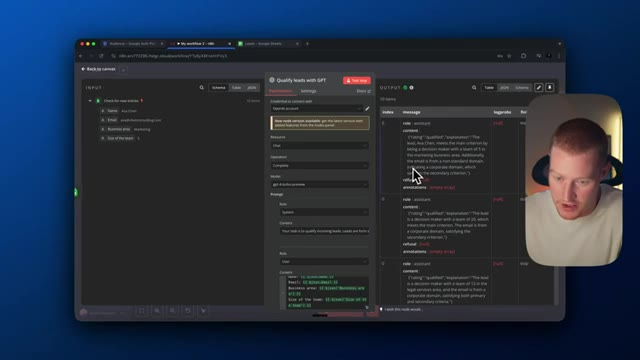
*⏱️ 00:08:18 — Exécution du test du nœud n8n, affichant les résultats JSON de sortie dans le volet droit de l'interface.*

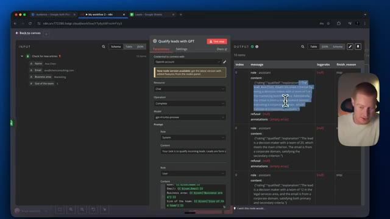
*⏱️ 00:08:26 — Sélection du texte de sortie dans le panneau des résultats pour examiner l'analyse de qualification du lead par l'IA.*

---

### ⏱️ `[00:08:35 - 00:09:09]` | Segment #20

**🔊 Audio (Transcription Intégrale Mot pour Mot en Français) :**
> décidez de ce qu'est un prospect qualifié, cependant voici ce que j'ai utilisé pour cela, vous pouvez modifier ceci donc votre tâche est de qualifier les prospects entrants, les prospects sont des soumissions de formulaires à un groupe de communauté fermé, utilisez les critères suivants pour un prospect de qualité, donc s'ils remplissent ces deux conditions ici, cela signifie qu'ils sont qualifiés. Donc c'est bon. Encore une fois, vous pouvez changer cela pour ce que vous voulez pour votre cas d'utilisation spécifique. Cependant, maintenant nous avons cette information. Nous devons maintenant coller cette information dans notre feuille Google Sheet. Ensuite, nous devons extraire la réponse JSON. Testons donc cette étape. Cela a fonctionné. Voici la réponse ici. Ensuite, nous devons les fusionner, ce que nous ne

**👁️ Analyse Visuelle d'Écran (gemini-3.5-flash-lite) :**
**Interface & Outils** : Interface web d'automatisation de type workflow (n8n ou similaire) avec une fenêtre modale d'édition de contenu.

**Contenu textuel & Code** : Texte de prompt détaillant les critères de qualification des leads ("Your task is to qualify incoming leads...").

**Action / Démonstration** : Le présentateur met en surbrillance et lit le texte du prompt définissant les critères de qualification des prospects.

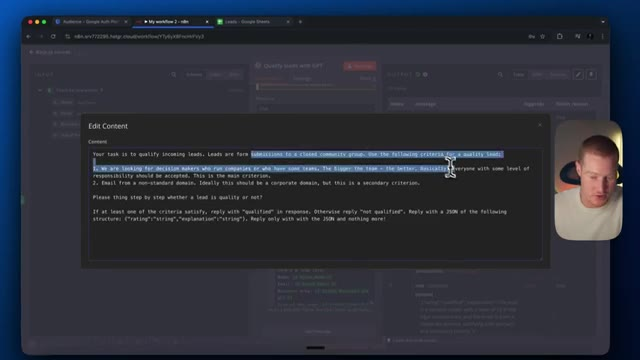
*⏱️ 00:08:43 — Interface d'automatisation montrant une fenêtre contextuelle "Edit Content" avec un prompt définissant les critères de qualification des prospects.*

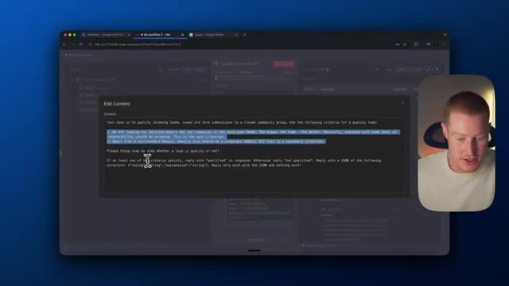
*⏱️ 00:08:52 — Vue similaire avec le curseur soulignant une partie du texte du prompt dans l'interface d'automatisation.*

---

### ⏱️ `[00:09:09 - 00:09:44]` | Segment #21

**🔊 Audio (Transcription Intégrale Mot pour Mot en Français) :**
> Il faut toucher ça en fait. Donc ensuite, nous devons en fait créer nos identifiants à nouveau. Donc essentiellement, copier les informations de l'étape précédente en fait. Donc, ou nous pourremmo en fait revenir dans notre Google Cloud. Donc je vais venir ici. Je vais aller sur client. Je vais cliquer sur notre nom ici. Donc copions l'ID client ainsi que notre secret client. Sauvegardons-le. Très bien, nous devons juste nous connecter avec notre compte ici comme avant. Cliquer sur continuer. Autoriser cela. Donc la connexion devrait réussir maintenant. Et nous voulons nous assurer de tester nos étapes précédentes afin de pouvoir obtenir ces informations ici à partir de la fusion. Donc une fois que nous sommes ici, il y a quelques petites choses que nous devons faire. Donc nous devons en fait faire correspondre quelques champs. Tout d'abord, nous devons sélectionner notre document. Donc

**👁️ Analyse Visuelle d'Écran (gemini-3.5-flash-lite) :**
**Interface & Outils** : Présentation ou face-caméra explicatif du trader sans interface logicielle partagée.

**Contenu textuel & Code** : Explications orales des stratégies et mise en contexte méthodologique du marché.

**Action / Démonstration** : Explications face caméra et analyse conceptuelle des marchés.

---

### ⏱️ `[00:09:44 - 00:10:06]` | Segment #22

**🔊 Audio (Transcription Intégrale Mot pour Mot en Français) :**
> Donc je vais cliquer sur les leads, qui est ce, évidemment ce tableur ici que nous voulons remplir avec la réponse. Cliquez sur la feuille, qui est la feuille un. Nous voulons cliquer sur "associer automatiquement". Et puis pour ceci, nous voulons aller à taille de votre équipe. Et puis testons cette étape. Et voilà. Voici la réponse ici. Et donc c'est la réponse avec la qualification des leads que l'étape ChatGPT a réellement effectuée.

**👁️ Analyse Visuelle d'Écran (gemini-3.5-flash-lite) :**
**Interface & Outils** : Navigateur web affichant l'interface de l'outil d'automatisation n8n et la webcam du présentateur.

**Contenu textuel & Code** : Configuration du nœud n8n : Document "Leads", Feuille "Sheet1", mode de correspondance "Map Automatically" et colonne "Your team size".

**Action / Démonstration** : Configuration et paramétrage d'un nœud d'automatisation pour mapper les données d'un lead vers un tableur Google Sheets.

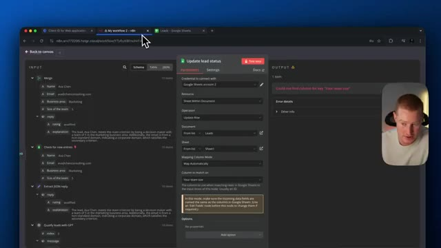
*⏱️ 00:09:50 — Capture d'écran montrant l'interface du logiciel n8n avec un nœud "Update lead status" configuré pour interagir avec Google Sheets.*

---

### ⏱️ `[00:10:06 - 00:10:27]` | Segment #23

**🔊 Audio (Transcription Intégrale Mot pour Mot en Français) :**
> Et donc cela devrait maintenant être rempli ici. Vous pouvez donc voir qu'il y a cette réponse. Ce n'est pas formidable. Ça n'a pas l'air parfait. Mais cependant, nous avons maintenant une explication qualifiée de nos prospects ici. Ainsi, le prospect Ava Chen répond au critère principal en étant une décisionnaire avec une équipe de cinq personnes sur son marché. De plus, l'e-mail provient d'un domaine non standard indiquant un domaine d'entreprise, ce qui satisfait au deuxième critère.

**👁️ Analyse Visuelle d'Écran (gemini-3.5-flash-lite) :**
**Interface & Outils** : Présentation ou face-caméra explicatif du trader sans interface logicielle partagée.

**Contenu textuel & Code** : Explications orales des stratégies et mise en contexte méthodologique du marché.

**Action / Démonstration** : Explications face caméra et analyse conceptuelle des marchés.

---

### ⏱️ `[00:10:27 - 00:10:46]` | Segment #24

**🔊 Audio (Transcription Intégrale Mot pour Mot en Français) :**
> Et voilà. Nous avons créé un agent dans N8N qui va maintenant qualifier automatiquement nos prospects qui s'inscrivent réellement à un formulaire et sont ajoutés à une feuille de calcul Google. C'est donc chose faite. De plus, nous avons maintenant hébergé ceci sur Hostinger, ce qui rend les choses vraiment faciles à faire. J'espère donc que vous avez apprécié. Assurez-vous de vous abonner à la chaîne si vous aimez cette vidéo. Je vous retrouve dans la prochaine.

**👁️ Analyse Visuelle d'Écran (gemini-3.5-flash-lite) :**
**Interface & Outils** : N8N (interface de workflow d'automatisation)

**Contenu textuel & Code** : Paramètres de configuration du nœud 'Update lead status' connectant Google Sheets (sélection de document, opération de mise à jour de ligne, correspondance des colonnes).

**Action / Démonstration** : Présentation du workflow d'automatisation et explication de la qualification automatique des prospects.

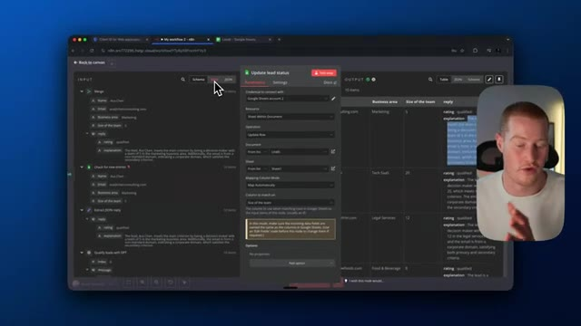
*⏱️ 00:10:32 — Capture d'écran montrant l'interface du logiciel N8N avec un panneau de configuration ouvert pour la mise à jour du statut des prospects, ainsi que le présentateur visible dans un encart en incrustation.*

---

