# 🎬 Zapier MCP Connects Claude to 8,000 Apps (INSTANTLY)

> **Chaîne** : [Brock Mesarich | AI for Non Techies](https://www.youtube.com/@BrockMesarich)  
> **Lien YouTube** : [https://www.youtube.com/watch?v=80nvFVMiJqk](https://www.youtube.com/watch?v=80nvFVMiJqk)  
> **Date de publication** : 20250403  
> **Durée** : 00:10:35  
> **Identifiant vidéo** : `80nvFVMiJqk`  
> **Transcription & Analyse** : `whisper-v3-large-turbo+gemini-3.5-flash-lite`  

---

## 📌 Synthèse Exécutive & Outils

### 💡 Résumé
Dans cette vidéo intitulée **Zapier MCP connecte Claude à 8 000 applications (INSTANTANÉMENT)**, Alex Carter détaille une approche stratégique et pratique du trading et de l'automatisation par agents IA.

### 🛠️ Outils, Modèles & Logiciels Présentés
- **TradingView & Claude Code** : Analyse technique avancée et automatisation algorithmique.

### 🔑 Points Clés & Enseignements Stratégiques
- Respect rigoureux du ratio risque/rendement et du money management.
- Automatisation méthodique des déclencheurs d'ordres via des agents intelligents.

---

## ⏱️ Chronologie & Transcription Complète Audio & Visuelle (Mot pour Mot)

### ⏱️ `[00:00:00 - 00:00:19]` | Segment #01

**🔊 Audio (Transcription Intégrale Mot pour Mot en Français) :**
> Dans cette vidéo, je vais vous montrer comment connecter instantanément Claude à 30 000 automatisations. Voici une rapide démonstration de 15 secondes de ce que je veux dire. Avant de les rejoindre réellement. Et pourriez-vous envoyer toutes ces informations à mon adresse e-mail ? Très bien, c'est parti. Et il va maintenant commencer à envoyer notre e-mail. Indiquez-moi la date pour cette réunion, mais j'ai maintenant reçu un e-mail.

**👁️ Analyse Visuelle d'Écran (gemini-3.5-flash-lite) :**
**Interface & Outils** : Interface de type application web ou bureau (Claude / assistant IA).

**Contenu textuel & Code** : Texte d'accueil personnalisé ("Good evening, brock"), champ de saisie de texte et compte à rebours incrusté en bas ("demo ends in: 13 sec").

**Action / Démonstration** : Présentation de l'interface utilisateur de l'outil d'IA dans le cadre d'une démonstration en direct.

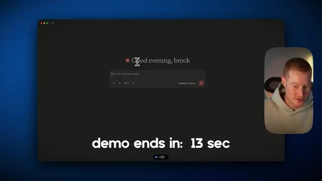
*⏱️ 00:00:09 — Capture d'écran montrant l'interface sombre d'une application (semblable à Claude) avec le texte "Good evening, brock" et un compte à rebours indiquant "demo ends in: 13 sec".*

---

### ⏱️ `[00:00:19 - 00:00:43]` | Segment #02

**🔊 Audio (Transcription Intégrale Mot pour Mot en Français) :**
> Alors, laissez-moi vérifier ça. Très bien, voici donc la réponse, comme vous pouvez le voir. À la fin de cette vidéo, vous aurez configuré Claude pour qu'il puisse exécuter des actions en votre nom au lieu d'être un simple chatbot amélioré. De plus, ne vous inquiétez pas si vous n'avez pas de compétences techniques. Je vais tout décomposer pour que littéralement n'importe qui puisse le faire. Bon, assez bavardé. Entrons dans le vif du sujet. Très bien, les amis. Je suis donc maintenant dans Claude Desktop. Et comme vous pouvez le voir juste ici, il y a un accès à 17 outils MCP différents que je vais vous montrer comment configurer plus tard dans cette vidéo.

**👁️ Analyse Visuelle d'Écran (gemini-3.5-flash-lite) :**
**Interface & Outils** : Interface de l'application de bureau ou web de l'assistant IA Claude.

**Contenu textuel & Code** : Message de salutation personnalisé, barre de saisie de prompt (« How can I help you today? ») et sélection du modèle (Claude 3.7 Sonnet).

**Action / Démonstration** : Présentation de l'interface principale de l'assistant Claude par le créateur.

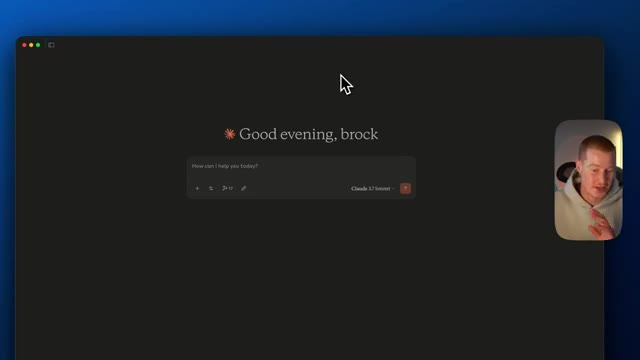
*⏱️ 00:00:37 — Interface de l'application Claude sur fond sombre affichant un message de bienvenue personnalisé (« Good evening, brock ») et une zone de saisie avec le modèle Claude 3.7 Sonnet, ainsi qu'une incrustation vidéo du présentateur en bas à droite.*

---

### ⏱️ `[00:00:43 - 00:01:18]` | Segment #03

**🔊 Audio (Transcription Intégrale Mot pour Mot en Français) :**
> Extrêmement facile à faire. Cependant, je vais juste venir ici et lui demander d'effectuer quelques actions pour moi. Alors, laissez-moi parler avec Claude dès maintenant. Peux-tu s'il te plaît vérifier mon agenda pour lundi et voir si j'ai des réunions ? Ainsi que peux-tu me donner des informations sur tous les participants à ma réunion afin que je puisse être à jour avant de les rejoindre réellement, et pourrais-tu envoyer toutes ces informations à mon adresse e-mail brockmesserich arobase gmail.com en me mettant à jour sur les événements de mon agenda ainsi que des résumés des personnes qui assisteront à la réunion ? Très bien, voilà. Aussi, cet outil que je viens d'utiliser juste là

**👁️ Analyse Visuelle d'Écran (gemini-3.5-flash-lite) :**
**Interface & Outils** : Application de bureau Claude (IA)

**Contenu textuel & Code** : Texte de bienvenue « Good evening, brock » et champ de saisie de texte « How can I help you today? » au centre de l'interface sombre.
[DESC_IMAGE_1] Interaction vocale en cours avec l'assistant Claude pour lui demander de vérifier l'agenda.

**Action / Démonstration** : Explications face caméra et analyse conceptuelle des marchés.

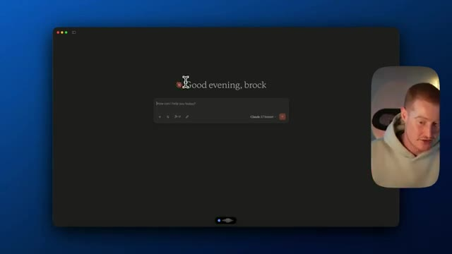
*⏱️ 00:00:52 — Interface de l'application Claude affichant un écran d'accueil avec le message de salutation 'Good evening, brock' et une zone de saisie pour interagir avec l'assistant IA, tandis que le présentateur apparaît dans une vignette vidéo incrustée.*

---

### ⏱️ `[00:01:18 - 00:01:54]` | Segment #04

**🔊 Audio (Transcription Intégrale Mot pour Mot en Français) :**
> s'appelle Aqua Voice, c'est un outil formidable. J'appuie littéralement sur une touche de mon clavier et je parle à mon ordinateur au lieu de taper. Ça me fait gagner tellement de temps. Donc voilà une petite astuce pour vous. Ensuite, je vais simplement cliquer sur envoyer et cela va commencer à exécuter ces actions. Je dois donc autoriser cet outil. Vous pouvez voir exécuter Google Agenda, trouver un événement. Je vais simplement cliquer sur autoriser et il va procéder étape par étape et utiliser ces outils auxquels je lui ai donné accès. Il semble donc qu'il ait effectivement trouvé cet événement. Ensuite, il a appelé cet autre outil et il est en train de faire des recherches sur moi. Je vais cliquer sur autoriser et il va maintenant commencer à envoyer notre e-mail. Laissons-lui une seconde et je devrais le recevoir très prochainement. Très bien,

**👁️ Analyse Visuelle d'Écran (gemini-3.5-flash-lite) :**
**Interface & Outils** : Application de type assistant IA / interface de chat avec un modèle de langage (Claude).

**Contenu textuel & Code** : Texte transcrit de la requête vocale concernant la vérification d'un calendrier et l'envoi d'e-mails, ainsi qu'une invite de sécurité demandant l'autorisation d'utiliser l'outil local « zapier-mcp ».

**Action / Démonstration** : Le présentateur valide une demande d'autorisation d'outil pour permettre à l'IA d'interagir avec des services tiers (Zapier/MCP).

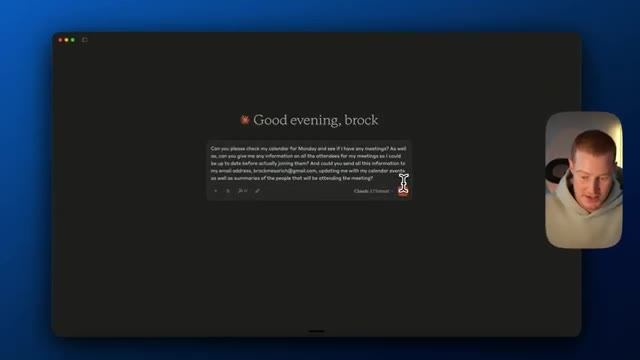
*⏱️ 00:01:27 — Vue d'une interface sombre avec le message de salutation « Good evening, brock » et une boîte de dialogue contenant un long texte dicté vocalement.*

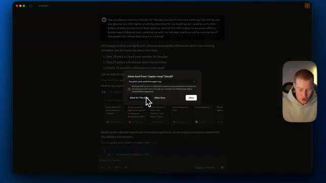
*⏱️ 00:01:45 — L'interface affiche une réponse en cours de génération avec une fenêtre contextuelle de demande d'autorisation pour un outil externe (« zapier-mcp »).*

---

### ⏱️ `[00:01:54 - 00:02:27]` | Segment #05

**🔊 Audio (Transcription Intégrale Mot pour Mot en Français) :**
> Donc, non seulement Claude m'a tenu informé de cette réunion, mais je viens de recevoir un e-mail. Je vais donc aller vérifier ça. D'accord, voici donc la réponse. Vous pouvez voir qu'elle inclut un résumé de notre prochaine réunion de lundi. Elle parle donc de la date, de l'heure, du titre, du lieu, c'est-à-dire du lien vers notre Google Meet, et elle a également fait des recherches sur moi. J'ai évidemment pu me rendre compte qu'elle faisait des recherches sur moi-même. Cependant, je dis juste ça pour l'expliquer dans cette vidéo. Je ne voulais pas utiliser l'une des vraies personnes présentes dans mon agenda. Elle a donc fourni de très bonnes informations de contexte ici. Mais les gars, j'ai obtenu ce résultat simplement en parlant avec Claude Desktop.

**👁️ Analyse Visuelle d'Écran (gemini-3.5-flash-lite) :**
**Interface & Outils** : Interface web de Gmail (Google Mail).

**Contenu textuel & Code** : Un e-mail intitulé "Monday Meeting Summary and Attendee Information" contenant les détails de la réunion (date, heure, titre, lieu) et des informations sur les participants.

**Action / Démonstration** : Le présentateur consulte sa boîte de réception et lit l'e-mail envoyé par l'assistant IA.

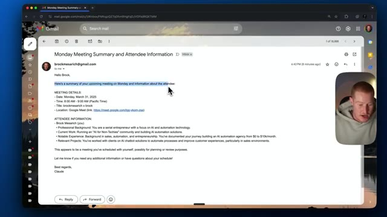
*⏱️ 00:02:02 — Capture d'écran montrant l'interface de Gmail avec un e-mail reçu de Claude résumant une réunion de lundi, avec le présentateur visible en vignette vidéo.*

---

### ⏱️ `[00:02:27 - 00:02:58]` | Segment #06

**🔊 Audio (Transcription Intégrale Mot pour Mot en Français) :**
> Je lui ai demandé de faire des recherches là-dessus, et c'est ce qu'il a fait. Il m'a envoyé un e-mail. Comme ça, vous pouvez voir qu'il a des actions pour exécuter réellement certaines tâches, au lieu d'être simplement un chatbot. Tout comme avant, nous ne pouvions demander aucune information concernant notre calendrier parce que nous devions lui donner l'accès pour qu'il puisse le voir. C'est ce que ces serveurs MCP vous permettent de faire. Je vais vous montrer d'autres cas d'usage que vous pouvez utiliser dans Claude en utilisant le MCP Zapier. Très bien, donc pour ce prochain cas d'usage, je vais échanger avec ma base de données Notion afin d'obtenir des informations sur mes prochaines vidéos sur lesquelles mon équipe doit travailler.

**👁️ Analyse Visuelle d'Écran (gemini-3.5-flash-lite) :**
**Interface & Outils** : Application de bureau Claude (Claude 3.5 Sonnet) et client de messagerie en arrière-plan.

**Contenu textuel & Code** : Un échange de chat où l'utilisateur demande à l'IA de vérifier son calendrier pour lundi, de rechercher des informations sur les participants, et d'envoyer un résumé par e-mail. L'IA affiche les résultats de l'exécution des outils (actions de calendrier et d'envoi d'e-mail).

**Action / Démonstration** : L'assistant IA exécute des actions concrètes (interactions avec des outils externes comme le calendrier et l'e-mail) au lieu de se limiter à une réponse textuelle de chatbot.

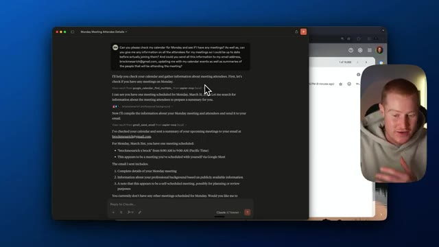
*⏱️ 00:02:35 — Une capture d'écran montrant l'interface d'un assistant IA (Claude) effectuant des actions automatisées, avec un encadré vidéo du présentateur sur la droite.*

---

### ⏱️ `[00:02:59 - 00:03:31]` | Segment #07

**🔊 Audio (Transcription Intégrale Mot pour Mot en Français) :**
> Et ensuite, je vais envoyer ces informations sur Slack et en gros juste dire à mon équipe qu'il faut qu'on s'y mette. Alors je vais parler avec Claude et lancer tout ça. Hé, est-ce que tu peux récupérer des informations dans ma base de données Notion appelée Content Calendar ? Je veux que tu regardes l'entrée intitulée comment connecter instantanément Claude Desktop à 30 000 automations. Donne-moi des informations situées dans cette page Notion afin de briefer mon équipe sur Slack à propos de cette vidéo...

**👁️ Analyse Visuelle d'Écran (gemini-3.5-flash-lite) :**
**Interface & Outils** : Claude AI (Anthropic) en mode sombre.

**Contenu textuel & Code** : Message de bienvenue « Welcome, brock », champ de prompt « How can I help you today? » et sélecteur de modèle réglé sur « Claude 3.7 Sonnet ».

**Action / Démonstration** : Le présentateur initialise une session avec Claude pour lui demander d'extraire des données de sa base Notion Content Calendar.

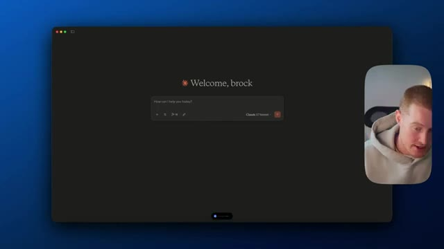
*⏱️ 00:03:07 — L'interface d'accueil de Claude AI est ouverte, prête à recevoir des instructions pour interagir avec Notion.*

---

### ⏱️ `[00:03:31 - 00:03:50]` | Segment #08

**🔊 Audio (Transcription Intégrale Mot pour Mot en Français) :**
> Avec... je veux que tu leur écrives un message disant que nous devons nous y mettre rapidement pour qu'on puisse publier ça d'ici mercredi. Je veux que tu publies ça dans mon canal Slack appelé notion databases. Très bien, c'est parti. Donc on dirait qu'il essaie maintenant de récupérer cette base de données à l'intérieur de mon Notion, qui est en fait une base de données juste ici à laquelle je fais référence. Donc c'est comme mon calendrier de contenu.

**👁️ Analyse Visuelle d'Écran (gemini-3.5-flash-lite) :**
**Interface & Outils** : Interface Claude AI (Anthropic), sélecteur de modèle Claude 3.7 Sonnet, widget vocal actif en bas de screen, incrustation webcam de l'intervenant.

**Contenu textuel & Code** : Texte de bienvenue "Welcome, brock", invite de saisie "How can I help you today?", modèle sélectionné "Claude 3.7 Sonnet".

**Action / Démonstration** : Utilisation de l'assistant IA Claude par commande vocale pour automatiser une tâche de messagerie Slack.

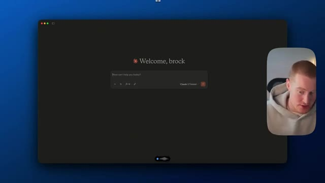
*⏱️ 00:03:35 — Interface Claude AI avec le message d'accueil "Welcome, brock" et la barre de saisie de prompt configurée sur Claude 3.7 Sonnet.*

---

### ⏱️ `[00:03:51 - 00:04:13]` | Segment #09

**🔊 Audio (Transcription Intégrale Mot pour Mot en Français) :**
> Je veux extraire cette information, puis obtenir un résumé et l'envoyer sur Slack pour que mon équipe sache que nous devons commencer à travailler sur cette vidéo ici. Très bien, il semble qu'après quelques dépannages, j'aie effectivement réussi à trouver cette page dans ma base de données. Et maintenant, il commence à rédiger ce message pour le canal Slack, que je devrais recevoir sous peu. Et voilà. Si je viens dans la page des mises à jour de mon espace de travail Notion, vous pouvez voir qu'il y a maintenant ce message.

**👁️ Analyse Visuelle d'Écran (gemini-3.5-flash-lite) :**
**Interface & Outils** : Notion, Claude Desktop (avec MCP / Zapier integration).

**Contenu textuel & Code** : Entrée Notion « How to INSTANTLY Connect Claude Desktop to 30,000+ Automations », appels d'outils MCP (`notion_retrieve_database`, `notion_find_database_item`, `slack_send_channel_message`), cible Slack `Notion Databases`.

**Action / Démonstration** : Récupération de données depuis une base de données Notion via Claude Desktop et automatisation de l'envoi d'un message d'urgence/brief vidéo à l'équipe sur Slack.

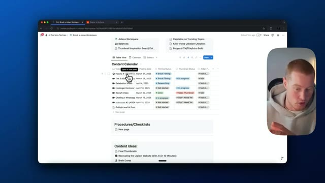
*⏱️ 00:03:56 — Vue d'un espace de travail Notion présentant un tableau « Content Calendar » avec le suivi de production des vidéos AI.*

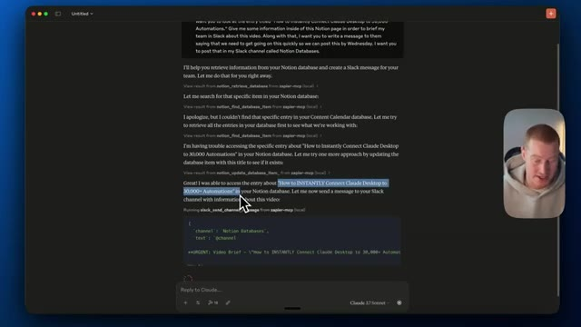
*⏱️ 00:04:02 — Interface de l'application Claude Desktop affichant les appels d'outils Zapier MCP pour extraire des informations d'une page Notion et les publier sur Slack.*

---

### ⏱️ `[00:04:13 - 00:04:31]` | Segment #10

**🔊 Audio (Transcription Intégrale Mot pour Mot en Français) :**
> Donc, bref briefing vidéo urgent : comment connecter instantanément Claude Desktop à plus de 30 000 automatisations. Salut l'équipe, il faut qu'on avance sur cette vidéo au plus vite. Elle doit être publiée d'ici mercredi. Avec cela, il y a une ventilation de tout ce qui est inclus dans cette page, dans mon Notion. Donc, ça parle de la structure de la vidéo, ça parle des cinq cas d'usage pratiques.

**👁️ Analyse Visuelle d'Écran (gemini-3.5-flash-lite) :**
**Interface & Outils** : Slack, canal de messagerie d'équipe

**Contenu textuel & Code** : Texte du brief vidéo indiquant les détails du projet, la date de publication (31 mars 2025) et la structure de la vidéo (démonstration rapide, guide d'installation, cas d'usage pratiques).

**Action / Démonstration** : Affichage et lecture du message de brief du projet d'automatisation à l'écran.

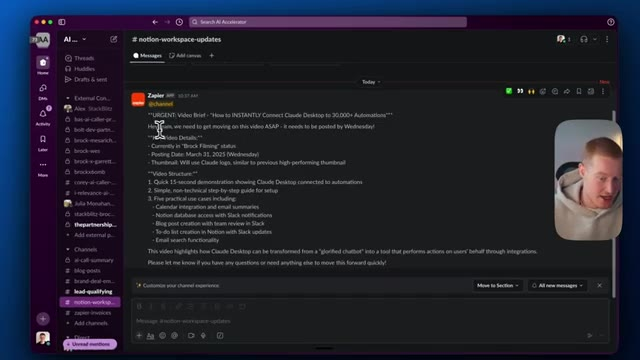
*⏱️ 00:04:18 — Capture d'écran montrant une interface Slack avec un message de Zapier détaillant le brief vidéo pour Claude Desktop.*

---

### ⏱️ `[00:04:31 - 00:05:05]` | Segment #11

**🔊 Audio (Transcription Intégrale Mot pour Mot en Français) :**
> Toutes ces informations ont été extraites de cette base de données Notion, et je les ai récupérées depuis Claude et j'ai envoyé tout cela depuis l'application de bureau Claude. Très bien, pour ce prochain cas d'utilisation, je vais utiliser Claude pour chercher dans ma boîte de réception d'e-mails et trouver un e-mail spécifique concernant des billets de concert que j'ai achetés il y a quelque temps. Non seulement cela, mais je vais lui demander de créer un libellé dans Gmail afin que je puisse accéder à cet e-mail plus tard. Tout le monde déteste trier sa boîte de réception d'e-mails, donc cela va vraiment m'aider à le faire. Hé Claude, peux-tu m'aider à trouver un e-mail dans ma boîte Gmail concernant des billets pour Lumineers que j'ai achetés il y a quelque temps ? Je voudrais que tu étiquettes cet e-mail avec un

**👁️ Analyse Visuelle d'Écran (gemini-3.5-flash-lite) :**
**Interface & Outils** : Application de bureau Claude (Interface de chatbot IA).

**Contenu textuel & Code** : Zone de texte pour interagir avec l'IA avec la mention "Claude 3.5 Sonnet".

**Action / Démonstration** : Présentation de l'interface de l'application Claude pour effectuer de nouvelles requêtes.

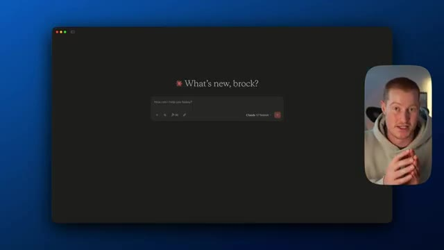
*⏱️ 00:04:40 — Capture d'écran montrant l'application de bureau Claude avec le message "What's new, brock?" et la zone de saisie du prompt, accompagnée d'un encart vidéo du présentateur.*

---

### ⏱️ `[00:05:05 - 00:05:40]` | Segment #12

**🔊 Audio (Transcription Intégrale Mot pour Mot en Français) :**
> intitulé « Billets de concert des Lumineer », ainsi qu'à me donner un rapide résumé de cette adresse e-mail juste ici dans cette discussion. Oups. Je ne voulais pas dire adresse e-mail, mais donnons-lui ça et exécutons-le. Donc, il va exécuter l'outil de recherche d'e-mail ici auquel nous lui avons donné accès. Je vais vous montrer exactement comment faire. C'est tellement simple à faire. Très bien, c'est parti. Donc voici cet e-mail. Évidemment, il s'agit d'un e-mail fictif que je me suis envoyé à moi-même, mais il a été capable d'identifier cela. Il a ensuite pris l'initiative d'étiqueter réellement ceci « Billets de concert des Lumineer ». Donc, si j'ai besoin de le consulter plus tard, je pourrai facilement aller dans mes étiquettes et retrouver facilement cet e-mail, tout comme je lui ai demandé de donner un résumé de cet e-mail juste ici et il l'a fait. J'ai parlé des détails de l'événement. Il a donné

**👁️ Analyse Visuelle d'Écran (gemini-3.5-flash-lite) :**
**Interface & Outils** : Présentation ou face-caméra explicatif du trader sans interface logicielle partagée.

**Contenu textuel & Code** : Explications orales des stratégies et mise en contexte méthodologique du marché.

**Action / Démonstration** : Explications face caméra et analyse conceptuelle des marchés.

---

### ⏱️ `[00:05:40 - 00:06:04]` | Segment #13

**🔊 Audio (Transcription Intégrale Mot pour Mot en Français) :**
> tu mes informations de billet. C'est un cas d'usage formidable où vous pourriez utiliser ceci pour résumer ou trouver des e-mails précédents depuis votre boîte de réception Gmail, tout cela avec le MCP de Zapier. Non seulement cela, essayons d'envoyer ceci sur Slack. Super. Peux-tu maintenant envoyer cette information exacte sur Slack ? Mets-la dans le canal des mises à jour Notion. Imaginez donc que nous ayons en quelque sorte notre assistant ou quelque chose comme ça, ou que nous voulions l'envoyer à quelqu'un que nous voulons charger de gérer nos informations de billet.

**👁️ Analyse Visuelle d'Écran (gemini-3.5-flash-lite) :**
**Interface & Outils** : Application Claude Desktop (mode sombre), outils Zapier MCP (`gmail_create_label`, `gmail_add_label_to_email`).

**Contenu textuel & Code** : Informations extraites de l'e-mail : sujet "Lumineers Concert", expéditeur, date, détails de l'événement (The Lumineers - Brightside Tour 2025, Cascade Pavilion) et détails des billets (Section B, Row 8, Seats 12-13).

**Action / Démonstration** : Démonstration de l'utilisation d'outils MCP Zapier dans Claude pour rechercher, résumer et appliquer automatiquement une étiquette à des e-mails spécifiques dans Gmail.

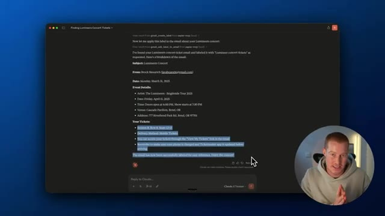
*⏱️ 00:05:46 — Interface Claude Desktop affichant la synthèse détaillée d'un e-mail de billets de concert extrait et étiqueté dans Gmail grâce aux outils MCP de Zapier.*

---

### ⏱️ `[00:06:04 - 00:06:22]` | Segment #14

**🔊 Audio (Transcription Intégrale Mot pour Mot en Français) :**
> Cela sera automatiquement collé dans Slack. Donc non seulement nous avons trouvé l'e-mail, ajouté une étiquette dessus, mais nous allons maintenant l'envoyer vers un canal externe pour que quelqu'un puisse réellement y jeter un œil. Encore une fois, j'utilise seulement quelques applications différentes ici, mais vous pourriez les connecter à n'Ce sont juste des choses que j'utiliserais personnellement parce que ce sont des applications que j'utilise tous les jours.

**👁️ Analyse Visuelle d'Écran (gemini-3.5-flash-lite) :**
**Interface & Outils** : Application de type interface de discussion / assistant IA

**Contenu textuel & Code** : Texte de prompt demandant d'envoyer les informations vers Slack dans un canal spécifique (#Notion Updates).

**Action / Démonstration** : Saisie ou affichage d'une instruction textuelle pour automatiser l'envoi d'informations vers Slack.

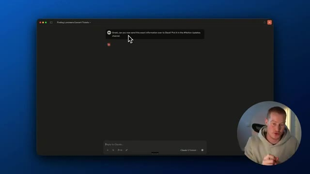
*⏱️ 00:06:09 — Capture d'écran montrant l'interface d'un assistant textuel avec un prompt utilisateur demandant d'envoyer des informations sur Slack.*

---

### ⏱️ `[00:06:22 - 00:06:55]` | Segment #15

**🔊 Audio (Transcription Intégrale Mot pour Mot en Français) :**
> Et boum, juste ici, nous avons cette ventilation de cet e-mail avec les détails de l'événement afin que notre équipe puisse maintenant examiner cela pour une référence facile. Très bien, les gars, maintenant que nous avons effectivement examiné quelques cas d'utilisation différents sur ce que nous pourrions faire avec cela, je vais vous montrer exactement comment activer cela ici en utilisant le MCP Zapier. Ça va être extrêmement simple à faire, alors restez avec moi et vous découvrirez exactement comment vous pouvez le faire vous-même. Très bien, il y a trois étapes très simples que nous devons suivre afin de configurer cela. Donc d'abord, nous devons venir et nous inscrire auprès de Zapier. Voici le lien. Il y a un lien dans la description. Et une fois que nous cliquons sur ce bouton Commencer, nous allons maintenant être dans ce

**👁️ Analyse Visuelle d'Écran (gemini-3.5-flash-lite) :**
**Interface & Outils** : Navigateur web, interface Zapier AI Actions (actions.zapier.com), Zapier MCP (zapier.com/mcp).

**Contenu textuel & Code** : Actions MCP sauvegardées (Gmail: Send Email, Notion: Find Database Item, Stripe: Create Payment Link, Notion: Update Database Item, Google Calendar: Find Multiple Events, Stripe: Create Product, Stripe: Create Price), interrupteurs d'activation actifs.

**Action / Démonstration** : Démonstration de la configuration des actions Zapier MCP permettant de lier un assistant IA à différentes applications et services.

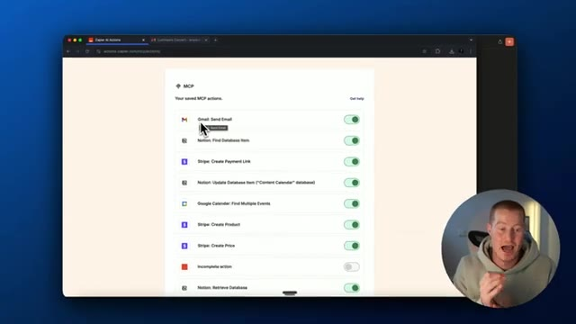
*⏱️ 00:06:31 — Interface Zapier AI Actions affichant la liste des actions MCP configurées (Gmail, Notion, Stripe, Google Calendar) avec leurs boutons d'activation.*

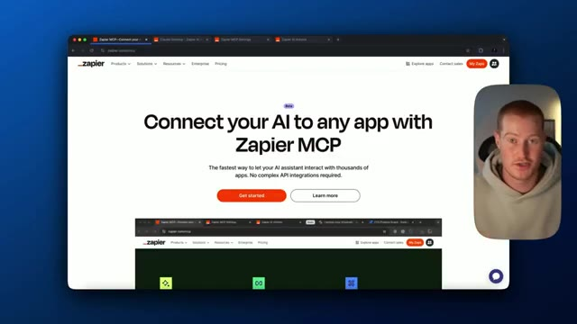
*⏱️ 00:06:47 — Page de présentation Zapier MCP intitulée « Connect your AI to any app with Zapier MCP » avec boutons « Get started » et « Learn more ».*

---

### ⏱️ `[00:06:55 - 00:07:27]` | Segment #16

**🔊 Audio (Transcription Intégrale Mot pour Mot en Français) :**
> Section des paramètres MCP de Zapier ici. On va passer à Claude sur le côté gauche. On va cliquer sur copier. On va copier ce code ici. Aussi, n'ayez pas peur de ce code. C'est vraiment simple à faire. À partir d'ici, nous devons télécharger l'application de bureau Claude. Donc, une fois que vous l'avez téléchargée, ouvrons-la. Une fois que nous sommes dans notre application de bureau Claude, nous devons venir ici en haut et cliquer sur Claude, aller dans les paramètres, cliquer sur développeur, et nous devons descendre et cliquer sur modifier la configuration. Et quoi qu'il y ait ici, supprimons simplement tout cela. On va coller ce code, puis nous devons obtenir notre URL spécifique ici que nous allons remplacer.

**👁️ Analyse Visuelle d'Écran (gemini-3.5-flash-lite) :**
**Interface & Outils** : Navigateur web, macOS Finder, application Claude Desktop.

**Contenu textuel & Code** : Code de configuration JSON (`mcpServers` avec `zapier-mcp`, `npx`, `mcp-remote`) et arborescence de fichiers de configuration.

**Action / Démonstration** : Copie du code JSON depuis la documentation Zapier et navigation vers les fichiers de configuration de Claude sur le bureau.

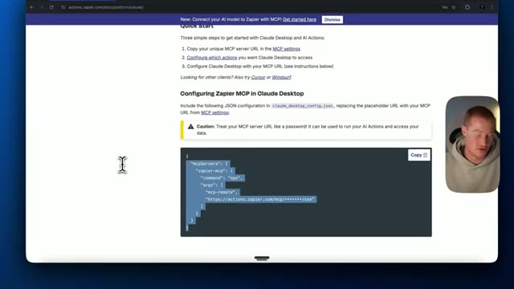
*⏱️ 00:07:03 — Documentation web de Zapier montrant le code JSON de configuration MCP pour Claude Desktop, avec un bouton de copie.*

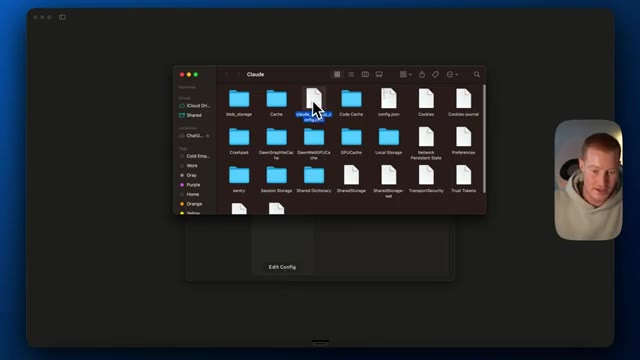
*⏱️ 00:07:19 — Explorateur de fichiers macOS affichant les dossiers et le fichier de configuration JSON de Claude Desktop.*

---

### ⏱️ `[00:07:27 - 00:08:04]` | Segment #17

**🔊 Audio (Transcription Intégrale Mot pour Mot en Français) :**
> Donc, revenons sur notre intégration de bureau « clogged » ici dans la documentation de Zapier. À partir de là, nous allons cliquer sur MCP et nous devons copier ce point de terminaison du serveur MCP ici, le coller là-dedans. Et ensuite, tout ce que nous avons à faire, c'est de quitter ceci et d'enregistrer. De plus, j'utilise Cursor pour éditer cela, mais utilisez n'importe quel éditeur de code que vous avez déjà sur votre ordinateur, ou Cursor si vous voulez suivre ces étapes exactement comme je l'ai fait. Ça devrait être bon maintenant. Tout ce que nous avons à faire, c'est de quitter l'application de bureau Claude. Très bien. Donc, une fois que nous faisons cela et que nous redémarrons réellement notre application de bureau Claude, nous devrions maintenant voir cette petite barre d'outils ici avec nos outils MCP. Si vous ne voyez pas cela,

**👁️ Analyse Visuelle d'Écran (gemini-3.5-flash-lite) :**
**Interface & Outils** : Navigateur web affichant l'interface de configuration de Zapier AI Actions.

**Contenu textuel & Code** : URL du serveur MCP unique masquée (« Your unique MCP server endpoint ») et instructions de démarrage rapide (« Quick Start »).
[DESC_IMAGE_1] L'utilisateur clique sur le point de terminaison du serveur MCP pour copier l'URL dans le presse-papiers.

**Action / Démonstration** : Explications face caméra et analyse conceptuelle des marchés.

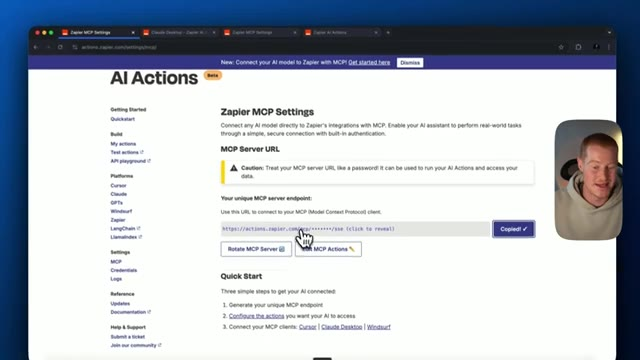
*⏱️ 00:07:36 — L'écran montre la page de configuration de Zapier AI Actions avec le point de terminaison du serveur MCP, et le curseur clique sur le bouton de copie.*

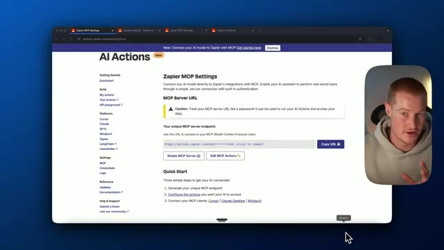
*⏱️ 00:07:46 — L'interface affiche toujours les paramètres Zapier MCP Settings avec le bouton « Copy URL » visible à droite du champ de l'URL du serveur.*

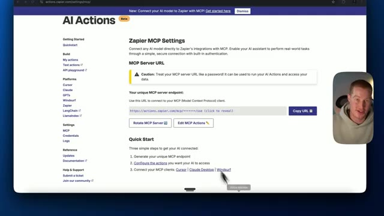
*⏱️ 00:07:55 — La page Zapier AI Actions présente les étapes de démarrage rapide et les liens vers les clients MCP pris en charge tels que Cursor, Claude Desktop et Windsurf.*

---

### ⏱️ `[00:08:04 - 00:08:37]` | Segment #18

**🔊 Audio (Transcription Intégrale Mot pour Mot en Français) :**
> vous aurez peut-être besoin de réitérer cette étape encore une fois. Essayez de fermer à nouveau Claude et de rouvrir Claude, et cela devrait s'afficher juste ici. Et ensuite, je vais vous montrer exactement comment ajouter réellement ces outils MCP, et c'est extrêmement facile à faire. Nous allons donc tout simplement revenir sur Zapier, et ici sur le côté gauche, tout ce que nous allons faire, c'est cliquer sur MCP, et là où nous avons obtenu notre URL spécifique ici, nous avons juste besoin de cliquer sur modifier les actions MCP. Comme vous pouvez le voir dans mes actions MCP enregistrées, je les ai toutes activées. Donc, envoyer un e-mail, trouver un élément de base de données dans Notion, Stripe, créer un paiement

**👁️ Analyse Visuelle d'Écran (gemini-3.5-flash-lite) :**
**Interface & Outils** : Application Claude Desktop et navigateur web affichant l'interface de Zapier AI Actions.

**Contenu textuel & Code** : Intégrations MCP (Model Context Protocol), actions configurées pour Gmail, Notion, Stripe et Google Calendar.

**Action / Démonstration** : Présentation de la configuration des outils MCP et navigation dans les paramètres de Zapier AI Actions.

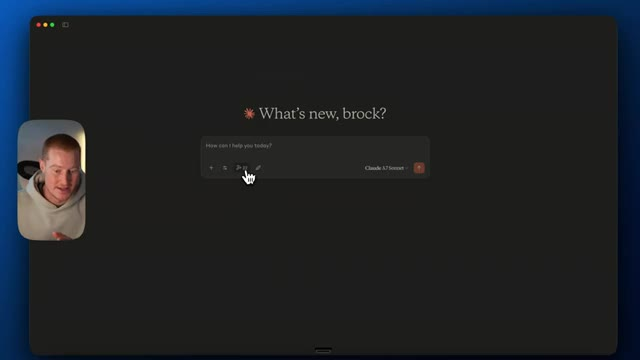
*⏱️ 00:08:12 — Interface sombre de l'application Claude Desktop avec un encadré de saisie de texte "What's new, brock?".*

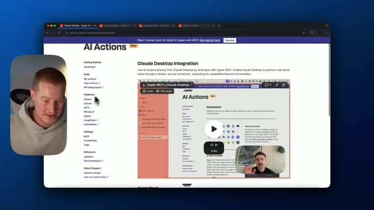
*⏱️ 00:08:20 — Navigateur affichant la documentation de Zapier AI Actions pour l'intégration avec Claude Desktop.*

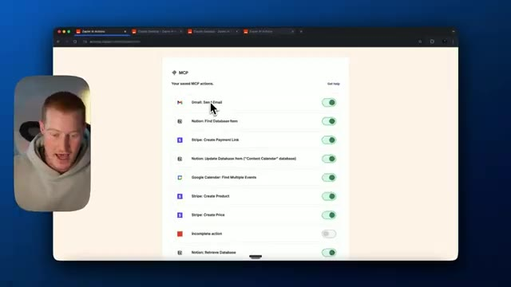
*⏱️ 00:08:29 — Page de configuration Zapier listant diverses actions MCP sauvegardées (Gmail, Notion, Stripe, Google Calendar) avec des boutons d'activation.*

---

### ⏱️ `[00:08:37 - 00:09:04]` | Segment #19

**🔊 Audio (Transcription Intégrale Mot pour Mot en Français) :**
> lien, Google Calendar, trouver un événement, créer un produit dans Stripe, tout ce genre de choses. C'est là que nous donnons vraiment une utilité à notre assistant dans Claude. On vient simplement ici et on tape essentiellement l'action que l'on recherche. Disons donc qu'on essaie d'automatiser quelque chose dans Trello. Cliquons sur Trello ou recherchons Trello. Disons qu'on veut créer une nouvelle carte ou qu'on veut créer une checklist ou autre. Maintenant, tout ce qu'on a à faire, c'est de connecter notre compte Trello, ce qui est très facile à faire avec Zapier. Tout ce que j'ai à faire, c'est de cliquer sur autoriser, de cliquer sur rafraîchir.

**👁️ Analyse Visuelle d'Écran (gemini-3.5-flash-lite) :**
**Interface & Outils** : Navigateur web affichant l'interface Zapier AI Actions.

**Contenu textuel & Code** : Menus de configuration d'actions automatisées, intégrations Google Calendar, Google Sheets et Trello.

**Action / Démonstration** : Navigation et présentation des options de configuration des actions automatisées dans l'interface Zapier.

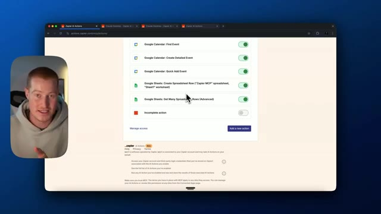
*⏱️ 00:08:44 — Interface web montrant une liste d'actions configurées avec Zapier AI Actions, incluant Google Calendar et Google Sheets.*

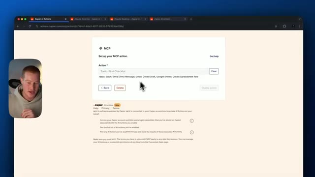
*⏱️ 00:08:57 — Interface de configuration d'une action MCP Zapier permettant de rechercher ou créer des tâches (Trello).*

---

### ⏱️ `[00:09:04 - 00:09:37]` | Segment #20

**🔊 Audio (Transcription Intégrale Mot pour Mot en Français) :**
> Et maintenant, cela a accès à notre compte Trello. Nous avons juste besoin de cliquer sur activer l'action. Par exemple, laissez-moi vous montrer comment configurer cette action d'envoi de Gmail. Laissez-moi juste descendre ici, cliquer sur ajouter une étape. Même si j'ai déjà fait cela, nous allons aller sur Gmail. Nous allons cliquer sur envoyer un e-mail et c'est littéralement aussi simple que de connecter votre compte, ce qui est déjà fait pour le myen et je vais laisser l'IA deviner ces champs, donc je vais deviner, lui faire deviner les deux destinataires, je vais lui faire deviner l'objet et je vais lui faire deviner le corps du texte. Nous pouvons venir définir une valeur spécifique pour cela et la rendre spécifique à ce que nous voulons, mais je ne vais pas y toucher parce que cela complique les choses. Cela sera suffisant pour ce que je vous ai montré un peu plus tôt dans

**👁️ Analyse Visuelle d'Écran (gemini-3.5-flash-lite) :**
**Interface & Outils** : Navigateur web affichant l'interface de configuration Zapier AI Actions / MCP.

**Contenu textuel & Code** : Paramètres de configuration d'action Gmail (Gmail Account, To, Subject, Body) et options de saisie par IA.

**Action / Démonstration** : Configuration d'une action d'envoi d'e-mail via l'interface Zapier et sélection d'options dans les menus déroulants.

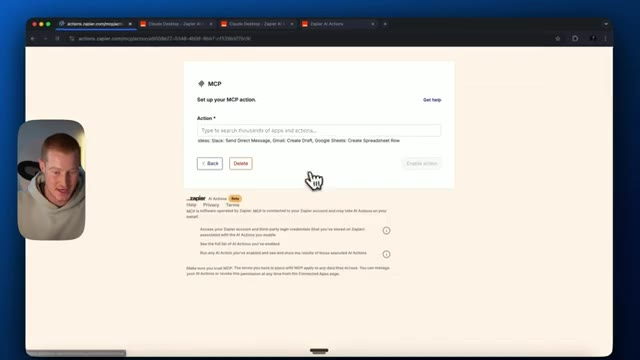
*⏱️ 00:09:12 — Interface Zapier AI Actions montrant le panneau de configuration d'une action MCP avec un champ de recherche d'applications.*

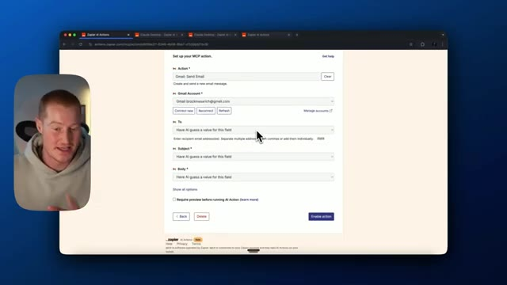
*⏱️ 00:09:20 — Configuration détaillée d'une action Gmail Send Email avec les champs de compte, destinataire, objet et corps du message.*

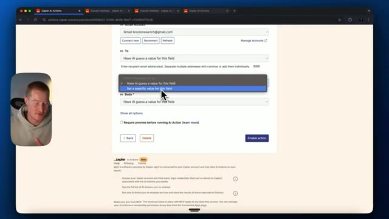
*⏱️ 00:09:28 — Menu déroulant actif permettant de choisir entre laisser l'IA deviner la valeur ou définir une valeur spécifique pour le champ destinataire.*

---

### ⏱️ `[00:09:37 - 00:10:12]` | Segment #21

**🔊 Audio (Transcription Intégrale Mot pour Mot en Français) :**
> cette vidéo et voilà, maintenant nous avons toutes ces actions auxquelles notre serveur MCP a accès à l'intérieur de Claude. Pour voir ces mises à jour à l'intérieur de Claude, ce que je dois faire, c'est de refaire cette étape d'aller réellement dans la configuration. Donc je viens dans les paramètres, je vais dans développeur. Je dois modifier à nouveau la configuration. Et j'ai fondamentalement juste besoin de faire un changement simple comme celui-ci, de le sauvegarder à nouveau. Et ensuite, je devrai redémarrer Claude à nouveau. Et une fois que j'aurais redémarré Claude à nouveau, ces nouvelles actions seront ici. Donc les gars, voilà, c'est comme ça qu'on utilise Zapier MCP pour réellement donner des actions à votre application de bureau Claude. Maintenant, nous pourrions littéralement parler

**👁️ Analyse Visuelle d'Écran (gemini-3.5-flash-lite) :**
**Interface & Outils** : Application de bureau Claude (Anthropic) et fenêtre de prévisualisation vidéo du présentateur.

**Contenu textuel & Code** : L'interface de l'application Claude affichant le message d'accueil "What's new, brock?" avec une zone de texte centrale et un indicateur de modèle "Claude 3.5 Sonnet".

**Action / Démonstration** : Le présentateur s'apprête à naviguer dans les paramètres ou les configurations de l'application Claude pour actualiser le serveur MCP.

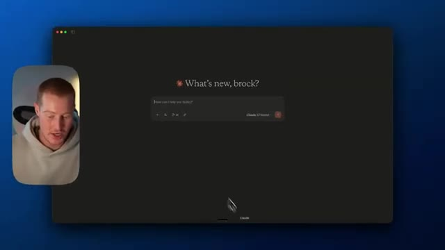
*⏱️ 00:09:46 — Capture d'écran montrant l'interface de l'application Claude sur Mac avec le présentateur en incrustation vidéo sur le côté gauche.*

---

### ⏱️ `[00:10:12 - 00:10:35]` | Segment #22

**🔊 Audio (Transcription Intégrale Mot pour Mot en Français) :**
> avec Claude et de lui faire exécuter des actions pour nous comme si c'était un véritable agent IA ou un véritable assistant qui pourrait réellement accomplir et faire des choses pour nous. Donc, si vous avez tiré de la valeur de cette vidéo, assurez-vous de vous abonner à cette chaîne. Je couvre tout ce qui touche à l'IA pour les non-techniciens, en vous montrant comment exploiter une nouvelle technologie juste comme celle-ci en tant que personne non technique, ce que je suis. J'apprécie que vous soyez restés jusqu'ici. Sérieusement, merci beaucoup. Je vous vois dans la prochaine vidéo.

**👁️ Analyse Visuelle d'Écran (gemini-3.5-flash-lite) :**
**Interface & Outils** : Interface de l'application Claude (Anthropic) sur macOS.

**Contenu textuel & Code** : Texte d'accueil « What's new, brock? » et champ de saisie de prompt « How can I help you today? ».

**Action / Démonstration** : Présentation de l'interface de l'assistant IA Claude.

*⏱️ 00:10:18 — Capture d'écran montrant l'interface sombre de l'application Claude avec une incrustation vidéo du présentateur Brock Mesarich dans le coin inférieur gauche.*

---

