# 🎬 How to Automate Anything INSTANTLY with AI (No Code)

> **Chaîne** : [Brock Mesarich | AI for Non Techies](https://www.youtube.com/@BrockMesarich)  
> **Lien YouTube** : [https://www.youtube.com/watch?v=EinBuRc3um4](https://www.youtube.com/watch?v=EinBuRc3um4)  
> **Date de publication** : 20250404  
> **Durée** : 00:36:16  
> **Identifiant vidéo** : `EinBuRc3um4`  
> **Transcription & Analyse** : `whisper-v3-large-turbo+gemini-3.5-flash-lite`  

---

## 📌 Synthèse Exécutive & Outils

### 💡 Résumé

Cette vidéo, présentée par Brock Mesarich et son invité Mark Kaship, explore les méthodes d'automatisation intelligente des flux de travail sans code en combinant de grands modèles de langage (LLM) et des plateformes iPaaS comme Make.com. L'objectif central est de démontrer comment un utilisateur non technique peut concevoir, itérer et déployer instantanément des architectures d'automatisation complexes grâce au *prompt engineering* et à l'intelligence artificielle générative. 

La démonstration s'appuie sur une astuce méthodologique puissante : alimenter des modèles dotés d'une large fenêtre de contexte (comme OpenAI O3 Mini High ou Claude) avec un référentiel exhaustif des modules Make.com. Cette base de données personnalisée permet aux LLM de s'affranchir des limites des interfaces fermées et de prescrire avec une précision chirurgicale la chaîne exacte des composants (déclencheurs, itérateurs, parseurs LLM) nécessaires à l'accomplissement d'une tâche métier.

Au-delà de la simple génération de scénarios, la session illustre la création de cas d'usage concrets — de l'analyse de messages Slack et l'enrichissement de bases de données Airtable à la qualification automatisée de prospects via Google Sheets. L'utilisation conjointe de l'assistant IA natif de Make.com et de diagrammes de flux (Mermaid) offre une visibilité totale sur l'architecture, abaissant drastiquement la barrière à l'entrée technique et accélérant le passage de l'idée conceptuelle au système opérationnel.

### 🛠️ Outils, Modèles & Logiciels Présentés

* **Make.com** : Plateforme d'automatisation visuelle (iPaaS) sur toile interactive permettant de connecter des milliers d'applications et d'API tierces sans coder.
* **ChatGPT (O3 Mini High)** : Modèle de raisonnement avancé d'OpenAI doté d'une large fenêtre de contexte, idéal pour analyser des fichiers volumineux et concevoir des architectures logiques complexes.
* **Claude** : Assistant conversationnel et modèle de pointe d'Anthropic utilisé pour la structuration de données et la génération de code ou de schémas.
* **Grok** : Modèle d'intelligence artificielle conversationnelle (mentionné dans l'écosystème technologique global des IA génératives).
* **Gemini** : Modèle multimodal de Google (évoqué dans la palette des assistants IA disponibles sur le marché).
* **Airtable** : Base de données relationnelle cloud flexible utilisée pour le stockage structuré des données et des prospects.
* **Slack** : Application de messagerie instantanée d'entreprise exploitée ici comme canal de déclenchement (trigger) et de restitution des réponses automatisées.
* **Google Sheets** : Outil de tableur cloud servant de source de données pour l'importation et la mise à jour en lot (batch) de listes de prospects.
* **Mermaid Chart / Mermaid Live Editor** : Outil de visualisation textuelle permettant de convertir du code de diagramme en flux de travail graphiques et clairs.

### 🔑 Points Clés & Enseignements Stratégiques

* **Exploitation d'une base de connaissances exhaustive** : Transférer l'inventaire complet des modules et actions Make.com sous forme de fichier structuré (PDF) dans un LLM permet d'éliminer 80 % de la friction initiale liée à la recherche des fonctionnalités.
* **Gain de contexte avec les modèles de raisonnement** : L'utilisation de modèles avancés à forte capacité de calcul (comme O3 Mini High) garantit une compréhension contextuelle optimale pour traiter des documentations techniques denses.
* **Génération de listes de modules hyper-succinctes** : Contraindre le LLM à délivrer uniquement la liste brute et séquentielle des composants évite le bruit informationnel et permet un copier-coller direct dans les outils d'automatisation.
* **Création instantanée de scénarios par l'IA** : L'intégration d'instructions textuelles précises dans l'assistant Make.com permet d'assembler la structure logique d'un flux de travail en quelques secondes.
* **Maîtrise des flux itératifs complexes** : L'utilisation automatisée d'« itérateurs » par l'IA permet de résoudre facilement la gestion des données groupées (*batch*), un concept souvent abstrait pour les profils non techniques.
* **Visualisation architecturale via Mermaid** : Demander au LLM de générer un diagramme Mermaid à partir d'un processus complexe permet de cartographier visuellement le système avant même de manipuler la plateforme d'automatisation.
* **Réduction de la barrière psychologique technique** : Le recours à l'IA pour nommer et positionner des modules abscons (comme les boucles ou les parseurs) dédramatise l'apprentissage des outils iPaaS avancés.
* **Souveraineté et sécurité des authentifications** : Le principal verrou technique réside dans la configuration des clés API et des jetons d'accès (OpenAI, Airtable, Slack), une étape administrative incontournable mais ponctuelle.
* **Approche modulaire de la qualification de prospects** : Conception d'un pipeline automatisé reliant Google Sheets, l'analyse sémantique par OpenAI, et la mise à jour dynamique des statuts de qualification.
* **Prototypage rapide et agilité métier** : Le passage de l'idéation conceptuelle à un prototype fonctionnel passe de plusieurs heures de recherche manuelle à quelques minutes de dialogue itératif avec l'IA.

---

## ⏱️ Chronologie & Transcription Complète Audio & Visuelle (Mot pour Mot)

### ⏱️ `[00:00:00 - 00:00:36]` | Segment #01

**🔊 Audio (Transcription Intégrale Mot pour Mot en Français) :**
> Salut tout le monde ! Aujourd'hui, j'ai mon bon ami Mark Kaship avec moi. Vous l'avez peut-être déjà vu sur la chaîne. C'est fondamentalement un savant fou de l'IA, et dans cet épisode, nous allons aborder quelques astuces make.com ainsi que des exemples d'automations que vous pouvez commencer à créer dès aujourd'hui pour avoir une idée de ce qu'il est possible de bâtir avec cette plateforme. Dire qu'il maîtrise Make.com est un doux euphémisme, donc je suis super heureux de voir ce que nous pouvons construire ainsi que d'apprendre quelques trucs et astuces de sa part en cours de route. Mark, ravi de t'avoir sur la chaîne et j'apprécie que tu prennes le temps de faire ça comme toujours. Alors oui, c'est un plaisir comme toujours. Et je suis motivé d'une part à montrer à ton audience quelques petits pépites d'or pour les aider à passer de zéro à un aussi rapidement que possible et à passer en revue

**👁️ Analyse Visuelle d'Écran (gemini-3.5-flash-lite) :**
**Interface & Outils** : Logiciel de visioconférence et interface Make.com floutée.

**Contenu textuel & Code** : Aucun contenu technique, graphique ou code lisible en raison du flou général de l'écran principal.

**Action / Démonstration** : Introduction de l'invité et présentation générale du sujet sur les automatisations Make.com, sans démonstration technique active à l'écran.

---

### ⏱️ `[00:00:36 - 00:01:02]` | Segment #02

**🔊 Audio (Transcription Intégrale Mot pour Mot en Français) :**
> quelques exemples d'automatisations juste pour stimuler la créativité quant à ce qui est possible. Ouais, à 100 %. Ouais, j'ai hâte de le faire. Cool. Eh bien, je vais te laisser en quelque sorte piloter ce navire ici. Je veux en quelque sorte voir, genre, je vais te poser des questions tout au long du processus, parce que je veux juste voir, en tant que personne non technique, tu sais, comment quelqu'un pourrait commencer à utiliser make.com dès aujourd'hui pour créer juste des automatisations sympas et voyons quelques astuces et conseils en chemin, parce que tu utilises cette plateforme depuis, je veux dire, presque des années à ce stade. Donc oui, la meilleure personne auprès de qui apprendre.

**👁️ Analyse Visuelle d'Écran (gemini-3.5-flash-lite) :**
**Interface & Outils** : Visioconférence (type Zoom ou Google Meet)

**Contenu textuel & Code** : Aucun contenu technique, graphique, code source ou métrique visible en raison du flou sur la zone de partage.

**Action / Démonstration** : Conversation en visio entre les intervenants en préparation d'une démonstration d'automatisation.

---

### ⏱️ `[00:01:02 - 00:01:37]` | Segment #03

**🔊 Audio (Transcription Intégrale Mot pour Mot en Français) :**
> Alors, plongeons-no-y. Oui, sans aucun doute. Cool. Donc, je vais partager mon écran ici. Faisons ça. Très bien. Alors, si vous regardez ici, nous avons une toile vierge, ce qui, si vous utilisez Make, vous est familier. Sinon, ce bouton violet ouvre les portes et laissez-moi juste cacher ceci à toutes sortes d'automatisations ici. Des centaines, voire des milliers d'intégrations que vous pouvez réellement utiliser. Donc, d'entrée de jeu, nous allons commencer par un gros "hack", qui est que toutes ces automatisations ici, théoriquement, si vous saviez ce que vous vouliez et que vous pouviez, vous savez, parcourir une liste de toutes les options possibles et l'injecter dans quelque chose comme ChatGPT et dire, hé, voici le

**👁️ Analyse Visuelle d'Écran (gemini-3.5-flash-lite) :**
**Interface & Outils** : Make (anciennement Integromat)

**Contenu textuel & Code** : Toile de scénario Make vide avec un bouton central violet portant un symbole plus et une barre d'outils latérale violette.

**Action / Démonstration** : Présentation de la plateforme Make et de son interface de création de scénarios.

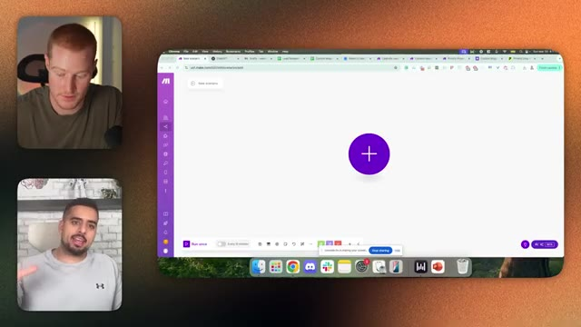
*⏱️ 00:01:11 — Capture d'écran montrant l'interface de Make avec une toile vierge et un bouton violet central au milieu de l'écran, ainsi que deux flux vidéo des présentateurs sur le côté gauche.*

---

### ⏱️ `[00:01:37 - 00:02:11]` | Segment #04

**🔊 Audio (Transcription Intégrale Mot pour Mot en Français) :**
> flux de travail que j'essaie de réaliser. Peux-tu esquisser ce que je devrais mettre, comme chaque pièce de puzzle ou chaque bloc de Lego, la façon dont je devrais les connecter ensemble. Maintenant, il y a quelques options que tu pourrais utiliser. Il y en a une qui est prête à l'emploi ici, à laquelle je viendrai sous peu, appelée l'assistant IA qui est toujours en version bêta, où tu peux réellement demander quelque chose, il va esquisser un scénario réel pour toi de bout en bout. Pas toujours à 100 %, mais je vais te montrer une petite astuce que j'ai dans ma poche arrière qui sera super utile. Donc, en décembre dernier, ce qui signifie que ce n'est pas nécessairement tout à fait à jour, mais j'ai fait passer mon équipe par une méthode manuelle juste parce qu'ils n'ont pas

**👁️ Analyse Visuelle d'Écran (gemini-3.5-flash-lite) :**
**Interface & Outils** : Navigateur web affichant Make.com avec un menu déroulant d'applications (Math, Google Maps, QCodeKit, Cloudinary, etc.) et des webcams intégrées.

**Contenu textuel & Code** : Liste des applications disponibles pour construire un scénario d'automatisation sous forme de blocs modulaires.

**Action / Démonstration** : Sélection ou ajout d'un nouveau module/bloc pour connecter les différentes étapes du flux de travail automatisé.

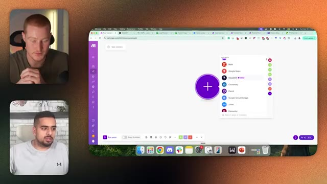
*⏱️ 00:01:45 — Capture d'écran montrant l'interface d'une plateforme d'automatisation de type Make.com avec deux intervenants en visioconférence sur le côté gauche.*

---

### ⏱️ `[00:02:11 - 00:02:43]` | Segment #05

**🔊 Audio (Transcription Intégrale Mot pour Mot en Français) :**
> une plateforme ouverte, make.com, et de passer en revue absolument toutes les automatisations possibles de l'outil. Et laissez-moi juste faire un zoom arrière un peu ici, de l'outil jusqu'à l'action réelle associée à cet outil. Parce que notre objectif était, et ça a été vraiment utile pour nous, de voir si on pouvait simplement parler à Claude ou ChatGPT et demander, hé, voici ce que j'essaye de faire. Quels sont les différents éléments dont j'aurais besoin pour y arriver ? Parce que ça élimine environ 80 % du travail facile pour juste comprendre de quels modules j'ai besoin, qu'est-ce qu'un module, quel service devrait être le bon service, et cetera. Et je vais aussi faire

**👁️ Analyse Visuelle d'Écran (gemini-3.5-flash-lite) :**
**Interface & Outils** : Lecteur PDF sous macOS avec le dock visible en bas, et deux flux vidéo de présentation sur le côté gauche.

**Contenu textuel & Code** : Tableau avec des lignes listant des outils (JSON, Gmail, Text parser) et leurs actions correspondantes (ex. 'Transform to JSON', 'Watch Emails', 'Copy an Email', 'Send an Email').

**Action / Démonstration** : Présentation du tableau récapitulatif des outils et des actions d'automatisation possibles.

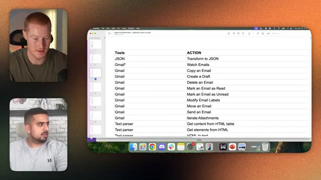
*⏱️ 00:02:19 — Un document PDF montrant un tableau avec deux colonnes principales : 'Tools' et 'ACTION', listant diverses intégrations comme JSON, Gmail et Text parser ainsi que leurs actions associées.*

---

### ⏱️ `[00:02:43 - 00:03:04]` | Segment #06

**🔊 Audio (Transcription Intégrale Mot pour Mot en Français) :**
> ceci est disponible pour votre communauté et votre audience également, afin qu'ils puissent l'utiliser à leur Maintenant, ce que nous pouvons faire avec ce petit PDF brillant, c'est que si nous allons dans ChatGPT et idéalement si nous allons dans quelque chose comme O3 Mini High simplement parce qu'il a une bonne fenêtre de contexte d'entrée parce que c'est un fichier assez volumineux. Nous pourrions simplement aller faire glisser et déposer ce super truc, le placer ici.

**👁️ Analyse Visuelle d'Écran (gemini-3.5-flash-lite) :**
**Interface & Outils** : Make.com (anciennement Integromat), navigateur web et explorateur de fichiers macOS.

**Contenu textuel & Code** : Tableau de bord Make.com avec un nouveau scénario et un fichier PDF de documentation affiché dans une fenêtre de prévisualisation.

**Action / Démonstration** : Présentation d'un flux de travail ou d'un fichier PDF devant être intégré dans un scénario Make.com.

*⏱️ 00:02:48 — Capture d'écran montrant l'interface de Make.com avec un fichier PDF ouvert au centre de l'écran, ainsi que deux intervenants en visioconférence sur le côté gauche.*

---

### ⏱️ `[00:03:04 - 00:03:36]` | Segment #07

**🔊 Audio (Transcription Intégrale Mot pour Mot en Français) :**
> Et ensuite, je peux simplement demander ce que je cherche. Donc je vais utiliser ma petite application de synthèse vocale, enfin de dictée vocale, et dire : Je veux créer une automatisation qui va de la réception d'un message Slack à l'analyse de ce message Slack en utilisant OpenOffice, OpenAI, pour ensuite acheminer ce message vers notre base de données dans Airtable afin de le stocker, puis acheminer cela vers la réponse créée par un autre module LLM d'OpenAI, et enfin renvoyer le tout sur Slack sous forme de message de réponse. Maintenant, je pourrais tout juste commencer ici et je veux envoyer ceci par-dessus

**👁️ Analyse Visuelle d'Écran (gemini-3.5-flash-lite) :**
**Interface & Outils** : Navigateur web (Google Chrome) affichant ChatGPT (modèle o3-mini-high) et interface de visioconférence.

**Contenu textuel & Code** : Page d'accueil de ChatGPT avec la barre de recherche centrale "Ask anything" et une icône d'intégration "MAKE INTEGRATIONS - VERIFIED...".

**Action / Démonstration** : Le présentateur s'apprête à saisir ou dicter sa requête pour créer une automatisation reliant Slack et OpenAI.

*⏱️ 00:03:12 — Capture d'écran montrant l'interface du navigateur avec ChatGPT et deux vignettes vidéo de présentateurs dans la partie gauche.*

---

### ⏱️ `[00:03:36 - 00:03:59]` | Segment #08

**🔊 Audio (Transcription Intégrale Mot pour Mot en Français) :**
> et ensuite utiliser un modèle de raisonnement c'est cool parce qu'il va rédiger exactement quelles sont les options possibles. Et on peut même poser une question de plus, qui est, est-ce que tu peux juste me donner une antisèche genre module par module de ce qu'on doit mettre étape par étape. C'est vrai. C'est plutôt génial. Et détrompe-moi si je me trompe, mais j'ai l'impression de me souvenir quand tu extrayais toutes les bases de données de Mix ou peu importe leur documentation ou peu importe pour obtenir ce PDF.

**👁️ Analyse Visuelle d'Écran (gemini-3.5-flash-lite) :**
**Interface & Outils** : Navigateur web affichant l'interface de ChatGPT.

**Contenu textuel & Code** : Texte du prompt utilisateur concernant l'intégration de Make, Slack, OpenAI et Airtable.

**Action / Démonstration** : Le présentateur explique l'utilisation de modèles de raisonnement pour concevoir des options et obtenir une structure étape par étape par module.

*⏱️ 00:03:42 — Capture d'écran montrant une conversation sur ChatGPT (modèle o3-mini-high) avec un document PDF joint, décrivant un prompt sur la création d'une automatisation d'intégration via Make.*

---

### ⏱️ `[00:03:59 - 00:04:19]` | Segment #09

**🔊 Audio (Transcription Intégrale Mot pour Mot en Français) :**
> Genre, c'était plutôt chronophage, non ? Genre, ce n'était pas quelque chose de facile à faire. Je ne l'ai pas fait à la manière dopée à l'IA. J'ai littéralement demandé à mes assistants virtuels d'aller vérifier chaque module, de le noter. C'est donc la méthode la plus manuelle possible, mais j'espère que personne d'autre n'aura plus jamais à faire ça. J'adore. Donc, vous pouvez voir ici, ça propose une suggestion. Déclencheur de message Slack, analyser le message avec OpenAI.

**👁️ Analyse Visuelle d'Écran (gemini-3.5-flash-lite) :**
**Interface & Outils** : Navigateur web affichant l'interface de ChatGPT (chatgpt.com) et des fenêtres de visioconférence.

**Contenu textuel & Code** : Texte d'un prompt utilisateur décrivant un workflow d'automatisation : "I want to create an automation that goes from receiving a Slack message to analyzing that Slack message using OpenAI...".

**Action / Démonstration** : Le présentateur présente ou lit une invite textuelle sur ChatGPT illustrant un cas d'usage d'automatisation.

*⏱️ 00:04:04 — Capture d'écran montrant l'interface de ChatGPT avec une invite (prompt) concernant la création d'une automatisation connectant Slack, OpenAI et Airtable, accompagnée de flux vidéo des participants.*

---

### ⏱️ `[00:04:20 - 00:04:40]` | Segment #10

**🔊 Audio (Transcription Intégrale Mot pour Mot en Français) :**
> Et maintenant, une chose que je regarde, c'est que je veux le nom exact de ceci. Je vais donc dire : peux-tu me donner en puces hyper succinctes le flux exact et les noms exacts des modules dont j'aurais besoin pour construire cette automatisation. Rien d'autre, aucun autre commentaire. Maintenant, vous allez voir pourquoi je tiens vraiment à ce que ce résultat soit aussi succinct, parce que nous allons le copier et en faire quelque chose.

**👁️ Analyse Visuelle d'Écran (gemini-3.5-flash-lite) :**
**Interface & Outils** : Navigateur web affichant ChatGPT (interface web)

**Contenu textuel & Code** : Texte généré par ChatGPT détaillant les étapes d'une automatisation multi-étapes (Slack Message Trigger, Analyze the Message with OpenAI, Store Data in a Database/Airtable, Generate a Response via a Second OpenAI Module, Send the Response Back to Slack).

**Action / Démonstration** : Le présentateur consulte et lit les instructions textuelles fournies par ChatGPT pour structurer un flux d'automatisation.

*⏱️ 00:04:25 — Capture d'écran montrant l'interface d'un navigateur affichant une conversation avec ChatGPT contenant des instructions pour configurer un workflow d'automatisation Slack, avec deux intervenants visibles dans de petites fenêtres sur le côté gauche.*

---

### ⏱️ `[00:04:40 - 00:05:00]` | Segment #11

**🔊 Audio (Transcription Intégrale Mot pour Mot en Français) :**
> Très bien. Et vous voyez ici, nous obtenons exactement ce que nous voulions, c'est-à-dire la liste exacte. Donc ce que je peux faire maintenant, c'est être paresseux, copier ceci, retourner dans Make. Et même si je ne connais rien, je peux dire, fais cette automatisation, jeu de mots intentionnel. Et nous allons juste mettre ça ici. Et ensuite, il commence maintenant à rédiger le plan sous nos yeux.

**👁️ Analyse Visuelle d'Écran (gemini-3.5-flash-lite) :**
**Interface & Outils** : Navigateur web (Google Chrome) affichant l'interface de ChatGPT.

**Contenu textuel & Code** : Texte généré par ChatGPT listant les modules d'automatisation : 'Slack Watch Direct Messages', 'OpenAI Create a Completion', 'Airtable Create a Record', 'Slack Create a Message'.

**Action / Démonstration** : Le présentateur sélectionne et copie la liste des modules d'automatisation générée par l'intelligence artificielle pour l'utiliser dans un outil d'automatisation.

*⏱️ 00:04:45 — Capture d'écran montrant l'interface de ChatGPT affichant une liste de modules d'automatisation sélectionnés en surbrillance bleue.*

---

### ⏱️ `[00:05:00 - 00:05:24]` | Segment #12

**🔊 Audio (Transcription Intégrale Mot pour Mot en Français) :**
> Maintenant, encore une fois, le taux de réussite n'est pas toujours de 100 %. Parfois, il va insérer un module aléatoire, même si j'ai littéralement demandé un module différent. Mais encore une fois, si vous voulez passer de la réflexion à la rédaction, vous pouvez voir ici, je pense qu'il a effectivement réussi la majorité de ces éléments dès le premier essai. Il surveille donc les messages. Il va analyser ce message en utilisant OpenAI. Il va créer un enregistrement dans Airtable pour stocker ce message. Il va rédiger une réponse et créer un message en retour.

**👁️ Analyse Visuelle d'Écran (gemini-3.5-flash-lite) :**
**Interface & Outils** : Navigateur web affichant Make.com avec l'assistant IA intégré.

**Contenu textuel & Code** : Interface de création de scénarios d'automatisation avec un bouton central violet « + » et un panneau de discussion d'assistant IA à droite proposant des suggestions d'automatisation.

**Action / Démonstration** : Utilisation de l'assistant IA pour générer ou modifier des modules et des scénarios d'automatisation.

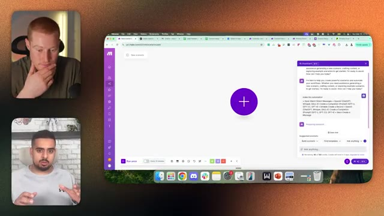
*⏱️ 00:05:06 — Capture d'écran montrant l'interface d'automatisation Make (anciennement Integromat) avec le panneau latéral de l'assistant IA ouvert à droite, et deux vignettes vidéo des présentateurs à gauche.*

---

### ⏱️ `[00:05:24 - 00:05:58]` | Segment #13

**🔊 Audio (Transcription Intégrale Mot pour Mot en Français) :**
> Maintenant, est-ce que ce sont exactement les bons modules selon votre cas d'usage ? Qui sait ? Ça dépend exactement de ce que vous essayez de faire. Mais cela nous a fait passer de la réflexion à l'action très rapidement. C'est vrai. Ça devrait être assez facile à rétro-concevoir pour genre connecter tout ça pour de vrai, j'en suis sûr. Plus facile que de devoir tout assembler un par un. Ouais. Maintenant, la partie difficile, la partie difficile entre guillemets, c'est juste de pouvoir se connecter à absolument tous les comptes, en ajoutant une clé API à OpenAI. Si vous n'avez jamais fait ça, c'est ça. S'authentifier sur Airtable et toute la partie administrative. Mais une grande partie du travail difficile consiste simplement à réfléchir et à imaginer qu'est-ce que je peux faire ? Donc si vous essayiez d'imaginer

**👁️ Analyse Visuelle d'Écran (gemini-3.5-flash-lite) :**
**Interface & Outils** : Make.com (anciennement Integromat), interface de scénario d'automatisation.

**Contenu textuel & Code** : Un flux comprenant 5 modules successifs : Slack (Watch Multiple Voice Messages), OpenAI (Create a Completion), Airtable (Create a Record), OpenAI (Create a Completion), et Slack (Create a Message).

**Action / Démonstration** : Présentation et explication visuelle du scénario automatisé combinant des outils de messagerie, d'intelligence artificielle et de base de données.

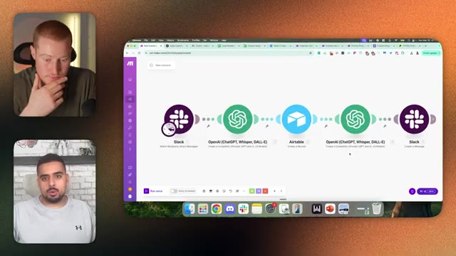
*⏱️ 00:05:33 — Capture d'écran montrant l'interface du créateur de flux d'automatisation Make.com avec des modules connectés (Slack, OpenAI, Airtable).*

---

### ⏱️ `[00:05:58 - 00:06:30]` | Segment #14

**🔊 Audio (Transcription Intégrale Mot pour Mot en Français) :**
> autre chose, alors prenons ceci maintenant, voyons si je peux créer un nouveau scénario, tout effacer, et je vais créer un nouveau scénario. Et nous allons aller ici et dire quelque chose comme, je veux créer une feuille Google Sheets où, lorsqu'une nouvelle ligne est ajoutée, nous prenons les informations de cette ligne, surtout si nous en recevons plusieurs à la fois, ce qui est le cas, et nous parcourons ces lignes, puis nous envoyons chacune de celles que nous recevons à OpenAI pour analyser un prospect et le qualifier selon certains critères. Et ensuite, nous retournons sur cette feuille Google Sheets et nous mettons à jour cette ligne avec un nouveau champ qui indique s'il est ou non

**👁️ Analyse Visuelle d'Écran (gemini-3.5-flash-lite) :**
**Interface & Outils** : Make.com (anciennement Integromat), navigateur web Chrome, macOS.

**Contenu textuel & Code** : Liste des applications (Flow Control, Make AI Tools, Tools, Google Sheets, OpenAI, Webhooks, Gmail) et panneau de l'assistant IA contextuel ("AI Assistant (BETA)").

**Action / Démonstration** : Le présentateur crée un nouveau scénario d'automatisation sur Make.com et explore l'interface d'ajout de modules avec l'aide de l'IA.

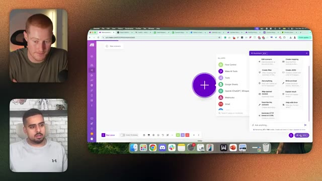
*⏱️ 00:06:06 — Interface de la plateforme Make.com montrant la création d'un nouveau scénario avec un panneau latéral d'assistant IA et la liste des applications disponibles.*

---

### ⏱️ `[00:06:30 - 00:06:50]` | Segment #15

**🔊 Audio (Transcription Intégrale Mot pour Mot en Français) :**
> qualifié, soit oui ou non. Maintenant, c'est une automatisation théoriquement super simple, mais si vous ne savez pas quel outil vous pourriez utiliser pour créer une itération ou une boucle à travers quelque chose, vous ne sauriez vraiment pas par où commencer. Donc cela va commencer à rédiger, vous pouvez voir ici, le plan, et cela devrait prendre probablement cinq à dix secondes de plus et créer le module entier.

**👁️ Analyse Visuelle d'Écran (gemini-3.5-flash-lite) :**
**Interface & Outils** : Make.com (navigateur Web Chrome) et interface de visioconférence.

**Contenu textuel & Code** : Panneau latéral de l'assistant IA Make avec un champ de saisie de texte décrivant un scénario d'automatisation (Google Sheets, itération, OpenAI).

**Action / Démonstration** : Saisie d'une description textuelle pour générer ou configurer un scénario d'automatisation complexe via l'assistant IA.

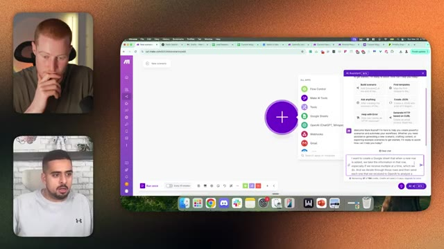
*⏱️ 00:06:35 — Capture d'écran montrant l'interface du créateur d'automatisation Make.com avec un assistant IA actif sur le côté droit de l'écran, ainsi que deux participants en visio sur la gauche.*

---

### ⏱️ `[00:06:51 - 00:07:11]` | Segment #16

**🔊 Audio (Transcription Intégrale Mot pour Mot en Français) :**
> Et vous pouvez voir juste là, il a été assez intelligent pour savoir, vous savez quoi, j'ai dit faire une boucle. Donc nous avons probablement besoin de cette chose appelée un itérateur. Et ce que fait un itérateur, c'est qu'il parcourt, si vous avez plusieurs réponses à la fois, ou dans ce cas, plusieurs lignes de Google Sheet ajoutées, et les enchaîne et met chacune en file d'attente à travers le processus afin que vous puissiez réellement faire une boucle à travers cette liste entière.

**👁️ Analyse Visuelle d'Écran (gemini-3.5-flash-lite) :**
**Interface & Outils** : Make.com (interface de création de scénarios et d'automatisation)

**Contenu textuel & Code** : Modules connectés en séquence : Google Sheets (Watch New Rows) -> Iterator -> OpenAI (ChatGPT, Whisper, DALL-E) -> Google Sheets (Update a Row)

**Action / Démonstration** : Le présentateur explique l'utilisation d'un module "Iterator" pour traiter plusieurs éléments ou réponses au sein d'un flux d'automatisation.

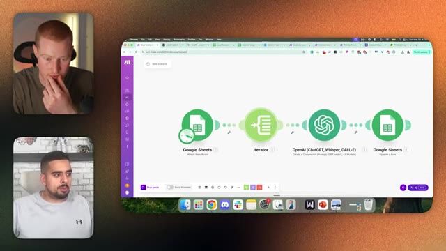
*⏱️ 00:06:56 — Vue d'ensemble d'un scénario Make (anciennement Integromat) montrant l'intégration de Google Sheets, d'un module "Iterator", d'OpenAI (ChatGPT) et d'un autre module Google Sheets.*

---

### ⏱️ `[00:07:11 - 00:07:33]` | Segment #17

**🔊 Audio (Transcription Intégrale Mot pour Mot en Français) :**
> Je vois. Moi, si je devais construire ça à partir de zéro, Iterator, pour une raison quelconque, ce mot me ferait juste peur. Je me dis, qu'est-ce que ça peut bien faire ? Donc le fait que ce soit du genre, oh, sait exactement ce que vous essayez d'accomplir, le placez là-dedans. Vous n'avez pas vraiment besoin d'y penser. Donc c'est bon à savoir. Oui, exactement. Et vous pouvez aller beaucoup plus en profondeur, surtout si vous voulez essayer quelque chose un peu plus compliqué, c'est-à-dire que vous pouvez demander, disons, un diagramme Mermaid pour une procédure plus complexe.

**👁️ Analyse Visuelle d'Écran (gemini-3.5-flash-lite) :**
**Interface & Outils** : Make.com (anciennement Integromat), Google Sheets, OpenAI (ChatGPT), visioconférence.

**Contenu textuel & Code** : Un scénario Make.com complet composé des modules : "Google Sheets (Watch New Rows)", "Iterator", "OpenAI (Create a Completion)" et "Google Sheets (Update a Row)".

**Action / Démonstration** : Le présentateur explique le fonctionnement du module "Iterator" dans un workflow Make.com automatisé reliant Google Sheets à l'API OpenAI.

*⏱️ 00:07:16 — Capture d'écran montrant l'interface du créateur de flux d'automatisation Make.com, avec le présentateur en haut à gauche et un invité en bas à gauche. Le flux comporte quatre étapes : Google Sheets, Iterator, OpenAI (ChatGPT) et Google Sheets.*

---

### ⏱️ `[00:07:33 - 00:07:53]` | Segment #18

**🔊 Audio (Transcription Intégrale Mot pour Mot en Français) :**
> Alors, si je dis quelque chose comme : « Bon, je veux créer un tout autre type d'automatisation. Je veux que tu imagines tout toi-même en utilisant les noms exacts des modules d'après la liste que je t'aie donnée. Crée un système pour noter et qualifier des prospects à grande échelle, en sachant que nous voulons utiliser quelque chose comme Google Sheets. Nous voulons utiliser Slack quelque part là-dedans. »

**👁️ Analyse Visuelle d'Écran (gemini-3.5-flash-lite) :**
**Interface & Outils** : Navigateur web affichant ChatGPT (modèle o3-mini-high) avec les flux et modules listés.

**Contenu textuel & Code** : Texte de prompt et réponse structurée listant des modules précis comme "Slack Watch Direct Messages", "OpenAI Create a Completion", et "Airtable Create a Record".

**Action / Démonstration** : Présentation de la réponse générée par l'IA détaillant les composants nécessaires à l'automatisation.

*⏱️ 00:07:38 — Capture d'écran montrant l'interface de ChatGPT générant des suggestions de modules d'automatisation sous forme de puces.*

---

### ⏱️ `[00:07:53 - 00:08:12]` | Segment #19

**🔊 Audio (Transcription Intégrale Mot pour Mot en Français) :**
> Nous voulons utiliser un Airtable quelque part là-dedans. Peux-tu simplement rédiger un processus complet et créer un diagramme Mermaid pour représenter ce flux en utilisant le nom exact des modules dont nous aurions besoin pour y parvenir ? Essaie de créer quelque chose qui soit efficace, utile et qui enrichisse évidemment les prospects que nous recevons réellement. Donc dans ce cas, tu peux réellement lui demander d'imaginer pour toi.

**👁️ Analyse Visuelle d'Écran (gemini-3.5-flash-lite) :**
**Interface & Outils** : Navigateur web (Google Chrome) affichant ChatGPT et la barre d'outils macOS.

**Contenu textuel & Code** : Réponse textuelle de ChatGPT listant les modules : Slack Watch Direct Messages, OpenAI (ChatGPT, Whisper, DALL-E) Create a Completion (Prompt), Airtable Create a Record, OpenAI Create a Completion, Slack Create a Message.

**Action / Démonstration** : Consultation de la réponse générée par l'intelligence artificielle pour identifier les modules nécessaires au flux d'automatisation.

*⏱️ 00:07:58 — Capture d'écran montrant l'interface de ChatGPT affichant une liste de modules d'automatisation demandés.*

---

### ⏱️ `[00:08:12 - 00:08:33]` | Segment #20

**🔊 Audio (Transcription Intégrale Mot pour Mot en Français) :**
> Donc maintenant, ça va prendre son temps, créer un diagramme Mermaid. Ensuite, je vais vous montrer comment vous pouvez réellement visualiser cela, que vous utilisiez ChatGPT ou Claude, et obtenir de l'aide pour inspirer le processus de ce que vous pouvez construire. Compris. Et vous obtenez quelque chose comme ça. Et si vous ne savez même pas ce qu'est Mermaid, cela crée des flux de travail pour vous très facilement d'une manière qui vous permet de visualiser n'importe quel processus.

**👁️ Analyse Visuelle d'Écran (gemini-3.5-flash-lite) :**
**Interface & Outils** : Navigateur web (Google Chrome), interface ChatGPT, macOS Dock.

**Contenu textuel & Code** : URL de ChatGPT (chatgpt.com), sélection du modèle "ChatGPT o3-mini-high", boîte de saisie de texte "Ask anything" avec options Search et Deep research, texte partiellement visible d'un prompt utilisateur concernant des modules et des flux.

**Action / Démonstration** : Navigation et présentation de l'interface ChatGPT pour l'utilisation de modèles de langage avancés.

*⏱️ 00:08:17 — Capture d'écran montrant une interface de navigateur web avec l'application ChatGPT (modèle o3-mini-high) affichée à l'écran, ainsi que deux vignettes vidéo des intervenants dans la partie gauche.*

---

### ⏱️ `[00:08:33 - 00:08:59]` | Segment #21

**🔊 Audio (Transcription Intégrale Mot pour Mot en Français) :**
> Donc si on prend ceci et qu'ensuite on va sur mermaidchart.com, vous pouvez l'utiliser pour, je crois, jusqu'à quatre ou cinq diagrammes gratuitement. Vous pouvez aussi utiliser l'éditeur en direct de Mermaid. Donc si vous allez dans l'éditeur en direct de Mermaid, allez sur l'espace de jeux, et qu'ensuite vous collez simplement cette charge utile, vous obtiendrez quelque chose comme ça, ce qui est super cool parce que vous pouvez commencer à auditer à quoi le processus devrait ressembler.

**👁️ Analyse Visuelle d'Écran (gemini-3.5-flash-lite) :**
**Interface & Outils** : Navigateur web affichant l'éditeur en ligne Mermaid Chart (Live Editor / Playground)

**Contenu textuel & Code** : Code source Mermaid d'un diagramme de flux de données (workflow de gestion de leads) et sa représentation graphique sous forme d'organigramme avec des boîtes et des flèches.

**Action / Démonstration** : Le présentateur montre comment utiliser l'éditeur en ligne de Mermaid Chart pour visualiser et éditer des diagrammes générés.

*⏱️ 00:08:40 — Le présentateur présente l'éditeur en direct de Mermaid Chart sur son écran d'ordinateur, affichant un organigramme de flux de travail à droite et son code source à gauche.*

---

### ⏱️ `[00:08:59 - 00:09:17]` | Segment #22

**🔊 Audio (Transcription Intégrale Mot pour Mot en Français) :**
> Donc, un nouveau prospect est ajouté à Google Sheets. Il indique que vous devriez utiliser un service appelé Clearbit pour enrichir le prospect. Utilisez OpenAI pour analyser la qualité du prospect. S'il s'agit d'un prospect qualifié, créez un enregistrement dans Airtable. Sinon, dites, par exemple, prospect qualifié. Sinon, dites prospect non qualifié. Et ensuite, s'il est qualifié, envoyez-le sur le canal Slack en disant alerte prospect qualifié.

**👁️ Analyse Visuelle d'Écran (gemini-3.5-flash-lite) :**
**Interface & Outils** : Navigateur web affichant un outil de création de diagrammes (Mermaid Chart).

**Contenu textuel & Code** : Diagramme textuel (éditeur à gauche) et visuel (à droite) représentant un flux de traitement de prospects : Clearbit Enrich Lead, OpenAI GPT Analyze Lead Quality, décision Qualified Lead, puis actions vers Airtable et Slack.

**Action / Démonstration** : Présentation visuelle et explication d'un workflow automatisé impliquant l'enrichissement de données et l'analyse par IA.

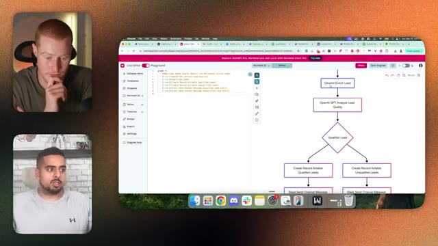
*⏱️ 00:09:03 — Un éditeur de diagramme affichant un organigramme de workflow avec des blocs logiques pour Clearbit, OpenAI et Airtable.*

---

### ⏱️ `[00:09:17 - 00:09:36]` | Segment #23

**🔊 Audio (Transcription Intégrale Mot pour Mot en Français) :**
> Et ensuite si vous voulez faire la même chose pour le prospect non qualifié. Mais le modèle mental ici c'est simplement que vous demandez, hé, voici ce que j'essaie d'automatiser. Voici en gros le genre de systèmes que j'utilise, propose quelque chose. Et cela vous aide juste à esquisser à quoi cela pourrait ressembler. Et puis encore une fois, vous passez de ceci à Make et ensuite vous avez cette boucle de rétroaction dans un sens et dans l'autre. Je vois.

**👁️ Analyse Visuelle d'Écran (gemini-3.5-flash-lite) :**
**Interface & Outils** : Navigateur web affichant un outil de création de diagrammes basé sur Mermaid.

**Contenu textuel & Code** : Code Mermaid et organigramme séquentiel : New Lead Added Google Sheets -> Clearbit Enrich Lead -> OpenAI GPT Analyze Lead Quality -> Condition "Qualified Lead".

**Action / Démonstration** : Visualisation d'un schéma d'automatisation de traitement des leads généré par code.

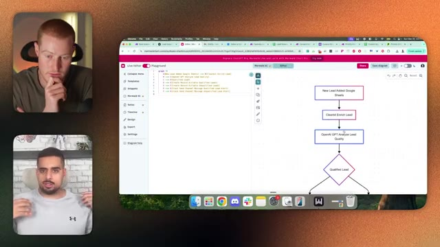
*⏱️ 00:09:22 — Un éditeur de diagramme Mermaid montrant un flux d'automatisation avec un code source à gauche et un schéma logique à droite.*

---

### ⏱️ `[00:09:36 - 00:10:08]` | Segment #24

**🔊 Audio (Transcription Intégrale Mot pour Mot en Français) :**
> Donc voilà comment vous pouvez utiliser quelques astuces juste pour commencer. Maintenant, ça vous va si je commence à passer en revue certaines des automatisations que nous avons préparées ? Bien sûr. Vas-y. Très bien. Entrons donc dans le vif du sujet. Donc si nous allons dans cette première automatisation ici, je vais juste faire un alignement automatique. C'est assez simple, elle recherche un événement Calendly sous la description de "vibe coding" et chaque fois que quelqu'un réserve effectivement ce Calendly, elle va extraire quelques variables différentes. Maintenant, pourquoi tenons-nous à extraire des variables ? Tout simplement parce que lorsque

**👁️ Analyse Visuelle d'Écran (gemini-3.5-flash-lite) :**
**Interface & Outils** : Navigateur web affichant un outil de diagramme/workflow (type Mermaid Chart) avec le code source à gauche et le schéma visuel à droite.

**Contenu textuel & Code** : Un organigramme de workflow de scoring de leads commençant par "New Lead Added Google Sheets", passant par "Clearbit Enrich Lead", "OpenAI GPT Analyze Lead Quality" puis une condition "Qualified Lead".

**Action / Démonstration** : Le présentateur présente et commente le flux d'automatisation des leads basé sur l'IA affiché à l'écran.

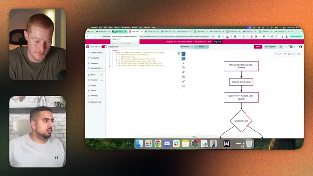
*⏱️ 00:09:44 — Capture d'écran montrant le présentateur et son invité en visioconférence à gauche, et à droite un diagramme d'automatisation des leads s'affichant dans un éditeur de type Mermaid ou outil de workflow.*

---

### ⏱️ `[00:10:08 - 00:10:44]` | Segment #25

**🔊 Audio (Transcription Intégrale Mot pour Mot en Français) :**
> vous exécutez des modules dans make.com et vous recevez ce qu'on appelle une charge utile d'informations, cette charge utile peut être très longue et ce sera super clair une fois qu'on aura réellement exécuté ceci, mais vous vous moquez probablement de 80 à 90 pour cent des données que vous obtenez, du moins pas en même temps. Donc vous utilisez cette étape appelée définir des variables multiples pour mettre en quelque sorte de côté ce qui vous intéresse. Afin de pouvoir vous y référer facilement plus tard. Et ensuite nous allons utiliser cette étape perplexity pour faire des recherches sur le prospect qui a réservé cette session de codage intuitif avec nous, et ensuite utiliser perplexity pour cela. Si vous n'êtes pas familiarisé avec ce qu'est perplexity,

**👁️ Analyse Visuelle d'Écran (gemini-3.5-flash-lite) :**
**Interface & Outils** : Make.com (interface de scénario d'automatisation)

**Contenu textuel & Code** : Configuration de variables pour le nom, prénom et nom complet (First Name, Last Name, Full Name) avec des données issues de Calendly, connectées à OpenAI et Google Sheets.

**Action / Démonstration** : Configuration des variables dans le module "Tools" (Set multiple variables) au sein du parcours d'automatisation Make.com.

*⏱️ 00:10:17 — Vue d'un scénario Make.com avec les modules Calendly, Tools, OpenAI et Google Sheets, affichant une fenêtre contextuelle pour configurer les variables.*

---

### ⏱️ `[00:10:44 - 00:11:06]` | Segment #26

**🔊 Audio (Transcription Intégrale Mot pour Mot en Français) :**
> C'est fondamentalement un outil pour vous aider à faire des recherches sur Internet qui possède une API capable de communiquer avec l'Internet en direct par rapport à la plupart des API qui ont juste, pour ainsi dire, des connaissances statiques provenant du modèle de langage lui-même. Nous avons donc ici une invite qui dit : résumez le parcours professionnel et toute information pertinente concernant et ensuite, dans ce cas, le nom, l'adresse e-mail, puis l'entreprise, et ensuite tout le reste en termes d'informations qui s'y trouvent.

**👁️ Analyse Visuelle d'Écran (gemini-3.5-flash-lite) :**
**Interface & Outils** : Make.com (anciennement Integromat), interface de navigateur web avec panneau de configuration de module Perplexity AI ouvert.

**Contenu textuel & Code** : Schéma d'automatisation reliant Calendly à Perplexity AI pour résumer des profils professionnels, puis enregisrant les résultats dans Google Sheets.

**Action / Démonstration** : Configuration d'un scénario d'automatisation montrant comment l'outil Perplexity AI traite les données textuelles en direct.

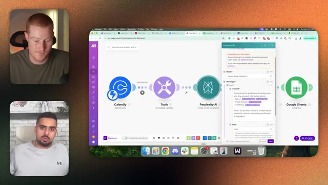
*⏱️ 00:10:50 — Capture d'écran montrant l'interface du créateur de flux Make.com au centre avec des intégrations Calendly, Outils, Perplexity AI et Google Sheets, ainsi que deux intervenants en visioconférence dans des cadres à gauche.*

---

### ⏱️ `[00:11:06 - 00:11:29]` | Segment #27

**🔊 Audio (Transcription Intégrale Mot pour Mot en Français) :**
> Nous le configurons comme ce que l'on appelle une invite utilisateur. Vous avez généralement deux types d'invites, une invite système et une invite utilisateur. La plupart des gens, lorsque vous écrivez des invites à Claude ou GPT, vous envoyez une invite utilisateur. Une invite système consiste essentiellement à dire à l'invite elle-même, genre, voici le personnage que tu dois adopter, ou voici le format de sortie que tu dois avoir. C'est beaucoup plus de haut niveau, tandis qu'une invite utilisateur est beaucoup plus détaillée, comme celle que nous utilisons ici.

**👁️ Analyse Visuelle d'Écran (gemini-3.5-flash-lite) :**
**Interface & Outils** : Make.com (interface d'automatisation de flux de travail)

**Contenu textuel & Code** : Un scénario Make montrant les modules Calendly, Tools, Perplexity AI et Google Sheets, ainsi qu'un champ de configuration de message avec le rôle "User" et un texte d'invite demandant de résumer le parcours professionnel.

**Action / Démonstration** : Configuration d'un module d'IA (Perplexity AI) pour définir une invite utilisateur (User prompt) basée sur les données d'un événement Calendly.

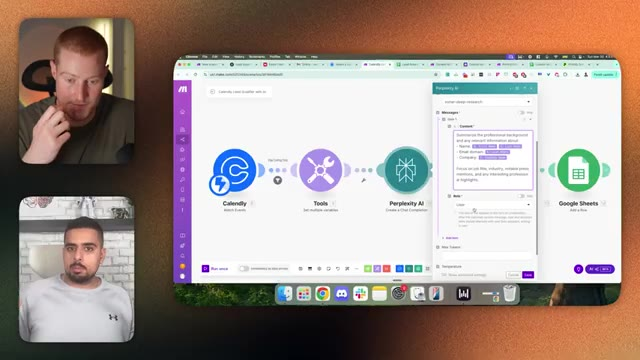
*⏱️ 00:11:12 — Vue d'un flux de travail Make (anciennement Integromat) connectant Calendly, des variables, Perplexity AI et Google Sheets, avec une fenêtre de configuration d'invite.*

---

### ⏱️ `[00:11:29 - 00:11:51]` | Segment #28

**🔊 Audio (Transcription Intégrale Mot pour Mot en Français) :**
> Une fois qu'il fait des recherches sur ce prospect, nous l'introduisons ensuite dans OpenAI, juste pour faire en gros une synthèse supplémentaire des recherches que nous avons faites à son sujet. Et puis une fois que nous avons cela, vous verrez ici le prompt. Il dira, veuillez résumer ce texte. Et vous remarquerez qu'avec Make et N8N et toutes sortes d'outils, c'est qu'il transporte toujours la dernière partie de l'automatisation, mais en gros ce qu'était le résultat.

**👁️ Analyse Visuelle d'Écran (gemini-3.5-flash-lite) :**
**Interface & Outils** : Make.com (anciennement Integromat), navigateur web Google Chrome.

**Contenu textuel & Code** : Un scénario d'automatisation avec des nœuds pour Calendly, des variables (Tools), Perplexity AI et OpenAI (ChatGPT), avec une fenêtre de configuration de connexion OpenAI ouverte à droite.

**Action / Démonstration** : Présentation et configuration des étapes du workflow d'automatisation connectant la recherche de prospects par l'IA à OpenAI.

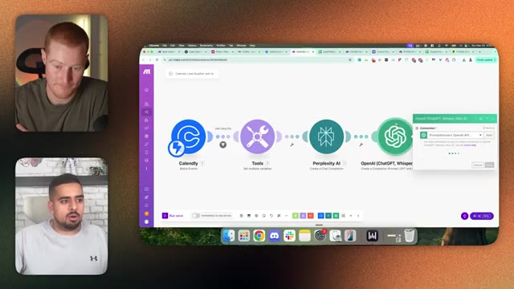
*⏱️ 00:11:35 — Capture d'écran montrant un flux de travail Make.com intégrant Calendly, des outils, Perplexity AI et OpenAI (ChatGPT).*

---

### ⏱️ `[00:11:51 - 00:12:10]` | Segment #29

**🔊 Audio (Transcription Intégrale Mot pour Mot en Français) :**
> Donc, de Perplexity, nous obtiendrons quelques éléments différents de, encore une fois, charge utile. Celui qui nous intéresse est quel que soit le message, qui est la finalisation de la recherche sur ce prospect. Et ensuite, nous dirons quelques choses comme résumer l'entrée finale en retournant un objet JSON. Et JSON est fondamentalement, encore une fois, un format structuré pour recevoir cette information.

**👁️ Analyse Visuelle d'Écran (gemini-3.5-flash-lite) :**
**Interface & Outils** : Make.com (anciennement Integromat), navigateur web affichant un flux d'automatisation (workflow).

**Contenu textuel & Code** : Workflow d'automatisation comprenant les modules Calendly (Watch Events), Tools (Set multiple variables), Perplexity AI (Create a Chat Completion) et OpenAI (Create a Completion). Un panneau latéral montre le contenu textuel d'un prompt demandant de résumer un texte et de le structurer sous format JSON.

**Action / Démonstration** : Configuration et visualisation d'un flux d'automatisation d'intelligence artificielle combinant Calendly, Perplexity et OpenAI pour qualifier des prospects.

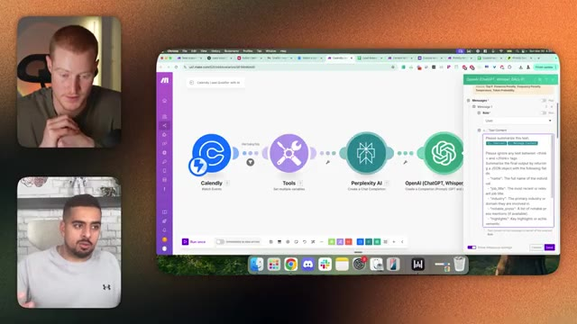
*⏱️ 00:11:56 — Vue d'ensemble d'un scénario Make.com connectant Calendly, des outils, Perplexity AI et OpenAI (ChatGPT) avec un panneau latéral de configuration de prompt.*

---

### ⏱️ `[00:12:10 - 00:12:29]` | Segment #30

**🔊 Audio (Transcription Intégrale Mot pour Mot en Français) :**
> et on lui dit fondamentalement, voilà ce qui nous importe. Nous voulons le nom, nous voulons l'intitulé du poste, nous voulons le secteur d'activité, la presse notable, les points clés, un résumé général, et cetera. Et ensuite, nous voulons consigner cela dans un Google Sheet juste ici. C'est donc le Google Sheet. Nous voulons que ces champs soient associés à ce tableau. Et la façon de faire est assez simple.

**👁️ Analyse Visuelle d'Écran (gemini-3.5-flash-lite) :**
**Interface & Outils** : Make.com (anciennement Integromat) et navigateur web.

**Contenu textuel & Code** : Un scénario Make.com comprenant les modules Calendly (Watch Events), Tools (Set multiple variables) et Perplexity AI (Create a Chat Completion), avec le prompt configuré pour extraire les informations clés (nom, intitulé de poste, secteur, etc.) au format JSON.

**Action / Démonstration** : Présentation de la configuration des différents modules du scénario d'automatisation pour traiter les données de Calendly et générer un résumé structuré via Perplexity.

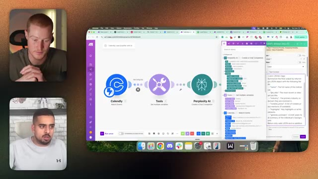
*⏱️ 00:12:15 — Capture d'écran montrant l'interface du créateur de flux d'automatisation Make.com, avec trois étapes connectées (Calendly, Outils, Perplexity AI) ainsi qu'un panneau de configuration textuel à droite.*

---

### ⏱️ `[00:12:29 - 00:12:54]` | Segment #31

**🔊 Audio (Transcription Intégrale Mot pour Mot en Français) :**
> Lorsque vous cliquez sur « ajouter une ligne », tant que vous êtes réellement lié au Google Sheet lui-même, c'est-à-dire que vous vous êtes authentifié et que vous vous êtes connecté à votre compte Google Sheet, vous pouvez alors dire : je veux écrire n'importe quoi depuis cette automatisation vers la recherche de prospects. Et ensuite, vous lui dites : laissez-moi faire correspondre cela étape par étape. Pour le nom dans cette colonne, je veux que vous y placiez cette information, qui est le résultat d'OpenAI pour le nom, le résultat pour le secteur d'activité, et ainsi de suite.

**👁️ Analyse Visuelle d'Écran (gemini-3.5-flash-lite) :**
**Interface & Outils** : Make (anciennement Integromat), Google Sheets, Calendly, Perplexity AI.

**Contenu textuel & Code** : Configuration du module Google Sheets pour ajouter une ligne avec des variables mappées (Name, Industry) issues des étapes précédentes.

**Action / Démonstration** : Configuration des paramètres de connexion et de sélection du fichier Google Sheet dans le constructeur d'automatisation Make.

*⏱️ 00:12:35 — Vue d'un flux d'automatisation sur Make montrant l'intégration de Google Sheets avec les champs de connexion et de mappage des données.*

---

### ⏱️ `[00:12:54 - 00:13:15]` | Segment #32

**🔊 Audio (Transcription Intégrale Mot pour Mot en Français) :**
> Et une fois que vous avez terminé le mappage, vous avez maintenant l'automatisation prête à l'emploi. Donc si vous cliquez simplement sur lecture, très bien, et que je vais sur mon calendrier hypothétique ici et que je vais réserver. Très bien. Donc je vais juste dire Brock M Brock arobase vibe coding point com vibe coding pro planifier l'événement.

**👁️ Analyse Visuelle d'Écran (gemini-3.5-flash-lite) :**
**Interface & Outils** : Make.com (interface de création de scénarios d'automatisation)

**Contenu textuel & Code** : Workflow d'automatisation étape par étape : Calendly (Watch Events) -> Tools -> Perplexity AI -> OpenAI -> Google Sheets

**Action / Démonstration** : Présentation et explication du flux d'automatisation complet configuré avec différentes applications et outils d'intelligence artificielle.

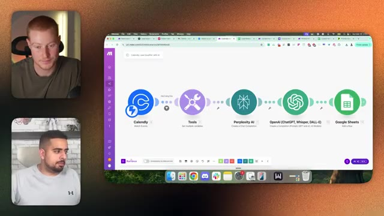
*⏱️ 00:12:59 — Vue d'ensemble d'un flux d'automatisation sur Make.com connectant Calendly, des outils, Perplexity AI, OpenAI et Google Sheets, avec les deux participants visibles dans des fenêtres vidéo sur le côté.*

---

### ⏱️ `[00:13:15 - 00:13:35]` | Segment #33

**🔊 Audio (Transcription Intégrale Mot pour Mot en Français) :**
> Très bien. Donc ça devrait passer. Vous verrez ici que nous avons reçu une notification à ce sujet. Et comme je l'ai dit avant, vous obtenez tout cela. Si vous allez dans ces petits lots de sortie, c'est tout ce que vous obtenez. Maintenant, est-ce que 90 % de cela vous importe ? Est-ce que le numéro de rappel par SMS vous importe ? Non, probablement pas. Est-ce que les notes de réunion vous importent ?

**👁️ Analyse Visuelle d'Écran (gemini-3.5-flash-lite) :**
**Interface & Outils** : Make.com (anciennement Integromat), Calendly, Perplexity AI, OpenAI, Google Sheets, navigateur web.

**Contenu textuel & Code** : Un scénario d'automatisation reliant Calendly à des outils d'IA et Google Sheets, avec un panneau de résultats affichant les données JSON brutes de Calendly (informations de réservation, liens, e-mails).

**Action / Démonstration** : Le présentateur montre le panneau de sortie (output bundle) d'une étape de l'automatisation pour expliquer les données récupérées.

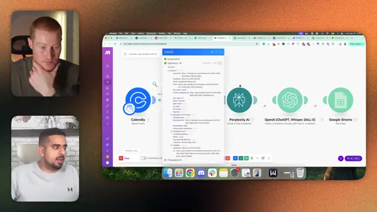
*⏱️ 00:13:20 — Un écran d'ordinateur affichant un workflow Make.com avec Calendly, Perplexity AI, OpenAI et Google Sheets, ainsi qu'une fenêtre contextuelle montrant les données de sortie d'une opération Calendly.*

---

### ⏱️ `[00:13:35 - 00:14:02]` | Segment #34

**🔊 Audio (Transcription Intégrale Mot pour Mot en Français) :**
> Peut-être, mais dans ce cas, c'est pour cela que nous configurons les variables. Ce que nous avons obtenu de cette sortie ici, si nous allons dans les lots de sortie, c'est que nous nous soucions simplement d'extraire le prénom, le nom, le nom complet, l'e-mail du prospect, le nom de l'entreprise, et cetera. C'est exact, et vous pourriez extraire n'importe quelle variable personnalisée pour tout ce qui s'y trouve, selon le cas d'utilisation que vous recherchez, mais ce sont juste les éléments que nous avons choisis aussi, parce que c'est la seule information qui doit être mappée dans nos feuilles Google Sheets, essentiellement.

**👁️ Analyse Visuelle d'Écran (gemini-3.5-flash-lite) :**
**Interface & Outils** : Navigateur web affichant Make.com (anciennement Integromat), avec deux flux vidéo des présentateurs dans de petites fenêtres sur le côté gauche.

**Contenu textuel & Code** : Données JSON au format texte : First Name ("Brock"), Last Name ("M"), Full Name ("Brock M"), Lead Email ("brock@vibecoding.com"), Company Name ("Vibe Coding.Pro").

**Action / Démonstration** : Le présentateur explique et examine le contenu d'un lot de données (bundle content) issu d'un module Make.com pour vérifier les variables extraites.

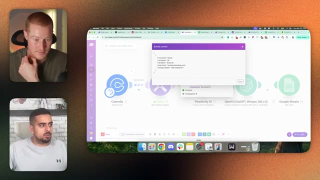
*⏱️ 00:13:42 — Capture d'écran montrant l'interface de Make.com avec une fenêtre de contenu de lot (Bundle content) affichant des données JSON extraites.*

---

### ⏱️ `[00:14:02 - 00:14:23]` | Segment #35

**🔊 Audio (Transcription Intégrale Mot pour Mot en Français) :**
> Ouais, et la chose magnifique, c'est qu'une fois que vous avez obtenu cette information, ou plutôt que vous l'avez reçue, vous pouvez toujours y faire référence par la suite. Donc même si vous construisez une partie de votre automatisation 10 étapes plus tard, vous aurez toujours cette charge utile de calendrier à laquelle revenir si vous avez besoin de récupérer des informations ou d'ajouter différentes variables que vous n'aviez pas reçues auparavant parce que vous n'aviez pas réellement pensé à la prochaine étape que vous vouliez ajouter dans votre automatisation.

**👁️ Analyse Visuelle d'Écran (gemini-3.5-flash-lite) :**
**Interface & Outils** : Make.com (Integromat)

**Contenu textuel & Code** : Structure de données (payload) affichant les détails de l'événement Calendly (nom, e-mail, date, liens) et les modules connectés (Calendly, Perplexity, OpenAI, Google Sheets).

**Action / Démonstration** : Explication de la réutilisation des données (charge utile / payload) issues des étapes précédentes dans un parcours d'automatisation.

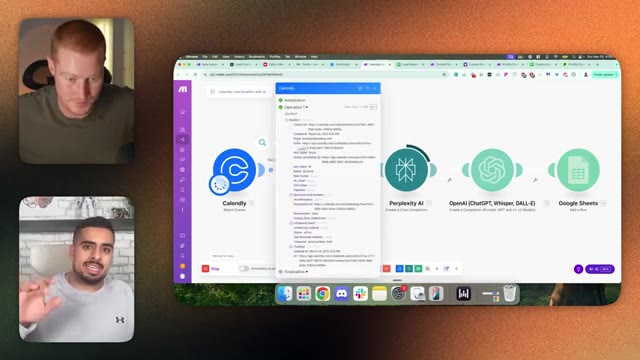
*⏱️ 00:14:07 — Capture d'écran montrant l'interface de Make.com avec un scénario d'automatisation reliant Calendly, Perplexity AI, OpenAI et Google Sheets, avec la fenêtre de sortie (payload) ouverte pour le module Calendly.*

---

### ⏱️ `[00:14:23 - 00:14:48]` | Segment #36

**🔊 Audio (Transcription Intégrale Mot pour Mot en Français) :**
> Exact. Maintenant, dans ce cas... Eh bien, si c'est passé par la coche, cela signifie évidemment que c'est passé par chacune de ces étapes. Donc, oh, on dirait que je viens en fait juste de terminer toutes les étapes. Ouais. Donc, dans ce cas, une remarque ici est que Perplexity a quelques modèles différents. Il a Sonar, qui est la recherche fondamentale, il a Sonar Pro, qui l'est légèrement plus. Il a Reasoning et Reasoning Pro, qui utilisent fondamentalement les modèles de raisonnement comme o3-mini ou 3.7 Sonnet de Claude pour s'ajouter afin de synthétiser réellement tout ce qu'il a cherché.

**👁️ Analyse Visuelle d'Écran (gemini-3.5-flash-lite) :**
**Interface & Outils** : Make.com (navigateur web Google Chrome) et double flux vidéo des intervenants dans des cadres latéraux.

**Contenu textuel & Code** : Un scénario Make nommé 'Calendly Lead Qualifier with AI' affichant les étapes successives : Calendly (Watch Events), Tools (Set multiple variables), Perplexity AI (Create a Chat Completion), OpenAI (Create a Completion) et Google Sheets (Add a row).

**Action / Démonstration** : Le présentateur explique et commente le flux d'automatisation validé montrant l'enchaînement de chaque étape du processus.

*⏱️ 00:14:29 — Capture d'écran montrant l'interface du créateur d'automatisation Make (anciennement Integromat) avec un flux de travail complet connectant Calendly, des outils, Perplexity AI, OpenAI et Google Sheets.*

---

### ⏱️ `[00:14:48 - 00:15:22]` | Segment #37

**🔊 Audio (Transcription Intégrale Mot pour Mot en Français) :**
> Et ensuite, il y a la recherche approfondie, qui est d'une part beaucoup plus coûteuse, mais d'autre part, elle est beaucoup plus complète. Maintenant, j'ai prédestiné cette automatisation à l'échec en mettant une vraie personne, Brock, sans ton nom de famille, et une entreprise non réelle et un nom non réel. Donc je ne m'attends pas à des étincelles ici. Et pourtant, d'une manière ou d'une autre, il a trouvé que Brock M est Brock Messerich. Oh, probablement parce que le "vibe coding" apparaît dans tes titres YouTube. Donc tu vois, c'est ça la puissance de la recherche approfondie. Je lui ai donné une entrée tellement mauvaise et on a quand même réussi à obtenir quelque chose. Et si nous allons à cette ligne ici et

**👁️ Analyse Visuelle d'Écran (gemini-3.5-flash-lite) :**
**Interface & Outils** : Navigateur web affichant l'interface de la plateforme Make.

**Contenu textuel & Code** : Un scénario d'automatisation comprenant les applications suivantes : Calendly, Tools (variables), Perplexity AI, OpenAI (ChatGPT) et Google Sheets.

**Action / Démonstration** : Présentation et explication du parcours d'automatisation connectant divers outils d'IA et de gestion de données.

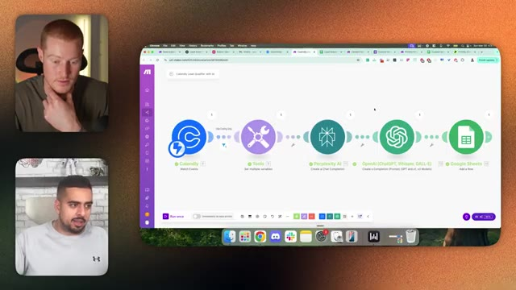
*⏱️ 00:14:57 — Vue d'un flux d'automatisation sur Make (anciennement Integromat) montrant l'enchaînement de différents services reliés entre eux.*

---

### ⏱️ `[00:15:22 - 00:15:47]` | Segment #38

**🔊 Audio (Transcription Intégrale Mot pour Mot en Français) :**
> fais un zoom arrière d'un tout petit peu. Très rapidement, laissez-moi prendre 10 secondes pour dire que, si vous voulez utiliser make.com, il y a un lien dans la description pour vous inscrire. Cela vous donnera accès à un mois de leur forfait pro gratuitement, ainsi qu'à 10 000 opérations par mois. Maintenant, retour à la vidéo. Très bien, nous avons Brock, nous avons le développement de logiciels assisté par l'IA dans l'industrie. Bien joué. Vous avez été promu à cette industrie. Créateur de contenu, éducateur en IA, ça vous va vraiment très bien.

**👁️ Analyse Visuelle d'Écran (gemini-3.5-flash-lite) :**
**Interface & Outils** : Google Sheets, macOS Dock

**Contenu textuel & Code** : Tableau de recherche de prospects (Lead Research) contenant le nom de Brock Mesarich, son secteur (AI-assisted Software Development / Vibe Coding), son rôle et un résumé biographique.

**Action / Démonstration** : Consultation et présentation d'un tableur Google Sheets contenant des données de recherche de prospects.

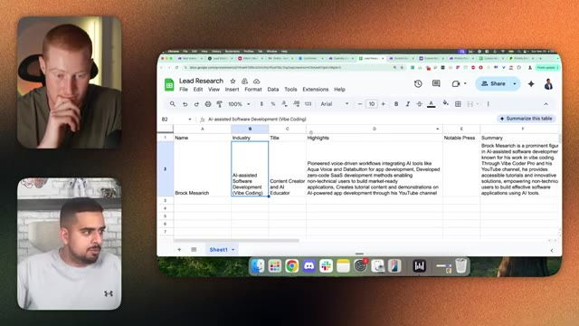
*⏱️ 00:15:41 — Vue d'écran montrant Google Sheets (Lead Research) avec des informations sur Brock Mesarich, accompagné de deux petits cadres vidéo des intervenants.*

---

### ⏱️ `[00:15:47 - 00:16:22]` | Segment #39

**🔊 Audio (Transcription Intégrale Mot pour Mot en Français) :**
> Et ensuite ça met en valeur tout ce que tu fais, comme parler d'Aqua voice, de data button, tu sais c'est super cool ouais et ensuite un résumé de euh qui tu es donc tu es clairement une figure importante je suis très privilégié de te parler mon ami c'est tellement gentil perplexité j'apprécie c'est très très très gentil oh l'ami cool donc c'est l'automatisation numéro un euh des questions là-dessus avant que je passe à la suivante non je pense que tout ça est génial je pense je veux dire ça a l'air d'être un cas d'usage assez pratique pour n'importe qui spécifiquement si tu es propriétaire d'entreprise évidemment tu sais si tu as

**👁️ Analyse Visuelle d'Écran (gemini-3.5-flash-lite) :**
**Interface & Outils** : Google Sheets, navigateur web Google Chrome sur macOS.

**Contenu textuel & Code** : Texte descriptif sur Brock Mesarich, mentionnant son travail dans le développement logiciel assisté par l'IA ("vibe coding"), l'utilisation d'Aqua Voice et Databutton, et son contenu YouTube.

**Action / Démonstration** : Présentation à l'écran d'un résumé biographique généré automatiquement ou compilé dans un tableau de recherche.

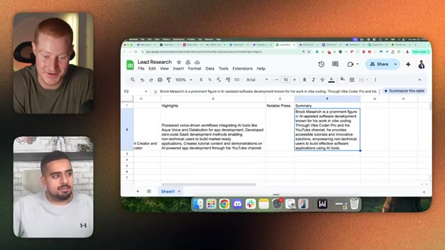
*⏱️ 00:15:56 — Un tableur Google Sheets affichant des informations de recherche sur Brock Mesarich, avec des colonnes "Highlights", "Notable Press" et "Summary".*

---

### ⏱️ `[00:16:22 - 00:16:47]` | Segment #40

**🔊 Audio (Transcription Intégrale Mot pour Mot en Français) :**
> les gens qui réservent des événements sur le calendrier, pourquoi ne pas simplement avoir une sorte d'automatisation où vous pourriez rechercher automatiquement cette personne et ensuite, je ne sais pas, vous faire gagner du temps pour que vous n'ayez pas à perdre votre temps avant une réunion à faire des recherches sur quelqu'un. Donc oui, j'aime bien ce cas d'utilisation, il a l'air assez simple à configurer. Passons au suivant. Cool. Faisons ça. Donc le suivant est un assistant de recherche de contenu. Allons donc ici et nous allons juste aligner automatiquement et nous allons zoomer à nouveau.

**👁️ Analyse Visuelle d'Écran (gemini-3.5-flash-lite) :**
**Interface & Outils** : Make.com (anciennement Integromat), navigateur web Google Chrome

**Contenu textuel & Code** : Workflow d'automatisation avec les modules : Calendly (Watch Events), Tools, Perplexity AI, OpenAI (ChatGPT) et Google Sheets.

**Action / Démonstration** : Présentation du scénario d'automatisation pour qualifier automatiquement les prospects issus des réservations de calendrier.

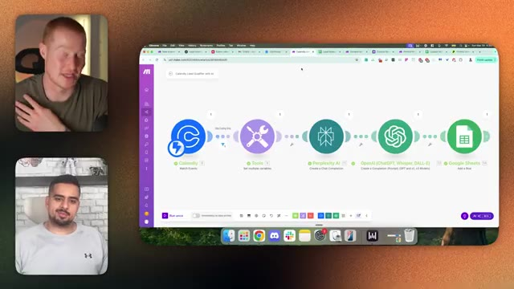
*⏱️ 00:16:28 — Capture d'écran montrant le flux d'automatisation sur Make.com connectant Calendly à Perplexity AI, OpenAI et Google Sheets.*

---

### ⏱️ `[00:16:47 - 00:17:10]` | Segment #41

**🔊 Audio (Transcription Intégrale Mot pour Mot en Français) :**
> maintenant que nous sommes familiers avec ce qu'est Perplexity. Question, une question. Désolé de t'interrompre. Donc pour tout cela, nous avons utilisé cet outil initial dont nous avons parlé au début, comme ce petit truc pour créer ce flux. Et maintenant, c'est à nous d'aller configurer chacun de ceux-ci, n'est-ce pas ? Oui, donc dans ce cas, je commence toujours par ce truc en y réfléchissant, puis je commence à affiner les petits modules dont j'ai besoin au fur et à mesure que je commence à le construire.

**👁️ Analyse Visuelle d'Écran (gemini-3.5-flash-lite) :**
**Interface & Outils** : Make.com (anciennement Integromat), interface de configuration de scénario d'automatisation.

**Contenu textuel & Code** : Configuration du module Perplexity AI affichant les champs « Connection », « Model », et un champ « Messages » contenant un prompt de recherche de tendances avec des instructions détaillées.

**Action / Démonstration** : Configuration des paramètres et des messages du module Perplexity AI au sein d'un flux d'automatisation comprenant des blocs Iterator, Google Sheets et Tools.

*⏱️ 00:16:53 — Capture d'écran montrant l'interface de Make.com avec un flux de travail automatisé et une fenêtre de configuration pour l'intégration de Perplexity AI.*

---

### ⏱️ `[00:17:10 - 00:17:33]` | Segment #42

**🔊 Audio (Transcription Intégrale Mot pour Mot en Français) :**
> Compris, c'est logique. Oui, donc si on retourne sur Perplexity, nous avons ici un prompt spécifique et je vais faire un zoom. Donc, rechercher des sujets tendance. Vous pourriez même appeler ça, je peux modifier ça à la volée. Rechercher des sujets d'IA tendance. Et ensuite, veuillez identifier les tendances les plus récentes de la semaine passée et inclure des analyses provenant de sources fiables comme Google Trends, les plateformes de réseaux sociaux et les rapports de l'industrie.

**👁️ Analyse Visuelle d'Écran (gemini-3.5-flash-lite) :**
**Interface & Outils** : Navigateur web affichant Make.com (anciennement Integromat) avec des fenêtres de visioconférence des intervenants sur le côté gauche.

**Contenu textuel & Code** : Configuration du module Perplexity AI affichant le texte du prompt : "Research trending topics. Please identify the most recent trends from the past week..." et le workflow global incluant Google Sheets, Tools, OpenAI et Gmail.

**Action / Démonstration** : Le présentateur explique la configuration d'un module d'IA (Perplexity) au sein d'un scénario d'automatisation Make.com.

*⏱️ 00:17:16 — Vue d'un flux Make.com intégrant un module Perplexity AI avec une fenêtre de configuration ouverte montrant un prompt de recherche de tendances.*

---

### ⏱️ `[00:17:33 - 00:17:53]` | Segment #43

**🔊 Audio (Transcription Intégrale Mot pour Mot en Français) :**
> Concentrez-vous sur la technologie de l'IA. Fournissez un résumé sous forme de puces avec des exemples et des citations pour chaque tendance. Si possible, incluez des prévisions pour la croissance ou l'impact futur. Et encore une fois ici, nous nous soucions du format de la sortie. Vous pouvez donc dire, fournissez un objet JSON avec toutes ces métadonnées ou toutes ces informations. Et tout ce que nous voulons, c'est qu'il renvoie le JSON.

**👁️ Analyse Visuelle d'Écran (gemini-3.5-flash-lite) :**
**Interface & Outils** : Make.com (anciennement Integromat)

**Contenu textuel & Code** : Invite textuelle de configuration pour un module d'IA : "Research trending AI topics. Please identify the most recent trends from the past week... Provide a summary in bullet points with examples and citations for each trend. If possible, include predictions for future growth or impact."

**Action / Démonstration** : Configuration d'un prompt dans un workflow d'automatisation d'intelligence artificielle.

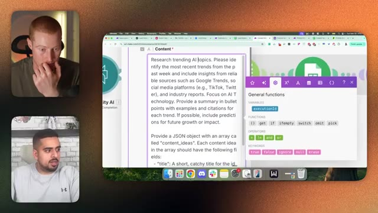
*⏱️ 00:17:38 — Capture d'écran montrant une interface de workflow Make (Integromat) avec une invite textuelle demandant un résumé des tendances en IA avec exemples, citations et prévisions.*

---

### ⏱️ `[00:17:53 - 00:18:19]` | Segment #44

**🔊 Audio (Transcription Intégrale Mot pour Mot en Français) :**
> Parce qu'une fois que nous avons cela, nous pouvons le réutiliser dans différentes parties de l'automatisation. Bien sûr. C'est comme nous en parlions dans l'automatisation précédente. Il y a tout un tas de jargon. Nous voulons seulement que ces quelques champs personnalisés soient repris dans les étapes suivantes. Eh bien, oui, nous allons créer, fondamentalement, Perplex va réellement utiliser un LLM pour synthétiser ce qu'il trouve. Il va nous donner une charge utile. Je veux m'assurer que cette réponse est dans un format que nous pouvons recycler pour d'autres automatisations de traitement qui devaient être au format JSON.

**👁️ Analyse Visuelle d'Écran (gemini-3.5-flash-lite) :**
**Interface & Outils** : Make (anciennement Integromat), Google Sheets, OpenAI, navigateur web Chrome.

**Contenu textuel & Code** : Un scénario d'automatisation complet avec des nœuds pour Perplexity AI, Google Sheets, un outil d'agrégation, OpenAI et Gmail, ainsi qu'une fenêtre de configuration d'un module affichant du texte et des paramètres (rôle utilisateur, Max Tokens, Temperature).

**Action / Démonstration** : Configuration et explication d'un flux d'automatisation d'IA intégrant plusieurs applications pour traiter et réutiliser des données.

*⏱️ 00:17:59 — Vue d'écran de l'interface Make montrant le flux d'automatisation avec Make, Google Sheets et OpenAI, avec deux participants visibles dans des fenêtres vidéo sur le côté gauche.*

---

### ⏱️ `[00:18:19 - 00:18:54]` | Segment #45

**🔊 Audio (Transcription Intégrale Mot pour Mot en Français) :**
> Compris. Je vois. Et pour tous ceux qui ne le savent pas, JSON signifie JavaScript Object Notation. C'est donc, encore une fois, une façon d'échanger des données via des API. Donc si on clique simplement ici, maintenant nous allons analyser ce JSON que nous avons demandé. Ensuite, nous allons parcourir ces éléments car évidemment, si nous recevons plusieurs passages surlignés ou plusieurs tendances d'actualité, si vous voulez créer une newsletter pour vous-même sur ce qui se passe, nous devons les parcourir. Si vous voulez le stocker dans une feuille Google Sheet, nous pouvons le faire. Et ensuite, nous pouvons agréger ce texte. Vous pouvez donc voir ici que je crée simplement ce qu'on appelle une nouvelle ligne. En gros, je formate toutes les informations que nous avons récupérées

**👁️ Analyse Visuelle d'Écran (gemini-3.5-flash-lite) :**
**Interface & Outils** : Navigateur web affichant Make.com

**Contenu textuel & Code** : Workflow d'automatisation avec les modules : Perplexity AI, JSON, Iterator, Google Sheets, Tools, OpenAI, Gmail.

**Action / Démonstration** : Le présentateur explique et analyse le module JSON dans l'automatisation.

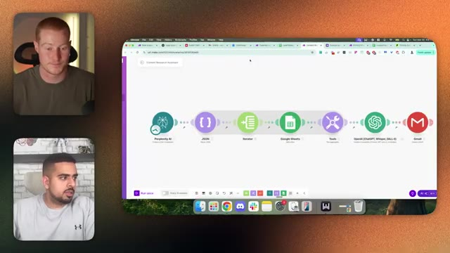
*⏱️ 00:18:28 — Vue d'écran de l'interface Make.com montrant un workflow automatisé reliant Perplexity AI, un module JSON, un Iterator, Google Sheets, Tools, OpenAI et Gmail. Deux intervenants apparaissent en vignettes sur la gauche.*

---

### ⏱️ `[00:18:54 - 00:19:13]` | Segment #46

**🔊 Audio (Transcription Intégrale Mot pour Mot en Français) :**
> de l'analyser de manière itérée. Et nous le préparons pour l'envoyer dans OpenAI. Et ce qu'OpenAI va faire est un peu différent de ce que nous avons vu jusqu'à présent. Nous lui disons donc ici, renvoie le résultat en utilisant des éléments HTML. Maintenant, qu'est-ce que cela signifie en français simple ? Le HTML est principalement ce qui est utilisé pour créer les sites Web, le HTML et le CSS.

**👁️ Analyse Visuelle d'Écran (gemini-3.5-flash-lite) :**
**Interface & Outils** : Make.com (anciennement Integromat) et le panneau de configuration du module d'intégration OpenAI (ChatGPT).

**Contenu textuel & Code** : Configuration du module OpenAI avec les paramètres du modèle "o3-mini (system)", les options de connexion, et les champs de tokens de complétion maximale configurés à 2048.

**Action / Démonstration** : Configuration et paramétrage d'un module d'automatisation Make.com connectant un flux de données à l'API d'OpenAI.

*⏱️ 00:18:59 — Capture d'écran montrant l'interface du créateur de flux Make.com avec un panneau de configuration ouvert pour le module OpenAI, configurant un modèle de type o3-mini.*

---

### ⏱️ `[00:19:13 - 00:19:41]` | Segment #47

**🔊 Audio (Transcription Intégrale Mot pour Mot en Français) :**
> Et vous pouvez utiliser le HTML pour faire de la mise en forme pour des formats comme l'e-mail. Donc si vous avez déjà vu cette newsletter dans votre boîte de réception qui a un peu de mise en forme, de jolies couleurs, une grande partie de cela est de la manipulation HTML. Donc au lieu de nous soucier de coder cela nous-mêmes ou d'apprendre le HTML, ce que nous n'allons pas faire, nous demandons simplement à O3 Mini, qui est un très bon modèle de raisonnement d'OpenAI, de renvoyer le résultat que nous avons reçu et d'utiliser les variables suivantes, qui sont le nom du destinataire, les idées de contenu, l'URL, le résumé général.

**👁️ Analyse Visuelle d'Écran (gemini-3.5-flash-lite) :**
**Interface & Outils** : Make.com (anciennement Integromat), navigateur web Google Chrome sur macOS.

**Contenu textuel & Code** : Un flux d'automatisation composé de plusieurs blocs (Perplexity AI, JSON, Iterator, OpenAI, Gmail) et une fenêtre de configuration du module OpenAI affichant un prompt textuel demandant de formater le résultat en HTML.

**Action / Démonstration** : Configuration d'un prompt pour structurer le contenu d'un e-mail à l'aide d'éléments HTML dans un scénario d'automatisation.

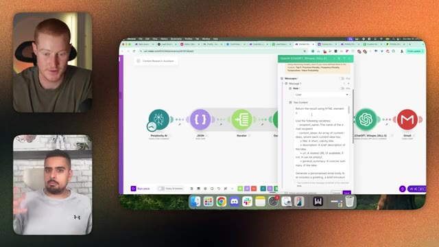
*⏱️ 00:19:20 — Capture d'écran montrant l'interface du constructeur de flux Make.com avec un scénario d'automatisation et une fenêtre de configuration OpenAI ouverte.*

---

### ⏱️ `[00:19:41 - 00:20:00]` | Segment #48

**🔊 Audio (Transcription Intégrale Mot pour Mot en Français) :**
> Et ensuite, nous allons dire de générer le corps d'un e-mail personnalisé qui comprend une salutation, une brève introduction, mentionnant le nom du client, en adoptant un ton créatif et amical. Et ensuite, nous utilisons ChatGPT pour concevoir ce style, ce HTML. Je ne l'ai pas fait moi-même. Je lui ai juste dit : hé, crée du HTML qui donnerait à une infolettre un très joli aspect, puis prends ces variables comme entrées.

**👁️ Analyse Visuelle d'Écran (gemini-3.5-flash-lite) :**
**Interface & Outils** : Make.com (Integromat), OpenAI (ChatGPT), navigateur web Chrome

**Contenu textuel & Code** : Un champ de texte « Text Content » contenant le prompt pour ChatGPT : « Generate a personalized email body that includes a greeting, a brief introduction mentioning the recipient's name... »

**Action / Démonstration** : Configuration d'un module d'automatisation Make.com intégrant ChatGPT pour générer le contenu d'un e-mail basé sur les données précédentes.

*⏱️ 00:19:46 — Capture d'écran montrant l'interface du générateur de scénarios Make.com avec un module OpenAI ouvert, affichant un prompt textuel pour générer un e-mail personnalisé, ainsi que deux participants en visio sur le côté gauche.*

---

### ⏱️ `[00:20:00 - 00:20:33]` | Segment #49

**🔊 Audio (Transcription Intégrale Mot pour Mot en Français) :**
> Donc tout ce truc est du HTML généré par l'IA pour la mise en forme. Et en disant juste, tu sais quoi ? meilleures salutations, high mark, et cetera. C'est donc ça la mise en forme ici. Et ensuite, nous incluons simplement le contenu textuel provenant des idées de contenu. Et puis, quand nous cliquons sur enregistrer juste ici, si nous allons à l'étape suivante, qui est Gmail, nous allons utiliser l'étape de création de brouillon que, lorsque nous cliquons sur cet e-mail ici, nous allons l'appeler objet, vos idées de contenu hebdomadaires. Et tout ce que nous prenons comme entrée pour le contenu, c'est le résultat, qui va être du HTML, ce qui devrait théoriquement provoquer

**👁️ Analyse Visuelle d'Écran (gemini-3.5-flash-lite) :**
**Interface & Outils** : Make.com (anciennement Integromat), navigateur web Google Chrome avec fenêtres modales de configuration des modules d'automatisation.

**Contenu textuel & Code** : Blocs de code HTML générés par l'IA contenant des balises 
, <strong>, ainsi que des formules de politesse (« Best regards », « [Your Name] ») et des variables de données.

**Action / Démonstration** : Configuration et explication d'un module Make.com intégrant du code HTML et du contenu textuel automatisé par l'IA.

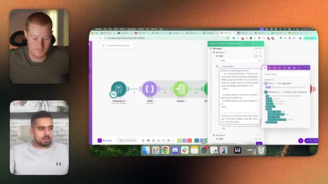
*⏱️ 00:20:09 — Capture d'écran montrant l'interface du créateur de flux Make.com avec un scénario d'automatisation incluant des modules Perplexity AI, JSON, Iterator et OpenAI, ainsi que des fenêtres contextuelles affichant du code HTML et du texte généré.*

---

### ⏱️ `[00:20:33 - 00:20:58]` | Segment #50

**🔊 Audio (Transcription Intégrale Mot pour Mot en Français) :**
> certains formatages automatiques vont se produire. Génial. J'adore. Donc nous allons obtenir un résultat plutôt super sympa de ça. Donc l'e-mail ne va pas ressembler juste à un bloc de texte brut. Ouais. Ouais. Bien sûr. Génial. J'adore. Donc je suppose que là, du coup, pour souligner un peu ce qui montre la puissance d'utiliser ces différents nœuds à l'intérieur de make.com, parce qu'autrement nous pourrions juste ne pas être vraiment précis avec le prompt qu'on lui donne et nous obtenons un résultat vraiment nul.

**👁️ Analyse Visuelle d'Écran (gemini-3.5-flash-lite) :**
**Interface & Outils** : Make (Integromat), Gmail, Google Sheets, OpenAI.

**Contenu textuel & Code** : Configuration du module Gmail pour créer un brouillon ("Create a Draft") avec les paramètres de connexion, de dossier, d'objet ("Your weekly content ideas!") et de contenu formaté.

**Action / Démonstration** : Configuration et paramétrage du module Gmail dans le workflow d'automatisation Make.

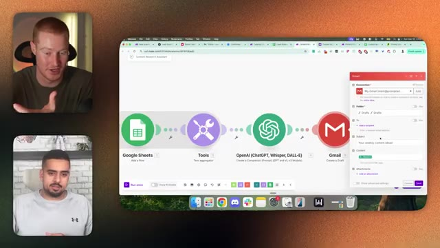
*⏱️ 00:20:39 — Un écran d'ordinateur montrant un flux Make (Integromat) reliant Google Sheets, Tools, OpenAI et Gmail, avec un panneau de configuration Gmail ouvert à droite.*

---

### ⏱️ `[00:20:58 - 00:21:17]` | Segment #51

**🔊 Audio (Transcription Intégrale Mot pour Mot en Français) :**
> Alors que si l'on entre vraiment dans les détails, du genre on peut le personnaliser comme on veut, obtenir un résultat final qui a l'air spectaculaire, ce genre de choses. Donc je veux juste faire remarquer ça, parce qu'il semble que ce soit, vous savez, bien plus qu'une simple petite automatisation basique qui va donner un résultat visuel assez médiocre. C'est quelque chose qui pourrait en fait être prêt pour la production, potentiellement, si vous avez une newsletter ou quelque chose du genre. C'est donc intéressant.

**👁️ Analyse Visuelle d'Écran (gemini-3.5-flash-lite) :**
**Interface & Outils** : Navigateur web affichant Make.com, avec deux intervenants en visioconférence dans des fenêtres encastrées à gauche.

**Contenu textuel & Code** : Un scénario Make d'automatisation composé de différentes étapes : Perplexity AI, JSON, Iterator, Google Sheets, Tools, OpenAI (ChatGPT) et Gmail.

**Action / Démonstration** : Présentation et explication du flux d'automatisation personnalisé combinant l'intelligence artificielle et divers outils de productivité.

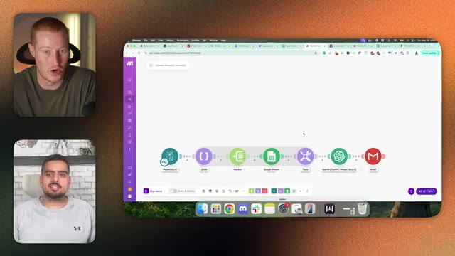
*⏱️ 00:21:03 — Capture d'écran montrant l'interface d'automatisation Make (anciennement Integromat) avec un flux de travail complet comprenant plusieurs blocs interconnectés.*

---

### ⏱️ `[00:21:18 - 00:21:41]` | Segment #52

**🔊 Audio (Transcription Intégrale Mot pour Mot en Français) :**
> Ouais. Ou encore, genre, mon plus grand cas d'usage pour ça, c'est de créer une infolettre pour moi-même. Exactement. Les cent mille nouvelles choses qui changent la donne chaque jour. Donc dans ce cas, comme nous initions cette automatisation en disant, va faire des recherches, nous n'attendons pas réellement une force extérieure. Donc nous pouvons simplement exécuter ceci et ne pas attendre que quelque chose se produise pour le déclencher. Donc si nous cliquons sur lecture ici, cela devrait commencer à fonctionner tout seul, ce qui est en train de se faire.

**👁️ Analyse Visuelle d'Écran (gemini-3.5-flash-lite) :**
**Interface & Outils** : Make.com (navigateur web Google Chrome) et visioconférence des deux intervenants dans des vignettes sur le côté gauche.

**Contenu textuel & Code** : Un scénario Make nommé "Content Research Assistant" avec les modules suivants enchaînés : Perplexity AI, JSON, Iterator, Google Sheets, Tools, OpenAI (ChatGPT, Whisper, DALL-E) et Gmail.

**Action / Démonstration** : Présentation et explication d'un flux d'automatisation pour la recherche de contenu et la génération d'infolettres.

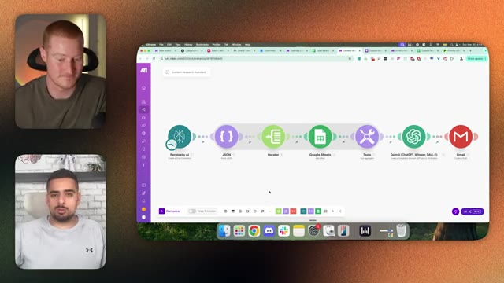
*⏱️ 00:21:24 — Capture d'écran montrant l'interface d'automatisation Make (anciennement Integromat) avec un flux de travail complet comprenant plusieurs intégrations.*

---

### ⏱️ `[00:21:42 - 00:22:17]` | Segment #53

**🔊 Audio (Transcription Intégrale Mot pour Mot en Français) :**
> On va le laisser faire son travail et ensuite on discutera une fois que ce sera terminé. Si on le voulait, on pourrait faire en sorte que ça se déclenche peut-être tous les jours à 20 heures ou peu importe, n'est-ce pas ? Oui, et je vais te montrer comment tu peux faire ça. Ouais, super. Très bien, et c'est fini de tourner ici et on a eu beaucoup de succès sur les nœuds. Donc si tu vas dans le lot de sortie juste ici, tu verras que c'est super cool avec Perplexity, c'est que ça donne maintenant des citations. Donc on sait exactement quels médias et quelles URL nous avons utilisés pour élaborer la recherche. Si nous descendons ici vers cette petite chose appelée contenu, c'est la réponse réelle de l'IA avec toutes les nouvelles tendances, tout ce qu'elle a trouvé.

**👁️ Analyse Visuelle d'Écran (gemini-3.5-flash-lite) :**
**Interface & Outils** : Make.com (anciennement Integromat), interface web d'automatisation.

**Contenu textuel & Code** : Modules d'automatisation chaînés : Perplexity AI, manipulation JSON, Iterator, Google Sheets, Tools, OpenAI (ChatGPT) et Gmail. Le scénario est en cours d'exécution ("Running").

**Action / Démonstration** : Le présentateur montre le déroulement d'un workflow automatisé connectant des outils d'IA et de productivité.

*⏱️ 00:21:51 — Vue d'un scénario Make.com en cours d'exécution avec plusieurs modules connectés (Perplexity AI, JSON, Iterator, Google Sheets, Tools, OpenAI, Gmail) et deux présentateurs à l'écran.*

---

### ⏱️ `[00:22:17 - 00:22:36]` | Segment #54

**🔊 Audio (Transcription Intégrale Mot pour Mot en Français) :**
> Et puis ce "parse JSON" extrait simplement ce qui nous intéresse. Allons dans "output bundles". Donc nous nous intéressons uniquement au titre, à la description, à l'URL et à un résumé général, comme le TLDR de ce dont il s'agit. Et si on ferme ça, cela est maintenant en train d'itérer à travers, comme vous l'avez vu, chacune de ces étapes.

**👁️ Analyse Visuelle d'Écran (gemini-3.5-flash-lite) :**
**Interface & Outils** : Make.com (navigateur web Google Chrome) et interface de webinaire/visio avec les participants dans de petits cadres à l'écran.

**Contenu textuel & Code** : Workflow d'automatisation avec des nœuds (Feedly, JSON, Iterator, Google Sheets, Tools, OpenAI, Email) et une pop-up de configuration JSON indiquant "Download output bundles".

**Action / Démonstration** : Le présentateur survole l'option "Download output bundles" dans le module JSON pour inspecter les données de sortie du scénario Make.

*⏱️ 00:22:22 — Capture d'écran montrant l'interface du créateur de scénario Make.com avec une fenêtre contextuelle sur l'élément JSON affichant l'option "Download output bundles".*

---

### ⏱️ `[00:22:36 - 00:22:55]` | Segment #55

**🔊 Audio (Transcription Intégrale Mot pour Mot en Français) :**
> Nous l'ajoutons à une Google Sheet. Et ensuite, nous allons sur OpenAI et nous disons, créons un e-mail personnalisé avec ces points saillants de tout ce que nous avons vu en termes d'actualités. Et mettons-le dans Gmail. Et ensuite, Gmail ressemblera à ceci. Il créera un ID d'e-mail. Il créera un ID de message.

**👁️ Analyse Visuelle d'Écran (gemini-3.5-flash-lite) :**
**Interface & Outils** : Make.com (anciennement Integromat), interface de navigateur web, panneau de configuration de module OpenAI.

**Contenu textuel & Code** : Un flux d'automatisation comprenant des modules pour OpenAI, JSON, Google Sheets et Gmail. Le panneau ouvert montre les détails d'exécution (Bundle 1, Model gpt-4o, paramètres d'entrée et de sortie).

**Action / Démonstration** : Le présentateur explique la configuration des modules d'automatisation connectant la recherche d'actualités, Google Sheets et la génération d'e-mails via OpenAI avant l'envoi sur Gmail.

*⏱️ 00:22:41 — Interface Make.com affichant un flux d'automatisation avec un panneau de configuration OpenAI ouvert, et les deux présentateurs en vignette vidéo à gauche.*

---

### ⏱️ `[00:22:55 - 00:23:16]` | Segment #56

**🔊 Audio (Transcription Intégrale Mot pour Mot en Français) :**
> Et si je retourne dans ma messagerie, je devrais voir un brouillon, ce qui est le cas. Et si nous ouvrons ce brouillon, vous verrez que vous n'obtenez pas un e-mail au format disgracieux. Vous obtenez un « bonjour [nom du destinataire] », que nous pouvons également personnaliser s'il est destiné à quelqu'un d'autre. Vous verrez qu'il sépare chacune de ces lignes. L'en-tête a un bel aspect soigné. Et il y a aussi le lien vers la source et le résumé ici.

**👁️ Analyse Visuelle d'Écran (gemini-3.5-flash-lite) :**
**Interface & Outils** : Interface web de Gmail (Google Chrome).

**Contenu textuel & Code** : Un brouillon d'e-mail intitulé « Your weekly content ideas! » avec une mise en forme propre incluant des balises de personnalisation (« Hi [recipient_name] ») et des sections textuelles numérotées.

**Action / Démonstration** : Le présentateur présente l'e-mail généré automatiquement et enregistré dans les brouillons de sa messagerie.

*⏱️ 00:23:00 — Capture d'écran montrant l'interface de Gmail avec un e-mail en mode brouillon ouvert, affichant un contenu structuré et formaté (idées de contenu hebdomadaires).*

---

### ⏱️ `[00:23:16 - 00:23:39]` | Segment #57

**🔊 Audio (Transcription Intégrale Mot pour Mot en Français) :**
> Donc, une automatisation plutôt géniale. Et vous pouvez personnaliser cela comme vous le souhaitez. Et parce que nous avons cette étape d'œil d'ouverture ici, si vous souhaitez qu'il soit présenté d'une manière différente, vous pouvez le faire assez facilement. Et l'astuce ici, l'astuce supplémentaire, c'est de ne jamais vous soucier de manipuler ce code HTML vous-même. Donc, vous retournez simplement dans le prompt et ensuite vous pouvez simplement prendre ceci et dire à Claude, hé, je n'aime pas la façon dont il génère cela.

**👁️ Analyse Visuelle d'Écran (gemini-3.5-flash-lite) :**
**Interface & Outils** : Navigateur web (Chrome), Gmail

**Contenu textuel & Code** : Brouillon d'e-mail intitulé "Your weekly content ideas" contenant des propositions structurées sur l'intelligence artificielle (Sora, AI Agents).

**Action / Démonstration** : Présentation du résultat final d'une automatisation montrant un e-mail rédigé et prêt à être envoyé.

*⏱️ 00:23:22 — Capture d'écran montrant l'interface de Gmail sur un navigateur web, avec une fenêtre de brouillon ouverte affichant un contenu généré automatiquement lié aux idées de contenu hebdomadaires.*

---

### ⏱️ `[00:23:39 - 00:24:06]` | Segment #58

**🔊 Audio (Transcription Intégrale Mot pour Mot en Français) :**
> Je veux que ce soit un tout petit peu différent et ensuite on pourra le modifier. Symbole. J'adore. Ouais. Donc ça, c'est numero dos. C'est une super idée et c'est quelque chose que j'utiliserais personnellement tous les jours. Très bien. Cool. Alors, continuons sur notre lancée. Donc pour la dernière, j'ai essayé d'imaginer quelque chose de totalement improvisé qui ne soit pas standard. Je me suis donc dit : et si vous aviez un formulaire Google que vos employés ou vos coéquipiers pourraient remplir et qui dirait, tu sais quoi ?

**👁️ Analyse Visuelle d'Écran (gemini-3.5-flash-lite) :**
**Interface & Outils** : Make.com (navigateur Chrome), avec deux webcams des participants affichées dans de petites fenêtres sur le côté gauche.

**Contenu textuel & Code** : Un flux d'automatisation composé de plusieurs modules successifs : Perplexity AI, JSON, un outil de manipulation de texte, Google Sheets, un outil d'agrégation, OpenAI (ChatGPT) et Gmail.

**Action / Démonstration** : Présentation et explication du flux d'automatisation Make par les intervenants pour l'utiliser au quotidien.

*⏱️ 00:23:46 — Capture d'écran montrant l'interface d'automatisation Make (anciennement Integromat) avec un scénario séquentiel complexe reliant plusieurs applications.*

---

### ⏱️ `[00:24:07 - 00:24:32]` | Segment #59

**🔊 Audio (Transcription Intégrale Mot pour Mot en Français) :**
> Imaginons qu'ils aient fait du très bon travail ce mois-ci et qu'ils veuillent s'offrir une tasse personnalisée avec une image. Ils pourraient effectivement le demander. Et cela permettrait non seulement de générer l'image, mais aussi de passer une commande pour la leur envoyer. Intéressant. Oui. Donc, nous ne ferons pas la dernière partie, qui consiste à passer la commande, parce que je n'essaie pas de dépenser de l'argent dans cet épisode pour des tasses dont je ne veux pas, et pour les frais de port et tout le reste.

**👁️ Analyse Visuelle d'Écran (gemini-3.5-flash-lite) :**
**Interface & Outils** : Navigateur web affichant un formulaire Google Forms (Printify).

**Contenu textuel & Code** : Champs de saisie : « Product Title », « Describe your desired image », et options de taille (10 oz - Small, 15 oz - Large).

**Action / Démonstration** : Présentation du formulaire de commande personnalisé pour les tasses Printify.

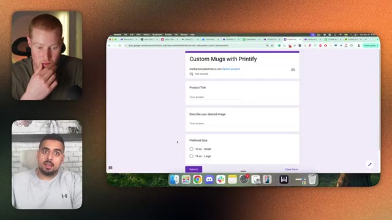
*⏱️ 00:24:13 — Un formulaire Google Forms intitulé « Custom Mugs with Printify » affiché à l'écran, avec des champs pour le titre du produit, la description de l'image souhaitée et le choix de la taille.*

---

### ⏱️ `[00:24:32 - 00:24:52]` | Segment #60

**🔊 Audio (Transcription Intégrale Mot pour Mot en Français) :**
> Donc nous allons simplement simuler la plus grande partie de ce processus. Donc ici, nous allons utiliser ce produit appelé Printify. Aucune affiliation. Mais à quoi ressemble Printify, c'est que si vous allez sur le site web, vous pouvez essentiellement faire de l'impression à la demande. Donc des tasses en céramique, des bouteilles d'eau en acier inoxydable. Ils ont un clin d'œil gratuit absolument sans aucune raison, mais juste parce que c'est un cas d'usage sympa.

**👁️ Analyse Visuelle d'Écran (gemini-3.5-flash-lite) :**
**Interface & Outils** : Make.com et le site web Printify affichés dans un navigateur web.

**Contenu textuel & Code** : Workflow d'automatisation en plusieurs étapes et catalogue de produits d'impression à la demande avec tarifs en USD.

**Action / Démonstration** : Présentation du flux de travail automatisé et navigation sur le site web de Printify.

*⏱️ 00:24:37 — Vue d'un scénario d'automatisation sur Make.com reliant Google Sheets, OpenAI et Printify.*

*⏱️ 00:24:42 — Tableau de bord principal de la plateforme Printify présentant les options de création de produits.*

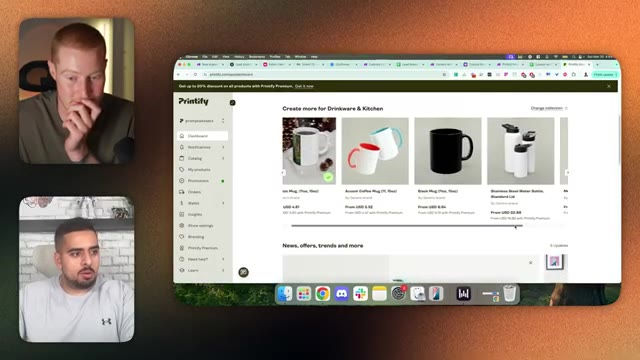
*⏱️ 00:24:47 — Section du catalogue Printify affichant des articles personnalisables comme des tasses et des bouteilles isothermes.*

---

### ⏱️ `[00:24:52 - 00:25:11]` | Segment #61

**🔊 Audio (Transcription Intégrale Mot pour Mot en Français) :**
> Mais en gros, vous pouvez imprimer toutes sortes d'accessoires à la demande. Ce qui m'a sauté aux yeux, c'est que parmi les nombreuses plateformes qui font ça, ils ont vraiment de superbes intégrations Make. Donc si vous double-cliquez ici et que vous allez simplement dans Printify, vous pouvez faire toutes sortes de choses, ce qui pour moi est toujours un bon signal que ce service est, genre, très accueillant quand il s'agit d'automatisation.

**👁️ Analyse Visuelle d'Écran (gemini-3.5-flash-lite) :**
**Interface & Outils** : Navigateur web affichant les plateformes Printify et Make.

**Contenu textuel & Code** : Interface utilisateur de Printify (dashboard, produits, options de commande) et interface de Make (flux de modules automatisés avec Google Sheets, OpenAI et Printify).

**Action / Démonstration** : Navigation et présentation de l'intégration entre Make et Printify pour l'automatisation de produits personnalisés.

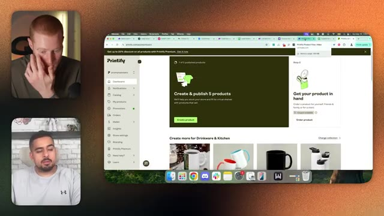
*⏱️ 00:24:57 — Capture d'écran du tableau de bord de la plateforme d'impression à la demande Printify, affichant les options de création de produits et de personnalisation.*

*⏱️ 00:25:01 — Capture d'écran d'un scénario d'automatisation sur la plateforme Make montrant un flux de travail connectant Google Sheets, OpenAI et Printify.*

---

### ⏱️ `[00:25:11 - 00:25:34]` | Segment #62

**🔊 Audio (Transcription Intégrale Mot pour Mot en Français) :**
> Donc vous pouvez faire des choses comme vous pouvez obtenir une image d'un produit existant, vous pouvez lister des images téléchargées que vous avez déjà faites. Vous pouvez télécharger une image, ce qui est ce que nous voulons faire. Parce que si vous voulez passer d'un formulaire Google, un formulaire Google plutôt, à la génération d'une image basée sur cette préférence en utilisant, disons, DALL-E, jusqu'à ce que nous ayons la nouvelle génération d'images de GPT-4 ou GPT-4.0, jusqu'à ce que ce soit dans l'API, nous utiliserons DALL-E pour l'instant.

**👁️ Analyse Visuelle d'Écran (gemini-3.5-flash-lite) :**
**Interface & Outils** : Make / Integromat, intégration Printify, navigateur web.

**Contenu textuel & Code** : Workflow d'automatisation reliant Google Sheets et OpenAI, avec un menu contextuel Printify listant les actions disponibles pour les images.

**Action / Démonstration** : Sélection ou explication de l'option d'action permettant de télécharger une image dans Make pour l'intégrer à un workflow d'automatisation e-commerce.

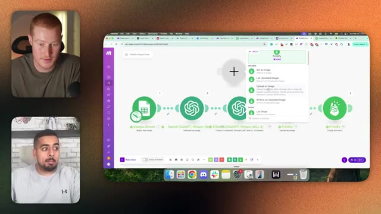
*⏱️ 00:25:17 — Capture d'écran montrant l'interface d'automatisation Make (anciennement Integromat) avec un menu déroulant Printify affichant les différentes options d'action (Get an Image, List Uploaded Images, Upload an Image, Archive an Uploaded Image).*

---

### ⏱️ `[00:25:34 - 00:25:55]` | Segment #63

**🔊 Audio (Transcription Intégrale Mot pour Mot en Français) :**
> Et vous avez toutes ces différentes choses. Si vous voulez éventuellement soumettre automatiquement la commande, vous pouvez voir ici, soumettre une commande. Donc vous pouvez aller d'un employé ou d'un collègue qui le demande à sa génération, à la création de cette tasse, à la publication de cette tasse, à l'envoi de cette tasse sur le pas de leur porte en quelques semaines. Ouais, c'est en fait assez fou si vous y pensez. Si seulement nous avions la génération d'images 4.0 disponible via l'API, mais je suppose que ce n'était pas le cas.

**👁️ Analyse Visuelle d'Écran (gemini-3.5-flash-lite) :**
**Interface & Outils** : Make.com (interface de workflow d'automatisation)

**Contenu textuel & Code** : Étapes de workflow automatisé : Google Sheets (Watch New Rows), OpenAI (Generate an image), OpenAI (Create a Completion), et Printify (avec menu contextuel affichant l'action 'Submit an Order').

**Action / Démonstration** : Sélection ou configuration d'une action dans le workflow d'automatisation pour soumettre automatiquement une commande via l'API Printify.

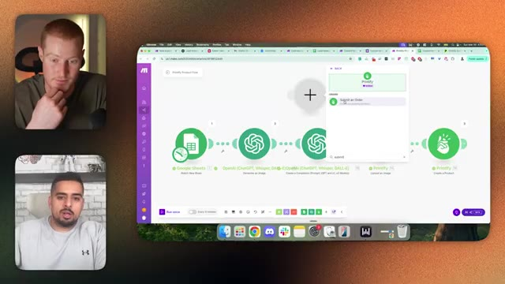
*⏱️ 00:25:39 — Capture d'écran montrant l'interface d'automatisation Make (anciennement Integromat) avec un flux de travail connectant Google Sheets, OpenAI et Printify, affichant une liste d'actions Printify dont l'option 'Submit an Order'.*

---

### ⏱️ `[00:25:55 - 00:26:19]` | Segment #64

**🔊 Audio (Transcription Intégrale Mot pour Mot en Français) :**
> Je suis sûr que ça arrive bientôt. Ouais, ça fera l'affaire. Oui. Donc dans ce cas, nous avons Google Sheets, qui indique de surveiller les nouvelles lignes. Donc dans ce cas, nous avons un Google Formulaire qui est lié à ce Google Sheets. D'accord. Nous en avons déjà quelques-uns qu'on a effectivement essayés. Et ensuite, une fois que vous avez rempli ça, juste pour vous montrer comment cela fonctionnerait, disons, tasse de codage vibe produit.

**👁️ Analyse Visuelle d'Écran (gemini-3.5-flash-lite) :**
**Interface & Outils** : Make.com (anciennement Integromat), navigateur web Google Chrome, macOS.

**Contenu textuel & Code** : Un diagramme de flux d'automatisation comprenant plusieurs étapes successives : Google Sheets (Watch New Rows), OpenAI (Generate an Image), OpenAI (Create a Completion), Printify (Upload an Image), et Printify (Create a Product).

**Action / Démonstration** : Le présentateur explique et présente le flux d'automatisation configuré sur Make.com reliant Google Sheets à des outils d'IA et de e-commerce.

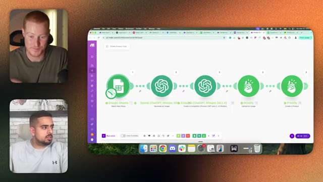
*⏱️ 00:26:01 — Capture d'écran montrant l'interface du créateur de flux Make.com avec un scénario d'automatisation reliant Google Sheets, OpenAI et Printify, tandis que le présentateur et son invité apparaissent dans des vignettes vidéo sur le côté gauche.*

---

### ⏱️ `[00:26:19 - 00:26:38]` | Segment #65

**🔊 Audio (Transcription Intégrale Mot pour Mot en Français) :**
> Et nous disons décris ton image, un roux qui boit. Tu ne veux pas être un codeur « vibe » ? Un « vibe ». Maintenant que tu assumes ça, tu assumes ça. Et je veux que ce soit une pinte de 10 onces. Si je soumets ça, d'accord, ça devrait maintenant s'enregistrer dans la feuille Google Sheet réelle.

**👁️ Analyse Visuelle d'Écran (gemini-3.5-flash-lite) :**
**Interface & Outils** : Navigateur web affichant Google Forms.

**Contenu textuel & Code** : Champs de formulaire remplis avec « vibe coding cup » et « a redhead drinking », ainsi que des options radio pour la taille de la tasse (10 oz - Small et 15 oz - Large).

**Action / Démonstration** : Démonstration du remplissage du formulaire pour générer une tasse personnalisée.

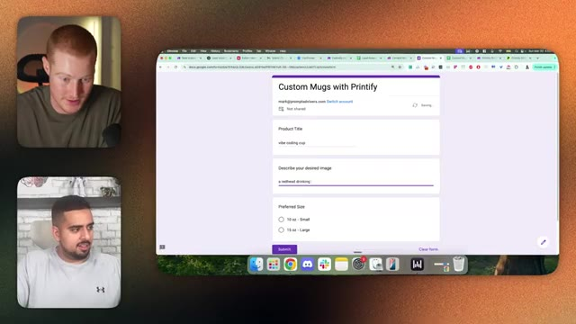
*⏱️ 00:26:24 — Un formulaire Google Forms intitulé « Custom Mugs with Printify » avec des champs de saisie pour le titre du produit, la description de l'image souhaitée et la taille préférée.*

---

### ⏱️ `[00:26:38 - 00:27:01]` | Segment #66

**🔊 Audio (Transcription Intégrale Mot pour Mot en Français) :**
> Voilà, c'est fait. La « vibe coding cup ». Donc c'est enregistré là aussi, juste pour notre propre historique et référence. Et ensuite, si on retourne sur l'automatisation Make, si on clique sur lecture, ça va s'exécuter. Maintenant, un truc qui me manque, et je l'ai laissé exprès, c'est un itérateur, parce que si vous recevez plusieurs requêtes en même temps, vous voudriez parcourir ces requêtes pour vous assurer que vous créez un produit pour chacune de ces requêtes correctement.

**👁️ Analyse Visuelle d'Écran (gemini-3.5-flash-lite) :**
**Interface & Outils** : Google Sheets, navigateur Chrome, interface de visioconférence

**Contenu textuel & Code** : Tableau Google Sheets intitulé « Custom Mugs with Printify (Responses) » avec des données textuelles de commandes de tasses personnalisées (horodatages, titres de produits, descriptions, tailles).

**Action / Démonstration** : Le présentateur consulte les données saisies dans Google Sheets pour valider l'enregistrement de la « vibe coding cup ».

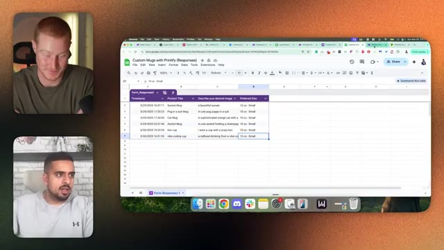
*⏱️ 00:26:44 — Capture d'écran montrant le présentateur et son écran avec un tableau Google Sheets listant les réponses d'un formulaire, incluant la ligne « vibe coding cup ».*

---

### ⏱️ `[00:27:02 - 00:27:20]` | Segment #67

**🔊 Audio (Transcription Intégrale Mot pour Mot en Français) :**
> Je vois. Si c'était genre, s'il y avait un déclencheur, genre à la demande. Oui, je vois. Exactement, exactement. Et nous allons examiner les invites réelles, ce qui se passe ici et le résultat final. C'était en fait assez rapide. Oui, super rapide. Donc pour le premier, nous sommes allés utiliser le module OpenAI pour générer une image.

**👁️ Analyse Visuelle d'Écran (gemini-3.5-flash-lite) :**
**Interface & Outils** : Navigateur web affichant Make.com (anciennement Integromat), avec deux flux vidéo des intervenants en incrustation à gauche.

**Contenu textuel & Code** : Schéma d'automatisation composé de cinq étapes consécutives : Google Sheets (Watch New Rows), OpenAI (Generate an image), OpenAI (Create a Completion), Printify (Upload an Image), et Printify (Create a Product).

**Action / Démonstration** : Présentation et explication du flux d'automatisation connecté entre différentes applications et outils d'intelligence artificielle.

*⏱️ 00:27:06 — Un workflow Make.com automatisé reliant Google Sheets, OpenAI (génération d'image et completion) et Printify.*

---

### ⏱️ `[00:27:20 - 00:27:40]` | Segment #68

**🔊 Audio (Transcription Intégrale Mot pour Mot en Français) :**
> Et si on regarde les prompts, rien de révolutionnaire. C'est : créer une image haute résolution, prête pour l'impression, l'image désirée, et maintenant on fait juste référence. Vous pouvez voir Google Sheets qui pulse comme un module pour vous dire, hé, vous savez quoi ? Vous m'utilisez. Et il fait référence à cet élément ici que je viens de cliquer et d'ajouter à notre charge utile.

**👁️ Analyse Visuelle d'Écran (gemini-3.5-flash-lite) :**
**Interface & Outils** : Make (Integromat), Google Sheets, OpenAI DALL-E 3, Printify

**Contenu textuel & Code** : Un prompt textuel pour générer une image haute résolution, avec des références dynamiques vers les données de Google Sheets (ex: "Desired image: [1. Row/data: your image idea]").

**Action / Démonstration** : Présentation et explication du flux d'automatisation connectant Google Sheets à l'API OpenAI pour la génération d'images.

*⏱️ 00:27:25 — Capture d'écran montrant l'interface d'automatisation Make (anciennement Integromat) avec un workflow reliant Google Sheets, OpenAI (DALL-E 3) et Printify.*

---

### ⏱️ `[00:27:40 - 00:28:00]` | Segment #69

**🔊 Audio (Transcription Intégrale Mot pour Mot en Français) :**
> Utilisez des couleurs riches et des détails nets. Pas de texte. Gardez l'arrière-plan blanc lorsque c'est possible. Évitez les ombres dures ou les éléments trop sombres. Et nous faisons simplement cela parce que sur une tasse, ces éléments ont tendance à ne pas être très esthétiques. Donc ce qui est cool, c'est que... La variable en vert, juste pour le public, ce ne sera pas toujours une rousse en train de boire ce que le film a dit.

**👁️ Analyse Visuelle d'Écran (gemini-3.5-flash-lite) :**
**Interface & Outils** : Make (Integromat), Google Sheets, OpenAI DALL-E 3, Printify

**Contenu textuel & Code** : Un scénario d'automatisation avec un module Google Sheets déclenchant une génération d'image via OpenAI avec le prompt visible : "Create a high resolution, print-ready image. Desired image: [1. Describe your desired image...]. Use rich colors and clean detail/No text. Keep the background white when possible. Avoid hard shadows or overly dark elements."

**Action / Démonstration** : Le créateur montre la configuration du prompt dans le module Make (Integromat) pour générer des images destinées à l'impression sur des tasses.

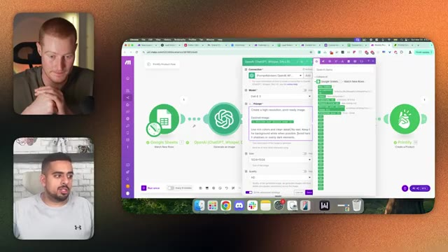
*⏱️ 00:27:45 — Capture d'écran montrant l'interface du logiciel Make (anciennement Integromat) avec un flux de travail automatisé reliant Google Sheets, OpenAI (DALL-E 3) et Printify, ainsi que deux participants en visio-conférence sur le côté gauche.*

---

### ⏱️ `[00:28:00 - 00:28:24]` | Segment #70

**🔊 Audio (Transcription Intégrale Mot pour Mot en Français) :**
> Donc c'est spécifique à tout ce qui a été précédemment saisi dans le tableur Google. Donc ça va automatiquement prendre cette information et l'amener à l'étape OpenAI. Ouais. Donc c'est toujours dynamique. Donc excellent point. Donc si je devais changer ceci pour une girafe, vous verrez maintenant que c'est une girafe. Génial. J'adore. C'est ça. Quelques détails administratifs supplémentaires consistent simplement à lui dire quelle taille d'image vous voulez.

**👁️ Analyse Visuelle d'Écran (gemini-3.5-flash-lite) :**
**Interface & Outils** : Make (Integromat), Google Sheets, OpenAI, Printify

**Contenu textuel & Code** : Configuration du module OpenAI (ChatGPT) avec un prompt de génération d'image et mapping de données provenant de Google Sheets.

**Action / Démonstration** : Le présentateur explique comment les données saisies dans Google Sheets sont transmises dynamiquement à l'étape OpenAI pour automatiser la génération de visuels.

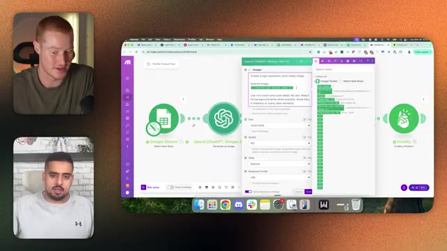
*⏱️ 00:28:06 — Capture d'écran montrant l'interface de Make (Integromat) avec un workflow automatisé reliant Google Sheets, OpenAI (ChatGPT) et Printify, ainsi que deux intervenants en visioconférence.*

---

### ⏱️ `[00:28:24 - 00:28:45]` | Segment #71

**🔊 Audio (Transcription Intégrale Mot pour Mot en Français) :**
> Il y a trois spécifications que vous pouvez choisir d'OpenAI. Et puis la qualité. Si c'est comme un standard inférieur, ce sera moins cher à exécuter via l'API, HD plus cher. Et ensuite, vous pouvez lui dire, hé, je veux un style vif ou naturel. Et puis une fois que c'est fait, la sortie, si vous allez au bundle de sortie, est cette URL. Cette URL relie essentiellement à l'image qui a été générée.

**👁️ Analyse Visuelle d'Écran (gemini-3.5-flash-lite) :**
**Interface & Outils** : Make.com (anciennement Integromat), navigateur web Google Chrome, flux d'automatisation de scénarios.

**Contenu textuel & Code** : Configuration du module OpenAI (génération d'image DALL-E) avec les champs Prompt, Size (1024x1024), Quality (options Standard et HD) et Response Format.

**Action / Démonstration** : Le présentateur configure les paramètres de qualité (HD vs Standard) pour la génération d'images via l'intégration OpenAI dans Make.com.

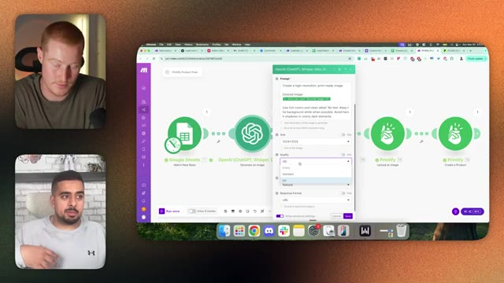
*⏱️ 00:28:29 — Capture d'écran montrant l'interface de Make.com avec un flux de travail automatisé connectant Google Sheets, OpenAI et Printify, et affichant le menu déroulant de configuration du module OpenAI (paramètre Quality : Standard ou HD).*

---

### ⏱️ `[00:28:45 - 00:29:22]` | Segment #72

**🔊 Audio (Transcription Intégrale Mot pour Mot en Français) :**
> Ensuite, l'étape OpenAI ici, si nous l'ouvrons, il est dit : vous êtes un rédacteur publicitaire de produits créant des descriptions convaincantes pour des tasses à la demande vendues en ligne. Utilisez les variables ci-dessous pour créer une courte description de produit engageante. Nous avons donc la description de notre image, nous avons quelques métadonnées que nous avons remplies dans cette feuille et c'est à peu près tout ici. L'étape suivante consiste à télécharger l'image, donc si nous allons sur Printify, nous prenons simplement l'URL qui a été produite par OpenAI et ensuite nous la mappons et nous la nommons titre du produit underscore image point png, nous ajoutons ceci parce que cela doit être un fichier au format image, je vois, et ensuite télécharger l'image en

**👁️ Analyse Visuelle d'Écran (gemini-3.5-flash-lite) :**
**Interface & Outils** : Make.com (anciennement Integromat), navigateur web.

**Contenu textuel & Code** : Un prompt de module OpenAI : "You are a product copywriter creating compelling descriptions for a print on demand mug sold online. Use the variables provided below to craft a short, engaging product description that appeals to the ideal customer." avec des variables de données (Mug Description, design_theme, tone, mug_size, special_features).

**Action / Démonstration** : Le présentateur explique et zoome sur la configuration et le prompt du module OpenAI au sein du scénario d'automatisation.

*⏱️ 00:28:54 — Capture d'écran montrant l'interface du créateur d'automatisation Make.com, avec le panneau de configuration d'un module OpenAI ouvert, affichant un prompt textuel pour la rédaction de descriptions de tasses.*

---

### ⏱️ `[00:29:22 - 00:29:54]` | Segment #73

**🔊 Audio (Transcription Intégrale Mot pour Mot en Français) :**
> URL ? Pourquoi est-ce que c'importants ? Ces choses comptent beaucoup parce que tout est une question de détails. Donc, vous voulez toujours vous demander, quand nous exécutons un module, qu'obtenons-nous ? Est-ce qu'on obtient un texte ? Est-ce que vous obtenez une URL ? Est-ce qu'on obtient un JSON ? Si vous savez à quoi vous avez affaire, vous savez comment vous pouvez l'utiliser. Et là où les gens bloquent, c'est qu'ils vont exécuter ce truc d'image et se dire, ok, je n'ai pas de fichier que je peux télécharger, mais vous avez une URL, n'est-ce pas ? Donc, vous voulez utiliser ce truc de carte et ensuite vous voulez le télécharger via une URL et ensuite vous voulez référencer l'URL, qui est l'URL de l'image ici même. Et vous pouvez voir que nous avons

**👁️ Analyse Visuelle d'Écran (gemini-3.5-flash-lite) :**
**Interface & Outils** : Make.com (anciennement Integromat) et Printify.

**Contenu textuel & Code** : Un flux d'automatisation composé de quatre étapes : Google Sheets, deux modules OpenAI (génération d'image et de texte), et le module Printify configuré avec les options de téléchargement d'image par URL.

**Action / Démonstration** : Le présentateur explique les détails de configuration et les types de données transmis entre les différents modules d'un flux Make.com.

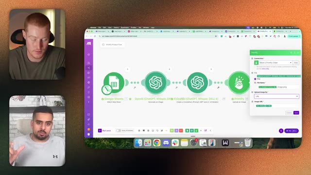
*⏱️ 00:29:30 — Vue d'un scénario Make.com avec des modules Google Sheets et OpenAI, ainsi que le panneau de configuration du module Printify ouvert sur la droite.*

---

### ⏱️ `[00:29:54 - 00:30:23]` | Segment #74

**🔊 Audio (Transcription Intégrale Mot pour Mot en Français) :**
> provenant de l'étape de dolly. Et une fois que vous l'enregistrez, la création d'un produit est assez simple. Nous allons juste dire : Hé, voici le nom du produit. La description est basée sur le résultat de cette étape d'OpenAI. Et ensuite, nous avons un identifiant de modèle. Donc dans ce cas, nous sélectionnons simplement ce qu'est le produit. Si vous voulez faire plusieurs produits, ce serait un peu plus complexe où nous devrions être capables de manipuler le type de produit que nous choisissons. Disons que vous voulez proposer non seulement des tasses, mais aussi des t-shirts pour femmes, des t-shirts à col rond, le t-shirt boyfriend, peu importe ce que vous voulez.

**👁️ Analyse Visuelle d'Écran (gemini-3.5-flash-lite) :**
**Interface & Outils** : Make.com (anciennement Integromat), Google Sheets, OpenAI, Printify, et navigateur web Google Chrome.

**Contenu textuel & Code** : Configuration du module Printify dans Make.com avec des champs pour la connexion, le nom du produit, la description et l'identifiant du modèle (Blueprint ID), illustrant l'automatisation de la création de produits.

**Action / Démonstration** : Configuration et paramétrage d'un module d'automatisation dans l'interface de Make.com pour lier des données provenant d'OpenAI à Printify.

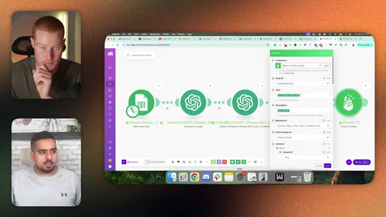
*⏱️ 00:30:01 — Capture d'écran montrant une interface de workflow Make.com avec différentes étapes automatisées (Google Sheets, OpenAI pour la génération d'images, OpenAI pour le texte, et Printify) ainsi que les deux présentateurs dans de petites fenêtres vidéo.*

---

### ⏱️ `[00:30:24 - 00:30:45]` | Segment #75

**🔊 Audio (Transcription Intégrale Mot pour Mot en Français) :**
> Et ensuite, spécifiez la variante parce que vous avez des UGS pour tout, n'est-ce pas ? Vous avez donc différents niveaux de tasses. Dans ce cas, c'est la taille de la tasse. Et puis le prix, s'ils l'achètent réellement ou si nous l'offrons gratuitement. Ce sont les différentes variantes que vous avez. D'accord. Donc, nous gardons simplement nos options ouvertes en fonction de 11 onces ou de 15 onces.

**👁️ Analyse Visuelle d'Écran (gemini-3.5-flash-lite) :**
**Interface & Outils** : Make.com, Google Sheets, Printify, OpenAI (ChatGPT)

**Contenu textuel & Code** : Workflow d'automatisation avec des nœuds Google Sheets, OpenAI (génération d'images et de texte), et Printify, avec un menu déroulant affichant les "Variants" (variantes de produits).

**Action / Démonstration** : Configuration des variantes de produits dans le module Printify d'un scénario d'automatisation Make.

*⏱️ 00:30:29 — Capture d'écran montrant l'interface de Make (anciennement Integromat) avec un flux d'automatisation connectant Google Sheets à des modules OpenAI et Printify, avec un panneau de configuration des variantes ouvert à droite.*

---

### ⏱️ `[00:30:45 - 00:31:19]` | Segment #76

**🔊 Audio (Transcription Intégrale Mot pour Mot en Français) :**
> C'est ce qu'on est en train de spécifier ici. Super. Tout a l'air bien. C'est la dernière étape ici. Voyons à quoi ressemblerait le résultat en vrai. Je veux me voir sur un mug ou quelqu'un qui me ressemble. Ce ne sera certainement pas vous parce que c'est DALL-E. Alors revoyez vos attentes à la baisse. Mais si vous allez dans mes produits, vous verrez ici qu'on a une tasse "vibe coding". Je pense qu'elle est peut-être encore en train de générer. Laissez-moi voir. Oh, on n'a pas spécifié homme ou femme. Donc on a une femme. On a une femme rousse. J'adore. Ouais. Allons-y, voilà. Maintenant, l'entraînement de ce modèle date de 2023, époque où le "vibe coding" n'existait pas. Donc il n'a aucune idée de ce dont je suis probablement en train de parler,

**👁️ Analyse Visuelle d'Écran (gemini-3.5-flash-lite) :**
**Interface & Outils** : Navigateur web affichant la plateforme Printify (printify.com).

**Contenu textuel & Code** : Interface utilisateur de Printify pour la création, la publication et la commande de produits personnalisés (tasses, vêtements).

**Action / Démonstration** : Navigation et configuration de produits personnalisés sur Printify pour visualiser le rendu final.

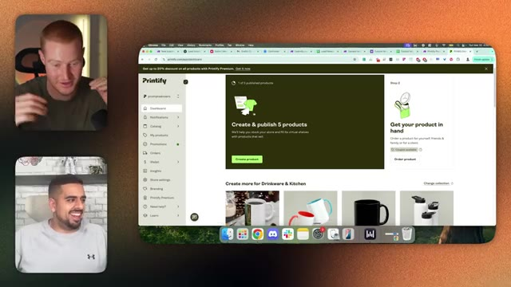
*⏱️ 00:30:54 — Capture d'écran montrant le tableau de bord de Printify avec des suggestions de produits et des tasses de café.*

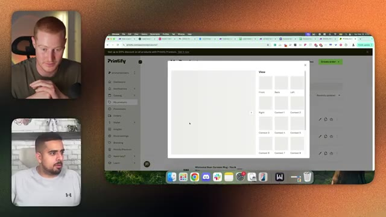
*⏱️ 00:31:02 — Capture d'écran montrant une fenêtre contextuelle de prévisualisation de produit sur la plateforme Printify.*

---

### ⏱️ `[00:31:19 - 00:31:38]` | Segment #77

**🔊 Audio (Transcription Intégrale Mot pour Mot en Français) :**
> mais vous pouvez voir genre la puissance de tout ça, tout le but de cette automatisation est juste d'amener les gens à imaginer qu'on peut automatiser toutes sortes de processus et même aller d'une saisie dans Google Sheets à quelque chose à votre porte est tout à fait possible. Ouais, c'est, c'est vraiment dingue. Et c'était assez, je veux dire, ça avait l'air plutôt simple à faire, honnêtement, rien de trop, trop fou.

**👁️ Analyse Visuelle d'Écran (gemini-3.5-flash-lite) :**
**Interface & Outils** : Navigateur web affichant Printify, application de visioconférence.

**Contenu textuel & Code** : Interface de personnalisation de produits avec affichage d'une tasse en céramique, miniatures de prévisualisation (mockups) sous différents angles et contextes.

**Action / Démonstration** : Présentation et visualisation d'un produit personnalisé généré ou configuré automatiquement dans le cadre du flux d'automatisation.

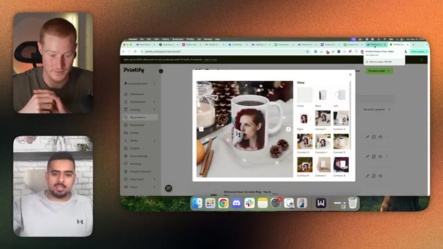
*⏱️ 00:31:24 — Capture d'écran montrant l'interface de Printify avec la prévisualisation d'une tasse personnalisée arborant une photo, ainsi que deux participants en visioconférence sur le côté gauche.*

---

### ⏱️ `[00:31:38 - 00:32:10]` | Segment #78

**🔊 Audio (Transcription Intégrale Mot pour Mot en Français) :**
> La partie la plus complexe était cette partie, qui est le produit créatif où vous deviez juste vous assurer d'aller étape par étape et de remplir exactement ce qu'ils demandent. Donc celle-ci était probablement la partie la plus complexe de cette automatisation, mais je fournirai tous ces scénarios pour votre audience afin qu'ils puissent les importer s'ils veulent les recréer, jouer avec et changer quoi que ce soit. Génial. Alors, à quoi cela ressemblerait-il ? Juste comme un lien vers une sorte de ressource et ils pourraient littéralement simplement l'importer dans make.com. Excellente question. Donc, la façon dont vous importez et exportez des automatisations en quelques secondes, c'est que vous allez simplement à ces trois petits boutons en bas. Vous voulez aller à exporter le blueprint.

**👁️ Analyse Visuelle d'Écran (gemini-3.5-flash-lite) :**
**Interface & Outils** : Make.com (anciennement Integromat), navigateur web Google Chrome

**Contenu textuel & Code** : Scénario d'automatisation avec des modules Google Sheets ("Watch New Rows"), OpenAI ("Generate an image", "Create a Completion") et Printify ("Create a Product" avec panneau de configuration latéral ouvert pour les variantes)

**Action / Démonstration** : Configuration détaillée des paramètres de variantes de produits Printify dans le flux d'automatisation Make.com.

*⏱️ 00:31:46 — Vue d'un flux d'automatisation sur Make.com montrant des intégrations Google Sheets, OpenAI et Printify avec deux participants incrustés à gauche.*

---

### ⏱️ `[00:32:10 - 00:32:33]` | Segment #79

**🔊 Audio (Transcription Intégrale Mot pour Mot en Français) :**
> vous obtiendrez cette chose à laquelle j'ai fait référence, ce JSON. Et juste pour montrer à votre audience, si vous n'êtes pas familier, voici à quoi ressemble le JSON. Cela ressemble à une série d'informations et c'est ainsi que les informations sont échangées. Donc ce que nous pouvons faire, c'est, si vous voulez l'importer maintenant, annulons simplement les modifications et créons un nouveau scénario. Si vous allez à nouveau dans plus et que vous allez dans importer un plan, choisissez le fichier, vous verrez que le plan apparaît ici.

**👁️ Analyse Visuelle d'Écran (gemini-3.5-flash-lite) :**
**Interface & Outils** : Navigateur web affichant l'interface Make.com et un éditeur de code/texte intégré montrant un fichier JSON.

**Contenu textuel & Code** : Code JSON structuré avec des clés et des valeurs (ex: "name", "flow", "parameters", "label", "connection").

**Action / Démonstration** : Le présentateur montre et explique la structure d'un fichier JSON utilisé dans l'automatisation de flux de travail.

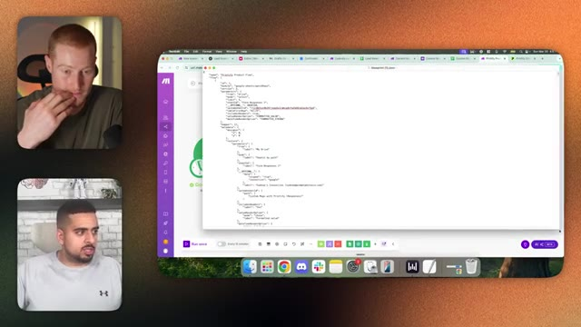
*⏱️ 00:32:15 — Un écran partagé montrant une structure de données au format JSON dans l'interface Make (anciennement Integromat), avec deux intervenants dans des fenêtres vidéo à gauche.*

---

### ⏱️ `[00:32:33 - 00:33:05]` | Segment #80

**🔊 Audio (Transcription Intégrale Mot pour Mot en Français) :**
> Je clique sur enregistrer et maintenant, tadam, vous avez tout ça. Sympathique. Maintenant vous aurez, oui, allez-y. Mais j'allais demander, est-ce que le prompt est dedans ou est-ce qu'on aura besoin de configurer les prompts et tout pour les étapes de Chachabit ? Le prompt, vous pouvez voir, est dedans. Oh, sympa. Cool. Tout est dedans, y compris le mappage. Ce que vous aurez à faire, c'est juste de vous connecter à vos comptes spécifiques, votre feuille Google spécifique, créer votre propre, dans ce cas, un compte Printify, obtenir votre clé API de Printify, ce qui, je dirais, est aussi une autre étape à laquelle vous voulez penser lors de la création d'une automatisation : quelle est cette clé API ?

**👁️ Analyse Visuelle d'Écran (gemini-3.5-flash-lite) :**
**Interface & Outils** : Navigateur web affichant la plateforme Make (anciennement Integromat) et interface de visioconférence.

**Contenu textuel & Code** : Un scénario d'automatisation composé de cinq étapes successives : Google Sheets, deux modules OpenAI (ChatGPT) et deux modules Printify.

**Action / Démonstration** : Présentation et explication d'un workflow automatisé connectant des feuilles de calcul, des modèles d'IA générative et une plateforme d'impression à la demande.

*⏱️ 00:32:41 — Capture d'écran montrant un flux de travail Make (Integromat) intégrant Google Sheets, OpenAI et Printify avec deux participants en visioconférence dans des cadres à gauche.*

---

### ⏱️ `[00:33:05 - 00:33:27]` | Segment #81

**🔊 Audio (Transcription Intégrale Mot pour Mot en Français) :**
> Où est-ce que je l'obtiens ? Dans mon cas, j'ai eu de la chance parce que je pouvais rédiger un accès à la clé API de Printify. Et puis quand vous allez ici, requête gratuite ici, je suis descendu. Et puis j'ai dit, générer un jeton API, ce qui, soit dit en passant, n'est généralement pas si facile. C'est vrai. Et puis tout ce que j'ai fait, c'est que j'ai cliqué sur générer. Ça m'a créé une clé. Et c'était la clé que j'ai utilisée pour pouvoir accéder de manière programmatique à Printify depuis make.com.

**👁️ Analyse Visuelle d'Écran (gemini-3.5-flash-lite) :**
**Interface & Outils** : Navigateur web affichant le site officiel de Printify.

**Contenu textuel & Code** : Section "Generate API token" et page "Connections" avec un champ de saisie et un bouton "Generate".

**Action / Démonstration** : Navigation sur le site de Printify pour accéder à l'interface de génération d'un jeton d'accès API.

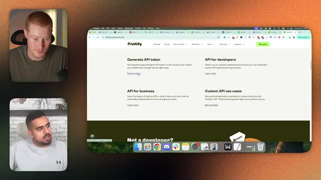
*⏱️ 00:33:16 — Page web de Printify affichant l'option pour générer un jeton API.*

*⏱️ 00:33:21 — Page des paramètres de connexion de Printify avec le bouton vert pour générer un jeton API.*

---

### ⏱️ `[00:33:27 - 00:33:49]` | Segment #82

**🔊 Audio (Transcription Intégrale Mot pour Mot en Français) :**
> Facile. Sympa. Cool. Ouais, c'est génial. Le fait qu'on puisse simplement télécharger un modèle comme ça, l'avoir instantanément d'une certaine façon tout, pas tout assemblé, mais au moins du genre le prompting et tout, ce qui je pense pour une personne qui voudrait juste, si elle voulait utiliser ça, tu sais, trouver le prompting pour obtenir un résultat aussi précis que celui qu'on a fait ici serait peut-être l'une des choses difficiles. C'est donc génial qu'ils puissent simplement télécharger un modèle comme ça, ce qui est une chose avec toi et les automatisations que tu construis, tu as des automatisations géniales que tu as construites.

**👁️ Analyse Visuelle d'Écran (gemini-3.5-flash-lite) :**
**Interface & Outils** : Navigateur web affichant la plateforme Printify (page des jetons API).

**Contenu textuel & Code** : Section « Connections », champ pour les « API tokens » (avec un token nommé « demo »), bouton vert « Generate », lien vers la documentation API Printify et champ pour l'adresse e-mail de contact.

**Action / Démonstration** : Présentation de la configuration des intégrations et de la gestion des jetons API sur la plateforme Printify.

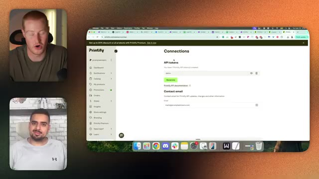
*⏱️ 00:33:32 — Capture d'écran montrant l'interface du site Printify avec le menu des connexions et des jetons API, flanqué des deux intervenants de la vidéo.*

---

### ⏱️ `[00:33:49 - 00:34:13]` | Segment #83

**🔊 Audio (Transcription Intégrale Mot pour Mot en Français) :**
> Et je pense que tu as partagé des ressources plutôt cool, des ressources sur ta chaîne également. Donc si quelqu'un est intéressé, je veux dire, Mark a du contenu génial. Il crée des choses avec make.com et sur sa propre chaîne. C'est donc une autopromo assumée là pour, pour Mark, parce qu'il a des trucs vraiment géniaux. Absolument assumée. Mais je pense que le plus important pour tout le temps est juste de se rappeler que la majorité des étapes qui auraient rendu cela difficile il y a deux, trois ans ou délicat il y a deux, trois ans, beaucoup d'entre elles peuvent être déléguées.

**👁️ Analyse Visuelle d'Écran (gemini-3.5-flash-lite) :**
**Interface & Outils** : Navigateur web affichant le tableau de bord de la plateforme Printify (printify.com)

**Contenu textuel & Code** : Section "Connections" avec gestion des "API tokens", un jeton nommé "demo" généré, et l'adresse e-mail de contact (mark@promptadvisers.com).

**Action / Démonstration** : Visualisation des paramètres de configuration et d'intégration d'API sur Printify.

*⏱️ 00:33:55 — Capture d'écran montrant l'interface du site Printify avec les paramètres de connexion et de jetons d'API (API tokens).*

---

### ⏱️ `[00:34:13 - 00:34:31]` | Segment #84

**🔊 Audio (Transcription Intégrale Mot pour Mot en Français) :**
> Quand il s'agit d'écrire un prompt, vous pouvez littéralement aller sur Claude ou ChatGPT et dire, vous savez quoi ? Agis en tant qu'ingénieur de prompts. Voici ce que j'essaye d'accomplir. C'est ce que j'essaye de faire. Crée un prompt, puis copie-le. Si vous voulez faire du HTML, allez sur Claude. Demandez-le. Crée du HTML. Prends ces variables. Vous pouvez. Et enfin, comme nous l'avons vu au début de cette vidéo, voici cette automatisation.

**👁️ Analyse Visuelle d'Écran (gemini-3.5-flash-lite) :**
**Interface & Outils** : Make.com (anciennement Integromat), Google Sheets, OpenAI DALL-E 3, Printify

**Contenu textuel & Code** : Configuration d'un nœud OpenAI dans Make.com avec un prompt textuel pour générer des images (modèle DALL-E 3, taille 1024x1024, qualité HD).

**Action / Démonstration** : Configuration d'un scénario d'automatisation reliant Google Sheets à OpenAI pour la génération d'images, puis leur envoi vers Printify.

*⏱️ 00:34:17 — Capture d'écran montrant une interface de workflow Make.com intégrant Google Sheets, OpenAI (DALL-E 3) et Printify, avec un panneau de configuration de prompt ouvert.*

---

### ⏱️ `[00:34:32 - 00:34:51]` | Segment #85

**🔊 Audio (Transcription Intégrale Mot pour Mot en Français) :**
> Fais-moi le flux de travail de cette automatisation. Nous pouvons déléguer 80 % et puis les 20 % restants, c'est ce qui prend un peu de temps, mais au moins toutes ces parties sont simplifiées pour toi. Génial. J'adore. Quelqu'un qui découvre totalement une plateforme comme celle-ci, capable de passer de zéro à 80 % et d'avoir ensuite ces 20 % restants, c'est tellement moins intimidant. C'est comme regarder une montagne que l'on a déjà grimpée à 80 %. C'est comme si, quelqu'un est juste là.

**👁️ Analyse Visuelle d'Écran (gemini-3.5-flash-lite) :**
**Interface & Outils** : Make.com (anciennement Integromat) et navigateur web Chrome.

**Contenu textuel & Code** : Un scénario Make.com complet composé de plusieurs étapes connectées : Google Sheets (Watch New Rows), OpenAI (Generate an Image), OpenAI (Create a Completion), et deux modules Printify (Upload an image, Create a Product).

**Action / Démonstration** : Présentation et explication du flux de travail de l'automatisation reliant Google Sheets, l'intelligence artificielle d'OpenAI et la plateforme d'impression Printify.

*⏱️ 00:34:36 — Capture d'écran montrant le flux de travail d'une automatisation sur la plateforme Make.com, avec deux participants visibles dans des fenêtres vidéo sur le côté gauche.*

---

### ⏱️ `[00:34:51 - 00:35:11]` | Segment #86

**🔊 Audio (Transcription Intégrale Mot pour Mot en Français) :**
> C'est donc comme si les ressources étaient là pour rendre cela accessible à une personne non technique afin de construire des choses plutôt cool avec une plateforme comme Make. Et c'est honnêtement pourquoi je voulais faire venir Mark, parce que, vous savez, une grande partie du public n'est pas technique. Je veux montrer ce que vous pouvez construire, même si vous n'êtes pas technique, en utilisant une plateforme comme make.com. Et, vous savez, il nous a donné ici quelques astuces plutôt cool que n'importe qui pourrait utiliser, je pense.

**👁️ Analyse Visuelle d'Écran (gemini-3.5-flash-lite) :**
**Interface & Outils** : Make (anciennement Integromat), Google Sheets, OpenAI, Printify

**Contenu textuel & Code** : Un flux d'automatisation séquentiel comprenant : Google Sheets (Watch New Rows) -> OpenAI (Generate an Image) -> OpenAI (Create a Completion) -> Printify (Upload an Image) -> Printify (Create a Product).

**Action / Démonstration** : Présentation et explication du flux d'automatisation sans code reliant divers services cloud pour générer et publier des produits automatiquement.

*⏱️ 00:34:56 — Capture d'écran montrant l'interface de la plateforme Make avec un scénario d'automatisation reliant Google Sheets, OpenAI et Printify, aux côtés des deux intervenants en visioconférence.*

---

### ⏱️ `[00:35:11 - 00:35:33]` | Segment #87

**🔊 Audio (Transcription Intégrale Mot pour Mot en Français) :**
> C'est donc pour ça que je suis heureux qu'on ait pu faire cet épisode aujourd'hui. Ouais. Et je vais faire un tout dernier cadeau, qui est que si vous êtes bloqué dans Make, ce qui est génial, c'est que si vous rencontrez un problème, ce qui vous arrivera typiquement souvent, vous pouvez simplement faire une capture d'écran de ce problème et aller sur quelque chose comme Perplexity ou Claude, lui montrer la vraie capture d'écran de l'erreur, télécharger le JSON de votre blueprint et dire, hé, voilà ce qui se passe.

**👁️ Analyse Visuelle d'Écran (gemini-3.5-flash-lite) :**
**Interface & Outils** : Navigateur web affichant Make (anciennement Integromat) et fenêtres de visioconférence des intervenants.

**Contenu textuel & Code** : Un flux d'automatisation composé de cinq étapes : Google Sheets, deux modules OpenAI (génération d'image et création de texte), puis deux modules Printify (téléchargement d'image et création de produit).

**Action / Démonstration** : Présentation d'un flux d'automatisation complet configuré dans l'outil Make.

*⏱️ 00:35:17 — Capture d'écran montrant l'interface de Make avec un scénario d'automatisation reliant Google Sheets, OpenAI et Printify.*

---

### ⏱️ `[00:35:33 - 00:35:52]` | Segment #88

**🔊 Audio (Transcription Intégrale Mot pour Mot en Français) :**
> Voici mon plan. Va chercher sur Internet et aide-moi à comprendre ce qui ne va pas. Tu peux aussi utiliser l'intelligence artificielle pour faire du dépannage à ta place au lieu de rester bloqué et de te cogner la tête contre les mur. C'est donc tout pour mon sac à astuces d'aujourd'hui. Génial. Eh bien, c'est un sac bien rempli. Alors Mark, je l'apprécie comme toujours, mec. Merci d'être venu sur la chaîne. Comme je l'ai dit plus tôt, il a une chaîne incroyable. Mark Kashiv, Prompt Advisors.

**👁️ Analyse Visuelle d'Écran (gemini-3.5-flash-lite) :**
**Interface & Outils** : Make.com (navigateur web)

**Contenu textuel & Code** : Un scénario Make affichant les modules séquentiels : Google Sheets (Watch New Rows), OpenAI (Generate an image), OpenAI (Generate a Completion), Printify (Upload an image), et Printify (Create a Product).

**Action / Démonstration** : Présentation du flux d'automatisation complet reliant les feuilles de calcul, l'intelligence artificielle générative et la plateforme d'impression à la demande Printify.

*⏱️ 00:35:38 — Capture d'écran montrant l'interface d'automatisation Make (anciennement Integromat) avec un flux de travail connectant Google Sheets, OpenAI et Printify.*

---

### ⏱️ `[00:35:52 - 00:36:10]` | Segment #89

**🔊 Audio (Transcription Intégrale Mot pour Mot en Français) :**
> Comme l'un de mes gars de référence quand il s'agit d'apprendre quoi que ce soit de détaillé sur l'IA, parce qu'il comprend les rouages et les boulots des choses. Donc Mark, encore une fois, merci d'être venu, mec. Vraiment, vraiment, j'apprécie. Je sais que tu es occupé, les gars. Tout va bien. Nous sommes tous les deux occupés, mais j'espère que c'est utile pour votre audience. Et ouais, si vous êtes intimidés et que vous n'êtes pas techniques, c'est l'une des meilleures années pour commencer à créer des automatisations.

**👁️ Analyse Visuelle d'Écran (gemini-3.5-flash-lite) :**
**Interface & Outils** : Make.com (anciennement Integromat), Google Sheets, OpenAI, Printify

**Contenu textuel & Code** : Workflow d'automatisation connectant un tableur Google Sheets à des modules OpenAI pour la génération d'images/texte et des modules Printify pour le téléchargement d'images et la création de produits.

**Action / Démonstration** : Visualisation d'un pipeline d'automatisation no-code combinant l'intelligence artificielle et l'impression à la demande.

*⏱️ 00:35:57 — Capture d'écran montrant l'interface du créateur de flux Make.com avec un scénario reliant Google Sheets, OpenAI (ChatGPT) et Printify.*

---

### ⏱️ `[00:36:11 - 00:36:15]` | Segment #90

**🔊 Audio (Transcription Intégrale Mot pour Mot en Français) :**
> Donc j'espère que je serai de retour ici pour vous montrer encore un peu de sauce. J'adore. C'est cool. Salut tout le monde.

**👁️ Analyse Visuelle d'Écran (gemini-3.5-flash-lite) :**
**Interface & Outils** : Navigateur web affichant Make.com, avec deux webcams des présentateurs dans de petites fenêtres sur le côté gauche.

**Contenu textuel & Code** : Un scénario Make.com comprenant un déclencheur Google Sheets, suivi de modules OpenAI pour la génération d'images et de prompts, puis de modules Printify pour le téléchargement d'images et la création de produits.

**Action / Démonstration** : Présentation visuelle d'un workflow automatisé complet intégrant des outils d'IA et de e-commerce.

*⏱️ 00:36:12 — Capture d'écran montrant l'interface du créateur de flux Make.com avec différentes étapes automatisées reliant Google Sheets, OpenAI et Printify.*

---

