# 🎬 Vibe Coding an MCP Server (As a Complete Beginner)

> **Chaîne** : [Brock Mesarich | AI for Non Techies](https://www.youtube.com/@BrockMesarich)  
> **Lien YouTube** : [https://www.youtube.com/watch?v=pB1MRWhS13Y](https://www.youtube.com/watch?v=pB1MRWhS13Y)  
> **Date de publication** : 20250407  
> **Durée** : 00:09:37  
> **Identifiant vidéo** : `pB1MRWhS13Y`  
> **Transcription & Analyse** : `whisper-v3-large-turbo+gemini-3.5-flash-lite`  

---

## 📌 Synthèse Exécutive & Outils

### 💡 Résumé

Cette vidéo, présentée par Brock Mesarich sur la chaîne *Brock Mesarich | AI for Non Techies*, démystifie la création et le déploiement d'un serveur MCP (Model Context Protocol) sans compétences préalables en programmation. L'objectif central est de briser les barrières contextuelles des LLMs en connectant l'application de bureau Claude à des services externes et des API tierces — en l'occurrence, YouTube et Slack — afin de transformer un assistant textuel en un agent conversationnel capable d'exécuter des actions concrètes dans les flux de travail quotidiens.

À travers une approche guidée par l'intelligence artificielle, la démonstration illustre comment concevoir le pont applicatif, configurer les clés API, intégrer des jetons de bot et activer le protocole MCP en quelques clics. L'utilisation d'outils de transcription vocale et de plateformes de développement no-code propulsées par l'IA permet d'accélérer drastiquement le prototypage, démontrant que l'automatisation avancée et l'interopérabilité logicielle sont désormais accessibles à un public non technique.

### 🛠️ Outils, Modèles & Logiciels Présentés

*   **Claude Desktop** : Application de bureau d'Anthropic servant d'interface centrale dotée d'une architecture MCP pour exécuter des actions et interroger des outils externes.
*   **DataButton** : Plateforme de développement d'applications pilotée par l'IA qui permet de concevoir, tester et déployer des services backend et des serveurs sans coder manuellement.
*   **AquaVoice** : Outil de dictée vocale instantanée permettant de piloter l'ordinateur à la voix et de coller automatiquement le texte dans les interfaces.
*   **API YouTube** : Interface de programmation utilisée pour effectuer des recherches de contenu en temps réel et extraire des métadonnées de vidéos.
*   **API Slack** : Service de messagerie d'équipe configuré via la création d'une application dédiée (bot) pour envoyer et automatiser des notifications ou des messages sur des canaux spécifiques.

### 🔑 Points Clés & Enseignements Stratégiques

*   **Dépassement des limites contextuelles des LLMs** : L'intégration d'un serveur MCP résout le problème de l'isolement des IA en leur octroyant un accès direct aux données en temps réel et aux outils de productivité de l'utilisateur.
*   **Démocratisation du développement No-Code** : Des plateformes comme DataButton permettent de structurer des architectures complexes (intégration d'API multiples) par le simple biais du prompt engineering et de la conversation en langage naturel.
*   **Gain de productivité par la dictée vocale** : L'utilisation d'utilitaires de saisie vocale comme AquaVoice accélère la phase de formulation des prompts et de description des fonctionnalités auprès des IA génératives.
*   **Configuration incrémentale par tâches** : La méthodologie de développement s'appuie sur une liste de tâches séquentielle (planification, implémentation des API, tests d'interface, déploiement) pour s'assurer du bon fonctionnement de chaque brique avant l'intégration finale.
*   **Sécurisation et gestion des jetons (Tokens)** : L'intégration d'outils professionnels nécessite la manipulation rigoureuse de clés API et de jetons OAuth de bots, qui doivent être injectés dans les variables d'environnement sécurisées de la plateforme.
*   **Paramétrage des permissions de bot (OAuth Scopes)** : Pour qu'un agent externe puisse interagir avec une application comme Slack, il est impératif d'octroyer des permissions précises, telles que la lecture de canaux (`channels:read`) et l'écriture de messages (`chat:write`).
*   **Test d'intégration unitaire (Sanity Check)** : Avant de connecter les services à Claude, il est indispensable de tester chaque API directement dans l'interface de développement (par exemple, en envoyant une blague automatisée sur un canal Slack) pour valider la robustesse du pipeline.
*   **Activation native du protocole MCP** : La transition vers un serveur MCP s'effectue en activant l'option de production sur la plateforme de développement, ce qui génère automatiquement une URL de serveur et un extrait de code d'intégration.
*   **Mise à jour du fichier de configuration local** : L'interfaçage avec Claude Desktop requiert l'édition manuelle du fichier de configuration des développeurs au format JSON, où l'on insère l'URL du serveur MCP et la clé API correspondante.
*   **Validation visuelle des outils chargés** : L'indicateur de succès dans Claude Desktop se matérialise par l'apparition d'une icône de marteau associée au nombre d'outils connectés, confirmant que le LLM a désormais la capacité d'exécuter des requêtes sur les services externes.
*   **Sécurité et autorisation des actions** : Lors de la première exécution d'une commande complexe via Claude, l'interface demande une validation explicite de l'utilisateur pour autoriser l'outil à manipuler les données du chat ou de l'application tierce.
*   **Chaînage de tâches multi-applications** : Le véritable potentiel stratégique réside dans la capacité à combiner plusieurs outils en un seul flux (par exemple, rechercher des informations sur YouTube puis diffuser instantanément ces résultats sur Slack pour une équipe).

---

## ⏱️ Chronologie & Transcription Complète Audio & Visuelle (Mot pour Mot)

### ⏱️ `[00:00:00 - 00:00:25]` | Segment #01

**🔊 Audio (Transcription Intégrale Mot pour Mot en Français) :**
> Dans cette vidéo, je vais vous montrer comment connecter Claude Desktop à n'importe quelle application. Imaginez parler à vos applications et demander à Claude d'exécuter des actions simplement par la conversation. Je vais créer un serveur MCP à partir de zéro en utilisant la plateforme de programmation propulsée par l'IA de DataButton. Je peux déjà vous entendre demander, et si je ne suis pas technique ? Absolument aucun souci, car nous créons simplement un pont pour que Claude fonctionne avec toutes vos applications préférées. Vous pouvez personnaliser cela comme vous le voulez, même si vous ne savez pas coder.

**👁️ Analyse Visuelle d'Écran (gemini-3.5-flash-lite) :**
**Interface & Outils** : Navigateur web affichant l'interface de développement ConnectFlow et un panneau de discussion latéral.

**Contenu textuel & Code** : Interface utilisateur avec une barre de recherche, des vignettes vidéo et un journal de logs montrant des requêtes HTTP (GET /youtube/v3/search).

**Action / Démonstration** : Démonstration du développement d'une application connectée à l'API YouTube avec assistance par chat IA.

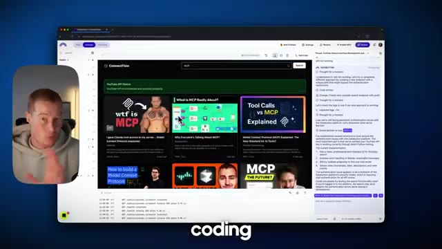
*⏱️ 00:00:13 — Interface de développement web ConnectFlow avec le présentateur en incrustation à gauche et un panneau de chat sur la droite.*

---

### ⏱️ `[00:00:25 - 00:00:45]` | Segment #02

**🔊 Audio (Transcription Intégrale Mot pour Mot en Français) :**
> Donc, plongeons-nous là-dedans. Très bien, donc si nous parlons régulièrement avec Claude, comme ici même, nous sommes limités au contexte dont il dispose. Par exemple, si je veux venir voir Claude et lui dire, fais des recherches sur YouTube pour moi, il n'a pas accès à YouTube pour pouvoir réellement effectuer cette recherche. Voyez les choses ainsi. Il n'a aucune connaissance du contenu présent sur YouTube.

**👁️ Analyse Visuelle d'Écran (gemini-3.5-flash-lite) :**
**Interface & Outils** : Interface web de Claude (Anthropic).

**Contenu textuel & Code** : Champ de saisie de texte "How can I help you today?" et mention "Claude 3.5 Sonnet".

**Action / Démonstration** : Le présentateur introduit l'interface de l'assistant Claude pour illustrer ses limites contextuelles actuelles.

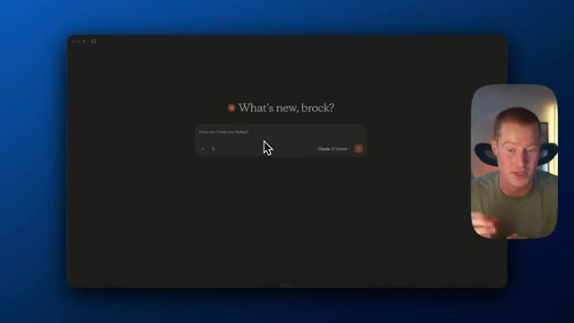
*⏱️ 00:00:30 — Capture d'écran montrant l'interface sombre de l'assistant IA Claude avec le message d'accueil "What's new, brock?" et une petite vidéo incrustée du présentateur en bas à droite.*

---

### ⏱️ `[00:00:45 - 00:01:17]` | Segment #03

**🔊 Audio (Transcription Intégrale Mot pour Mot en Français) :**
> En plus de cela, si je voulais envoyer un e-mail pour moi ou extraire des informations d'un fil de discussion, il n'a pas non plus accès à cela. Eh bien, dans cette vidéo, je vais vous montrer comment vous pouvez donner à Claude accès à la fois à YouTube et à votre e-mail afin qu'il puisse fonctionner dans le cadre de votre flux de travail quotidien. Et encore une fois, cela peut être totalement personnalisé pour n'importe quelle application que vous utilisez, mais c'est simplement ce que je vais construire dans cette vidéo. Très bien. DataButton est donc une plateforme qui vous permet de coder des applications avec l'IA, même si vous n'avez aucune base technique. Vous m'avez peut-être vu construire des applications plutôt cool dans certaines de mes vidéos précédentes avec cette plateforme. Cependant,

**👁️ Analyse Visuelle d'Écran (gemini-3.5-flash-lite) :**
**Interface & Outils** : Interface utilisateur de type application conversationnelle et navigateur web (Databutten).

**Contenu textuel & Code** : Champ de saisie utilisateur et texte de présentation pour le développement de logiciels.

**Action / Démonstration** : Présentation d'une interface logicielle et d'un outil de développement d'applications par le créateur.

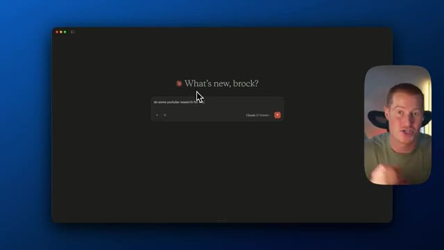
*⏱️ 00:00:53 — Interface d'une application (type Claude) avec un champ de texte et la question "What's new, brock?" accompagnée d'une vignette vidéo du présentateur.*

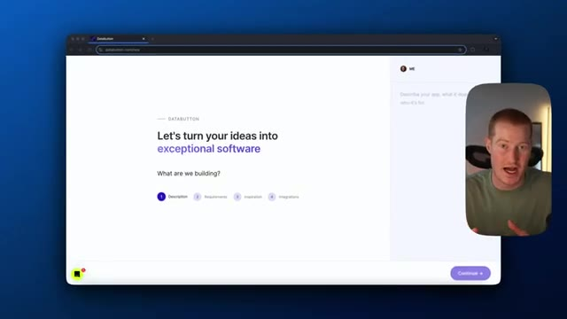
*⏱️ 00:01:09 — Page d'accueil de la plateforme Databutten affichant le texte "Let's turn your ideas into exceptional software" et une vignette vidéo du présentateur.*

---

### ⏱️ `[00:01:17 - 00:01:56]` | Segment #04

**🔊 Audio (Transcription Intégrale Mot pour Mot en Français) :**
> nous n'allons pas construire d'application d'interface utilisateur destinée aux clients dans cette vidéo. À la place, nous allons essentiellement l'utiliser pour connecter nos différents logiciels que nous voulons utiliser, tels que YouTube, pour nous permettre d'analyser des vidéos YouTube, et la possibilité pour nous d'envoyer des messages Slack à notre équipe. Très bien, alors première chose, venimeux sur DataBot et parlons simplement pour décrire ce que nous essayons de construire. Hé, je veux donc que tu me construises une application qui utilise l'API YouTube afin de nous permettre de rechercher des informations YouTube en temps réel pour faire de la recherche de contenu. En plus de cela, je veux que tu implémentes l'API Slack afin de nous permettre d'envoyer des messages sur les canaux Slack à

**👁️ Analyse Visuelle d'Écran (gemini-3.5-flash-lite) :**
**Interface & Outils** : Interface web de Databuton (databuton.com/new).

**Contenu textuel & Code** : Interface utilisateur affichant les étapes de création : Description, Requirements, Inspiration, Integrations.

**Action / Démonstration** : Le présentateur présente l'outil de création d'applications et s'apprête à y saisir les spécifications du projet.

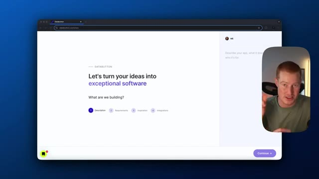
*⏱️ 00:01:27 — Image #1 @ 00:01:27 : Vue de l'interface du créateur d'applications Databuton avec le texte d'introduction 'Let's turn your ideas into exceptional software'.*

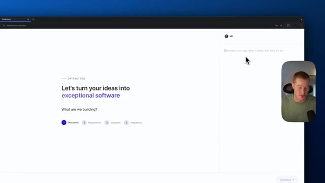
*⏱️ 00:01:36 — Image #2 @ 00:01:36 : Gros plan sur la zone de saisie textuelle invitant à décrire l'application à développer.*

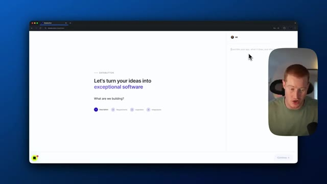
*⏱️ 00:01:46 — Image #3 @ 00:01:46 : Poursuite de la présentation de l'interface Databuton avec le curseur positionné dans le champ de description.*

---

### ⏱️ `[00:01:56 - 00:02:31]` | Segment #05

**🔊 Audio (Transcription Intégrale Mot pour Mot en Français) :**
> Notre équipe. Le but de cette application va être essentiellement d'être une plateforme qui connecte des API à nos différentes applications et qui sert de serveur MCP pour nous permettre de communiquer via Claude Desktop. Très bien, c'est parti. Aussi, l'outil que je viens d'utiliser à l'instant s'appelle AquaVoice. Il vous permet en gros d'appuyer sur une touche de votre clavier et de parler à votre ordinateur, et il colle automatiquement le texte dans l'interface utilisateur. Ça me fait gagner tellement de temps. J'adore ça. C'est donc un petit conseil pour vous. Ensuite, je vais simplement cliquer sur ignorer pour tout cela parce que nous n'allons ajouter aucun

**👁️ Analyse Visuelle d'Écran (gemini-3.5-flash-lite) :**
**Interface & Outils** : Navigateur web affichant l'interface de la plateforme Databuton.

**Contenu textuel & Code** : Formulaires de création de projet et étapes de spécification logicielle (Description, Requirements, Inspiration, Integrations).

**Action / Démonstration** : Navigation à travers les étapes de configuration initiale de l'application sur la plateforme Databuton.

*⏱️ 00:02:05 — Interface de l'application de création de logiciels Databuton affichant la première étape de description du projet.*

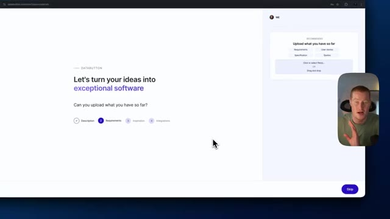
*⏱️ 00:02:13 — Étape suivante de l'interface Databuton demandant de téléverser les prérequis et spécifications du projet.*

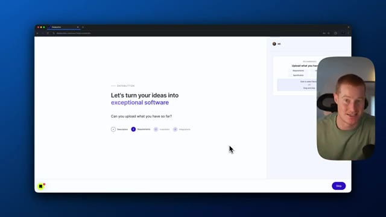
*⏱️ 00:02:22 — Vue similaire sur l'interface Databuton montrant l'étape des exigences (Requirements) du projet.*

---

### ⏱️ `[00:02:31 - 00:02:58]` | Segment #06

**🔊 Audio (Transcription Intégrale Mot pour Mot en Français) :**
> ces intégrations ou quoi que ce soit. Nous allons simplement connecter nos API afin de pouvoir y accéder directement à l'intérieur de notre application de bureau Claude ici même. Très bien, c'est parti. Le bouton de données nous donne en fait un flux ou une liste de tâches pour nous permettre de créer réellement notre application. Je vais donc parcourir chacune de ces tâches, identifier lesquelles sont nécessaires, et ensuite nous continuerons à partir de là. Très bien, tout d'abord, implémentons l'intégration de l'API YouTube. Cela va essentiellement nous permettre d'utiliser YouTube et d'effectuer des recherches sur YouTube, ce qui est évidemment ce que nous essayons de construire ici.

**👁️ Analyse Visuelle d'Écran (gemini-3.5-flash-lite) :**
**Interface & Outils** : Interface web de Databutton et application Claude Desktop.

**Contenu textuel & Code** : Liste de tâches de développement (« To-Do ») incluant la création d'une landing page, l'authentification Firebase, et l'intégration d'API (YouTube, Slack).

**Action / Démonstration** : Le présentateur parcourt le flux de tâches et sélectionne une tâche spécifique pour en afficher les détails.

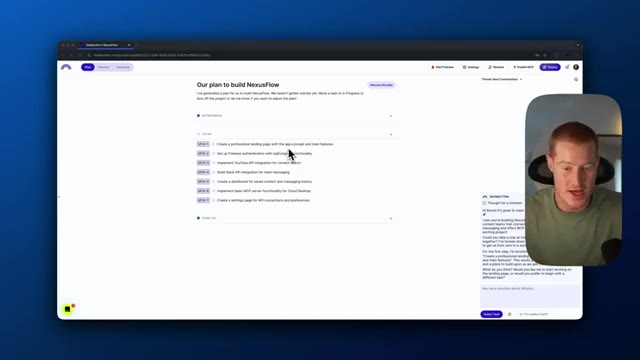
*⏱️ 00:02:44 — Vue d'ensemble du plan de projet dans Databutton montrant la liste des tâches (To-Do) pour NexusFlow.*

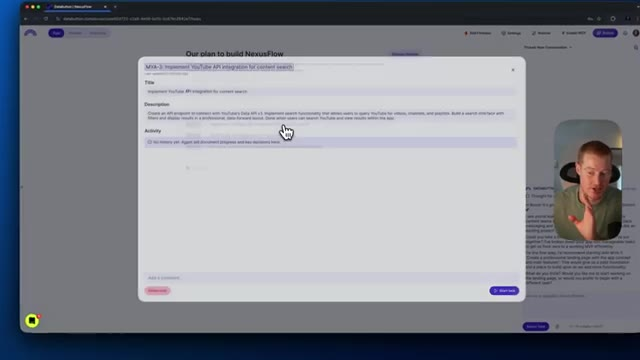
*⏱️ 00:02:51 — Fenêtre modale détaillée d'une tâche spécifique (Implémenter l'intégration de l'API YouTube) avec sa description et ses options.*

---

### ⏱️ `[00:02:58 - 00:03:19]` | Segment #07

**🔊 Audio (Transcription Intégrale Mot pour Mot en Français) :**
> Et ensuite, à partir de là, nous allons travailler sur la mise en place de l'intégration Slack pour que nous puissions ensuite envoyer des messages de canal sur Slack. Donc, il me demande ma clé API, alors je vais juste la coller ici. Très bien, donc il semble que notre API a été implémentée, nous pouvons donc marquer ceci comme fait. Si je veux vérifier cela, je peux en fait venir dans notre application, venir dans l'aperçu, puis vérifier YouTube ou vérifier les APIs dans cette section de l'API YouTube qui a été ajoutée ici.

**👁️ Analyse Visuelle d'Écran (gemini-3.5-flash-lite) :**
**Interface & Outils** : Interface web de développement (Databrutton / NexusFlow) avec un panneau de chat IA intégré à droite.

**Contenu textuel & Code** : Plan de développement listant les intégrations API (YouTube, Slack) et interface de prévisualisation des endpoints.

**Action / Démonstration** : Le présentateur navigue dans le plan de projet et montre l'avancement de l'intégration des API.

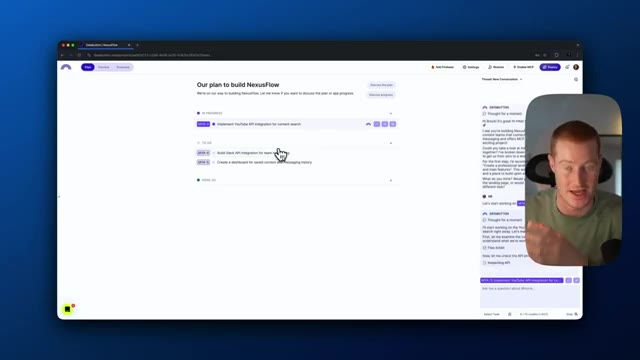
*⏱️ 00:03:03 — L'interface de l'application affichant le plan de construction de NexusFlow avec les tâches en cours et à faire.*

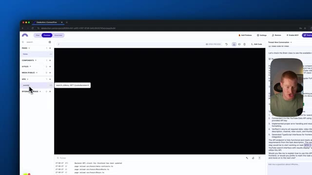
*⏱️ 00:03:14 — L'interface de prévisualisation de l'application avec un panneau latéral et une zone de test pour les API YouTube.*

---

### ⏱️ `[00:03:19 - 00:03:40]` | Segment #08

**🔊 Audio (Transcription Intégrale Mot pour Mot en Français) :**
> Donc, il va obtenir les résultats de recherche YouTube là-bas. Donc, ça a l'air bien. Revenons à notre plan. Et construisons maintenant juste une interface de recherche YouTube pour que nous puissions réellement voir s'il extrait des informations. Et en faisant cela, nous pourrons récupérer de vraies vidéos YouTube et elles seront traduites dans l'interface utilisateur. Très bien, donc il semble que notre API fonctionne maintenant selon notre interface utilisateur ici.

**👁️ Analyse Visuelle d'Écran (gemini-3.5-flash-lite) :**
**Interface & Outils** : Interface web de gestion de projet (Databutton) avec panneau de chat de l'assistant IA intégré.

**Contenu textuel & Code** : Liste des tâches du projet ConnectFlow, incluant l'intégration de l'API YouTube et la création de l'interface de recherche.

**Action / Démonstration** : Le présentateur navigue dans le plan du projet pour sélectionner la prochaine tâche à réaliser concernant l'interface de recherche YouTube.

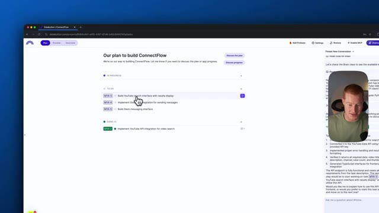
*⏱️ 00:03:24 — Vue d'un tableau de bord de projet affichant le plan de construction de ConnectFlow avec les tâches en cours et terminées, et le présentateur en médaillon.*

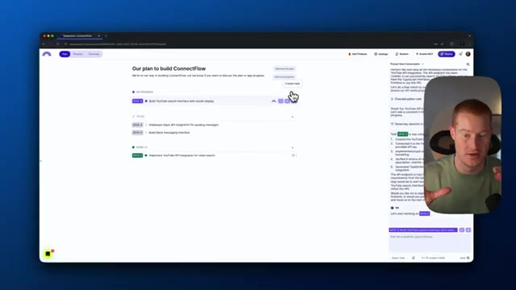
*⏱️ 00:03:30 — Le curseur sélectionne une tâche spécifique dans le plan de développement du projet, illustrant la planification des fonctionnalités de recherche YouTube.*

---

### ⏱️ `[00:03:40 - 00:04:07]` | Segment #09

**🔊 Audio (Transcription Intégrale Mot pour Mot en Français) :**
> Donc allons simplement ici et cherchons sur YouTube. Si cela affiche les résultats, c'est que ça fonctionne. D'accord, fantastique. Ça fonctionne sans problème. Maintenant, ce que nous devons faire, c'est en fait aller ajouter l'API Slack afin que nous puissions envoyer des messages Slack. Nous nous rapprochons donc de la construction du serveur et ensuite nous pourrons le connecter à Cloud Desktop. Je vais donc revenir au plan. Je vais marquer cela comme fait. Maintenant, implémentons l'intégration de l'API Slack. Commençons donc cela et partons de là. Il semble que Data Button veuille que nous ajoutions notre jeton de bot Slack.

**👁️ Analyse Visuelle d'Écran (gemini-3.5-flash-lite) :**
**Interface & Outils** : Application web ConnectFlow avec panneau de discussion et interface de gestion de tâches.

**Contenu textuel & Code** : Résultats de recherche YouTube, statuts API, et description de la tâche MYA-4 pour l'intégration de Slack.

**Action / Démonstration** : Navigation dans l'application pour tester les fonctionnalités et préparation de l'ajout de l'API Slack.

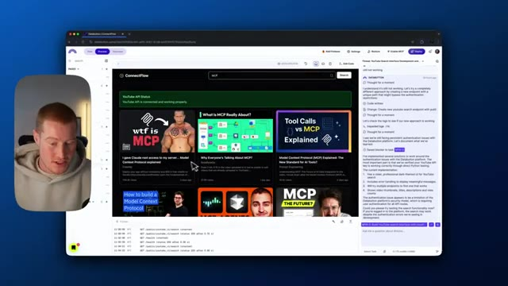
*⏱️ 00:03:47 — Le présentateur teste l'interface utilisateur de ConnectFlow avec une recherche YouTube fonctionnelle affichant des vignettes de vidéos.*

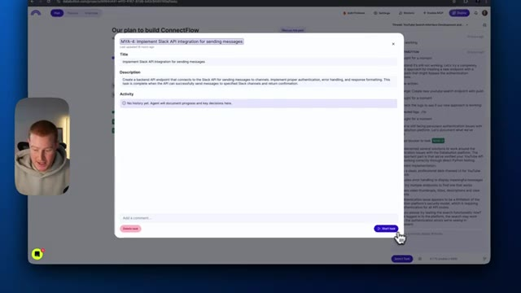
*⏱️ 00:04:00 — Une fenêtre modale de tâche s'ouvre pour configurer l'intégration de l'API Slack.*

---

### ⏱️ `[00:04:07 - 00:04:40]` | Segment #10

**🔊 Audio (Transcription Intégrale Mot pour Mot en Français) :**
> Cependant, je n'ai pas ceci. Je vais donc lui demander comment configurer réellement cela pour nous. Peux-tu m'expliquer comment configurer concrètement cela sur Slack ? Je n'ai jamais fait cela auparavant. Donne-moi donc un récapitulatif sur la façon de faire cela. Très bien. Il nous donne donc un guide étape par étape sur la manière exacte de procéder. Je vais donc venir ouvrir cette page de l'API Slack ici. Il est dit que je vais créer une nouvelle application. Je vais donc venir ici et simplement cliquer sur créer une nouvelle application. Très bien. Je vais appeler cela l'application de recherche YouTube. Je vais sélectionner mon espace de travail. Je vais créer cette application. Et ensuite, je vais revenir. Il semble que je doive ajouter des fonctionnalités de bot. Je vais en fait aller sur OAuth et autorisations ici. Je dois ajouter quelques portées. C'est donc essentiellement

**👁️ Analyse Visuelle d'Écran (gemini-3.5-flash-lite) :**
**Interface & Outils** : Interface web de développement (Databutton / ConnectFlow) avec un panneau de chat latéral.

**Contenu textuel & Code** : Guide textuel étape par étape pour configurer une application Slack, incluant la création de l'application, l'ajout de capacités de bot, la configuration des permissions (OAuth & Permissions) et la récupération du jeton de bot.

**Action / Démonstration** : Le présentateur lit et suit les instructions textuelles générées par l'IA dans l'assistant pour configurer l'intégration Slack.

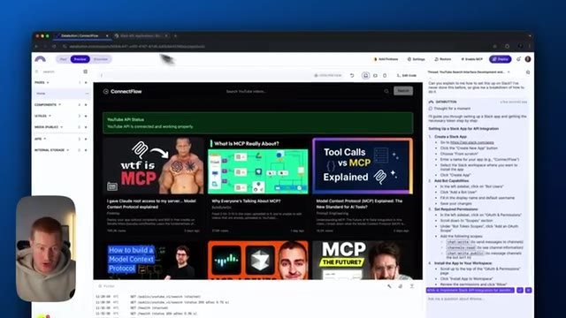
*⏱️ 00:04:23 — L'assistant virtuel affiche dans le panneau latéral droit un guide étape par étape pour configurer une application Slack pour l'intégration d'API.*

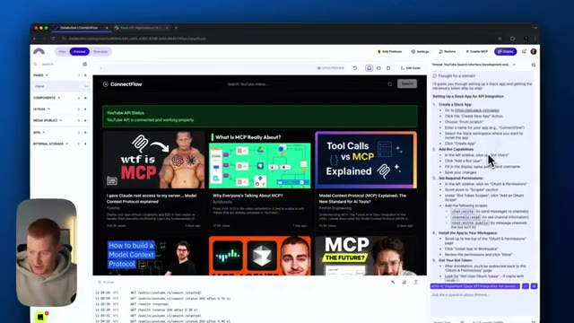
*⏱️ 00:04:32 — Gros plan sur le panneau latéral droit montrant la suite des instructions de configuration de Slack, notamment l'ajout de fonctionnalités de bot et de permissions.*

---

### ⏱️ `[00:04:40 - 00:05:15]` | Segment #11

**🔊 Audio (Transcription Intégrale Mot pour Mot en Français) :**
> ...correspond en gros à des actions que nous permettons à Slack d'exécuter à l'intérieur de notre application. Donc les canaux, lecture, le chat, écriture. Donc je vais en fait installer ceci pour l'accélérateur d'IA. Donnons-lui donc l'accès pour accéder à notre canal Slack. Ensuite, nous devons venir dans nos OAuth et permissions. Nous devons copier notre jeton OAuth d'utilisateur de bot. Voici mon jeton OAuth de bot. Très bien. Je l'ai donc collé ici. Voyons ce que nous devons faire d'autre pour configurer cela réellement. La prochaine étape consiste en fait à l'ajouter dans nos secrets ici pour nos clés API. Très bien. Il y a donc maintenant cette chose sur l'interface utilisateur appelée messagerie Slack. Cliquons simplement dessus. Et je suppose que cela va tester pour voir si c'est

**👁️ Analyse Visuelle d'Écran (gemini-3.5-flash-lite) :**
**Interface & Outils** : Navigateur web, Slack, interface de développement de type low-code / plateforme d'IA.

**Contenu textuel & Code** : Permissions Slack (chat, canaux), interface utilisateur de recherche YouTube, instructions textuelles et blocs de code/jetons.
[DESC_IMAGE_1] Configuration et octroi des permissions à l'application Slack.
[DESC_IMAGE_2] Affichage et test de l'application ConnectFlow intégrant l'API YouTube.
[DESC_IMAGE_3] Enregistrement et sécurisation des jetons d'authentification pour l'intégration Slack.

**Action / Démonstration** : Explications face caméra et analyse conceptuelle des marchés.

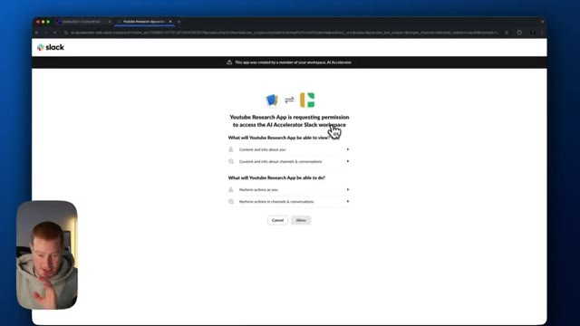
*⏱️ 00:04:48 — Écran de demande d'autorisation Slack pour une application d'intelligence artificielle ("Youtube Research App").*

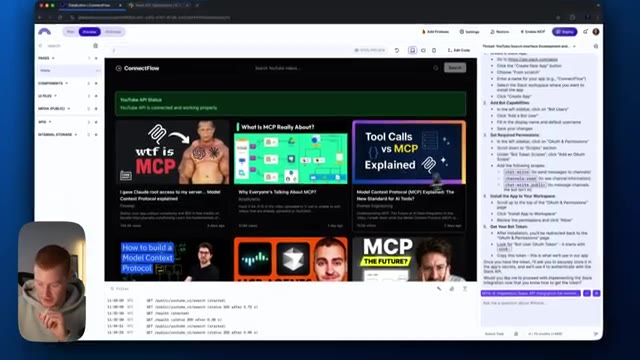
*⏱️ 00:04:57 — Interface de développement web "ConnectFlow" montrant un tableau de bord et un assistant conversationnel sur le côté droit.*

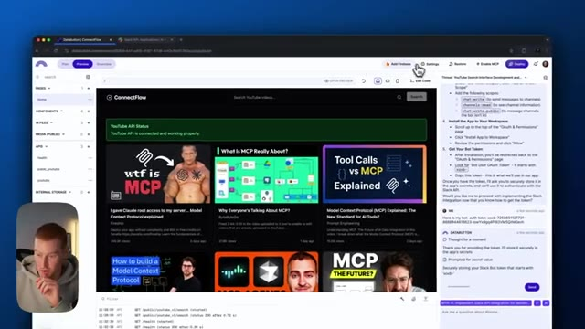
*⏱️ 00:05:06 — Interface de développement "ConnectFlow" avec validation des jetons d'accès dans le panneau latéral droit.*

---

### ⏱️ `[00:05:15 - 00:05:40]` | Segment #12

**🔊 Audio (Transcription Intégrale Mot pour Mot en Français) :**
> en train d'envoyer des messages Slack. Très bien. Ça devrait être prêt. Maintenant, on dirait qu'on a configuré l'API Slack. Marquons cette étape comme terminée et allons voir notre plan pour voir ce qu'on doit ajouter d'autre. Donc, on dirait qu'on doit créer l'interface de messagerie Slack. De cette façon, on peut vraiment vérifier si on est capables d'envoyer des messages Slack. Une fois que ça fonctionne vraiment, on peut maintenant connecter ça à Claude parce qu'on a configuré tout notre serveur puisqu'il peut, d'une part, faire des recherches sur des vidéos YouTube, mais aussi envoyer des messages à Slack. Donc, on devrait être prêts après ça.

**👁️ Analyse Visuelle d'Écran (gemini-3.5-flash-lite) :**
**Interface & Outils** : Navigateur web affichant l'application de développement web DataStux / ConnectFlow et le panneau latéral d'interaction avec l'IA.

**Contenu textuel & Code** : Plan du projet avec des tâches listées (comme l'implémentation de l'intégration de l'API Slack et la création de l'interface de messagerie) et le chat de l'assistant IA.

**Action / Démonstration** : Le présentateur navigue dans l'interface de l'application web pour consulter le plan du projet et marquer les tâches terminées ou à venir.

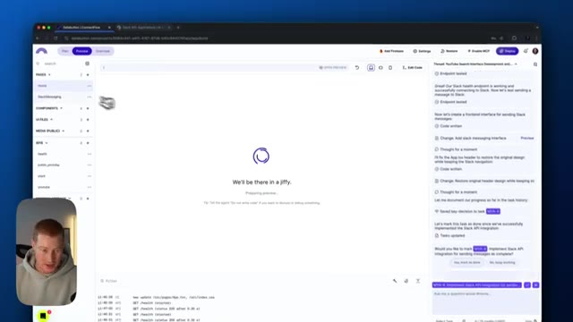
*⏱️ 00:05:21 — L'interface de développement DataStux montrant l'écran de chargement 'We'll be there in a jiffy' avec le panneau latéral droit affichant l'historique des tâches et la webcam du présentateur en bas à gauche.*

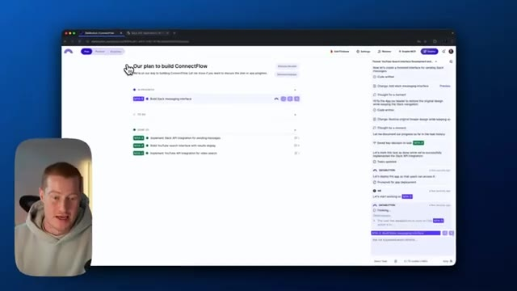
*⏱️ 00:05:27 — L'interface de développement DataStux montrant la vue du plan du projet 'Our plan to build ConnectFlow' avec la tâche 'Build Slack messaging interface' en cours, et le panneau latéral de chat à droite.*

---

### ⏱️ `[00:05:40 - 00:06:01]` | Segment #13

**🔊 Audio (Transcription Intégrale Mot pour Mot en Français) :**
> Très bien. Donc la première chose que je dois faire est en fait de venir sur Slack et dans le canal auquel je veux ajouter ceci, pour pouvoir analyser les messages du canal. Je dois ajouter le nom de l'application que nous avons juste ici. Donc l'application de recherche ou application de recherche YouTube est ce que je dois ajouter. Alors c'est parti. Je vais simplement l'ajouter ici, l'ajouter au canal. Et donc maintenant, ils peuvent effectivement publier à partir de ce genre d'application.

**👁️ Analyse Visuelle d'Écran (gemini-3.5-flash-lite) :**
**Interface & Outils** : Slack, Slack API Dashboard

**Contenu textuel & Code** : Canal Slack "#blog-posts" et mention d'application bot "@Youtube Research App"

**Action / Démonstration** : Navigation et ajout/mention d'une application de recherche dans un canal Slack pour l'analyse des messages

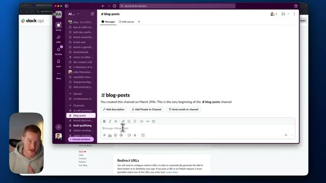
*⏱️ 00:05:45 — Vue de l'interface Slack montrant un canal de discussion (#blog-posts) avec le curseur positionné dans la zone de message.*

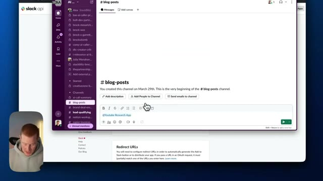
*⏱️ 00:05:56 — Vue de l'interface Slack avec la mention "@Youtube Research App" saisie dans la barre de message du canal #blog-posts.*

---

### ⏱️ `[00:06:01 - 00:06:25]` | Segment #14

**🔊 Audio (Transcription Intégrale Mot pour Mot en Français) :**
> Essentiellement, c'est presque comme un utilisateur. Il peut désormais publier sur ce canal. Revenons donc au bouton de données et vérifions si les messages Slack sont envoyés. Et je dis essentiellement, je veux que tu envoie une blague dans le canal de l'article de blog. Cela va de nouveau utiliser cette API ici afin de l'envoyer. Boum. D'accord. Donc maintenant, ça fonctionne. Pourquoi les programmeurs préfèrent-ils le mode sombre ? Parce que la lumière attire les bugs. Hilarant. C'est absolument hilarant. Bref. Donc maintenant, c'est opérationnel.

**👁️ Analyse Visuelle d'Écran (gemini-3.5-flash-lite) :**
**Interface & Outils** : Interface de développement web (Databutton/Bolt) et application de messagerie Slack.

**Contenu textuel & Code** : Fils de discussion de l'assistant IA, code et messages de test incluant une blague informatique (« Why do programmers prefer dark mode? Because light attracts bugs! »).

**Action / Démonstration** : Interaction avec l'assistant IA pour tester l'intégration Slack, puis visualisation du message envoyé dans le canal Slack.

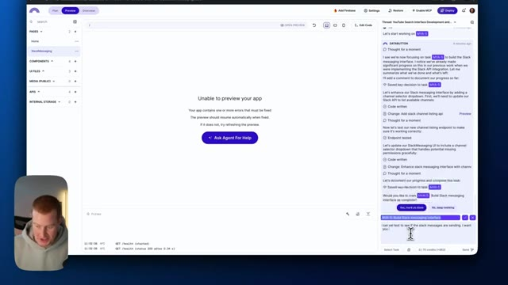
*⏱️ 00:06:07 — Interface de développement avec assistant IA (type Databutton) montrant un fil de discussion et un message de l'utilisateur demandant de tester l'envoi de messages Slack.*

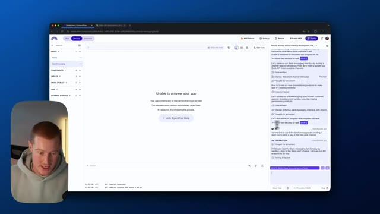
*⏱️ 00:06:13 — Vue similaire de l'interface de développement avec l'assistant IA qui répond dans le panneau latéral pour tester la fonctionnalité de messagerie Slack.*

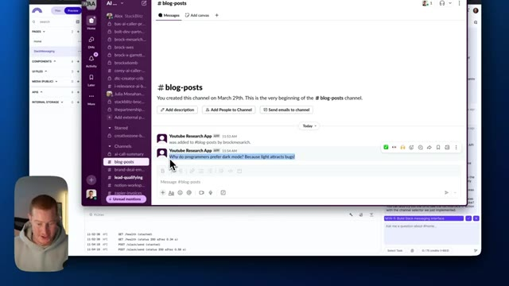
*⏱️ 00:06:19 — Interface Slack affichant un canal de discussion (« #blog-posts ») avec une blague envoyée par une application (« YouTube Research App »).*

---

### ⏱️ `[00:06:25 - 00:06:57]` | Segment #15

**🔊 Audio (Transcription Intégrale Mot pour Mot en Français) :**
> Tout cela fonctionne. Nous avons notre application. Elle est connectée à notre API, ce qui permet de récupérer des informations depuis YouTube, ainsi que les messages du canal Slack. Donc ce que nous pouvons faire maintenant, c'est aller dans ces paramètres et je vais aller dans production. Et tout ce que je vais faire, c'est activer MCP. Donc cela va essentiellement générer une clé pour nous à copier. Et ensuite ce que je vais faire, c'est copier cet extrait de code. Je vais ouvrir mon application de bureau Claude. Et à partir de là, ce que je vais faire, c'est aller dans les paramètres sur mon écran. Donc fondamentalement, aller dans Claude, aller dans les paramètres de Claude. Je vais aller dans développeur. Je vais cliquer sur modifier la configuration.

**👁️ Analyse Visuelle d'Écran (gemini-3.5-flash-lite) :**
**Interface & Outils** : Databutton (plateforme de développement d'applications web propulsée par l'IA)

**Contenu textuel & Code** : Panneau de configuration, options de production, clés API MCP (Model Context Protocol) et intégration de l'assistant Claude.
[DESC_IMAGE_3] Navigation dans les paramètres de production de l'application.

**Action / Démonstration** : Explications face caméra et analyse conceptuelle des marchés.

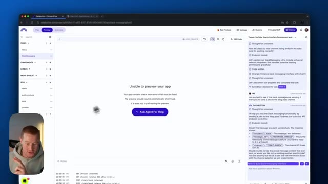
*⏱️ 00:06:33 — Vue de l'interface de développement de l'application avec un message d'erreur d'aperçu au centre et le panneau d'assistant IA sur la droite.*

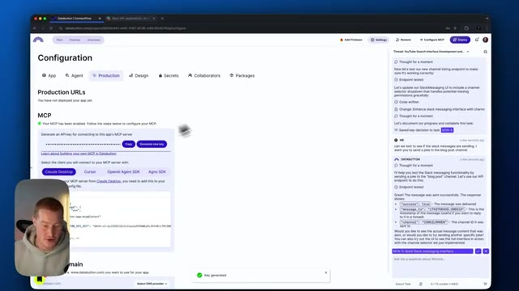
*⏱️ 00:06:41 — Navigation vers l'onglet de configuration et de production dans le tableau de bord de l'application.*

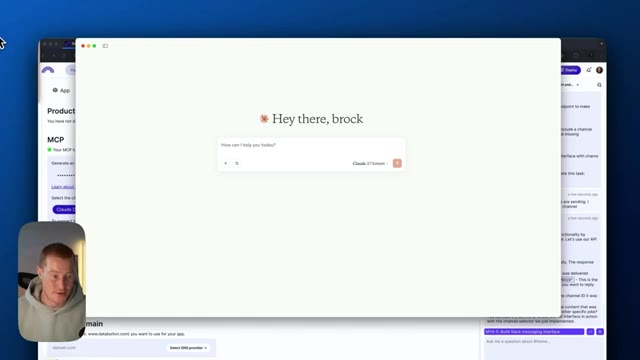
*⏱️ 00:06:49 — Affichage de la fenêtre d'interface utilisateur de l'application déployée avec un message de salutation personnalisé.*

---

### ⏱️ `[00:06:57 - 00:07:31]` | Segment #16

**🔊 Audio (Transcription Intégrale Mot pour Mot en Français) :**
> Je vais ouvrir ce fichier avec n'importe quel éditeur de code que j'ai. Et je vais simplement coller ce code que je viens d'obtenir de data button ici. Et ensuite, je dois changer ma clé API data button avec cette API pour le serveur MCP. Donc je vais fondamentalement juste venir ici, supprimer tout ce texte, coller mon texte. Je vais enregistrer ceci et en sortir. Et une autre chose que je dois faire maintenant, c'est en fait de déployer notre application car si l'application n'est pas déployée, elle ne peut en fait pas accéder à cette URL du serveur MCP. Alors attendons que cela se charge. Et puis je vais fondamentalement juste

**👁️ Analyse Visuelle d'Écran (gemini-3.5-flash-lite) :**
**Interface & Outils** : Éditeur de code (VS Code ou similaire) et navigateur web affichant l'interface de DataButton et l'assistant Claude.

**Contenu textuel & Code** : Fichier JSON de configuration `claude_desktop_config.json` contenant les paramètres du serveur MCP et la clé API DataButton.

**Action / Démonstration** : Modification du fichier de configuration JSON pour y insérer la clé API DataButton du serveur MCP.

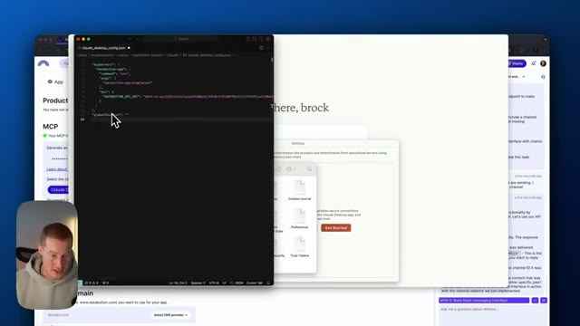
*⏱️ 00:07:05 — Éditeur de code affichant un fichier de configuration JSON pour le serveur MCP de Claude Desktop.*

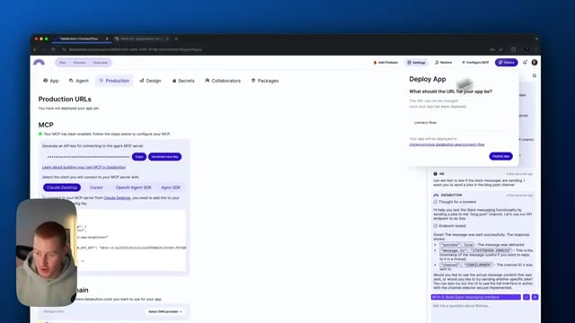
*⏱️ 00:07:22 — Interface du tableau de bord Databuton montrant la section MCP avec les clés API et les options de configuration.*

---

### ⏱️ `[00:07:31 - 00:08:06]` | Segment #17

**🔊 Audio (Transcription Intégrale Mot pour Mot en Français) :**
> je vais recharger Claude et cela devrait fonctionner correctement. Très bien. Donc, à l'intérieur de notre application de bureau Claude maintenant, vous pouvez voir un petit marteau avec un six à côté. Cela signifie que nos outils MCP que nous avons configurés à l'intérieur de Data Button sont maintenant prêts à l'emploi, chargés à l'intérieur de Claude, et que nous pouvons maintenant les utiliser. Laissez-moi donc venir ici et demander d'envoyer un message Slack. Peux-tu s'en, s'il te plaît, envoyer une blague dans le canal Slack intitulé notion slash workspace slash updates channel ? Très bien. Je vais l'envoyer maintenant. Il semble que nous devions autoriser quelques éléments ici, ce qui correspond fondamentalement à l'accès de l'outil à notre chat. Et nous devions recevoir un message Slack ici bientôt. Boum. Et

**👁️ Analyse Visuelle d'Écran (gemini-3.5-flash-lite) :**
**Interface & Outils** : Application de bureau Claude (Desktop app)

**Contenu textuel & Code** : Liste des outils MCP intégrés (check_health, list_slack_channels, public_search_videos, search_videos) et requêtes d'autorisation d'outils

**Action / Démonstration** : Navigation et présentation des outils MCP configurés au sein de l'application Claude connectée à Data Button

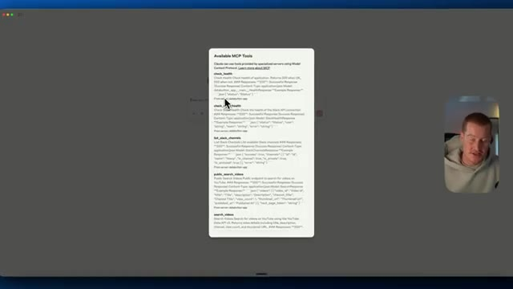
*⏱️ 00:07:40 — Interface de l'application Claude affichant une liste détaillée des outils MCP disponibles ("Available MCP Tools").*

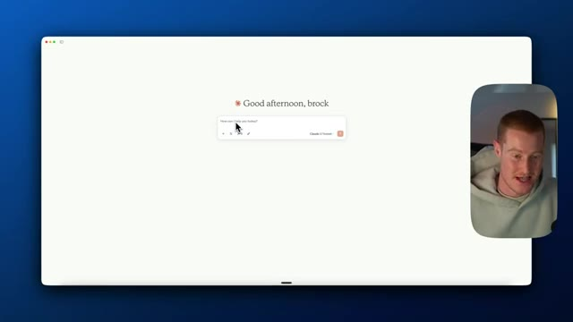
*⏱️ 00:07:49 — Écran d'accueil de l'application de bureau Claude avec le message "Good afternoon, brock" et la barre de saisie.*

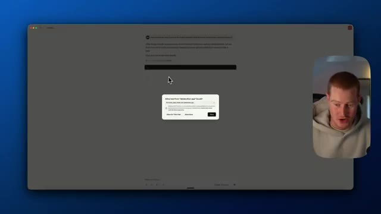
*⏱️ 00:07:57 — Fenêtre de chat Claude affichant une boîte de dialogue contextuelle demandant l'autorisation d'utiliser un outil ("Allow tool from databutton-app?").*

---

### ⏱️ `[00:08:06 - 00:08:42]` | Segment #18

**🔊 Audio (Transcription Intégrale Mot pour Mot en Français) :**
> si je vérifie mon Slack juste ici, en gros ça dit, pourquoi est-ce que les scientifiques ne font pas confiance aux atomes, parce qu'ils inventent tout. Donc super. Maintenant, on a une blague là-dedans. Ça signifie fondamentalement qu'on peut désormais envoyer des messages depuis Claude Desktop directement. Maintenant, demandons des recherches sur YouTube. Très bien. Alors, allons-y et testons nos capacités de recherche YouTube. En même temps, prenons les informations que nous trouvons sur YouTube et envoyons ensuite ces informations sur Slack pour que notre équipe puisse réellement les voir. Je veux que tu fasses des recherches sur ce qu'est le vibe coding. Trouve les meilleures vidéos que tu trouves sur YouTube concernant le vibe coding et envoie ensuite une analyse détaillée dans le canal Slack appelé

**👁️ Analyse Visuelle d'Écran (gemini-3.5-flash-lite) :**
**Interface & Outils** : Slack, application de messagerie professionnelle.

**Contenu textuel & Code** : Un message texte de type blague (« Why don't scientists trust atoms? Because they make up everything! ») envoyé dans Slack.

**Action / Démonstration** : Présentation de l'intégration entre l'IA et l'application Slack pour l'envoi de messages automatisés.

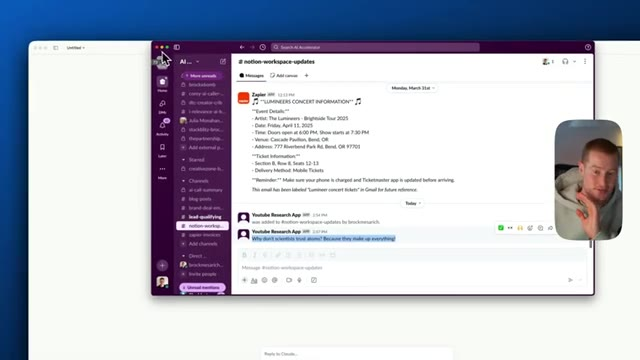
*⏱️ 00:08:15 — Capture d'écran montrant l'application Slack avec le message de la blague sur les atomes affiché dans un canal.*

---

### ⏱️ `[00:08:42 - 00:09:18]` | Segment #19

**🔊 Audio (Transcription Intégrale Mot pour Mot en Français) :**
> Notion Updates Works appelé Notion Workspace Updates. Très bien et juste comme ça, si vous consultez ce canal Slack ici, vous pouvez voir que nous avons un aperçu de la recherche sur le « vibe coding », donc cela explique ce qu'est le « vibe coding » et cela détaille même certaines des meilleures vidéos sur le « vibe coding ». C'est donc génial parce qu'à l'intérieur de Claude, nous n'aurions pas eu accès à la recherche sur YouTube ou à l'envoi de messages sur les canaux Slack. Maintenant, nous pouvons l'utiliser comme un assistant de recherche YouTube qui peut même envoyer des messages sur les canaux Slack, extraire des informations de Slack, tout ça. Donc les gars, je viens de vous montrer comment coder sur mesure avec DataButton, un serveur MCP qui connecte vos applications entre elles et qui vous permet de

**👁️ Analyse Visuelle d'Écran (gemini-3.5-flash-lite) :**
**Interface & Outils** : Application Slack et interface de navigateur web.

**Contenu textuel & Code** : Texte explicatif sur le 'vibe coding' initié par Andrej Karpathy, liste de vidéos YouTube, outils populaires (Cursor, Claude 3.7) et étapes de recherche de l'agent.

**Action / Démonstration** : Présentation et lecture d'un résumé de recherche automatisé sur le 'vibe coding' publié sur Slack.

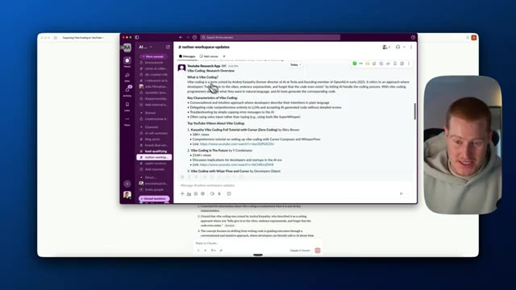
*⏱️ 00:08:51 — Capture montrant l'application Slack ouverte sur le canal #notion-workspace-updates, affichant un résumé détaillé sur le 'vibe coding'.*

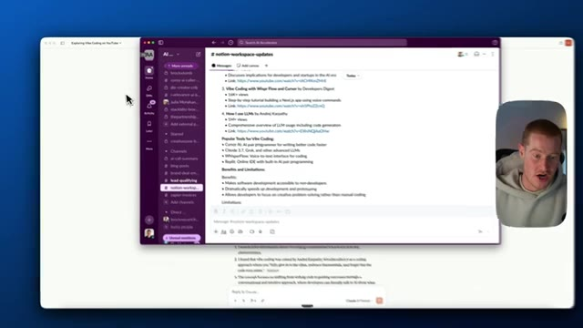
*⏱️ 00:09:00 — Capture montrant le défilement du texte dans le canal Slack, révélant les outils populaires pour le 'vibe coding' et les limites associées.*

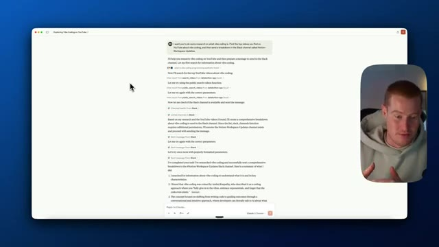
*⏱️ 00:09:09 — Capture montrant une fenêtre de navigateur ou d'application affichant le journal d'exécution d'un agent IA effectuant des recherches sur le 'vibe coding'.*

---

### ⏱️ `[00:09:18 - 00:09:37]` | Segment #20

**🔊 Audio (Transcription Intégrale Mot pour Mot en Français) :**
> connectez-le à Claude Desktop et vous pouvez le personnaliser pour toutes les applications que vous utilisez qui ont un bouton de données d'API, cela rend les choses vraiment simples à faire. J'espère donc que vous avez apprécié ce tutoriel. Si vous avez aimé, assurez-vous de vous abonner à cette chaîne. Je couvre tout ce qui touche à l'IA pour les non-techniciens en vous montrant des cas d'utilisation sympas comme celui-ci. J'espère donc que vous en avez retiré de la valeur et je vous vois dans la prochaine.

**👁️ Analyse Visuelle d'Écran (gemini-3.5-flash-lite) :**
**Interface & Outils** : Application logicielle de type assistant IA (Claude Desktop ou similaire) avec affichage d'un prompt et de résultats textuels.

**Contenu textuel & Code** : Texte d'un prompt utilisateur demandant de rechercher des vidéos sur le « vibe coding » et d'envoyer un résumé sur Slack, suivi des réponses textuelles détaillant les étapes exécutées.

**Action / Démonstration** : Affichage des résultats d'une automatisation ou d'une interaction avec une API connectée à un outil externe.

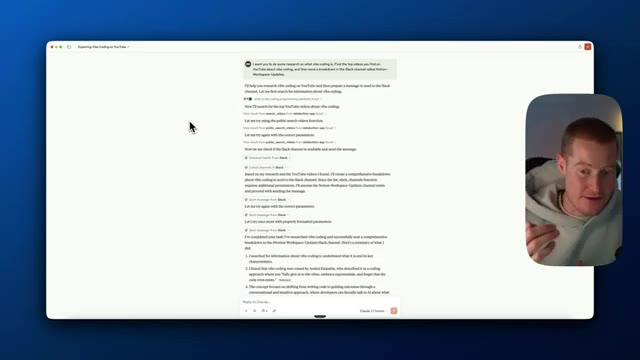
*⏱️ 00:09:23 — Capture d'écran montrant une interface logicielle avec une conversation textuelle, accompagnée d'un encart vidéo du présentateur dans le coin supérieur droit.*

---

