# 🎬 NEW Google Firebase Studio Is Overrated (Here's Why)

> **Chaîne** : [Brock Mesarich | AI for Non Techies](https://www.youtube.com/@BrockMesarich)  
> **Lien YouTube** : [https://www.youtube.com/watch?v=vFPwtgjNLX0](https://www.youtube.com/watch?v=vFPwtgjNLX0)  
> **Date de publication** : 20250410  
> **Durée** : 00:08:55  
> **Identifiant vidéo** : `vFPwtgjNLX0`  
> **Transcription & Analyse** : `whisper-v3-large-turbo+gemini-3.5-flash-lite`  

---

## 📌 Synthèse Exécutive & Outils

### 💡 Résumé
Dans cette vidéo orientée non-technophiles, Brock Mesarich teste en temps réel et sans filtre **Google Firebase Studio**, la nouvelle plateforme de codage par intelligence artificielle de Google conçue pour concurrencer des IDE comme Bolt.new, Lovable ou Cursor. L'objectif est de prototyper rapidement une application web fonctionnelle (nommée *Voice Digest*, permettant l'enregistrement, la transcription et le résumé automatique de notes vocales) afin d'évaluer son accessibilité, sa fluidité et sa pertinence réelle face aux standards actuels du marché du "vibe coding".

Dès la phase de test initiale, l'analyste met en lumière le positionnement hybride de l'outil. S'appuyant nativement sur le modèle **Google Gemini** et s'intégrant directement à l'écosystème **Firebase** pour la gestion des bases de données et des profils utilisateurs, la plateforme offre un accès gratuit initial assorti de trois espaces de travail et de crédits exploratoires. L'interface intègre également des fonctionnalités novatrices mais perfectibles, comme l'utilisation d'**Excalidraw** pour modifier l'interface utilisateur de manière visuelle via un tableau blanc interactif.

Cependant, l'expérience utilisateur globale pour un profil non technique se révèle mitigée et nettement en deçà d'alternatives comme Bolt ou Lovable. Entre des bugs fonctionnels lors de la transcription audio, des erreurs de génération de code, une interface lourde et une configuration de base de données (Firebase) réputée plus complexe que Supabase, la conclusion est sans appel : si le produit s'avère puissant pour des développeurs cherchant un IDE full-stack intégré, les créateurs non techniques ont tout intérêt à s'en détourner et à privilégier des outils no-code/low-code d'IA beaucoup plus fluides et intuitifs.

### 🛠️ Outils, Modèles & Logiciels Présentés
* **Google Firebase Studio** : Nouvelle plateforme IDE de codage et de prototypage d'applications web et mobiles par intelligence artificielle développée par Google.
* **Google Gemini** : Grand Modèle de Langage (LLM) propriétaire de Google servant de moteur d'intelligence artificielle sous-jacent pour la génération de code et l'analyse de données.
* **Bolt.new** : Plateforme de référence de codage et de création d'applications par IA appréciée pour sa fluidité auprès des utilisateurs non techniques.
* **Lovable** : IDE de développement piloté par l'IA concurrent, reconnu pour sa simplicité dans la conception d'interfaces utilisateur et de prototypes SaaS.
* **Cursor** : Éditeur de code assisté par IA destiné aux développeurs recherchant une intégration poussée dans leur flux de travail technique.
* **DataButton** : Alternative de développement d'applications full-stack assistées par intelligence artificielle.
* **Excalidraw** : Outil de tableau blanc interactif intégré à Firebase Studio permettant de modifier visuellement les éléments graphiques d'une application.
* **Aqua Voice** : Outil de dictée vocale par intelligence artificielle utilisé pour la retranscription rapide de texte sans saisie clavier.
* **Perplexity** : Moteur de recherche conversationnel alimenté par l'IA utilisé pour vérifier en temps réel la gratuité et les conditions tarifaires de la plateforme Google.
* **Supabase** : Solution de base de données relationnelle open-source souvent préférée à Firebase pour sa simplicité d'intégration dans les projets no-code/low-code.
* **Firebase** : Écosystème backend de Google gérant le stockage des données et l'authentification, jugé plus lourd d'utilisation pour les débutants.
* **Make / Zapier / n8n** : Plateformes d'automatisation de flux de travail et d'intégration de services tiers (mentionnées dans l'écosystème global d'automatisation).
* **ChatGPT / Grok / Claude** : Principaux modèles et assistants conversationnels concurrents du marché de l'intelligence artificielle générative.

### 🔑 Points Clés & Enseignements Stratégiques
1. **Positionnement surcoté pour les non-techniciens** : Contrairement aux promesses marketing, Google Firebase Studio s'adresse davantage aux développeurs confirmés qu'aux profils "non-tech", se révélant nettement plus lourd et moins intuitif que des solutions comme Bolt ou Lovable.
2. **Accessibilité financière initiale** : La plateforme propose un modèle d'accès gratuit incluant trois espaces de travail pour le développement ainsi que des crédits exploratoires (environ 300 dollars) pour tester des fonctionnalités avancées.
3. **Intégration native de l'écosystème Google** : L'utilisation directe de Google Gemini comme LLM central permet une génération et une configuration simplifiées des clés API d'intelligence artificielle au sein des applications prototypées.
4. **Complexité du backend Firebase** : L'adossement obligatoire à Firebase pour la gestion des données et l'authentification représente une barrière à l'entrée significative pour les débutants, la communauté privilégiant généralement Supabase pour sa simplicité d'exécution.
5. **Innovation visuelle avec Excalidraw** : L'intégration d'un outil de type tableau blanc pour modifier l'interface utilisateur en dessinant ou pointant directement sur les éléments constitue une approche interactive originale, bien que perfectible en termes de stabilité.
6. **Double approche de développement** : La plateforme oscille entre une tentative de "vibe coding" (génération pure par prompts textuels) et un IDE de codage traditionnel, ce dernier mode restant le plus fiable pour les utilisateurs disposant de compétences techniques.
7. **Limites des prototypes en conditions réelles** : Les tests en direct démontrent des frictions importantes lors de l'exécution de logiques complexes (comme l'enregistrement vocal et la transcription automatique), entraînant des erreurs récurrentes nécessitant des interventions manuelles.
8. **Gain de productivité par la dictée vocale** : L'utilisation d'outils annexes de transcription vocale comme Aqua Voice démontre l'efficacité d'une approche "hands-free" pour interagir rapidement avec des environnements de développement ou rédiger des prompts.
9. **Avantage concurrentiel des acteurs spécialisés** : Les plateformes spécialisées dans le prototypage rapide conservent une nette avance ergonomique face aux géants technologiques qui intègrent des outils de développement dans des écosystèmes préexistants lourds.
10. **Recommandation stratégique d'usage** : Pour les créateurs de logiciels et de SaaS sans bagage technique, il est fortement conseillé de s'en tenir aux solutions existantes et éprouvées (Bolt, Lovable) plutôt que d'essuyer les plâtres sur la version actuelle de Firebase Studio.

---

## ⏱️ Chronologie & Transcription Complète Audio & Visuelle (Mot pour Mot)

### ⏱️ `[00:00:00 - 00:00:36]` | Segment #01

**🔊 Audio (Transcription Intégrale Mot pour Mot en Français) :**
> Très bien, comme si le monde de l'intelligence artificielle ne bougeait pas déjà assez vite, Google a en fait sorti Firebase Studio, qui est notre plateforme de codage par IA, similaire à des plateformes comme Bolt.new, Lovable, Cursor, toutes ces plateformes d'IDE de codage. Et dans cette vidéo, en tant que personne non technique comme moi, je vais utiliser cette plateforme et voir à quel point elle est réellement adaptée aux débutants. Et je veux voir, est-ce que c'est réellement bien ? Sur cette chaîne, j'ai couvert des choses comme Bolt, Lovable, DataButton, toutes ces plateformes qui vous permettent de coder avec l'IA. Mais est-ce que c'est quelque chose que moi, en tant que personne non technique, je peux utiliser pour développer des logiciels et potentiellement du SaaS. Apparemment, vous êtes capable de

**👁️ Analyse Visuelle d'Écran (gemini-3.5-flash-lite) :**
**Interface & Outils** : Navigateur web affichant le site de Firebase Studio.

**Contenu textuel & Code** : Page de présentation de Firebase Studio avec le texte "AI workspace" et un aperçu de l'interface de codage par IA.

**Action / Démonstration** : Présentation visuelle de la nouvelle plateforme de codage par IA de Google.

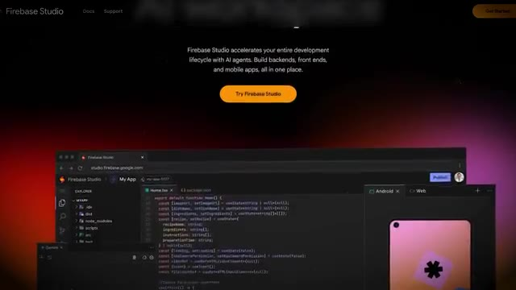
*⏱️ 00:00:09 — Capture d'écran montrant la page d'accueil de Firebase Studio avec une interface de développement affichant du code et un aperçu mobile.*

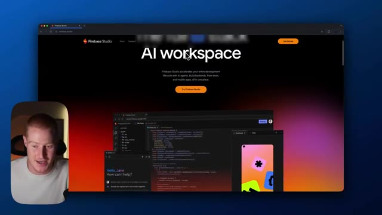
*⏱️ 00:00:27 — Capture d'écran montrant la section "AI workspace" de Firebase Studio avec la petite vignette vidéo du présentateur en bas à gauche.*

---

### ⏱️ `[00:00:36 - 00:00:58]` | Segment #02

**🔊 Audio (Transcription Intégrale Mot pour Mot en Français) :**
> créer vos propres applications mobiles ainsi que des applications web comme vous pourriez le faire avec ces autres plateformes. Tout d'abord, cette page d'accueil a l'air absolument géniale. La question est de savoir si elle est fonctionnelle pour quelqu'un comme moi. Suis-je capable de créer quelque chose sans être confus en tant que personne non technique ? Alors tout d'abord, allons-y et essayons ceci en temps réel. C'est la première fois que j'essaie ceci. Dans cette vidéo, il va s'agir d'une vidéo assez franche donnant mes impressions.

**👁️ Analyse Visuelle d'Écran (gemini-3.5-flash-lite) :**
**Interface & Outils** : Navigateur web affichant la plateforme Firebase Studio (Google).

**Contenu textuel & Code** : Texte de présentation de la plateforme de développement IA "Firebase Studio" intégrant Gemini, pour la création d'applications full-stack, web et mobiles.
[DESC_IMAGE_1] Analyse et présentation visuelle des fonctionnalités de développement d'applications mobiles et web de Firebase Studio.

**Action / Démonstration** : Explications face caméra et analyse conceptuelle des marchés.

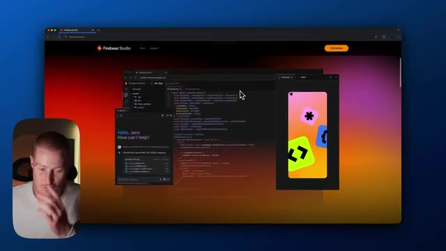
*⏱️ 00:00:41 — Capture d'écran montrant l'interface de Firebase Studio avec des fenêtres superposées de code et de prévisualisation mobile.*

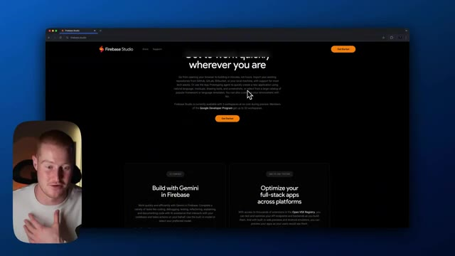
*⏱️ 00:00:47 — Vue de la page d'accueil de Firebase Studio présentant la section texte "Build with Gemini in Firebase".*

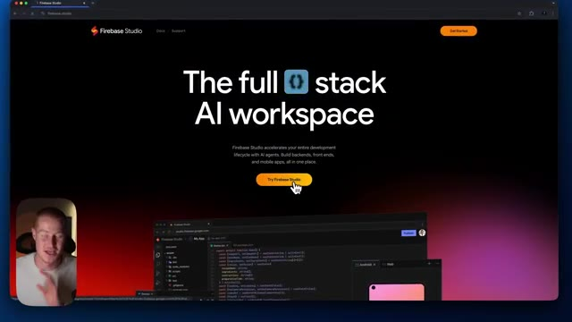
*⏱️ 00:00:53 — Page d'accueil principale de Firebase Studio affichant le titre "The full stack AI workspace" avec un bouton d'appel à l'action.*

---

### ⏱️ `[00:00:58 - 00:01:33]` | Segment #03

**🔊 Audio (Transcription Intégrale Mot pour Mot en Français) :**
> Très bien. Donc, première chose, nous allons faire en sorte que cette interface utilisateur nous demande ce que nous voulons construire. Elle indique que nous pouvons prototyper une application avec l'IA et elle nous donne ici quelques exemples de suggestions de ce que nous pourrions construire. Ensuite, ce que nous pouvons voir, c'est que nous avons un nouvel espace de travail que nous pouvons ajouter. Nous pourrions importer un dépôt GitHub ou télécharger notre propre projet ainsi que tous ces différents frameworks ici. Moi, en tant que personne non technique, je ne sais pas vraiment ce que tout cela est. Je veux juste pouvoir créer une application qui a l'air sympa et qui est fonctionnelle. C'est donc quelque chose que vous pouvez configurer, mais allons-y et passons concrètement à la création de notre application. Je vais donc simplement parler avec notre Google Firebase Studio et lui dire essentiellement ce que nous voulons construire. Allons-y

**👁️ Analyse Visuelle d'Écran (gemini-3.5-flash-lite) :**
**Interface & Outils** : Navigateur web affichant Firebase Studio (studio.firebase.google.com).

**Contenu textuel & Code** : Texte « Hello, Brock - What do you want to build? », un champ de saisie de prompt (« Prototype an app with AI ») et des exemples de suggestions (Tip/Tax Calculator, Recipe Generator, CRM Dashboard, Expense Tracker).

**Action / Démonstration** : Le présentateur présente l'interface de prototypage d'application par IA et survole le champ de texte avec le curseur de la souris.

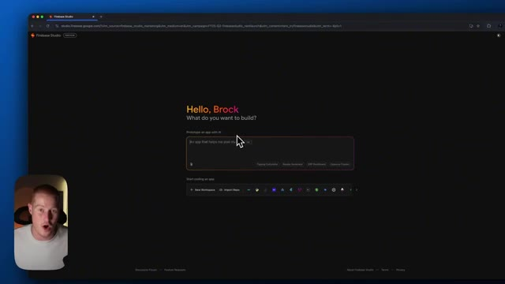
*⏱️ 00:01:07 — Capture d'écran montrant l'interface utilisateur de Firebase Studio avec un champ de saisie invitant l'utilisateur à décrire l'application qu'il souhaite construire, et le présentateur visible dans un encadré en bas à gauche.*

---

### ⏱️ `[00:01:33 - 00:02:05]` | Segment #04

**🔊 Audio (Transcription Intégrale Mot pour Mot en Français) :**
> créer une application qui vous permet d'enregistrer une note vocale et de résumer ensuite automatiquement cette note vocale grâce à l'intelligence artificielle, tout en ayant la possibilité de sauvegarder réellement cette note vocale sur mon profil. D'accord, c'est donc une application très simple. Je ne sais pas si je vais la développer entièrement. Je veux simplement avoir une idée de ce à quoi ressemblent les fonctionnalités et l'interface utilisateur de cette plateforme, et à quoi ressemblera le flux de travail si je l'utilise réellement par rapport à d'autres plateformes. Très bien. Il semble donc que cela utilise Google Gemini, évidemment comme LLM, puisque c'est un produit Google. Google a lancé toute une série de produits différents récemment. Il est donc logique qu'ils

**👁️ Analyse Visuelle d'Écran (gemini-3.5-flash-lite) :**
**Interface & Outils** : Navigateur web affichant Firebase Studio (interface de développement assistée par IA).

**Contenu textuel & Code** : Texte affiché : "Hello, Brock. What do you want to build?" avec une zone de saisie pour prototyper une application avec l'IA.

**Action / Démonstration** : Saisie d'un prompt pour générer l'application de notes vocales.

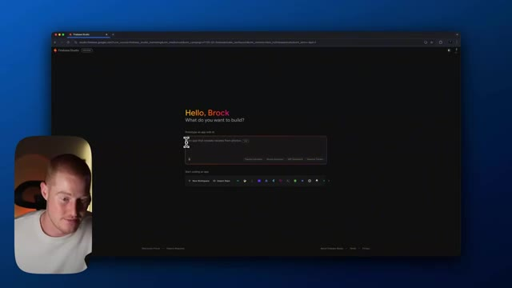
*⏱️ 00:01:41 — Capture d'écran montrant l'interface de Firebase Studio avec un champ de saisie de prompt au centre et le visage du présentateur incrusté en bas à gauche.*

---

### ⏱️ `[00:02:05 - 00:02:26]` | Segment #05

**🔊 Audio (Transcription Intégrale Mot pour Mot en Français) :**
> lancer leur propre plateforme de codage en IA avec ceci. Donc il appelle ça voice digest et ça me donne essentiellement un résumé des fonctionnalités. Il y a donc l'enregistrement vocal ou la transcription de la voix au texte, la résumation par IA, l'enregistrement dans le profil, et ensuite la gestion du profil. Ça nous donne aussi cette palette de couleurs ici pour le contour du style de notre application. Donc c'est plutôt intéressant.

**👁️ Analyse Visuelle d'Écran (gemini-3.5-flash-lite) :**
**Interface & Outils** : Navigateur web, Firebase Studio (studio.firebase.google.com).

**Contenu textuel & Code** : Plan de l'application (App Blueprint) nommé "VoiceDigest" détaillant les fonctionnalités : Voice Recording, Voice-to-Text Transcription, AI Summarization, Save to Profile, et Profile Management.

**Action / Démonstration** : Présentation du plan de l'application généré par l'IA avant le prototypage.

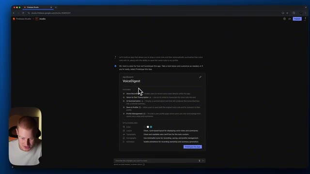
*⏱️ 00:02:10 — Interface de Firebase Studio affichant le blueprint de l'application 'VoiceDigest' avec ses fonctionnalités listées.*

---

### ⏱️ `[00:02:26 - 00:02:58]` | Segment #06

**🔊 Audio (Transcription Intégrale Mot pour Mot en Français) :**
> Je n'ai pas vu ça dans les plateformes précédentes que j'ai utilisées. Ça décompose la mise en page, la typographie, l'iconographie, l'animation, tout ça. Donc je peux faire des changements ici si je veux. Cependant, allons-y et créons simplement le prototype de cette application. Continuons donc. Avançons. Et maintenant, nous allons voir Firebase Studio en train d'écrire le code ici, comme nous le verrions pour n'importe laquelle de ces autres plateformes comme Bolt ou Lovable, par exemple. Et sur le côté droit, vous pouvez voir l'interface utilisateur où nous allons échanger des messages avec notre agent IA, si vous voulez l'appeler ainsi. Très bien. Donc je crois que l'utilisation de ceci est en fait gratuite. Donc je suis

**👁️ Analyse Visuelle d'Écran (gemini-3.5-flash-lite) :**
**Interface & Outils** : Interface web de Firebase Studio

**Contenu textuel & Code** : Plan d'application (App Blueprint) pour "VoiceDigest" avec des sections sur les fonctionnalités (enregistrement vocal, transcription, résumé IA, sauvegarde) et les directives de style (Color, Layout, Typography, Iconography, Animation).

**Action / Démonstration** : Présentation du plan de l'application et des options de modification du design et du prototype avant la création.

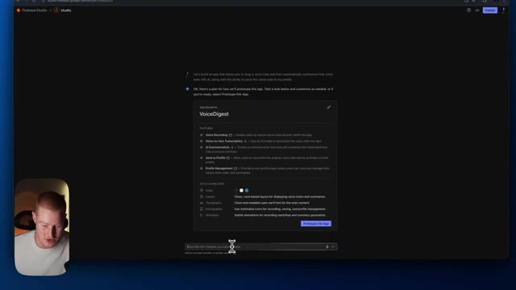
*⏱️ 00:02:34 — Capture d'écran montrant l'interface de Firebase Studio avec un plan d'application (App Blueprint) nommé VoiceDigest, détaillant les fonctionnalités et les directives de style (mise en page, typographie, iconographie, animation).*

---

### ⏱️ `[00:02:58 - 00:03:33]` | Segment #07

**🔊 Audio (Transcription Intégrale Mot pour Mot en Français) :**
> je vais aller sur Perplexity et confirmer cela en temps réel. Le nouveau Google Firebase Studio est-il gratuit ? Très bien. Donc en gros, il est dit que Google Firebase Studio est gratuit, permettant aux utilisateurs d'accéder à ses fonctionnalités sans aucun coût initial. Il offre trois espaces de travail gratuits pour le développement et les utilisateurs peuvent également recevoir 300 dollars de crédits pour explorer des capacités supplémentaires. C'est donc intéressant. Je me demande si nous serons facturés une fois que nous l'aurons hébergé ou quelque chose dans ce genre. Revenons donc à notre application. Voyons ce qu'elle nous a construit. C'est honnêtement une interface utilisateur très simple. Cela ne ressemble en rien à quelque chose comme Bolt ou

**👁️ Analyse Visuelle d'Écran (gemini-3.5-flash-lite) :**
**Interface & Outils** : Navigateur web affichant le moteur de recherche Perplexity AI.

**Contenu textuel & Code** : Question de recherche : "Is the new Google Firebase Studio free to use" et texte de réponse soulignant que Firebase Studio est gratuit avec trois espaces de travail gratuits.

**Action / Démonstration** : Le présentateur consulte la réponse en direct sur Perplexity AI pour confirmer les informations concernant Google Firebase Studio.

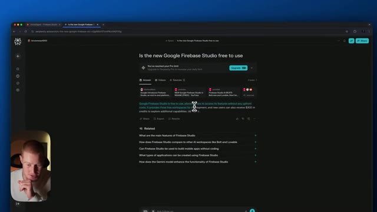
*⏱️ 00:03:07 — Capture d'écran montrant une recherche sur l'interface de Perplexity posant la question sur la gratuité de Google Firebase Studio, avec la réponse générée affichée à l'écran et la webcam du présentateur dans le coin inférieur gauche.*

---

### ⏱️ `[00:03:33 - 00:04:05]` | Segment #08

**🔊 Audio (Transcription Intégrale Mot pour Mot en Français) :**
> Lovable ou DataButton, toutes ces autres plateformes, mais essayons ceci et voyons un peu ce que nous pourrions construire avec. On dirait que je dois effectivement ajouter ma clé API Gemini pour pouvoir probablement utiliser la fonction de résumé par IA que j'ai ajoutée ici, cette fonctionnalité ici. Allons-y donc. On dirait que je peux en fait simplement générer automatiquement cette clé API Gemini parce que c'est connecté à Gemini, évidemment, puisque c'est un produit Google. C'est donc plutôt intéressant. Cela nous facilite vraiment la tâche pour connecter notre fonctionnalité d'IA à notre application. Très bien. Cela signifie donc essentiellement que la première version de notre prototype d'application est prête. Essayez-la dans la fenêtre de prévisualisation et décrivez

**👁️ Analyse Visuelle d'Écran (gemini-3.5-flash-lite) :**
**Interface & Outils** : Navigateur web affichant Firebase Studio (VoiceDigest) et une webcam du présentateur.

**Contenu textuel & Code** : Interface utilisateur avec un bouton 'Start Recording', un champ de transcription, et une invite demandant d'entrer une clé API Gemini.

**Action / Démonstration** : Saisie ou préparation de l'entrée de la clé API Gemini pour activer les fonctionnalités de résumé par intelligence artificielle.

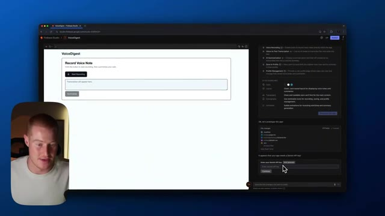
*⏱️ 00:03:41 — Vue d'ensemble de l'interface de développement montrant l'application VoiceDigest et un champ de saisie pour la clé API Gemini.*

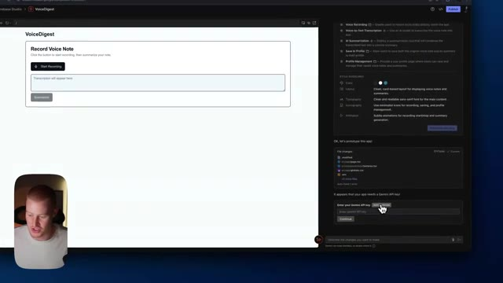
*⏱️ 00:03:49 — Gros plan sur le curseur pointant vers l'interface de configuration pour ajouter la clé API requise par l'application.*

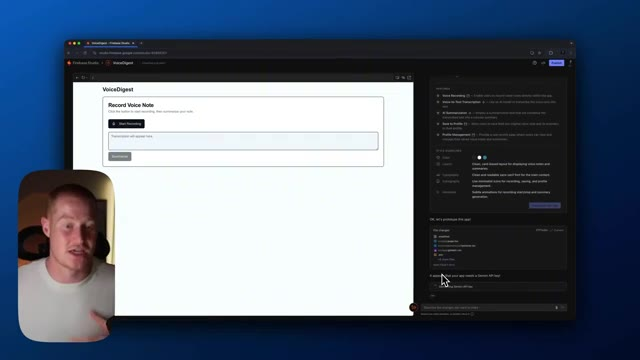
*⏱️ 00:03:57 — Vue identique affichant l'interaction avec le panneau latéral de configuration et le prototype de l'application de notes vocales.*

---

### ⏱️ `[00:04:05 - 00:04:39]` | Segment #09

**🔊 Audio (Transcription Intégrale Mot pour Mot en Français) :**
> les changements que vous aimeriez apporter. Alors allons-y et voyons si cela fonctionne réellement. Bonjour. J'ai donc une idée de vidéo où je teste réellement le nouveau Google Firebase Studio afin de créer ma propre application avec l'IA pour voir s'il est possible de le faire en tant que non-technophile. Ok, c'est donc intéressant. Il a effectivement pris notre enregistrement ici. Il a donc pris ce fichier audio, il l'a stocké ici. Cependant, il semble que, pour une raison quelconque, il dise que je n'ai pas assez d'informations pour transcrire le document fourni.

**👁️ Analyse Visuelle d'Écran (gemini-3.5-flash-lite) :**
**Interface & Outils** : Google Firebase Studio (interface de développement d'applications web)

**Contenu textuel & Code** : Interface utilisateur de l'application 'VoiceDigest', panneau de configuration des styles et des fonctionnalités à droite, et zone de chat pour les modifications par l'IA.

**Action / Démonstration** : Test du prototype d'application web et démonstration des fonctionnalités de transcription vocale dans Google Firebase Studio.

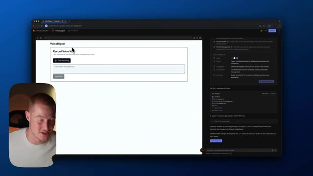
*⏱️ 00:04:14 — Aperçu de l'interface de Google Firebase Studio montrant le prototype de l'application 'VoiceDigest' avec les options de configuration à droite et la webcam du présentateur incrustée en bas à gauche.*

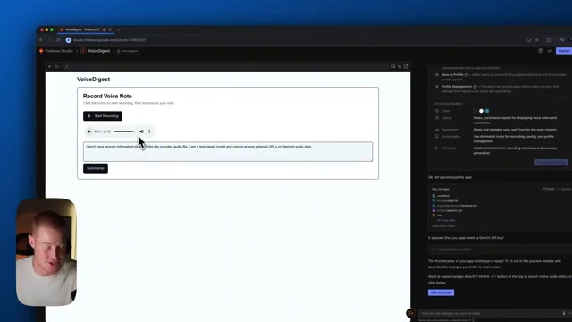
*⏱️ 00:04:31 — Test de l'application 'VoiceDigest' dans Firebase Studio avec un lecteur audio et un champ de transcription généré, et la webcam du présentateur visible en bas à gauche.*

---

### ⏱️ `[00:04:39 - 00:04:58]` | Segment #10

**🔊 Audio (Transcription Intégrale Mot pour Mot en Français) :**
> fichier audio. Faisons un résumé. Intéressant. D'accord. Donc, pour une raison quelconque, cela ne fonctionne pas, revenons simplement ici. Pour une raison quelconque, le résumé par IA ne fonctionne pas pour la voix. Maintenant, il capture l'enregistrement vocal, mais il ne résume pas cela et ne fait aucune des autres choses que je voulais qu'il fasse. Une chose que je tiens à mentionner, c'est que je parle à mon ordinateur ici.

**👁️ Analyse Visuelle d'Écran (gemini-3.5-flash-lite) :**
**Interface & Outils** : Firebase Studio / VoiceDigest

**Contenu textuel & Code** : Interface utilisateur avec un lecteur audio, une zone de transcription affichant une erreur de modèle textuel, et un panneau latéral de configuration.

**Action / Démonstration** : Le présentateur analyse le problème où l'application capture l'enregistrement mais ne parvient pas à le résumer.

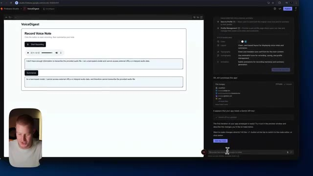
*⏱️ 00:04:44 — Aperçu de l'application VoiceDigest montrant un problème de transcription de note vocale.*

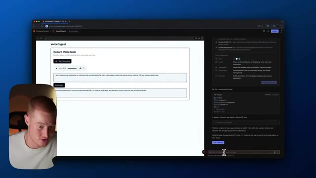
*⏱️ 00:04:49 — Vue similaire de l'application VoiceDigest pendant que le présentateur explique le dysfonctionnement de la synthèse vocale.*

---

### ⏱️ `[00:04:58 - 00:05:17]` | Segment #11

**🔊 Audio (Transcription Intégrale Mot pour Mot en Français) :**
> En fait, je ne suis pas en train de taper au clavier. J'utilise un outil qui s'appelle Aqua Voice, qui me permet littéralement de cliquer sur un bouton de mon clavier ou de mon ordinateur et de simplement parler à mon ordinateur. Et il traduit ça automatiquement en texte. Donc je n'ai pas vraiment besoin de taper. C'est l'un de mes outils d'IA préférés que j'utilise. Je voulais donc juste mentionner ça. On dirait qu'il a effectivement pris les devants et fait ces changements.

**👁️ Analyse Visuelle d'Écran (gemini-3.5-flash-lite) :**
**Interface & Outils** : Navigateur web affichant une application de prise de notes vocales (Firebase Studio / VoiceDigest) avec un panneau de code/assistant.

**Contenu textuel & Code** : Interface utilisateur avec un bouton "Start Recording", une zone de texte "Transcription will appear here", et des panneaux latéraux détaillant les modifications de fichiers et l'historique des discussions avec l'IA.

**Action / Démonstration** : Le présentateur commente l'utilisation d'outils de transcription vocale tandis que l'application de démonstration est affichée à l'écran.

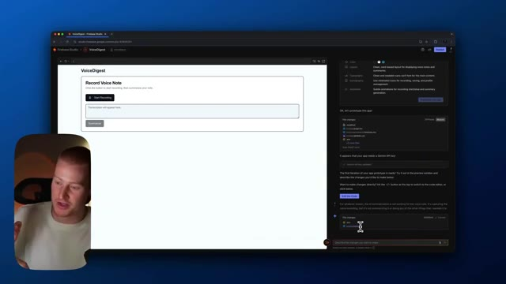
*⏱️ 00:05:03 — Capture d'écran montrant une interface de développement web avec un aperçu d'application nommé "VoiceDigest" et un panneau de chat ou de modifications sur le côté droit.*

---

### ⏱️ `[00:05:17 - 00:05:36]` | Segment #12

**🔊 Audio (Transcription Intégrale Mot pour Mot en Français) :**
> Voyons si ça fonctionne maintenant. Ouais, j'ai une idée de vidéo où je présente vraiment mes cinq meilleurs cas d'usage de l'intelligence artificielle pour des plateformes comme Google Firebase Studio. Bon, alors c'est intéressant. Donc ça donne toujours cette erreur. Ouais, donc j'ai une idée de vidéo où j'utilise l'IA pour vraiment construire une application en utilisant le nouveau Firebase Studio. C'est quoi ce bordel ?

**👁️ Analyse Visuelle d'Écran (gemini-3.5-flash-lite) :**
**Interface & Outils** : Google Firebase Studio (navigateur web)

**Contenu textuel & Code** : Interface utilisateur de l'application 'VoiceDigest' avec un bouton 'Record Voice Note', une zone de transcription et un panneau latéral de configuration ou de chat IA.

**Action / Démonstration** : Navigation et présentation d'une application prototype en cours de test dans Firebase Studio.

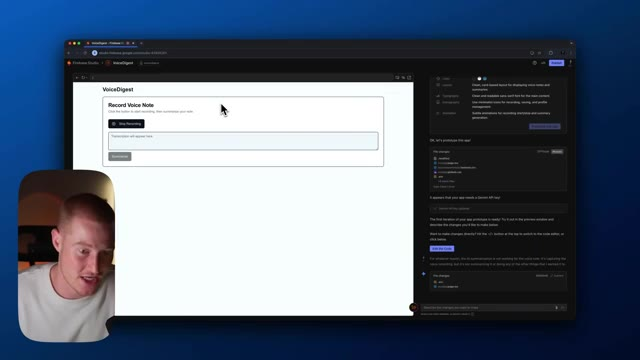
*⏱️ 00:05:22 — Capture d'écran montrant l'interface de Google Firebase Studio avec l'application de prototype 'VoiceDigest', accompagnée du présentateur en incrustation.*

---

### ⏱️ `[00:05:36 - 00:06:05]` | Segment #13

**🔊 Audio (Transcription Intégrale Mot pour Mot en Français) :**
> Bon, alors pour une raison quelconque, on dirait que ça récupère de fausses informations ici. Donc, laissez-moi régler ça et revenons à la démonstration de la plateforme. Très bien. Donc, en fait, je jouais avec l'interface utilisateur et on dirait que si je viens ici et que je clique là, je peux cliquer sur certains aspects de ça et je peux juste genre cliquer sur, par exemple, je veux genre cliquer sur ce bouton. Je peux cliquer ici et je peux juste expliquer comment je veux le changer. Je veux que tu fasses ce bouton bleu clair. Très bien. C'est très intéressant. Pour une raison quelconque, ça n'a pas réellement fait ce changement. Donc, je rencontre quelques problèmes ici. Ce n'est pas très fluide à utiliser. Je ne vais pas mentir.

**👁️ Analyse Visuelle d'Écran (gemini-3.5-flash-lite) :**
**Interface & Outils** : Application web 'VoiceDigest' sous Firebase Studio avec un éditeur de code intégré et la webcam du présentateur.

**Contenu textuel & Code** : Code source HTML/JavaScript, interface utilisateur de test d'enregistrement vocal et zones de texte pour les transcriptions.

**Action / Démonstration** : Le présentateur manipule l'interface utilisateur de l'application et interagit avec les composants d'enregistrement vocal.

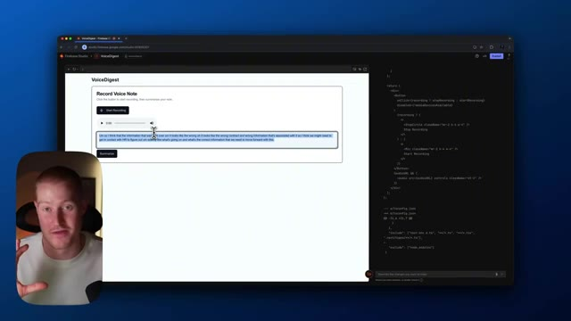
*⏱️ 00:05:43 — Image #1 : L'interface de l'application 'VoiceDigest' affiche une transcription avec du texte sélectionné, accompagnée du code source à droite et du présentateur en médaillon.*

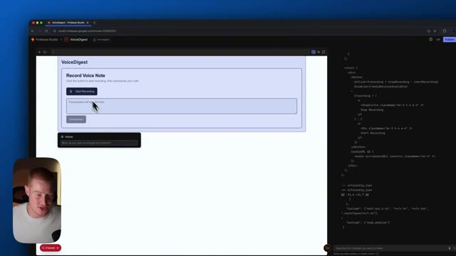
*⏱️ 00:05:50 — Image #2 : L'interface 'VoiceDigest' montre la zone de transcription réinitialisée avec le message par défaut 'Transcription will appear here' et un curseur en mouvement.*

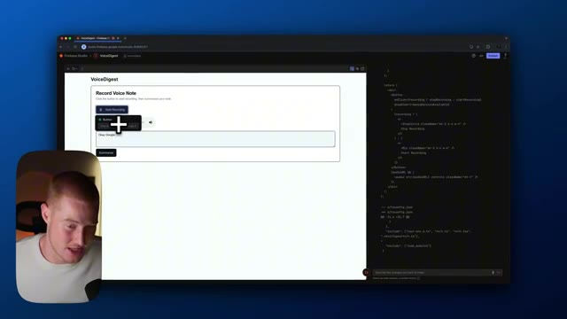
*⏱️ 00:05:57 — Image #3 : L'interface 'VoiceDigest' présente une interaction utilisateur avec un menu contextuel en incrustation au-dessus des boutons d'enregistrement.*

---

### ⏱️ `[00:06:05 - 00:06:25]` | Segment #14

**🔊 Audio (Transcription Intégrale Mot pour Mot en Français) :**
> Ce n'est pas la meilleure chose que j'ai utilisée en matière de codage par IA, si je suis tout à fait honnête. Donc si je descends et clique ici, c'est en fait une fonctionnalité plutôt cool, même si cela a l'air très bizarre, genre ça n'a pas l'air terrible dans cette interface utilisateur ici. Donc apparemment, ce que ça utilise, ça utilise Excalidraw pour me permettre réellement d'apporter des modifications à l'interface utilisateur de mon application ici.

**👁️ Analyse Visuelle d'Écran (gemini-3.5-flash-lite) :**
**Interface & Outils** : Interface de développement web (Firebase Studio / IDE cloud) avec un navigateur intégré et un panneau de code.

**Contenu textuel & Code** : Code source React/JSX affichant des composants de bouton d'enregistrement vocal (« Start Recording ») et des fichiers de configuration TypeScript (`tsconfig.json`).

**Action / Démonstration** : Le présentateur manipule l'interface utilisateur de l'application web pour interagir avec les fonctionnalités de dessin et de code.

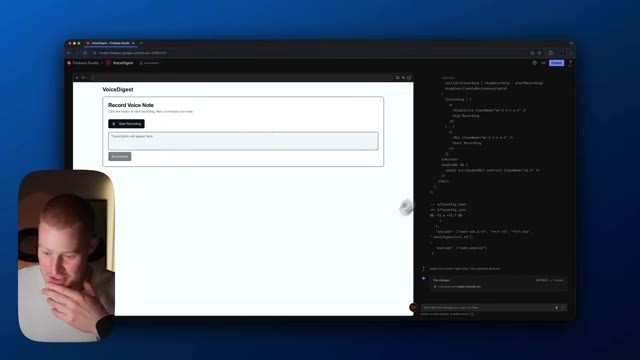
*⏱️ 00:06:10 — Image montrant une application web nommée 'VoiceDigest' avec un panneau de code sur la droite et le présentateur en médaillon.*

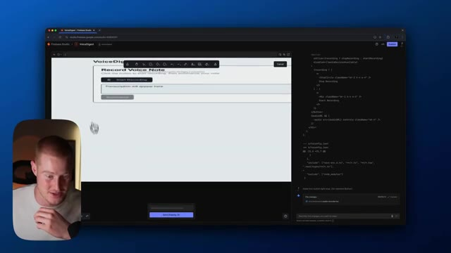
*⏱️ 00:06:15 — Image montrant l'application 'VoiceDigest' avec une barre d'outils de dessin activée en haut de la page web.*

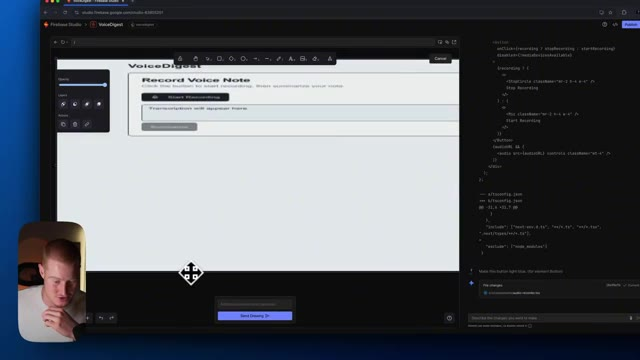
*⏱️ 00:06:20 — Image montrant l'application 'VoiceDigest' avec un curseur de déplacement actif sur le canevas de dessin.*

---

### ⏱️ `[00:06:25 - 00:06:45]` | Segment #15

**🔊 Audio (Transcription Intégrale Mot pour Mot en Français) :**
> Donc cliquons simplement sur, je veux dire, je ne peux même rien faire avec ça parce que ça ne charge pas correctement. Alors laissez-moi rafraîchir ceci, voir si je peux réellement tester cette fonctionnalité sans rencontrer de problèmes. Très bien. Pour une raison quelconque, la mise en page a toujours l'air très bizarre, mais ce que je pourrais faire, c'est venir ici et je pourrais littéralement juste dessiner ici et genre, je pourrais pointer juste ici. Changeons ça pour, euh, genre du bleu.

**👁️ Analyse Visuelle d'Écran (gemini-3.5-flash-lite) :**
**Interface & Outils** : Firebase Studio, éditeur de code et navigateur web intégré.

**Contenu textuel & Code** : Code source pour un enregistreur vocal (React / JavaScript) et interface utilisateur de l'application 'VoiceDigest'.

**Action / Démonstration** : Test et interaction avec l'application web pour corriger la mise en page et les fonctionnalités.

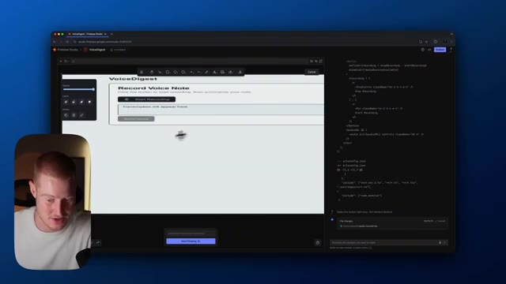
*⏱️ 00:06:30 — Interface Firebase Studio affichant une application web 'VoiceDigest' avec un panneau de code à droite et une incrustation vidéo du présentateur en bas à gauche.*

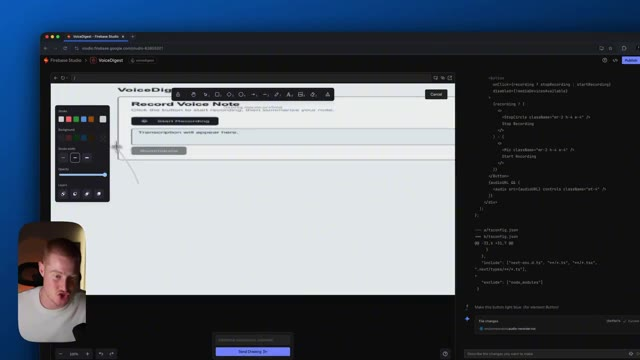
*⏱️ 00:06:40 — Interface de développement Firebase Studio montrant un outil d'annotation visuelle ouvert sur l'application 'VoiceDigest'.*

---

### ⏱️ `[00:06:45 - 00:07:18]` | Segment #16

**🔊 Audio (Transcription Intégrale Mot pour Mot en Français) :**
> Je veux dire, par exemple, disons que je veux faire un changement là-dessus. Disons simplement, rendons ça bleu clair ou, disons, je pourrais aussi entourer quelque chose. On dirait que, d'accord. Intéressant. C'est une façon intéressante d'interagir avec notre application. Je n'ai pas vu ça sur d'autres plateformes où ça fait littéralement apparaître cette interface utilisateur où on pourrait, tu sais, l'utiliser comme un tableau blanc afin d'apporter des modifications à notre application. Donc c'est plutôt intéressant. Je ne sais pas si ça fonctionne vraiment ou à quel point ce serait utile. Mais c'est quelque chose d'intéressant que je veux savoir. Donc mes premières impressions ici en tant que personne non technique, cette plateforme est un peu lourde.

**👁️ Analyse Visuelle d'Écran (gemini-3.5-flash-lite) :**
**Interface & Outils** : IDE de développement web (Firebase Studio) intégrant un navigateur web, un éditeur de code et un assistant IA textuel/visuel.

**Contenu textuel & Code** : Code source JavaScript/TypeScript, interface utilisateur de l'application VoiceDigest, et consignes textuelles/visuelles de modification ("Make this button light blue").

**Action / Démonstration** : Le présentateur utilise une fonction d'interaction visuelle pour annoter directement l'interface web et demander à l'IA d'apporter des modifications au code source correspondant.

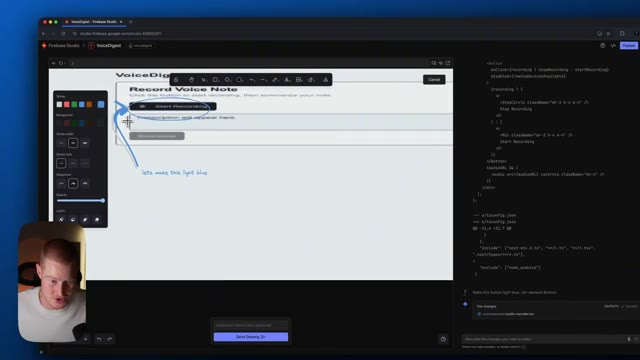
*⏱️ 00:06:54 — Le présentateur dessine un cercle bleu autour du bouton d'enregistrement sur l'interface web de VoiceDigest et ajoute une note textuelle "let's make this light blue".*

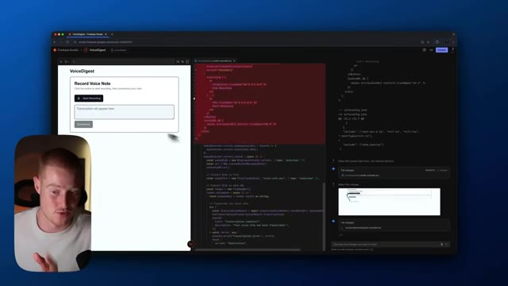
*⏱️ 00:07:02 — L'interface affiche simultanément l'application web à gauche, le code source en cours de modification au centre et le panneau d'historique des changements à droite.*

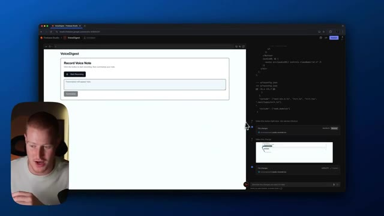
*⏱️ 00:07:10 — L'application web VoiceDigest avec le bouton "Start Recording" et le panneau latéral affichant les modifications de code suggérées par l'IA.*

---

### ⏱️ `[00:07:18 - 00:07:52]` | Segment #17

**🔊 Audio (Transcription Intégrale Mot pour Mot en Français) :**
> Genre peut-être que c'est mieux d'utiliser ceci simplement pour coder plutôt que, genre, du vibe coding et de construire avec l'IA et juste en faisant des prompts, mais je pourrais venir ici. Je pourrais, genre, modifier le code juste ici, exactement comme n'importe quelle autre, genre, plateforme de codage ou IDE. Donc potentiellement, ça pourrait t'être utile si tu sais coder, mais le prototypeur, je ne suis juste pas super impressionné. Ça ne m'épate pas vraiment ici dès ma toute première interaction que j'ai avec. Je vais continuer à tester un peu ça, mais c'est ma première impression ici. Pendant que j'enregistre cette vidéo, vous m'avez vu tester ça. Je pense qu'évidemment, la raison pour laquelle cela pourrait avoir un impact énorme, c'est parce que

**👁️ Analyse Visuelle d'Écran (gemini-3.5-flash-lite) :**
**Interface & Outils** : Firebase Studio, interface de développement web, navigateur

**Contenu textuel & Code** : Arborescence de fichiers d'un projet web, interface utilisateur de VoiceDigest avec fonction d'enregistrement vocal et code source/diffs de modification

**Action / Démonstration** : Navigation dans l'arborescence des fichiers du projet puis visualisation de l'application et de ses modifications de code dans l'interface de développement.

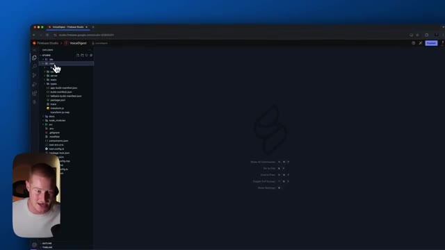
*⏱️ 00:07:26 — L'écran affiche un environnement de développement intégré en ligne (Firebase Studio) avec l'arborescence de fichiers du projet VoiceDigest visible dans le volet de gauche, et le présentateur en médaillon dans le coin inférieur gauche.*

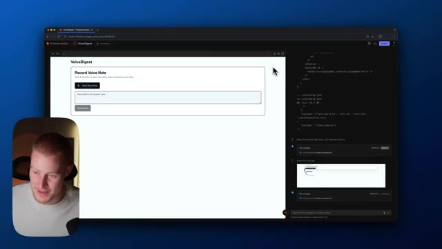
*⏱️ 00:07:44 — L'écran montre une application web prévisualisée à gauche ("VoiceDigest" avec un bouton d'enregistrement vocal) et du code/historique de modifications dans un panneau à droite.*

---

### ⏱️ `[00:07:52 - 00:08:12]` | Segment #18

**🔊 Audio (Transcription Intégrale Mot pour Mot en Français) :**
> cela s'intègre directement avec Firebase de Google, qui est essentiellement un moyen pour nous d'interagir avec des données. Nous pourrions donc créer des comptes d'utilisateurs, stocker des informations dans nos applications que nous construisons directement à l'intérieur de Firebase, ce que généralement je n'aime pas utiliser Firebase lorsque je construis des applications avec des outils comme Lovable, Data Button ou Bolt. J'aime simplement utiliser Supabase. C'est beaucoup plus simple. C'est beaucoup plus facile.

**👁️ Analyse Visuelle d'Écran (gemini-3.5-flash-lite) :**
**Interface & Outils** : Navigateur web affichant l'interface de Firebase Studio / environnement de développement, avec le présentateur en incrustation vidéo (PiP).

**Contenu textuel & Code** : Code source et interface utilisateur d'une application de prise de notes vocales (« Record Voice Note », « Transcription will appear here », « Summarize »).

**Action / Démonstration** : Le présentateur explique et montre l'interface de développement d'une application connectée à Firebase.

*⏱️ 00:07:57 — Interface de développement web montrant une application nommée 'VoiceDigest' avec un panneau de code et une fenêtre de prévisualisation, accompagnée de la vidéo du présentateur en incrustation.*

---

### ⏱️ `[00:08:12 - 00:08:31]` | Segment #19

**🔊 Audio (Transcription Intégrale Mot pour Mot en Français) :**
> Firebase est plutôt lourd à utiliser, mais je suppose que si vous construisez des applications full-stack, cela pourrait potentiellement être utile de l'avoir intégré directement là. Et avec tous les produits de Google. Cependant, comme je l'ai dit au début de cette vidéo, à quel point est-ce convivial pour une personne non technique ? À mon avis, si vous utilisez Bolt et Lovable et que vous n'avez aucune idée de comment coder, restez sur cette plateforme.

**👁️ Analyse Visuelle d'Écran (gemini-3.5-flash-lite) :**
**Interface & Outils** : Firebase Studio, navigateur web, IDE intégré.

**Contenu textuel & Code** : Code source d'une application web (VoiceDigest), modifications de configuration JSON et affichage de l'interface utilisateur.

**Action / Démonstration** : Présentation et démonstration de la construction d'une application full-stack via l'interface de développement de Google Firebase.

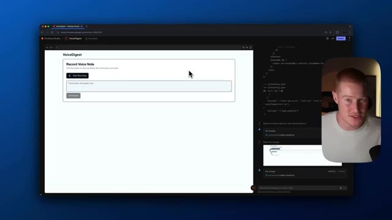
*⏱️ 00:08:17 — Interface de développement Firebase Studio montrant l'application "VoiceDigest" avec un panneau de code à droite et la webcam du présentateur.*

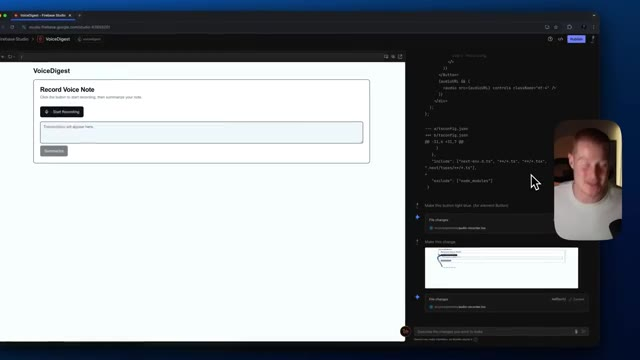
*⏱️ 00:08:21 — Vue similaire de l'application VoiceDigest sur Firebase Studio avec des modifications de code affichées dans le panneau latéral.*

*⏱️ 00:08:26 — Aperçu de l'interface Firebase Studio et du code source avec le présentateur commentant le processus de développement.*

---

### ⏱️ `[00:08:31 - 00:08:55]` | Segment #20

**🔊 Audio (Transcription Intégrale Mot pour Mot en Français) :**
> Je n'essaierais même pas de faire ça. Peut-être que Google fera quelques mises à jour là-dessus et le rendra beaucoup plus accessible aux débutants, sans tout un tas d'erreurs comme celles que je viens de rencontrer ici. Mais bon, voilà ce que j'en pense. J'espère que vous avez tiré de la valeur de ceci. Si vous avez apprécié cette vidéo, n'oubliez pas de vous abonner. Je traite de tout ce qui touche à l'intelligence artificielle pour les non-techniciens, où je montre aux gens toutes ces nouvelles plates-formes qui sortent et comment les utiliser si vous n'êtes pas une personne technique. Et j'espère que vous avez tiré de la valeur de cette vidéo. Je vous retrouve dans la prochaine.

**👁️ Analyse Visuelle d'Écran (gemini-3.5-flash-lite) :**
**Interface & Outils** : Navigateur web, Firebase Studio, interface de développement / IDE, aperçu d'application web

**Contenu textuel & Code** : Interface utilisateur avec un bouton d'enregistrement vocal ("Start Recording"), une zone de texte de transcription et du code source affiché dans le panneau latéral droit.

**Action / Démonstration** : Démonstration et test de l'application web VoiceDigest avec visualisation des modifications de code en temps réel.

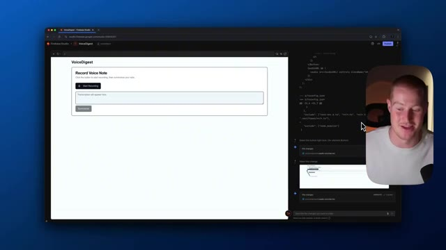
*⏱️ 00:08:37 — Interface de développement web montrant l'application VoiceDigest en cours de test avec un panneau latéral de code et la webcam du présentateur.*

---

