# 🎬 NEW Google Firebase Studio vs Lovable (Which Should You Use?)

> **Chaîne** : [Brock Mesarich | AI for Non Techies](https://www.youtube.com/@BrockMesarich)  
> **Lien YouTube** : [https://www.youtube.com/watch?v=Ybez4af5jpo](https://www.youtube.com/watch?v=Ybez4af5jpo)  
> **Date de publication** : 20250414  
> **Durée** : 00:18:17  
> **Identifiant vidéo** : `Ybez4af5jpo`  
> **Transcription & Analyse** : `whisper-v3-large-turbo+gemini-3.5-flash-lite`  

---

## 📌 Synthèse Exécutive & Outils

### 💡 Résumé

Cette vidéo propose un comparatif côte à côte de deux environnements de développement pilotés par l'intelligence artificielle destinés aux profils non-techniques : le tout nouveau **Google Firebase Studio** et la plateforme **Lovable**. L'expérimentation repose sur un prompt unique et exigeant : concevoir une application web interactive de recommandation de cartes de crédit personnalisée, intégrant des formulaires dynamiques et des données réelles. L'analyse met en lumière la rapidité d'exécution, la qualité de l'interface utilisateur et la fluidité des interactions conversationnelles proposées par chaque solution.

Dès la phase de génération initiale, **Lovable** se démarque nettement en produisant une page d'atterrissage complète, esthétique et dotée d'une ergonomie fluide, tandis que **Google Firebase Studio** génère une interface basique, jugée maladroite et peu intuitive. Au-delà du design, le test des fonctionnalités interactives et de la logique métier révèle de profondes disparités : les parcours utilisateurs sur Lovable s'avèrent structurés et opérationnels, là où Firebase Studio nécessite des ajustements répétés et peine initialement à rendre les boutons fonctionnels. 

L'évaluation s'oriente ensuite vers des exigences d'architecture logicielle plus avancées, telles que l'intégration de l'authentification des utilisateurs, des paiements en ligne via **Stripe** et l'interrogation de sources de données réelles versus des données simulées. La confrontation des modèles sous-jacents — notamment **Gemini 2.5** pour Google et **Claude 3.7** pour Lovable — démontre la supériorité de Lovable dans la gestion contextuelle de projets complexes, offrant aux créateurs d'applications sans code une expérience de prototypage nettement plus mature et professionnelle.

### 🛠️ Outils, Modèles & Logiciels Présentés

* **Google Firebase Studio** : Nouvelle plateforme de développement cloud de Google permettant de prototyper des applications web à l'aide de l'IA, adossée au modèle Gemini.
* **Lovable** : Plateforme de génération d'applications full-stack no-code de premier plan, réputée pour la qualité esthétique et fonctionnelle de ses interfaces utilisateur.
* **Gemini 2.5** : Modèle de langage multimodal de Google intégré à Firebase Studio pour la génération et la correction de code.
* **Claude 3.7** : Modèle de pointe développé par Anthropic, utilisé par Lovable pour concevoir des logiques applicatives robustes et des interfaces soignées.
* **Aqua Voice** : Outil de dictée vocale piloté par l'IA permettant de convertir instantanément la voix en texte dans n'importe quel champ de saisie ou interface de prompt.
* **Stripe** : Solution de paiement en ligne internationale évoquée pour l'implémentation de la monétisation et la gestion des abonnements utilisateurs.
* **Excalidraw** : Outil de tableau blanc virtuel intégré pour annoter ou modifier visuellement des éléments d'interface (présent de manière perfectible dans Firebase Studio).
* **n8n** : Outil d'automatisation de flux de travail (mentionné dans l'écosystème des créateurs de contenu de la chaîne).
* **Make** : Plateforme d'automatisation no-code pour connecter des applications tierces (mentionnée dans l'écosystème d'automatisation).
* **Zapier** : Pionnier des intégrations logicielles et des flux automatisés (mentionné dans la boîte à outils des créateurs).
* **Grok** : Modèle d'intelligence artificielle conversationnelle (mentionné dans la veille technologique de la chaîne).
* **ChatGPT** : Assistant conversationnel d'OpenAI (référencé comme standard de comparaison ou d'intégration d'API).

### 🔑 Points Clés & Enseignements Stratégiques

* **Supériorité esthétique initiale** : Lovable génère dès le premier prompt une page d'atterrissage complète et professionnelle, surpassant largement le rendu visuel rudimentaire et maladroit de Google Firebase Studio.
* **Efficacité des moteurs sous-jacents** : L'utilisation de Claude 3.7 dans Lovable offre une compréhension contextuelle supérieure et une structuration du code plus propre comparée à l'implémentation initiale de Gemini 2.5 dans Firebase Studio.
* **Expérience utilisateur (UX) interactive** : Le parcours de qualification des dépenses et des profils de crédit s'avère fluide, guidé et hautement interactif sur Lovable, tandis qu'il présente des frictions techniques et des bugs de soumission sur Firebase.
* **Fiabilité des fonctionnalités générées** : Les boutons et formulaires de Firebase Studio nécessitent des prompts correctifs répétés pour devenir pleinement opérationnels, illustrant une maturité de prototypage encore perfectible.
* **Gestion des sources de données** : L'analyse révèle qu'un prompt initial génère souvent des données fictives ; des instructions explicites sont requises pour connecter l'application à de véritables bases de données ou moteurs d'API.
* **Évolutivité architecturale** : La capacité à intégrer de manière fluide des briques complexes telles que l'authentification des utilisateurs et les passerelles de paiement (Stripe) constitue un critère décisif pour industrialiser une application.
* **Ergonomie des outils d'édition** : Les fonctionnalités de modification visuelle de Lovable (clic direct sur l'interface) se révèlent beaucoup plus intuitives et stables que les tentatives d'édition via tableau blanc d'Excalidraw dans Firebase Studio.
* **Gain de productivité par la dictée vocale** : L'intégration d'outils de transcription vocale comme Aqua Voice permet de s'affranchir de la saisie clavier, accélérant considérablement l'écriture des prompts et la phase de itération.
* **Adaptabilité aux profils non-techniques** : Ces plateformes démocratisent la création de logiciels en masquant la complexité des frameworks (Next.js, Angular, Flutter), permettant à des utilisateurs sans bagage en programmation de se concentrer exclusivement sur la logique métier.
* **Stratégie de prototypage rapide** : Le choix d'une plateforme de développement par IA doit se baser non seulement sur la vitesse de génération, mais surtout sur la maintenabilité du code généré et sa capacité à accepter des modifications itératives sans casser l'application.

---

## ⏱️ Chronologie & Transcription Complète Audio & Visuelle (Mot pour Mot)

### ⏱️ `[00:00:00 - 00:00:19]` | Segment #01

**🔊 Audio (Transcription Intégrale Mot pour Mot en Français) :**
> Dans cette vidéo, je vais comparer côte à côte le tout nouveau Google Firebase Studio et Lovable. Google a enfin sorti sa plateforme de codage par IA et tout le monde en parle. Eh bien, dans cette vidéo, je vais la mettre à l'épreuve et voir ce qu'elle peut faire par rapport à ses concurrents. Nous allons voir laquelle de ces plateformes permet aux personnes non techniques de créer les meilleures applications web, et ce, sans une seule ligne de code.

**👁️ Analyse Visuelle d'Écran (gemini-3.5-flash-lite) :**
**Interface & Outils** : Navigateur web affichant Firebase Studio et des interfaces de développement d'applications web.

**Contenu textuel & Code** : Pages de présentation de services cloud, interfaces utilisateur pour application de cartes de crédit et panneaux de configuration de code.

**Action / Démonstration** : Présentation des outils de développement IA par le créateur.

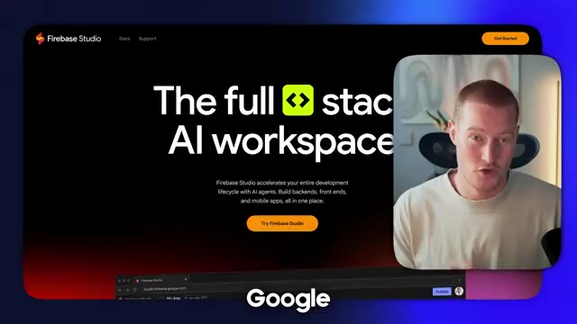
*⏱️ 00:00:05 — Page d'accueil officielle de Google Firebase Studio montrant le titre "The full stack AI workspace" avec le présentateur incrusté en médaillon.*

*⏱️ 00:00:09 — Interface de développement et de test de l'application de recommandation de cartes de crédit avec plusieurs panneaux de code et de prévisualisation.*

---

### ⏱️ `[00:00:19 - 00:00:54]` | Segment #02

**🔊 Audio (Transcription Intégrale Mot pour Mot en Français) :**
> Très bien, allons-y. Très bien, les amis. Donc j'ai une comparaison côte à côte ici. Sur le côté gauche, j'ai Firebase Studio par Google qui vient tout juste de sortir. Et sur le côté droit, j'ai lovable.dev, que vous m'avez déjà vu présenter sur cette chaîne. Donc la question est : laquelle de ces plateformes peut créer une meilleure application en tant que personne non technique ? Et je vais décortiquer cela précisément dans cette vidéo. Nous allons créer la même application avec le même prompt. Alors allons-y et commençons. Voici le prompt que je vais donner à chacune de nos applications. Créons donc une application qui permet aux utilisateurs de saisir des informations pour obtenir la meilleure carte de crédit pour eux en fonction de leurs critères. Nous allons implémenter

**👁️ Analyse Visuelle d'Écran (gemini-3.5-flash-lite) :**
**Interface & Outils** : Navigateur web affichant Firebase Studio (studio.firebase.google.com) et Lovable.dev (lovable.dev).

**Contenu textuel & Code** : Interface utilisateur des deux plateformes de développement d'applications par IA avec des zones de saisie de texte pour les prompts ("Hello, Brock" et "Idea to app in seconds").

**Action / Démonstration** : Présentation comparative des interfaces des deux outils de création d'applications sans code.

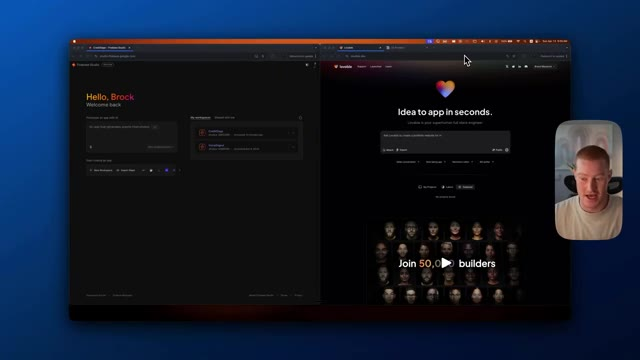
*⏱️ 00:00:28 — Comparaison côte à côte de Firebase Studio (à gauche) et lovable.dev (à droite) sur l'écran d'un ordinateur.*

---

### ⏱️ `[00:00:54 - 00:01:27]` | Segment #03

**🔊 Audio (Transcription Intégrale Mot pour Mot en Français) :**
> des informations sur de vraies cartes de crédit et nous voulons que ce soit une application interactive où ils remplissent des formulaires et obtiennent ensuite des recommandations spécialisées pour les cartes qu'ils devraient utiliser en fonction de leurs préférences, du montant d'argent qu'ils gagnent, etc. Donc c'est un prompt que nous allons utiliser, comme vous pouvez le voir, je l'ai mis sur ces deux applications, donc ce que nous allons voir tout d'abord, c'est qu'à l'intérieur de Google Firebase Studio, nous pouvons commencer à coder notre application mais nous pouvons choisir n'importe lequel de ces frameworks de codage que nous voulons ajouter, vous savez, je ne suis pas un développeur, je ne connais pas nécessairement la différence entre Next.js et Angular ou Flutter.

**👁️ Analyse Visuelle d'Écran (gemini-3.5-flash-lite) :**
**Interface & Outils** : Navigateur web affichant la plateforme Lovable.dev (Firebase Studio / Lovable) et le présentateur en médaillon.

**Contenu textuel & Code** : Texte du prompt saisi : "Let's build an app that allows users to input information and get the best credit card for them based on their specifications. We are going to implement information about real credit cards. And we want this to be an interactive app where they fill out forms and then get a specialized recommendation for the cards they should use based on their preferences, amount of money they make, etc."

**Action / Démonstration** : Affichage de l'interface de développement d'application Lovable et du prompt textuel décrivant le projet d'application de cartes de crédit.

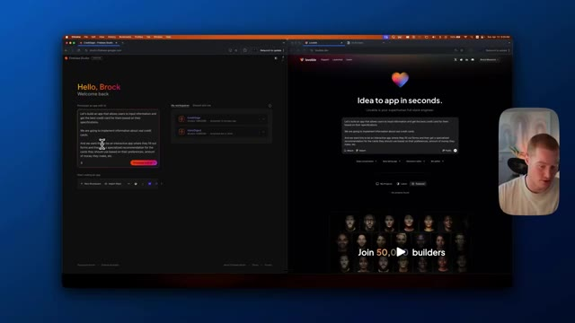
*⏱️ 00:01:02 — Capture d'écran montrant deux fenêtres de navigateur côte à côte affichant la plateforme de création d'applications Lovable.dev, avec le texte du prompt décrivant l'application interactive de recommandation de cartes de crédit.*

---

### ⏱️ `[00:01:27 - 00:01:48]` | Segment #04

**🔊 Audio (Transcription Intégrale Mot pour Mot en Français) :**
> Je ne connais pas la différence. Donc encore une fois, ce sera un avis venant de quelqu'un avec un parcours non technique pour voir ce que vous pouvez construire. Je vais donc cliquer sur « prototyper avec l'IA ». Je ne vais pas m'attarder sur les détails là-dessus. Et avec Lovable, nous avons simplement la possibilité de le faire. Ça va donc maintenant commencer à générer notre aperçu pour ces deux applications différentes. Ce sera donc intéressant de voir laquelle est la plus rapide pour donner le premier résultat ici.

**👁️ Analyse Visuelle d'Écran (gemini-3.5-flash-lite) :**
**Interface & Outils** : Navigateur web affichant Firebase Studio et Lovable.dev.

**Contenu textuel & Code** : Interface de création d'applications No-Code / IA avec des champs de saisie de texte ("Idea to app in seconds").

**Action / Démonstration** : Présentation comparative de plateformes de prototypage d'applications alimentées par l'intelligence artificielle.

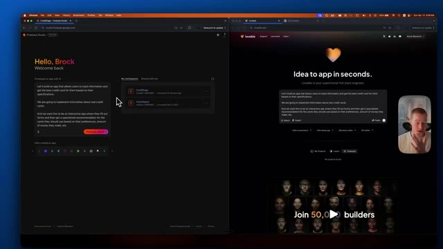
*⏱️ 00:01:32 — Capture d'écran montrant deux fenêtres de navigateur côte à côte, affichant des interfaces d'outils de développement d'applications par IA (Firebase Studio à gauche et Lovable à droite), avec le présentateur visible en incrustation.*

---

### ⏱️ `[00:01:48 - 00:02:21]` | Segment #05

**🔊 Audio (Transcription Intégrale Mot pour Mot en Français) :**
> Donc, il semble que sur le côté gauche, Firebase Studio demande une confirmation pour certaines choses, et Lovable a déjà pris les devants et a commencé à configurer cela, donc ça me donne les fonctionnalités, nous avons donc un formulaire de saisie de données, un moteur de recommandation, un affichage de cartes de recommandation, et ensuite nous avons les couleurs, la mise en page, tout ça. Alors cliquons simplement sur "oui, prototyper cette application" et voyons à quoi cela ressemble ici, donc vous pouvez voir que Firebase Studio sur le côté gauche commence à coder tout cela. Ça a l'air, ça a juste l'air un peu maladroit, laissez-moi juste dire ça, genre, ça ne fonctionne pas de manière fluide, là où Lovable, c'est juste agréable pour les yeux de le regarder faire réellement son travail, donc ce

**👁️ Analyse Visuelle d'Écran (gemini-3.5-flash-lite) :**
**Interface & Outils** : Navigateur web affichant les plateformes Firebase Studio et Lovable en écran partagé.

**Contenu textuel & Code** : Spécifications de l'application "Credit Card Compass", incluant les fonctionnalités de formulaire de saisie de données, de moteur de recommandation, et de comparaison de cartes.

**Action / Démonstration** : Le présentateur compare les interfaces et observe la génération automatique de l'application sur les deux plateformes.

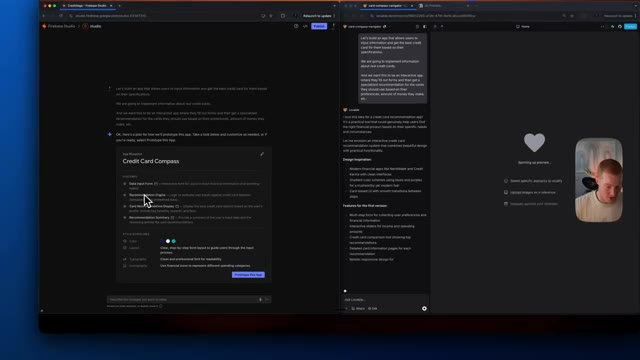
*⏱️ 00:01:56 — Comparaison côte à côte de deux interfaces de développement d'applications par IA (Firebase Studio à gauche et Lovable à droite), affichant des plans de fonctionnalités pour une application de recommandation de cartes de crédit.*

---

### ⏱️ `[00:02:21 - 00:02:54]` | Segment #06

**🔊 Audio (Transcription Intégrale Mot pour Mot en Français) :**
> c’est ma toute première impression quand je compare ces deux plates-formes. Très bien, nous avons donc notre première sortie d’interface utilisateur de Firebase Studio. C’est ce que nous avons obtenu du côté gauche. Donnons-lui une seconde et attendons que Lovable nous donne son résultat, puis comparons les deux. Très bien, voici donc le résultat initial que chacune d’elles nous a fourni. Vous pouvez voir sur le côté gauche, nous avons cette application de formulaire très, très basique que Firebase Studio nous a créée. Sur le côté droite, Lovable nous a construit une page d’atterrissage complète qui a l’air vraiment pas mal. C’est notre tout premier prompt également. Nous devons donc garder cela à l’esprit, mais jetons juste un œil à ceci.

**👁️ Analyse Visuelle d'Écran (gemini-3.5-flash-lite) :**
**Interface & Outils** : Firebase Studio, Lovable, Navigateur web

**Contenu textuel & Code** : Génération d'applications de comparaison de cartes bancaires (Credit Card Compass) via des outils d'IA.

**Action / Démonstration** : Comparaison des interfaces utilisateur générées par deux plateformes d'IA différentes.

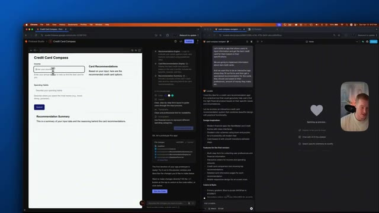
*⏱️ 00:02:29 — Comparaison d'interfaces avec Firebase Studio à gauche et Lovable en cours de chargement à droite, avec la webcam du présentateur.*

*⏱️ 00:02:37 — Comparaison d'interfaces montrant Firebase Studio à gauche et le résultat final de Lovable généré à droite, avec la webcam du présentateur.*

---

### ⏱️ `[00:02:54 - 00:03:31]` | Segment #07

**🔊 Audio (Transcription Intégrale Mot pour Mot en Français) :**
> Vous pouvez voir trouver votre carte de crédit idéale. Il y a même comme un petit élément d'interface utilisateur d'une carte de crédit ici appelé credit card genius. Notre application s'appelle credit card genius. Et ça nous dit fondamentalement comment ça fonctionne. Nous pourrions commencer et cela nous amène à cette chose interactive ici, voyons si cela fonctionne réellement, ce qui a l'air de bien fonctionner. Et sur le côté gauche, regardez ce que nous avons ici de Firebase studio. C'est juste, ça n'a pas l'air terrible. C'est le premier prompt initial et allons-y et voyons si cela fonctionne. Faisons juste quelque chose ici. Disons que notre revenu est de 50 000 dollars, nos habitudes de dépenses. Disons que nous aimons dépenser notre argent en voyages. C'est vraiment pas génial par rapport à ce que nous voyons par ici. Cliquons sur soumettre.

**👁️ Analyse Visuelle d'Écran (gemini-3.5-flash-lite) :**
**Interface & Outils** : Navigateur web affichant Firebase Studio et l'application prototype « Credit Card Genius ».

**Contenu textuel & Code** : Formulaires de recommandation de cartes de crédit, champs de saisie des revenus et options de profil financier.

**Action / Démonstration** : Navigation et test des fonctionnalités interactives de l'application web en cours de développement.

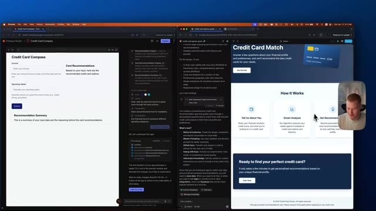
*⏱️ 00:03:03 — Vue d'ensemble de l'interface de développement de l'application « Credit Card Genius » avec le site web affiché à droite et l'environnement de code à gauche.*

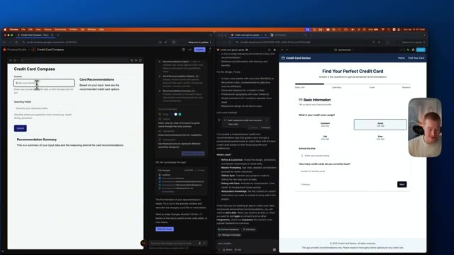
*⏱️ 00:03:13 — Gros plan sur le formulaire interactif de l'application permettant de saisir les informations financières et le score de crédit.*

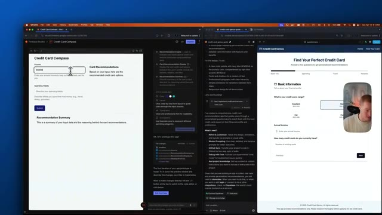
*⏱️ 00:03:22 — Manipulation du champ de saisie du revenu annuel dans l'interface de test de l'application web.*

---

### ⏱️ `[00:03:31 - 00:03:58]` | Segment #08

**🔊 Audio (Transcription Intégrale Mot pour Mot en Français) :**
> et d'accord. Ce bouton de soumission ne fonctionne pas. Et venons de l'autre côté, sur le côté droit, et essayons Lovable. Il nous demande quel est notre score de crédit. D'accord. Disons donc que nous avons un bon score de crédit. C'est la même chose. Disons que nous gagnons 50 000 $. Combien de cartes de crédit possédez-vous actuellement ? Il prend donc en compte un peu plus d'informations et de contexte par rapport à l'application du côté gauche. Cliquez sur suivant. Cela nous amène ici. Habitudes de dépenses. Disons que nous dépensons de l'argent en voyages, en affaires et au restaurant.

**👁️ Analyse Visuelle d'Écran (gemini-3.5-flash-lite) :**
**Interface & Outils** : Navigateur web affichant Firebase Studio et Lovable en mode multitâche côte à côte, avec la webcam du présentateur incrustée.

**Contenu textuel & Code** : Formulaires de saisie de données financières (« Credit Card Compass » et « Credit Card Genius ») avec champs de revenus, habitudes de dépenses et scores de crédit.

**Action / Démonstration** : Navigation et tests des formulaires interactifs sur les deux plateformes de développement pour comparer leur fonctionnement.

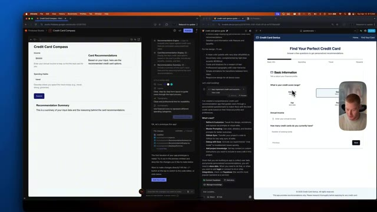
*⏱️ 00:03:38 — Comparaison côte à côte de deux interfaces de développement d'applications web (Firebase Studio à gauche et Lovable à droite), montrant un formulaire de recommandation de carte de crédit.*

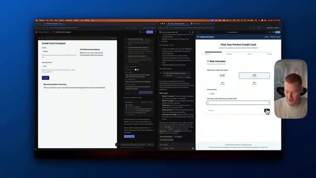
*⏱️ 00:03:51 — Poursuite de la démonstration sur l'application Lovable, avec la sélection du score de crédit et la saisie des informations financières.*

---

### ⏱️ `[00:03:58 - 00:04:24]` | Segment #09

**🔊 Audio (Transcription Intégrale Mot pour Mot en Français) :**
> Cliquez sur suivant. D'accord, les gars, ça a l'air vraiment, vraiment solide. À quelle fréquence voyagez-vous ? Je voyage fréquemment. Cliquer sur suivant. Et puis disons qu'on veut nos avantages de voyage et qu'on veut des bonus d'inscription ou quelque chose comme ça. Obtenir des recommandations. D'accord. Donc maintenant, nous avons ce profil qui montre que nous avons un bon score de crédit. Nous avons 50 000 dollars de revenus annuels, les principales catégories de dépenses, la fréquence, et nous pouvons également mettre à jour nos préférences. C'est donc une première, tout d'abord, ça a l'air super.

**👁️ Analyse Visuelle d'Écran (gemini-3.5-flash-lite) :**
**Interface & Outils** : Navigateur web avec l'interface de développement d'application et la vue utilisateur.

**Contenu textuel & Code** : Formulaire interactif de sélection de préférences de cartes de crédit (Cash Back, Travel Benefits, Low Fees, Sign-up Bonuses).

**Action / Démonstration** : Navigation dans le questionnaire de l'application pour configurer les critères de recherche de cartes de crédit et obtenir des recommandations.

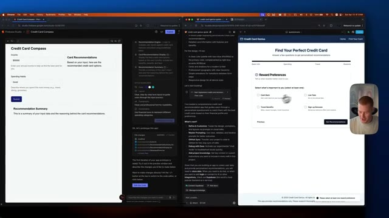
*⏱️ 00:04:04 — Aperçu du prototype d'application avec l'étape des préférences de récompenses des cartes de crédit.*

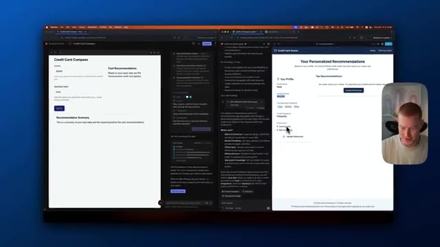
*⏱️ 00:04:17 — Écran de l'application montrant les recommandations personnalisées de cartes de crédit avec les critères sélectionnés.*

---

### ⏱️ `[00:04:24 - 00:04:42]` | Segment #10

**🔊 Audio (Transcription Intégrale Mot pour Mot en Français) :**
> Retournons à nos prompts et commençons à prompter ceci pour y apporter quelques changements. En fait, une chose que je tiens à mentionner, c'est que les deux possèdent une certaine forme de capacité d'édition. Je peux donc venir ici et cliquer dessus, ce qui me permet d'utiliser Excalidraw pour, par exemple, entourer certaines choses. Disons simplement que je veux changer la couleur de ce bouton, mais cela a l'air très maladroit.

**👁️ Analyse Visuelle d'Écran (gemini-3.5-flash-lite) :**
**Interface & Outils** : Navigateur web affichant Lovable (ou outil similaire de prototypage IA) et une application de recommandation de cartes de crédit.

**Contenu textuel & Code** : Formulaire de saisie utilisateur "Credit Card Compass", panneaux de configuration, fenêtres de chat d'IA et code source.

**Action / Démonstration** : Navigation et démonstration des capacités d'édition visuelle et de modification de l'application générée par l'IA.

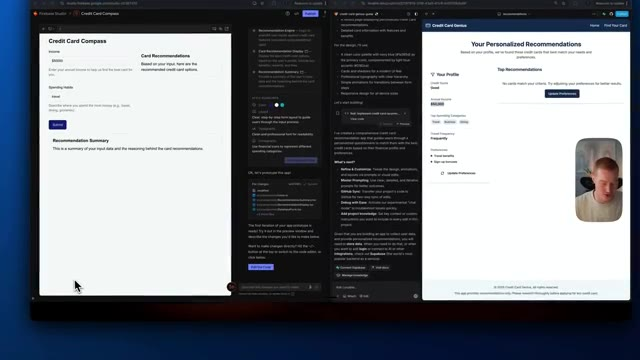
*⏱️ 00:04:28 — Vue d'ensemble de l'interface avec l'application "Credit Card Compass" à gauche et le panneau de code/chat au milieu.*

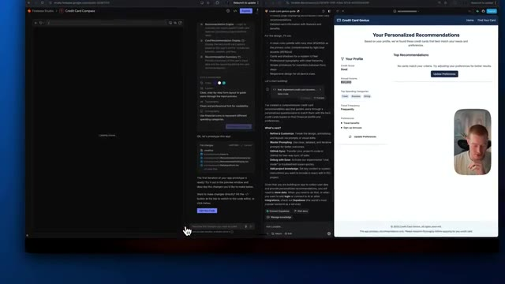
*⏱️ 00:04:33 — La fenêtre de prévisualisation se recharge au centre, montrant l'application en cours de mise à jour.*

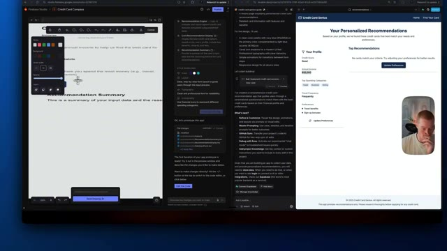
*⏱️ 00:04:38 — Activation de l'outil d'annotation visuelle (similaire à Excalidraw) par-dessus l'interface de l'application web.*

---

### ⏱️ `[00:04:42 - 00:05:16]` | Segment #11

**🔊 Audio (Transcription Intégrale Mot pour Mot en Français) :**
> Écoutez, quand je vais pour modifier ceci, ça n'a vraiment pas du tout l'air bien. Genre, c'est tout zoomé, ce n'est pas génial, mais sur le côté droit, nous n'avons pas la même option Excalidraw pour utiliser réellement un tableau blanc afin d'apporter des modifications, mais nous pouvons modifier notre application via cette fonctionnalité de modification et nous pouvons cliquer sur certaines parties de l'interface utilisateur. Donc, si nous ne voulions pas de ceci ou si nous voulions changer quelque chose à ce sujet. Genre, disons qu'on n'aime pas ce texte. Nous pourrions venir ici et changer le texte si vous le souhaitez. Ils ont donc tous les deux des capacités de modification. Cependant, je pense que les capacités de modification sur Lovable sont un peu meilleures parce que Google Firebase Studio a vraiment l'air très maladroit.

**👁️ Analyse Visuelle d'Écran (gemini-3.5-flash-lite) :**
**Interface & Outils** : Navigateur web affichant des environnements de développement et des prototypes d'applications web (Firebase Studio, Bolt/v0).

**Contenu textuel & Code** : Interfaces d'applications web de recommandation de cartes bancaires, code source, panneaux de configuration visuels, et fenêtres de prévisualisation.

**Action / Démonstration** : Comparaison et modification des interfaces utilisateur de deux prototypes d'applications web côte à côte.

*⏱️ 00:04:51 — Vue d'ensemble de l'interface de développement avec un aperçu web de l'application 'Credit Card Compass' divisé en deux fenêtres de navigateur.*

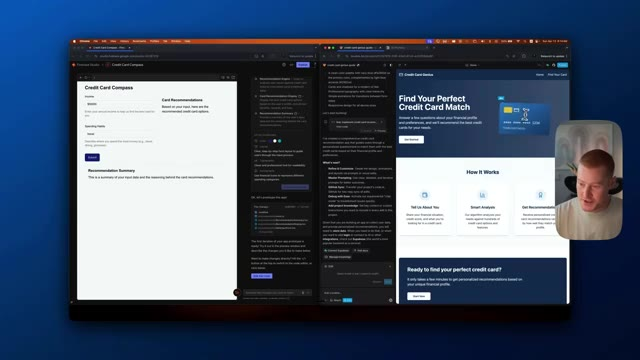
*⏱️ 00:04:59 — Affichage de l'interface de l'application de comparaison de cartes de crédit 'Credit Card Genius' avec les options de recommandations personnalisées.*

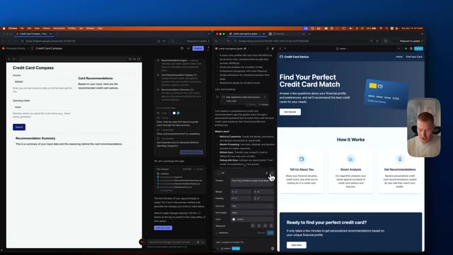
*⏱️ 00:05:07 — Gros plan sur le panneau de configuration et les options de style d'une application web en cours de modification.*

---

### ⏱️ `[00:05:16 - 00:05:51]` | Segment #12

**🔊 Audio (Transcription Intégrale Mot pour Mot en Français) :**
> Ça ne marche pas bien. Très bien. Donc je vais aller ici sur le côté gauche. Je vais aller sur Firebase Studio et disons simplement, rendons le bouton fonctionnel. Je veux que tu rendes le bouton fonctionnel. De sorte que, quand je clique réellement sur soumettre, cela soumet réellement ces informations. Voilà. Je donne cette consigne. Aussi, ce que je viens d'utiliser à l'instant s'appelle Aqua Voice, je peux juste cliquer sur cette touche de commande de mon clavier. En parlant à mon ordinateur, cela traduit automatiquement cela en texte, colle cela dans l'interface utilisateur, rend cela super facile de parler réellement avec son ordinateur au lieu de taper. Ça me fait gagner tellement de temps. Donc voilà un petit truc pour vous les gars que vous pouvez ajouter à votre boîte à outils IA. D'accord. Donc j'ai fait un changement rapide ici.

**👁️ Analyse Visuelle d'Écran (gemini-3.5-flash-lite) :**
**Interface & Outils** : Firebase Studio, navigateur web Google Chrome, interface de développement d'application web.

**Contenu textuel & Code** : Code source Python/JavaScript, interface utilisateur d'une application de recommandation de cartes de crédit, volet de chat IA.

**Action / Démonstration** : Interaction avec l'interface de développement et saisie de modifications pour rendre le bouton fonctionnel.

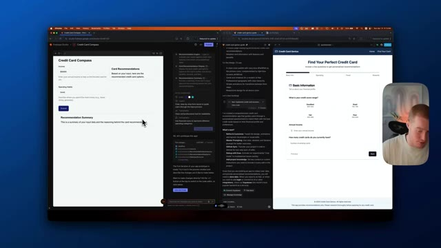
*⏱️ 00:05:25 — Vue d'ensemble de Firebase Studio avec l'application de comparaison de cartes de crédit et le panneau latéral de chat.*

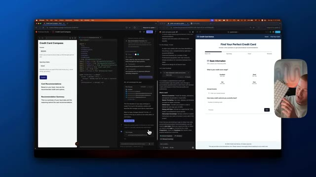
*⏱️ 00:05:34 — Affichage du code source et de l'éditeur de Firebase Studio pendant la modification de l'application.*

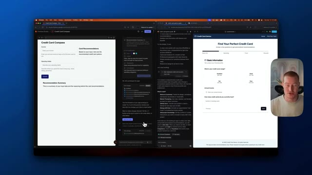
*⏱️ 00:05:42 — Interface de prévisualisation de l'application 'Credit Card Compass' dans Firebase Studio avec le bouton de soumission.*

---

### ⏱️ `[00:05:51 - 00:06:26]` | Segment #13

**🔊 Audio (Transcription Intégrale Mot pour Mot en Français) :**
> Allons-y et testons cela à nouveau. Cliquez sur soumettre. Il est indiqué que cela fonctionne. Cependant, je ne vois pas la fonctionnalité ici. Cela ne fonctionne pas. Laissez-moi peut-être ouvrir ceci dans un navigateur séparé. C'est peut-être pour cela que ça ne fonctionne pas. Ouais. D'accord. Donc, cela ne fonctionne tout simplement pas du tout. Retournons à notre application Firebase. Cela ne fonctionne toujours pas. Je pouvais saisir certains champs, mais lorsque je clique sur soumettre, rien ne se passe. Rendons donc notre application fonctionnelle. Commencer à écrire ce code. C'est assez rapide pour écrire ce code. Il utilise en fait Gemini 2.5 pour écrire notre code, ce qui, je crois, Lovable utilise donc Claude pour le faire. Claude 3.7 pour cela, je suppose. D'accord. Je pense que cela fonctionne peut-être

**👁️ Analyse Visuelle d'Écran (gemini-3.5-flash-lite) :**
**Interface & Outils** : Navigateur web, interface de développement / application web "Credit Card Compass" (Firebase Studio / Bolt / environnement de dev similaire).

**Contenu textuel & Code** : Formulaire de saisie financière ("Income", "Spending habits"), bouton "Submit", sections "Card Recommendations" et "Recommendation Summary", journaux de code.

**Action / Démonstration** : Test du formulaire web, soumission des données de revenus et de dépenses, et tentative d'affichage des recommandations de cartes de crédit.

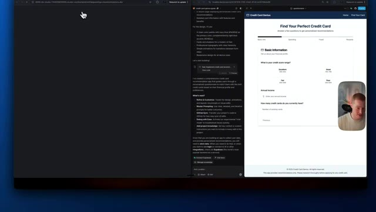
*⏱️ 00:06:00 — Image #1 montre l'écran d'un ordinateur affichant un navigateur avec l'application "Credit Card Compass" en cours de chargement sur fond sombre, aux côtés d'autres onglets, et la webcam du présentateur en incrustation à droite.*

*⏱️ 00:06:08 — Image #2 montre l'application "Credit Card Compass" affichée dans un navigateur, avec un formulaire de recommandation de carte de crédit rempli ("50000", "travel"), un bouton "Submit", ainsi qu'une section de résumé des recommandations.*

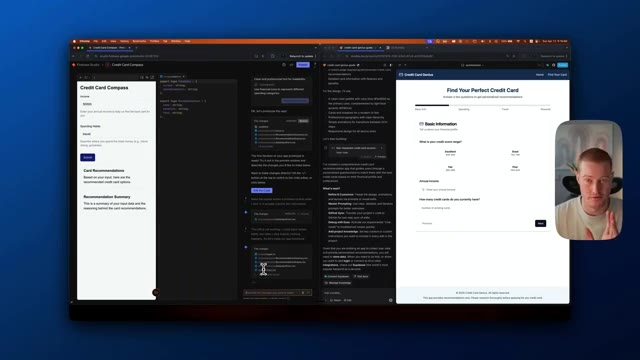
*⏱️ 00:06:17 — Image #3 montre le même écran avec l'interface de l'application interactive et l'éditeur de code ou les journaux de modifications visibles dans la partie centrale de la fenêtre du navigateur.*

---

### ⏱️ `[00:06:26 - 00:06:59]` | Segment #14

**🔊 Audio (Transcription Intégrale Mot pour Mot en Français) :**
> maintenant. D'accord, voilà. Donc, ça crache maintenant une recommandation de carte ici. Cependant, ça n'a vraiment pas beau rendu. Et je me demande s'il s'agit de vraies informations de cartes. Revenons donc à Lovable et faisons en sorte qu'il nous recommande réellement une carte. Ça a l'air super. L'interface utilisateur est géniale. Cependant, je veux maintenant que tu recommandes réellement une carte en fonction de mes critères que je donne en remplissant le formulaire. Donc, après avoir fait fonctionner cette fonctionnalité, ce que nous devons faire, nous devons tester à quel point il est fluide d'ajouter réellement une authentification d'utilisateur. Donc, ce que

**👁️ Analyse Visuelle d'Écran (gemini-3.5-flash-lite) :**
**Interface & Outils** : Lovable (éditeur de code IA et aperçu d'application web), navigateurs web affichant l'application "Credit Card Compass" et une autre page web de comparaison de cartes.

**Contenu textuel & Code** : Formulaire de saisie pour les revenus et habitudes de dépenses, section "Card Recommendations" affichant des suggestions de cartes bancaires (Chase Sapphire Preferred, American Express Blue Cash Preferred) avec leurs avantages et frais.

**Action / Démonstration** : Le présentateur analyse l'interface générée et les recommandations de cartes affichées pour identifier les améliorations à apporter au design et aux données.

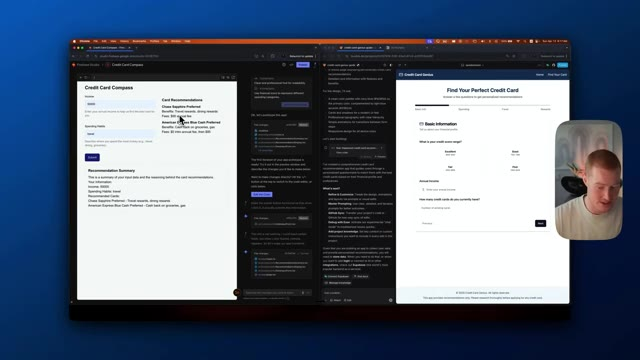
*⏱️ 00:06:34 — Capture d'écran montrant l'interface de Lovable avec l'application "Credit Card Compass" en cours de développement et de test dans le navigateur.*

---

### ⏱️ `[00:06:59 - 00:07:24]` | Segment #15

**🔊 Audio (Transcription Intégrale Mot pour Mot en Français) :**
> c'est-à-dire, cela permet à un utilisateur de s'inscrire. Donc par exemple, à l'intérieur de notre application Lovable, nous avons notre page d'atterrissage. Je veux maintenant faire en sorte que, pour pouvoir accéder à cette application ici, vous devez en fait être un utilisateur ainsi que nous allons ajouter des paiements Stripe. Vous devez donc être un utilisateur payant de notre application pour pouvoir l'utiliser. Je vais donc tester les deux pour voir à quel point il est facile de mettre en œuvre à la fois l'authentification des utilisateurs et les paiements Stripe, parce que nous voulons potentiellement pouvoir facturer notre application.

**👁️ Analyse Visuelle d'Écran (gemini-3.5-flash-lite) :**
**Interface & Outils** : Navigateur web, plateforme de développement Lovable.

**Contenu textuel & Code** : Pages d'atterrissage d'applications (Credit Card Compass, Credit Card Genius) et assistants conversationnels de programmation.

**Action / Démonstration** : Présentation de deux versions différentes d'une application web en cours de développement avec l'aide de l'IA.

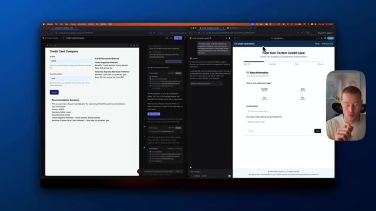
*⏱️ 00:07:05 — Capture d'écran montrant l'interface de développement Lovable divisée en plusieurs fenêtres avec le rendu d'applications et les panneaux de discussion avec l'IA.*

---

### ⏱️ `[00:07:24 - 00:07:43]` | Segment #16

**🔊 Audio (Transcription Intégrale Mot pour Mot en Français) :**
> C'est quelque chose avec ces plateformes que nous voulons être capables de faire. Nous voulons voir quelle plateforme est la plus fluide pour pouvoir le faire. Donc nous allons tester cela après avoir fait fonctionner correctement les fonctionnalités sur ces deux applications. D'accord, donc Lovable sur le côté droit ne me donne en fait pas de recommandation. Donc je ne sais pas vraiment si sur le côté gauche, Firebase Studio me donne les bonnes informations.

**👁️ Analyse Visuelle d'Écran (gemini-3.5-flash-lite) :**
**Interface & Outils** : Navigateur web affichant deux plateformes de développement d'applications web (Lovable et Firebase Studio / interface similaire), avec un aperçu vidéo du présentateur.

**Contenu textuel & Code** : Interfaces utilisateur de prototypes d'applications "Credit Card Compass" et "Credit Card Genius", fenêtres de chat d'assistant IA avec modifications de code et instructions utilisateur.

**Action / Démonstration** : Comparaison et test simultané de deux applications web de recommandation créées avec des outils d'IA, observation des interfaces et des retours de l'assistant de code.

*⏱️ 00:07:29 — Vue d'écran partagée montrant deux applications web de recommandation de cartes de crédit en cours de développement sur des plateformes no-code / IA, avec le présentateur incrusté en bas à droite.*

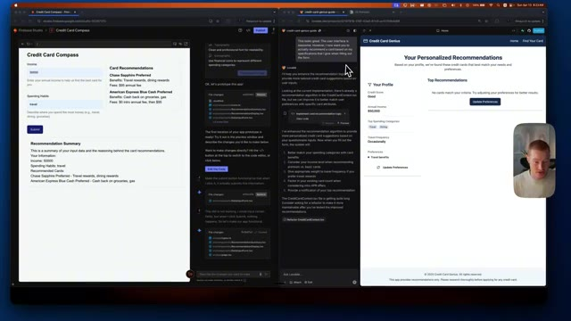
*⏱️ 00:07:38 — Vue mise à jour de l'écran partagé montrant les modifications de code et les interactions avec les assistants IA sur les deux interfaces de développement web.*

---

### ⏱️ `[00:07:43 - 00:08:15]` | Segment #17

**🔊 Audio (Transcription Intégrale Mot pour Mot en Français) :**
> Je dois en fait demander ici même et dire : est-ce que c'est de vraies informations ou des données fictives ? Les recommandations de cartes que tu me donnes, est-ce que ce sont de vraies informations ou est-ce que c'est juste de faux data ? Et ensuite, je vais venir sur Lovable. Et ensuite, demandons simplement si nous avons besoin d'ajouter une sorte d'API, genre pour accéder à ChatGPT par exemple, afin d'extraire les bonnes recommandations, je veux que tu me donnes de vraies recommandations. Devons-nous ajouter une clé API d'IA quelconque pour que tu puisses récupérer des informations ? D'accord. Donc, ça dit qu'on n'a pas vraiment besoin d'ajouter ça parce que, à l'intérieur de cette page de contexte de carte de crédit, nous avons déjà de vraies

**👁️ Analyse Visuelle d'Écran (gemini-3.5-flash-lite) :**
**Interface & Outils** : Lovable (plateforme de développement web par IA), navigateur web Google Chrome, interface de chat pour les prompts.

**Contenu textuel & Code** : Application web "Credit Card Compass" avec des champs de saisie pour les revenus et les habitudes de dépenses, affichant des recommandations de cartes de crédit (Chase Sapphire Preferred, American Express Blue Cash Preferred) et le panneau de chat de Lovable.

**Action / Démonstration** : Le présentateur compare ou examine les modifications apportées à l'application via Lovable suite aux instructions de l'IA.

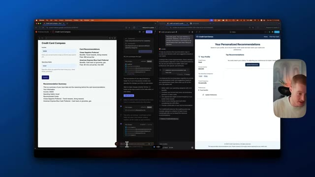
*⏱️ 00:07:51 — Vue d'ensemble de l'écran montrant l'interface de développement Lovable avec plusieurs fenêtres de prévisualisation et de chat pour l'application "Credit Card Compass".*

---

### ⏱️ `[00:08:15 - 00:08:51]` | Segment #18

**🔊 Audio (Transcription Intégrale Mot pour Mot en Français) :**
> des données de cartes de crédit et des moteurs de recommandation sophistiqués. Donc, il indique que c'est déjà conçu pour le côté gauche, Google Firebase Studio dit qu'il s'agit simplement de fausses données. Nous pourrions appeler une API pour obtenir de vraies recommandations. D'accord. Ajoutons une sorte d'API d'IA afin d'utiliser l'intelligence artificielle pour nous recommander certaines cartes de crédit. D'accord. C'est donc ce que nous voyons sur le côté droit avec Lovable. Cela nous donne réellement, cela possède une interface utilisateur à l'apparence incroyable. Cette interface utilisateur a juste l'air assez terrible et elle ne récupère pas de vraies informations de carte de crédit pour une raison quelconque. Nous devons donc ajouter la clé API Google Gemini. Google Gemini est donc le modèle d'IA de Google,

**👁️ Analyse Visuelle d'Écran (gemini-3.5-flash-lite) :**
**Interface & Outils** : Navigateur web, interface Firebase Studio et application web 'Credit Card Compass'

**Contenu textuel & Code** : Code source, interface de l'application de comparaison de cartes de crédit, assistant textuel et aperçu des recommandations personnalisées.

**Action / Démonstration** : Présentation de la configuration de l'application de recommandation de cartes de crédit et du code généré par l'IA.

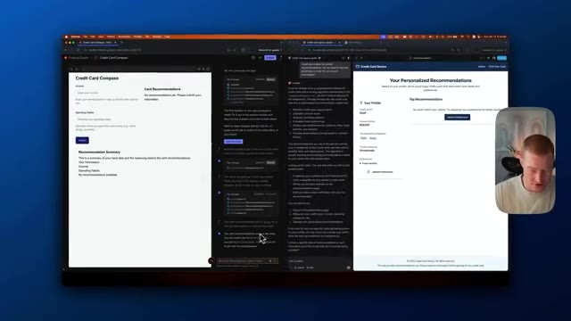
*⏱️ 00:08:24 — Capture d'écran montrant l'interface de développement Firebase Studio et l'application 'Credit Card Compass' en cours de test avec des fenêtres divisées et le présentateur dans un encadré.*

---

### ⏱️ `[00:08:52 - 00:09:25]` | Segment #19

**🔊 Audio (Transcription Intégrale Mot pour Mot en Français) :**
> juste comme Chat2BT, mais c'est essentiellement la version de Google. Et ce que nous pourrions faire, c'est simplement générer automatiquement une clé API, ce qui est en fait assez cool puisque cela s'intègre directement dans l'écosystème de Google. C'est la chose cool à propos de Firebase Studio et le potentiel intéressant ici, c'est que ça s'intègre avec toutes les différentes applications qu'ils ont. Donc quelque chose comme Google Gemini, c'est vraiment facile de connecter instantanément notre LLM ici si nous cherchons à utiliser l'IA sur le back-end de notre application ainsi que des bases de données. Firebase est essentiellement la base de données native de Google. Donc si nous pouvions connecter une base de données directement à l'intérieur de Firebase, alors cela pourrait être

**👁️ Analyse Visuelle d'Écran (gemini-3.5-flash-lite) :**
**Interface & Outils** : Navigateur web, interface de développement Firebase Studio / environnement de code.

**Contenu textuel & Code** : Application web 'Credit Card Compass', interface de chat avec l'IA, recommandations personnalisées de cartes de crédit (Chase Sapphire Preferred, American Express Gold Card).

**Action / Démonstration** : Présentation du fonctionnement et de l'intégration des fonctionnalités de l'application web dans l'écosystème de développement.

*⏱️ 00:09:00 — Capture d'écran montrant l'interface de développement avec un aperçu de l'application 'Credit Card Compass' et des fenêtres de code.*

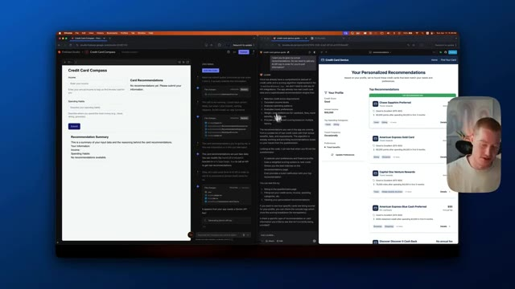
*⏱️ 00:09:08 — Capture d'écran similaire à la précédente montrant l'application web interactive de recommandation de cartes de crédit et son environnement de développement.*

---

### ⏱️ `[00:09:25 - 00:10:03]` | Segment #20

**🔊 Audio (Transcription Intégrale Mot pour Mot en Français) :**
> Plutôt génial. Cependant, je n'aime généralement pas utiliser Firebase. J'aime utiliser Lovable et Bolt. J'aime utiliser Supabase, avec lequel il s'intègre de manière native. C'est juste beaucoup plus simple à utiliser. Ce n'est pas vieux et lourd. C'est comme beaucoup plus intuitif à utiliser. C'est donc quelque chose que nous devons garder à l'esprit lorsque nous allons commencer à construire notre base de données ici. D'accord. Donc il est dit que notre clé API est mise à jour. Allons-y et essayons à nouveau, voyons si cela fonctionne correctement. D'accord. Donc cela nous a donné une recommandation ici. Chase Sapphire Reserve. Intéressant. D'accord. C'est donc des données réelles ici, mais encore une fois, l'interface utilisateur ne ressemble à rien du tout. Il y a donc quelque chose que nous devons faire maintenant. Nous devons ajouter l'authentification des utilisateurs pour que les utilisateurs puissent s'inscrire. Et ensuite nous stockons aussi nos informations de profil comme ça.

**👁️ Analyse Visuelle d'Écran (gemini-3.5-flash-lite) :**
**Interface & Outils** : Navigateur web affichant l'interface de Firebase Studio et Lovable, avec un encart vidéo du présentateur en bas à droite.

**Contenu textuel & Code** : Formulaire de saisie de profil financier, recommandations de cartes de crédit personnalisées (Chase Sapphire Preferred, American Express Gold Card, Capital One Venture Rewards) et journaux de modification de code.

**Action / Démonstration** : Saisie de données financières dans un formulaire de test et affichage des recommandations de cartes bancaires correspondantes.

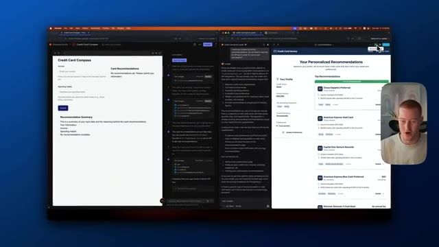
*⏱️ 00:09:34 — Vue d'ensemble de l'interface de développement avec un aperçu de l'application 'Credit Card Compass' à gauche, un panneau de code/chat au milieu et l'interface 'Credit Card Genius' à droite.*

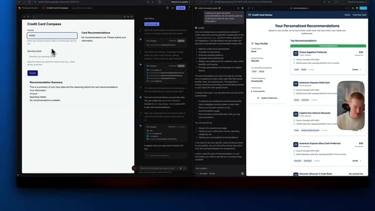
*⏱️ 00:09:44 — Gros plan sur le formulaire de saisie de l'application où l'utilisateur entre un revenu de 50000 dans le champ de texte.*

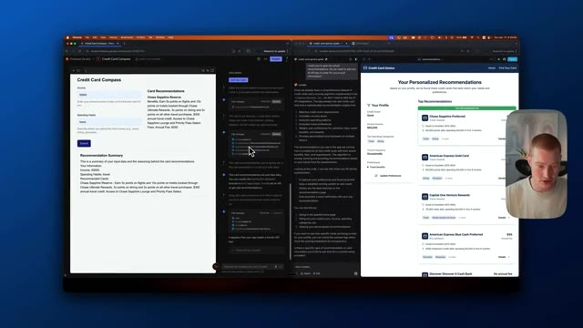
*⏱️ 00:09:53 — Affichage des résultats de recommandation de cartes de crédit après soumission du formulaire, montrant les détails de la carte 'Chase Sapphire Reserve'.*

---

### ⏱️ `[00:10:03 - 00:10:36]` | Segment #21

**🔊 Audio (Transcription Intégrale Mot pour Mot en Français) :**
> ainsi que nos cartes de crédit que nous voulons explorer dans notre compte. Alors allons-y et faisons cela. Maintenant, je vais venir sur Firebase Studio et simplement dire, ajoutons l'authentification des utilisateurs à notre application. Ainsi, pour s'inscrire et utiliser notre application, ils doivent être un utilisateur. Et ensuite, je vais donner exactement le même prompt aux gars de Lovable. J'apprécie de faire cette comparaison côte à côte. Si vous voulez plus de contenu comme celui-ci, assurez-vous de vous abonner à la chaîne. Je couvre tout ce qui concerne l'IA pour les non-techniciens. Donc, si vous n'êtes pas technique, je vais vous montrer différentes sortes d'outils et de plateformes d'IA que vous pouvez utiliser chaque jour, que ce soit en tant que propriétaire d'entreprise ou simplement comme personne ordinaire cherchant à garder une longueur d'avance avec l'IA. Et si vous ne l'avez pas vu par le passé, j'ai couvert

**👁️ Analyse Visuelle d'Écran (gemini-3.5-flash-lite) :**
**Interface & Outils** : Firebase Studio, interface de développement web, navigateur web.

**Contenu textuel & Code** : Interface utilisateur de l'application 'Credit Card Compass', panneaux de code source et historique des prompts d'intelligence artificielle.

**Action / Démonstration** : Navigation et modification du code de l'application via les instructions données à l'assistant IA pour l'authentification des utilisateurs.

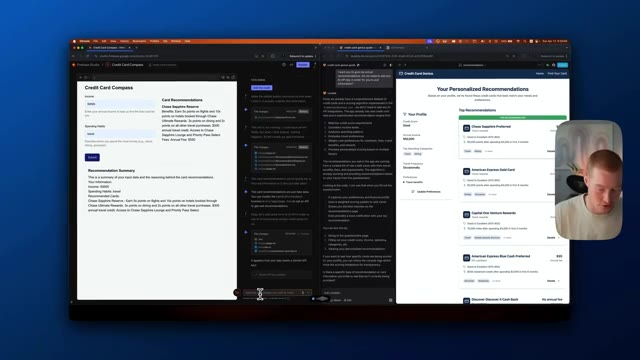
*⏱️ 00:10:11 — Vue d'ensemble du bureau avec Firebase Studio à gauche affichant l'application 'Credit Card Compass' et l'assistant IA, et un navigateur à droite montrant les recommandations de cartes de crédit.*

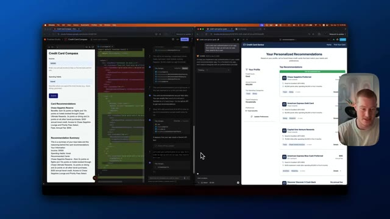
*⏱️ 00:10:19 — Affichage du code source en cours de modification dans l'interface de développement de l'application web avec les panneaux de discussion de l'assistant IA.*

---

### ⏱️ `[00:10:36 - 00:11:08]` | Segment #22

**🔊 Audio (Transcription Intégrale Mot pour Mot en Français) :**
> plein de vidéos parlent de Lovable, Bolt, Replit Agent, toutes ces plateformes de codage par IA pour que vous puissiez créer des applications avec l'IA même sans aucune connaissance en codage. Très bien, on dirait qu'on a une erreur sur le côté gauche avec Firebase Studio, alors cliquons sur Réessayer. Cependant, on dirait que Lovable règle ça sans problème. Oh, en fait, on dirait qu'on a eu une erreur ici, j'ai parlé un peu trop vite, et on dirait qu'on a eu une autre erreur dans Firebase Studio, cliquons sur Corriger. Je ne sais pas diable ce qui se passe ici, cependant ça n'a pas l'air bien, et ensuite cliquons sur Essayer de corriger avec Lovable. C'est plutôt une bonne chose qu'on ait eu des erreurs sur les deux plateformes en même t

**👁️ Analyse Visuelle d'Écran (gemini-3.5-flash-lite) :**
**Interface & Outils** : Firebase Studio et navigateur web (application Credit Card Compass).

**Contenu textuel & Code** : Code source, interface de chat d'IA, aperçu d'application web de recommandations de cartes bancaires et messages d'erreur.

**Action / Démonstration** : Interaction avec l'outil de génération de code par IA pour corriger une erreur et ajouter une authentification.

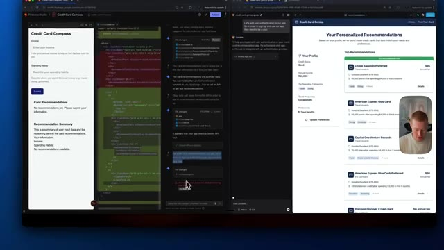
*⏱️ 00:10:44 — Vue partagée montrant Firebase Studio avec une interface de code à gauche et l'application 'Credit Card Compass' à droite, avec le présentateur en médaillon.*

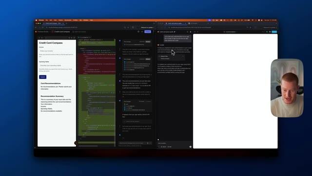
*⏱️ 00:10:52 — Interface de développement divisée en deux écrans affichant Firebase Studio et une autre application web en cours de construction.*

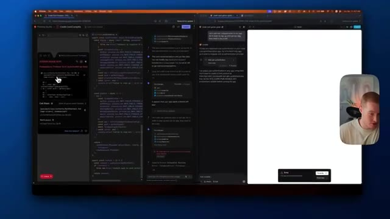
*⏱️ 00:11:00 — Écran de codage avec une erreur visible dans le panneau de gauche de Firebase Studio et le panneau d'interaction de l'IA.*

---

### ⏱️ `[00:11:08 - 00:11:41]` | Segment #23

**🔊 Audio (Transcription Intégrale Mot pour Mot en Français) :**
> en même temps juste pour voir comment ils gèrent des erreurs spécifiques. D'accord, donc maintenant on dirait qu'on a une interface utilisateur mise à jour. On a Credit Card Compass. Symbole cool. Inscrivons-nous. Curieux de voir comment ce parcours va fonctionner. Donc ça dit que j'ai deux problèmes. D'accord, je ne sais pas ce qui se passe ici. Très bien, et ensuite sur le côté droit j'obtiens une erreur ici parce que pour une raison quelconque, il essaie d'utiliser Clerk, qui aide avec l'authentification des utilisateurs. Cependant, je n'ai jamais fait ça auparavant. D'habitude, Supabase s'en charge tout seul. Donc je vais venir ici et dire simplement : est-ce qu'on peut juste utiliser Supabase pour l'authentification des utilisateurs ? Très bien. Donc maintenant, il me donne les instructions sur la façon d'implémenter Supabase. Cliquez sur le bouton vert Supabase en haut à droite. Cliquons dessus.

**👁️ Analyse Visuelle d'Écran (gemini-3.5-flash-lite) :**
**Interface & Outils** : Navigateur web avec l'application Lovable / interface de développement et aperçu de l'application 'Credit Card Compass'.

**Contenu textuel & Code** : Messages d'erreur d'application, journaux de code, et instructions de configuration de clé API d'authentification (Clerk).

**Action / Démonstration** : Navigation dans l'application, visualisation des erreurs et lecture des suggestions de correction générées par l'IA.

*⏱️ 00:11:16 — Interface divisée montrant l'application 'Credit Card Compass' avec des boutons de connexion et un panneau de code/chat d'IA Lovable avec des messages d'erreur.*

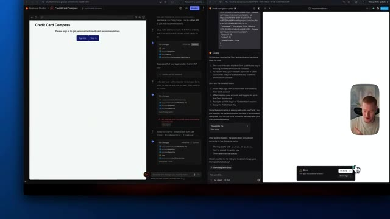
*⏱️ 00:11:25 — L'application affiche une alerte d'erreur en bas à droite (« The app encountered an error ») pendant que le chat analyse la configuration de l'API.*

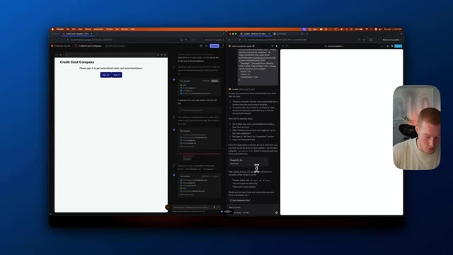
*⏱️ 00:11:33 — Le panneau de chat Lovable se développe pour afficher des instructions détaillées sur la résolution d'une erreur d'authentification (clé Clerk manquante).*

---

### ⏱️ `[00:11:41 - 00:12:15]` | Segment #24

**🔊 Audio (Transcription Intégrale Mot pour Mot en Français) :**
> Et vous venez sur Supabase et vous créez réellement un projet. D'accord. Donc maintenant j'ai cette application créée. Laissons-lui une petite seconde pendant qu'elle charge. Très bien. Donc afin d'intégrer notre application ici, je vais cliquer sur « credit card app », qui est un projet que je viens de créer. Je vais cliquer sur « connect ». D'accord, super. Ça devrait fonctionner. Je vais retourner au projet maintenant. Et ensuite, il est écrit que notre application est maintenant connectée à Supabase. Ainsi, nous pouvons ajouter des comptes d'utilisateurs et nous connecter, stocker et utiliser de vraies données, utiliser des fonctionnalités avancées comme les fonctions de périphérie (« edge functions »). J'obtiens une autre erreur ici. Alors, dépannons cette erreur. D'accord. C'est parce qu'elle essayait d'utiliser Clerk pour l'authentification, ce que nous n'allons plus utiliser puisque nous utilisons Supabase. Donc cette erreur est logique.

**👁️ Analyse Visuelle d'Écran (gemini-3.5-flash-lite) :**
**Interface & Outils** : Navigateur web, interface Supabase, environnement de développement web (Firebase Studio / Bolt), panneau de prévisualisation d'application.

**Contenu textuel & Code** : Liste des projets Supabase, message de confirmation « Your app is now connected to Supabase », et messages d'erreur de code dans l'interface de programmation.

**Action / Démonstration** : Connexion du projet d'application à Supabase et vérification du statut de la liaison ainsi que des messages d'erreur associés.

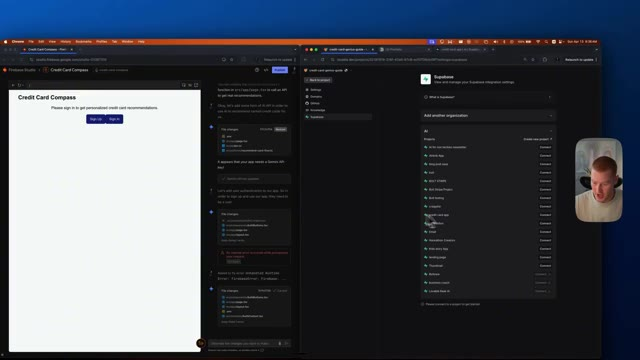
*⏱️ 00:11:50 — L'écran montre le navigateur avec l'interface de Supabase affichant une liste de projets de bases de données et d'outils d'intégration d'intelligence artificielle, aux côtés du panneau de prévisualisation de l'application « Credit Card Compass ».*

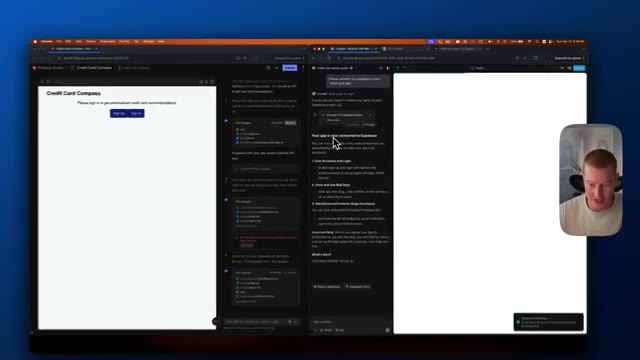
*⏱️ 00:11:58 — L'écran affiche une confirmation indiquant que l'application est désormais connectée à Supabase, avec des sections détaillant la gestion des comptes utilisateurs, le stockage de données et les fonctionnalités avancées.*

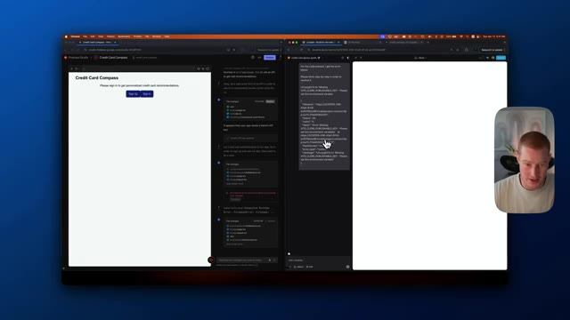
*⏱️ 00:12:07 — L'écran présente un terminal de développement ou une interface de chat textuel affichant un journal d'erreurs de code et des messages de diagnostic liés à des variables d'environnement manquantes.*

---

### ⏱️ `[00:12:15 - 00:12:46]` | Segment #25

**🔊 Audio (Transcription Intégrale Mot pour Mot en Français) :**
> Cependant, sur le côté gauche avec Firebase Studio, je n'ai aucune idée de ce qui se passe ici, honnêtement. Donc, essayez de vous inscrire. Notre application ne fonctionne pas. Lorsque je clique sur le bouton d'inscription, cela ne me permet pas de m'inscrire ni quoi que ce soit. D'accord. Côté gauche, Firebase Studio n'est que des erreurs. Lovable sur le côté droit. Nous avons une page d'accueil magnifique. Nous avons une application fonctionnelle qui a l'air formidable. Alors maintenant, ça dit que notre authentification d'utilisateur devrait fonctionner maintenant. Donc, cliquons sur commencer. D'accord. C'est logique. Ça me demande de m'inscrire, prénom, e-mail, mot de passe. Inscrivons-nous. D'accord. Ça dit que nous nous sommes inscrits avec succès.

**👁️ Analyse Visuelle d'Écran (gemini-3.5-flash-lite) :**
**Interface & Outils** : Navigateur web avec fenêtres divisées montrant des environnements de développement d'applications (Firebase Studio / Lovable) et le visage du présentateur en incrustation.

**Contenu textuel & Code** : Messages d'erreur de code ("Uncaught Error: Missing VITE_CLERK_PUBLISHABLE_KEY"), journaux de modifications de code et interfaces utilisateur de test d'authentification.

**Action / Démonstration** : Le présentateur compare deux environnements de développement et teste les fonctionnalités de connexion et d'inscription de l'application.

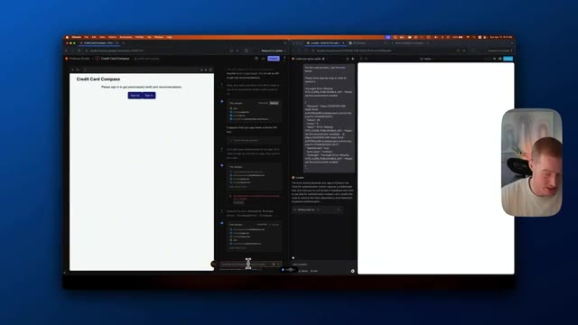
*⏱️ 00:12:23 — L'écran montre deux interfaces de développement côte à côte avec une application de recommandation de cartes de crédit et une fenêtre de chat de débogage.*

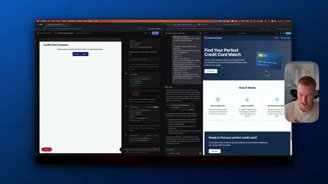
*⏱️ 00:12:30 — L'interface montre l'application "Credit Card Service" fonctionnelle sur le côté droit avec des options de recherche de cartes.*

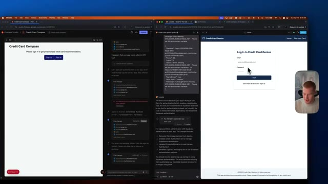
*⏱️ 00:12:38 — L'interface affiche un écran de connexion ("Log in to Credit Card Genius") sur l'application de droite.*

---

### ⏱️ `[00:12:46 - 00:13:04]` | Segment #26

**🔊 Audio (Transcription Intégrale Mot pour Mot en Français) :**
> Cependant, venons-en à notre application ici. Il semble que la connexion ne fonctionne pas exactement comme nous en avons besoin. Je dois donc apporter une modification ici. Lorsqu'un nouvel utilisateur s'inscrit, je ne veux pas que vous lui envoyiez un lien de confirmation par e-mail. Je veux simplement qu'il puisse s'inscrire directement sur l'application. Donc, ce que cela va faire maintenant, c'est que cela va modifier les règles à l'intérieur de notre compte Superbase. Ça va donc aller dans l'éditeur SQL.

**👁️ Analyse Visuelle d'Écran (gemini-3.5-flash-lite) :**
**Interface & Outils** : Navigateur web affichant un environnement de développement d'application web (Lovable / interface de code et prévisualisation).

**Contenu textuel & Code** : Code source, journaux d'erreurs d'authentification (erreurs liées à l'API Clerk et Supabase) et interfaces de connexion.

**Action / Démonstration** : Configuration et correction des erreurs d'authentification et de connexion dans l'application web.

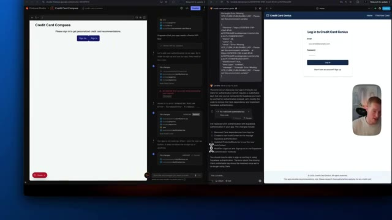
*⏱️ 00:12:50 — Vue d'ensemble du développement d'une application web avec des fenêtres de code et de prévisualisation, montrant l'interface utilisateur "Credit Card Compass" et "Credit Card Genius".*

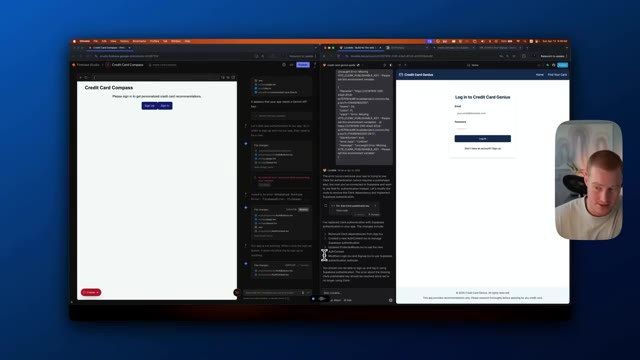
*⏱️ 00:12:55 — Vue similaire affichant l'interface de développement avec un aperçu de l'application de gestion de cartes de crédit et le présentateur en médaillon.*

---

### ⏱️ `[00:13:04 - 00:13:36]` | Segment #27

**🔊 Audio (Transcription Intégrale Mot pour Mot en Français) :**
> Ce que cela va faire, c'est que cela va essentiellement rédiger certaines règles afin que notre base de données les suive. Donc maintenant, cela devrait mettre à jour cette table, espérons-le avec des utilisateurs. Laissons-lui une seconde pour voir si cela le fait vraiment. Il semble que nous ayons réellement besoin de modifier quelque chose manuellement ici. Donc, d'accord, donc cela fonctionne maintenant. J'ai en fait pu me connecter à un compte ou créer un compte, et cela stocke ensuite ces informations ici. Encore une fois, Supabase est notre base de données. C'est ici que nous permettons aux utilisateurs de s'inscrire et nous pourrions même stocker un genre d'informations sur leur compte, comme ces informations de profil ici une fois que nous aurons réellement les spécifications de carte de crédit. Allons-y donc. Passons ensuite

**👁️ Analyse Visuelle d'Écran (gemini-3.5-flash-lite) :**
**Interface & Outils** : Navigateur web affichant Firebase Studio et un tableau de bord Supabase en mode sombre.

**Contenu textuel & Code** : Code source de l'application, logs de l'assistant IA, interface utilisateur de configuration d'authentification et listes d'utilisateurs connectés.

**Action / Démonstration** : Navigation et vérification de la mise à jour de la table des utilisateurs suite aux modifications apportées par l'assistant IA.

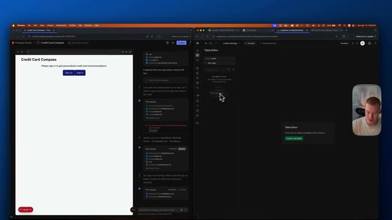
*⏱️ 00:13:12 — Vue d'un éditeur de code et d'une base de données Supabase affichant l'interface d'authentification et les tables de l'application 'Credit Card Compass'.*

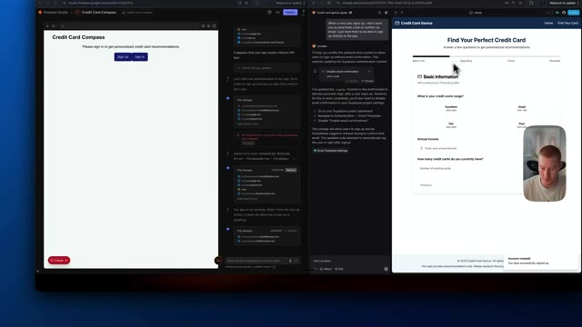
*⏱️ 00:13:20 — Aperçu de l'application interactive 'Credit Card Genius' affichant les formulaires de recommandation de cartes de crédit et le profil utilisateur.*

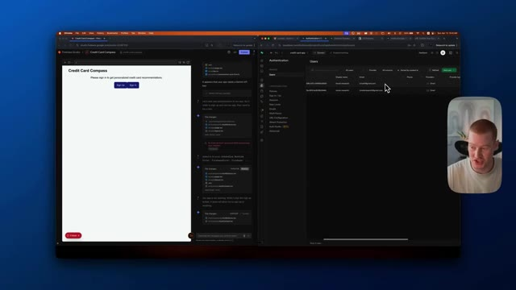
*⏱️ 00:13:28 — Panneau d'administration de la base de données montrant la liste des utilisateurs enregistrés avec leurs adresses e-mail.*

---

### ⏱️ `[00:13:36 - 00:14:10]` | Segment #28

**🔊 Audio (Transcription Intégrale Mot pour Mot en Français) :**
> ajoute quelque chose ici. Disons que je veux que tu ajoutes maintenant, je veux que tu enregistres maintenant n'informations dans un profil utilisateur lorsqu'ils obtiennent réellement leurs informations de carte spécifiques. Donc une fois qu'ils remplissent le formulaire et tout. Je veux que tu enregistres ces informations dans leur profil utilisateur. D'accord. Nous progressons ici avec notre application Lovable. Cependant, sur le côté gauche, dans Firebase studio, je n'ai aucune idée de ce qui se passe. Ça ne fonctionne tout simplement pas. Genre clique sur s'inscrire. Il y a trois problèmes ici. Je veux dire, je ne sais pas quoi faire. La clé API Firebase est manquante. Nous devons donc ajouter un peu d'API Firebase.

**👁️ Analyse Visuelle d'Écran (gemini-3.5-flash-lite) :**
**Interface & Outils** : Lovable (outil de développement d'applications par IA), Firebase Studio, interface web de questionnaire de cartes de crédit (« Credit Card Genius »).

**Contenu textuel & Code** : Code SQL de création de table (`CREATE TABLE IF NOT EXISTS profiles`), requêtes utilisateur et réponses de l'IA concernant l'enregistrement des profils utilisateurs et des préférences financières, formulaire de score de crédit et de revenus.
[DESC_IMAGE_1] L'utilisateur configure l'assistant IA pour enregistrer les données du formulaire utilisateur dans un profil Supabase.

**Action / Démonstration** : Explications face caméra et analyse conceptuelle des marchés.

*⏱️ 00:13:45 — Vue d'ensemble de l'écran avec Firebase Studio à gauche, Lovable au milieu montrant le chat avec l'IA et une application de formulaire de carte de crédit à droite, et la webcam du présentateur.*

*⏱️ 00:13:53 — Vue similaire centrée sur l'interface de développement Lovable et l'application web interactive « Credit Card Genius » avec le formulaire de profil financier.*

*⏱️ 00:14:01 — Gros plan sur le panneau central de Lovable où le code SQL pour la table `profiles` est généré, avec le formulaire de questionnaire de carte de crédit visible sur la droite.*

---

### ⏱️ `[00:14:10 - 00:14:45]` | Segment #29

**🔊 Audio (Transcription Intégrale Mot pour Mot en Français) :**
> Pouvez-vous m'aider à corriger ces erreurs ? Le truc avec le niveau un, c'est que les gens lui demandent simplement de m'aider à corriger les erreurs. Et ça les corrige généralement. Je n'ai aucune idée de ce qu'il faut faire dans Firebase Studio en tant que personne non technique, pour être tout à fait honnête. Et puis, en retournant sur Lovable sur le côté droit, vous pouvez voir qu'il ajoute maintenant toutes ces informations. C'est essentiellement afin de configurer des tables de profil à l'intérieur de Supabase. Ainsi, nous pourrions stocker des informations sur les comptes utilisateurs, cliquez sur appliquer. D'accord. C'est donc là que nous en sommes avec notre application Lovable. Nous pouvons donc continuer et remplir nos spécifications, cela nous donne nos recommandations ici, et ensuite nous pouvons sauvegarder notre profil. Donc ce que cela fait, c'est que cela stocke automatiquement ces informations dans une base de données à l'intérieur de

**👁️ Analyse Visuelle d'Écran (gemini-3.5-flash-lite) :**
**Interface & Outils** : Firebase Studio, éditeur de code, interfaces web des applications "Credit Card Compass" et "Credit Card Genius", panneau de base de données.

**Contenu textuel & Code** : Code source JavaScript, messages de chat de débogage, scripts SQL de création de tables, interface de formulaire web.

**Action / Démonstration** : Débogage d'erreurs d'authentification et configuration d'une base de données relationnelle pour une application de recommandation de cartes de crédit.

*⏱️ 00:14:19 — Vue d'écran partagée montrant l'application "Credit Card Compass" à gauche, du code source et l'interface de l'application "Credit Card Genius" à droite.*

*⏱️ 00:14:27 — Vue similaire avec l'affichage d'un chat dans l'éditeur de code et des lignes de requêtes SQL pour configurer la base de données.*

*⏱️ 00:14:36 — Vue de l'éditeur de table (Table Editor) montrant un tableau vide nommé "profiles" et la structure de l'application connectée.*

---

### ⏱️ `[00:14:45 - 00:15:17]` | Segment #30

**🔊 Audio (Transcription Intégrale Mot pour Mot en Français) :**
> Supabase. Donc on pourrait toujours avoir cette information chaque fois qu'on se connecte à notre compte parce que c'est ce que fait Supabase. Ça nous lie à notre profil utilisateur en utilisant une base de données. Ce que je pourrais faire maintenant, disons une fois que l'utilisateur a rempli le questionnaire, montrons-lui simplement la page sur laquelle vous êtes maintenant au lieu de devoir le remplir à nouveau. Je veux qu'ils le remplissent une seule fois et que ce soit réglé, à moins qu'ils ne veuillent y retourner et le modifier. D'accord, malheureusement, c'est ce que nous regardons. On ne voit pas, genre on ne voit pas, on a une application entièrement fonctionnelle sur le côté droit. En gros, je vais faire quelques changements de plus avec Lovable sur le côté gauche, Firebase Studio.

**👁️ Analyse Visuelle d'Écran (gemini-3.5-flash-lite) :**
**Interface & Outils** : Navigateur web affichant une application web locale et la console de Supabase (Table Editor).

**Contenu textuel & Code** : Interface utilisateur de l'application 'Credit Card Compass' avec des boutons d'authentification (Sign Up / Sign In) et le panneau de gestion de table Supabase avec les profils utilisateurs.

**Action / Démonstration** : Présentation de la liaison entre l'application utilisateur et la base de données Supabase pour gérer les profils et l'authentification.

*⏱️ 00:14:53 — Un écran partagé montrant une application web nommée 'Credit Card Compass' sur la gauche et l'interface de gestion de base de données Supabase sur la droite.*

---

### ⏱️ `[00:15:17 - 00:15:50]` | Segment #31

**🔊 Audio (Transcription Intégrale Mot pour Mot en Français) :**
> Je n'arrive pas à faire fonctionner l'application. Peut-être que je vais prendre, genre, je vais un peu patouiller avec ça, voir si je peux faire quelques changements. Mais bon, je n'arrive même pas à faire fonctionner ces boutons. Donc sans parler du fait que, quand elle fonctionnait un tout petit peu, l'interface utilisateur était absolument terrible. Donc prenez ça en considération quand vous choisissez quelle plateforme utiliser. Lovable, non-technique, super facile à utiliser. J'ai construit un truc plutôt cool en l'espace de, genre, 30 minutes ou un truc comme ça, si ce n'est moins. Donc laissez-moi continuer à bidouiller avec ça. Je vais vous montrer le produit final ici dans une seconde. Mais c'est mon avis initial après avoir utilisé ces deux plateformes, littéralement côte à côte. Très bien, voilà où

**👁️ Analyse Visuelle d'Écran (gemini-3.5-flash-lite) :**
**Interface & Outils** : Navigateur web affichant Firebase Studio et une interface de base de données (Table Editor).

**Contenu textuel & Code** : Interface utilisateur d'une application "Credit Card Compass" avec boutons "Sign up" et "Sign in", journaux de modifications de fichiers et gestionnaire de tables vide.

**Action / Démonstration** : Test des boutons de l'application et revue des modifications de code pour résoudre un dysfonctionnement d'authentification.

*⏱️ 00:15:25 — Vue d'écran partagée montrant l'application "Credit Card Compass" en cours de test à gauche et une base de données vide à droite, avec le présentateur en médaillon.*

*⏱️ 00:15:34 — Gros plan sur la même interface d'application web de recommandation de cartes de crédit avec panneau de code et de logs visible au centre.*

*⏱️ 00:15:42 — Continuation de la démonstration montrant les fenêtres de développement côte à côte avec le curseur se déplaçant sur l'éditeur de table.*

---

### ⏱️ `[00:15:50 - 00:16:22]` | Segment #32

**🔊 Audio (Transcription Intégrale Mot pour Mot en Français) :**
> nous avons obtenu avec notre application adorable. Donc ce que je vais faire, c'est allons-y et ouvrons un nouvel aperçu. C'est donc à quoi ressemble notre application. Nous avons notre page d'accueil. Elle est superbe. Nous avons notre génie de la carte de crédit. Nous pouvons cliquer sur commencer. En fait, je dois venir dans une fenêtre de navigation privée pour essayer ceci pour la première fois. Très bien. Donc j'essaie ceci dans un nouveau navigateur. Je vais cliquer ici. Nous avons notre page d'accueil, cliquez sur commencer. Nous pouvons nous inscrire pour un compte. Faisons simplement quelque chose d'aléatoire. Rock test, test. Très bien. Nous pourrions donc nous inscrire pour un compte. Ce que nous faisons ensuite, c'est que nous pourrions remplir notre questionnaire afin de comprendre cela.

**👁️ Analyse Visuelle d'Écran (gemini-3.5-flash-lite) :**
**Interface & Outils** : Navigateur web affichant un environnement de développement d'application (Firebase Studio / outil de code low-code) et une base de données.

**Contenu textuel & Code** : Interface utilisateur de l'application "Credit Card Compass" avec boutons d'inscription (Sign Up) et panneau de gestion de base de données.

**Action / Démonstration** : Présentation et démonstration de l'interface de l'application web développée.

*⏱️ 00:15:58 — Vue d'écran partagée montrant l'application "Credit Card Compass" en cours de développement avec interface de code/chat à gauche et base de données à droite.*

*⏱️ 00:16:06 — Vue similaire montrant l'interface de développement avec un aperçu de l'application et des journaux de modification.*

---

### ⏱️ `[00:16:22 - 00:16:41]` | Segment #33

**🔊 Audio (Transcription Intégrale Mot pour Mot en Français) :**
> Donc, essayons simplement des informations différentes ici par rapport à ce que nous avons fait précédemment. Disons donc que notre cote de crédit est mauvaise. Nous gagnons 25 000 dollars par an. Nous avons une carte de crédit. Disons que nous dépensons l'essentiel de notre argent en épicerie, en achats en ligne et en essence. Ensuite, nous ne voyons presque jamais. Nous voulons obtenir des récompenses en argent remis.

**👁️ Analyse Visuelle d'Écran (gemini-3.5-flash-lite) :**
**Interface & Outils** : Navigateur Web, IDE de développement, interface Firebase Studio et outil de gestion de base de données Supabase.

**Contenu textuel & Code** : Interface utilisateur de l'application « Credit Card Compass » avec boutons de connexion et panneau de code/historique de modifications.

**Action / Démonstration** : Navigation et démonstration du fonctionnement de l'application web en cours de développement avec affichage simultané de la base de données.

*⏱️ 00:16:27 — Vue d'écran partagée montrant à gauche l'interface d'une application web de comparateur de cartes de crédit (« Credit Card Compass ») et à droite un éditeur de table de base de données.*

*⏱️ 00:16:31 — Vue similaire avec l'application de comparateur de cartes à gauche et un panneau de gestion de base de données à droite, avec le présentateur en médaillon vidéo.*

---

### ⏱️ `[00:16:41 - 00:17:00]` | Segment #34

**🔊 Audio (Transcription Intégrale Mot pour Mot en Français) :**
> Donc nous allons maintenant obtenir des recommandations. Donc ça nous donne la bonne carte de crédit parce que ça ne recommande pas la même que l'autre où j'ai un bon score de crédit. J'aime voyager, tout ça. Donc ça fonctionne. Nous pourrions cliquer sur, ou tout d'abord, nous pourrions sauvegarder notre profil. Donc ça va le sauvegarder dans notre base de données que nous avons connectée. Nous pourrions cliquer sur nos détails. Vous pouvez voir que cette Discover est sécurisée.

**👁️ Analyse Visuelle d'Écran (gemini-3.5-flash-lite) :**
**Interface & Outils** : Navigateur web affichant Firebase Studio et un éditeur de base de données (Supabase) avec webcam du présentateur.

**Contenu textuel & Code** : Interface utilisateur de l'application "Credit Card Compass" avec boutons d'authentification ("Sign up", "Sign in") et tables de données.

**Action / Démonstration** : Le présentateur commente l'interface de l'application et les fonctionnalités de recommandation de cartes de crédit.

*⏱️ 00:16:46 — Vue d'ensemble de l'écran avec l'application "Credit Card Compass" ouverte à gauche et l'éditeur de base de données à droite.*

*⏱️ 00:16:51 — Gros plan sur l'interface de développement de l'application avec le panneau de code et la prévisualisation web active.*

*⏱️ 00:16:55 — Navigation dans l'interface de gestion de base de données (Table Editor) montrant la structure des profils utilisateurs.*

---

### ⏱️ `[00:17:00 - 00:17:33]` | Segment #35

**🔊 Audio (Transcription Intégrale Mot pour Mot en Français) :**
> Il nous donne toutes les informations. Voici notre score de crédit requis. Il pourrait être de mauvais à passable. Voici notre taux d'intérêt. Voici notre TAEG de bienvenue, nos avantages clés, tout ça. Nous pourrions le comparer avec d'autres cartes ou et une chose que je veux mentionner, c'est que je peux l'actualiser et ces informations resteront ici parce que j'ai ajouté la possibilité de sauvegarder cela dans notre profil à l'intérieur de Supabase. Donc voilà, notre application ici fonctionne correctement, elle est entièrement fonctionnelle et notre application sur le côté gauche, les gars, j'essaie d'y apporter des correctifs, je n'arrive littéralement pas à la faire fonctionner. Donc voilà, c'est exactement ça le test Google Firebase Studio.

**👁️ Analyse Visuelle d'Écran (gemini-3.5-flash-lite) :**
**Interface & Outils** : Navigateur web affichant Firebase Studio et une interface de base de données (table editor).

**Contenu textuel & Code** : Application web "Credit Card Compass" avec boutons "Sign up" et "Sign in", journaux de modification de code et éditeur de table de base de données vide.

**Action / Démonstration** : Présentation du processus de développement de l'application et visualisation des composants de l'interface utilisateur.

*⏱️ 00:17:08 — Vue d'ensemble de l'interface de développement avec un aperçu de l'application "Credit Card Compass" à gauche et une base de données vide à droite.*

*⏱️ 00:17:17 — Même vue de l'interface de développement montrant le panneau de code et les outils de base de données.*

*⏱️ 00:17:25 — Vue similaire affichant l'application en cours de construction et le panneau latéral de gestion des tables.*

---

### ⏱️ `[00:17:33 - 00:18:06]` | Segment #36

**🔊 Audio (Transcription Intégrale Mot pour Mot en Français) :**
> versus lovable.dev lovable.dev a tout écrasé beaucoup de gens disent que firebase studio est un truc de fou vous devriez essayer les gars ça va être un véritable tournant ça ne l'est pas je veux dire je vais juste le dire en tant que personne non technique ce n'est pas bon il y a tellement d'autres meilleures plateformes sur le marché entre bolt lovable toutes ces autres donc peut-être que ce sera bien avec le temps parce que ça s'intègre avec toutes leurs applications et ce serait génial de créer une application de manière transparente intégrée dans tout leur écosystème en ce qui concerne google mais ce n'est tout simplement pas encore au point donc vous les gars qui n'êtes pas techniques n'essayez même pas pour l'instant je ne pense pas que ce soit bon mais si vous avez tiré une certaine valeur de ceci assurez-vous

**👁️ Analyse Visuelle d'Écran (gemini-3.5-flash-lite) :**
**Interface & Outils** : Navigateur web, éditeur de code et plateforme de développement d'applications.

**Contenu textuel & Code** : Interface de prévisualisation d'application nommée "Credit Card Compass" avec des boutons de connexion et un panneau de gestion de base de données.

**Action / Démonstration** : Présentation et comparaison d'outils de développement d'applications par le présentateur.

*⏱️ 00:17:41 — Capture d'écran montrant une interface de développement divisée en deux fenêtres, comparant des applications web avec un éditeur de code et une base de données, tandis que le présentateur apparaît dans une petite fenêtre incrustée à droite.*

---

### ⏱️ `[00:18:06 - 00:18:17]` | Segment #37

**🔊 Audio (Transcription Intégrale Mot pour Mot en Français) :**
> de laisser un pouce bleu, de laisser un commentaire, de vous abonner à la chaîne, nous couvrons tout ce qui concerne l'IA pour les non-initiés, en vous montrant ce que vous pouvez utiliser en tant que personne ordinaire dans votre entreprise ou dans votre vie de tous les jours. J'espère donc que vous avez trouvé cela utile. On se retrouve dans la prochaine.

**👁️ Analyse Visuelle d'Écran (gemini-3.5-flash-lite) :**
**Interface & Outils** : Navigateur Web, Google Chrome, Firebase Studio / Console de développement, Base de données

**Contenu textuel & Code** : Interface utilisateur d'une application web « Credit Card Compass » avec des boutons de connexion (Sign up / Sign in) et un panneau latéral de configuration ou de code, ainsi qu'un éditeur de table de base de données.

**Action / Démonstration** : Présentation du rendu visuel de l'application web développée et de son intégration backend.

*⏱️ 00:18:09 — Capture d'écran montrant l'écran partagé d'un ordinateur avec une application web de recommandation de cartes de crédit (« Credit Card Compass ») à gauche et un panneau de gestion de base de données à droite, ainsi qu'une incrustation vidéo du présentateur.*

---

