# 🎬 Make AI Agents Explained in 8 Minutes (How to Use It)

> **Chaîne** : [Brock Mesarich | AI for Non Techies](https://www.youtube.com/@BrockMesarich)  
> **Lien YouTube** : [https://www.youtube.com/watch?v=vJLyP_tYE4w](https://www.youtube.com/watch?v=vJLyP_tYE4w)  
> **Date de publication** : 20250417  
> **Durée** : 00:08:37  
> **Identifiant vidéo** : `vJLyP_tYE4w`  
> **Transcription & Analyse** : `whisper-v3-large-turbo+gemini-3.5-flash-lite`  

---

## 📌 Synthèse Exécutive & Outils

### 💡 Résumé
Dans cette vidéo présentée sur la chaîne *Brock Mesarich | AI for Non Techies*, l'analyse se penche sur une avancée majeure dans le domaine de l'automatisation des flux de travail : le lancement des agents IA par la plateforme Make.com. Cette nouvelle fonctionnalité redéfinit l'interaction avec les scénarios d'automatisation en combinant un raisonnement agentique (propulsé par des modèles comme ChatGPT-4o mini) avec une "ceinture à outils" composée de scénarios Make existants. Au lieu de concevoir des arbres de décision complexes basés sur des conditions rigides de type "si/alors", l'utilisateur configure un agent doté d'un prompt système comportemental et lui octroie l'accès à des outils modulaires — tels que Google Sheets pour l'extraction de données de vente, Perplexity AI pour la recherche web, ainsi que Gmail et Slack pour la communication omnicanale.

La démonstration pratique illustre la fluidité de ce paradigme : un message posté sur un canal Slack déclenche l'agent principal, qui analyse dynamiquement la requête ("Quel était le statut de notre dernière commande ?"), sélectionne l'outil adéquat (Google Sheets), traite l'information et formule une réponse contextuelle et empathique directement dans Slack. Cette architecture agentique permet de centraliser des dizaines de micro-scénarios sous une interface décisionnelle unique. L'agent évalue de manière autonome la meilleure stratégie d'exécution pour répondre à une sollicitation, éliminant ainsi la nécessité de prédéfinir manuellement des pipelines séquentiels lourds et redondants.

Pour les professionnels cherchant à optimiser leurs opérations, l'intégration de ces agents au sein de Make.com représente un gain de temps considérable et introduit une flexibilité cognitive inédite dans l'automatisation sans code. Bien que le déploiement de cette fonctionnalité se fasse de manière progressive sur les comptes utilisateurs, elle préfigure une mutation profonde où l'intelligence artificielle ne se contente plus d'exécuter une tâche isolée, mais orchestre l'ensemble d'un écosystème logiciel de manière adaptative, autonome et proactive.

### 🛠️ Outils, Modèles & Logiciels Présentés
- **Make.com** : Plateforme d'automatisation sans code (no-code) qui introduit nativement des agents IA décisionnels capables d'orchestrer des scénarios complexes.
- **ChatGPT-4o mini** : Modèle de langage léger et performant développé par OpenAI, utilisé ici comme moteur cognitif sous-jacent pour alimenter les agents Make.
- **Perplexity AI** : Outil de recherche et de navigation web en temps réel intégré comme module dans les scénarios Make pour alimenter l'agent en données externes.
- **Google Sheets** : Tableur cloud utilisé comme base de données opérationnelle pour stocker, extraire et analyser les chiffres de vente et l'inventaire.
- **Slack** : Application de messagerie collaborative instantanée servant à la fois de canal de déclenchement (trigger) et d'interface de restitution des réponses de l'agent.
- **Gmail** : Service de messagerie électronique configuré comme outil d'action pour permettre à l'agent d'envoyer des e-mails automatisés de manière contextuelle.
- **n8n** : Alternative de référence dans l'écosystème de l'automatisation de flux de travail (mentionnée dans le contexte global des outils d'automatisation).
- **Make, Zapier** : Plateformes majeures d'intégration d'API et d'automatisation de tâches évoquées pour situer l'innovation des agents Make sur le marché.

### 🔑 Points Clés & Enseignements Stratégiques
- **Transition du procédural à l'agentique** : Abandon des structures de conditionnement linéaire (« si/alors ») au profit d'un agent décisionnel qui analyse la requête et choisit lui-même le meilleur outil d'exécution.
- **Architecture de la « ceinture à outils »** : Les agents Make ne fonctionnent pas en vase clos ; ils s'appuient sur des scénarios Make existants (Google Sheets, Perplexity, Gmail) qu'ils activent dynamiquement selon les besoins.
- **Définition d'un prompt système comportemental** : Chaque agent est configuré avec un rôle précis, un objectif métier (ex. : analyste des stocks) et des directives de ton (ex. : amical et empathique) pour garantir des interactions cohérentes.
- **Centralisation des scénarios de messagerie** : Regroupement de multiples flux de communication (Slack, e-mail) sous une entité d'agent unique pour éviter la duplication des étapes d'API dans chaque nouveau scénario.
- **Déclenchement omnicanal basé sur les événements** : Capacité à surveiller des canaux de communication publics (comme Slack ou l'ajout d'une ligne dans un tableur) pour amorcer des boucles de traitement automatisées par l'IA.
- **Connexion aux données dynamiques en temps réel** : Utilisation d'intégrations Google Sheets et d'agrégateurs de tableaux pour fournir à l'agent un contexte informationnel actualisé sur les commandes et les ventes.
- **Recherche web augmentée par Perplexity** : Intégration d'outils de navigation internet directement accessibles par l'agent pour enrichir ses prises de décision avec des données exogènes.
- **Réduction drastique de la complexité de design** : Simplification de la création de workflows où l'ingénieur en automatisation n'a plus besoin de prédéfinir chaque embranchement logique, l'IA gérant la complexité d'aiguillage.
- **Gain de temps et agilité opérationnelle** : L'utilisation d'agents IA dans Make.com insuffle une dimension dynamique et adaptative aux automatisations, réduisant significativement le temps de maintenance et de configuration des flux.
- **Déploiement progressif des fonctionnalités** : Prise en compte du fait que les nouveautés Make AI Agents sont déployées de manière graduelle sur les comptes utilisateurs, nécessitant de vérifier la disponibilité de l'outil sur sa plateforme.

---

## ⏱️ Chronologie & Transcription Complète Audio & Visuelle (Mot pour Mot)

### ⏱️ `[00:00:00 - 00:00:30]` | Segment #01

**🔊 Audio (Transcription Intégrale Mot pour Mot en Français) :**
> Make.com vient de lancer son propre agent IA. Ce sont des agents auxquels vous pouvez donner des instructions ainsi que l'accès à des outils pour exécuter des tâches pour nous. Cette nouvelle fonctionnalité va complètement transformer la manière dont nous interagissons avec les scénarios dans Make.com. Et dans cette vidéo, je vais décortiquer tout cela afin que vous puissiez comprendre comment les utiliser, tout en vous donnant mon avis sur cette nouvelle mise à jour. Très bien, plongeons dans le vif du sujet. Très bien, je vais donc vous expliquer le déroulement sur lequel nous allons travailler dans cette vidéo afin de présenter les fonctionnalités des agents Make.ai. Tout d'abord, nous allons envoyer un message dans un canal Slack pour poser des questions sur les ventes de produits.

**👁️ Analyse Visuelle d'Écran (gemini-3.5-flash-lite) :**
**Interface & Outils** : Make.com (interface de scénario) et tableau blanc numérique (Excalidraw).

**Contenu textuel & Code** : Configuration d'un agent IA (Make AI Agents) avec des outils intégrés (Google Sheets, Slack, Perplexity AI) et instructions système.

**Action / Démonstration** : Présentation de la configuration des outils et des instructions pour l'agent IA au sein d'un scénario d'automatisation.

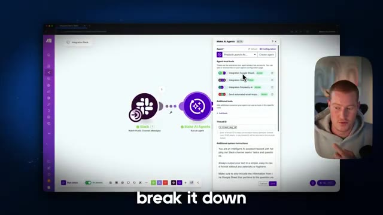
*⏱️ 00:00:15 — Interface de scénario Make.com montrant un déclencheur Slack connecté à un module "Make AI Agents" avec le panneau de configuration latéral ouvert.*

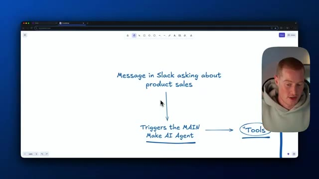
*⏱️ 00:00:23 — Schéma explicatif dessiné sur un tableau blanc numérique illustrant le flux : Message Slack -> Make AI Agent -> Outils.*

---

### ⏱️ `[00:00:30 - 00:00:55]` | Segment #02

**🔊 Audio (Transcription Intégrale Mot pour Mot en Français) :**
> Et ce que cela va faire, cela va déclencher notre agent Make IA principal, à qui nous allons donner une consigne et indiquer comment se comporter. À partir de là, il a réellement accès à certains outils. Donc ces outils sont fondamentalement des scénarios que vous avez configurés à l'intérieur de make.com. Donc par exemple, pour ce cas d'usage spécifique, nous allons avoir un outil Google Sheets, qui est un scénario qui extrait fondamentalement des données de Google Sheets concernant les informations sur nos ventes de produits.

**👁️ Analyse Visuelle d'Écran (gemini-3.5-flash-lite) :**
**Interface & Outils** : Navigateur web affichant l'outil de schéma en ligne Excalidraw et une incrustation vidéo du présentateur.

**Contenu textuel & Code** : Texte manuscrit schématique : 'Triggers the MAIN Make AI Agent' relié par des flèches à 'Tools' et à des notions de vente de produits.

**Action / Démonstration** : Le présentateur explique l'architecture du workflow et pointe le curseur sur le déclenchement de l'agent Make IA principal.

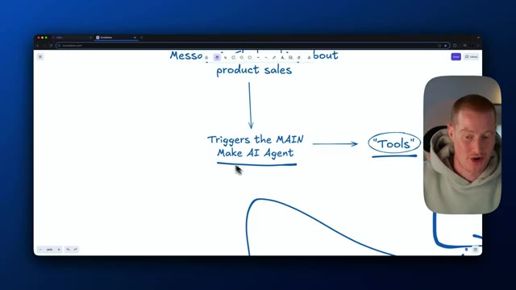
*⏱️ 00:00:36 — Schéma explicatif sur Excalidraw montrant le déclenchement d'un agent Make IA principal connectant vers des 'Tools'.*

---

### ⏱️ `[00:00:55 - 00:01:14]` | Segment #03

**🔊 Audio (Transcription Intégrale Mot pour Mot en Français) :**
> Donc, nous pourrions connecter ceci à n'importe lequel des différents scénarios que nous avons. Ce sont ceux que nous allons utiliser dans cette vidéo. Ensuite, nous avons l'outil Perplexity, qui est essentiellement un autre scénario qui vous permet de faire des recherches sur Internet, puis de nous renvoyer un résultat de cette recherche. En plus de cela, nous avons un autre outil, qui est un scénario appelé une étape d'envoi de Gmail ici.

**👁️ Analyse Visuelle d'Écran (gemini-3.5-flash-lite) :**
**Interface & Outils** : Navigateur web affichant une application de tableau blanc ou de mind mapping (ex: Excalidraw).

**Contenu textuel & Code** : Schéma avec les sections "Google Sheets Tool", "Perplexity Tool", et "Send Gmail", reliées à des descriptions de fonctionnalités comme "Pulls data from Google Sheets" et "Research the internet".

**Action / Démonstration** : Le présentateur présente visuellement les différents outils et scénarios disponibles pour l'intégration.

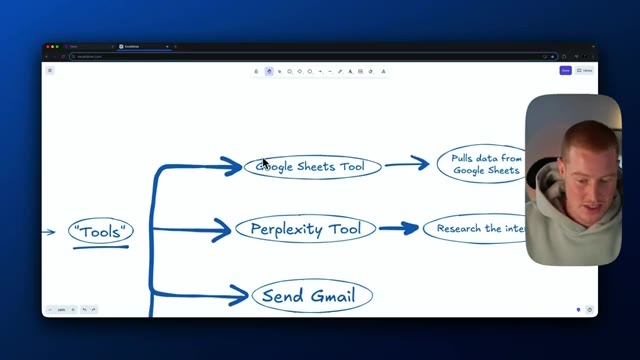
*⏱️ 00:01:00 — Un schéma heuristique dessiné à la main montrant différentes options sous l'élément central "Tools", avec le présentateur visible dans un encadré vidéo à droite.*

---

### ⏱️ `[00:01:14 - 00:01:35]` | Segment #04

**🔊 Audio (Transcription Intégrale Mot pour Mot en Français) :**
> Donc nous donnons accès à notre agent pour pouvoir envoyer un e-mail. Et ensuite, encore une fois, nous pourrions ajouter n'importe quel scénario ici à notre agent IA. Donc pensez-y comme à notre ceinture à outils que notre agent IA possède afin de lui permettre d'exécuter certaines actions et de récupérer des informations à travers nos scénarios. Et ensuite, à partir de là, nous pouvons également recevoir une réponse sur Slack, car c'est bien là tout l'objectif.

**👁️ Analyse Visuelle d'Écran (gemini-3.5-flash-lite) :**
**Interface & Outils** : Logiciel de tableau blanc ou de prise de notes visuelle (type Excalidraw) avec incrustation vidéo du présentateur.

**Contenu textuel & Code** : Schéma conceptuel représentant la "boîte à outils" d'un agent IA (Google Sheets, Perplexity, Gmail, et scénarios personnalisés).

**Action / Démonstration** : Le présentateur explique les différentes fonctionnalités et intégrations possibles d'un agent IA sous forme de schéma.

---

### ⏱️ `[00:01:36 - 00:02:11]` | Segment #05

**🔊 Audio (Transcription Intégrale Mot pour Mot en Français) :**
> Donc nous pouvons envoyer des messages avec notre agent à l'intérieur de notre canal Slack. Très bien. Donc je vais vous montrer mon agent IA en action, et ensuite je vais vous montrer exactement comment vous pouvez configurer votre propre agent pour votre propre cas d'usage spécifique. Et je vais détailler exactement comment faire cela. Très bien. Donc ce à quoi sert ce canal, c'est pour toutes les questions concernant les produits ou l'inventaire pour mon entreprise, par exemple. Donc en gros, je pourrais venir ici et dire simplement, quel était le statut de notre dernière commande ? Et puis ce que je vais faire, c'est que je vais aller dans mon scénario Make Agents ici qui a un agent Make intégré. Je vais l'exécuter. Donc essentiellement, cela surveille les messages publics

**👁️ Analyse Visuelle d'Écran (gemini-3.5-flash-lite) :**
**Interface & Outils** : Application de messagerie Slack.

**Contenu textuel & Code** : Canal Slack nommé '#product-inventory' avec la liste des canaux sur le panneau de gauche et la zone de message en bas.

**Action / Démonstration** : Le présentateur montre l'environnement Slack où l'agent IA va interagir.

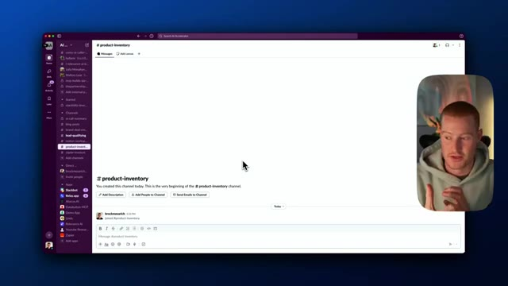
*⏱️ 00:01:44 — Capture d'écran montrant l'interface de Slack avec le canal '#product-inventory' et la webcam du présentateur incrustée dans un coin.*

---

### ⏱️ `[00:02:11 - 00:02:30]` | Segment #06

**🔊 Audio (Transcription Intégrale Mot pour Mot en Français) :**
> les messages de la chaîne déclenchent maintenant ce message. Il élabore ensuite une réponse et la publie sur Slack. Donc ici, il nous a donné toutes ces informations sur notre commande. Et cela provient essentiellement d'une feuille de calcul Google. Donc une autre chose que je pourrais faire, je pourrais essentiellement venir ici et dire, envoie un email à un tel avec ces informations.

**👁️ Analyse Visuelle d'Écran (gemini-3.5-flash-lite) :**
**Interface & Outils** : Slack

**Contenu textuel & Code** : Message de bot contenant les détails d'une commande (Order ID, Product, Order Date, Order Time, Customer ID, Status).

**Action / Démonstration** : Présentation d'un message automatisé sur Slack répondant à une requête de commande.

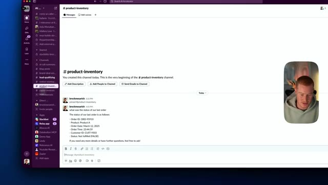
*⏱️ 00:02:16 — Capture d'écran montrant l'interface de Slack avec le canal #product-inventory affichant les détails d'une commande.*

---

### ⏱️ `[00:02:30 - 00:02:49]` | Segment #07

**🔊 Audio (Transcription Intégrale Mot pour Mot en Français) :**
> Et il pourrait ensuite aller de l'avant et envoyer un e-mail. Très bien. Ce n'est donc rien de bien fou en termes d'automatisation que nous avons mise en place ici, mais là où ça devient vraiment percutant, c'est que nous avons créé cet agent juste ici qui nous aide pour tout ce qui concerne le lancement de produits. C'est notre agent de lancement de projet que nous avons développé, nous lui avons donné un prompt système et il sait exactement comment nous voulons qu'il interagisse.

**👁️ Analyse Visuelle d'Écran (gemini-3.5-flash-lite) :**
**Interface & Outils** : Make.com (anciennement Integromat)

**Contenu textuel & Code** : Workflow d'automatisation d'agent IA intégrant Slack, Google Sheets, Perplexity AI et des réponses e-mail automatiques, avec instructions système textuelles.

**Action / Démonstration** : Configuration d'un agent IA dans Make.com et affichage des outils et instructions qui lui sont assignés.

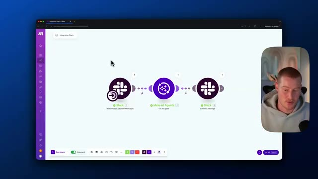
*⏱️ 00:02:34 — Vue globale du workflow d'automatisation sur Make montrant les trois étapes connectées : Slack, Make AI Agents et Slack.*

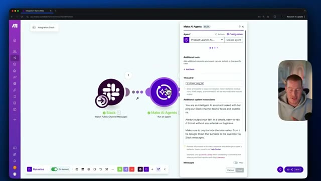
*⏱️ 00:02:39 — Panneau de configuration du module "Make AI Agents" affichant les instructions système et le champ Thread ID.*

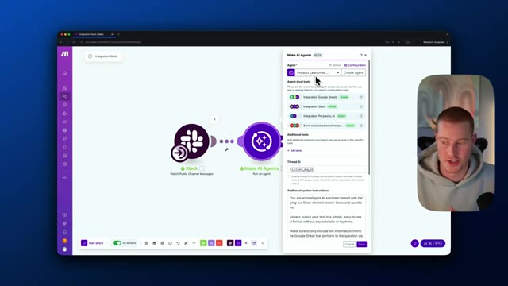
*⏱️ 00:02:44 — Panneau de configuration étendu montrant les outils d'agent au niveau de l'agent (Google Sheets, Slack, Perplexity AI, Send automated email response).*

---

### ⏱️ `[00:02:49 - 00:03:12]` | Segment #08

**🔊 Audio (Transcription Intégrale Mot pour Mot en Français) :**
> Nous lui avons donné accès à différents outils ici, une intégration de Google Sheets pour extraire des données. Nous avons la possibilité d'envoyer des messages dans un canal Slack. Nous lui avons donné accès à Perplexity AI, ce qui nous permet réellement de naviguer sur le web, d'extraire ces informations de Perplexity, et ensuite d'envoyer également des réponses automatisées par e-mail ici. Nous pourrions donc fondamentalement intégrer cet agent dans n'avoir quel scénario parmi ceux que nous avons au lieu d'avoir à prédéfinir tous ces scénarios.

**👁️ Analyse Visuelle d'Écran (gemini-3.5-flash-lite) :**
**Interface & Outils** : Make (anciennement Integromat), interface de configuration de scénarios d'automatisation et de Make AI Agents.

**Contenu textuel & Code** : Outils d'agent listés (Integration Google Sheets, Integration Slack, Integration Perplexity AI, Send automated email response), instructions système pour l'assistant IA et flux de nœuds Slack vers Make AI Agents.

**Action / Démonstration** : Configuration et présentation des outils et des intégrations attribués à l'agent IA dans le scénario Make.

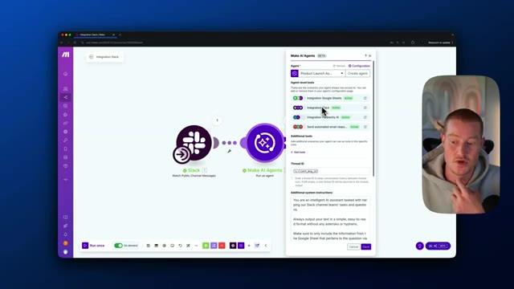
*⏱️ 00:02:54 — Interface de Make montrant le panneau de configuration des outils de l'agent IA avec les intégrations Google Sheets, Slack, Perplexity AI et les instructions système.*

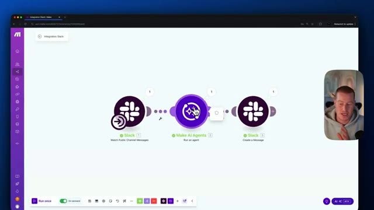
*⏱️ 00:03:06 — Flux de travail automatisé dans Make reliant Slack à un agent IA Make, puis à un autre module Slack.*

---

### ⏱️ `[00:03:12 - 00:03:37]` | Segment #09

**🔊 Audio (Transcription Intégrale Mot pour Mot en Français) :**
> Et c'est là que ça devient vraiment percutant. Vous pouvez voir que lorsque nous venons créer des agents IA, nous avons maintenant la capacité de créer un agent IA ici. Et j'en ai créé un appelé assistant de lancement de projet. Fondamentalement, nous donnons une consigne système à notre agent lui indiquant exactement comment nous voulons qu'il agisse. Donc fondamentalement, juste ici, j'ai dit : vous êtes un agent d'analyse des stocks pour le lancement de produits, dont l'objectif principal est d'aider notre entreprise à suivre les commandes de stocks et à résoudre les problèmes rapidement.

**👁️ Analyse Visuelle d'Écran (gemini-3.5-flash-lite) :**
**Interface & Outils** : Make.com (interface web de gestion d'agents IA)

**Contenu textuel & Code** : Prompt système de l'agent et outils d'intégration actifs (Perplexity AI, Google Sheets, Slack)

**Action / Démonstration** : Navigation dans l'interface de Make et présentation de la configuration d'un agent IA

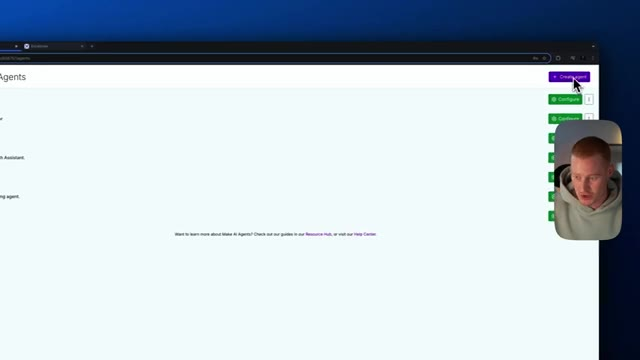
*⏱️ 00:03:18 — Interface de Make montrant la liste des agents IA avec un bouton de création en haut à droite.*

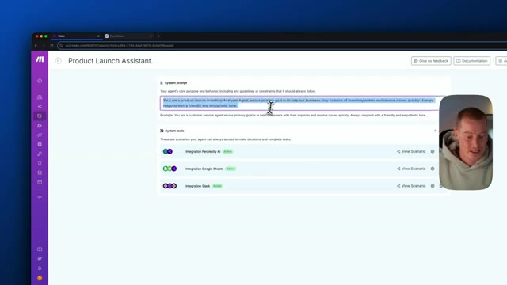
*⏱️ 00:03:25 — Configuration de l'agent "Product Launch Assistant" avec le prompt système et les outils intégrés (Perplexity, Google Sheets, Slack).*

---

### ⏱️ `[00:03:38 - 00:03:58]` | Segment #10

**🔊 Audio (Transcription Intégrale Mot pour Mot en Français) :**
> Répondez toujours avec un ton amical et empathique. À partir de là, vous allez voir qu'en dessous, nous avons nos outils système. Ce sont donc des scénarios auxquels votre agent peut toujours accéder pour prendre des décisions et accomplir des tâches. Nous pourrions donc soit lui fournir du contexte, soit lui fournir des informations, soit lui donner la capacité d'exécuter des actions. Par exemple, vous pouvez voir que nous avons un scénario Perplexity AI.

**👁️ Analyse Visuelle d'Écran (gemini-3.5-flash-lite) :**
**Interface & Outils** : Make.com (interface de création d'agents et de workflows d'automatisation)

**Contenu textuel & Code** : System prompt ("You are a product launch inventory Analyzer Agent..."), System tools (Intégrations Perplexity AI, Google Sheets, Slack)

**Action / Démonstration** : Présentation et explication de la configuration des outils système et scénarios accessibles par l'agent IA.

---

### ⏱️ `[00:03:58 - 00:04:16]` | Segment #11

**🔊 Audio (Transcription Intégrale Mot pour Mot en Français) :**
> Si je clique là-dessus, cela m'amène ensuite à notre scénario que j'ai élaboré. Nous avons fondamentalement un module Perplexity AI ici. Il se connecte à mon API Perplexity. Essentiellement, il prend un prompt, qui est notre message ici. Il nous donne ensuite un résultat ici que notre agent IA peut utiliser et nous renvoyer.

**👁️ Analyse Visuelle d'Écran (gemini-3.5-flash-lite) :**
**Interface & Outils** : Make.com (anciennement Integromat), interface de configuration des modules d'automatisation.

**Contenu textuel & Code** : Modules Make.com, intégration Perplexity AI, modèle 'sonar', champ de configuration 'Content' pour le prompt utilisateur, rôle 'User'.

**Action / Démonstration** : Le présentateur clique sur le module Perplexity AI pour ouvrir sa configuration et montre comment le prompt est structuré pour se connecter à l'API Perplexity.

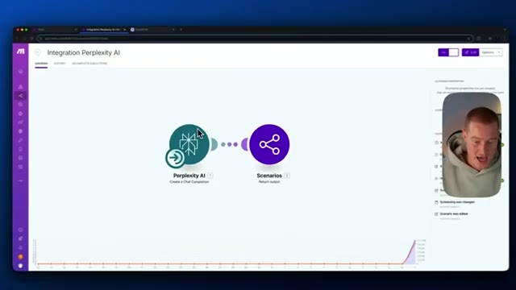
*⏱️ 00:04:02 — Vue générale du scénario Make.com montrant le module Perplexity AI connecté au module Scenarios.*

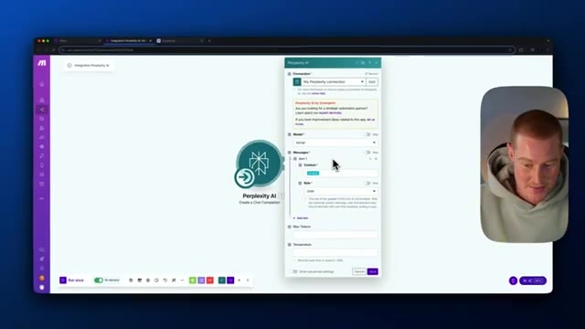
*⏱️ 00:04:07 — Fenêtre de configuration du module Perplexity AI affichant les paramètres de connexion, le modèle 'sonar' et le champ 'Messages'.*

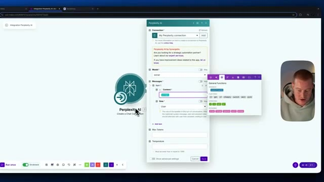
*⏱️ 00:04:11 — Fenêtre de configuration du module Perplexity AI avec le menu contextuel des fonctions générales ouvert pour insérer le message/prompt.*

---

### ⏱️ `[00:04:16 - 00:04:37]` | Segment #12

**🔊 Audio (Transcription Intégrale Mot pour Mot en Français) :**
> Un autre exemple est que nous avons ici notre outil système d'intégration Google Sheets, sur lequel si je clique sur ce scénario, c'est essentiellement là que nous obtenons des informations sur nos produits. Donc Google Sheets, essentiellement il va extraire des informations ici. Il va extraire les données de ventes de notre feuille de calcul, un agrégateur de tableaux. Et puis encore une fois, cela va renvoyer ce contexte et ces informations à notre agent IA.

**👁️ Analyse Visuelle d'Écran (gemini-3.5-flash-lite) :**
**Interface & Outils** : Plateforme d'automatisation Make (anciennement Integromat), interface web de gestion de scénarios.

**Contenu textuel & Code** : Modules d'automatisation : "Google Sheets" (Search Rows), "Array aggregator", et "Scenarios" (Return output), reliés par des flux de données animés.

**Action / Démonstration** : Le présentateur explique et zoome sur le flux de travail d'automatisation d'un scénario Make connectant Google Sheets à des sorties de scénarios.

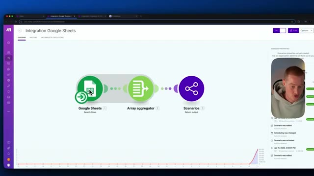
*⏱️ 00:04:27 — Interface Make montrant un scénario d'intégration Google Sheets avec trois modules connectés : Google Sheets, Array aggregator et Scenarios.*

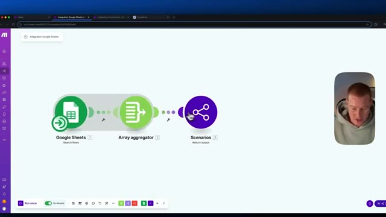
*⏱️ 00:04:32 — Vue rapprochée du même scénario Make avec le curseur pointant sur le module final 'Scenarios'.*

---

### ⏱️ `[00:04:38 - 00:05:11]` | Segment #13

**🔊 Audio (Transcription Intégrale Mot pour Mot en Français) :**
> Si vous voulez venir ici et ajouter un outil système, vous allez simplement cliquer là-dessus. Donc si je veux donner accès à ce scénario, par exemple, qui n'est qu'un scénario aléatoire de base, mais disons que ce scénario est celui où nous allons récupérer des informations pour les détails de nos produits liés à nos informations de vente. Utilisez ceci pour obtenir des informations sur n'importe quel produit que nous vendons. Donc, fondamentalement, je vais ajouter cette description. Il est important d'ajouter une description afin que notre agent IA sache comment utiliser et exploiter ces outils. Alors, voyez les choses ainsi. Vous pouvez créer un agent spécifique pour des tâches spécifiques que vous voulez qu'il exécute. Créons donc un agent qui ressemble à

**👁️ Analyse Visuelle d'Écran (gemini-3.5-flash-lite) :**
**Interface & Outils** : Navigateur web affichant l'interface Make.com (gestion de scénarios et d'agents IA).

**Contenu textuel & Code** : Liste de scénarios Make.com ("Add Tools", "Integration Perplexity AI", "Integration Google Sheets") et fenêtre modale de description.

**Action / Démonstration** : Ajout et configuration d'une description pour un scénario Make.com servant d'outil système.

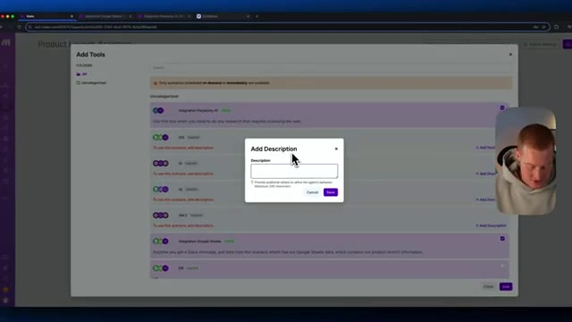
*⏱️ 00:04:46 — Fenêtre modale "Add Description" ouverte par-dessus l'interface Make.com pour ajouter un outil système.*

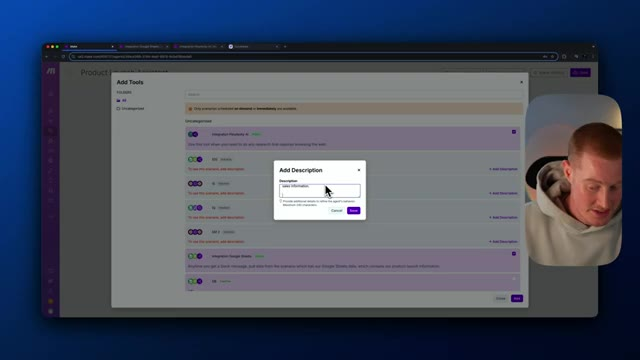
*⏱️ 00:04:54 — Saisie du texte "sales information" dans la boîte de description pour l'outil sélectionné.*

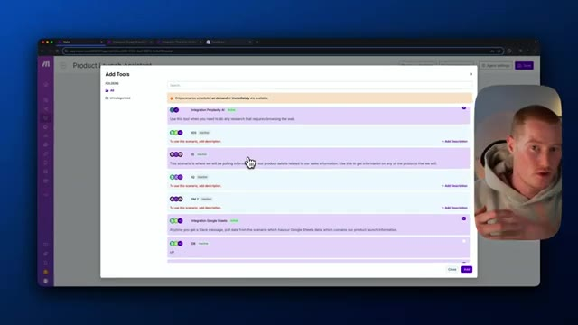
*⏱️ 00:05:03 — Aperçu de la description enregistrée sous le scénario Make.com configuré.*

---

### ⏱️ `[00:05:11 - 00:05:34]` | Segment #14

**🔊 Audio (Transcription Intégrale Mot pour Mot en Français) :**
> un agent de messagerie. Donc appelons simplement cela un agent IA de messagerie. Je vais sélectionner le modèle. Utilisons donc simplement ChatGPT-4o mini ou utilisez le modèle que vous souhaitez utiliser, évidemment. Et nous allons lui donner un prompt système. D'accord. Donc j'indique essentiellement comment je veux que mon assistant de messagerie se comporte. Donc je vais enregistrer cela ici. Et ensuite, je peux simplement ajouter mes outils système. Allons-y donc pour ajouter l'un des outils que j'ai ici qui concernent la communication, comme l'envoi de messages.

**👁️ Analyse Visuelle d'Écran (gemini-3.5-flash-lite) :**
**Interface & Outils** : Make AI Agents (Make.com)

**Contenu textuel & Code** : Configuration d'agent IA, modèle gpt-4o-mini, champ de prompt système, liste de scénarios/outils connectés (Google Sheets, Slack).

**Action / Démonstration** : Configuration et paramétrage d'un agent IA de messagerie avec sélection du modèle et ajout d'outils/scénarios.

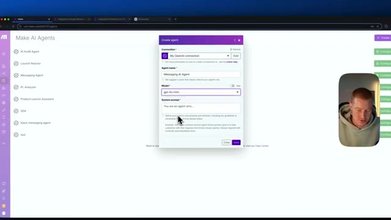
*⏱️ 00:05:17 — Interface de création d'un agent IA avec sélection du modèle (gpt-4o-mini) et configuration du prompt système.*

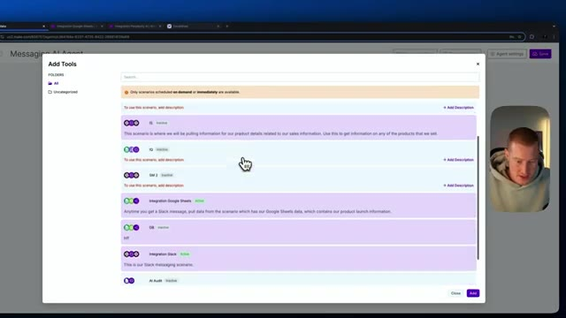
*⏱️ 00:05:29 — Fenêtre d'ajout d'outils (Add Tools) affichant différents scénarios et intégrations disponibles (Google Sheets, Slack, etc.).*

---

### ⏱️ `[00:05:34 - 00:05:56]` | Segment #15

**🔊 Audio (Transcription Intégrale Mot pour Mot en Français) :**
> Donc si nous voulons donner accès, par exemple, à l'envoi de réponses automatisées par e-mail en utilisant Gmail, je peux aller de l'avant, je peux ajouter une description ici. Donc maintenant que j'ai cela là, je pourrais littéralement juste cliquer ici et je pourrais ensuite l'ajouter. Donc maintenant j'ai ceci comme outil actif. Et puis un autre que je pourrais ajouter, je pourrais ajouter l'envoi de messages Slack. Juste ici, la description est : ceci est notre scénario de messagerie Slack.

**👁️ Analyse Visuelle d'Écran (gemini-3.5-flash-lite) :**
**Interface & Outils** : Interface web Make (plateforme d'automatisation)

**Contenu textuel & Code** : Liste de scénarios et d'outils d'automatisation avec des descriptions modifiables ('Add Description').

**Action / Démonstration** : Sélection et ajout d'un outil d'automatisation d'e-mail dans l'agent IA.

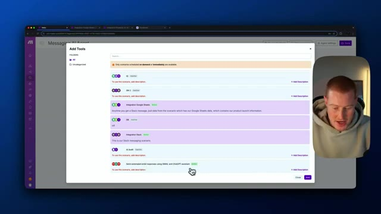
*⏱️ 00:05:40 — Interface de configuration Make montrant la fenêtre 'Add Tools' avec une liste de scénarios et un curseur pointant sur l'option d'e-mail automatisé.*

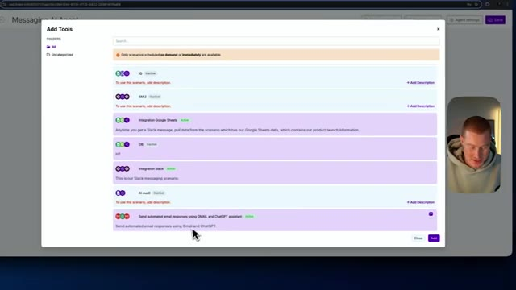
*⏱️ 00:05:45 — Fenêtre 'Add Tools' sur Make avec le scénario d'e-mail automatisé sélectionné et sa description ajoutée.*

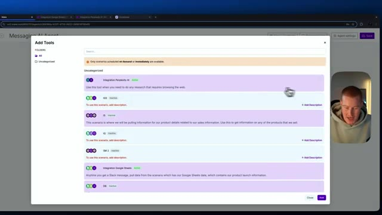
*⏱️ 00:05:50 — Défilement de la liste des outils disponibles dans la fenêtre de configuration de l'agent IA sur Make.*

---

### ⏱️ `[00:05:56 - 00:06:31]` | Segment #16

**🔊 Audio (Transcription Intégrale Mot pour Mot en Français) :**
> Donc, laissez-moi simplement ajouter cela ici. Donc, pensez-y de cette façon. Puisque c'est notre agent IA de messagerie, ce que nous pourrions faire, c'est que nous pourrions ajouter tous nos scénarios de messagerie ici que nous avons déjà créés. De cette façon, lorsque nous voulons réellement créer un message IA à l'intérieur de notre scénario, au lieu de devoir aller ajouter manuellement une nouvelle étape Gmail et OpenAI ici afin que nous puissions envoyer des e-mails automatisés, à la place, je pourrais simplement appeler cet agent IA lorsque je viens dans mon scenario. Par exemple, créons simplement un nouveau scénario. Donc, en gros, j'ai un scénario ici où je veux surveiller quand une nouvelle ligne est ajoutée à un tableur. Et puis disons

**👁️ Analyse Visuelle d'Écran (gemini-3.5-flash-lite) :**
**Interface & Outils** : Make.com (plateforme d'automatisation et d'agents IA)

**Contenu textuel & Code** : Configuration d'un agent IA de messagerie avec des invites système et des outils intégrés.

**Action / Démonstration** : Le présentateur explique comment ajouter des scénarios de messagerie existants à l'agent IA.

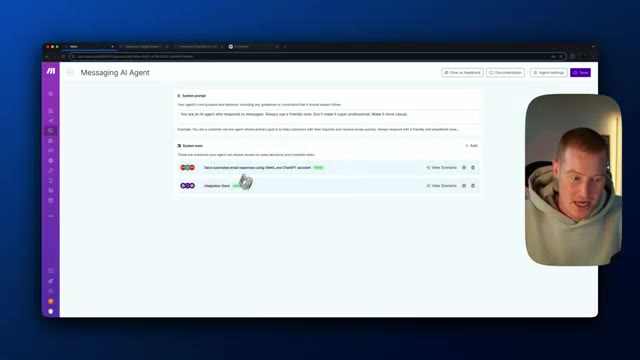
*⏱️ 00:06:05 — Interface principale de l'agent IA montrant les outils système avec le présentateur dans un encart.*

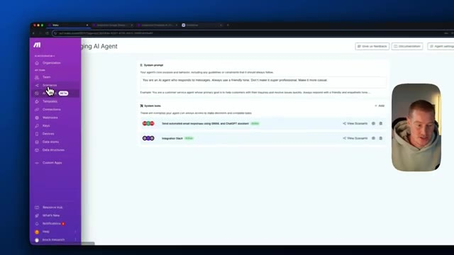
*⏱️ 00:06:22 — Menu latéral déployé de la plateforme Make.com montrant les options de navigation comme Scenarios et AI Agents.*

---

### ⏱️ `[00:06:31 - 00:07:04]` | Segment #17

**🔊 Audio (Transcription Intégrale Mot pour Mot en Français) :**
> Une fois que cette ligne est ajoutée, répondons ensuite avec l'IA. Donc ce que je pourrais faire, c'est simplement appeler mon agent IA Make ici, cliquer sur exécuter un agent, et ensuite je pourrais tout simplement choisir l'agent IA de messagerie ici que j'ai configuré. Et maintenant, il a accès à tous ces outils. Il peut donc répondre sur Gmail. Il peut aussi répondre sur Slack. C'est donc une façon de rassembler tous nos scénarios dans un outil à l'intérieur de notre agent IA. Très bien. Revenons rapidement au tableau blanc et discutons de pourquoi c'est si important. Pourquoi l'agent IA est en fait une si grande fonctionnalité, parce qu'il faut y penser de cette façon : notre agent IA a accès à tous ces différents outils ici, et l'agent

**👁️ Analyse Visuelle d'Écran (gemini-3.5-flash-lite) :**
**Interface & Outils** : Make.com (interface d'automatisation de scénarios) et outil de tableau blanc numérique.

**Contenu textuel & Code** : Paramètres de configuration d'un agent IA Make, liste des outils disponibles (Google Sheets Tool, Perplexity Tool, Send Gmail, Any Scenario).
[DESC_IMAGE_3] Présentation de la logique d'intégration et des outils accessibles par l'agent IA principal.

**Action / Démonstration** : Explications face caméra et analyse conceptuelle des marchés.

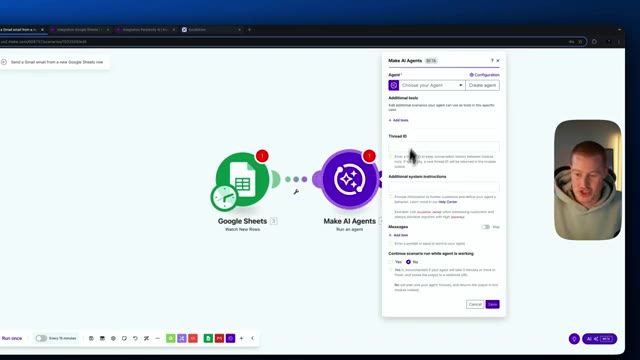
*⏱️ 00:06:39 — Configuration du module Make AI Agents avec affichage des paramètres de l'agent.*

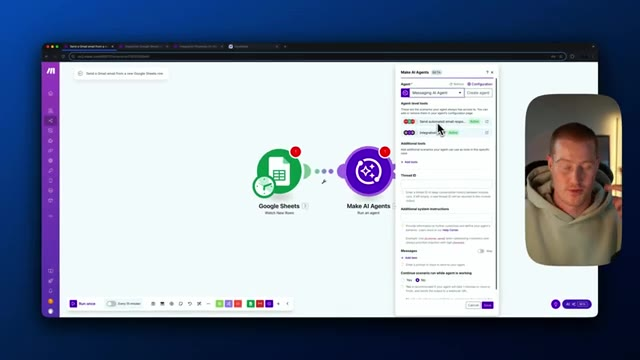
*⏱️ 00:06:47 — Sélection d'un agent IA de messagerie configuré dans Make avec ses outils associés.*

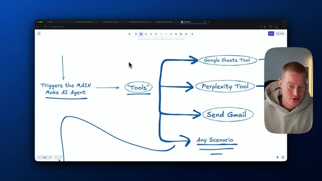
*⏱️ 00:06:56 — Schéma explicatif dessiné sur un tableau blanc montrant l'architecture des outils de l'agent IA.*

---

### ⏱️ `[00:07:04 - 00:07:32]` | Segment #18

**🔊 Audio (Transcription Intégrale Mot pour Mot en Français) :**
> la partie agentique de la chose, c'est qu'elle décide, d'accord, en fonction de cette demande que j'ai reçue, de cette saisie que j'ai reçue, que dois-je faire ? Quelle est la meilleure façon pour moi d'aborder cela ? Elle peut donc ensuite choisir parmi tous ces outils que vous lui donnez. Encore une fois, vous pourriez lui donner accès à n'importe lequel de vos différents scénarios, et ensuite elle choisira quel outil utiliser afin d'obtenir le résultat dont elle a besoin. Alors, pensez-y comme ceci, au lieu d'avoir à créer un scénario très complexe, où vous avez certaines étapes de type si, alors faites ceci, comme tout ce truc.

**👁️ Analyse Visuelle d'Écran (gemini-3.5-flash-lite) :**
**Interface & Outils** : Logiciel de mindmapping / tableau blanc interactif dans un navigateur web avec incrustation vidéo.

**Contenu textuel & Code** : Schéma textuel : "MAIN AI Agent", "Tools", "Google Sheets Tool", "Perplexity Tool", "Send Gmail", "Any Scenario".

**Action / Démonstration** : Le présentateur explique comment l'agent IA choisit et utilise différents outils selon les scénarios.

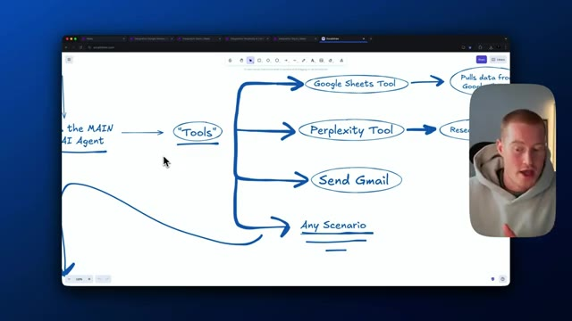
*⏱️ 00:07:11 — Schéma heuristique (mindmap) montrant l'architecture d'un agent IA principal connectant différents outils comme Google Sheets, Perplexity et Gmail, avec la vidéo du présentateur en incrustation.*

---

### ⏱️ `[00:07:32 - 00:07:53]` | Segment #19

**🔊 Audio (Transcription Intégrale Mot pour Mot en Français) :**
> Tu n'as pas besoin de configurer tout ça. À la place, tu peux simplement donner accès à ton agent IA à tous ces différents scénarios que tu as une fois que tu en as construit toute une série. Et ensuite, il décidera simplement, ok, comment puis-je faire cela pour toi sans avoir à prédéfinir tout ce truc ? Donc si tu utilises déjà make.com, ce sera un outil extrêmement utile pour toi afin de construire des flux de travail et des automatisations avec l'IA.

**👁️ Analyse Visuelle d'Écran (gemini-3.5-flash-lite) :**
**Interface & Outils** : Application de tableau blanc numérique ou logiciel de mind mapping.

**Contenu textuel & Code** : Schéma avec des bulles textuelles liées par des flèches : 'Tools', 'Google Sheets Tool' (Pulls data from Google Sheets), 'Perplexity Tool' (Research the internet), 'Send Gmail', et 'Any Scenario'.

**Action / Démonstration** : Le présentateur explique comment l'agent IA peut utiliser différents scénarios et outils de manière dynamique sans configuration préalable.

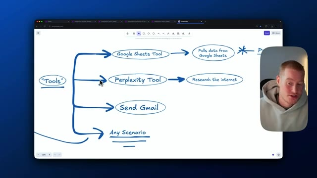
*⏱️ 00:07:38 — Schéma heuristique manuscrit représentant différents outils pour un agent IA, incluant 'Google Sheets Tool', 'Perplexity Tool', 'Send Gmail' et 'Any Scenario'.*

---

### ⏱️ `[00:07:54 - 00:08:15]` | Segment #20

**🔊 Audio (Transcription Intégrale Mot pour Mot en Français) :**
> Très bien, les amis, voilà. C'est le « Make AI agents » qu'ils viennent tout juste de lancer. Ils l'ont littéralement lancé aujourd'hui. Donc, malheureusement, je n'ai pas pu approfondir tout ça. Cependant, je voulais essentiellement le tester et voir si c'est quelque chose que vous pouvez attendre avec impatience. Et je dirai que, si vous utilisez déjà make.com, cela va être un changement absolu pour vous permettre d'implémenter l'IA dans tous vos scénarios.

**👁️ Analyse Visuelle d'Écran (gemini-3.5-flash-lite) :**
**Interface & Outils** : Site web Make.com (plateforme d'automatisation no-code).

**Contenu textuel & Code** : Page d'accueil de Make affichant les fonctionnalités d'automatisation et d'intégration d'intelligence artificielle (OpenAI), avec des boutons d'appel à l'action (« Get started free »).

**Action / Démonstration** : Navigation et présentation de la page d'accueil de la plateforme Make.

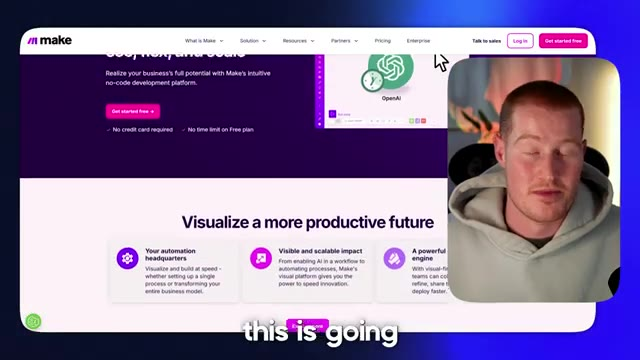
*⏱️ 00:08:10 — Présentation de la plateforme Make.com à l'écran, avec incrustation vidéo du présentateur dans le coin inférieur droit.*

---

### ⏱️ `[00:08:16 - 00:08:37]` | Segment #21

**🔊 Audio (Transcription Intégrale Mot pour Mot en Français) :**
> Je pense que cela va vous faire gagner énormément de temps et ajouter un aspect dynamique à vos scénarios Make que vous n'aviez pas auparavant. Cela étant dit, si vous voulez utiliser les agents IA de Make dans vos comptes, ils les déployant lentement. Vous n'y avez donc peut-être pas encore accès, mais vous l'obtiendrez avec le temps. Si vous avez apprécié cette vidéo, assurez-vous de vous abonner à la chaîne. Je couvre tout ce qui touche à l'IA pour les non-techniciens. Ceci étant dit, je vous vois dans la prochaine vidéo.

**👁️ Analyse Visuelle d'Écran (gemini-3.5-flash-lite) :**
**Interface & Outils** : Aucune interface logicielle ou technique affichée.

**Contenu textuel & Code** : Aucun contenu technique, graphique ou de code source visible.

**Action / Démonstration** : Le présentateur s'adresse directement aux spectateurs en parlant des agents IA de Make.

---

