# 🎬 Building AND Launching a Software With AI (Custom Domain)

> **Chaîne** : [Brock Mesarich | AI for Non Techies](https://www.youtube.com/@BrockMesarich)  
> **Lien YouTube** : [https://www.youtube.com/watch?v=CR8wsetblYY](https://www.youtube.com/watch?v=CR8wsetblYY)  
> **Date de publication** : 20250420  
> **Durée** : 00:18:35  
> **Identifiant vidéo** : `CR8wsetblYY`  
> **Transcription & Analyse** : `whisper-v3-large-turbo+gemini-3.5-flash-lite`  

---

## 📌 Synthèse Exécutive & Outils

### 💡 Résumé

Cette vidéo présentée par la chaîne *Brock Mesarich | AI for Non Techies* explore le potentiel du « vibe coding » et de la création d'applications web pilotées par l'intelligence artificielle, spécifiquement axée sur le développement rapide et le déploiement sur domaine personnalisé sans compétences en programmation. L'intervenant démontre l'efficacité d'un flux de travail moderne combinant la reconnaissance vocale et des interfaces de développement assistées par IA pour matérialiser en quelques minutes une idée de logiciel SaaS — en l'occurrence, un générateur de scripts pour formats courts (TikTok, Instagram Reels, YouTube Shorts) intégrant une correspondance de style de créateurs.

Au-delà de la simple génération d'interfaces utilisateur, la démonstration met en lumière la configuration fluide d'une base de données backend via l'intégration automatisée de Supabase. L'analyste montre comment, par de simples requêtes en langage naturel, il est possible de structurer des tables relationnelles, d'implémenter l'authentification des utilisateurs (inscription, connexion, e-mails de vérification) et de persister des données complexes comme des profils et des historiques de scripts. Ce processus illustre l'abaissement radical des barrières techniques pour lancer des produits viables minimums (MVP) sur le marché.

Enfin, la vidéo aborde l'aspect pratique du prototypage itératif : corriger les bugs visuels, modifier l'UI (comme le passage à un dégradé de bleu), et lier des fonctionnalités dynamiques de manière conversationnelle. En combinant des outils de transcription vocale pour optimiser les prompts et des plateformes de déploiement tout-en-un, cette approche redéfinit l'agilité du développement logiciel, permettant aux non-techniciens de se concentrer exclusivement sur la logique métier et la proposition de valeur de leur produit.

### 🛠️ Outils, Modèles & Logiciels Présentés

* **Hostinger Horizons** : Plateforme tout-en-un de création et d'hébergement d'applications web propulsée par l'IA, servant d'environnement principal pour concevoir et déployer le logiciel sur un domaine personnalisé.
* **Supabase** : Outil de base de données relationnelle open-source intégré nativement pour gérer l'authentification des utilisateurs et stocker les profils, les styles de créateurs et les scripts générés.
* **AquaVoice** : Outil de dictée et de transcription vocale par IA utilisé via des raccourcis clavier pour dicter rapidement des idées complexes et rédiger des prompts textuels fluides.
* **Claude / ChatGPT / Grok / Gemini** : Modèles de langage avancés servant de standards de référence pour le prompt engineering et l'assistance à la programmation par IA.
* **n8n / Make / Zapier** : Plateformes d'automatisation de workflows mentionnées dans l'écosystème technique pour connecter les différentes briques logicielles et APIs entre elles.

### 🔑 Points Clés & Enseignements Stratégiques

* **Le paradigme du « Vibe Coding »** : Adopter une approche itérative et fluide de programmation par IA, où le créateur ajuste le comportement et l'esthétique du logiciel au fil de l'eau par le dialogue, sans nécessiter de cahier des charges rigide ou de lignes de code pré-écrites.
* **Optimisation de la productivité par la voix** : Utiliser des outils de transcription vocale instantanée (comme AquaVoice) pour accélérer la rédaction des prompts, réduire la fatigue de frappe et structurer des idées complexes sous forme textuelle en quelques secondes.
* **Prototypage visuel et fonctionnel simultané** : Gérer de pair la conception de l'expérience utilisateur (UI) — telle que l'intégration de dégradés de couleurs ou de pages d'accueil épurées — et l'implémentation de la logique métier sous-jacente.
* **Intégration backend automatisée** : Tirer parti des connecteurs natifs entre les constructeurs d'applications IA et les bases de données (comme Supabase) pour s'affranchir de la configuration manuelle complexe des tables et des schémas relationnels.
* **Gestion des profils et persistance des données** : Structurer la base de données pour segmenter clairement les utilisateurs, les préférences de style de contenu et les historiques de scripts générés afin de garantir une expérience utilisateur cohérente et personnalisée.
* **Mise en place de l'authentification sécurisée** : Intégrer des flux d'inscription et de connexion robustes (avec vérification par e-mail ou comptes tiers) pour restreindre l'accès à l'application et sécuriser les données stockées dans le cloud.
* **Réplication de styles par l'IA** : Concevoir des fonctionnalités logicielles avancées permettant d'analyser et de reproduire le style rédactionnel de créateurs tiers pour personnaliser automatiquement les résultats générés.
* **Stratégie de tarification et d'acquisition** : Naviguer parmi les différents forfaits d'hébergement de logiciels (Explorer, Starter, Hobbyist, Hustler) et utiliser des codes promotionnels ciblés pour optimiser les coûts de lancement d'un SaaS.
* **Déploiement rapide sur domaine personnalisé** : Réduire le cycle de vie du développement d'un produit (de l'idée conceptuelle à la mise en ligne effective sur le web) à une fenêtre de quelques minutes grâce aux environnements de staging intégrés.
* **Alternative aux environnements de développement traditionnels** : Privilégier des plateformes intégrées (comme Hostinger Horizons) par rapport à des alternatives plus complexes ou boguées pour éliminer les frictions techniques lors de la phase de test d'un MVP.

---

## ⏱️ Chronologie & Transcription Complète Audio & Visuelle (Mot pour Mot)

### ⏱️ `[00:00:00 - 00:00:32]` | Segment #01

**🔊 Audio (Transcription Intégrale Mot pour Mot en Français) :**
> Dans cette vidéo, je vais créer et lancer un logiciel grâce à l'IA, sans aucune base en programmation. Non seulement vous me verrez créer ce logiciel avec l'IA, mais vous verrez à quel point il est facile de le lancer sur votre propre domaine personnalisé en moins de deux minutes. La plateforme que je vais vous montrer dans cette vidéo est une plateforme tout-en-un idéale pour créer et héberger des applications web avec l'IA. De plus, si vous découvrez la chaîne, je montre aux non-techniciens comment créer des choses formidables avec l'IA, alors si cela vous intéresse, assurez-vous de rester jusqu'à la fin de cette vidéo. Très bien, entrons dans le vif du sujet. Très bien, alors premièrement, si vous cliquez sur le lien dans la description, cela vous amènera sur cette page de destination pour héberger nos horizons, vous pouvez voir que nous pouvons commencer à créer notre application web ici. Mais si vous voulez faire défiler vers le bas,

**👁️ Analyse Visuelle d'Écran (gemini-3.5-flash-lite) :**
**Interface & Outils** : Hostinger Horizons, interface de génération d'application par IA.

**Contenu textuel & Code** : Barre de prompt pour créer des applications sans code, interface de prévisualisation web.

**Action / Démonstration** : Présentation de la plateforme de création de logiciels par IA et aperçu d'une application générée.

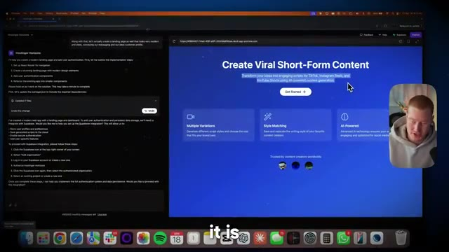
*⏱️ 00:00:08 — Interface de développement avec un panneau de code/chat à gauche et l'aperçu de la landing page à droite.*

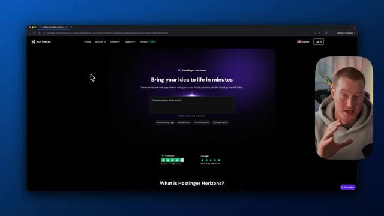
*⏱️ 00:00:24 — Page d'accueil de la plateforme Hostinger Horizons affichant la barre de prompt "What would you like to build?".*

---

### ⏱️ `[00:00:32 - 00:01:03]` | Segment #02

**🔊 Audio (Transcription Intégrale Mot pour Mot en Français) :**
> Vous pouvez soit commencer gratuitement, soit vous créer un compte. Voici les grilles tarifaires ici. Nous avons le forfait Explorer, le forfait Starter, Hobbyist, et le Hustler. Je suis sur le forfait Hustler, mais vous pouvez choisir celui qui vous convient le mieux. Et nous obtiendrions cent messages ici si nous devions commencer avec le forfait Starter. Très bien. Je vais donc vous montrer rapidement comment vous pouvez vous inscrire. Je vais donc sélectionner un forfait ici. Je vais commencer par celui-ci. Et à partir de là, ce que je ferai, c'est que je pourrais effectivement ajouter un code promo. Si vous souhaitez vous inscrire, j'ai un code Brock10. Cela vous donne 10 % de réduction sur le forfait que vous décidez de choisir.

**👁️ Analyse Visuelle d'Écran (gemini-3.5-flash-lite) :**
**Interface & Outils** : Navigateur web affichant le site de tarification et le panier d'achat d'Hostinger.

**Contenu textuel & Code** : Tarifs des forfaits (14.99$, 19.99$, 49.99$, 99.99$ par mois) et volumes de messages correspondants (50, 100, 250, 500 messages/mois).

**Action / Démonstration** : Présentation des différentes options tarifaires et sélection d'un forfait par l'utilisateur.

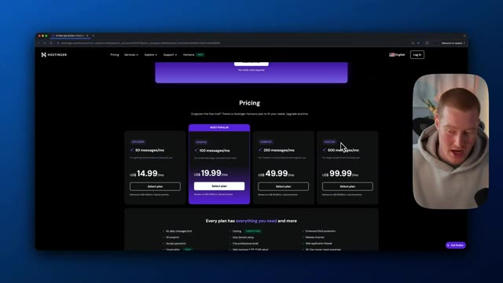
*⏱️ 00:00:40 — Page de tarification d'Hostinger affichant les différents forfaits disponibles (Explorer, Starter, Hobbyist, Hustler) avec leurs prix et limites de messages.*

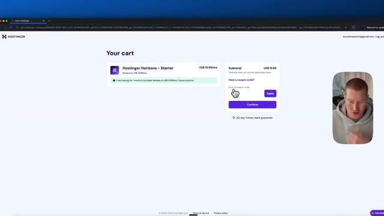
*⏱️ 00:00:55 — Page du panier d'achat Hostinger récapitulant la sélection du forfait Starter à 19.99$ par mois avec un champ pour code promo.*

---

### ⏱️ `[00:01:03 - 00:01:38]` | Segment #03

**🔊 Audio (Transcription Intégrale Mot pour Mot en Français) :**
> Donc, j'espère que cela vous fait économiser de l'argent, les gars. En gros, vous cliquez simplement sur continuer, vous ajoutez vos informations de facturation, et évidemment vous ajoutez vos informations de paiement. Vous pouvez voir que notre coupon nous a fait économiser de l'argent ici. Donc j'espère que cela vous aide. Une fois que vous aurez fait tout ça, vous serez ensuite redirigé vers l'interface utilisateur de Hostinger Horizons où nous pourrons commencer à créer notre application. Très bien, les gars. Donc c'est l'interface utilisateur de Hostinger Horizons. Vous pouvez voir qu'il y a cette zone de texte ici. En gros, il est écrit : que voulez-vous créer ? Tapez votre idée et laissez l'IA s'en charger à partir d'ici. Tout ce que j'ai besoin de faire, c'est de venir ici et simplement de parler ici. Et je veux fondamentalement coller mes idées ici pour ce que nous voulons construire. Et ensuite, nous continuerons à partir de là. Construisons un site web

**👁️ Analyse Visuelle d'Écran (gemini-3.5-flash-lite) :**
**Interface & Outils** : Navigateur web affichant l'interface de paiement et de création du site web Hostinger Horizons.

**Contenu textuel & Code** : Détails de la facture, application de code coupon de réduction, et interface utilisateur avec invite textuelle de création.

**Action / Démonstration** : Présentation du processus de paiement avec réduction et transition vers l'interface de création IA.

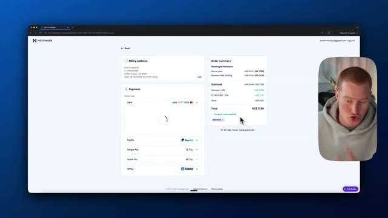
*⏱️ 00:01:12 — Page de paiement Hostinger avec un résumé de commande et l'application d'un code promo, avec la webcam du présentateur en médaillon.*

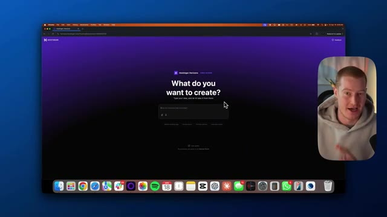
*⏱️ 00:01:29 — Interface d'accueil Hostinger Horizons posant la question 'What do you want to create?', avec la barre d'applications MacOS visible en bas.*

---

### ⏱️ `[00:01:38 - 00:02:13]` | Segment #04

**🔊 Audio (Transcription Intégrale Mot pour Mot en Français) :**
> application qui permet aux créateurs de contenu de générer des scripts de format court basés sur une idée générale. Donc, pensez-y de cette façon. Un créateur va coller une idée pour une vidéo, et ensuite nous aurons un script généré par IA qui est très engageant pour les vidéos de format court comme les YouTube Shorts, Instagram, TikTok, etc. Ajoutons la possibilité de générer plusieurs types de scripts. Donc, pour chaque vidéo, nous obtenons trois propositions de scripts et l'utilisateur peut choisir celle qu'il préfère pour ensuite l'affiner. D'accord, c'est parti. On va partir là-dessus. Aussi, ce que je viens d'utiliser là s'appelle AquaVoice. J'ai littéralement appuyé sur cette touche de commande de mon clavier, j'ai parlé dans mon ordinateur,

**👁️ Analyse Visuelle d'Écran (gemini-3.5-flash-lite) :**
**Interface & Outils** : Navigateur web affichant l'interface de l'application et macOS Dock en bas.

**Contenu textuel & Code** : Texte « What do you want to create? » avec un champ de saisie pour coller l'idée de vidéo.

**Action / Démonstration** : Présentation de l'interface utilisateur où les utilisateurs peuvent saisir ou coller leur idée de contenu pour générer un script par IA.

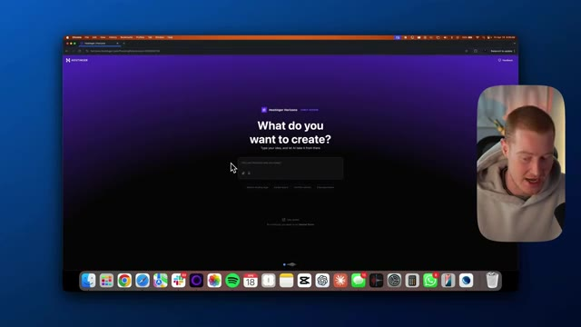
*⏱️ 00:01:47 — Interface web d'une application de génération de scripts avec un champ de saisie de texte central sur fond violet et sombre.*

---

### ⏱️ `[00:02:13 - 00:02:31]` | Segment #05

**🔊 Audio (Transcription Intégrale Mot pour Mot en Français) :**
> et ça prend automatiquement ma voix et ça la colle en texte. Donc ça rend les choses vraiment faciles, en particulier lors de la construction de ces applications web. Mais en général, lorsque j'utilise mon ordinateur, c'est l'un de mes nouveaux outils IA préférés. J'espère donc que cela aide comme petit truc ici. Utiliser ceci pour aider à écrire des e-mails, répondre à des commentaires, tout ça, c'est extrêmement utile. Je voulais donc lancer ça. J'espère que vous en retirerez de la valeur.

**👁️ Analyse Visuelle d'Écran (gemini-3.5-flash-lite) :**
**Interface & Outils** : Navigateur web affichant une interface de développement d'application web (type Bolt/StackBlitz) et le bureau macOS.

**Contenu textuel & Code** : Texte de prompt concernant la création d'une application pour générer des scripts de courte durée, et code source en cours de génération avec un indicateur de chargement "Web app is building".

**Action / Démonstration** : Démonstration de la construction d'une application web à l'aide d'un outil d'IA.

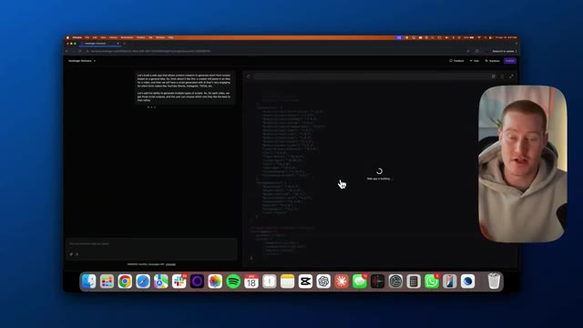
*⏱️ 00:02:17 — Capture d'écran montrant une application web en cours de développement avec un panneau de code à droite et un prompt d'IA à gauche, ainsi qu'une petite incrustation vidéo du présentateur.*

---

### ⏱️ `[00:02:31 - 00:03:01]` | Segment #06

**🔊 Audio (Transcription Intégrale Mot pour Mot en Français) :**
> Bon, alors c'est parti. Nous avons cette toute petite interface basique ici. Nous avons donc un générateur de scripts pour formats courts. Allons-y et collons simplement une idée ici. La toute nouvelle version de GPT 4.1. Cliquons donc sur générer des scripts. Ça ne va probablement pas générer un vrai script. Il n'y a pas d'IA connectée à ceci. Nous devons ajouter une API d'IA. C'est intéressant, ça a l'air bien. Cependant, changeons l'arrière-plan de ceci. Disons que nous voulons en faire un dégradé bleu. Pouvons-nous changer l'arrière-plan pour en faire un dégradé de bleu plus foncé au lieu de violet et de rose ?

**👁️ Analyse Visuelle d'Écran (gemini-3.5-flash-lite) :**
**Interface & Outils** : Navigateur web affichant une application de génération de scripts alimentée par l'IA et interface de développement à gauche.

**Contenu textuel & Code** : Champ de texte avec l'idée saisie 'The brand new GPT 4.1 release.' et blocs de scripts générés selon divers styles de narration.

**Action / Démonstration** : Saisie d'une idée de vidéo et génération de scripts courts par l'application.

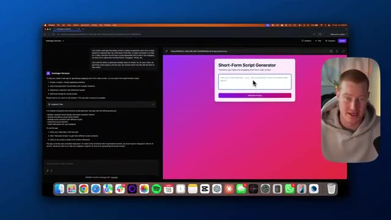
*⏱️ 00:02:39 — Interface web du générateur de scripts pour formats courts avec un champ de saisie vide et un bouton violet 'Generate Scripts'.*

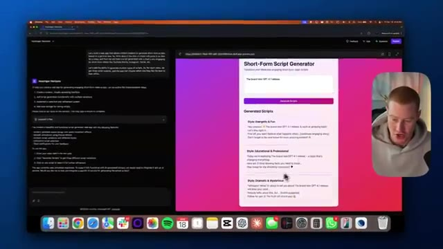
*⏱️ 00:02:46 — L'application web affichant trois scripts générés sous différentes catégories de style (Énergique, Éducatif, Dramatique).*

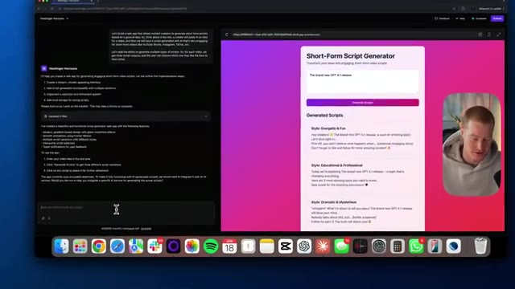
*⏱️ 00:02:53 — Vue globale de l'interface de développement et de l'application web de génération de scripts côte à côte.*

---

### ⏱️ `[00:03:01 - 00:03:20]` | Segment #07

**🔊 Audio (Transcription Intégrale Mot pour Mot en Français) :**
> Alors, première chose, sur le côté gauche, nous avons évidemment l'interface où nous pouvons faire des allers-retours avec l'hébergement de nos horizons. C'est ici que nous collons nos invites, et nous avons sur le côté droit l'affichage de notre application Web interactive que nous sommes en train de construire, tout comme beaucoup d'autres de ces plateformes de codage par IA telles que bolt et lovable, cela y ressemble beaucoup. Nous pouvons basculer en mode plein écran ici pour afficher notre application.

**👁️ Analyse Visuelle d'Écran (gemini-3.5-flash-lite) :**
**Interface & Outils** : Hostinger Horizons (interface de développement web par IA) et navigateur Google Chrome.

**Contenu textuel & Code** : Interface utilisateur fractionnée avec un panneau de chat textuel/prompt à gauche et l'affichage d'une application web interactive "Short-Form Script Generator" à droite.

**Action / Démonstration** : Navigation et présentation de l'interface de développement d'applications web assistée par IA.

---

### ⏱️ `[00:03:20 - 00:03:40]` | Segment #08

**🔊 Audio (Transcription Intégrale Mot pour Mot en Français) :**
> Nous pourrions aussi passer en vue mobile également, tout comme nous avons une intégration Supabase ici que je vais en fait configurer ici afin que nous puissions ajouter l'authentification des utilisateurs ainsi que la sauvegarde de ces éléments sur nos profils d'utilisateurs réels. D'accord, c'est parti. Donc, cela a l'air bien jusqu'à présent. Je vais y apporter quelques modifications, mais ajoutons une fonctionnalité un peu différente ici.

**👁️ Analyse Visuelle d'Écran (gemini-3.5-flash-lite) :**
**Interface & Outils** : Navigateur web (Google Chrome), plateforme de création d'applications web avec interface de chat et aperçu en direct.

**Contenu textuel & Code** : Interface utilisateur d'une application de génération de scripts courts pour vidéos, avec panneau de chat à gauche et aperçu visuel à droite.

**Action / Démonstration** : Navigation et démonstration de l'interface de l'application web générée par IA en cours de construction.

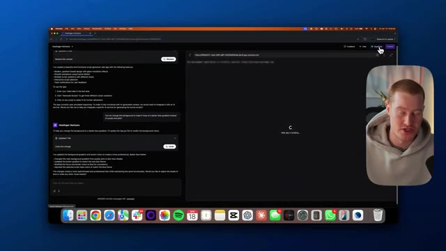
*⏱️ 00:03:25 — Interface de développement web montrant un générateur de scripts avec un écran de chargement (Web app is building...) et le présentateur dans un encadré.*

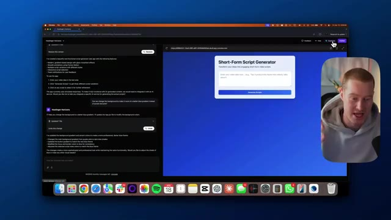
*⏱️ 00:03:30 — Affichage complet de l'interface "Short-Form Script Generator" avec un design en dégradé bleu et les instructions textuelles.*

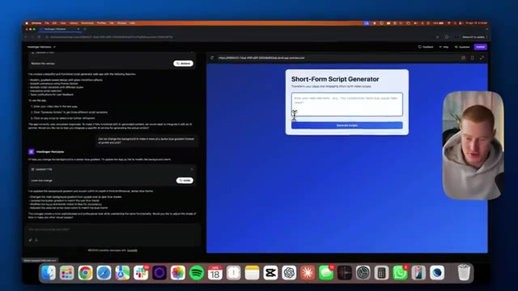
*⏱️ 00:03:35 — Gros plan sur le champ de saisie du générateur de scripts avec le curseur de la souris interagissant avec la zone de texte.*

---

### ⏱️ `[00:03:40 - 00:04:14]` | Segment #09

**🔊 Audio (Transcription Intégrale Mot pour Mot en Français) :**
> Ça a l'air bien. Cependant, je veux ajouter l'option pour chaque créateur de coller en gros des idées de contenu d'autres créateurs afin de reproduire un style similaire. Je veux ensuite que l'utilisateur puisse enregistrer cela sur son profil. De cette façon, pour n'importe quel script court que nous générons, il suit ce style similaire. D'accord, allons-y avec ça. Je serai curieux de voir comment il gère cela. On va probablement devoir configurer une authentification utilisateur afin qu'on puisse se connecter, genre permettre aux utilisateurs de se connecter, de s'inscrire à une application, ainsi que de stocker ces informations dans Supabase. Alors, donnons-lui une seconde et voyons quel est le processus.

**👁️ Analyse Visuelle d'Écran (gemini-3.5-flash-lite) :**
**Interface & Outils** : Navigateur web affichant un outil de génération de contenu (type Lovable/Bolt ou interface similaire) avec un assistant conversationnel IA à gauche.

**Contenu textuel & Code** : Code ou instructions textuelles relatives au générateur de scripts, interface web avec un champ de saisie pour les idées de vidéos ("Short-Form Script Generator").

**Action / Démonstration** : Présentation de l'interface utilisateur de l'application en cours de développement et discussion avec l'assistant IA pour modifier les fonctionnalités.

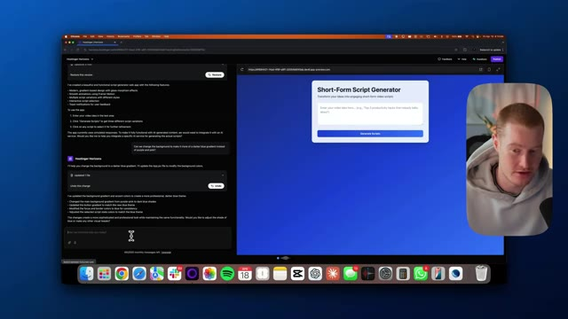
*⏱️ 00:03:49 — Capture d'écran montrant l'interface de développement d'une application de génération de scripts courts (Short-Form Script Generator) avec un panneau de chat à gauche et la prévisualisation de l'application à droite.*

---

### ⏱️ `[00:04:14 - 00:04:48]` | Segment #10

**🔊 Audio (Transcription Intégrale Mot pour Mot en Français) :**
> va être pour ça. Jusqu'à présent, en interagissant avec, c'est très facile à utiliser. C'est très fluide. Il ne semble pas y avoir de bugs comme sur d'autres plateformes comme Firebase Studio. Si vous avez vu ma vidéo précédente, c'est une bien meilleure alternative à quelque chose comme Firebase Studio. C'est juste très facile à utiliser. C'est fluide. Ça a l'air super. Et c'est en fait assez rapide aussi pour vous donner des résultats. D'accord. Donc maintenant nous avons une référence de style de créateur. Collez donc un exemple de contenu d'un créateur dont vous voulez reproduire le style. D'accord. Ça a l'air bien. Cependant, nous devons rendre cela réellement fonctionnel car cela ne va pas réellement stocker cette information. L'interface utilisateur a l'air bien. Cependant, stockons maintenant réellement cette information tout en ajoutant un utilisateur

**👁️ Analyse Visuelle d'Écran (gemini-3.5-flash-lite) :**
**Interface & Outils** : Navigateur web affichant une application de type bolt.diy ou plateforme similaire de génération d'applications web assistée par IA, avec une barre de tâches macOS en bas.

**Contenu textuel & Code** : Interface divisée en deux panneaux : à gauche, un chat avec des instructions de code (fichiers modifiés comme `App.tsx`) ; à droite, l'application web en développement avec un champ de saisie et le message "Web app is building".

**Action / Démonstration** : Le présentateur commente l'utilisation fluide de la plateforme d'IA pour construire et modifier l'application web en temps réel.

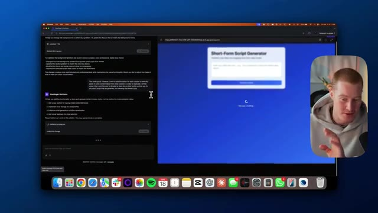
*⏱️ 00:04:23 — Capture d'écran montrant une interface de développement web avec un assistant conversationnel à gauche et le rendu en cours de chargement de l'application "Short-Form Script Generator" à droite, tandis que le présentateur apparaît dans un encadré.*

---

### ⏱️ `[00:04:48 - 00:05:24]` | Segment #11

**🔊 Audio (Transcription Intégrale Mot pour Mot en Français) :**
> des profils pour que les utilisateurs puissent s'inscrire à notre application. En plus de cela, créons également une page d'accueil qui a l'air très moderne et épurée, qui transmet notre message et notre profil de client idéal. D'accord, donc nous allons aller de l'avant avec ça. Ce n'est pas super structuré de la façon dont je structure les choses. Cependant, c'est du *vibe coding* pour vous. Je fais juste un peu comme si je suivais le courant. Je n'avais pas de requêtes prédéfinies que j'allais donner, je fais juste des itérations au fur et à mesure. J'espère donc que cela nous donnera le résultat que nous recherchons. D'accord. C'est parti. Nous avons cette page d'accueil, que nous pourrions affiner. Nous pouvons la rendre un peu plus jolie si nous le souhaitons, mais c'est un bon résultat initial. Transformez vos idées en scripts captivants pour

**👁️ Analyse Visuelle d'Écran (gemini-3.5-flash-lite) :**
**Interface & Outils** : Navigateur web affichant une plateforme de création d'applications No-Code / IA (Hostinger Horizons) et une fenêtre de prévisualisation.

**Contenu textuel & Code** : Interface divisée en deux : à gauche, un chat avec l'assistant IA détaillant les étapes de mise en œuvre et les nouvelles fonctionnalités ; à droite, la maquette d'une application nommée "Short-Form Script Generator".

**Action / Démonstration** : Interaction avec l'outil de génération de scripts et discussion avec l'assistant IA pour modifier l'interface utilisateur et ajouter de nouvelles fonctionnalités.

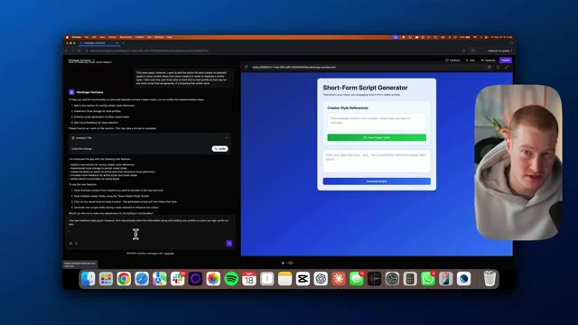
*⏱️ 00:04:57 — Capture d'écran montrant une interface de développement d'application avec un assistant IA sur le panneau de gauche et un aperçu d'application sur le panneau de droite, ainsi qu'une incrustation vidéo du présentateur.*

---

### ⏱️ `[00:05:24 - 00:05:59]` | Segment #12

**🔊 Audio (Transcription Intégrale Mot pour Mot en Français) :**
> TikTok et Instagram Reels, YouTube Shorts utilisant la génération de contenu propulsée par l'IA, de multiples variations, des émissions propulsées par l'IA avec correspondance de style approuvées par des créateurs de contenu du monde entier. Alors allons-y. Et si je regarde ce message ici, il dit essentiellement que j'ai créé une application web moderne. Voudriez-vous m'aider à configurer l'intégration Supabase ? Disons simplement, ou en fait, il semble que cela nous ait donné une étape. Alors, cliquez sur l'icône Supabase en haut à droite de votre écran. Je vais donc cliquer ici, ajouter une organisation. Je vais créer une nouvelle organisation ici. D'accord, voilà. Nous avons une nouvelle intégration Supabase configurée. Connectons-nous donc à notre compte Supabase, autorisons l'hébergement de vos horizons. Il semble donc que nous devions créer un nouveau projet. Je suis donc dans mon compte ici.

**👁️ Analyse Visuelle d'Écran (gemini-3.5-flash-lite) :**
**Interface & Outils** : Navigateur web, macOS Dock, outil de développement web avec panneau de chat IA et aperçu en direct.

**Contenu textuel & Code** : Interface utilisateur affichant "Create Viral Short-Form Content", options "Multiple Variations", "Style Matching", et instructions d'intégration Supabase.

**Action / Démonstration** : Présentation de la création et de la configuration d'une application web de génération de contenu court par IA.

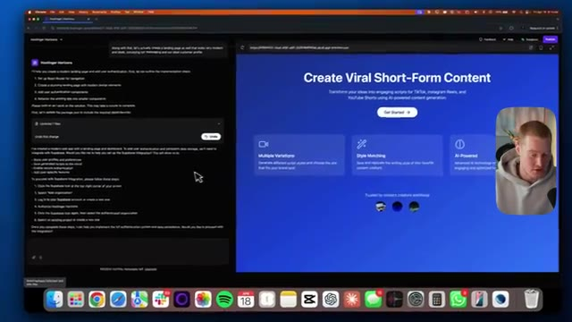
*⏱️ 00:05:33 — Vue d'un navigateur web montrant une interface de génération de contenu propulsée par l'IA avec un assistant textuel à gauche et un aperçu de page web à droite.*

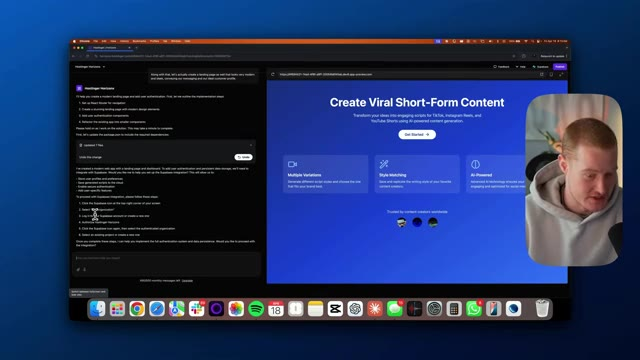
*⏱️ 00:05:41 — Vue similaire montrant le processus de développement d'une application web avec des instructions de configuration de base de données et d'authentification.*

---

### ⏱️ `[00:05:59 - 00:06:34]` | Segment #13

**🔊 Audio (Transcription Intégrale Mot pour Mot en Français) :**
> appelons ça simplement Horizons, je vais lui donner un mot de passe d'accord donc nous avons ce nouveau projet pratiquement mis en place et opérationnel, nous devons attendre que cela devienne vert, je vais patienter une seconde et ensuite revenons à ceci et si je rafraîchis ici, on dirait bien que je pourrais connecter mon projet Horizons, alors laissez-moi juste connecter ceci, ce sera intéressant de voir à quel point cette intégration est fluide, très bien donc tout, très bien donc il est dit qu'il a configuré notre intégration Supabase avec les fonctionnalités suivantes : création des tables de base de données nécessaires pour les utilisateurs, les créateurs et les scripts générés, ajout de la configuration du client Supabase, configuration de l'abonnement en temps réel. D'accord. Laissez-moi aller dans Hostinger et voyons, ou laissez-moi aller dans Supabase et voir si ces tables sont configurées.

**👁️ Analyse Visuelle d'Écran (gemini-3.5-flash-lite) :**
**Interface & Outils** : Navigateur web affichant une interface de gestion de projet (type Supabase ou outil cloud) et un environnement de développement.

**Contenu textuel & Code** : Tableau de bord du projet 'horizons', options d'authentification, de base de données et de stockage.

**Action / Démonstration** : Configuration et vérification du nouveau projet 'horizons' en cours de déploiement.

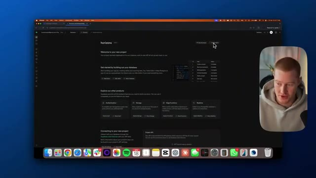
*⏱️ 00:06:08 — Interface d'un tableau de bord affichant le projet 'horizons' en cours de configuration.*

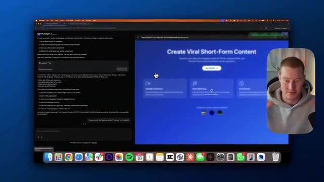
*⏱️ 00:06:17 — Écran partagé montrant une interface de développement avec du code ou des instructions à gauche et une application en cours de chargement à droite.*

---

### ⏱️ `[00:06:34 - 00:07:07]` | Segment #14

**🔊 Audio (Transcription Intégrale Mot pour Mot en Français) :**
> D'accord. Donc nous avons des tables configurées. Nous avons des styles de créateurs, nous avons généré des scripts, et nous avons des utilisateurs. C'est là que nous allons stocker ces informations pour les utiliser comme base de données à l'intérieur de notre application. Jusqu'à présent, cette intégration ici est très fluide. C'était super facile à faire par rapport à certaines de ces autres plates-formes. Je ne vais pas mentir. Donc il demande : aimerais-tu que j'ajoute des composants d'authentification des utilisateurs, allons-y et ajoutons l'authentification des utilisateurs avec des formulaires d'inscription et de connexion. Afin d'accéder à notre application, tu dois t'inscrire sur la page d'atterrissage et être un utilisateur. D'accord. Donc la raison pour laquelle je fais cela est parce que pour que nous puissions réellement accéder à notre application

**👁️ Analyse Visuelle d'Écran (gemini-3.5-flash-lite) :**
**Interface & Outils** : Navigateur web affichant une application web en cours de développement et un panneau de chat IA (Hostinger Horizons).

**Contenu textuel & Code** : Interface utilisateur de l'application "Create Viral Short-Form Content" avec des sections sur les variations multiples, le style matching et l'IA.

**Action / Démonstration** : Configuration et intégration de la base de données Supabase dans l'application via l'assistant conversationnel.

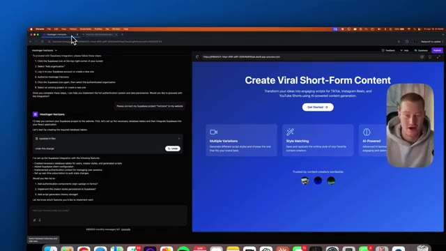
*⏱️ 00:06:43 — Vue d'ensemble de l'écran montrant l'application de création de contenu d'un côté et un assistant IA en mode chat de l'autre.*

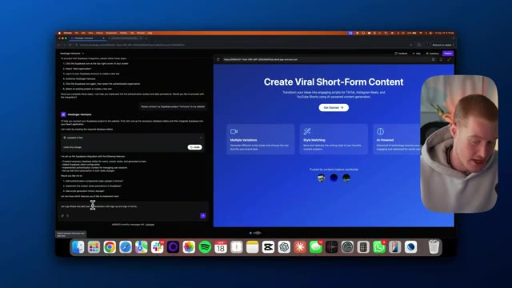
*⏱️ 00:06:59 — Gros plan sur l'interface de développement montrant la validation d'une étape de configuration de base de données.*

---

### ⏱️ `[00:07:07 - 00:07:40]` | Segment #15

**🔊 Audio (Transcription Intégrale Mot pour Mot en Français) :**
> afin de générer des scripts, ils vont devoir s'inscrire en tant qu'utilisateur. Ce que cela va faire, c'est permettre à un utilisateur de s'inscrire avec un e-mail ou notre compte Google. Nous allons ensuite stocker cela en tant qu'utilisateur à l'intérieur de Supabase. Et ensuite, à partir de là, ils vont avoir accès à l'utilisation de notre générateur de scripts, qui stockerait alors cette information dans cette base de données ici pour conserver cela sur le profil de l'utilisateur. Donc s'ils se déconnectent, s'ils rafraîchissent la page, toutes ces informations sont toujours là. Aussi, une chose à mentionner, si vous débutez dans la création avec des constructeurs web IA comme celui-ci, si nous devions configurer cela à l'intérieur de Supabase, ce serait une véritable galère. Mais puisque ça

**👁️ Analyse Visuelle d'Écran (gemini-3.5-flash-lite) :**
**Interface & Outils** : Navigateur web affichant l'interface de Supabase (Table Editor).

**Contenu textuel & Code** : Structure de base de données vide avec des colonnes telles que 'created_at' et 'updated_at', et le panneau de navigation latéral affichant la table 'users'.

**Action / Démonstration** : Navigation et sélection de la table 'users' dans le tableau de bord de la base de données Supabase.

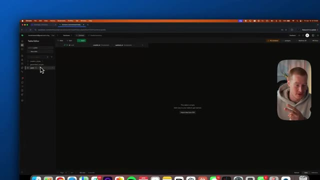
*⏱️ 00:07:16 — Capture d'écran montrant l'interface du tableau de bord Supabase (Table Editor) avec la table 'users' sélectionnée, ainsi qu'une vignette vidéo du présentateur en bas à droite.*

---

### ⏱️ `[00:07:40 - 00:08:13]` | Segment #16

**🔊 Audio (Transcription Intégrale Mot pour Mot en Français) :**
> s'intègre directement avec Supabase, c'est capable de configurer tout ça juste en faisant des allers-retours avec du langage naturel ici, ce qui est vraiment, vraiment génial. C'est génial. Très bien, testons ça. Alors cliquez sur Commencer, inscrivez-vous avec un e-mail, créez un compte, voyons si nous avons un compte ici, d'accord, donc ça ne semble pas fonctionner. Oh, vous savez quoi, c'est que je viens juste de recevoir cet e-mail ici, ça dit en gros que ça m'envoie un e-mail de confirmation, ce qu'on ne veut pas qui se produise, donc je dois aller dans Supabase, laissez-moi désactiver ça. Très bien, donc j'ai désactivé ça, laissez-moi juste dire que j'ai désactivé la confirmation par e-mail, essayons à nouveau, une chose que je dirais c'est que nous n'avons pas rencontré de

**👁️ Analyse Visuelle d'Écran (gemini-3.5-flash-lite) :**
**Interface & Outils** : Navigateur web affichant l'interface de développement d'application et la base de données Supabase.

**Contenu textuel & Code** : Panneau de configuration par langage naturel, logs de mise à jour de fichiers, et interface de connexion/inscription.

**Action / Démonstration** : Navigation et démonstration de la configuration de l'authentification et de la base de données par l'IA.

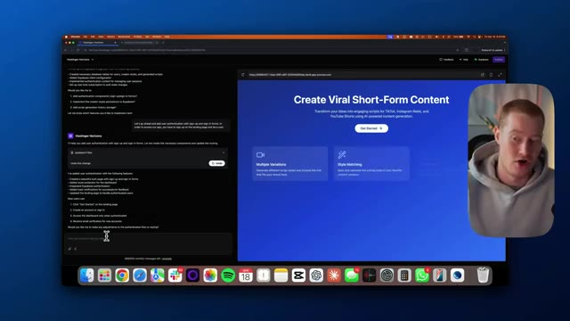
*⏱️ 00:07:48 — Vue d'ensemble de l'interface montrant le panneau de discussion de l'IA à gauche et l'application Web de génération de contenu à droite.*

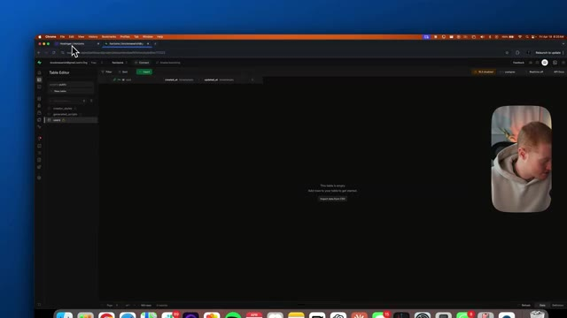
*⏱️ 00:07:56 — Affichage de l'éditeur de table de la base de données Supabase montrant la gestion des données utilisateurs.*

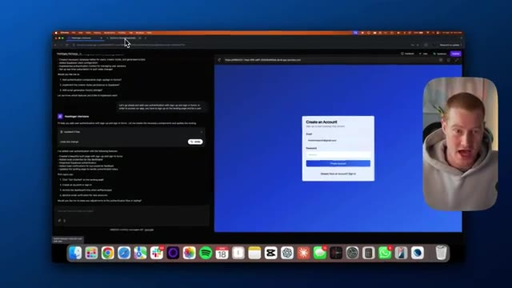
*⏱️ 00:08:05 — Formulaire de création de compte utilisateur ("Create an Account") intégré à l'application web.*

---

### ⏱️ `[00:08:13 - 00:08:46]` | Segment #17

**🔊 Audio (Transcription Intégrale Mot pour Mot en Français) :**
> seule erreur pourtant en utilisant Hostinger ou Horizon donc c'est un bon signe cependant nous devons faire quelques changements à notre application. Nous devons encore ajouter l'IA. Donc ça crée réellement des scripts générés par l'IA, tout ça. Nous devons aussi faire quelques améliorations au niveau de l'interface utilisateur, mais ça a l'air plutôt bien sans aucune erreur que nous ayons rencontrées jusqu'à présent. Mais bien sûr, je ne veux pas parler trop vite, évidemment. D'accord, cliquons là-dessus. Commençons. Créer un compte. Et voilà. Donc si cela fonctionne correctement, il y aura maintenant un utilisateur ici. Pour une raison quelconque, nous n'en avons pas. Alors revenons sur Hostinger et disons simplement que cela a fonctionné. J'ai pu m'inscrire. Cependant, cela ne se reflète pas ici

**👁️ Analyse Visuelle d'Écran (gemini-3.5-flash-lite) :**
**Interface & Outils** : Navigateur web affichant l'interface de développement Hostinger Horizon et Supabase.

**Contenu textuel & Code** : Interface de génération d'application par IA, code, fenêtres de prévisualisation et éditeur de base de données.

**Action / Démonstration** : Test et configuration de l'authentification et des fonctionnalités de l'application générée par IA.

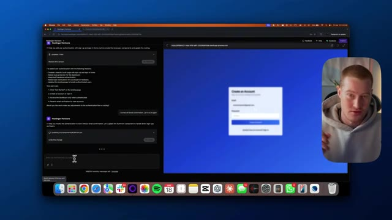
*⏱️ 00:08:21 — Capture d'écran montrant l'interface de Hostinger Horizon avec un panneau de chat IA à gauche et la prévisualisation d'une page de création de compte à droite.*

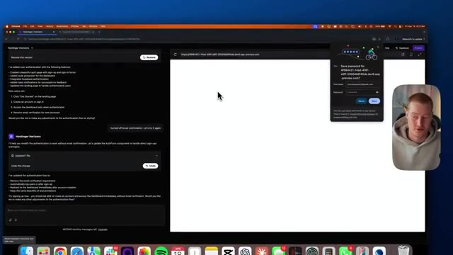
*⏱️ 00:08:30 — Capture d'écran montrant la mise à jour de l'authentification dans Hostinger Horizon avec une fenêtre de sauvegarde de mot de passe du navigateur.*

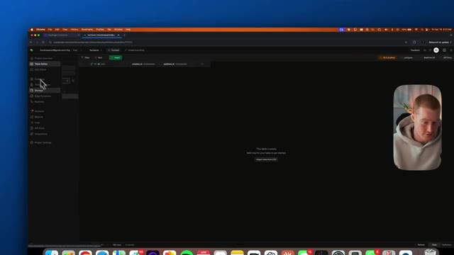
*⏱️ 00:08:38 — Capture d'écran montrant l'interface d'un éditeur de table de base de données avec une table vide affichée.*

---

### ⏱️ `[00:08:46 - 00:09:09]` | Segment #18

**🔊 Audio (Transcription Intégrale Mot pour Mot en Français) :**
> à l'intérieur de notre base de données Supabase. Donc partons de là. Quelque chose me dit que ça devrait être facile à corriger, mais je suppose qu'on va bien voir. Très bien. Donc ça fonctionne maintenant. Je peux effectivement me connecter. Je viens de me connecter ici. Et ensuite, ce que ça a fait, ça a effectivement stocké ces informations utilisateur. Cependant, ça ne stocke pas l'e-mail. Laissez-moi aller de l'avant et mentionner ça ici. Je veux que vous alliez de l'avant et que vous stockiez réellement l'e-mail de l'utilisateur lorsqu'il s'inscrit et que vous l'enregistriez dans la table des utilisateurs dans Supabase.

**👁️ Analyse Visuelle d'Écran (gemini-3.5-flash-lite) :**
**Interface & Outils** : Navigateur web affichant Supabase et l'application web en cours de développement.

**Contenu textuel & Code** : Base de données Supabase, tables de données et interface utilisateur de l'application SaaS.

**Action / Démonstration** : Navigation dans la base de données Supabase et visualisation de l'application web connectée.

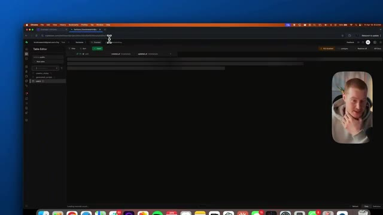
*⏱️ 00:08:52 — Interface Supabase affichant l'éditeur de table avec les utilisateurs, tandis que le présentateur apparaît en incrustation vidéo.*

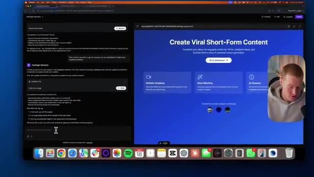
*⏱️ 00:09:03 — Écran partagé montrant une interface de développement à gauche et une application web intitulée "Create Viral Short-Form Content" à droite.*

---

### ⏱️ `[00:09:09 - 00:09:43]` | Segment #19

**🔊 Audio (Transcription Intégrale Mot pour Mot en Français) :**
> Très bien. Laissez-moi essayer cela encore une fois. Ouvrons un nouvel onglet. D'accord. Alors, cliquez sur commencer, ajoutez mon e-mail, ajoutons un mot de passe ici, cliquez sur créer un compte, d'accord, j'ai donc maintenant accès à cela. Revenons maintenant et vérifions à l'intérieur d'ici, et voilà, et maintenant cela enregistre notre e-mail, c'était une correction facile. Cela fonctionne donc maintenant correctement là où les utilisateurs, nous avons fait en sorte que les utilisateurs puissent réellement créer un profil utilisateur, c'est donc parfait. Revenons maintenant sur Hostinger et ajoutons de nouvelles fonctionnalités ici, construisons essentiellement cela ici. Super. Maintenant, ajoutons des fonctionnalités à notre application. Lorsqu'un utilisateur clique sur le bouton générer un script,

**👁️ Analyse Visuelle d'Écran (gemini-3.5-flash-lite) :**
**Interface & Outils** : Navigateur web affichant une application web en cours de développement et un panneau de base de données.

**Contenu textuel & Code** : Formulaires de création de compte, table de base de données avec des adresses e-mail, et interface de génération de scripts.

**Action / Démonstration** : Navigation dans l'application, création d'un compte utilisateur et vérification de l'enregistrement des données dans la base de données.

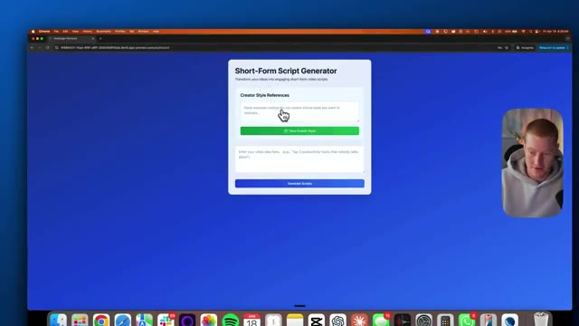
*⏱️ 00:09:18 — Interface d'une application de génération de scripts courts montrant un champ pour les références de style et un bouton de création.*

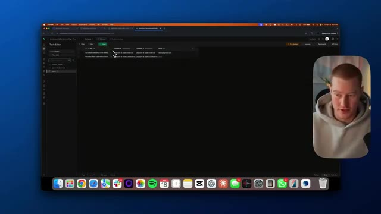
*⏱️ 00:09:26 — Vue de l'éditeur de table de base de données avec des lignes de données correspondant aux nouvelles inscriptions d'utilisateurs.*

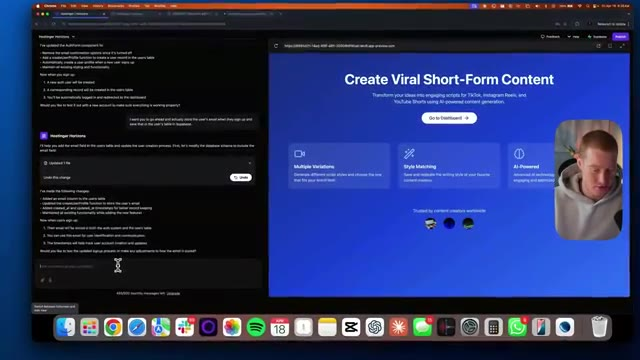
*⏱️ 00:09:34 — Interface divisée en deux avec l'assistant IA d'un côté et la page d'accueil de l'application de création de contenu de l'autre.*

---

### ⏱️ `[00:09:43 - 00:10:18]` | Segment #20

**🔊 Audio (Transcription Intégrale Mot pour Mot en Français) :**
> Je veux que vous utilisiez réellement l'intelligence artificielle pour générer un vrai script. Utilisons l'API d'OpenAI pour faire cela. D'accord. Donc, en gros, ce que j'ai entré ici comme instruction, c'est que j'ai dit que lorsqu'un nouvel utilisateur clique sur générer un script, cela va réellement générer un script en utilisant l'IA. Donc, ce qu'il doit faire, c'est obtenir l'API pour le fournisseur de grand modèle de langage que nous allons utiliser. Donc, essentiellement, cela signifie que cela nous donne accès à l'utilisation de ChatGPT à l'intérieur de notre application. Allons-y donc et voyons essentiellement comment nous pouvons importer ceci. Très bien. Donc, nous rencontrons notre première erreur ici. Je vais simplement cliquer sur demander de corriger le code ici afin qu'il puisse probablement l'identifier.

**👁️ Analyse Visuelle d'Écran (gemini-3.5-flash-lite) :**
**Interface & Outils** : Interface de développement (Hostinger Horizons), navigateur web affichant l'application 'Short-Form Script Generator' et macOS Dock.

**Contenu textuel & Code** : Code de configuration, instructions en langage naturel pour intégrer l'API OpenAI dans un générateur de scripts de vidéos courtes.

**Action / Démonstration** : Saisie et envoi du prompt à l'assistant IA pour connecter l'application à l'API OpenAI.

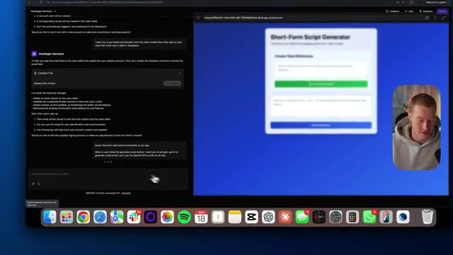
*⏱️ 00:09:52 — Interface divisée montrant un assistant de code IA à gauche et la prévisualisation d'une application web à droite, avec le présentateur en médaillon.*

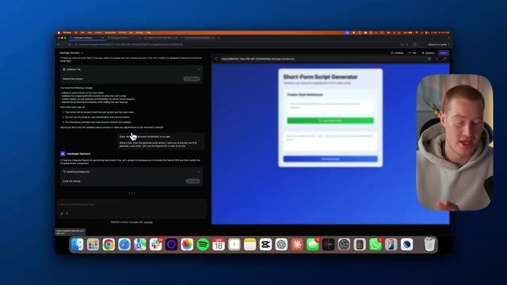
*⏱️ 00:10:00 — Mise à jour de l'assistant de code IA avec la mise en cache/installation des packages nécessaires à l'intégration de l'API OpenAI.*

---

### ⏱️ `[00:10:18 - 00:10:40]` | Segment #21

**🔊 Audio (Transcription Intégrale Mot pour Mot en Français) :**
> quel est l'erreur. D'accord. Donc ça a un rapport avec la clé API d'OpenAI. Allons-y. Laissons tourner ceci. Quelque chose me dit que ça va réussir à régler ça tout seul. D'accord. J'ai copié ma clé API d'OpenAI. Laissez-moi juste demander où je dois la mettre. Pouvez-vous me permettre d'importer simplement ma clé API ici. D'accord. Donc ça va être intéressant. J'ai hâte de voir à quel point il est facile de publier et de déployer réellement notre application, parce que Hostinger est évidemment une plateforme d'hébergement.

**👁️ Analyse Visuelle d'Écran (gemini-3.5-flash-lite) :**
**Interface & Outils** : Navigateur Web, assistant de développement IA Hostinger Horizons, macOS.

**Contenu textuel & Code** : Messages d'erreur concernant la variable d'environnement OPENAI_API_KEY manquante, instructions de configuration et interface utilisateur de l'application.

**Action / Démonstration** : L'assistant IA met à jour automatiquement la configuration pour corriger l'erreur de clé API OpenAI pendant que le présentateur discute de l'intégration.

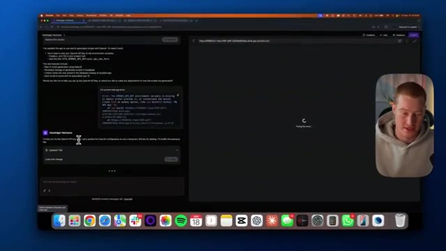
*⏱️ 00:10:24 — Vue d'un navigateur avec une interface de génération de code et l'assistant IA qui résout l'erreur de clé API OpenAI.*

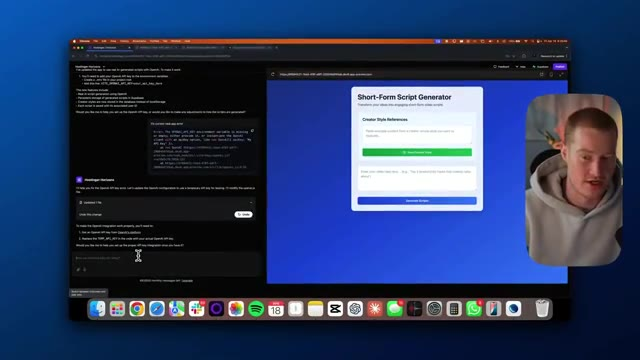
*⏱️ 00:10:29 — Affichage de l'interface fonctionnelle du générateur de scripts de courts métrages après correction de l'erreur par l'IA.*

---

### ⏱️ `[00:10:40 - 00:11:16]` | Segment #22

**🔊 Audio (Transcription Intégrale Mot pour Mot en Français) :**
> Donc ils ont construit ceci au sommet de leur plateforme d'hébergement. Donc ça va nous rendre très facile de simplement déployer nos applications parce que beaucoup d'entre vous par le passé ont demandé, ok, vous pouvez faire des applications sympas avec ces plateformes, mais comment est-ce qu'on les héberge réellement et qu'on les lance si on essaie de vendre ça comme un SaaS ou quelque chose ? Donc nous allons tester ça ici dans un petit moment. Très bien. Donc voici l'interface utilisateur. Maintenant, nous avons fondamentalement cette configuration de clé API d'ouverture ici. Donc nous collons juste notre clé API ici. Ça va sauvegarder notre clé API sur notre profil utilisateur. Et ensuite, laissez-moi venir sur notre Supabase, m'assurer que cette information est stockée ici. Super. Donc ça montre que notre clé API est maintenant stockée. Donc ce qu'on pourrait faire, on pourrait ensuite coller des styles de créateur. Donc laissez-moi aller

**👁️ Analyse Visuelle d'Écran (gemini-3.5-flash-lite) :**
**Interface & Outils** : Navigateur web affichant un IDE basé sur le cloud, un assistant conversationnel IA et Supabase.

**Contenu textuel & Code** : Code source mis à jour, interface de configuration de clé API OpenAI, gestion des secrets (Edge Function Secrets) et prévisualisation d'application web.

**Action / Démonstration** : Configuration d'une clé API OpenAI, mise à jour des composants de l'application et gestion des variables d'environnement dans le cloud.

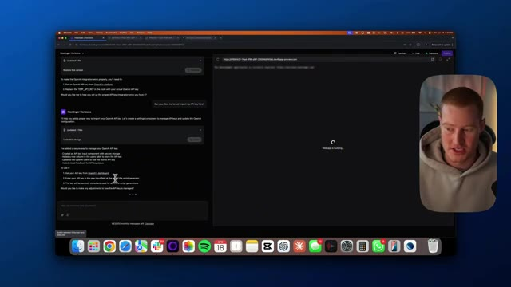
*⏱️ 00:10:49 — Interface de développement avec assistant IA (Hostinger Horizons) et prévisualisation d'application en cours de chargement.*

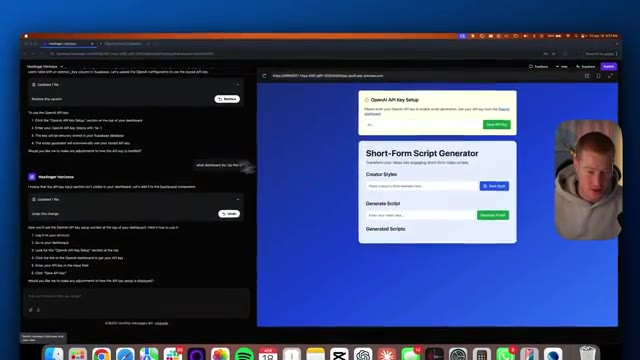
*⏱️ 00:10:58 — Affichage de l'interface utilisateur générée avec la section de configuration de clé API OpenAI et le générateur de scripts.*

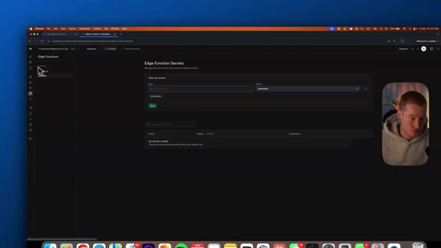
*⏱️ 00:11:07 — Tableau de bord Supabase montrant la gestion des secrets d'Edge Functions et des variables d'environnement.*

---

### ⏱️ `[00:11:16 - 00:11:43]` | Segment #23

**🔊 Audio (Transcription Intégrale Mot pour Mot en Français) :**
> allez-y et collez quelques vidéos. J'ai donc pu coller une de mes vidéos en fait pour l'utiliser comme exemple, parce que nous voulons répliquer ce style. Mais ce que nous devons faire, allons-y et faisons en sorte que cela transcrive réellement cette vidéo. Ainsi, nous pourrions ensuite, vous savez, évidemment utiliser les mêmes termes et le même style. Super. L'API fonctionne désormais. Cependant, lorsque nous l'ajoutons à la section des styles de créateur et que nous l'enregistrons, allons effectivement transcrire cette vidéo afin de pouvoir l'utiliser comme exemple de la façon dont nous voulons structurer notre script.

**👁️ Analyse Visuelle d'Écran (gemini-3.5-flash-lite) :**
**Interface & Outils** : Navigateur web affichant l'application de génération de scripts et un outil de développement ou d'IA.

**Contenu textuel & Code** : Interface utilisateur avec configuration de clé API OpenAI et générateur de scripts courts.

**Action / Démonstration** : Démonstration de l'application web de génération de scripts à partir d'exemples de vidéos.

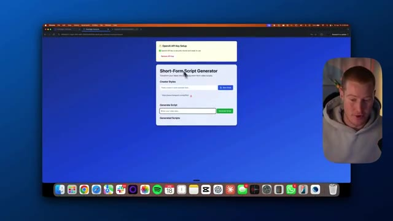
*⏱️ 00:11:23 — Interface web du 'Short-Form Script Generator' avec un champ pour coller le style d'un créateur et une configuration de clé API OpenAI.*

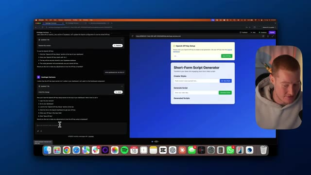
*⏱️ 00:11:36 — Vue partagée montrant l'interface web de l'application à droite et un panneau de code/chat d'intelligence artificielle à gauche.*

---

### ⏱️ `[00:11:43 - 00:12:11]` | Segment #24

**🔊 Audio (Transcription Intégrale Mot pour Mot en Français) :**
> C'est quelque chose dont je ne suis pas vraiment sûr de pouvoir faire. Je n'ai pas réfléchi à la logistique de la façon exact dont cela va fonctionner, mais supportez-moi les gars. C'est une vidéo où je suis juste en train de tester cette plateforme au fur et à mesure encore une fois. Je n'ai pas essayé ça avant, essayé de construire ça pour cette vidéo. Alors supportez-moi juste. Voyons ce que nous pouvons faire ici. Très bien, allons-y et testons cela pour voir si c'est réellement capable de générer un script pour nous maintenant. Alors disons juste créons un script sur le nouveau GPT 4.1 qui vient de sortir. Très bien, alors cliquez sur générer le script. D'accord, intéressant. Donc cela nous donne une ventilation de la voix hors champ.

**👁️ Analyse Visuelle d'Écran (gemini-3.5-flash-lite) :**
**Interface & Outils** : Navigateur web, application web de génération de scripts, interface de chat/développement assisté par IA.

**Contenu textuel & Code** : Interface utilisateur d'un générateur de scripts pour vidéos courtes (« Short-Form Script Generator ») avec configuration de clé API OpenAI et champs de saisie.

**Action / Démonstration** : Le présentateur démontre l'utilisation et l'interface de l'application web qu'il est en train de tester et de configurer.

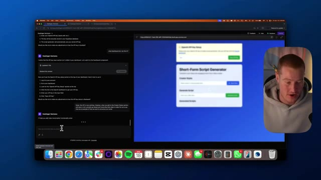
*⏱️ 00:11:50 — Vue d'écran partagée montrant à gauche un assistant conversationnel de type IDE/chat et à droite l'application en cours de développement, avec le présentateur en incrustation.*

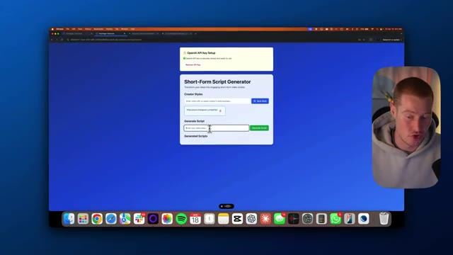
*⏱️ 00:12:04 — Gros plan sur l'interface de l'application 'Short-Form Script Generator' montrant les champs de saisie pour les styles de créateurs et la génération de scripts, avec le présentateur en incrustation.*

---

### ⏱️ `[00:12:11 - 00:12:30]` | Segment #25

**🔊 Audio (Transcription Intégrale Mot pour Mot en Français) :**
> Alerte nouvelle tech, GPT 4.1 vient de sortir et on plonge dans la magie de la création de script aujourd'hui. Dites adieu au syndrome de la page blanche et bonjour à l'infini. Ok, intéressant. Donc on ne lui a pas donné beaucoup de contexte sur exactement ce qu'on veut, genre sur quoi on veut que le script porte. Crée un script sur la nouvelle sortie de GPT 4.1. Et parlons de la façon dont c'est un potentiel changement de donne pour les développeurs.

**👁️ Analyse Visuelle d'Écran (gemini-3.5-flash-lite) :**
**Interface & Outils** : Navigateur web affichant une application web de génération de scripts ("Short-Form Script Generator").

**Contenu textuel & Code** : Champs de configuration "Creator Styles", champ "Generate Script" et section "Generated Scripts" affichant un script vidéo structuré (voix off et instructions visuelles).

**Action / Démonstration** : Navigation et présentation de l'outil de génération de scripts assisté par intelligence artificielle.

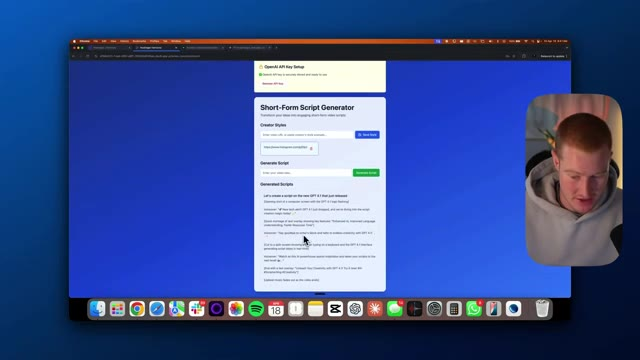
*⏱️ 00:12:15 — Interface d'un générateur de scripts pour formats courts sur navigateur web, avec le résultat affiché en bas.*

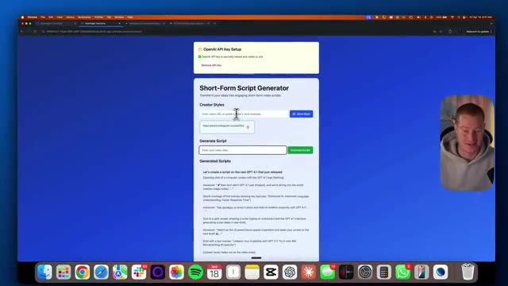
*⏱️ 00:12:20 — Vue de l'interface montrant les champs de saisie pour le style de créateur et l'URL Instagram.*

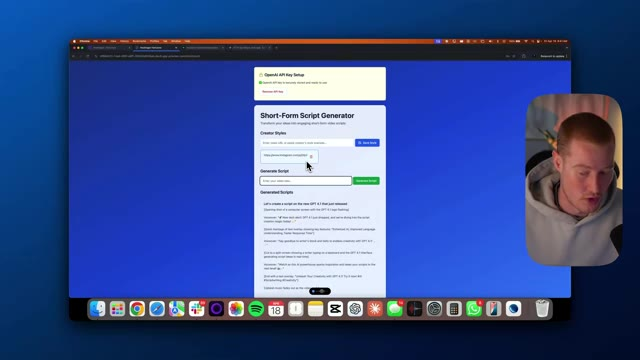
*⏱️ 00:12:25 — Gros plan sur le formulaire de génération de scripts avec l'URL du créateur renseignée.*

---

### ⏱️ `[00:12:30 - 00:12:56]` | Segment #26

**🔊 Audio (Transcription Intégrale Mot pour Mot en Français) :**
> Très bien, alors cliquons sur générer le script. D'accord, donc ça génère en fait deux scripts différents pour nous. Nous pouvons choisir ceux que nous aimons. C'est cool. Ajoutons maintenant la possibilité pour nous d'enregistrer réellement ceci dans notre profil. Ça a l'air super. Ajoutons maintenant la possibilité pour nous d'enregistrer des scripts spécifiques dans notre profil. J'ai une autre idée que je veux implémenter. Je veux implémenter la possibilité pour nous de donner du genre à un prompt système à stocker dans notre profil utilisateur afin que nous puissions définir exactement à quoi nous voulons que le script ressemble, le langage différent que nous voulons utiliser, et cetera.

**👁️ Analyse Visuelle d'Écran (gemini-3.5-flash-lite) :**
**Interface & Outils** : Navigateur web, application web de génération de scripts, interface de chat de développement.

**Contenu textuel & Code** : Interface utilisateur d'un générateur de scripts, champs de saisie, configuration de clé API OpenAI, et panneau de code/chat d'assistance.

**Action / Démonstration** : Navigation et démonstration de l'interface de l'application web avec les scripts générés et le panneau de développement.

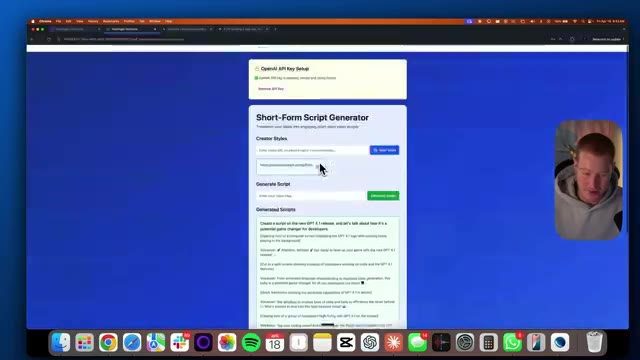
*⏱️ 00:12:36 — Interface web du générateur de scripts pour courts métrages montrant les scripts générés.*

*⏱️ 00:12:43 — Vue partagée montrant à gauche un assistant textuel de type chat de développement et à droite l'interface de l'application web.*

---

### ⏱️ `[00:12:56 - 00:13:14]` | Segment #27

**🔊 Audio (Transcription Intégrale Mot pour Mot en Français) :**
> Donc, voyons si je peux vraiment intégrer ça, parce que sinon, je ne veux pas que le résultat ressemble à ça tout le temps. J'ai besoin que les utilisateurs aient réellement une sorte d'instructions fournies par l'outil. Ainsi, à chaque fois qu'ils génèrent un nouveau script, il comprend le style qu'ils essaient de créer. D'accord, je ne vois pas de bouton de sauvegarde. Revenons en arrière et faisons simplement quelques modifications ici.

**👁️ Analyse Visuelle d'Écran (gemini-3.5-flash-lite) :**
**Interface & Outils** : Navigateur web Google Chrome sous macOS.

**Contenu textuel & Code** : Texte de scripts générés (Voiceover, descriptions de plans vidéo, instructions) et affichage du présentateur en incrustation (PiP).

**Action / Démonstration** : Présentation et relecture des scripts générés automatiquement par l'outil d'intelligence artificielle.

*⏱️ 00:13:01 — Capture d'écran montrant une page web avec des scripts générés, sur fond bleu, et le présentateur visible dans un encadré en bas à droite.*

---

### ⏱️ `[00:13:14 - 00:13:42]` | Segment #28

**🔊 Audio (Transcription Intégrale Mot pour Mot en Français) :**
> Ajoutons un bouton de sauvegarde et ne sauvegardons aucun des scripts générés que l'utilisateur ne souhaite pas réellement sauvegarder explicitement. De plus, ajoutons un autre aspect à l'interface utilisateur qui affiche tous nos scripts sauvegardés sur un profil utilisateur. D'accord, nous allons donc apporter quelques modifications ici à l'interface utilisateur. Je veux pouvoir sauvegarder ceci, puis peut-être le stocker ici ou sous une certaine forme, je veux fondamentalement changer l'interface utilisateur de ceci pour qu'elle ne ressemble pas exactement à ça avec un style de créateur, générer un script, et ensuite juste avoir ça ici.

**👁️ Analyse Visuelle d'Écran (gemini-3.5-flash-lite) :**
**Interface & Outils** : Navigateur web affichant une application de génération de contenu vidéo et une interface de chat de développement.

**Contenu textuel & Code** : Interface utilisateur avec des sections "Create Viral Short-Form Content", des blocs de scripts générés et une boîte de dialogue de code/chat.

**Action / Démonstration** : Navigation et présentation de l'interface de l'application web de génération de scripts.

*⏱️ 00:13:21 — Vue d'ensemble du navigateur affichant l'interface de développement avec un assistant conversationnel de type chat sur la gauche et l'application web prévisualisée sur la droite.*

*⏱️ 00:13:35 — Gros plan sur l'interface de l'application web montrant les scripts générés pour le contenu de courtes vidéos ("Your Scripts").*

---

### ⏱️ `[00:13:42 - 00:14:00]` | Segment #29

**🔊 Audio (Transcription Intégrale Mot pour Mot en Français) :**
> On aimerait un peu ajouter des choses par ici parce que c'est plutôt vide. Peut-être que je devrais aller de l'avant et prendre une capture d'écran, l'injecter dans Hostinger Horizons. Mais voyons d'abord quel est le résultat et ensuite je m'adapterai. Très bien. Donc vous pouvez voir ici, nous pouvons réellement sauvegarder ou mettre en favori un script. Nous pourrions voir nos scripts sauvegardés. D'accord. Donc ça a l'air bien. Retournons au générateur.

**👁️ Analyse Visuelle d'Écran (gemini-3.5-flash-lite) :**
**Interface & Outils** : Navigateur web affichant l'application de génération de contenu via l'outil Hostinger Horizons.

**Contenu textuel & Code** : Formulaires de génération de scripts, codes source et interface de gestion de scripts IA.

**Action / Démonstration** : Navigation et présentation de l'interface utilisateur de l'application web en cours de développement.

*⏱️ 00:13:47 — Interface de l'application de génération de scripts avec configuration OpenAI API Key et section Short-Form Script Generator.*

*⏱️ 00:13:51 — Interface en écran partagé montrant l'outil de développement Hostinger Horizons avec assistant IA et aperçu de l'application.*

*⏱️ 00:13:56 — Page affichant les scripts enregistrés ('Your Saved Scripts') avec différentes sections de textes générés.*

---

### ⏱️ `[00:14:00 - 00:14:19]` | Segment #30

**🔊 Audio (Transcription Intégrale Mot pour Mot en Français) :**
> Ça fonctionne correctement. Allons-y simplement. Allons-y. Faisons une capture d'écran de ceci. Et disons simplement, rendons cela un peu plus joli. Genre, parce qu'on utilise seulement une partie de cet espace ici. Jetez un œil à la capture d'écran que je viens de fournir. Notre application web est assez basique et nous n'avons qu'une petite partie de l'espace de notre interface utilisateur qui est remplie. Ce qui est réellement fonctionnel.

**👁️ Analyse Visuelle d'Écran (gemini-3.5-flash-lite) :**
**Interface & Outils** : Navigateur web affichant une application web de génération de contenu et une interface de développement IA.

**Contenu textuel & Code** : Page d'accueil de l'application web avec le titre « Create Viral Short-Form Content » et des sections sur les variations multiples et le style matching.

**Action / Démonstration** : Présentation et observation de l'interface utilisateur de l'application web générée par IA.

*⏱️ 00:14:10 — Affichage côte à côte de l'interface de développement IA et de la page d'accueil de l'application web « Create Viral Short-Form Content ».*

*⏱️ 00:14:14 — Vue similaire affichant l'interface de développement et la page d'accueil de l'application web.*

---

### ⏱️ `[00:14:19 - 00:14:41]` | Segment #31

**🔊 Audio (Transcription Intégrale Mot pour Mot en Français) :**
> Alors, faisons en sorte que la mise en page ait un meilleur aspect, ajoutons différentes cartes et tout le reste pour stocker les idées générées et sauvegardées, et trouvons aussi des idées créatives pour améliorer l'esthétique. Bon, c'est un prompt un peu fou, là. Je ne lui donne pas beaucoup d'instructions, ce que je devrais probablement faire davantage, mais je suis curieux de voir ce qu'il va nous donner, car, honnêtement, je n'ai vraiment aucune idée de la façon dont nous pourrions améliorer l'apparence.

**👁️ Analyse Visuelle d'Écran (gemini-3.5-flash-lite) :**
**Interface & Outils** : Navigateur web, interface de développement / génération d'application (type Hostinger Horizons), macOS Dock.

**Contenu textuel & Code** : Chat textuel de l'IA détaillant les modifications apportées aux fichiers, interface utilisateur d'une application web intitulée "Create Viral Short-Form Content" avec des cartes de fonctionnalités.

**Action / Démonstration** : Présentation de la mise en page de l'application générée et du code/des instructions dans le panneau de chat de l'assistant IA.

*⏱️ 00:14:25 — Capture d'écran montrant l'interface d'un outil de développement web ou d'intelligence artificielle avec un chat à gauche et un aperçu de l'application à droite.*

---

### ⏱️ `[00:14:41 - 00:15:08]` | Segment #32

**🔊 Audio (Transcription Intégrale Mot pour Mot en Français) :**
> Je veux juste le donner à Hostinger Horizons. Voyons ce qu'il peut faire. Curieux de voir s'il sera assez créatif pour, je ne sais pas, peut-être mettre ceci ici, mettre la clé API ici, puis ajouter les scripts enregistrés ici ou quelque chose comme ça, juste pour rendre ça un peu mieux. Et encore une fois, tout se résume aux invites, les gars. La fonctionnalité de notre application est là. C'est juste comment rendre ça plus beau ? Et nous allons essayer de nous attaquer à ça maintenant avant de vous montrer réellement comment héberger ceci. Ok, super. Ça a l'air un peu mieux. Donc nous avons le total des scripts, les scripts enregistrés, le dernier généré.

**👁️ Analyse Visuelle d'Écran (gemini-3.5-flash-lite) :**
**Interface & Outils** : Navigateur web affichant l'interface de développement et de prévisualisation d'Hostinger Horizons.

**Contenu textuel & Code** : Interface utilisateur d'un générateur de scripts courts avec champs pour les styles de créateurs et l'API OpenAI, ainsi qu'un panneau de code et de génération IA.

**Action / Démonstration** : Interaction avec l'outil de création web Hostinger Horizons pour améliorer le design et l'agencement de l'application.

*⏱️ 00:14:48 — Capture montrant l'interface web de Hostinger Horizons avec le générateur de scripts de courts formats et la configuration de la clé API OpenAI.*

*⏱️ 00:14:55 — Vue partagée de l'éditeur Hostinger Horizons avec le panneau de chat textuel à gauche et l'aperçu de l'application web en cours de modification à droite.*

*⏱️ 00:15:02 — Capture affichant à nouveau l'interface principale du générateur de scripts, avec la webcam du présentateur incrustée sur le côté droit.*

---

### ⏱️ `[00:15:09 - 00:15:41]` | Segment #33

**🔊 Audio (Transcription Intégrale Mot pour Mot en Français) :**
> Nous avons nos styles de créateurs ici. Nous pourrions générer un script. Donc disons simplement encore une fois, GPT 4.1 génère un script, voici nos scripts générés, nous pourrions sauvegarder un script, une fois que nous l'avons sauvegardé, il se stocke alors juste ici de retour au générateur, d'accord super, laissez-moi envoyer une capture d'écran et ensuite je vais basically juste dire j'adore la fonctionnalité de ceci, cependant, montrons les scripts sauvegardés sur le côté droit de l'écran et déplaçons toutes ces cartes que vous pouvez voir dans la capture d'écran vers le côté gauche, de sorte que ça remplit tout l'écran, d'accord les gars, il y en a tellement

**👁️ Analyse Visuelle d'Écran (gemini-3.5-flash-lite) :**
**Interface & Outils** : Application web "Short-Form Script Generator", interface de développement (Hostinger Horizons).

**Contenu textuel & Code** : Section "Generated Scripts", affichage d'un script structuré (Opening shot, Voiceover, Cues visuels).

**Action / Démonstration** : Navigation dans l'application web pour montrer le stockage et la génération des scripts de courte durée.

*⏱️ 00:15:17 — Image #1 : L'interface du générateur de scripts montre un script généré par GPT 4.1 affiché dans une boîte verte.*

*⏱️ 00:15:25 — Image #2 : L'interface affiche le haut du générateur de scripts avec la configuration de la clé API OpenAI et les statistiques (Total Scripts, Saved Scripts, Last Generated).*

*⏱️ 00:15:33 — Image #3 : Vue partagée montrant à gauche un assistant de code (Hostinger Horizons) et à droite la page d'accueil de l'application de création de contenu court.*

---

### ⏱️ `[00:15:41 - 00:16:14]` | Segment #34

**🔊 Audio (Transcription Intégrale Mot pour Mot en Français) :**
> affinant des choses que nous pourrions faire à cela. Nous pourrions simplement rendre cela beaucoup plus beau. Nous pourrions ajouter différentes fonctionnalités. Je pense que je vais en rester là une fois que j'aurai réglé ceci que j'essaie de faire. En gros, je vais avoir tout cela sur le côté gauche, et ensuite je veux que les scripts sauvegardés soient par ici. Donc ça remplit en quelque sorte toute notre interface utilisateur. Mais à partir d'ici, une fois que c'est prêt, nous avons une application fonctionnelle. Je veux en fait aller de l'avant et déployer ceci et l'héberger. Et je vais vous montrer exactement comment vous pouvez faire cela. Donc non seulement vous pouvez créer des applications web, mais vous pouvez ensuite les héberger pour que d'autres personnes les utilisent. Bien sûr, je rencontre une petite erreur ici. Cependant, à chaque fois que j'ai eu une erreur lors de ce processus de construction,

**👁️ Analyse Visuelle d'Écran (gemini-3.5-flash-lite) :**
**Interface & Outils** : Navigateur web affichant l'interface de développement Hostinger Horizons et un outil de génération de contenu.

**Contenu textuel & Code** : Interface utilisateur avec des sections "Short-Form Script Generator", "Creator Styles", "Generate Script" et une console de chat IA.

**Action / Démonstration** : Modification et réorganisation de la disposition de l'application web via des instructions textuelles adressées à l'assistant IA.

*⏱️ 00:15:49 — Interface d'une application web de génération de scripts courts (Short-Form Script Generator) avec des statistiques d'API et des champs de saisie.*

*⏱️ 00:15:58 — Vue partagée (split-screen) montrant à gauche l'interface de développement de Hostinger Horizons et à droite un aperçu de l'application en cours de construction.*

*⏱️ 00:16:06 — Vue partagée similaire avec un indicateur de chargement ("Web app is building...") pendant la mise à jour des composants par l'IA.*

---

### ⏱️ `[00:16:14 - 00:16:50]` | Segment #35

**🔊 Audio (Transcription Intégrale Mot pour Mot en Français) :**
> J'ai juste cliqué sur corriger l'erreur et ça la corrige du premier coup à chaque fois jusqu'à présent. Très bien, c'est parti. Donc voici notre interface utilisateur mise à jour. Je trouve que ça a l'air plutôt solide. On peut cliquer sur générer, ça affiche les scripts générés. On peut ensuite sauvegarder un script et ensuite on peut voir tous les scripts sauvegardés. D'accord. Donc les gars, nous avons ici une application entièrement fonctionnelle. Nous pouvons y apporter autant de changements que nous le souhaitons. Cependant, allons-y et hébergeons ceci maintenant. Très bien. Donc une dernière chose que j'ai effectivement ajoutée. J'ai ajouté la possibilité pour moi de coller un style spécifique. Donc appelons ça par exemple style de critique tech, collons ceci, cet exemple de script ici, qui est quelque chose que, disons, j'aimerais recréer afin de garder de la cohérence sur tous les scripts qui sont générés. Je pourrais

**👁️ Analyse Visuelle d'Écran (gemini-3.5-flash-lite) :**
**Interface & Outils** : Navigateur web affichant l'interface utilisateur d'une application web de génération de scripts par IA.

**Contenu textuel & Code** : Champs de saisie pour les styles de créateurs, statistiques de scripts (Total, Styles, Dernier) et section de génération de nouveaux scripts.

**Action / Démonstration** : Navigation et démonstration de l'interface utilisateur mise à jour de l'application, montrant la génération et la sauvegarde des scripts.

*⏱️ 00:16:23 — Interface utilisateur de l'application affichant un script généré dans le panneau de droite.*

*⏱️ 00:16:32 — Interface mise à jour montrant le générateur de scripts avec un panneau de scripts générés vide en attente.*

*⏱️ 00:16:41 — Saisie d'un style de créateur ("Tech Nerd") dans le champ de configuration de l'application.*

---

### ⏱️ `[00:16:50 - 00:17:21]` | Segment #36

**🔊 Audio (Transcription Intégrale Mot pour Mot en Français) :**
> cliquez sur enregistrer le script. C'est donc maintenant enregistré ici. Ce que je pourrais faire ensuite, c'est que je peux maintenant générer un script. Disons GPT 4.1 et je pourrais le générer avec ce script de test technique ici que je viens juste d'enregistrer. Je pourrais le générer avec ce style de script de test technique ici, puis cliquer sur générer et cela générera un script similaire à celui-ci, juste ici. Et voilà. Donc ensuite, ce que je vais faire, c'est allons-y et lançons et publions ceci. Je n'ai jamais fait cela auparavant sur cette plateforme. Laissez-moi juste essayer cela maintenant pour voir à quel point c'est fluide. Alors cliquons simplement sur publier.

**👁️ Analyse Visuelle d'Écran (gemini-3.5-flash-lite) :**
**Interface & Outils** : Navigateur web (Google Chrome) affichant une application de génération de scripts par IA et Hostinger Horizons.

**Contenu textuel & Code** : Interface utilisateur avec des sections 'Script Generator', 'Creator Styles', et un champ de saisie pour modèle de langage ('gpt 4.1').

**Action / Démonstration** : Saisie du modèle 'gpt 4.1' dans l'interface et préparation de la génération d'un script basé sur le contenu enregistré.

*⏱️ 00:16:58 — Interface web d'une application de génération de scripts avec un champ de saisie où est écrit 'gpt 4.1'.*

*⏱️ 00:17:06 — Vue similaire sur l'interface de l'application Web avec le curseur positionné sur le bouton vert 'Generate'.*

*⏱️ 00:17:13 — Écran partagé montrant à gauche un terminal de code (Hostinger Horizons) affichant des logs d'erreurs et des corrections de code, et à droite l'application Web.*

---

### ⏱️ `[00:17:21 - 00:17:57]` | Segment #37

**🔊 Audio (Transcription Intégrale Mot pour Mot en Français) :**
> Boum. On dirait que ça a déjà été publié. Je peux cliquer sur "voir le site". Nous avons maintenant notre page d'atterrissage. Nous devons maintenant créer un compte ou nous pouvons nous connecter à un compte préexistant. Ça a l'air bien. Et nous pouvons maintenant cliquer ici pour obtenir un domaine de manière native directement dans Hostinger Horizons. Disons donc creatormind123.com. Nous pouvons cliquer sur suivant, l'étape suivante. D'accord. Je viens donc d'acheter un domaine directement sur Hostinger Horizons. Et maintenant, il va automatiquement le déployer sur notre site. Ainsi, au lieu d'avoir cette URL bizarre ici, ce sera en fait notre URL de domaine spécifique que nous venons d'acheter sur Hostinger Horizons. Boum. Et voilà. J'ai cliqué

**👁️ Analyse Visuelle d'Écran (gemini-3.5-flash-lite) :**
**Interface & Outils** : Navigateur web affichant des pages de configuration et de connexion de services web (Hostinger).

**Contenu textuel & Code** : Formulaires de connexion utilisateur et interface de recherche de noms de domaine avec différentes extensions et tarifs.

**Action / Démonstration** : Saisie des informations de connexion et navigation vers la configuration du domaine du site web.

*⏱️ 00:17:30 — Image #1 montre l'interface de connexion (Welcome Back) d'une plateforme web hébergée.*

*⏱️ 00:17:39 — Image #2 montre l'interface Hostinger permettant de rechercher et connecter un nom de domaine à un site.*

*⏱️ 00:17:48 — Image #3 montre à nouveau l'écran de connexion avec les champs email et mot de passe.*

---

### ⏱️ `[00:17:57 - 00:18:32]` | Segment #38

**🔊 Audio (Transcription Intégrale Mot pour Mot en Français) :**
> publier à nouveau. Et maintenant nous avons cette nouvelle URL ici. Et voilà, les gars. Nous avons cette nouvelle URL de domaine ici appelée creatormind123.com. Nous pourrions changer cela en ce que nous voulons. Nous l'avons acheté sur Hostinger Horizons. Nous pouvons maintenant créer un compte ici. Laissez-moi juste vérifier ça, voir si cela fonctionne toujours. Super. Et maintenant nous avons notre générateur de scripts ici. Encore une fois, les gars, nous avons construit ceci super rapidement. Ce n'est rien de fou, mais c'est une application sympa que je pourrais utiliser en interne et que je vais réellement utiliser en interne pour m'aider à écrire des scripts. J'ai mon propre domaine ici. Tout est hébergé sur Hostinger Horizon. Donc si vous avez tiré de la valeur de cette vidéo, assurez-vous de laisser un pouce bleu, de vous abonner à la chaîne. Je couvre tout ce qui touche à l'IA pour les non-techniciens, en montrant comment construire

**👁️ Analyse Visuelle d'Écran (gemini-3.5-flash-lite) :**
**Interface & Outils** : Navigateur web Google Chrome affichant l'interface utilisateur d'une application web de génération de contenu court.

**Contenu textuel & Code** : URL "creatormind123.com", interface de configuration de l'API OpenAI et sections du générateur de scripts vidéo.
[DESC_IMAGE_1] Navigation sur la page web et visualisation des fonctionnalités de génération de contenu propulsé par l'IA.

**Action / Démonstration** : Explications face caméra et analyse conceptuelle des marchés.

*⏱️ 00:18:06 — Page d'accueil du site web hébergé sur creatormind123.com avec le titre "Create Viral Short-Form Content".*

*⏱️ 00:18:14 — Tableau de bord de l'application web avec un champ pour configurer la clé API OpenAI et une invite de sauvegarde de mot de passe du navigateur.*

*⏱️ 00:18:23 — Vue principale du tableau de bord de l'application web montrant les sections de configuration de l'API OpenAI et le générateur de scripts.*

---

### ⏱️ `[00:18:32 - 00:18:35]` | Segment #39

**🔊 Audio (Transcription Intégrale Mot pour Mot en Français) :**
> applications web sans code du tout. Ceci étant dit, je vous vois dans la prochaine vidéo.

**👁️ Analyse Visuelle d'Écran (gemini-3.5-flash-lite) :**
**Interface & Outils** : Navigateur web Google Chrome affichant une application no-code/web de génération de scripts, avec une incrustation vidéo du présentateur en bas à droite.

**Contenu textuel & Code** : Configuration de la clé API OpenAI, section pour les styles de créateurs, générateur de scripts et zone pour les scripts générés.

**Action / Démonstration** : Présentation de l'interface utilisateur d'une application web sans code permettant de générer des scripts vidéo.

*⏱️ 00:18:32 — Capture d'écran montrant l'interface d'une application web de génération de scripts avec configuration de clé API OpenAI.*

---

