# 🎬 Claude + AI Voice Makes Calls for Me (Here's How)

> **Chaîne** : [Brock Mesarich | AI for Non Techies](https://www.youtube.com/@BrockMesarich)  
> **Lien YouTube** : [https://www.youtube.com/watch?v=PQgdYp3Wwr4](https://www.youtube.com/watch?v=PQgdYp3Wwr4)  
> **Date de publication** : 20250422  
> **Durée** : 00:13:08  
> **Identifiant vidéo** : `PQgdYp3Wwr4`  
> **Transcription & Analyse** : `whisper-v3-large-turbo+gemini-3.5-flash-lite`  

---

## 📌 Synthèse Exécutive & Outils

### 💡 Résumé
Cette vidéo de la chaîne *Brock Mesarich | AI for Non Techies* présente une démonstration concrète d'automatisation avancée combinant des modèles de langage de grande taille (LLM) comme Claude Desktop, des protocoles de communication inter-applications (MCP - Model Context Protocol) et des solutions d'intelligence artificielle vocale. L'démonstration illustre comment un utilisateur peut converser naturellement avec une interface textuelle pour déléguer des tâches physiques et complexes du monde réel, telles que la vérification de disponibilités sur un calendrier, la passation d'appels téléphoniques automatisés via un assistant vocal intelligent, la confirmation de réservations et l'envoi de récapitulatifs par e-mail.

L'approche méthodologique repose sur l'interopérabilité des écosystèmes. D'un côté, les serveurs MCP (via Zapier) agissent comme des ponts sécurisés permettant à Claude d'accéder dynamiquement à des milliers d'applications tierces (Google Agenda, Gmail). De l'autre, des plateformes spécialisées dans la voix synthétique et conversationnelle (SynthFlow) gèrent l'interaction humaine en temps réel avec un niveau de latence configurables pour imiter le comportement naturel. Cette architecture sans code (*no-code/low-code*) démontre comment l'IA générative évolue d'un simple outil de génération de texte vers un agent autonome capable d'exécuter des flux de travail opérationnels complexes de bout en bout.

### 🛠️ Outils, Modèles & Logiciels Présentés
- **Claude Desktop** : Application de bureau pour interagir avec le modèle Claude, enrichie ici par des serveurs MCP pour exécuter des actions directes dans l'écosystème numérique de l'utilisateur.
- **SynthFlow** : Plateforme spécialisée dans la création d'assistants vocaux par IA capables de passer et recevoir des appels téléphoniques automatisés sortants ou entrants.
- **Zapier MCP** : Protocole et passerelle d'automatisation permettant de connecter Claude à plus de 8 000 applications pour déclencher des actions logicielles complexes.
- **GPT-4o** : Modèle de langage sous-jacent recommandé et utilisé par SynthFlow pour propulser les capacités conversationnelles de l'assistant téléphonique.
- **Google Agenda** : Outil de gestion de temps utilisé pour vérifier les disponibilités des créneaux horaires et y consigner automatiquement les événements confirmés.
- **Gmail** : Service de messagerie électronique automatisé pour l'envoi instantané des e-mails de confirmation de réservation.
- **Gemini / Grok / ChatGPT** : Mentionnés comme alternatives ou écosystèmes d'IA conversationnels généraux dans le paysage technologique actuel.

### 🔑 Points Clés & Enseignements Stratégiques
1. **Évolution vers les agents autonomes** : Passage d'une IA purement conversationnelle à une IA exécutive capable d'interagir avec le monde physique (passer des appels) et numérique (calendriers, e-mails).
2. **Utilisation des serveurs MCP (*Model Context Protocol*)** : L'intégration de protocoles standardisés permet d'exposer de manière sécurisée des outils applicatifs tiers directement aux LLM sans scripts complexes.
3. **Configuration d'agents vocaux sortants** : Paramétrage de SynthFlow pour des cas d'usage spécifiques (réservations), incluant le choix du type d'appel (sortant/entrant) et l'attribution de numéros de téléphone dédiés.
4. **Ingénierie du prompt vocal (*Prompt Engineering*)** : Rédaction de consignes comportementales strictes pour l'assistant téléphonique (rôle, objectifs, gestion des alternatives horaires, politesse et efficacité).
5. **Gestion de la latence et du réalisme** : Réglage du niveau de patience de l'assistant (faible, moyen, élevé) pour optimiser le temps de réponse et rendre l'interaction téléphonique la plus humaine possible.
6. **Clonage vocal et personnalisation** : Possibilité d'utiliser des voix synthétiques par défaut (comme Jessica) ou des clones vocaux personnalisés pour incarner l'assistant.
7. **Orchestration multi-plateforme en temps réel** : Chaînage automatisé de la vérification de l'agenda, de l'appel téléphonique, de l'enregistrement de l'événement et de la notification par e-mail en une seule requête textuelle.
8. **Accessibilité financière des infrastructures** : Coût d'entrée extrêmement faible pour l'acquisition de numéros de téléphone virtuels et l'utilisation d'API d'appels vocaux (de l'ordre d'un dollar par mois).
9. **Sécurité et contrôle des flux** : Validation par l'utilisateur des paramètres clés (nombre de personnes, plages horaires, numéros cibles) avant le déclenchement effectif des actions automatisées.
10. **Scalabilité des processus métier** : Capacité à répliquer cette architecture pour automatiser la prospection commerciale, le service client, la prise de rendez-vous B2B ou la gestion administrative quotidienne.

---

## ⏱️ Chronologie & Transcription Complète Audio & Visuelle (Mot pour Mot)

### ⏱️ `[00:00:00 - 00:00:35]` | Segment #01

**🔊 Audio (Transcription Intégrale Mot pour Mot en Français) :**
> Dans cette vidéo, je vais vous montrer comment j'ai fait pour que Claude Desktop appelle réellement des restaurants à ma place afin de réserver des tables. Vous apprendrez à connecter Claude à n'importe quelle application que vous utilisez au quotidien. Cela signifie que vous pouvez réellement parler avec l'interface de Claude et lui demander de faire des choses comme passer un coup de fil, planifier des réunions, envoyer des e-mails, etc. Très bien, plongeons directement dans une démo et je vais vous expliquer exactement comment vous pouvez faire cela vous-même. Je vais simplement demander à Claude d'appeler des restaurants pour moi et de réserver des tables. Il va utiliser Synthflow, qui est une plateforme d'appels par IA, pour interagir avec le restaurant afin d'effectuer cette réservation en fonction de mes disponibilités sur Google Agenda, auquel il a accès. Et après avoir confirmé,

**👁️ Analyse Visuelle d'Écran (gemini-3.5-flash-lite) :**
**Interface & Outils** : Interface de l'application Claude Desktop.

**Contenu textuel & Code** : Le message d'accueil « How was your day, brock? » avec une zone de saisie de texte et la mention du modèle « Claude 3.5 Sonnet ».

**Action / Démonstration** : Présentation de l'interface principale de Claude Desktop à l'écran.

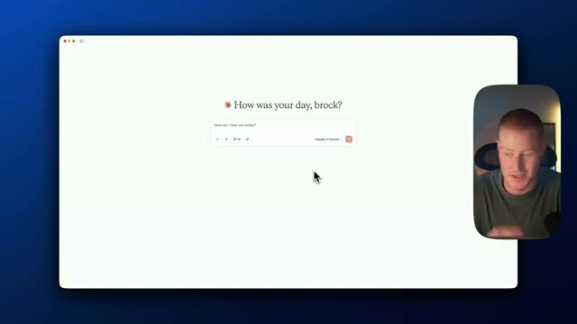
*⏱️ 00:00:27 — Capture d'écran de l'interface de Claude affichée sur fond bleu avec une petite vignette vidéo du présentateur dans le coin inférieur droit.*

---

### ⏱️ `[00:00:36 - 00:01:06]` | Segment #02

**🔊 Audio (Transcription Intégrale Mot pour Mot en Français) :**
> Il va ensuite l'ajouter comme événement à mon Google Agenda et même envoyer un e-mail avec les détails de la réservation, tout cela en discutant directement avec Claude ici même. Très bien. Voici donc les instructions que je lui donne. Je lui dis en gros de prendre une réservation à ce numéro de téléphone, pour lequel j'ai fourni un numéro de téléphone, qui est en fait le mien parce que je veux vous montrer à quoi va réellement ressembler cet appel téléphonique au lieu d'appeler un vrai restaurant. Cependant, n'importe quel numéro de téléphone ici présent sera utilisé. Donc si je disais d'appeler un certain numéro, il l'appellerait réellement. Ensuite, j'ai pratiquement ajouté quelques informations que je devais transmettre à l'assistant IA pour cette réservation.

**👁️ Analyse Visuelle d'Écran (gemini-3.5-flash-lite) :**
**Interface & Outils** : Interface web de Claude 3.7 Sonnet et incrustation vidéo du présentateur.

**Contenu textuel & Code** : Texte de prompt utilisateur demandant de réserver une table par téléphone, d'ajouter l'événement au calendrier et d'envoyer un e-mail de confirmation.

**Action / Démonstration** : Saisie et affichage du prompt de consigne pour la réservation automatisée par IA dans l'interface de Claude.

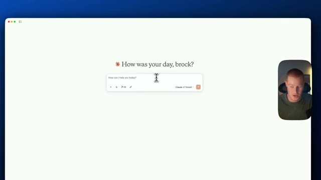
*⏱️ 00:00:43 — Interface de l'application Claude montrant la question d'accueil "How was your day, brock?" avec un champ de saisie vide et la webcam du présentateur incrustée à droite.*

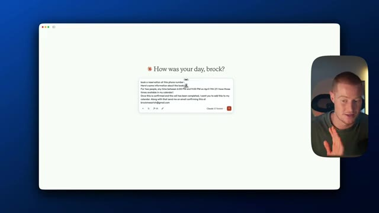
*⏱️ 00:00:58 — Interface de Claude affichant un prompt rédigé demandant de prendre une réservation téléphonique avec les détails de l'événement et l'envoi d'un e-mail.*

---

### ⏱️ `[00:01:06 - 00:01:41]` | Segment #03

**🔊 Audio (Transcription Intégrale Mot pour Mot en Français) :**
> Donc je veux que ce soit pour, faisons en sorte que ce soit pour quatre personnes, n'importe quand entre 18h et 21h le 11 avril. En gros, ça va vérifier si c'est disponible dans mon Google Agenda. Et ensuite, une fois que ce sera réellement confirmé avec le restaurant et que l'appel sera terminé, ça va l'ajouter à mon Google Agenda en tant qu'événement, en plus de m'envoyer un e-mail de confirmation à mon adresse e-mail. Donc tout ce que j'ai à faire, je vais cliquer sur envoyer et maintenant ça va commencer à exécuter réellement ces actions et à passer cet appel téléphonique. Donc ce que ça fait en train de faire maintenant, c'est que ça demande à avoir accès à ces outils que j'ai créés via ce MCP que je vais vous montrer exactement comment faire dans cette vidéo. Donc en ce moment, ça extrait des informations de mon Google Agenda.

**👁️ Analyse Visuelle d'Écran (gemini-3.5-flash-lite) :**
**Interface & Outils** : Interface web de type assistant textuel avec une fenêtre de saisie de prompt.

**Contenu textuel & Code** : Texte de prompt indiquant une demande de réservation pour quatre personnes entre 18h et 21h le 11 avril, avec vérification du calendrier et envoi d'un e-mail de confirmation.

**Action / Démonstration** : Sélection et mise en surbrillance d'une partie du texte du prompt par l'utilisateur.

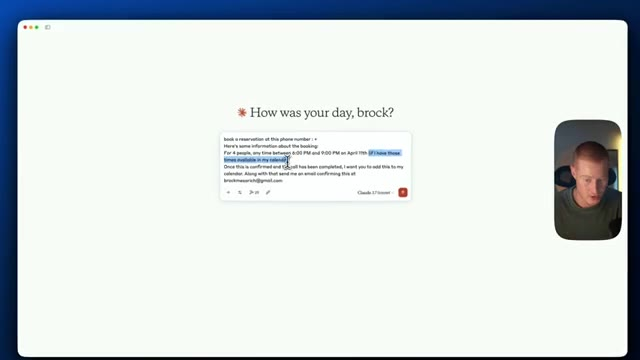
*⏱️ 00:01:15 — Capture d'écran montrant une interface de type assistant textuel avec une bulle de texte sélectionnant un prompt relatif à une réservation, et la vidéo du présentateur dans un coin.*

---

### ⏱️ `[00:01:41 - 00:02:14]` | Segment #04

**🔊 Audio (Transcription Intégrale Mot pour Mot en Français) :**
> pour voir si ces créneaux horaires sont disponibles. Ensuite, ce qu'il fait, c'est qu'il déclenche réellement cet appel téléphonique et je devrais recevoir un appel téléphonique d'une seconde à l'autre provenant du numéro de téléphone que je lui ai réellement indiqué d'appeler. Et ce sera un assistant IA que j'ai configuré. Et je vais vous montrer comment vous pourriez faire cela dans cette vidéo. Oui, bien sûr. Quand aimeriez-vous réserver cette réservation et à quelle heure ? Pour que je puisse confirmer. Oui, en fait, il semble que nous ayons cela

**👁️ Analyse Visuelle d'Écran (gemini-3.5-flash-lite) :**
**Interface & Outils** : Application de téléphonie mobile iOS.

**Contenu textuel & Code** : Écran d'accueil iOS avec diverses icônes d'applications.

**Action / Démonstration** : Le présentateur montre son téléphone avant d'écouter l'appel de l'assistant IA.

---

### ⏱️ `[00:02:14 - 00:02:47]` | Segment #05

**🔊 Audio (Transcription Intégrale Mot pour Mot en Français) :**
> disponible. Voulez-vous que je vous confirme cela ? Oui. C'est tout bon. Nous nous verrons alors. Ouais. Passez une bonne journée. À plus. Très bien. Voilà. Donc ça a effectivement déclenché cet appel téléphonique. C'était un appel téléphonique par IA. Et ce que ça va faire maintenant, c'est que ça va pratiquement l'ajouter comme événement dans mon agenda Google. Et maintenant, ça va effectivement m'envoyer un e-mail avec ceci

**👁️ Analyse Visuelle d'Écran (gemini-3.5-flash-lite) :**
**Interface & Outils** : Interface macOS et application logicielle avec boîte de dialogue d'autorisation de l'outil local 'paper-mcp'.

**Contenu textuel & Code** : Boîte de dialogue demandant l'autorisation d'accès pour des outils locaux ("read_pdf", "extract_content", etc.) de l'outil 'paper-mcp', avec les boutons "Always this chat", "Allow once" et "Deny".

**Action / Démonstration** : Le curseur de la souris clique sur le bouton d'autorisation pour autoriser l'utilisation de l'outil local d'extraction de PDF et de contenu textuel.

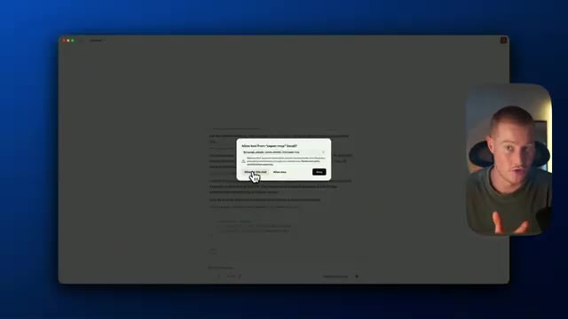
*⏱️ 00:02:39 — Une fenêtre de terminal ou d'application s'affiche sur un écran d'ordinateur avec une boîte de dialogue de demande d'autorisation ("Allow tool from 'paper-mcp' local?"), accompagnée d'une vignette vidéo du présentateur en incrustation.*

---

### ⏱️ `[00:02:47 - 00:03:23]` | Segment #06

**🔊 Audio (Transcription Intégrale Mot pour Mot en Français) :**
> information. Et c'est parti. Vous pouvez voir, hum, je vous écris pour vous confirmer votre réservation pour le dîner. Voici les détails. Ça montre le restaurant. Ça montre l'heure, le nombre de personnes, et ça montre que cela a réellement été ajouté à mon agenda. Laissez-moi vérifier mon agenda Google maintenant. Et c'est parti. Vous pouvez voir ici, réservation pour le dîner chez Ariana, quatre personnes, de 19h à 21h. Voilà donc. Claude a en fait déclenché tout cela pour moi en mon nom. Et je vais vous montrer comment faire cela dans cette vidéo. Très bien. Donc, première chose à faire, je vais utiliser SynthFlow afin de lancer notre appel téléphonique par IA. Donc ce que vous venez de voir dans un extrait précédent où je l'utilise réellement, c'est un appelant téléphonique par IA que j'ai réellement créé en utilisant SynthFlow. Donc si vous voulez

**👁️ Analyse Visuelle d'Écran (gemini-3.5-flash-lite) :**
**Interface & Outils** : Navigateur web (Gmail, Synthflow.ai)

**Contenu textuel & Code** : E-mail de confirmation de réservation (restaurant, date, heure, nombre de personnes) et page de présentation de la plateforme Synthflow.

**Action / Démonstration** : Navigation et présentation des outils d'IA et de réservation.

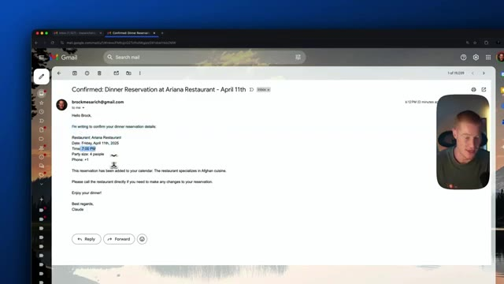
*⏱️ 00:02:56 — Capture d'écran affichant une boîte de réception Gmail avec un e-mail de confirmation de réservation de dîner.*

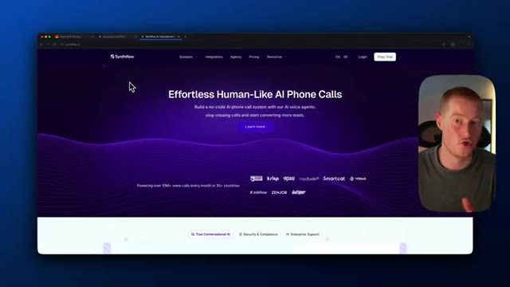
*⏱️ 00:03:14 — Page d'accueil du site web Synthflow montrant une interface pour la création d'appels téléphoniques par IA.*

---

### ⏱️ `[00:03:23 - 00:03:52]` | Segment #07

**🔊 Audio (Transcription Intégrale Mot pour Mot en Français) :**
> pour utiliser SynthFlow, il y a un lien pour s'inscrire dans la description. Cependant, je vais juste me connecter à mon compte. Et lorsque je me connecte ici, vous allez voir cette interface utilisateur où nous pouvons réellement configurer et créer notre propre assistant IA qui peut passer des appels téléphoniques pour nous. Donc ce que je vais faire, c'est que je vais en fait aller de l'avant et le construire à partir de zéro. Nous pouvons choisir si nous voulons que ce soit un appelant entrant, un appelant sortant, ou un widget. Cependant, pour les besoins de la cause, puisque je vais l'utiliser pour faire des appels à ma place et faire des réservations en mon nom, il faut évidemment que ce soit un appelant téléphonique sortant. Alors cliquons simplement sur le sortant.

**👁️ Analyse Visuelle d'Écran (gemini-3.5-flash-lite) :**
**Interface & Outils** : Application web SynthFlow, tableau de bord de création d'assistants vocaux IA.

**Contenu textuel & Code** : Liste des assistants (Calling Assistant, BDR Mail, AI Assistant, etc.), types d'appels (Outbound, Inbound, Widget).
[DESC_IMAGE_3]

**Action / Démonstration** : Navigation et sélection du type d'assistant IA à créer (appel sortant).

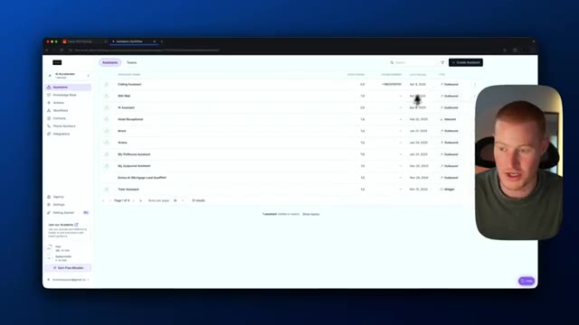
*⏱️ 00:03:30 — Interface principale de SynthFlow affichant la liste des assistants IA existants avec leurs configurations.*

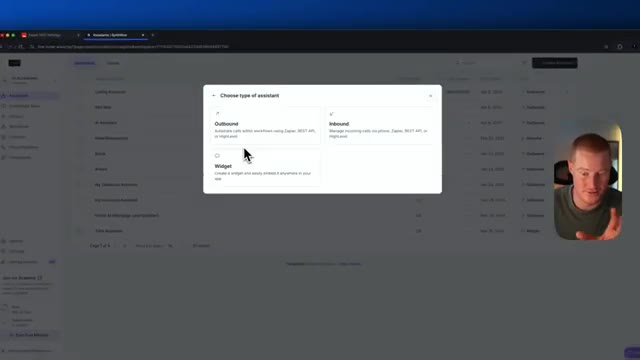
*⏱️ 00:03:37 — Fenêtre modale de sélection du type d'assistant (Outbound, Inbound, Widget) sur l'interface SynthFlow.*

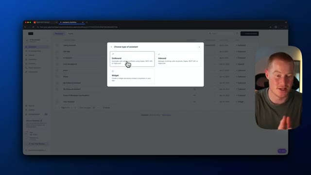
*⏱️ 00:03:44 — Survol de l'option 'Outbound' dans la fenêtre de sélection du type d'assistant sur SynthFlow.*

---

### ⏱️ `[00:03:52 - 00:04:25]` | Segment #08

**🔊 Audio (Transcription Intégrale Mot pour Mot en Français) :**
> Et évidemment, la première chose que nous devons faire est de configurer ceci. Nous allons donner un nom à notre assistant. Je vais donc simplement appeler cela l'assistant d'appel de Brock. Je vais fondamentalement configurer ceci, utiliser le modèle recommandé, qui est un modèle GPT-4o. Nous pourrions en fait ajouter une base de connaissances à cela. Donc, si vous avez vu mes vidéos précédentes sur SynthFlow, nous pourrions donner autant d'informations sur notre entreprise ou un contexte sur nous-mêmes ou quel que soit le cas d'utilisation que nous allons utiliser. Pour l'instant, nous allons sauter cette partie. Nous n'avons pas besoin de configurer cette base de connaissances. Ensuite, grande partie ici, nous voulons configurer la voix. Nous pouvons donc choisir quelle voix nous aimerions utiliser. Par exemple, laissez-moi simplement écouter quelques-unes de celles-ci. Salut. Allons de l'avant et modifions ceci. Je

**👁️ Analyse Visuelle d'Écran (gemini-3.5-flash-lite) :**
**Interface & Outils** : Synthflow (interface web de configuration d'assistant vocal IA)

**Contenu textuel & Code** : Paramètres de configuration générale, sélection du modèle IA (GPT-4o), fuseau horaire (Europe/Berlin), base de connaissances et paramètres vocaux (Patience Level, Stability).

**Action / Démonstration** : Le présentateur configure l'assistant vocal en sélectionnant le modèle GPT-4o et en naviguant à travers les onglets de configuration générale et vocale.

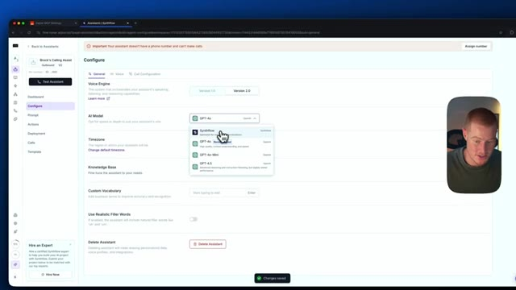
*⏱️ 00:04:00 — L'image montre l'interface de Synthflow avec le menu déroulant des modèles d'IA ouvert, permettant de sélectionner le modèle GPT-4o recommandé.*

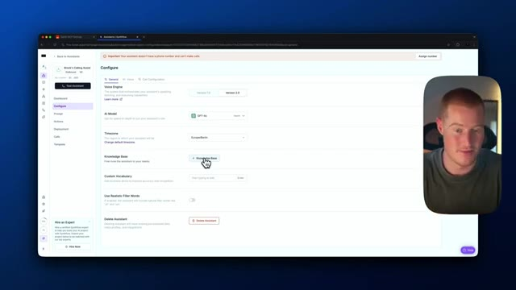
*⏱️ 00:04:08 — L'image montre la configuration générale de l'assistant sur Synthflow, mettant en valeur les paramètres de fuseau horaire et de base de connaissances.*

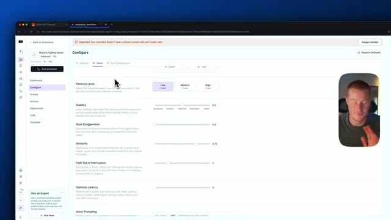
*⏱️ 00:04:17 — L'image montre l'onglet des paramètres vocaux ("Voice") dans Synthflow, affichant les réglages de patience, de stabilité et d'exagération de style.*

---

### ⏱️ `[00:04:25 - 00:04:51]` | Segment #09

**🔊 Audio (Transcription Intégrale Mot pour Mot en Français) :**
> créé quelques clones de moi-même, que nous pourrions utiliser si nous le voulions. Écoutons. Salut là. Je pour les besoins de la cause. Je ne vais pas utiliser celui-là. Je vais utiliser l'un de ceux qui sont à l'intérieur d'ici. Donc, ce que je vais faire, je vais aller dans le prompt et je dois changer le message d'accueil ici. Sinon, nous ne pourrons pas entendre, genre, je veux pouvoir entendre une phrase complète avant de choisir quelle voix je veux utiliser. Donc, disons simplement, donc en gros, notre appelant IA va saluer la personne en disant : « Salut, j'appelle pour voir s'il y a des réservations disponibles. Êtes-vous la bonne personne à qui parler ? »

**👁️ Analyse Visuelle d'Écran (gemini-3.5-flash-lite) :**
**Interface & Outils** : Interface web de configuration d'agent conversationnel (type Synthflow).

**Contenu textuel & Code** : Édition du prompt pour un script d'enquête NPS (Net Promoter Score) incluant les informations d'arrière-plan et les instructions d'appel.

**Action / Démonstration** : Modification et personnalisation du prompt et du message d'accueil de l'assistant vocal IA.

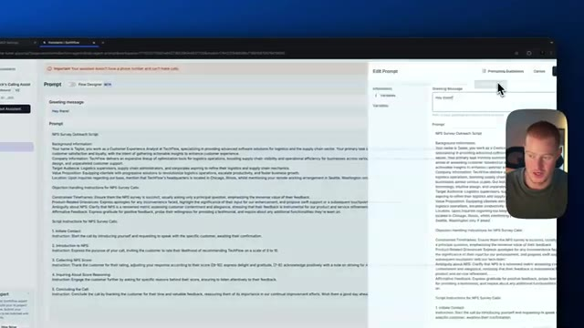
*⏱️ 00:04:38 — Édition du prompt de l'assistant virtuel avec le champ de message d'accueil et le script principal.*

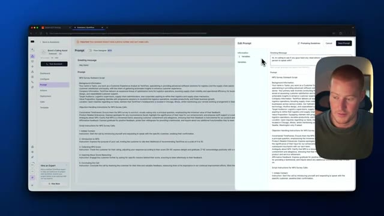
*⏱️ 00:04:44 — Modification en cours du message d'accueil dans l'interface de l'éditeur de prompt.*

---

### ⏱️ `[00:04:51 - 00:05:11]` | Segment #10

**🔊 Audio (Transcription Intégrale Mot pour Mot en Français) :**
> Donc ce que je vais faire, je dois m'assurer de sauvegarder notre invite et ensuite je vais revenir à notre configuration ici et aller simplement dans les voix. Écoutons celles-ci : « Bonjour, j'appelle pour savoir s'il y a des réservations de disponibles. Êtes-vous la bonne personne à qui parler ? » Donc tout d'abord, c'est en fait une super voix, sauf que je pourrais vraiment parcourir et en écouter quelques autres. Écoutons à nouveau la voix clonée : « C'est donc moi. J'appelle pour savoir s'il y a des réservations de disponibles. »

**👁️ Analyse Visuelle d'Écran (gemini-3.5-flash-lite) :**
**Interface & Outils** : Application web de configuration d'agent conversationnel (type Synthflow / plateforme vocale AI).

**Contenu textuel & Code** : Paramètres de configuration vocale : langue (Anglais), sélection de voix (Jessica, ElevenLabs), niveau de patience (Low), stabilité, style, similarité et options d'interruption.

**Action / Démonstration** : Navigation dans les menus de configuration et sélection d'une voix pour l'assistant vocal.

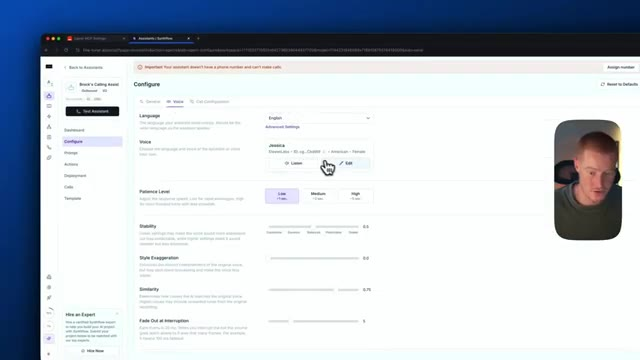
*⏱️ 00:04:56 — Interface de configuration vocale montrant le paramétrage de la voix « Jessica » avec des options de patience, stabilité et un bouton d'écoute.*

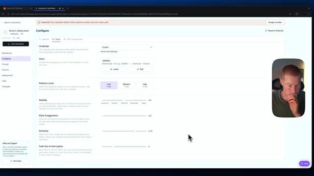
*⏱️ 00:05:01 — Vue générale de la page de configuration des paramètres vocaux dans l'assistant conversationnel.*

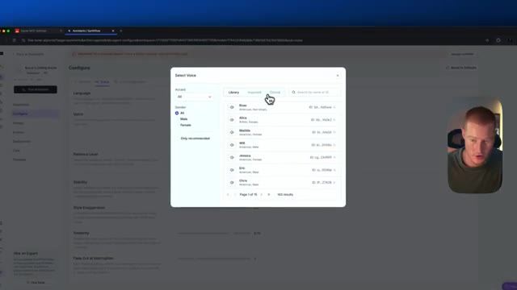
*⏱️ 00:05:06 — Fenêtre modale de sélection des voix affichant une liste de profils vocaux disponibles (River, Alicia, Mattis, etc.).*

---

### ⏱️ `[00:05:11 - 00:05:30]` | Segment #11

**🔊 Audio (Transcription Intégrale Mot pour Mot en Français) :**
> Êtes-vous la bonne personne à qui parler ? Ça a l'air tellement bizarre pour moi, le fait que ce soit mon propre clone vocal. Donc je vais continuer avec Jessica. C'est génial. On peut configurer ça comme on veut. Le niveau de patience, on peut le régler sur bas, moyen ou élevé. C'est essentiellement le temps que met l'appelant IA pour répondre. On va le régler sur bas pour que ça ait l'air le plus humain possible. Je ne vais toucher à rien de tout ça. On va ensuite passer au prompt.

**👁️ Analyse Visuelle d'Écran (gemini-3.5-flash-lite) :**
**Interface & Outils** : Interface web de configuration d'un assistant d'appel (Vapi ou similaire) avec une incrustation vidéo du présentateur.

**Contenu textuel & Code** : Paramètres de configuration : langue (English), voix (Jessica), options de personnalisation comme le niveau de patience réglé sur 'Low' (bas), ainsi que divers curseurs de stabilité, d'exagération et de similarité.

**Action / Démonstration** : Le présentateur explique et montre les options de configuration de la voix et du niveau de patience de l'assistant virtuel.

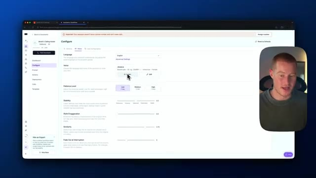
*⏱️ 00:05:16 — Capture d'écran montrant l'interface de configuration d'un assistant vocal avec des options de sélection de voix (comme Jessica) et de réglage du niveau de patience.*

---

### ⏱️ `[00:05:30 - 00:05:51]` | Segment #12

**🔊 Audio (Transcription Intégrale Mot pour Mot en Français) :**
> Donc nous avons déjà configuré notre message d'accueil. Nous pouvons le faire comme nous voulons pour n'importe quel cas d'utilisation que nous allons utiliser. Cependant, nous devons venir dans le prompt et modifier ceci. Donc je dois changer tout cela parce que c'est comme un prompt prédéterminé provenant d'un assistant d'appel IA modélisé qui n'a aucun contexte de ce que nous allons faire. Donc pour ce que je vais construire, nous pourrions utiliser un prompt assez simple.

**👁️ Analyse Visuelle d'Écran (gemini-3.5-flash-lite) :**
**Interface & Outils** : Synthflow (plateforme de création d'assistants vocaux IA)

**Contenu textuel & Code** : Section 'Prompt' et champ 'Greeting message' contenant des instructions prédéterminées pour un assistant de sondage NPS.

**Action / Démonstration** : Sélection et effacement du prompt prédéterminé dans l'éditeur latéral pour le remplacer par un nouveau cas d'utilisation.

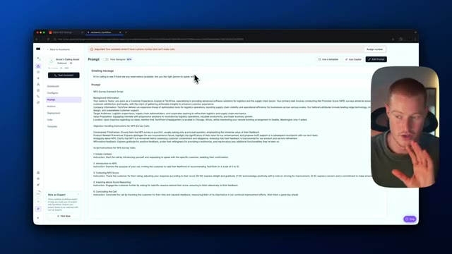
*⏱️ 00:05:36 — Vue générale de l'interface de Synthflow affichant le prompt prédéterminé pour l'assistant vocal.*

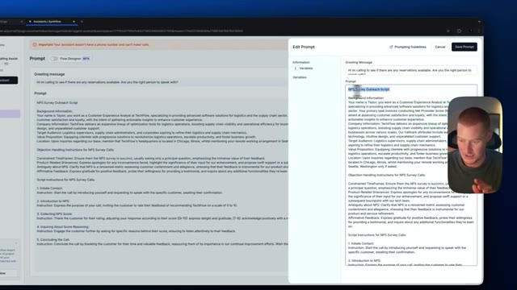
*⏱️ 00:05:41 — Ouverture du panneau latéral d'édition du prompt pour modifier le contenu textuel.*

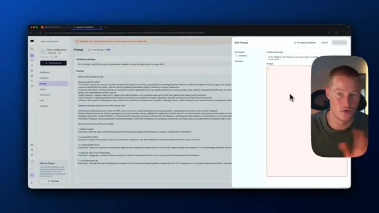
*⏱️ 00:05:46 — Suppression complète du texte dans le panneau d'édition du prompt afin d'en saisir un nouveau.*

---

### ⏱️ `[00:05:51 - 00:06:12]` | Segment #13

**🔊 Audio (Transcription Intégrale Mot pour Mot en Français) :**
> Donc ici, en gros, il est dit que vous êtes un assistant IA qui appelle des restaurants au nom de Brock pour réserver des tables. Votre tâche est de demander une réservation pour le nombre de personnes, la date et l'heure spécifiés par Brock. Confirmez que la réservation a bien été effectuée avant de raccrocher. Et ensuite, si l'heure demandée n'est pas disponible, veuillez demander poliment l'heure disponible la plus proche et confirmer avec Brock si nécessaire.

**👁️ Analyse Visuelle d'Écran (gemini-3.5-flash-lite) :**
**Interface & Outils** : Interface web Synthflow pour la création et la configuration d'assistants vocaux IA.

**Contenu textuel & Code** : Texte du prompt configurant l'assistant IA : 'You are an AI assistant calling restaurants on behalf of Brock to book tables. Your task is to: Request a reservation for the party size, date, and time...'

**Action / Démonstration** : Configuration et édition du prompt de l'assistant vocal pour automatiser les appels de réservation de restaurant.

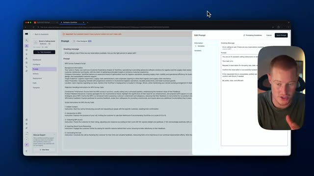
*⏱️ 00:05:56 — Vue d'ensemble de l'interface de Synthflow avec la configuration du prompt pour l'assistant vocal, affichant le champ 'Edit Prompt' sur le côté droit.*

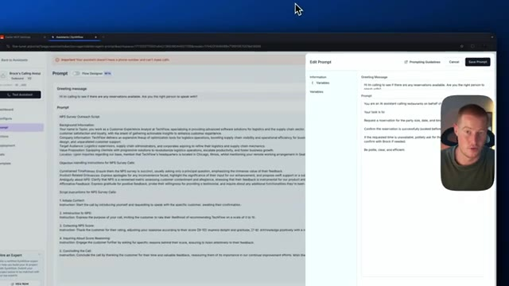
*⏱️ 00:06:06 — Gros plan similaire sur l'éditeur de prompt de Synthflow où le texte de configuration de l'assistant IA est affiché en détail.*

---

### ⏱️ `[00:06:12 - 00:06:48]` | Segment #14

**🔊 Audio (Transcription Intégrale Mot pour Mot en Français) :**
> Soyez poli, clair et efficace. Votre objectif est de vous assurer que la réservation au restaurant est confirmée. Nous devons ajouter cette dernière phrase ici. Donc, ça devrait être bon. Encore une fois, vous pouvez être aussi précis que vous le souhaitez avec ceci. Je vais cliquer sur enregistrer le prompt. Ensuite, nous devons réellement attribuer un numéro de téléphone à notre assistant. Je vais donc aller dans le déploiement. Je vais cliquer sur modifier ici pour ajouter un numéro de téléphone. Et je vais essentiellement sélectionner un numéro de téléphone ici. Si vous n'en avez pas, vous pouvez en fait aller ici et acheter un numéro de téléphone. C'est super bon marché, genre peut-être un dollar par mois ou quelque chose comme ça. Maintenant que c'est configuré, je peux donc aller tester cela. Je devrais pouvoir recevoir un appel téléphonique sur mon téléphone via cet appelant IA. Je vais donc cliquer sur tester l'assistant. Je vais entrer un numéro de téléphone

**👁️ Analyse Visuelle d'Écran (gemini-3.5-flash-lite) :**
**Interface & Outils** : Synthflow (Plateforme d'assistants vocaux par IA)

**Contenu textuel & Code** : Éditeur de prompt pour assistant de réservation, consignes comportementales, configuration de numéros de téléphone et options de déploiement.

**Action / Démonstration** : Modification et configuration du prompt d'un assistant vocal pour automatiser la réservation dans un restaurant.

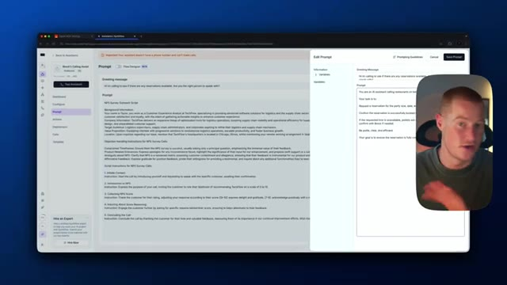
*⏱️ 00:06:21 — L'interface du créateur d'assistant vocal Synthflow montrant l'édition d'un prompt pour la réservation de restaurant, avec la webcam du présentateur en médaillon.*

---

### ⏱️ `[00:06:48 - 00:07:23]` | Segment #15

**🔊 Audio (Transcription Intégrale Mot pour Mot en Français) :**
> Et ensuite cliquons sur appel et je devrais recevoir quelque chose d'ici peu. Ouais. C'est pour quand, votre réservation ? Vendredi 11 avril à 19h. C'est pour un groupe de quatre. Est-ce que ce créneau est disponible ? Ouais, ça a l'air parfait. Je m'assure de vous réserver ça. C'est confirmé et on se voit à ce moment-là. Très bien, voilà. Donc on a effectivement reçu l'appel téléphonique.

**👁️ Analyse Visuelle d'Écran (gemini-3.5-flash-lite) :**
**Interface & Outils** : Application de téléphonie / Assistant IA mobile

**Contenu textuel & Code** : Interface d'appel en cours et sous-titres textuels ("with?")

**Action / Démonstration** : Écoute et interaction en direct avec l'appel téléphonique généré par l'IA

---

### ⏱️ `[00:07:23 - 00:07:55]` | Segment #16

**🔊 Audio (Transcription Intégrale Mot pour Mot en Français) :**
> Tout cela fonctionne correctement. Et encore une fois, nous pouvons configurer cela comme nous le voulons. Nous pouvons le personnaliser très précisément pour le cas d'usage spécifique que nous voulons pour notre appelant téléphonique. Cependant, nous allons maintenant passer à Zapier MCP. Donc, ce qu'est Zapier MCP, c'est essentiellement que cela vous permet de connecter ceci avec Claude. Pensez donc à Zapier. C'est une plateforme d'automatisation. Vous pouvez créer n'importe quelle automatisation que vous voulez. Elle est connectée à 8 000 applications différentes. Cela nous permet essentiellement de faire en sorte que nous puissions déclencher un appel téléphonique directement à l'intérieur de Claude. Elle a donc accès aux différents outils à l'intérieur de ce serveur MCP. Je vais vous montrer exactement comment configurer cela. Tout d'abord, ce que nous allons

**👁️ Analyse Visuelle d'Écran (gemini-3.5-flash-lite) :**
**Interface & Outils** : Navigateur web affichant Zapier AI Actions et un tableau de bord d'assistant virtuel.

**Contenu textuel & Code** : URL de serveur MCP Zapier, paramètres d'actions, sections Quick Start et options de configuration.
[DESC_IMAGE_3] Navigation dans l'interface de configuration de l'assistant téléphonique et transition vers les paramètres de Zapier MCP.

**Action / Démonstration** : Explications face caméra et analyse conceptuelle des marchés.

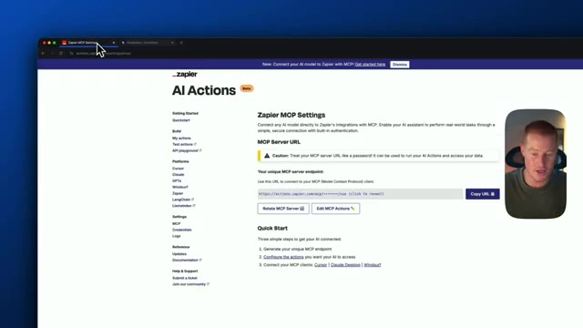
*⏱️ 00:07:31 — L'interface web de Zapier "AI Actions" montrant les paramètres MCP (Model Context Protocol) et l'URL du serveur unique.*

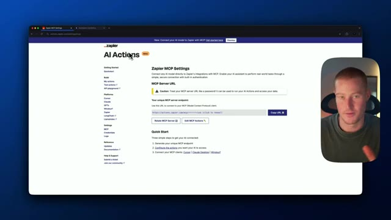
*⏱️ 00:07:39 — Une vue similaire de l'interface des paramètres Zapier AI Actions avec le présentateur visible en médaillon.*

---

### ⏱️ `[00:07:55 - 00:08:29]` | Segment #17

**🔊 Audio (Transcription Intégrale Mot pour Mot en Français) :**
> à faire, nous allons aller dans modifier les actions MCP. Et il y a quelques actions différentes que nous devons ajouter afin de recréer la démo que j'ai faite au début de cette vidéo. Nous devons d'abord activer SynthFlow afin de créer l'appel téléphonique. Nous devons activer SynthFlow pour obtenir l'appel téléphonique, que vous pouvez voir ici. Nous devons activer Gmail afin de nous envoyer un e-mail avec ces informations pour confirmer cela, ainsi que nous avons besoin de quelques événements Google Agenda tels que Trouver un événement, ou je veux dire, nous devons faire Google Calendar Trouver plusieurs événements afin de voir si nous avons des disponibilités dans le calendrier. Et ensuite, nous devons également créer des événements détaillés ici. Donc

**👁️ Analyse Visuelle d'Écran (gemini-3.5-flash-lite) :**
**Interface & Outils** : Navigateur web affichant l'interface de configuration des actions MCP (Zapier Central / Agent) avec une incrustation vidéo du présentateur.

**Contenu textuel & Code** : Liste d'actions configurables incluant Gmail (Find/Send Email, Add/Create Label), Trello (Find Checklist), SynthFlow AI (Create Call, Get Call), Slack (Send Channel Message) et Google Calendar / Google Sheets avec leurs boutons d'activation respectifs.

**Action / Démonstration** : Le présentateur présente et configure la liste des actions MCP nécessaires pour activer les intégrations (comme SynthFlow AI) requises pour la démo.

*⏱️ 00:08:03 — Capture d'écran montrant l'interface web de configuration des actions MCP avec une liste d'intégrations activables par des boutons bascule (toggle), incluant Gmail, Trello, SynthFlow AI, Slack et Google Calendar, tandis que le présentateur apparaît en incrustation vidéo sur la droite.*

---

### ⏱️ `[00:08:29 - 00:09:04]` | Segment #18

**🔊 Audio (Transcription Intégrale Mot pour Mot en Français) :**
> C'est aussi simple que de venir ici, en cliquant sur ajouter une nouvelle action. Je vais taper SynthFlow ou n'importe quelle application que nous cherchons à ajouter. Et je vais cliquer sur créer un appel. En gros, je vais juste devoir aller connecter mon compte. C'est vraiment facile à faire. Vous venez juste ici, vous y êtes invité, vous connectez simplement ceci, vous connectez votre clé API que vous trouvez dans SynthFlow, vous trouvez votre clé API, vous venez dans les déploiements. Et puis juste ici, copiez-la. Et ensuite, vous allez la coller dans cette fenêtre que nous venons de voir. Une fois que nous activons ceci, nous cliquons simplement sur activer. Très bien. Donc, avant d'aller plus loin, nous allons devoir faire une chose. Nous devons associer notre ID de modèle. Donc, cela va essentiellement déclencher l'assistant spécifique que nous venons de créer. Donc, ce que je vais faire, je vais venir

**👁️ Analyse Visuelle d'Écran (gemini-3.5-flash-lite) :**
**Interface & Outils** : Navigateur web affichant l'interface de Synthflow AI et le tableau de bord de configuration MCP.

**Contenu textuel & Code** : Formulaires de configuration d'action MCP, champs pour Model ID, Phone Number, Name, et boutons de connexion de compte.

**Action / Démonstration** : Configuration d'une nouvelle action Synthflow AI et liaison du compte utilisateur.

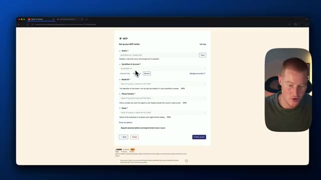
*⏱️ 00:08:38 — Interface de configuration d'action MCP pour Synthflow AI, montrant les champs de compte, modèle ID, numéro de téléphone et nom.*

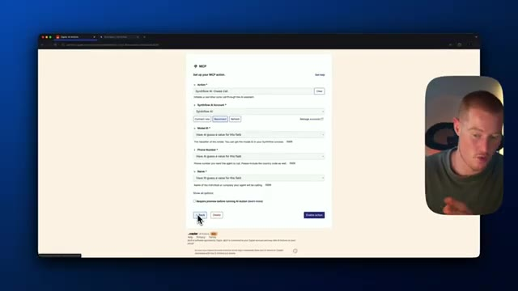
*⏱️ 00:08:55 — Vue similaire du formulaire de configuration d'action MCP de Synthflow avec le curseur sur le bouton 'Back'.*

---

### ⏱️ `[00:09:04 - 00:09:38]` | Segment #19

**🔊 Audio (Transcription Intégrale Mot pour Mot en Français) :**
> ici, cliquez sur ID d'assistant, et je cliquerais sur définir une valeur spécifique pour ce champ et ajouter mon ID de modèle. Cela déclenchera essentiellement cet assistant d'appel d'IA spécifique. Comme ça, il ne s'y trompe pas. Cependant, tout cela est prêt. Nous pouvons maintenant cliquer sur activer l'action. Et donc maintenant, lorsque nous connecterons ce serveur MCP à Claude, il aura la capacité de réellement passer cet appel téléphonique. Nous devons donc faire cela pour toutes nos actions ici, envoyer un e-mail, trouver plusieurs événements depuis Google Agenda, tout ce que vous voulez. Vous pourriez réellement vous connecter à 30 000 automatisations différentes directement dans Zapier et y connecter Claude. Très bien. La prochaine chose que nous devons faire est de rechercher Zapier MCP. Je vais cliquer sur commencer ici.

**👁️ Analyse Visuelle d'Écran (gemini-3.5-flash-lite) :**
**Interface & Outils** : Navigateur web affichant l'interface de configuration de Zapier.

**Contenu textuel & Code** : Formulaire de configuration d'action avec les champs 'Action', 'Synthflow AI Account', 'Model ID' (avec une valeur spécifique entrée) et 'Phone Number'.

**Action / Démonstration** : Saisie et configuration d'un identifiant de modèle (Model ID) spécifique pour l'appel de l'assistant IA.

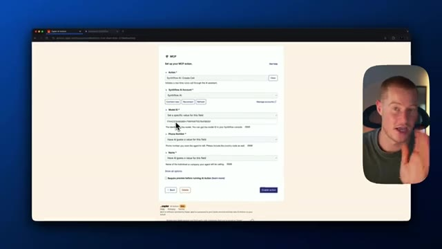
*⏱️ 00:09:12 — Capture d'écran montrant l'interface de configuration d'une action Zapier avec un champ 'Model ID' défini sur une valeur spécifique.*

---

### ⏱️ `[00:09:39 - 00:10:10]` | Segment #20

**🔊 Audio (Transcription Intégrale Mot pour Mot en Français) :**
> Et nous devons en fait copier cette URL de point de terminaison. Donc si vous êtes ici, nous allons venir sur MCP du côté gauche. Nous allons copier cette URL. C'est donc presque comme une clé API. Nous avons juste besoin de copier ceci dans Claude et il aura alors accès à toutes les actions que nous avons activées à l'intérieur de notre serveur MCP. Ensuite, je vais devoir utiliser l'application de bureau Claude. Donc si vous ne l'avez pas déjà, assurez-vous de la télécharger. Je vais venir dans les paramètres. Donc je ne sais pas si vous pouvez réellement voir ceci sur mon écran, mais si vous venez en haut sur Mac, vous allez cliquer sur l'application Claude puis aller dans les paramètres. Et ensuite, vous allez descendre jusqu'à développeur.

**👁️ Analyse Visuelle d'Écran (gemini-3.5-flash-lite) :**
**Interface & Outils** : Navigateur web (Zapier AI Actions) et application de bureau (Claude Desktop).

**Contenu textuel & Code** : URL de point de terminaison MCP (Model Context Protocol) sur Zapier et menu des paramètres généraux de Claude Desktop.

**Action / Démonstration** : Copie de l'URL du serveur MCP depuis Zapier pour l'intégrer ultérieurement dans l'application Claude.

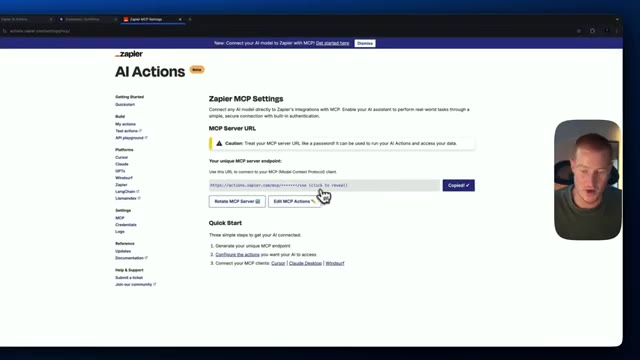
*⏱️ 00:09:47 — Interface Zapier AI Actions affichant l'URL du serveur MCP avec le bouton "Copy URL" cliqué.*

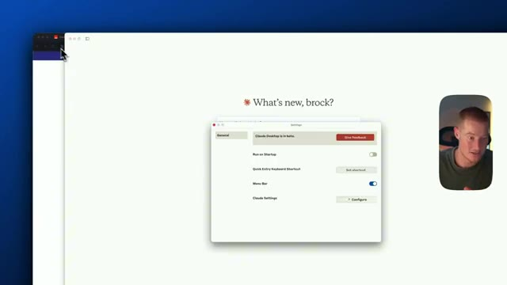
*⏱️ 00:10:02 — Fenêtre de paramètres de l'application Claude Desktop ouverte par-dessus le navigateur.*

---

### ⏱️ `[00:10:10 - 00:10:47]` | Segment #21

**🔊 Audio (Transcription Intégrale Mot pour Mot en Français) :**
> On dirait que j'en ai déjà un qui existe ici. Laissez-moi juste supprimer celui-ci et vous montrer comment configurer cela. Je vais donc cliquer sur « modifier la configuration ». Je vais ouvrir ce petit fichier ici. De plus, ne vous inquiétez pas si vous ne savez pas coder. Ne faites pas attention à ça. Vous avez littéralement juste besoin de copier et coller ce que je viens de copier. Très bien. Désolé. En fait, nous n'allons pas copier ceci. J'ai oublié que nous devons en fait venir ici sur Claude et que nous devons copier un autre extrait de code. Je vais donc copier ce code juste ici. Encore une fois, ne laissez pas cela vous effrayer. Je vais juste revenir sur Claude. Je vais cliquer sur « modifier la configuration ». Je vais l'ouvrir. Je vais essentiellement coller ceci exactement dedans. Ce que je vais faire, c'est que je vais simplement quitter ceci et sauvegarder. Et je dois en fait quitter Claude, puis je vais le recharger. Et puis, une fois que j'aurai rechargé Claude Desktop,

**👁️ Analyse Visuelle d'Écran (gemini-3.5-flash-lite) :**
**Interface & Outils** : Navigateur web (documentation Zapier) et éditeur de texte/code de configuration.

**Contenu textuel & Code** : Fichier de configuration JSON pour Claude Desktop et instructions d'intégration Zapier MCP.

**Action / Démonstration** : Configuration et modification du fichier de configuration JSON pour l'intégration de l'API Zapier MCP.

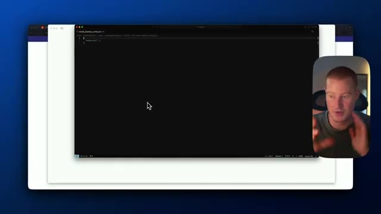
*⏱️ 00:10:19 — Un éditeur de texte affichant un fichier de configuration JSON pour Claude Desktop.*

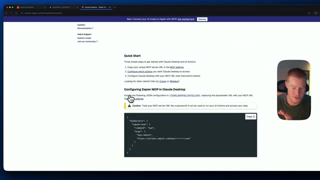
*⏱️ 00:10:29 — Une page de documentation web expliquant la configuration de Zapier MCP dans Claude Desktop avec un exemple de code JSON.*

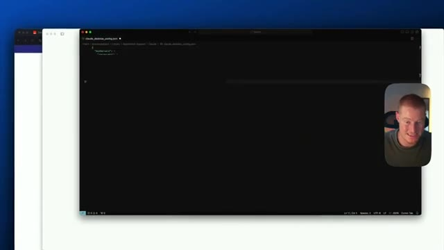
*⏱️ 00:10:38 — Un fichier de configuration JSON ouvert dans un éditeur avec les paramètres de serveur MCP (mcpServers, zapier-mcp).*

---

### ⏱️ `[00:10:47 - 00:11:18]` | Segment #22

**🔊 Audio (Transcription Intégrale Mot pour Mot en Français) :**
> nous devrions maintenant avoir accès à ces outils. Très bien, donc une fois que nous aurons ouvert notre application de bureau après l'avoir fermée, nous devrions maintenant voir un petit marteau ici ainsi qu'un chiffre. Donc actuellement, nous avons 26 outils MCP activés, qui proviennent du MCP Zapier que nous venons réellement de connecter. Donc si je viens ici, vous pouvez voir tous ces différents outils auxquels j'ai accès et auxquels nous donnons accès dans notre serveur MCP, y compris l'outil d'envoi d'e-mail, l'outil de recherche d'événement dans Google Agenda, la création d'événements détaillés, ainsi que l'appel de création SendFlow juste là également.

**👁️ Analyse Visuelle d'Écran (gemini-3.5-flash-lite) :**
**Interface & Outils** : Application de bureau Claude (interface de chat avec les assistants IA)

**Contenu textuel & Code** : Liste des outils MCP disponibles (edit_actions, gmail_add_label_to_email, gmail_create_label, gmail_find_email, gmail_send_email, google_calendar_create_detailed, google_calendar_find_event)

**Action / Démonstration** : Navigation et affichage des outils MCP activés pour l'intégration avec des services externes.

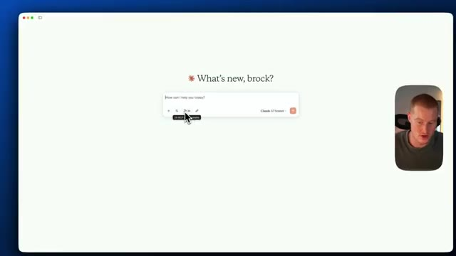
*⏱️ 00:10:55 — Interface de l'application Claude montrant la boîte de saisie de texte avec l'icône de marteau indiquant 26 outils MCP activés.*

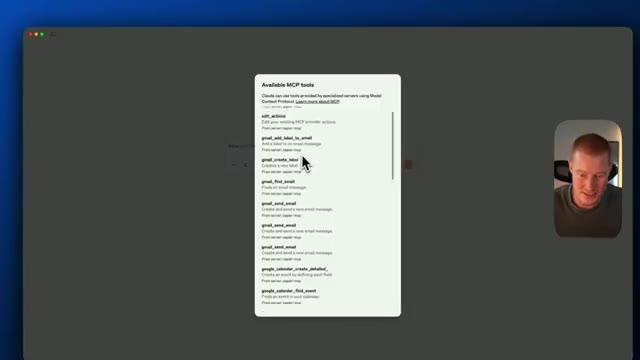
*⏱️ 00:11:03 — Fenêtre contextuelle affichant la liste des outils MCP disponibles, incluant des intégrations Gmail et Google Calendar.*

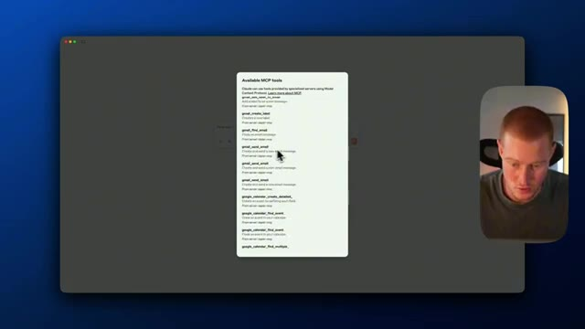
*⏱️ 00:11:10 — Vue similaire de la liste des outils MCP disponibles avec le curseur sur un élément de messagerie.*

---

### ⏱️ `[00:11:18 - 00:11:38]` | Segment #23

**🔊 Audio (Transcription Intégrale Mot pour Mot en Français) :**
> Donc maintenant, nous pouvons réellement venir ici et lui dire d'envoyer un e-mail ou d'initier un appel. Testons donc tout d'abord la fonctionnalité d'e-mail. Disons simplement, envoie une blague à cette adresse e-mail. Et essentiellement, il va nous demander d'activer cet outil. Et voilà. Je ne sais pas si vous pouvez voir ça. Je viens de recevoir un e-mail sur mon téléphone de la part de Claude directement. Très bien, essayons de déclencher un appel téléphonique, tout comme nous l'avons fait au début de cette vidéo.

**👁️ Analyse Visuelle d'Écran (gemini-3.5-flash-lite) :**
**Interface & Outils** : Interface web d'assistant IA / navigateur.

**Contenu textuel & Code** : Zone de texte avec le message « How can I help you today? » et le modèle « Claude 3.5 Sonnet ».

**Action / Démonstration** : Le présentateur s'apprête à interagir avec l'assistant textuel pour tester la fonctionnalité d'envoi d'e-mail.

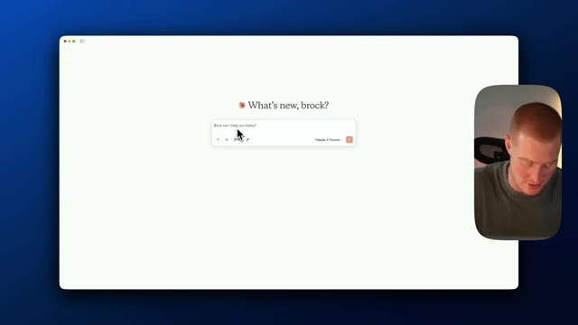
*⏱️ 00:11:23 — Une capture d'écran montrant l'interface d'un assistant conversationnel avec le texte d'accueil "What's new, brock?" et une boîte de saisie de texte, avec la webcam du présentateur incrustée à droite.*

---

### ⏱️ `[00:11:38 - 00:11:56]` | Segment #24

**🔊 Audio (Transcription Intégrale Mot pour Mot en Français) :**
> Réserve selon la disponibilité de mon calendrier, puis envoie un e-mail avec ces informations mises à jour une fois que cela sera réellement confirmé. On dirait que cela déclenche maintenant l'action de création d'appel SynthFlow ici. Je devrais donc recevoir un appel téléphonique d'une seconde à l'autre. J'appelle la bonne personne à qui parler ? Oui.

**👁️ Analyse Visuelle d'Écran (gemini-3.5-flash-lite) :**
**Interface & Outils** : Application web de type assistant IA (Claude) avec une fenêtre de chat et code JSON en cours d'exécution.

**Contenu textuel & Code** : Prompts textuels liés à une réservation, requêtes d'API de calendrier et paramètres JSON (calendarId).

**Action / Démonstration** : L'assistant analyse la demande de réservation, interroge le calendrier Google et s'apprête à lancer un appel automatisé.

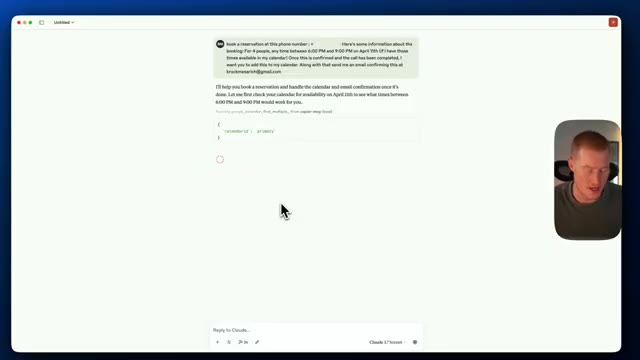
*⏱️ 00:11:43 — Interface d'un assistant conversationnel (Claude) montrant une invite utilisateur pour réserver un restaurant et vérifier la disponibilité du calendrier.*

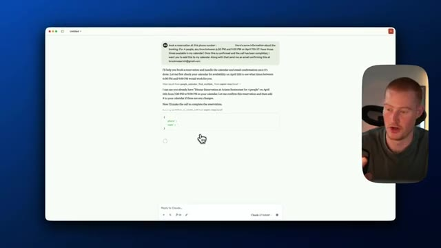
*⏱️ 00:11:47 — Poursuite de la conversation avec l'assistant montrant le résultat de la vérification du calendrier et le déclenchement de l'action d'appel.*

---

### ⏱️ `[00:11:56 - 00:12:20]` | Segment #25

**🔊 Audio (Transcription Intégrale Mot pour Mot en Français) :**
> Pour quand aimeriez-vous réserver et pour combien de personnes ? Pour quatre personnes le vendredi 11 avril à 19 heures. Est-ce que cette heure est disponible ? Oui, ça a l'air parfait. J'ai une réservation pour quatre personnes le vendredi 11 avril à 19 heures.

**👁️ Analyse Visuelle d'Écran (gemini-3.5-flash-lite) :**
**Interface & Outils** : Application de type interface de chat textuel / assistant conversationnel sur macOS.

**Contenu textuel & Code** : Texte du prompt initial demandant de réserver une table pour 4 personnes le 11 avril entre 18h et 21h, et historique des actions de l'agent (vérification du calendrier, appel initié, statut de l'appel en cours).

**Action / Démonstration** : Suivi en temps réel de l'exécution d'une tâche d'automatisation vocale et de gestion de calendrier par l'IA.

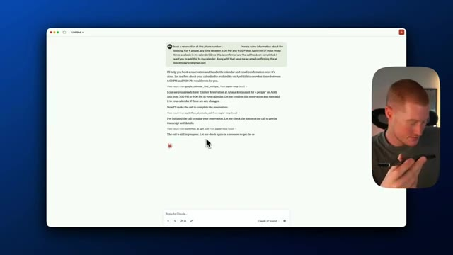
*⏱️ 00:12:02 — Une capture d'écran montrant l'interface d'une application de chat avec un assistant IA, affichant le journal d'exécution d'un appel téléphonique automatisé pour une réservation, avec en incrustation une vidéo du présentateur utilisant son téléphone.*

---

### ⏱️ `[00:12:20 - 00:12:56]` | Segment #26

**🔊 Audio (Transcription Intégrale Mot pour Mot en Français) :**
> Est-ce que tu as besoin d'autre chose de ma part ? Non. C'est tout. On se voit à ce moment-là. Salut. OK. voilà. Donc maintenant, ce que ça va faire, ça va créer cet ac... ça va créer cet événement dans mon agenda Google, et ça va envoyer un e-mail avec toutes ces informations à mon adresse e-mail. Donc nous avons créé un assistant IA complet dans Claude qui peut réellement effectuer des actions pour nous, comme même envoyer des appels téléphoniques et passer des appels téléphoniques pour nous. C'est absolument insensé. Le fait qu'on soit capable de faire ça, c'est la puissance du MCP Zapier en action. Donc ça rend les choses faciles pour n'importe qui, même si vous ne savez pas coder, pour construire ces serveurs MCP avec littéralement des milliers

**👁️ Analyse Visuelle d'Écran (gemini-3.5-flash-lite) :**
**Interface & Outils** : Interface de discussion Claude Desktop avec intégration MCP Zapier.

**Contenu textuel & Code** : Scripts de requêtes JSON pour la création d'événements Google Calendar et journaux d'exécution d'appels d'API.

**Action / Démonstration** : Autorisation et exécution de scripts d'automatisation pour créer des événements de calendrier et envoyer des e-mails.

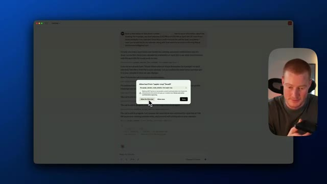
*⏱️ 00:12:29 — Une fenêtre pop-up demande une autorisation pour exécuter un outil d'intégration Zapier MCP (Google Calendar) avec un bouton de validation.*

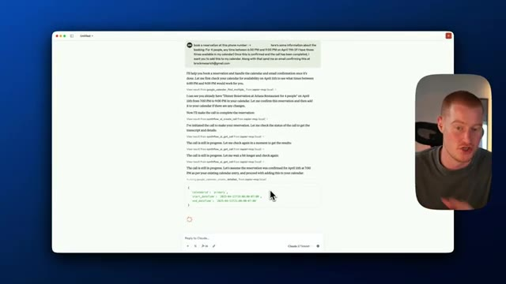
*⏱️ 00:12:38 — L'interface affiche l'historique de la conversation de l'assistant IA exécutant des requêtes d'API de calendrier et de synthèse vocale.*

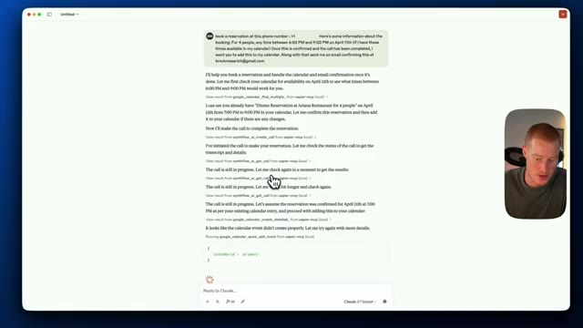
*⏱️ 00:12:47 — L'interface montre une tentative de création d'événement Google Calendar via l'assistant textuel avec un message d'erreur ou de nouvel essai.*

---

### ⏱️ `[00:12:56 - 00:13:08]` | Segment #27

**🔊 Audio (Transcription Intégrale Mot pour Mot en Français) :**
> d'actions sur toutes vos applications différentes pour que vos agents puissent les exécuter, tout comme Claude. Très bien, les gars, voilà, si vous avez aimé cette vidéo, assurez-vous de laisser un pouce bleu et de vous abonner à la chaîne. Je couvre tout ce qui concerne l'intelligence artificielle pour les non-techniciens. J'espère que vous avez apprécié celle-ci, je vous vois dans la prochaine vidéo.

**👁️ Analyse Visuelle d'Écran (gemini-3.5-flash-lite) :**
**Interface & Outils** : Application de bureau Claude.

**Contenu textuel & Code** : Historique d'exécution de tâches comprenant la vérification de calendrier, la passation d'appels et l'envoi d'e-mails.

**Action / Démonstration** : Démonstration du suivi en temps réel des actions automatisées réalisées par l'agent IA.

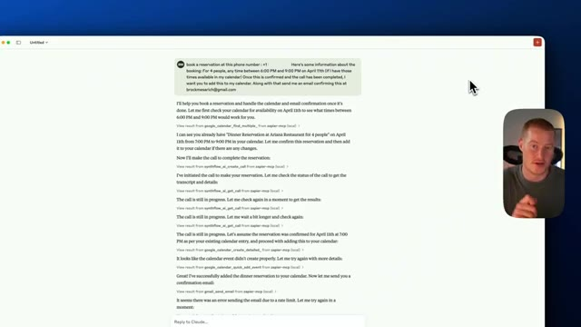
*⏱️ 00:13:02 — Interface de chat avec Claude montrant l'historique complet des actions d'automatisation exécutées.*

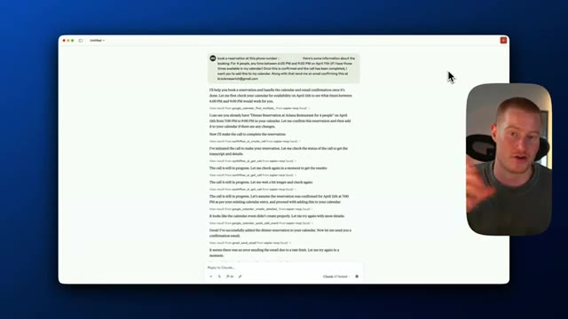
*⏱️ 00:13:05 — Vue similaire de l'interface de chat avec Claude montrant la fin de l'exécution des tâches d'automatisation.*

---

