# 🎬 Bolt CEO vs Google Firebase Studio (Which Builds The Better App?)

> **Chaîne** : [Brock Mesarich | AI for Non Techies](https://www.youtube.com/@BrockMesarich)  
> **Lien YouTube** : [https://www.youtube.com/watch?v=Ew3M9AtoMsc](https://www.youtube.com/watch?v=Ew3M9AtoMsc)  
> **Date de publication** : 20250423  
> **Durée** : 00:37:20  
> **Identifiant vidéo** : `Ew3M9AtoMsc`  
> **Transcription & Analyse** : `whisper-v3-large-turbo+gemini-3.5-flash-lite`  

---

## 📌 Synthèse Exécutive & Outils

### 💡 Résumé

Cet épisode spécial de la chaîne *Brock Mesarich | AI for Non Techies* met en scène un duel de développement d'applications par intelligence artificielle entre Eric, le PDG de StackBlitz (société mère de **bolt.new**), et le présentateur Brock, qui utilise **Google Firebase Studio**. L'objectif est de concevoir de zéro une plateforme de cours vidéo premium monétisée, dotée d'une interface aux tons terreux, intégrant des paiements via Stripe et une authentification via Supabase. Ce cas d'usage concret permet d'analyser l'accessibilité de ces outils no-code/low-code pour les créateurs non techniques et d'évaluer la rapidité d'exécution, la qualité du design et l'interactivité des applications générées.

Au fil de la transcription, la confrontation met en lumière les philosophies produit des deux plateformes : d'un côté, **bolt.new** mise sur une génération directe et immédiate pilotée par un agent ultra-optimisé pour le design et l'UI/UX, soutenu par des outils de retouche visuelle en temps réel (inspecteur visuel) ; de l'autre, **Google Firebase Studio** propose une approche structurée basée sur un plan détaillé validable en amont par l'utilisateur. Le test révèle les forces et faiblesses inhérentes aux prototypes générés par IA, notamment les ajustements de couleurs, la réactivité des boutons et la complexité de navigation entre la page d'atterrissage (*landing page*) et l'application fonctionnelle.

Cette confrontation démontre que même sans compétences techniques avancées, les créateurs peuvent déployer des architectures web complexes en quelques minutes. Les discussions autour de l'emballage visuel et de l'expérience utilisateur soulignent un impératif stratégique : la crédibilité d'un produit numérique repose autant sur la fluidité de son interface que sur son code sous-jacent, faisant de ces assistants de codage par IA des leviers majeurs pour l'économie des créateurs et le prototypage rapide.

### 🛠️ Outils, Modèles & Logiciels Présentés

* **bolt.new** : Plateforme de développement web propulsée par IA de StackBlitz, spécialisée dans la génération ultra-rapide d'applications interactives et de designs haut de gamme grâce à un agent optimisé.
* **Google Firebase Studio** : Environnement de développement et de prototypage de Google intégrant l'IA pour générer des applications, se distinguant par la proposition d'un plan détaillé validable avant le codage.
* **ChatGPT** : Modèle conversationnel d'OpenAI servant de référence en matière de génération de texte et d'assistance textuelle au prompt engineering.
* **Gemini** : Modèle d'intelligence artificielle multimodal de Google, écosystème sous-jacent aux outils de développement et de cloud de la firme.
* **Grok** : Modèle d'IA conversationnelle développé par xAI, intégré aux flux de données en temps réel.
* **Claude** : Modèle de pointe d'Anthropic, particulièrement reconnu pour ses capacités de raisonnement logique, d'analyse et de génération de code complexe.
* **Stripe** : Solution de paiement en ligne intégrée aux applications pour gérer les abonnements et les transactions monétaires.
* **Supabase** : Alternative open-source à Firebase utilisée pour la gestion des bases de données relationnelles et l'authentification sécurisée des utilisateurs.
* **Make & Zapier** : Plateformes d'automatisation de flux de travail (*workflows*) connectant différentes applications web sans code.

### 🔑 Points Clés & Enseignements Stratégiques

* **Prototypage instantané pour non-techniciens** : La démonstration prouve qu'un utilisateur sans bagage en programmation peut concevoir un produit fonctionnel (cours vidéo, authentification, paiements) en quelques prompts textuels.
* **Philosophie des agents IA (Génération directe vs Planification)** : *Bolt* privilégie l'exécution immédiate avec une confiance élevée dans son agent de design, tandis que *Firebase Studio* structure le processus via un plan global modifiable avant l'écriture du code.
* **L'importance critique du design et de l'UI/UX** : L'emballage visuel d'un produit (palettes de couleurs, typographies, tons terreux) est déterminant pour inspirer confiance au client final et valider la proposition de valeur d'une offre payante.
* **Gestion de la latence et de la vitesse d'exécution** : Le temps de réponse et la fluidité de génération constituent des facteurs différenciants majeurs pour évaluer l'efficacité concurrentielle des environnements de développement par IA.
* **Fonctionnalités interactives et limitations des prototypes** : Les premiers jets générés par l'IA nécessitent souvent des ajustements itératifs pour rendre les boutons, liens de redirection et sections FAQ pleinement fonctionnels.
* **Itération ciblée via l'inspecteur visuel** : L'utilisation d'outils de sélection visuelle directe (comme sur *Bolt*) permet de corriger chirurgicalement des défauts d'affichage (ex: contraste du texte d'en-tête) sans réécrire tout le prompt.
* **Intégration native des briques SaaS complexes** : Le prompt initial intègre des exigences de services tiers robustes (Stripe pour la monétisation, Supabase pour la sécurité des comptes), démontrant la capacité de l'IA à architecturer un produit complet.
* **Transition fluide de la *Landing Page* à l'application** : Un écueil classique des prototypes générés par l'IA réside dans la dissociation entre la page de présentation et l'espace utilisateur post-connexion, nécessitant des instructions explicites de l'utilisateur.
* **Amélioration continue des agents de design** : Les mises à jour constantes des modèles (telles que annoncées par StackBlitz) visent à combler l'écart esthétique entre les applications générées par IA et les standards des meilleurs designers humains.
* **Stratégie de monétisation pour les créateurs de contenu** : Transformer une audience en abonnés payants à l'aide d'une plateforme SaaS construite sur-mesure illustre un cas d'usage à fort retour sur investissement dans l'économie des créateurs.

---

## ⏱️ Chronologie & Transcription Complète Audio & Visuelle (Mot pour Mot)

### ⏱️ `[00:00:00 - 00:00:31]` | Segment #01

**🔊 Audio (Transcription Intégrale Mot pour Mot en Français) :**
> Qu'est-ce qui se passe les gars aujourd'hui ? On a un épisode spécial. Je suis vraiment super enthousiaste de faire ça. Donc on a Eric qui est le PDG de StackBlitz, qui est la société mère de bolt.new que vous avez évidemment vu couvert sur cette chaîne partout sur YouTube. Vous l'avez probablement utilisé vous-même. Donc aujourd'hui, on va vraiment s'affronter entre bolt.new et Firebase Studio. Donc tout le monde parle du nouveau Firebase Studio de Google, donc je me suis dit, pourquoi ne pas inviter le PDG de cette entreprise et construire en concurrence avec cette autre plateforme concurrente, si on peut appeler ça comme ça. Donc Eric, je suis ravi de t'avoir avec nous.

**👁️ Analyse Visuelle d'Écran (gemini-3.5-flash-lite) :**
**Interface & Outils** : Navigateur web affichant l'interface de bolt.new et visioconférence.

**Contenu textuel & Code** : Champ de prompt contenant une description détaillée de projet d'application ("Hi, I'm Brock Mesarich...").

**Action / Démonstration** : Présentation de la plateforme de développement par IA bolt.new.

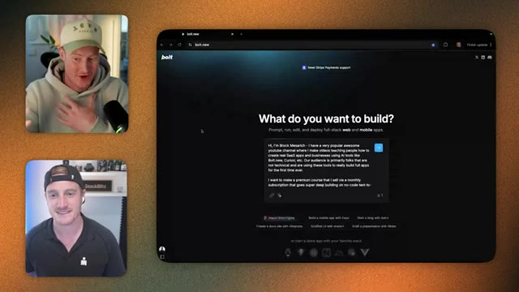
*⏱️ 00:00:08 — Capture d'écran montrant l'interface principale de bolt.new avec un prompt saisi, aux côtés des deux participants de l'appel vidéo.*

---

### ⏱️ `[00:00:31 - 00:00:50]` | Segment #02

**🔊 Audio (Transcription Intégrale Mot pour Mot en Français) :**
> J'ai hâte de voir ce qu'on peut construire aujourd'hui. Ouais, moi aussi, mec. Moi aussi. Ouais, c'est injuste. On n'a pas fait venir le PDG de Google pour se battre. Non, mais je veux dire, je connais les gars de chez Firebase. Je suis très bon ami avec eux. Tu sais, comme David Easton. Donc peu importe comment ça se passe, genre David et toute l'équipe, ne m'en voulez pas si vous m'écrasez. Ayez pitié de moi. Rejetez juste la faute sur moi. Ouais, ouais, ouais, exactement.

**👁️ Analyse Visuelle d'Écran (gemini-3.5-flash-lite) :**
**Interface & Outils** : Navigateur web affichant Bolt.new et fenêtres de visioconférence.

**Contenu textuel & Code** : Champ de saisie de prompt contenant une description textuelle détaillée pour créer une application SaaS et un cours en ligne.

**Action / Démonstration** : Saisie d'un prompt initial dans l'outil Bolt.new pour démarrer la création d'une application web complète.

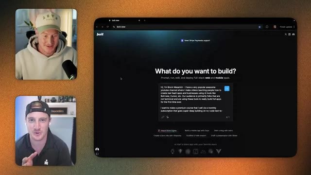
*⏱️ 00:00:35 — Capture d'écran montrant l'interface principale de Bolt.new avec deux participants en visioconférence sur le côté gauche.*

---

### ⏱️ `[00:00:50 - 00:01:09]` | Segment #03

**🔊 Audio (Transcription Intégrale Mot pour Mot en Français) :**
> Mais je suis trop content d'être sur la chaîne, au passage, parce que genre tu étais l'une des premières personnes, je te disais ça un peu plus tôt, mais genre tu étais genre l'une des premières personnes à avoir fait des vidéos sur Bolt quand on s'est lancés en octobre dernier. Et depuis, ça fait un moment que je regarde et je suis trop content d'être ici en direct avec toi. Ouais, je pense qu'on a tous les deux pas mal grandi. Vous surtout. Je suis content. La boucle est bouclée pour nous deux.

**👁️ Analyse Visuelle d'Écran (gemini-3.5-flash-lite) :**
**Interface & Outils** : Navigateur web affichant bolt.new

**Contenu textuel & Code** : Champ de prompt contenant un texte descriptif sur la création d'applications SaaS et l'utilisation d'outils d'IA, avec le texte "What do you want to build?".

**Action / Démonstration** : Présentation de la plateforme Bolt.new et discussion sur son utilisation pour créer des applications web et mobiles.

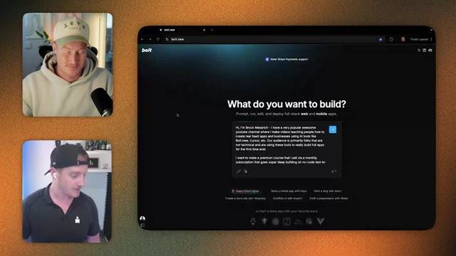
*⏱️ 00:00:55 — Capture d'écran montrant l'interface principale de Bolt.new avec une fenêtre de chat de prompt, entourée par les flux vidéo des deux participants à l'appel.*

---

### ⏱️ `[00:01:09 - 00:01:39]` | Segment #04

**🔊 Audio (Transcription Intégrale Mot pour Mot en Français) :**
> Disons simplement ça. Totalement, totalement, mec. Ouais, super. Du coup, je me suis dit que pour ça, on pourrait peut-être faire en sorte que tu construises un truc avec Bolt et que j'essaie de construire la même chose en utilisant Google Firebase Studio, pour voir un peu lequel sort une meilleure version. Donc je pense que c'est un peu comme ça qu'on devrait structurer ça. Tu as des objections par rapport à ça ? Super. Ouais. Ouais, ça a du sens. Et genre, et du coup avant ça, on avait genre, on a préparé un prompt ici, Brock et moi, juste un exemple d'application, hum, mis en place. Hum, et donc, ouais, je suis un, je suis abonné à la chaîne de Brock comme tout le monde qui regarde, j'imagine.

**👁️ Analyse Visuelle d'Écran (gemini-3.5-flash-lite) :**
**Interface & Outils** : Navigateur web affichant Bolt (bolt.new) et interface de visioconférence.

**Contenu textuel & Code** : Texte du prompt dans Bolt : présentation de la chaîne YouTube de Brock Mesarich et description du projet de cours en abonnement mensuel sur les outils no-code.

**Action / Démonstration** : Présentation et visualisation de l'interface de Bolt pour la création d'applications.

*⏱️ 00:01:17 — Capture d'écran montrant l'interface du site web Bolt (bolt.new) avec un prompt saisi dans la boîte de dialogue, ainsi que deux participants en visio sur le côté gauche.*

---

### ⏱️ `[00:01:39 - 00:02:02]` | Segment #05

**🔊 Audio (Transcription Intégrale Mot pour Mot en Français) :**
> Et donc je me suis dit, j'ai demandé à Brock, genre : « Est-ce que tu vends des vidéos premium ? » Tu sais, genre tu fais des cours ou un truc du genre. Et, euh, tu as répondu : « Pas encore ». Ouais. On a un peu envie de trouver quelque شيء qui pourrait potentiellement être un cas d'usage utile pour moi. Donc je me suis dit autant partir sur cette idée. Je, j'aimais bien. Ce sera aussi une façon sympa de présenter certaines fonctionnalités, comme la mise en place des paiements Stripe et tout ça, ainsi que l'authentification des utilisateurs avec Supabase.

**👁️ Analyse Visuelle d'Écran (gemini-3.5-flash-lite) :**
**Interface & Outils** : Navigateur web affichant Bolt.new

**Contenu textuel & Code** : Champ de saisie de prompt contenant un texte descriptif sur la chaîne YouTube de Brock Mesarich et son projet de cours premium payant.

**Action / Démonstration** : Saisie d'un prompt pour créer une application web complète via l'outil d'intelligence artificielle Bolt.new.

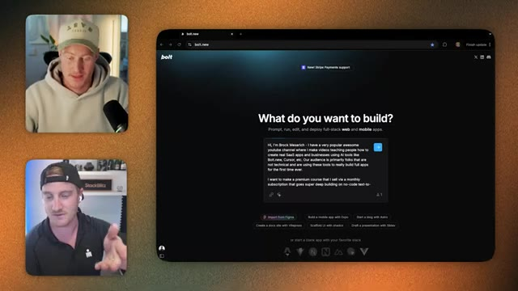
*⏱️ 00:01:45 — Capture d'écran montrant l'interface de Bolt.new sur le navigateur web, avec des vignettes vidéo des intervenants sur le côté gauche.*

---

### ⏱️ `[00:02:03 - 00:02:29]` | Segment #06

**🔊 Audio (Transcription Intégrale Mot pour Mot en Français) :**
> Donc je pense que c'est une bonne, ouais, je pense que c'est une bonne, une bonne application à choisir. Totalement. Ouais. Donc on vient juste, on s'est juste amusés avec. Tu sais, en gros, on est en train de créer une plateforme de cours où tu peux acheter un abonnement, accéder à des vidéos de genre de cours premium que Brock est en train de faire. Et on avait l'habitude d'utiliser un ton de couleur terreux. C'est genre, c'était une recommandation de Brock, de Brock pour ce à quoi ça devrait ressembler. Mais c'est genre toujours bien. J'ai l'impression que c'est toujours un bon point de départ de juste lui dire en gros ce que tu es en train de créer, à quoi l'interface utilisateur et le thème devraient ressembler.

**👁️ Analyse Visuelle d'Écran (gemini-3.5-flash-lite) :**
**Interface & Outils** : Navigateur web affichant la plateforme bolt.new et application de visioconférence.

**Contenu textuel & Code** : Texte de prompt demandant de créer une plateforme de cours premium avec abonnement mensuel et une belle page de destination aux tons terreux.

**Action / Démonstration** : Saisie ou affichage d'un prompt utilisateur dans bolt.new pour générer une application web complète.

*⏱️ 00:02:09 — Capture d'écran montrant l'interface de bolt.new avec une boîte de prompt active, et deux intervenants en visioconférence dans des cadres à gauche.*

---

### ⏱️ `[00:02:29 - 00:02:48]` | Segment #07

**🔊 Audio (Transcription Intégrale Mot pour Mot en Français) :**
> J'ai l'impression que c'est généralement une bonne première idée de prompt sur Bolt ou Firebase Studio ou n'importe quoi d'autre. 100 %. Donc je vais lancer ça. Et ça va démarrer et on va commencer à fabriquer quelque chose. Et ça va probablement prendre une minute. On vient juste d'en déployer, mais on n'a pas encore annoncé ça, mais demain on l'annonce.

**👁️ Analyse Visuelle d'Écran (gemini-3.5-flash-lite) :**
**Interface & Outils** : Navigateur web affichant l'interface de Bolt.new et deux flux vidéo des intervenants en incrustation.

**Contenu textuel & Code** : Un prompt complet demandant de créer une application de cours premium par abonnement mensuel autour des outils no-code de texte à application.

**Action / Démonstration** : Le présentateur présente l'outil Bolt.new et le prompt initial saisi pour lancer la génération de l'application.

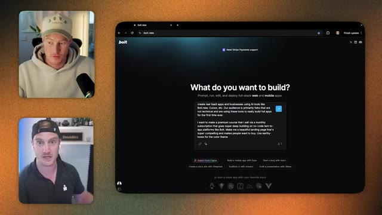
*⏱️ 00:02:34 — Capture d'écran montrant l'interface de Bolt.new avec une invite (prompt) textuelle rédigée dans le champ de saisie central.*

---

### ⏱️ `[00:02:48 - 00:03:20]` | Segment #08

**🔊 Audio (Transcription Intégrale Mot pour Mot en Français) :**
> nouvelle mise à jour de design sur Bolt, genre où nous avons beaucoup investi pour améliorer notre agent afin de faire, vous savez, une interface utilisateur et de concevoir simplement vos générations qui n'ont rien à envier aux autres, je veux dire ouais, les meilleures choses qui existent, donc c'est comme en fait en direct sur le produit, vous pouvez essayer ça sur Bolt dès maintenant, oui, pendant que ça tourne, peut-être que tu bascules sur le premier, ouais, laisse-moi prendre le contrôle de l'écran ici et allons directement sur Firebase Studio, donc j'ai en fait exactement le même prompt ici qu'Eric a réellement utilisé dans Bolt.

**👁️ Analyse Visuelle d'Écran (gemini-3.5-flash-lite) :**
**Interface & Outils** : Navigateur web affichant Bolt (bolt.new) avec un éditeur de code et un terminal intégrés.

**Contenu textuel & Code** : Code source en React (Navbar.tsx) et journal d'exécution dans le terminal (npm install).

**Action / Démonstration** : Présentation de la mise à jour de design et de l'agent de génération d'interface utilisateur de Bolt.

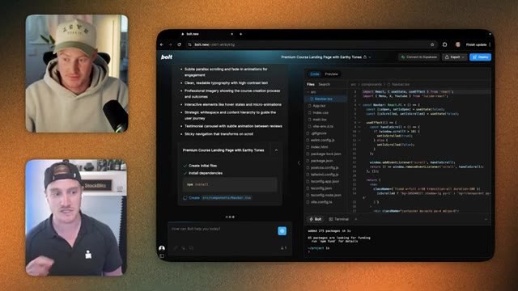
*⏱️ 00:02:56 — Capture d'écran montrant l'interface de bolt.new avec la génération de code pour une page d'atterrissage, accompagnée de deux webcams des présentateurs.*

---

### ⏱️ `[00:03:20 - 00:03:38]` | Segment #09

**🔊 Audio (Transcription Intégrale Mot pour Mot en Français) :**
> Alors laissez-moi continuer, faire ça, cliquer sur prototype avec IA. On dirait que je peux, vous savez, choisir ces différentes choses ici. Mais une autre chose que je veux mentionner aussi, c'est que je ne suis pas une personne technique, comme mon audience le sait. Donc je veux aborder cette, cette vidéo presque comme une personne non technique pour voir ce que nous pourrions construire. Parce que la plupart des gens, je suppose, ne sont pas techniques et veulent apprendre à construire avec l'IA.

**👁️ Analyse Visuelle d'Écran (gemini-3.5-flash-lite) :**
**Interface & Outils** : Interface de prototypage web / application d'IA (Firebase Studio ou similaire) et flux vidéo des participants.

**Contenu textuel & Code** : Un prompt textuel détaillant la création d'un cours par abonnement mensuel et d'une page de vente, ainsi qu'une liste de projets récents ("My workspace").

**Action / Démonstration** : Le présentateur navigue et interagit avec l'interface de l'outil de prototypage par IA.

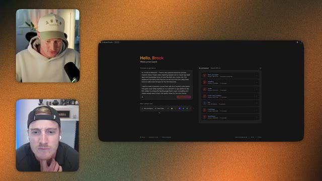
*⏱️ 00:03:24 — Capture d'écran montrant le présentateur en deux vignettes et, au centre, l'interface de l'application de prototypage par IA affichant un prompt textuel décrivant un projet de cours et une liste de projets dans l'espace de travail.*

---

### ⏱️ `[00:03:39 - 00:03:58]` | Segment #10

**🔊 Audio (Transcription Intégrale Mot pour Mot en Français) :**
> Alors, tout d'abord, nous obtenons, nous obtenons les fonctionnalités du modèle d'application qu'il indique qu'il va mettre en valeur, ainsi que la palette de couleurs, la mise en page, ce genre de choses. Je vais juste cliquer sur « Prototyper avec l'IA » parce que je ne veux pas forcément entrer dans les détails ici. On dirait qu'il va commencer à coder ça ici. Ce sera intéressant de voir, c'est-à-dire, comme la latence de comparaison, de voir lequel est le plus rapide.

**👁️ Analyse Visuelle d'Écran (gemini-3.5-flash-lite) :**
**Interface & Outils** : Interface web de prototypage d'application / Studio de design assisté par IA.

**Contenu textuel & Code** : Spécifications de fonctionnalités pour une landing page SaaS (Benefit highlighting, Testimonial section, AI-Powered FAQ) et options de palette de couleurs, incluant un bouton « Prototyper avec l'IA ».

**Action / Démonstration** : Le présentateur examine les fonctionnalités proposées par l'IA avant de cliquer pour lancer le prototypage de l'application.

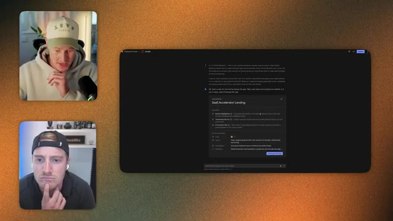
*⏱️ 00:03:43 — Capture d'écran montrant l'interface d'un outil de prototypage par IA affichant les fonctionnalités d'une application « SaaS Accelerator Landing », avec deux fenêtres de webcam du présentateur sur le côté gauche.*

---

### ⏱️ `[00:03:58 - 00:04:18]` | Segment #11

**🔊 Audio (Transcription Intégrale Mot pour Mot en Français) :**
> Ouais. Et j'aime bien leur truc de plan détaillé qu'ils font où ils disent en gros, hé, voici le aperçu global de ce qu'on va aller et probablement construire ici. Tu vois ce que je veux dire ? Donc tu peux en quelque sorte modifier peut-être le plan avant que ça ne se mette en route. Ouais. Et parce qu'avec Bolt, on a un peu, on part par défaut sur juste, hé, donne-nous un truc et on va juste se mettre au travail et commencer à le construire, ce qui est, je pense que c'est comme dans beaucoup de cas, cas d'usage, sympa.

**👁️ Analyse Visuelle d'Écran (gemini-3.5-flash-lite) :**
**Interface & Outils** : Outil de prototypage d'applications (type Firebase Studio ou similaire) et fenêtres de visioconférence.

**Contenu textuel & Code** : Plan détaillé de construction d'une application "SaaS Accelerator Landing" avec des sections de fonctionnalités et des options de personnalisation.

**Action / Démonstration** : Présentation du plan de développement généré par l'IA avant la mise en route de la construction de l'application.

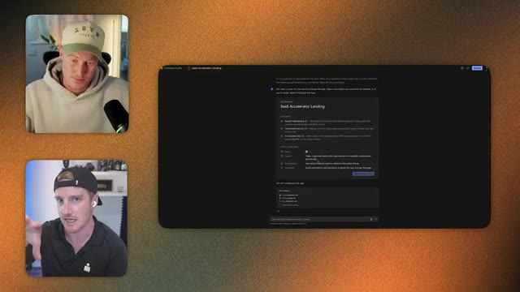
*⏱️ 00:04:03 — Capture d'écran montrant l'interface d'un outil de développement avec un plan détaillé pour une application SaaS et le présentateur en incrustation vidéo.*

---

### ⏱️ `[00:04:19 - 00:04:40]` | Segment #12

**🔊 Audio (Transcription Intégrale Mot pour Mot en Français) :**
> Mais surtout si vous construisez en quelque sorte quelque chose de structuré, du genre, ouais, je pense que c'est un peu un favori. Je pense que les deux cas d'utilisation sont bénéfiques pour de nombreuses personnes différentes. Certaines personnes veulent juste lancer un prompt, voir, OK, qu'est-ce que tu pourrais même faire avant d'aller de l'avant et de continuer avec ? D'autres personnes pourraient vouloir être un peu structurées. Personnellement, j'aime pouvoir juste donner un petit prompt et ensuite laisser Bolt faire son travail parce que j'ai confiance dans le fait que c'est bien.

**👁️ Analyse Visuelle d'Écran (gemini-3.5-flash-lite) :**
**Interface & Outils** : Interface de prototypage et de développement d'applications web (Prototype Studio).

**Contenu textuel & Code** : Spécifications de fonctionnalités pour une application SaaS, structure de code, options de personnalisation et rendu visuel d'une page web de présentation.

**Action / Démonstration** : Démonstration de la création et de la prévisualisation d'une interface de landing page SaaS à l'aide d'un outil de développement assisté.

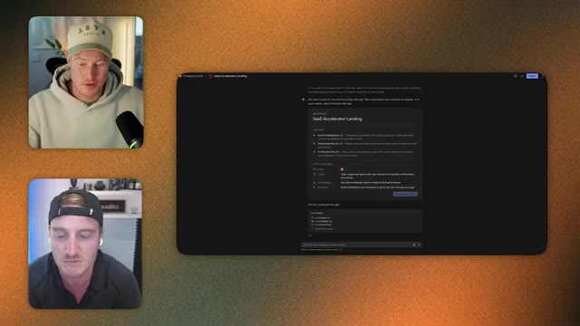
*⏱️ 00:04:24 — Vue d'une interface de développement d'application montrant les spécifications d'une landing page SaaS avec des options de configuration textuelles.*

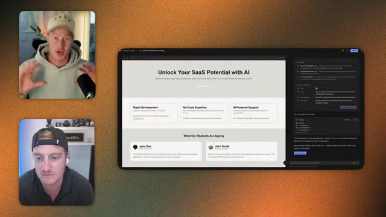
*⏱️ 00:04:30 — Affichage de la prévisualisation d'une page de destination SaaS intitulée "Unlock Your SaaS Potential with AI" générée par l'outil.*

---

### ⏱️ `[00:04:41 - 00:05:13]` | Segment #13

**🔊 Audio (Transcription Intégrale Mot pour Mot en Français) :**
> Ça va faire un bon design. Non, ouais, c'est genre si ça ne le fait pas, non ? tu fais juste genre soit tu en commences un nouveau, bon, laisse-moi juste balancer ça ou alors tu lui demandes juste en mode "je n'aime pas ça" genre "je n'aime pas ci, peu importe", exactement, c'est un peu comme ça que j'aborde le truc aussi, mais euh 100% cool donc c'est ce qu'on obtient avec Firebase Studio, c'est plutôt correct, ce n'est pas horrible, je veux dire, ça a l'air un peu, je veux dire, je ne sais pas, je retiens ma langue Brock, je retiens ma langue ici, bon, retournons vers toi alors, voyons voir quel genre de brutal, quel genre de brutal, je veux dire, je pense que la disposition générale y est, non ?

**👁️ Analyse Visuelle d'Écran (gemini-3.5-flash-lite) :**
**Interface & Outils** : Interface de création de site web / prototype web (SaaS Accelerator Landing) avec panneau latéral de configuration et prévisualisation centrale.

**Contenu textuel & Code** : Page web affichant le titre "Unlock Your SaaS Potential with AI", des sections de fonctionnalités et des témoignages, ainsi qu'un panneau de configuration textuel sur la droite.

**Action / Démonstration** : Présentation d'un modèle de design de landing page généré ou en cours de modification via l'interface logicielle.

*⏱️ 00:04:49 — Capture d'écran montrant l'interface d'un outil de création de site web par IA avec prévisualisation d'une landing page "SaaS Accelerator", accompagnée de deux intervenants en visioconférence.*

---

### ⏱️ `[00:05:13 - 00:05:33]` | Segment #14

**🔊 Audio (Transcription Intégrale Mot pour Mot en Français) :**
> Je suis d'accord. Mais c'est comme les couleurs, tu vois, je me dis. Peut-être qu'il ne comprend pas nos tons terreux qu'on vise. Ouais, ouais, ouais, un truc comme ça. Mais, tu vois, donc si on bascule, je vais te montrer ce que c'est. Ouais, renvoyons ça à Bolt. Donc c'est ce que Bolt a préparé. Oh, d'accord.

**👁️ Analyse Visuelle d'Écran (gemini-3.5-flash-lite) :**
**Interface & Outils** : Bolt.new (plateforme de développement web assistée par IA) et fenêtres de visioconférence des intervenants.

**Contenu textuel & Code** : Interface utilisateur générée automatiquement, panneau de chat latéral de l'assistant IA, arborescence de fichiers et code d'application web.

**Action / Démonstration** : Démonstration du résultat généré par l'intelligence artificielle sur Bolt.new suite aux instructions de design.

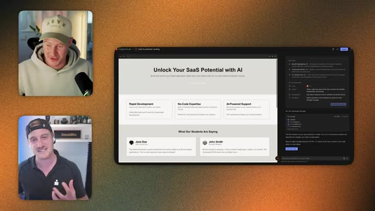
*⏱️ 00:05:18 — Aperçu de l'interface de Bolt.new affichant une application web SaaS en cours de développement avec des blocs de texte et des témoignages.*

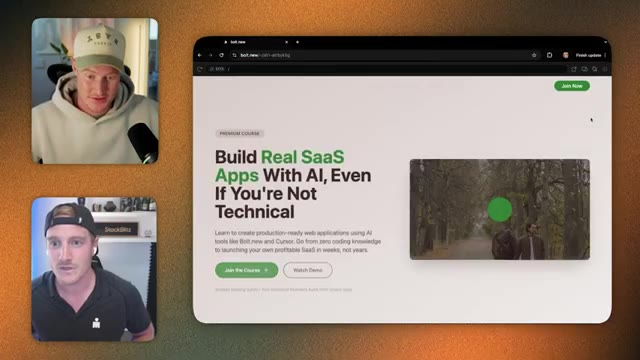
*⏱️ 00:05:28 — Affichage du rendu final de la page web générée par Bolt.new, présentant le titre "Build Real SaaS Apps With AI" avec un design vert et blanc.*

---

### ⏱️ `[00:05:33 - 00:06:06]` | Segment #15

**🔊 Audio (Transcription Intégrale Mot pour Mot en Français) :**
> Donc ça c'est, je pense qu'il y a un problème, je pense, où genre cette couleur ici en haut, ici. Ça n'a pas capté que c'est parce que je pense que c'est probablement en train de la colorer pour quand c'est dessus. Ça a l'air plutôt solide. Je ne vais pas mentir. Premier essai. Ouais. Ouais. Juste genre zéro essai. Genre c'est genre plutôt bon. Non ? Et donc je, tu sais, je peux retourner ici. Donc peut-être que pour le deuxième prompt sur les deux nôtres, je peux, tu sais, je peux en quelque sorte, tu sais, lui dire, il y a genre l'inspecteur visuel qu'on a intégré donc je peux juste cliquer et je peux cliquer sur n'importe quel élément. Et donc je vais aller ici et dire, je ne vois pas le

**👁️ Analyse Visuelle d'Écran (gemini-3.5-flash-lite) :**
**Interface & Outils** : Navigateur web, plateforme de développement et génération de code bolt.new.

**Contenu textuel & Code** : Page web générée automatiquement avec des sections de tarification, un titre principal pour une formation SaaS par l'IA, et un volet de code source.

**Action / Démonstration** : Le créateur navigue et examine le rendu visuel et les couleurs de la page web générée par l'IA.

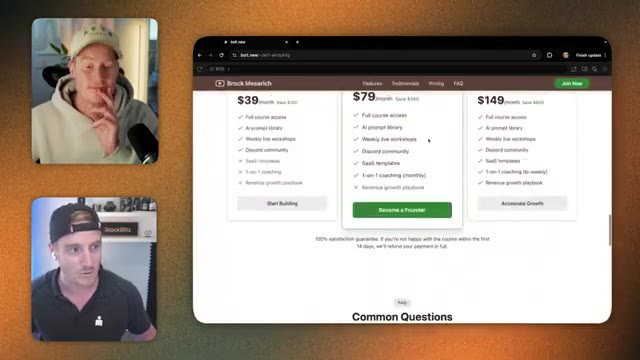
*⏱️ 00:05:41 — Vue rapprochée de la section des tarifs (Pricing) sur la page web en cours de développement via bolt.new.*

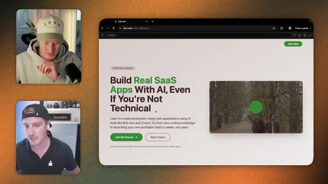
*⏱️ 00:05:49 — Aperçu de la page d'accueil (Landing Page) générée pour un cours en ligne sur le développement d'applications SaaS avec l'IA.*

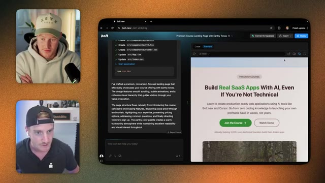
*⏱️ 00:05:58 — Interface complète de bolt.new affichant l'éditeur de code à gauche et la prévisualisation de la page web à droite.*

---

### ⏱️ `[00:06:06 - 00:06:40]` | Segment #16

**🔊 Audio (Transcription Intégrale Mot pour Mot en Français) :**
> la couleur du texte d'en-tête sur l'arrière-plan et nous allons le laisser essayer de corriger ça. Sympa. Et donc peut-être sur celui de Firebase, genre tu peux lui dire, genre, je suis plutôt curieux de savoir si tu lui dis d'essayer de s'occuper du design ou quelque chose, si ça aiderait vraiment ou quoi faire. Parce que c'est du genre, je pense que le design est une chose tellement importante, surtout pour un produit comme celui-ci que nous fabriquons, n'est-ce pas ? C'est comme quand tu vends quelque chose, l'emballage compte beaucoup, n'est-ce pas ? Si ça ne donne pas l'impression d'être de haute qualité, comme une expérience vraiment haut de gamme, c'est sûr que ça n'inspire pas confiance, n'est-ce pas, auprès du client que tu essaies d'atteindre ?

**👁️ Analyse Visuelle d'Écran (gemini-3.5-flash-lite) :**
**Interface & Outils** : Bolt.new, environnement de développement web assisté par IA.

**Contenu textuel & Code** : Code source React/TypeScript, panneau de chat interactif avec l'IA signalant un problème de couleur de texte d'en-tête.

**Action / Démonstration** : Interaction avec Bolt.new pour identifier et corriger un problème de contraste de couleur sur l'en-tête du site web en cours de création.

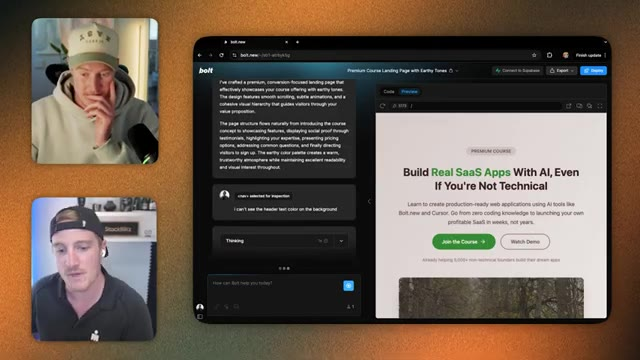
*⏱️ 00:06:15 — Image montrant l'interface de Bolt.new avec le présentateur en incrustation, affichant le chat et la prévisualisation de la page web.*

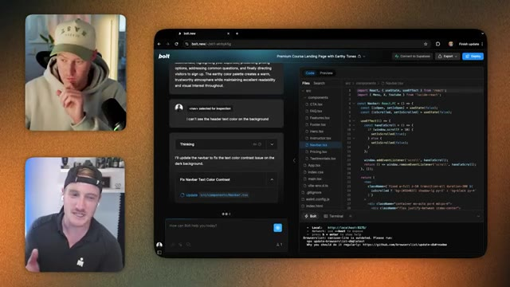
*⏱️ 00:06:23 — Image montrant Bolt.new avec le code source ouvert (Navbar.tsx) et l'assistant IA en train de corriger le contraste de la barre de navigation.*

---

### ⏱️ `[00:06:40 - 00:07:03]` | Segment #17

**🔊 Audio (Transcription Intégrale Mot pour Mot en Français) :**
> ouais, ce qui explique pourquoi on a tant investi, tu vois, et dans la création des éléments de design sur Bolt, genre, ouais, je te disais ça avant aussi, et j'adore tout simplement, genre, l'interface utilisateur de Bolt, même pas seulement le résultat qu'il te donne concernant l'appli que tu es en train de construire, mais genre, littéralement, genre, cette page sur laquelle tu te trouves en ce moment, c'est tellement, genre, satisfaisant à regarder, pour ainsi dire, donc c'est un peu, genre, un exemple parfait de l'importance de ce design.

**👁️ Analyse Visuelle d'Écran (gemini-3.5-flash-lite) :**
**Interface & Outils** : Bolt.new (éditeur de code web basé sur l'IA et environnement de prévisualisation)

**Contenu textuel & Code** : Code source React/JSX (`Hero.tsx`), structure des composants, arborescence de fichiers et interface de chat de l'assistant IA

**Action / Démonstration** : Modification automatisée du code source par l'IA pour corriger le contraste de la barre de navigation et affichage du résultat final de l'application web

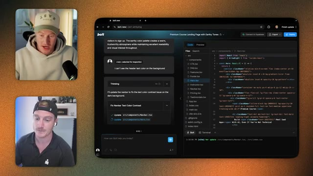
*⏱️ 00:06:45 — Interface de Bolt.new affichant l'éditeur de code source React et le panneau de discussion de l'IA.*

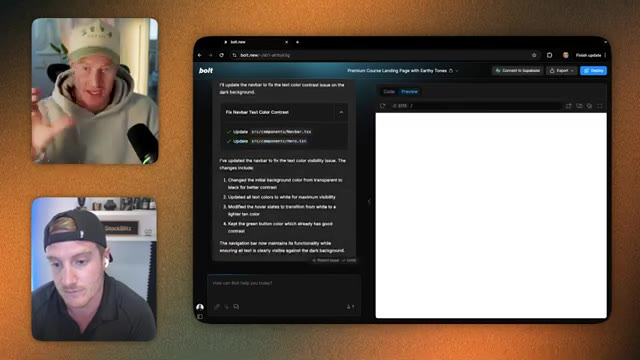
*⏱️ 00:06:51 — Interface de Bolt.new montrant le panneau de prévisualisation en cours de chargement avec les explications des modifications de code par l'IA.*

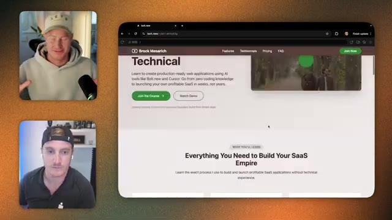
*⏱️ 00:06:57 — Aperçu complet de la landing page "Technical" générée et rendue par Bolt.new dans le navigateur.*

---

### ⏱️ `[00:07:03 - 00:07:22]` | Segment #18

**🔊 Audio (Transcription Intégrale Mot pour Mot en Français) :**
> Totalement. Donc maintenant j'en ai ajouté un petit, ça a fait comme une barre noire. Sympa. À la place. Cool. Génial. Donc qu'est-ce que tu veux faire ? Tu veux revenir sur Firebase ? Tu veux commencer à ajouter un peu de fonctionnalités sur ce truc ? Revenons sur Firebase très vite. Je veux lui donner un ou deux prompts juste pour voir si on peut rendre cette interface un tout petit peu meilleure.

**👁️ Analyse Visuelle d'Écran (gemini-3.5-flash-lite) :**
**Interface & Outils** : Navigateur web (Bolt.new)

**Contenu textuel & Code** : Interface de développement web par IA avec panneau de chat, code mis à jour (Navbar.tsx, Hero.tsx) et aperçu en direct de la page web "Build Real SaaS Apps With AI".

**Action / Démonstration** : Le présentateur commente l'ajout d'une barre de navigation foncée pour corriger un problème de contraste de couleur.

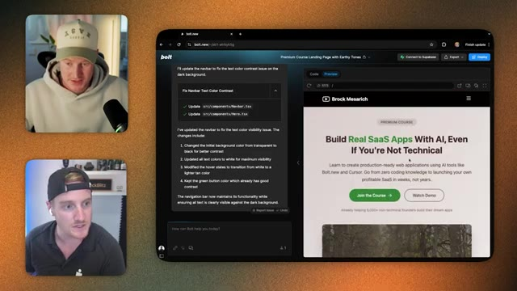
*⏱️ 00:07:08 — Capture d'écran montrant l'interface de bolt.new avec la prévisualisation d'une page de cours SaaS et les explications textuelles de l'IA sur la modification de la barre de navigation.*

---

### ⏱️ `[00:07:22 - 00:07:41]` | Segment #19

**🔊 Audio (Transcription Intégrale Mot pour Mot en Français) :**
> De plus, je n'ai pas vraiment testé les fonctionnalités pour voir si je pouvais cliquer sur ces boutons et tout le tralala et voir si ça fonctionne. Allons-y et faisons ça aussi. Donc cliquons sur partager l'écran ici. Et très bien, nous sommes de retour sur Firebase Studio ici. Il semble qu'il y ait ce petit, je pense que c'est un bouton parce que mon curseur change. C'est écrit commencez votre essai gratuit. Laisse-moi cliquer dessus. Ce n'est en fait pas fonctionnel.

**👁️ Analyse Visuelle d'Écran (gemini-3.5-flash-lite) :**
**Interface & Outils** : bolt.new, Firebase Studio, navigateur web

**Contenu textuel & Code** : Page de destination SaaS "Build Real SaaS Apps With AI", éléments de design, code source et interface de prévisualisation web.

**Action / Démonstration** : Navigation et test des fonctionnalités de l'application web générée par IA dans l'interface de développement.

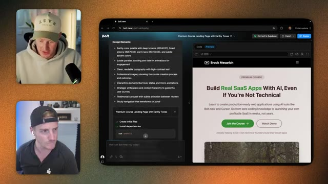
*⏱️ 00:07:27 — Capture montrant l'interface de bolt.new avec un panneau de code/chat à gauche et l'aperçu d'une page de destination SaaS à droite.*

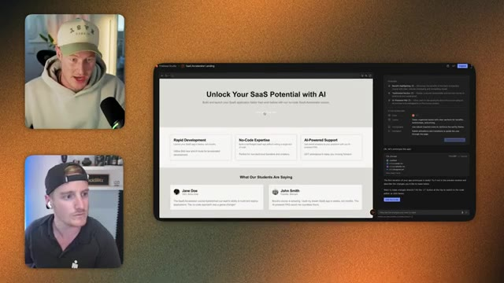
*⏱️ 00:07:32 — Capture montrant l'interface de Firebase Studio avec l'aperçu d'une application web en cours de développement et des panneaux de configuration.*

---

### ⏱️ `[00:07:42 - 00:08:25]` | Segment #20

**🔊 Audio (Transcription Intégrale Mot pour Mot en Français) :**
> Donc ça ne marche pas. On dirait qu'il y a des questions fréquentes ici. Oh, ça s'ouvre vraiment. Donc vous aurez besoin d'un abonnement. Eh bien, intéressant. D'accord. Venez simplement et allons, faisons quelques changements ici. Laissez-moi réfléchir exactement à ce que je veux faire. Euh disons simplement changeons un peu les couleurs de notre application, je veux pimenter les choses et rendre ça moins fade qu'un simple noir et blanc classique, optons pour plus de vert et disons vert clair.

**👁️ Analyse Visuelle d'Écran (gemini-3.5-flash-lite) :**
**Interface & Outils** : Bolt.new / StackBlitz (interface web de prototypage SaaS)

**Contenu textuel & Code** : Page web générée affichant 'Unlock Your SaaS Potential with AI', avec des sections 'Rapid Development', 'No-Code Expertise', 'AI-Powered Support', ainsi qu'un panneau latéral de chat et de code.

**Action / Démonstration** : Navigation et présentation de l'application SaaS générée automatiquement par l'IA.

*⏱️ 00:07:52 — Capture d'écran montrant l'interface d'un outil de développement web assisté par IA (Bolt.new / StackBlitz) avec un aperçu de page d'atterrissage SaaS et deux webcams du présentateur.*

---

### ⏱️ `[00:08:25 - 00:09:06]` | Segment #21

**🔊 Audio (Transcription Intégrale Mot pour Mot en Français) :**
> et des tons marrons, ok, allons-y avec ça, et puis je suppose que pendant qu'on y est, autant aller au-delà de notre simple page d'atterrissage, parce qu'on dirait qu'ici on a juste la page d'atterrissage, si je clique sur ce bouton, ça ne m'amène nulle part, donc autant dire, ajoutons aussi une page avec l'application réelle, comme ça après qu'un utilisateur s'est inscrit, il est dirigé vers, oups, vers l'application

**👁️ Analyse Visuelle d'Écran (gemini-3.5-flash-lite) :**
**Interface & Outils** : Navigateur web affichant une page d'atterrissage SaaS et un assistant de création ou éditeur visuel sur le côté droit.

**Contenu textuel & Code** : Page d'atterrissage intitulée "Unlock Your SaaS Potential with AI" avec des sections de fonctionnalités et des témoignages, accompagnée d'un panneau de configuration et de chat d'IA.

**Action / Démonstration** : Le présentateur commente le design de la page d'atterrissage et discute de l'ajout de nouvelles pages ou fonctionnalités.

*⏱️ 00:08:35 — Aperçu d'une application web en cours de développement avec une interface de type éditeur no-code/IA sur le panneau latéral droit.*

---

### ⏱️ `[00:09:06 - 00:09:40]` | Segment #22

**🔊 Audio (Transcription Intégrale Mot pour Mot en Français) :**
> bon d'accord, allons-y avec ça, retournons sur Bolt, faisons peut-être quelques modifications pendant que ça charge ici, cool ouais, je peux afficher le mien, j'étais en fait, j'étais juste, j'étais un peu curieux, j'en ai lancé un autre parce que je me suis dit, voyons ce qu'il conçoit d'autre, mais bon, donc on va, c'est encore en train de travailler là-dessus, mais on peut travailler, on peut se mettre au travail pour obtenir quelque chose, donc je pense, donc en gros, je pense que la prochaine étape ici pour nous, c'est d'obtenir genre, probablement un genre de système de connexion, parce que j'imagine que ce qu'on veut probablement, c'est la possibilité de s'inscrire

**👁️ Analyse Visuelle d'Écran (gemini-3.5-flash-lite) :**
**Interface & Outils** : Interface web de Bolt.new avec des fenêtres de prévisualisation d'application SaaS et un panneau latéral de code/chat.

**Contenu textuel & Code** : Textes descriptifs de landing page SaaS, sections sur le développement rapide, le no-code, des témoignages et des boutons d'appel à l'action.

**Action / Démonstration** : Présentation et démonstration de la génération d'une application web SaaS à l'aide de l'outil Bolt.new.

*⏱️ 00:09:15 — L'image montre le présentateur en visioconférence sur le côté gauche, et l'interface de Bolt.new au centre affichant une application web SaaS générée par IA intitulée "Unlock Your SaaS Potential with AI".*

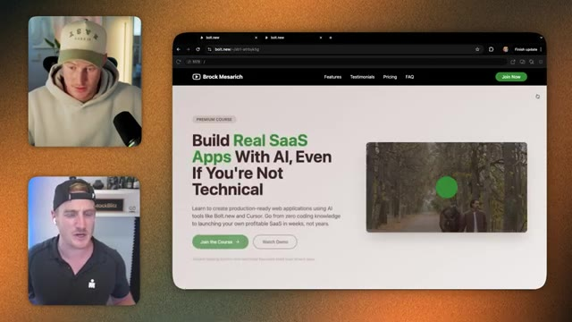
*⏱️ 00:09:32 — L'image montre le présentateur sur le côté gauche et une autre page web générée sur Bolt.new intitulée "Build Real SaaS Apps With AI, Even If You're Not Technical" avec une vidéo de démonstration.*

---

### ⏱️ `[00:09:40 - 00:10:24]` | Segment #23

**🔊 Audio (Transcription Intégrale Mot pour Mot en Français) :**
> créez un compte. Et puis si vous, euh, quand vous, si vous vous inscrivez pour un compte et que vous n'avez pas encore acheté quelque chose, il y a comme, ça dit comme, Hé, ceci, le contenu est verrouillé jusqu'à ce que vous achetiez un abonnement. C'est ça. C'est ça. Ouais. Euh, donc allons-y et essayons. C'est parti. Donc, euh, vous savez, ajoutez, euh, euh, vous savez, inscrivez-vous et connectez-vous en utilisant Supabase. Euh, quand les utilisateurs sont connectés, ils devraient voir un tableau de bord euh s'ils n'ont pas d'abonnement

**👁️ Analyse Visuelle d'Écran (gemini-3.5-flash-lite) :**
**Interface & Outils** : Bolt.new (navigateur web) et interface de visioconférence avec le présentateur.

**Contenu textuel & Code** : Texte du prompt utilisateur et aperçu d'une page web de cours en ligne avec des tons terreux ("Earthy Tones").

**Action / Démonstration** : Génération et affichage d'une page de destination interactive à l'aide d'un outil de développement no-code propulsé par l'IA.

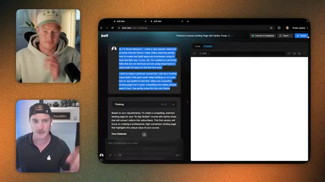
*⏱️ 00:09:51 — Interface de l'application Bolt.new affichant un prompt textuel décrivant la création d'une page de vente pour un cours en ligne.*

*⏱️ 00:10:02 — Aperçu en direct dans Bolt.new d'une page de destination avec le titre "Build Real SaaS Apps With AI".*

---

### ⏱️ `[00:10:24 - 00:10:57]` | Segment #24

**🔊 Audio (Transcription Intégrale Mot pour Mot en Français) :**
> en fait on n'a pas encore fait les paiements laisse-moi juste faire ça de façon très simple euh c'est genre bon on va juste poser les bases de l'application et genre on ajoutera les abonnements et tout ce bazar une fois qu'on aura l'authentification en place juste pour voir un tableau de bord qui dit un abonnement pour obtenir l'accès alors allons-y et euh essayons de faire ça super est-ce que l'autre est-ce que l'autre a été lancé ouais je suis curieux en fait il l'a fait ok alors voici l'autre design on obtient super c'est pas mal

**👁️ Analyse Visuelle d'Écran (gemini-3.5-flash-lite) :**
**Interface & Outils** : Navigateur web avec l'interface de développement Bolt.new (comprenant un panneau de chat avec l'IA et une vue de prévisualisation)

**Contenu textuel & Code** : Le chat affiche les modifications apportées aux fichiers de composants (ex: Navbar.tsx, Hero.tsx) et le prompt de l'utilisateur demandant l'ajout d'une authentification (signup/signin) avec Supabase et un tableau de bord.

**Action / Démonstration** : Saisie d'un prompt demandant l'intégration de l'authentification Supabase et la configuration du tableau de bord utilisateur dans l'application web.

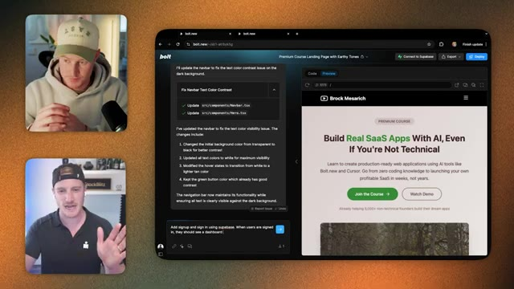
*⏱️ 00:10:32 — Interface de la plateforme Bolt.new montrant un assistant de code et un aperçu en direct d'une landing page de cours SaaS, avec le présentateur incrusté en double vue.*

---

### ⏱️ `[00:10:57 - 00:11:16]` | Segment #25

**🔊 Audio (Transcription Intégrale Mot pour Mot en Français) :**
> je pense que ce n'est pas mal je pense que je préfère notre premier design mais j'aime bien j'aime le premier aussi ouais c'est ce que j'aime faire ça j'aime mettre ces trucs côte à côte et juste genre tu vois voir ok est-ce qu'il y en a un de meilleur que l'autre tu vois euh dans ce cas-là genre le premier peut-être que le premier est le gagnant. Faisons-le. Cool. Retournons sur Firebase.

**👁️ Analyse Visuelle d'Écran (gemini-3.5-flash-lite) :**
**Interface & Outils** : Navigateur web affichant un site de cours propulsé par l'outil Bolt.new et un éditeur de code.

**Contenu textuel & Code** : Interface utilisateur d'une landing page de cours SaaS avec code React et terminal intégré.

**Action / Démonstration** : Comparaison et visualisation de différents designs et sections de pages web générées par l'IA.

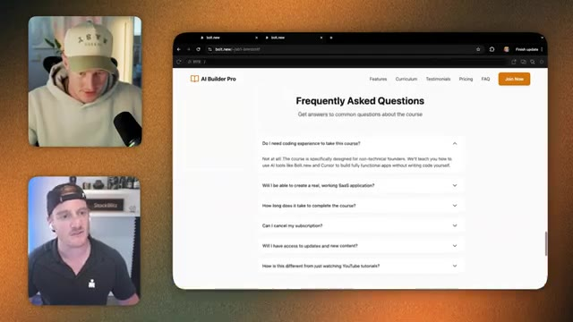
*⏱️ 00:11:02 — Aperçu d'une page web de cours en ligne montrant la section des questions fréquentes (FAQ).*

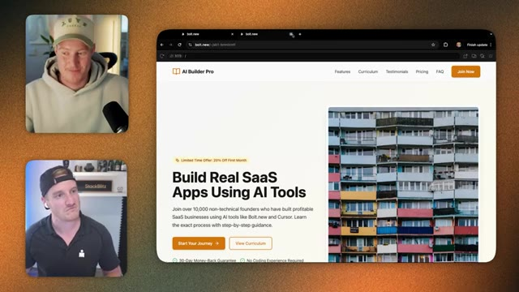
*⏱️ 00:11:07 — Aperçu de la page d'accueil du site 'AI Builder Pro' avec le titre 'Build Real SaaS Apps Using AI Tools'.*

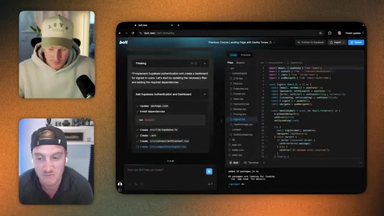
*⏱️ 00:11:11 — Interface de développement avec un volet de code source à droite et un panneau d'intelligence artificielle à gauche.*

---

### ⏱️ `[00:11:17 - 00:11:38]` | Segment #26

**🔊 Audio (Transcription Intégrale Mot pour Mot en Français) :**
> Autant le faire. On va juste faire un petit va-et-vient ici jusqu'à... J'aime bien ça. Je veux dire, c'est plutôt amusant de voir jusqu'où on va sur chacun. C'est comme tour par tour, tu vois ? Exactement. Je suis d'accord. D'accord. Donc, en revenant sur Firebase, ça dit... Je ne sais pas quels changements ça a faits ici. Laisse-moi actualiser parce que je lui avais évidemment dit de changer les couleurs de notre application.

**👁️ Analyse Visuelle d'Écran (gemini-3.5-flash-lite) :**
**Interface & Outils** : Bolt.new (éditeur de code en ligne et assistant de développement IA).

**Contenu textuel & Code** : Code source React, structure de fichiers d'un projet web, instructions textuelles de l'assistant IA et terminal intégré affichant les dépendances npm installées.

**Action / Démonstration** : Développement et prévisualisation en direct d'une application web de cours/SaaS via un assistant IA.

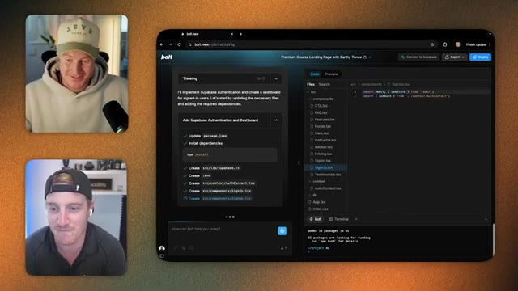
*⏱️ 00:11:22 — Interface Bolt.new affichant l'éditeur de code, le terminal et le panneau de génération d'une application web avec intégration Supabase.*

*⏱️ 00:11:32 — Aperçu de la page d'atterrissage SaaS générée par l'IA (« Unlock Your SaaS Potential with AI ») avec l'interface de Bolt.new sur le côté droit.*

---

### ⏱️ `[00:11:38 - 00:11:59]` | Segment #27

**🔊 Audio (Transcription Intégrale Mot pour Mot en Français) :**
> On dirait que ça n'a changé aucune des couleurs. ainsi que cliquer sur commencer votre essai gratuit. Donc on dirait que ce bouton ne fonctionne pas. Voyons voir. Est-ce que j'rate quelque chose là ? Je ne sais pas pourquoi ça n'a pas pris en compte ces changements. On dirait... Peut-être juste essayer de rafraîchir tout le truc.

**👁️ Analyse Visuelle d'Écran (gemini-3.5-flash-lite) :**
**Interface & Outils** : Navigateur web / Outil de développement No-Code (Bolt/StackBlitz Studio) et flux vidéo des présentateurs.

**Contenu textuel & Code** : Page de prévisualisation "Unlock Your SaaS Potential with AI" avec des sections de fonctionnalités et des témoignages, ainsi qu'un panneau latéral de chat pour les modifications par IA.

**Action / Démonstration** : Le présentateur examine la page de prévisualisation et teste les fonctionnalités de l'interface de génération de site web par IA.

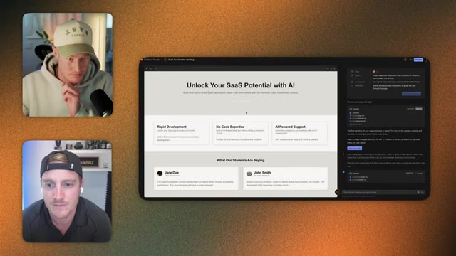
*⏱️ 00:11:43 — Capture d'écran montrant l'interface d'un outil de développement No-Code avec un aperçu de page web d'atterrification SaaS et deux fenêtres de webcam des présentateurs.*

---

### ⏱️ `[00:11:59 - 00:12:18]` | Segment #28

**🔊 Audio (Transcription Intégrale Mot pour Mot en Français) :**
> Ouais, bon point. Parce que ça, je ne sais pas si... Parfois ces trucs basés sur des machines virtuelles, comme Bolt, s'exécutent entièrement dans votre navigateur. Donc, quand vous rafraîchissez la page, ça vous donne en quelque sorte un environnement propre à chaque fois. S'il y a un problème avec la machine virtuelle, parce que c'est comme Firebase et Lovable et tous ces trucs, ils ont des machines virtuelles dans le cloud auxquelles vous vous connectez.

**👁️ Analyse Visuelle d'Écran (gemini-3.5-flash-lite) :**
**Interface & Outils** : Interface de développement web (semblable à Bolt) intégrant un panneau de prévisualisation et des outils d'IA.

**Contenu textuel & Code** : Une landing page SaaS intitulée 'Unlock Your SaaS Potential with AI' avec des sections de fonctionnalités et de témoignages clients.

**Action / Démonstration** : Présentation et démonstration de la génération d'une application web à l'aide d'une plateforme de développement basée sur l'IA.

*⏱️ 00:12:09 — Image #2 montre les deux intervenants à gauche et une interface de développement web SaaS avec un aperçu de landing page et un panneau d'outils d'intelligence artificielle à droite.*

---

### ⏱️ `[00:12:18 - 00:12:58]` | Segment #29

**🔊 Audio (Transcription Intégrale Mot pour Mot en Français) :**
> Donc quelque chose se casse dessus, même actualiser votre page va juste genre se reconnecter à la même genre de machine virtuelle cassée, ce qui pourrait faire se demander, qu'est-ce qui se passe ici. Difficile à dire, mais ça pourrait être, peut-être juste lui dire, faire genre, Hé, je pense qu'il y a quelque chose qui ne va pas. Ouais, ouais, disons simplement, on dirait que je ne vois aucune des mises à jour des couleurs, ainsi que la, voyons voir, fonctionnalité du bouton commencez votre essai gratuit.

**👁️ Analyse Visuelle d'Écran (gemini-3.5-flash-lite) :**
**Interface & Outils** : Navigateur web, interface de développement SaaS avec panneau latéral de configuration et de chat.

**Contenu textuel & Code** : Page affichant le titre "Unlock Your SaaS Potential with AI", des sections pour le développement rapide, l'expertise sans code, le support alimenté par l'IA, ainsi que des témoignages et des options de modification par chat.

**Action / Démonstration** : Présentation de la maquette ou de l'application SaaS en cours de développement avec des outils d'intelligence artificielle.

*⏱️ 00:12:28 — Capture d'écran montrant l'interface d'un outil de développement web ou d'une application SaaS avec un aperçu de page d'atterrissage à gauche et un panneau de configuration avec des options de code et de prompts à droite.*

---

### ⏱️ `[00:13:01 - 00:13:34]` | Segment #30

**🔊 Audio (Transcription Intégrale Mot pour Mot en Français) :**
> Disons simplement, implémentons ceux-là. Donc j'espère qu'il comprend cette fois. Ouais, intéressant. Quelque chose me dit, je veux dire, j'ai un peu utilisé Firebase avant, comme les gens l'ont vu sur la chaîne, euh, je n'étais pas allé trop loin avec, je pense que Bolt va probablement surpasser ça, honnêtement, mais je veux donner à Firebase, tu vois, au moins une chance équitable ici pour voir jusqu'où on peut aller. Encore une fois, c'est peut-être plus orienté vers les développeurs, je sais que ça s'intègre peut-être avec l'écosystème de Google et c'est un peu l'attrait derrière l'utilisation de ceci, mais ouais, personnellement je n'étais pas allé trop loin avec, on dirait que, voyons voir, je ne vois toujours pas les mises à jour ici, allons-y, je vais

**👁️ Analyse Visuelle d'Écran (gemini-3.5-flash-lite) :**
**Interface & Outils** : Interface de développement Bolt.new (Web IDE et assistant IA) avec prévisualisation de page web.

**Contenu textuel & Code** : Page de destination SaaS ("Unlock Your SaaS Potential with AI") avec sections de fonctionnalités (Rapid Development, No-Code Expertise, AI-Powered Support) et avis clients, ainsi que les messages de l'assistant de programmation dans le panneau latéral droit.

**Action / Démonstration** : Affichage de l'application web générée par l'IA et de l'historique des modifications de code dans l'interface Bolt.new.

*⏱️ 00:13:09 — Capture d'écran montrant l'interface de développement Bolt.new avec une page web générée ("SaaS Accelerator Landing") sur la gauche et le panneau de chat de l'assistant IA sur la droite, accompagnée de deux flux vidéo des présentateurs dans des encarts à gauche.*

---

### ⏱️ `[00:13:34 - 00:14:04]` | Segment #31

**🔊 Audio (Transcription Intégrale Mot pour Mot en Français) :**
> renvoie-le-moi et puis euh revoyons cela dans un instant ouais on dirait que ça ne se met pas du tout à jour non ça ne met rien à jour vraiment bizarre confus donc le mien le mien est terminé euh et je vais afficher ça euh donc la prochaine étape est euh ça dit que je dois me connecter à Supabase donc je vais le faire alors super clique simplement là-dessus je vais créer un nouveau projet Supabase euh je vais appeler ça euh tu sais mon projet cool en fait je vais appeler ça genre plateforme de cours ou ou quelque chose comme ça.

**👁️ Analyse Visuelle d'Écran (gemini-3.5-flash-lite) :**
**Interface & Outils** : Interface de développement web Bolt.new avec intégration Supabase.

**Contenu textuel & Code** : Instructions pour connecter Supabase, champs de configuration de base de données (nom du projet, mot de passe, région).

**Action / Démonstration** : Configuration de la connexion à la base de données Supabase pour l'application en cours de développement.

*⏱️ 00:13:42 — Interface de Bolt.new affichant une application web SaaS générée par IA avec des sections de fonctionnalités et des témoignages.*

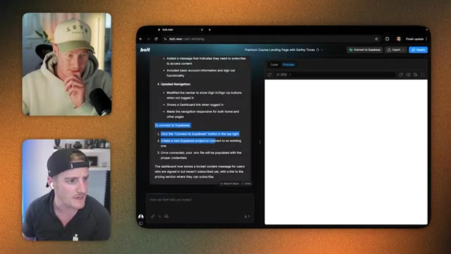
*⏱️ 00:13:49 — Instructions textuelles dans Bolt.new détaillant les étapes pour se connecter à Supabase.*

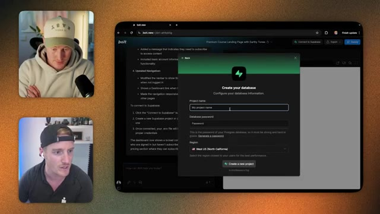
*⏱️ 00:13:57 — Fenêtre modale de création de base de données Supabase au sein de l'interface Bolt.new, demandant un nom de projet et un mot de passe.*

---

### ⏱️ `[00:14:11 - 00:14:38]` | Segment #32

**🔊 Audio (Transcription Intégrale Mot pour Mot en Français) :**
> Crée ce nouveau projet. Très bien, donc sur ce genre de truc, c'est comme un truc cool, pour moi, genre tellement une partie cool de l'expérience, tu vois, je devrais aller sur Supabase pour lancer cette base de données. Ça va juste tout provisionner et mettre en place, la rendre opérationnelle, et cetera. Ouais. Et puis à partir d'ici, ça devrait, donc ce qu'on récupère, je veux dire, ça devrait avoir toute l'authentification et la possibilité de genre s'inscrire et se connecter et de pouvoir voir ce tableau de bord où c'est écrit, hé, tu dois genre avoir un abonnement.

**👁️ Analyse Visuelle d'Écran (gemini-3.5-flash-lite) :**
**Interface & Outils** : Navigateur web affichant bolt.new

**Contenu textuel & Code** : Menu de configuration "Connect to Supabase" avec les étapes : Connect to Supabase, Create project, Setup authentication, Create database, Finalize setup.

**Action / Démonstration** : Connexion et configuration automatique de Supabase pour le projet en cours de création.

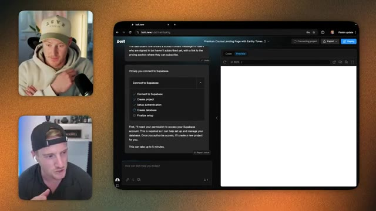
*⏱️ 00:14:18 — Capture d'écran montrant l'interface de bolt.new avec un panneau de discussion à gauche proposant de se connecter à Supabase, et un panneau d'aperçu à droite, avec les webcams des présentateurs superposées sur le côté gauche.*

---

### ⏱️ `[00:14:38 - 00:15:04]` | Segment #33

**🔊 Audio (Transcription Intégrale Mot pour Mot en Français) :**
> Et puis la dernière étape, ça va juste être d'obtenir les paiements. Oui, à 100 %. Aussi, un truc que je veux mentionner aussi, c'est que venant d'une perspective de personne non technique, construire des choses avec ces plateformes, c'est que Firebase Studio utilise évidemment Firebase pour leurs bases de données et tout le tralala. Et j'ai juste eu des problèmes en l'utilisant par le passé. Ce n'est pas aussi facile à utiliser pour une personne non technique. Le fait que vous ayez cette intégration native de Supabase rend les choses, c'est tellement plus facile à utiliser si vous n'avez pas, vous n'avez pas déjà la compréhension du genre d'être un développeur en quelque sorte.

**👁️ Analyse Visuelle d'Écran (gemini-3.5-flash-lite) :**
**Interface & Outils** : Navigateur web affichant la plateforme de développement et de prévisualisation Bolt.new.

**Contenu textuel & Code** : Interface utilisateur avec panneau de chat de l'assistant IA à gauche et fenêtre de prévisualisation web de l'application SaaS à droite.

**Action / Démonstration** : Démonstration de la configuration automatique d'une base de données Supabase et visualisation du résultat de la landing page SaaS.

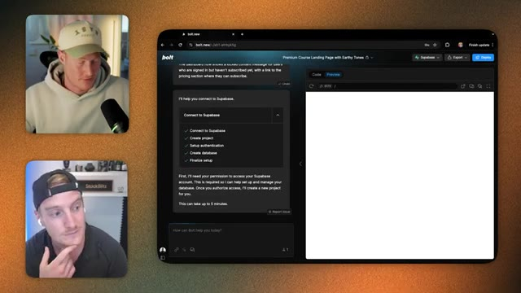
*⏱️ 00:14:45 — L'interface de Bolt.new affichant un assistant textuel configurant l'intégration avec Supabase avec une liste de vérification des étapes.*

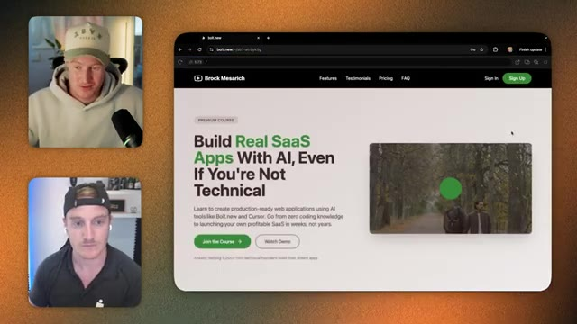
*⏱️ 00:14:51 — La page d'accueil d'un cours en ligne nommé "Build Real SaaS Apps With AI, Even If You're Not Technical" générée et prévisualisée.*

---

### ⏱️ `[00:15:04 - 00:15:23]` | Segment #34

**🔊 Audio (Transcription Intégrale Mot pour Mot en Français) :**
> Donc c'est une chose que je veux mentionner. Donc on dirait qu'on pourrait tester ça maintenant. Essayons. Ouais. Ouais, totalement. Donc vas-y, laisse-moi... vas-y et... Bon, parfait. Donc je viens de créer un compte. Je pense que je suis effectivement connecté. Donc si je rafraîchis ça... Ouais, donc j'ai un tableau de bord. J'accède à la suite du tableau de bord. D'accord. Donc c'est...

**👁️ Analyse Visuelle d'Écran (gemini-3.5-flash-lite) :**
**Interface & Outils** : Navigateur web affichant l'application bolt.new (plateforme de développement SaaS).

**Contenu textuel & Code** : Formulaire d'inscription (« Create Your Account ») avec les champs pour l'adresse e-mail et le mot de passe, ainsi que les flux vidéo des participants.

**Action / Démonstration** : Inscription ou connexion à un compte utilisateur sur la plateforme bolt.new.

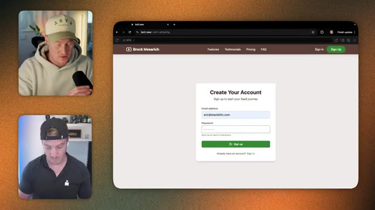
*⏱️ 00:15:09 — Capture d'écran montrant l'interface de création de compte sur bolt.new aux côtés des webcams des intervenants.*

---

### ⏱️ `[00:15:23 - 00:15:44]` | Segment #35

**🔊 Audio (Transcription Intégrale Mot pour Mot en Français) :**
> Le statut de l'abonnement est inactif. Abonnez-vous maintenant. Encore une fois, cela ne fait rien pour l'instant. Parce que nous ne l'avons pas fait. Tu sais ? Est-ce que la déconnexion fonctionne ? La déconnexion fonctionne. Super. Donc je peux en fait me reconnecter. Oh, mon Dieu. Et voilà.

**👁️ Analyse Visuelle d'Écran (gemini-3.5-flash-lite) :**
**Interface & Outils** : Navigateur web affichant la plateforme Bolt.new et le site web de Brock Mesarich.

**Contenu textuel & Code** : Page de landing "Build Real SaaS Apps With AI" et formulaire "Welcome Back" pour la connexion.

**Action / Démonstration** : Navigation sur le site et test du processus de connexion.

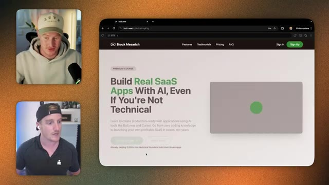
*⏱️ 00:15:28 — Page d'accueil du site web avec le présentateur incrusté à gauche.*

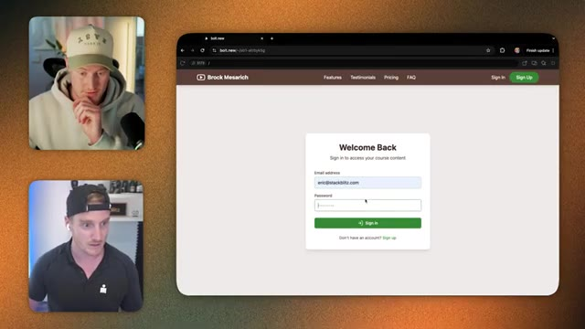
*⏱️ 00:15:33 — Formulaire de connexion affiché sur le site web avec un e-mail pré-rempli.*

---

### ⏱️ `[00:15:44 - 00:16:05]` | Segment #36

**🔊 Audio (Transcription Intégrale Mot pour Mot en Français) :**
> Mot de passe un, deux, trois. Ouais. Difficile à, difficile à oublier. D'accord, cool. Donc ouais, genre je suppose prochaine étape, et si on, et si on ajoutait des paiements à ce truc. Ouais. Faisons-le. À 100 %. Ouais. Utilisons le prompt là-bas pour ce qui est de commencer avec les paiements. Et puis peut-être qu'on retourne sur Firebase Studio. Voir si je peux faire des, faire des progrès ici.

**👁️ Analyse Visuelle d'Écran (gemini-3.5-flash-lite) :**
**Interface & Outils** : Navigateur web, plateforme de développement Bolt.new, StackBlitz.

**Contenu textuel & Code** : Fichiers de configuration `.env` avec clés Supabase masquées, arborescence de projet, terminal avec commande `npm install`.

**Action / Démonstration** : Navigation sur l'application web pour visualiser le statut d'abonnement inactif et transition vers l'environnement de code pour intégrer les paiements.

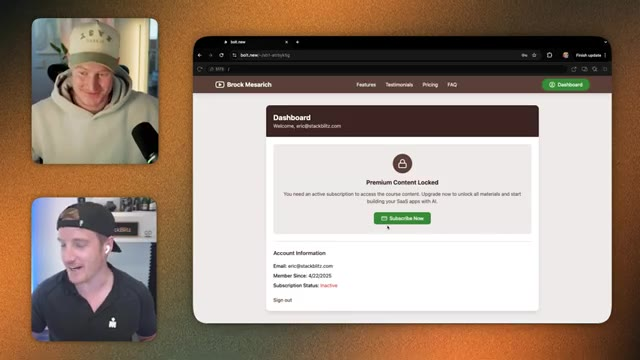
*⏱️ 00:15:49 — Aperçu du tableau de bord d'une application web avec un contenu premium verrouillé et un bouton d'abonnement.*

*⏱️ 00:16:00 — Interface de développement Bolt affichant l'explorateur de fichiers, les clés d'environnement Supabase et le terminal en cours d'exécution.*

---

### ⏱️ `[00:16:05 - 00:16:29]` | Segment #37

**🔊 Audio (Transcription Intégrale Mot pour Mot en Français) :**
> Mais ouais. D'accord. Voyons voir. Donc je pense qu'on veut ajouter un, qu'est-ce qu'ils nous ont donné genre, je pense que le prix est genre il y a genre trois prix différents. Peut-être qu'on dit juste genre, tu sais, ajoutons des paiements Stripe à ça et voyons ce qu'il nous dit de faire.

**👁️ Analyse Visuelle d'Écran (gemini-3.5-flash-lite) :**
**Interface & Outils** : Navigateur web affichant l'interface de développement Bolt (bolt.new) avec panneau de chat de l'assistant IA et aperçu en direct de la page web.

**Contenu textuel & Code** : Console de Bolt affichant "Importing StackBlitz Project", l'installation des dépendances (npm install) et le lancement de l'application (npm run dev), avec un aperçu montrant des options de tarification (SaaS Founder à 79$/mois).

**Action / Démonstration** : Le présentateur explique et visualise l'avancement de l'importation du projet et la structure de la page de tarification générée par l'IA.

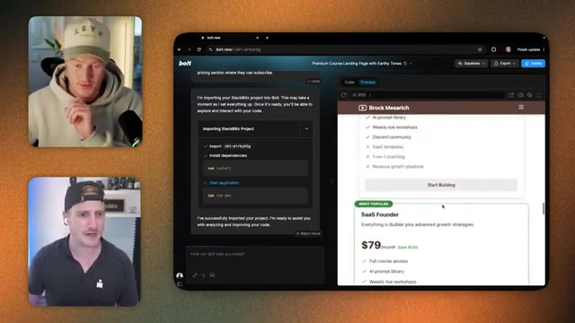
*⏱️ 00:16:11 — Interface de l'application web Bolt montrant l'importation d'un projet StackBlitz à gauche et un aperçu d'une page de tarification (pricing) à droite.*

---

### ⏱️ `[00:16:29 - 00:16:55]` | Segment #38

**🔊 Audio (Transcription Intégrale Mot pour Mot en Français) :**
> Ouais, j'ai un compte Stripe. Super, d'accord. Parfait. D'accord, alors section développeur, récupérer ma clé API. Un truc que je, un truc que je disais à Eric avant de faire ça aussi, c'est, euh, évidemment par le passé, il y avait des problèmes avec l'impossibilité d'utiliser Stripe avec Bolt, mais votre nouvelle intégration Stripe à vous, euh, est de loin la plus fluide que j'aie utilisée sur n'importe quelle plateforme.

**👁️ Analyse Visuelle d'Écran (gemini-3.5-flash-lite) :**
**Interface & Outils** : Navigateur web (Bolt.new / Stripe)

**Contenu textuel & Code** : Interface web avec des zones délibérément floutées pour des raisons de confidentialité (clés API Stripe).

**Action / Démonstration** : Navigation et préparation de l'intégration de clés API Stripe dans un projet de développement.

---

### ⏱️ `[00:16:55 - 00:17:34]` | Segment #39

**🔊 Audio (Transcription Intégrale Mot pour Mot en Français) :**
> Donc je suis tellement ravi que vous ayez enfin réussi à implémenter quelque chose. Parce que ça a été, ça a été absolument génial de l'intégrer facilement et sans transition dans vos applications. Merci, mec. Ouais, je suis d'accord. Je veux dire, c'est, c'est comme la manière la plus simple je pense qui ait jamais existé pour genre, genre quand tu construis un truc réel, tu vois, c'est comme. un super stripe parce qu'il s'agit de ça genre mon mais le bac à sable de stripe donc je ne ils ne divulguent rien ici euh et je le colle juste ici je clique sur récupérer mes produits et il n'y a pas de produits je dois aller ajouter des produits ici ce qui est tout à fait logique donc je peux retourner ici et aller dans mon catalogue de produits et je vais créer un nouveau produit appelons ça genre notre tu vois plan mensuel à 49 dollars et c'est un plan mensuel récurrent à 49 dollars créons-le

**👁️ Analyse Visuelle d'Écran (gemini-3.5-flash-lite) :**
**Interface & Outils** : Bolt.new et Stripe Dashboard (Sandbox)

**Contenu textuel & Code** : Clé API Stripe masquée, formulaire d'ajout de produit (nom, description, prix, facturation récurrente ou unique en USD)

**Action / Démonstration** : Configuration et intégration transparente des paiements par carte bancaire via Stripe dans l'application générée.

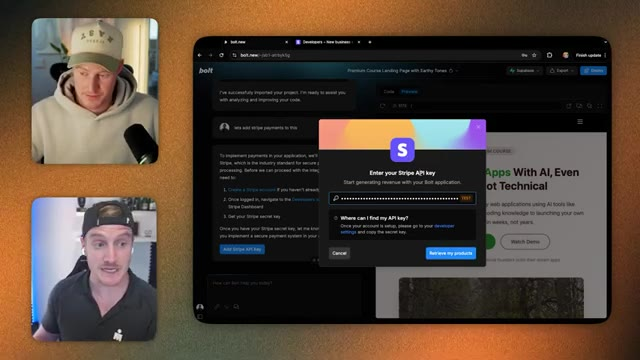
*⏱️ 00:17:05 — Interface de Bolt.new affichant une pop-up demandant d'entrer la clé API Stripe pour intégrer les paiements.*

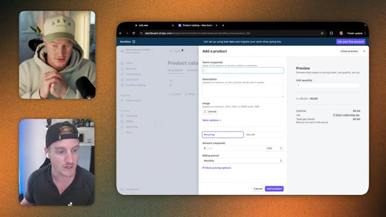
*⏱️ 00:17:25 — Tableau de bord de Stripe (Sandbox) affichant le formulaire d'ajout d'un nouveau produit ("Add a product").*

---

### ⏱️ `[00:17:34 - 00:18:12]` | Segment #40

**🔊 Audio (Transcription Intégrale Mot pour Mot en Français) :**
> l'un de ces gars euh et à partir de là euh allons-y et mettons à jour nos produits d'accord cochez cochez selon le cas et donc si vous avez du genre un compte Stripe vous avez tout un tas de produits différents je suppose que tout cela serait chargé ici et vous pourriez simplement piocher et choisir ceux que vous voulez ajouter d'accord super absolument et ce qui est chouette c'est que ça va chercher tout ce qui se trouve sous le capot comme l'identifiant du produit et tout le tralala genre c'est juste vous savez quelqu'un comme moi je ne vis pas et ne respire pas Stripe hein genre je suis genre vous savez j'ai un parcours de développeur genre je n'aime pas regarder toutes ces choses ouais c'est genre beaucoup mec tu vois euh donc ce qui est plutôt cool c'est que ça se contente de

**👁️ Analyse Visuelle d'Écran (gemini-3.5-flash-lite) :**
**Interface & Outils** : Navigateur web affichant l'outil de développement et de génération de code bolt.new avec interface de chat et éditeur de code.

**Contenu textuel & Code** : Modale de sélection de produits Stripe avec un abonnement de 49 $, et panneau de code source avec fonctions Edge Supabase pour Stripe.

**Action / Démonstration** : Sélection et synchronisation des produits Stripe dans l'interface de l'application en cours de création par l'IA.

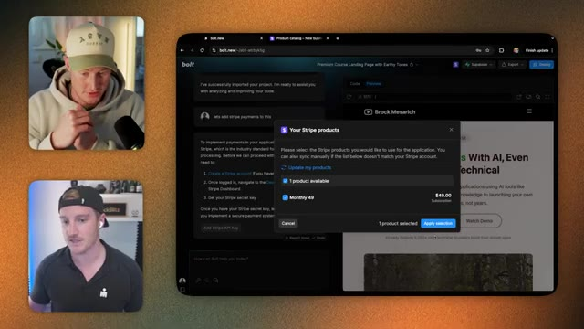
*⏱️ 00:17:44 — Fenêtre modale "Your Stripe products" affichant la sélection d'un produit d'abonnement (Monthly 49) au sein de l'interface de développement bolt.new.*

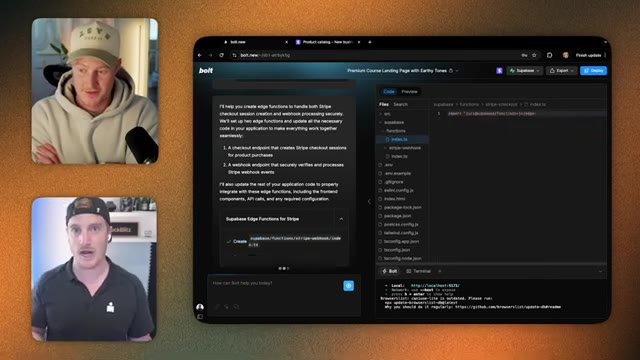
*⏱️ 00:18:03 — Génération de code et affichage de l'arborescence de fichiers dans bolt.new, avec un terminal intégré montrant l'exécution locale de l'application.*

---

### ⏱️ `[00:18:12 - 00:18:45]` | Segment #41

**🔊 Audio (Transcription Intégrale Mot pour Mot en Français) :**
> et ça vient juste de te guider dans toute la plomberie, toutes les mises à jour que tu dois faire sur la base de données, comme assurer le suivi des abonnements individuels et tout ça, c'est génial, ça écrit en fait les fonctions backend et ça les déploie pour toi sur ce projet Supabase. Je pense que l'un des trucs avec ces plateformes, c'est que les gens qui construisent des trucs avec, je ne pense pas que les gens réalisent vraiment ce qui se cache sous le capot, à moins d'être un développeur et de se dire « oh, j'ai déjà fait ça moi-même », alors que moi, je suis plutôt du genre « oh, je veux juste intégrer Stripe et si ça marche, oh, je veux juste que ça marche », je ne connais pas forcément la raison technique sous-jacente du pourquoi ça marche, mais quand on décortique tout ça, c'est vraiment assez impressionnant tout ce que ça fait.

**👁️ Analyse Visuelle d'Écran (gemini-3.5-flash-lite) :**
**Interface & Outils** : bolt.new, Supabase

**Contenu textuel & Code** : Code TypeScript pour l'intégration de Stripe, gestion des paiements, schémas de base de données et prévisualisation d'une page de cours SaaS.

**Action / Démonstration** : Le créateur montre la génération automatique de code backend et l'application des migrations de base de données via l'assistant IA de bolt.new.

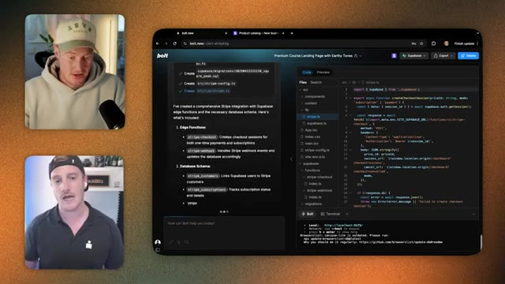
*⏱️ 00:18:20 — L'interface de bolt.new affichant le code source d'une intégration Stripe et les fonctions associées dans un panneau latéral.*

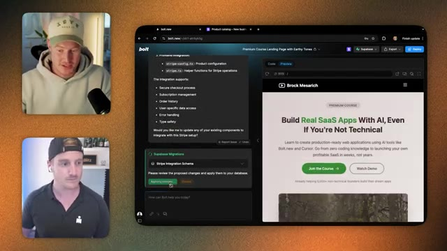
*⏱️ 00:18:29 — L'interface de bolt.new montrant un aperçu de l'application SaaS en cours de développement avec un panneau de migration Supabase en cours d'application.*

---

### ⏱️ `[00:18:45 - 00:19:07]` | Segment #42

**🔊 Audio (Transcription Intégrale Mot pour Mot en Français) :**
> le back-end même dans Supabase avec du coup les edge functions et tout ce truc genre et c'est plutôt impressionnant totalement ouais je suis totalement d'accord mec euh et euh ouais allons allons donner sa chance à ce truc donc je vais y aller et me reconnecter. Mot de passe un, deux, trois. Et je suis dedans. Et donc allons-y et cliquons sur ce bouton s'abonner maintenant et voyons si ça marche.

**👁️ Analyse Visuelle d'Écran (gemini-3.5-flash-lite) :**
**Interface & Outils** : Navigateur web affichant une application web développée via Bolt.new / StackBlitz.

**Contenu textuel & Code** : Formulaire de connexion, champs d'authentification et tableau de bord avec gestion d'abonnement SaaS.

**Action / Démonstration** : Connexion de l'utilisateur à l'application et visualisation du tableau de bord avec contenu verrouillé.

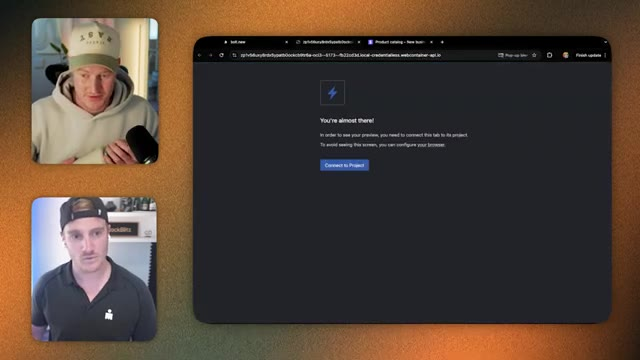
*⏱️ 00:18:50 — Écran de prévisualisation Bolt.new affichant un message de connexion au projet ("You're almost there!").*

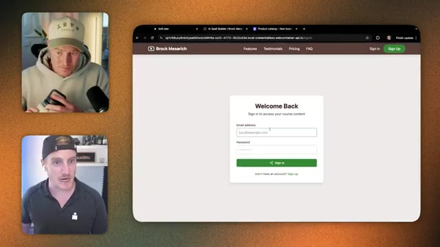
*⏱️ 00:18:56 — Interface Web de connexion de l'application SaaS (Brock Mesarich) demandant l'email et le mot de passe.*

*⏱️ 00:19:01 — Tableau de bord utilisateur montrant un contenu verrouillé ("Premium Content Locked") et le statut d'abonnement inactif.*

---

### ⏱️ `[00:19:07 - 00:19:31]` | Segment #43

**🔊 Audio (Transcription Intégrale Mot pour Mot en Français) :**
> Oh, comment est-ce que je, comment est-ce que je, comment est-ce que je fais cette tarification ? Où est-ce que c'est ? Laissez-moi demander. Donc c'est le mode discussion. C'est donc un nouveau mode qu'on a en fait demandé. Donc du genre, je ne veux pas forcément que l'agent aille faire quelque chose tout de suite. Genre il y a un truc, je me dis, comment est-ce que je... ça vient juste d'ajouter les paiements, il me semble. Donc c'est un peu du genre, je veux poser ça sous forme de questions et pouvoir déterminer en collaboration ce qui se passe, puis planifier ce qu'on fait ?

**👁️ Analyse Visuelle d'Écran (gemini-3.5-flash-lite) :**
**Interface & Outils** : Navigateur web, plateforme de développement Bolt.new, interface de prévisualisation SaaS.

**Contenu textuel & Code** : Documentation sur l'intégration Stripe (stripe-config.ts, stripe.ts), options de sécurité (RLS), et page de tableau de bord utilisateur avec abonnement inactif.

**Action / Démonstration** : Navigation et explication du mode discussion sur Bolt.new pour configurer la tarification et les abonnements Stripe sans modifier directement le code.

*⏱️ 00:19:13 — Interface Bolt.new affichant une application SaaS en cours de développement avec un panneau de discussion à gauche et un aperçu web à droite.*

*⏱️ 00:19:19 — Aperçu d'une page web SaaS (Dashboard) indiquant que le contenu est verrouillé ("Premium Content Locked") avec une option d'abonnement.*

*⏱️ 00:19:25 — Interface Bolt.new montrant le mode de discussion ("Discuss mode") activé en bas du panneau de configuration de l'IA.*

---

### ⏱️ `[00:19:31 - 00:19:51]` | Segment #44

**🔊 Audio (Transcription Intégrale Mot pour Mot en Français) :**
> Donc vous cliquez juste sur ce petit bouton ici. On peut discuter et dire, vous savez, je suis sur le tableau de bord et je clique, vous savez, sur s'abonner maintenant, mais ça ne me mène pas, vous savez, à Stripe. Et ce que j'imagine, c'est que ça ne l'a probablement tout simplement pas lié.

**👁️ Analyse Visuelle d'Écran (gemini-3.5-flash-lite) :**
**Interface & Outils** : Navigateur web, plateforme de développement Bolt.new, prévisualisation de page d'atterrissage (SaaS).

**Contenu textuel & Code** : Code d'intégration Stripe, configuration de base de données, instructions de paiement et invite de discussion textuelle.

**Action / Démonstration** : Saisie d'une instruction textuelle pour résoudre un problème de redirection vers Stripe lors du clic sur le bouton d'abonnement.

*⏱️ 00:19:36 — Interface de Bolt.new affichant une application web de formation et un panneau de chat avec l'intelligence artificielle.*

---

### ⏱️ `[00:19:51 - 00:20:25]` | Segment #45

**🔊 Audio (Transcription Intégrale Mot pour Mot en Français) :**
> C'est exact. C'est logique. Oui. Si si vous cherchez à construire une application plus complexe, vous pourriez réellement comprendre le raisonnement réel derrière une certaine chose plutôt que de simplement ne pas fonctionner en quelque sorte, et si vous êtes capable de prendre votre temps, je pense que cela ferait une différence énorme par rapport à dire corrige ça, corrige ça, ou vous savez, peut-être que vous avez le contexte pour pouvoir le corriger. Oui, et une chose aussi, soit dit en passant, donc quand vous êtes en mode discussion, les messages coûtent moins d'un dixième du prix de lorsque vous n'êtes pas en mode discussion, donc c'est un facteur énorme de ceci, c'est que vous pouvez brûler beaucoup de jetons d'inférence, ce qui représente un coût réel, c'est comme de vrais GPU que vous payez, n'est-ce pas ?

**👁️ Analyse Visuelle d'Écran (gemini-3.5-flash-lite) :**
**Interface & Outils** : Navigateur web affichant l'application bolt.new et deux flux vidéo du présentateur.

**Contenu textuel & Code** : Plan de correction pour un bouton 'Subscribe Now' et aperçu de la landing page 'Build Real SaaS Apps With AI, Even If You're Not Technical'.

**Action / Démonstration** : Explication et démonstration de la modification de code par IA pour l'intégration de Stripe.

*⏱️ 00:20:00 — Capture d'écran montrant l'interface de bolt.new avec un panneau de chat interactif à gauche et un aperçu de page web SaaS à droite.*

---

### ⏱️ `[00:20:25 - 00:20:58]` | Segment #46

**🔊 Audio (Transcription Intégrale Mot pour Mot en Français) :**
> cela vous permet de genre économiser de l'argent euh vraiment en fait de plonger profondément dans ce qui se passe de trouver le bon plan et donc ce truc propose genre vous savez ce qu'il pense qu'on devrait faire ici et donc on peut en fait juste cliquer sur genre vous savez réparer ce bug et il va aller de l'avant et juste prendre ce plan et le mettre réellement en application ce qui encore une fois est genre c'est c'est beaucoup moins cher de faire de cette manière parce que si nous avions juste dit hey pourquoi est-ce que ça ne marche pas il fait juste et de manière aléatoire quelque chose qui n'est pas la bonne chose et peut-être que ce n'est pas la bonne chose nous verrons mais au moins c'est genre ça a eu comme nous avons eu un échange c'est genre ok ça a l'air raisonnable essayons

**👁️ Analyse Visuelle d'Écran (gemini-3.5-flash-lite) :**
**Interface & Outils** : Interface web de développement bolt.new, comprenant un assistant conversationnel de type chat, un explorateur de fichiers et un éditeur de code.

**Contenu textuel & Code** : Plan d'action textuel pour corriger un bouton de souscription Stripe, code source React/TypeScript, et console du terminal local.

**Action / Démonstration** : Présentation de la correction automatisée d'un bug de redirection vers Stripe par l'intelligence artificielle de bolt.new.

*⏱️ 00:20:34 — Image montrant l'interface de bolt.new avec un plan de correction de bug affiché dans le panneau de chat et l'aperçu du site web à droite.*

*⏱️ 00:20:50 — Image montrant bolt.new avec l'affichage du code source du composant Dashboard.tsx et le terminal en bas à droite.*

---

### ⏱️ `[00:20:58 - 00:21:18]` | Segment #47

**🔊 Audio (Transcription Intégrale Mot pour Mot en Français) :**
> et et ça, tu sais, effectivement, tu sais, ces messages en mode discussion ne coûtent presque rien, j'adore ça, hum, donc j'aime bien rester en mode discussion, en fait, surtout à mesure que l'application grandit, parce que, genre, je ne veux pas vraiment... tu pourrais, tu pourrais, ouais, tu pourrais lui faire modifier quelque chose et ça bousille tout sans que tu le saches, quand tu essaies juste de poser une question, ouais, c'est super utile.

**👁️ Analyse Visuelle d'Écran (gemini-3.5-flash-lite) :**
**Interface & Outils** : Navigateur web, interface de développement Bolt.new, éditeur de code, terminal intégré.

**Contenu textuel & Code** : Code source en TypeScript (React avec `useState`, `useAuth`, `Dashboard.tsx`), instructions textuelles du chatbot, configuration et dépendances de l'application.

**Action / Démonstration** : Interaction avec le chatbot pour modifier un composant et corriger le bouton d'abonnement sur le tableau de bord de l'application.

*⏱️ 00:21:03 — Capture d'écran montrant l'interface de Bolt.new avec un panneau de chat conversationnel à gauche et un éditeur de code source React/TypeScript à droite, ainsi que le présentateur en incrustation vidéo.*

---

### ⏱️ `[00:21:18 - 00:21:39]` | Segment #48

**🔊 Audio (Transcription Intégrale Mot pour Mot en Français) :**
> Exactement. Exactement. Donc allons-y et voyons si nous pouvons faire démarrer ce truc. Donc disons que ça indique traitement. Être capable de lancer le processus de paiement. Pourquoi ça ? JWT invalide. OK, donc remettons ça, c'est une autre chose qui est bien avec le mode discussion, c'est qu'on peut dire discuter du problème.

**👁️ Analyse Visuelle d'Écran (gemini-3.5-flash-lite) :**
**Interface & Outils** : Navigateur web, plateforme de développement Bolt.new et interface de prévisualisation SaaS.

**Contenu textuel & Code** : Message d'erreur technique affiché dans Bolt.new et interface utilisateur SaaS de test de cours en ligne.

**Action / Démonstration** : Test du processus de paiement sur l'application et visualisation d'une erreur de code détectée automatiquement par l'IA.

*⏱️ 00:21:23 — Vue du tableau de bord d'une application SaaS en cours de test avec un message indiquant 'Premium Content Locked' et un bouton de traitement.*

*⏱️ 00:21:29 — Interface de développement Bolt.new affichant une erreur détectée dans la console à gauche et la prévisualisation de la page web à droite.*

---

### ⏱️ `[00:21:39 - 00:22:11]` | Segment #49

**🔊 Audio (Transcription Intégrale Mot pour Mot en Français) :**
> Et nous allons voir ce que l'agent pense que le problème est. OK. tu fais oh je veux dire je ne sais pas vas-y là vas-y ça a l'air raisonnable genre ça a l'air d'être un problème ouais oh on dirait qu'il voit l'erreur ouais je veux dire c'est donc il pense ouais donc il pense ouais je veux dire et c'est encore une fois la bonne chose avec ça c'est que c'est comme

**👁️ Analyse Visuelle d'Écran (gemini-3.5-flash-lite) :**
**Interface & Outils** : Bolt.new (interface de développement web assistée par IA)

**Contenu textuel & Code** : Analyse d'erreur JWT, plan de correction proposé par l'agent, et code source TypeScript dans l'éditeur.

**Action / Démonstration** : Examen par le créateur du diagnostic d'erreur et de la solution proposée par l'agent IA.

*⏱️ 00:21:47 — L'interface Bolt.new affichant l'analyse d'une erreur d'authentification JWT par l'agent IA et un aperçu de la landing page à droite.*

*⏱️ 00:22:03 — L'interface Bolt.new montrant l'éditeur de code source et la réponse de l'agent IA proposant de corriger le problème JWT dans Stripe checkout.*

---

### ⏱️ `[00:22:11 - 00:22:49]` | Segment #50

**🔊 Audio (Transcription Intégrale Mot pour Mot en Français) :**
> avec le mode de discussion c'est comme si c'est en fait un agent séparé que nous avons donc vous avez deux agents différents qui examinent en quelque sorte ceci et s'y attaquent euh ce qui souvent vous aidera s'il y a s'il y a un problème alors voyons oh on arrive quelque part bien d'accord mais boum d'accord allons-y allons-y et inscrivons-nous euh boum allez on y va c'est de ça que je parle ça a l'air bien en cours de traitement oui suis-je riche maintenant nous avons gagné 49

**👁️ Analyse Visuelle d'Écran (gemini-3.5-flash-lite) :**
**Interface & Outils** : Navigateur web affichant l'interface utilisateur de l'application SaaS (Bolt.new / StackBlitz) et une page de paiement Stripe.

**Contenu textuel & Code** : Tableau de bord utilisateur (informations de compte, e-mail, abonnement inactif) et interface de paiement par carte bancaire Stripe (mode test).

**Action / Démonstration** : Navigation sur le tableau de bord de l'application SaaS et test du processus de paiement/abonnement.

*⏱️ 00:22:21 — Capture montrant le tableau de bord (dashboard) de l'application web avec un contenu premium verrouillé et un statut d'abonnement inactif.*

*⏱️ 00:22:30 — Capture montrant une page de paiement Stripe intégrée en mode test pour un abonnement mensuel à 49,00 $.*

---

### ⏱️ `[00:22:49 - 00:23:18]` | Segment #51

**🔊 Audio (Transcription Intégrale Mot pour Mot en Français) :**
> Je vais faire en sorte que ça parfois... Nous redirige correctement. Ouais. Parce qu'il y a comme ce truc de sécurité sur les navigateurs où on va ouvrir ça et s'assurer que cette redirection fonctionnera quand elle aura réellement fini ça.

**👁️ Analyse Visuelle d'Écran (gemini-3.5-flash-lite) :**
**Interface & Outils** : Navigateur web affichant Stripe Checkout et une application web en cours de développement.

**Contenu textuel & Code** : Interface de paiement Stripe en mode test avec le montant de 49,00 $ et les flux de redirection.

**Action / Démonstration** : Test du processus de paiement et vérification du comportement des redirections du navigateur.

*⏱️ 00:22:56 — Page de paiement Stripe affichant un abonnement mensuel de 49 dollars avec les champs de saisie pour la carte bancaire.*

*⏱️ 00:23:10 — Écran de navigateur web affichant une page vide en cours de chargement avec une URL WebContainer.*

---

### ⏱️ `[00:23:18 - 00:23:36]` | Segment #52

**🔊 Audio (Transcription Intégrale Mot pour Mot en Français) :**
> Assure-toi que ce n'est pas le problème. Très bien. Donc ça devrait rediriger. Ouais. D'accord. Donc, oh, contenu premium verrouillé. D'accord, alors allons dans notre Supabase en fait, parce que peut-être que l'interface utilisateur ne se met simplement pas à jour. C'est vrai.

**👁️ Analyse Visuelle d'Écran (gemini-3.5-flash-lite) :**
**Interface & Outils** : Navigateur web affichant Stripe, une application web SaaS personnalisée et le tableau de bord Supabase.

**Contenu textuel & Code** : Formulaire de paiement Stripe, état d'abonnement inactif ("Inactive"), et URL du projet Supabase.

**Action / Démonstration** : Navigation du processus de paiement vers le tableau de bord, puis ouverture de Supabase pour vérifier l'état de la base de données.

*⏱️ 00:23:22 — Page de paiement Stripe affichant un abonnement mensuel de 49,00 $ pour un test "New business sandbox".*

*⏱️ 00:23:27 — Tableau de bord utilisateur affichant "Premium Content Locked" avec un statut d'abonnement inactif.*

*⏱️ 00:23:31 — Interface du tableau de bord Supabase en cours de chargement sur un écran sombre.*

---

### ⏱️ `[00:23:36 - 00:23:55]` | Segment #53

**🔊 Audio (Transcription Intégrale Mot pour Mot en Français) :**
> Aussi, je ne sais pas si nous avons ajouté quoi que ce soit après cette page également. Donc cela pourrait être l'un des problèmes également. C'est peut-être en fait ce qui se passe. Nous avons ajouté du genre une vraie vidéo ou du genre quelques informations derrière ce mur payant. Je me demande si cela redirigerait ceci correctement. Jetez un œil à ceci. Ouais, je veux dire, donc il y a un abonnement dans la base de données en fait. Génial, ouais. Donc cela ressemble vraiment à ce que la fonctionnalité fonctionne.

**👁️ Analyse Visuelle d'Écran (gemini-3.5-flash-lite) :**
**Interface & Outils** : Navigateur web affichant le tableau de bord Supabase (Table Editor) avec une liste de tables liées à Stripe.

**Contenu textuel & Code** : Noms des tables de base de données visibles dans le panneau de gauche : "stripe_customers", "stripe_orders", "stripe_subscriptions", "stripe_user_orders", "stripe_user_subscriptions".

**Action / Démonstration** : Navigation et inspection des tables de la base de données Supabase pour vérifier la structure des données de paiement et d'abonnement.

*⏱️ 00:23:41 — Capture d'écran montrant le tableau de bord de Supabase avec l'éditeur de tables ouvert, et deux intervenants en visioconférence dans des fenêtres séparées sur la gauche.*

---

### ⏱️ `[00:23:56 - 00:24:29]` | Segment #54

**🔊 Audio (Transcription Intégrale Mot pour Mot en Français) :**
> Donc je vais passer en mode discussion, juste demander genre : "Ok, alors je me suis abonné mais sur le tableau de bord, ça dit toujours que je dois payer et, vous savez, payer pour débloquer le contenu, veuillez plutôt afficher une vidéo YouTube." Si l'utilisateur a un abonnement, voyons ce que dit la discussion. Oui, parfait, ouais, et c'est tout, on dirait que c'est exactement ce qui se passe, donc c'est juste génial, ce n'était pas configuré pour récupérer ça en réalité.

**👁️ Analyse Visuelle d'Écran (gemini-3.5-flash-lite) :**
**Interface & Outils** : Navigateur web affichant la plateforme de développement bolt.new (environnement de code et prévisualisation d'une page de cours).

**Contenu textuel & Code** : Explication textuelle de la correction d'un bug d'authentification JWT pour Stripe checkout, modifications de code suggérées (src/lib/stripe.ts), et saisie d'un prompt dans la zone de discussion de l'IA.

**Action / Démonstration** : Saisie d'une instruction en langage naturel pour demander à l'IA de corriger un problème lié à l'affichage du tableau de bord malgré un abonnement actif.

*⏱️ 00:24:04 — Capture d'écran montrant l'interface de bolt.new avec un panneau de chat interactif et un aperçu web de l'application en cours de développement, aux côtés de deux fenêtres de webcam du présentateur.*

---

### ⏱️ `[00:24:29 - 00:25:01]` | Segment #55

**🔊 Audio (Transcription Intégrale Mot pour Mot en Français) :**
> donc je clique sur implémenter ce plan et évidemment je dois juste faire une vidéo YouTube mais je veux dire il y a plein de genre de euh oh mon dieu j'en ai utilisé un il y a longtemps j'avais en fait un cloud que la société précédente que mon cofondateur et moi avons faite c'était en gros c'était comme ça nous vendions des cours sur la façon de faire du développement web nous l'avons construit nous-mêmes OK c'est ça qui est époustouflant nous avons fait cette application elle s'appelle thingsprint.io je pense qu'elle est toujours en ligne nous avons en fait vendu l'entreprise ouais et notre stack de départ c'est ça nous a pris un mois ou deux pour genre construire toutes les infos de paiement de fou et c'est comme

**👁️ Analyse Visuelle d'Écran (gemini-3.5-flash-lite) :**
**Interface & Outils** : Bolt.new (navigateur web avec IDE intégré et panneau de chat)

**Contenu textuel & Code** : Code source React (Dashboard.tsx) avec des importations de composants d'authentification et de routage, ainsi qu'une arborescence de fichiers de projet.

**Action / Démonstration** : Le présentateur explique et démontre l'implémentation de plans de développement via Bolt.new en montrant la génération de code en temps réel.

*⏱️ 00:24:37 — Vue d'écran montrant l'interface de Bolt.new avec un panneau de code React et une prévisualisation de page web.*

---

### ⏱️ `[00:25:01 - 00:25:34]` | Segment #56

**🔊 Audio (Transcription Intégrale Mot pour Mot en Français) :**
> retour en 2014 ou un truc comme ça, n'est-ce pas, c'est dingue je veux dire, vous savez, parce que je pense que c'était, je crois que ça s'appelle Wistia ou un truc du genre, où on peut genre télécharger des vidéos et genre les intégrer d'une manière premium ou je ne sais quoi, n'est-ce pas, euh c'est ce qu'on utilisait pour les trucs vidéo, mais euh allons-y, maintenant on peut juste concocter ça au feeling, c'est ce que tu dis, ce qui est insensé, ce qui est, ce qui est fou, et regarde ça, et donc ça, c'est, tu sais, si on avait une vraie vidéo ici, ce qu'on pourrait faire, ce serait, ouais, ouais, maintenant tu es, alors passons en revue, juste pour prouver que ça marche, n'est-ce pas, laisse-moi juste créer un tout nouveau compte, n'est-ce pas, euh donc je vais y aller

**👁️ Analyse Visuelle d'Écran (gemini-3.5-flash-lite) :**
**Interface & Outils** : Bolt.new, StackBlitz, interface web SaaS.

**Contenu textuel & Code** : Composant Dashboard, gestion des abonnements, intégration vidéo YouTube.

**Action / Démonstration** : Développement et prévisualisation d'une application SaaS intégrant du contenu vidéo protégé par abonnement.

*⏱️ 00:25:09 — Interface de Bolt.new affichant une landing page de cours en SaaS et le code généré.*

*⏱️ 00:25:18 — Aperçu du tableau de bord utilisateur avec un lecteur vidéo noir en cours de chargement.*

*⏱️ 00:25:26 — Aperçu du tableau de bord utilisateur affichant une vidéo YouTube intégrée (Rick Astley).*

---

### ⏱️ `[00:25:34 - 00:26:20]` | Segment #57

**🔊 Audio (Transcription Intégrale Mot pour Mot en Français) :**
> et je m'inscris et je vais créer un nouveau compte utiliser mon adresse e-mail personnelle euh ouais tu es allé zut ouais utilise ce truc euh s'inscrire impossible d'accéder au contenu ouais je vais m'abonner alors impossible d'y accéder à la tribu je vais entrer mes informations de carte de crédit je vais m'abonner à ce super truc oh et voilà ça vient juste de passer et dans une seconde ça devrait nous ramener en arrière

**👁️ Analyse Visuelle d'Écran (gemini-3.5-flash-lite) :**
**Interface & Outils** : Navigateur web, tableau de bord SaaS, passerelle de paiement Stripe Checkout, et base de données Supabase.

**Contenu textuel & Code** : Interface utilisateur avec statut d'abonnement inactif, formulaire de paiement par carte bancaire en mode test Stripe, et tables de données SQL contenant des identifiants Stripe.

**Action / Démonstration** : Test du parcours d'inscription et de la page de paiement sécurisée pour débloquer le contenu premium d'une application SaaS.

*⏱️ 00:25:46 — Image #1 montre le tableau de bord d'une application SaaS avec le message "Premium Content Locked" et un bouton "Subscribe Now".*

*⏱️ 00:25:57 — Image #2 montre une interface de paiement Stripe de test avec le montant de l'abonnement à 49,00 $ par mois et les champs de saisie de carte bancaire.*

*⏱️ 00:26:09 — Image #3 montre une base de données Supabase affichant l'éditeur de table avec des identifiants clients Stripe (`customer_id`, `subscription_id`).*

---

### ⏱️ `[00:26:21 - 00:26:53]` | Segment #58

**🔊 Audio (Transcription Intégrale Mot pour Mot en Français) :**
> et voilà c'est parfait et on peut voir waouh génial c'est fou je veux dire tu sais c'est c'est juste c'est ouais c'est ça je veux dire du genre c'est du genre c'est tu sais du genre putain de merde genre ça ça prendrait vraiment beaucoup de temps à faire manuellement n'est-ce pas je veux dire ou alors quelqu'un sans compétences techniques ne pourrait jamais le faire tu sais absolument c'est la meilleure partie ce sont les choses qu'on peut construire je pense maintenant qu'on a en gros une application entièrement fonctionnelle sur bolt maintenant on a implémenté les paiements stripe on a supabase intégré pour les comptes d'utilisateurs pour stocker cela

**👁️ Analyse Visuelle d'Écran (gemini-3.5-flash-lite) :**
**Interface & Outils** : Navigateur web, plateforme Bolt.new, prévisualisation de page web SaaS et interface de visioconférence avec le présentateur.

**Contenu textuel & Code** : Code source mis à jour automatiquement par l'IA (composant Dashboard.tsx), gestion des abonnements, intégration vidéo et page de vente de formation SaaS.

**Action / Démonstration** : Démonstration de la génération et de la mise à jour automatique d'une application web complète par l'intelligence artificielle.

*⏱️ 00:26:29 — Aperçu du tableau de bord d'une plateforme de cours en ligne avec une vidéo YouTube intégrée ("Rick Astley - Never Gonna Give You Up") et l'en-tête de la marque Brock Mesarich.*

*⏱️ 00:26:45 — Interface de l'outil de développement web Bolt.new affichant à gauche l'assistant IA détaillant les modifications apportées aux composants, et à droite un aperçu de la landing page du cours "Build Real SaaS Apps With AI, Even If You're Not Technical".*

---

### ⏱️ `[00:26:53 - 00:27:28]` | Segment #59

**🔊 Audio (Transcription Intégrale Mot pour Mot en Français) :**
> information, je pense, essayons de retourner sur, sur Firebase, j'oublie exactement où nous en étions, mais bon, en fait, dernière étape pendant qu'on déploie ce truc, euh ouais, faisons-le, attends, oh, tu dois partager l'écran, je viens juste, ouais, ouais, je m'en occupe, euh ouais, parce que je, tu sais, c'est ça le truc bien, c'est que, tu sais, ce bolt se connecte directement à des hébergeurs de production, ce n'est pas, ce n'est pas comme un hébergement de pacotille, c'est intégré directement avec Netlify, que tu peux, tu sais, tu peux monter en charge jusqu'à figma.com, comme leur marketing, enfin quand tu vas sur figma.com, du moins pendant des années c'était propulsé par Netlify, tu vois, oh là là, juste comme exemple, donc c'est comme ça et

**👁️ Analyse Visuelle d'Écran (gemini-3.5-flash-lite) :**
**Interface & Outils** : Navigateur web, plateforme Bolt.new, interface de développement assistée par IA.

**Contenu textuel & Code** : Page de destination SaaS, code source, instructions de déploiement vers Netlify (npm vite build), console de chat Bolt.new.

**Action / Démonstration** : Développement d'une application web, mise à jour des composants et préparation au déploiement.

*⏱️ 00:27:02 — Capture d'écran montrant l'interface de Bolt.new avec l'aperçu d'une page de destination SaaS et le panneau latéral de l'assistant IA.*

*⏱️ 00:27:10 — Capture d'écran montrant l'interface de Bolt.new affichant une application web SaaS "Build Real SaaS Apps With AI" et les modifications de composants.*

*⏱️ 00:27:19 — Capture d'écran montrant l'interface de Bolt.new avec les options de déploiement de l'application vers Netlify.*

---

### ⏱️ `[00:27:28 - 00:27:46]` | Segment #60

**🔊 Audio (Transcription Intégrale Mot pour Mot en Français) :**
> et tu n'as pas besoin de te connecter à Alify pour faire ça. Et donc maintenant, genre, c'est en ligne sur Internet. En ligne, ouais. Et on peut associer notre propre domaine juste en cliquant ici, n'est-ce pas ? Et genre, c'est, tu sais, en utilisant exactement notre même base de données Supabase. On peut s'inscrire, et cetera. Ouais, pour le fun, envoie-moi un lien vers ça pour que je puisse vraiment le tester de mon côté. Pour que je puisse... Ouais, ouais, ouais, ouais. Je vais t'envoyer ça.

**👁️ Analyse Visuelle d'Écran (gemini-3.5-flash-lite) :**
**Interface & Outils** : Navigateur web affichant l'application déployée sur Netlify et l'interface de développement Bolt.new.

**Contenu textuel & Code** : URL Netlify de l'application (dynamic-snickerdoodle-71ec99.netlify.app), code source, options de déploiement et interface SaaS ("Build Real SaaS Apps With AI").

**Action / Démonstration** : Présentation et navigation sur l'application Web SaaS déployée en ligne en direct.

*⏱️ 00:27:32 — Aperçu du site web déployé sur Netlify affichant la page d'accueil de la plateforme SaaS de Brock Mesarich.*

*⏱️ 00:27:37 — Interface de l'outil de développement Bolt.new montrant le code et l'aperçu en direct du site avec les liens de déploiement Netlify.*

*⏱️ 00:27:41 — Page web du SaaS en ligne montrant l'intégration réussie de la vidéo de démonstration avec le bouton de lecture en vert.*

---

### ⏱️ `[00:27:46 - 00:28:07]` | Segment #61

**🔊 Audio (Transcription Intégrale Mot pour Mot en Français) :**
> Oh, ouais. Je vais te l'envoyer tout de suite. Voici Firebase Studio. Laisse-moi juste vérifier cette application encore une fois. Bon, alors c'est parti. On a notre application. Je veux dire, c'est une page d'accueil plutôt solide. Je ne vais pas mentir, à partir d'une seule invite. Je veux dire, on aurait pu, ce n'est pas moi, mais on pourrait facilement intégrer une vraie photo de moi ici, ainsi que refléter réellement le nombre d'abonnés. Je n'en ai pas autant, mais bref, donc ça a l'air bien.

**👁️ Analyse Visuelle d'Écran (gemini-3.5-flash-lite) :**
**Interface & Outils** : Firebase Studio / Interface de développement web assistée par IA

**Contenu textuel & Code** : Page de destination SaaS intitulée "Unlock Your SaaS Potential with AI" avec des blocs de fonctionnalités, des témoignages et un panneau de discussion à droite.

**Action / Démonstration** : Le présentateur présente l'application générée à partir d'une seule invite.

*⏱️ 00:27:51 — Aperçu d'une page d'accueil SaaS générée par IA montrant les sections principales et un panneau de chat latéral.*

---

### ⏱️ `[00:28:07 - 00:28:26]` | Segment #62

**🔊 Audio (Transcription Intégrale Mot pour Mot en Français) :**
> Ça fonctionne. Nous savons déjà que la connexion et l'inscription fonctionnent. Retournons sur Firebase Studio. Je veux dire, nous ne, nous n'avons pas passé autant de temps ici, mais nous n'en sommes pas loin du tout. D'accord. Donc nous y sommes. J'ai cliqué sur ce bouton ici pour aller réellement sur mon application. C'est écrit, bienvenue sur votre application. C'est ici que le contenu de l'application principale ira. D'accord. Donc ça, ça ne fonctionne tout simplement pas.

**👁️ Analyse Visuelle d'Écran (gemini-3.5-flash-lite) :**
**Interface & Outils** : Interface web de Firebase Studio, flux vidéo des intervenants.

**Contenu textuel & Code** : Page de destination (landing page) avec formulaires, sections de FAQ, tarification d'abonnement et panneau latéral affichant des instructions et des modifications de code par chat IA.

**Action / Démonstration** : Navigation et présentation de l'interface de développement de l'application au sein de l'outil Firebase Studio.

*⏱️ 00:28:11 — Capture d'écran montrant le présentateur en haut à gauche et en bas à gauche, et l'interface de Firebase Studio au centre avec une vue de prévisualisation d'application de type page de destination et un volet latéral de chat textuel.*

---

### ⏱️ `[00:28:26 - 00:29:01]` | Segment #63

**🔊 Audio (Transcription Intégrale Mot pour Mot en Français) :**
> disons simplement ok je fais comme une petite capture d'écran ok je suis sur cette page cependant je veux montrer de vraies vidéos ici c'est là que nous aurons notre contenu premium alors commençons juste par ça pour voir si nous pourrions même faire apparaître quelque chose ici tout d'abord ok donc nous tournons dans le vide cliquons sur réessayer ici euh voyons ok donc nous avons je veux dire nous avons ça ici nous avons une vraie vidéo on dirait que c'est la même vidéo que que euh que notre autre site dont on m'a dit que je ressemblais à ça

**👁️ Analyse Visuelle d'Écran (gemini-3.5-flash-lite) :**
**Interface & Outils** : Interface de développement web / éditeur d'application (type Bolt.new / StackBlitz Studio) avec deux webcams du présentateur en incrustation à gauche.

**Contenu textuel & Code** : Page de prévisualisation affichant le texte "Welcome to the App!" et un panneau latéral avec des modifications de fichiers et un assistant textuel.

**Action / Démonstration** : Le présentateur examine la page de prévisualisation initiale générée par l'outil d'IA et discute des modifications à apporter.

*⏱️ 00:28:35 — Aperçu d'une application en cours de développement avec une interface de prévisualisation et un panneau de chat d'assistance IA sur le côté droit.*

---

### ⏱️ `[00:29:01 - 00:29:35]` | Segment #64

**🔊 Audio (Transcription Intégrale Mot pour Mot en Français) :**
> gars avant mais je ne le vois pas donc d'accord est-ce que tu as des suggestions sur ce qu'on pourrait faire ici pour un peu pimenter tout ça ou le faire fonctionner un peu mieux je veux donner un peu plus sa chance à Firebase Studio genre soyons créatifs ici avec un prompt ouais mon Dieu je veux dire c'est dur aussi quand ça ne te donne pas vraiment un bon point de départ je dois dire parce que Bolt nous a donné un très bon point de départ tu sais on a pratiquement eu ça comme premier résultat pour notre page d'accueil j'étais du genre oh ça a l'air bien tu as littéralement juste un bouton de connexion inscription on pourrait l'ajouter mais ça genre je ne sais pas je ne sais vraiment pas par où continuer à partir d'ici ouais j'ai presque l'impression que

**👁️ Analyse Visuelle d'Écran (gemini-3.5-flash-lite) :**
**Interface & Outils** : Interface web de Firebase Studio / StackBlitz avec panneau de discussion latéral et aperçu de page web.

**Contenu textuel & Code** : Interface utilisateur montrant une section 'Premium Content' avec 'Video 1', 'Video 2', 'Video 3' et des boîtes de dialogue de prompts d'IA pour modifier l'application.

**Action / Démonstration** : Interaction avec l'assistant IA pour modifier l'interface de la page de destination et ajouter des composants vidéo.

*⏱️ 00:29:10 — Vue d'ensemble de Firebase Studio affichant une page de contenu premium avec des vignettes vidéo et un panneau de chat avec des prompts d'IA, accompagné de deux flux vidéo des intervenants sur le côté gauche.*

---

### ⏱️ `[00:29:35 - 00:29:54]` | Segment #65

**🔊 Audio (Transcription Intégrale Mot pour Mot en Français) :**
> les directions que je prendrais ici ce serait du genre ok je m'occuperai de la laideur du design plus tard et je me concentrerai juste sur la fonctionnalité ouais ou alors je serais du genre je veux réussir parfaitement le design et et je ferai la fonctionnalité après. J'ai l'impression que pour le bien de genre tu sais, si ça n'a pas réussi le prompt du premier coup du côté du design, genre probablement allons lui dire.

**👁️ Analyse Visuelle d'Écran (gemini-3.5-flash-lite) :**
**Interface & Outils** : Outil de développement web / éditeur de landing page SaaS avec panneau de chat latéral

**Contenu textuel & Code** : Page web avec les titres 'Unlock Your SaaS Potential with AI', des sections de fonctionnalités et des témoignages clients, avec un panneau latéral affichant l'historique des modifications de fichiers et des prompts.

**Action / Démonstration** : Présentation d'un prototype de page de destination pour un accélérateur SaaS en cours de développement avec l'aide de l'intelligence artificielle.

*⏱️ 00:29:40 — Capture d'écran montrant l'interface d'un outil de développement web assisté par IA avec un aperçu de landing page SaaS et un panneau de chat/code sur le côté droit.*

---

### ⏱️ `[00:29:54 - 00:30:13]` | Segment #66

**🔊 Audio (Transcription Intégrale Mot pour Mot en Français) :**
> Ouais, j'ai l'impression de lui dire d'ajouter la connexion et l'authentification. Ouais. Tu vois ce que je veux dire ? Genre, hé, ajoute l'authentification pour qu'ils puissent s'inscrire et se connecter et, tu vois, et ensuite ils devraient être sur le tableau de bord ou peu importe. C'est ça. Ça devrait être un domaine où Firebase est fort parce que Firebase est comme une base de données en tant que service. À 100 %. Tu te dirais que c'est toute la raison pour laquelle quelqu'un utilise ça.

**👁️ Analyse Visuelle d'Écran (gemini-3.5-flash-lite) :**
**Interface & Outils** : Interface de développement web et générateur d'applications SaaS par IA (type Bolt.new).

**Contenu textuel & Code** : Prévisualisation d'un site web ("Unlock Your SaaS Potential with AI") à gauche, et un panneau latéral de discussion avec l'IA affichant des modifications de code pour des fichiers (src/App.tsx, src/index.css).

**Action / Démonstration** : Présentation et explication du processus de création d'une application web et de l'ajout de fonctionnalités via un assistant textuel IA.

*⏱️ 00:29:59 — Capture d'écran montrant l'interface d'un outil de développement web assisté par IA avec une prévisualisation de page d'atterrissage SaaS et un panneau de chat latéral.*

---

### ⏱️ `[00:30:13 - 00:30:44]` | Segment #67

**🔊 Audio (Transcription Intégrale Mot pour Mot en Français) :**
> D'accord. Donc, quand un utilisateur s'inscrit pour un essai gratuit, routons-le pour qu'il s'inscrive avec un compte, d'accord, ne faites pas attention à mon orthographe ici, mais ça va comprendre, d'accord, alors faisons avec ça. Je n'ai en fait pas encore configuré l'authentification des utilisateurs dans Firebase Studio parce que je n'en suis honnêtement pas encore arrivé au point où ça en valait la peine, parce que j'essayais juste, vous savez, de finaliser l'interface utilisateur, de faire en sorte que l'interface utilisateur n'ait pas l'air terrible, mais ouais, je veux dire, pour être juste, je me concentrerais généralement sur l'interface utilisateur avant de me concentrer sur votre authentification.

**👁️ Analyse Visuelle d'Écran (gemini-3.5-flash-lite) :**
**Interface & Outils** : Bolt.new (interface de développement web no-code/IA)

**Contenu textuel & Code** : Interface utilisateur affichant la prévisualisation d'une landing page SaaS et l'historique des prompts textuels dans le panneau de droite.

**Action / Démonstration** : Saisie d'un prompt pour modifier le parcours utilisateur lors de l'inscription à un essai gratuit.

*⏱️ 00:30:21 — Capture d'écran montrant l'interface de Bolt.new avec une page de prévisualisation "Unlock Your SaaS Potential with AI" et le panneau de chat latéral contenant les prompts saisis.*

---

### ⏱️ `[00:30:44 - 00:31:03]` | Segment #68

**🔊 Audio (Transcription Intégrale Mot pour Mot en Français) :**
> Mais je suis plutôt curieux de savoir si, tu vois, genre, est-ce que ça peut, est-ce que ça peut faire au moins les, les parties fonctionnelles de ça ? C'est ça. Et ouais, on dirait qu'on a un problème ici. Erreur de console, la clé API est manquante. D'accord. Intéressant. Je ne sais pas où mettre ma clé API, mais. Ouais. Il y avait genre un bouton pour corriger ça.

**👁️ Analyse Visuelle d'Écran (gemini-3.5-flash-lite) :**
**Interface & Outils** : Navigateur web affichant une application de prévisualisation et une interface de chat IA (type Bolt.new).

**Contenu textuel & Code** : Code source, interface de prévisualisation d'une landing page SaaS et message d'erreur rouge dans la console ("API key is missing").

**Action / Démonstration** : Test des fonctionnalités de l'application générée par l'IA et analyse de l'erreur de configuration de la clé API.

*⏱️ 00:30:49 — Aperçu du site web en cours de développement avec un panneau latéral d'intelligence artificielle.*

*⏱️ 00:30:58 — Affichage d'une erreur de console indiquant une clé API manquante lors du test de l'application.*

---

### ⏱️ `[00:31:03 - 00:31:21]` | Segment #69

**🔊 Audio (Transcription Intégrale Mot pour Mot en Français) :**
> Genre, ouais, voyons voir ça. Je vais cliquer sur corriger l'erreur. Donnons-lui juste un tout petit peu plus ici. Voyons si nous pouvons faire le moindre progrès. Sinon, peut-être qu'on le laisse là potentiellement. Hum, voyons voir, j'ai l'impression d'obtenir toujours la même erreur. Malheureusement, je veux dire, c'est là que ce bouton de discussion s'avère pratique sur bolt, non ? Genre si on pouvait juste genre, qu'est-ce qui, qu'est-ce qui se passe ici ?

**👁️ Analyse Visuelle d'Écran (gemini-3.5-flash-lite) :**
**Interface & Outils** : Interface de développement web, éditeur de code et plateforme de création de landing page SaaS.

**Contenu textuel & Code** : Messages d'erreur de console liés à Firebase ("Firebase authentication not initialized, API key missing") et code source associé.

**Action / Démonstration** : Le créateur examine et tente de corriger une erreur d'initialisation d'API dans l'interface de développement.

*⏱️ 00:31:07 — L'écran affiche une application de développement SaaS avec un panneau contextuel d'erreur rouge indiquant un problème d'authentification Firebase.*

*⏱️ 00:31:12 — L'écran montre un aperçu complet d'une page de destination SaaS intitulée "Unlock Your SaaS Potential with AI".*

*⏱️ 00:31:17 — L'écran revient au panneau d'erreur Firebase affiché par-dessus l'application pendant le processus de correction de bug.*

---

### ⏱️ `[00:31:21 - 00:31:40]` | Segment #70

**🔊 Audio (Transcription Intégrale Mot pour Mot en Français) :**
> Ouais. Je veux dire, c'est du genre, mais c'est du genre, est-ce qu'il y a un moyen du genre d'ajouter une base Firebase ? Je veux dire, c'est du genre, c'est ça, c'est Firebase, non ? Je veux dire, si ça devrait juste être du genre un truc, j'imagine. Ouais. Parce que du genre dans notre produit où tu cliques du genre sur se connecter à la base. Et ensuite il y a un, il y a un bouton qui rend ça facile et ensuite qui explique toutes les étapes sur la façon de l'implémenter. Alors que là, ça a juste l'air, je sais pas, caché ou ?

**👁️ Analyse Visuelle d'Écran (gemini-3.5-flash-lite) :**
**Interface & Outils** : Navigateur web, outil de développement (Lovable / Bolt ou similaire) et interface de visioconférence.

**Contenu textuel & Code** : Message d'erreur concernant Firebase (Firebase: Firebase Authentication is not initialized. API key missing.).

**Action / Démonstration** : Consultation et débogage d'une erreur d'initialisation de l'API Firebase dans l'application en cours de développement.

*⏱️ 00:31:26 — Capture d'écran montrant l'interface d'un assistant de développement avec une erreur Firebase affichée à l'écran, ainsi que deux flux vidéo des participants.*

---

### ⏱️ `[00:31:40 - 00:32:00]` | Segment #71

**🔊 Audio (Transcription Intégrale Mot pour Mot en Français) :**
> Ouais. Je veux dire, j'en ai un de ceux-là, est-ce qu'il y a des boutons là-haut ? Euh, comme vous avez en haut à droite de l'écran là. Est-ce qu'ils, est-ce qu'il y en a un ? Est-ce qu'il y a une icône de code ou quelque chose ? Ça vous amène évidemment vers un nouvel onglet là. Euh, ça a l'air, ok. Ça c'est pour partager notre application. Et puis ça ici, je pense que c'est un truc similaire aussi.

**👁️ Analyse Visuelle d'Écran (gemini-3.5-flash-lite) :**
**Interface & Outils** : Outil de développement no-code / constructeur de site web avec assistant IA intégré (Bolt / stack de développement web).

**Contenu textuel & Code** : Prévisualisation d'une page de vente ("SaaS Accelerator Landing") avec des sections sur le développement rapide, l'expertise no-code, et des témoignages, ainsi qu'un journal de modifications de fichiers et un panneau de chat avec l'IA.

**Action / Démonstration** : Navigation et présentation d'une interface de création de site web assistée par IA avec aperçu en temps réel.

*⏱️ 00:31:45 — Capture d'écran montrant l'interface d'un outil de développement web ou de création de landing page avec un panneau de chat IA à droite et la prévisualisation du site au centre, ainsi que deux flux vidéo des intervenants sur la gauche.*

---

### ⏱️ `[00:32:00 - 00:32:19]` | Segment #72

**🔊 Audio (Transcription Intégrale Mot pour Mot en Français) :**
> Ouais. Et qu'est-ce qu'il y a à côté de ce bouton de publication ? Il y a comme une petite icône de code là-haut. Genre à droite, à gauche du bouton de publication. Je crois que je l'ai cassé. Je crois que je l'ai cassé. Bon. On recharge. Cet engin en a bavé, sérieux.

**👁️ Analyse Visuelle d'Écran (gemini-3.5-flash-lite) :**
**Interface & Outils** : Interface de développement ou éditeur de site web en ligne (type Framer Studio) avec un bouton "Publish" en haut à droite.

**Contenu textuel & Code** : Écran principal entièrement noir (bug ou chargement), onglet "SaaS Accelerator Landing".

**Action / Démonstration** : Le présentateur commente un dysfonctionnement de l'interface qui affiche un écran noir, puis s'apprête à recharger la page.

*⏱️ 00:32:04 — Capture d'écran montrant le présentateur à gauche et une grande fenêtre d'application au centre affichant un écran noir de chargement ou un bug d'affichage.*

---

### ⏱️ `[00:32:19 - 00:32:38]` | Segment #73

**🔊 Audio (Transcription Intégrale Mot pour Mot en Français) :**
> Ouais. Pendant ce temps, on a ça ici. Donc au moins on a un truc qui tourne. Je crois que c'est du genre GG. C' arrête. Arrête de me pousser, mec. C'est... Ouais. Je veux lui donner une vraie chance ici. Je veux lui donner une vraie chance, mais c'est juste genre... Ça ne charge littéralement pas, hein ?

**👁️ Analyse Visuelle d'Écran (gemini-3.5-flash-lite) :**
**Interface & Outils** : Application de bureau ou navigateur avec une page en cours de chargement, et double flux vidéo de présentation.

**Contenu textuel & Code** : Aucun graphique, indicateur, code source ou élément technique pertinent affiché à l'écran, uniquement un logo de chargement.

**Action / Démonstration** : Le présentateur patiente pendant le chargement d'une application ou d'une page web.

---

### ⏱️ `[00:32:38 - 00:32:58]` | Segment #74

**🔊 Audio (Transcription Intégrale Mot pour Mot en Français) :**
> Ouais, ça ne charge pas. C'est un problème courant, au fait, avec les trucs qui sont... Bolt est le seul produit où le calcul est fait dans votre navigateur, n'est-ce pas ? Donc ce qui est basé sur l'exécution, comme cet exemple classique de la simple latence et du temps que ça a pris pour obtenir une réponse. Bien sûr. C'est pour ça qu'on a construit cette technologie pendant sept ans.

**👁️ Analyse Visuelle d'Écran (gemini-3.5-flash-lite) :**
**Interface & Outils** : Navigateur web, interface de développement Bolt / StackBlitz, flux vidéo des deux présentateurs en haut et bas à gauche.

**Contenu textuel & Code** : Page de destination SaaS générée (« SaaS Accelerator Landing ») avec des blocs textuels, des témoignages et un panneau de discussion latéral montrant les interactions avec l'IA.

**Action / Démonstration** : Chargement de l'application et affichage du résultat généré dans l'interface Bolt.

*⏱️ 00:32:48 — Image #2 montre l'interface de Bolt avec la page web SaaS générée affichée à gauche (« Unlock Your SaaS Potential with AI ») et le panneau de chat de l'assistant IA visible sur la droite.*

---

### ⏱️ `[00:32:58 - 00:33:32]` | Segment #75

**🔊 Audio (Transcription Intégrale Mot pour Mot en Français) :**
> Ouais, exactement. D'accord, très bien, on rencontre toujours un problème ici. D'accord, je crois que j'abandonne. Je crois que j'abandonne, Eric. Tu veux quoi, c'est quoi, ouais, c'est quoi ce code en haut, en haut à droite, à côté de "publier", à gauche de ça ? C'est quoi cette icône de code, genre tout en haut, genre au-dessus ? Oh ouais, ouais, d'accord, alors, d'accord, ça ne fait rien, bon tant pis, ça te donne juste un IDE, ouais, c'est logique, ce qui, je pense, est plutôt conçu pour, c'est, ouais, je suppose que si tu es un développeur, ça pourrait peut-être être utile d'utiliser ça, mais je veux dire, je ne suis pas, je ne suis pas une personne technique, beaucoup de gens qui regardent mon

**👁️ Analyse Visuelle d'Écran (gemini-3.5-flash-lite) :**
**Interface & Outils** : IDE de développement web et interface de prévisualisation d'application avec assistant IA intégré (type Firebase Studio / environnement de code cloud).

**Contenu textuel & Code** : Code source, messages d'erreur d'API Firebase ("Firebase authentication not initialized, API key missing"), arborescence de fichiers de projet (dossiers src, components, etc.), interface utilisateur de formulaire de connexion.
[DESC_IMAGE_3] L'intervenant navigue dans l'arborescence des fichiers du projet et interagit avec l'interface de développement pour examiner la structure du code et résoudre les erreurs d'API signalées par l'assistant IA.

**Action / Démonstration** : Explications face caméra et analyse conceptuelle des marchés.

*⏱️ 00:33:06 — L'écran affiche un IDE de développement avec un panneau de chat d'IA au centre montrant une erreur liée à l'authentification Firebase, et un panneau latéral de l'historique des modifications de fichiers.*

*⏱️ 00:33:15 — L'interface montre l'aperçu d'une page de création de compte utilisateur avec des champs e-mail et mot de passe, tandis que le panneau latéral droit affiche le fil de discussion de l'assistant IA.*

*⏱️ 00:33:23 — L'interface bascule pour afficher l'explorateur de fichiers de l'arborescence du projet dans le panneau de gauche et l'écran d'accueil de l'application au centre.*

---

### ⏱️ `[00:33:32 - 00:33:52]` | Segment #76

**🔊 Audio (Transcription Intégrale Mot pour Mot en Français) :**
> chaîne ne sont pas techniques non plus. Alors quel est le, quel est l'avantage d'avoir un genre d'IDE là-dedans pour, tu sais, si tu ne sais pas coder. Oui. D'accord. Donc c'est du genre, comment est-ce qu'on obtient seulement une clé API ? Genre c'est ouais. Donc ouais, je pense, je, je pense qu'il est juste de l'appeler à ce stade parce que tu sais, c'est du genre, tu devrais aller sur Google et je veux dire, tu lui as demandé directement, genre, Hé, quel est le problème ? Et il a dit, eh bien, le problème est que tu n'as pas de clé API.

**👁️ Analyse Visuelle d'Écran (gemini-3.5-flash-lite) :**
**Interface & Outils** : Navigateur web / IDE no-code et de génération d'applications par IA (type Bolt ou similaire)

**Contenu textuel & Code** : Page de prévisualisation « Unlock Your SaaS Potential with AI », panneau latéral affichant des modifications de fichiers (« File changed ») et des messages d'erreur liés à l'authentification Firebase.

**Action / Démonstration** : Présentation de la plateforme de développement et de génération d'applications SaaS assistée par IA pour les non-programmeurs.

*⏱️ 00:33:37 — Capture d'écran montrant l'interface d'un outil de développement no-code/IA affichant une page d'atterrissage SaaS et un panneau latéral de discussion avec des journaux d'erreurs et des modifications de fichiers.*

---

### ⏱️ `[00:33:52 - 00:34:29]` | Segment #77

**🔊 Audio (Transcription Intégrale Mot pour Mot en Français) :**
> Eh bien, par le passé, par le passé, c'est écrit générer une clé API ici et ça génère automatiquement une clé API Gemini sans que j'aie besoin d'aller nulle part, ce qui est sympa. Mais pour une raison quelconque, ça ne, ça ne s'affiche pas ici, d'accord, ce qui semble un peu bizarre, mais de toute façon, je pense, je pense que je vais en rester là, hum, très bien, Brock, qui gagne ? Oui, qui gagne ? On va laisser ça aux, aux abonnés, mais allons, je veux dire, je suppose, montrons juste une fois de plus ce que nous avons avec, attendez, laissez-moi partager mon écran entier, ce que nous avons avec Bolt ici. Donc, très bien, donc nous avons cette page de destination, évidemment.

**👁️ Analyse Visuelle d'Écran (gemini-3.5-flash-lite) :**
**Interface & Outils** : Interface web de développement (type éditeur No-Code / Bolt ou similaire) et visioconférence.

**Contenu textuel & Code** : Page de prévisualisation intitulée 'Unlock Your SaaS Potential with AI' avec des blocs de contenu et des témoignages, et un panneau latéral affichant des messages d'erreur liés à Firebase et à l'authentification (ex: 'Firebase authentication not initialized').

**Action / Démonstration** : Le présentateur explique et montre un problème lié à l'initialisation de l'authentification Firebase ou à l'absence de clé API dans l'application en cours de génération.

*⏱️ 00:34:01 — Vue d'écran montrant l'interface d'un outil de développement No-Code/IA avec un aperçu de page web d'atterrification 'SaaS Accelerator Landing' à gauche et un panneau de chat/journal de modifications à droite, ainsi que les webcams des participants dans les coins supérieurs et inférieurs gauches.*

---

### ⏱️ `[00:34:29 - 00:34:49]` | Segment #78

**🔊 Audio (Transcription Intégrale Mot pour Mot en Français) :**
> Encore une fois, tout ce petit truc de texte fictif, nous pourrions facilement ajouter nos propres informations parce que, vous savez, c'est juste une image fictive là. Nous pourrions tout mettre à jour. Ça a l'air bien. Je veux dire, c'est du solide ici même. Tout cela a l'air super. Nous avons nos options ici, dont nous n'avons évidemment implémenté qu'un seul des plans de paiement, mais nous pourrions facilement ajouter les autres. Mais cliquons simplement sur s'inscrire.

**👁️ Analyse Visuelle d'Écran (gemini-3.5-flash-lite) :**
**Interface & Outils** : Navigateur web affichant une application web SaaS et les flux vidéo des participants.

**Contenu textuel & Code** : Textes de présentation, en-têtes de sections et grilles tarifaires de la plateforme SaaS de Brock Mesarich.

**Action / Démonstration** : Navigation et défilement sur le site web pour présenter la structure et le contenu des différentes pages.

*⏱️ 00:34:34 — Vue d'un navigateur web montrant la page d'accueil d'un site SaaS avec le titre 'Build Real SaaS Apps With AI'.*

*⏱️ 00:34:39 — Défilement de la page web montrant la section biographique de Brock Mesarich avec sa photo et du texte fictif.*

*⏱️ 00:34:44 — Présentation des différentes offres tarifaires (tarifs mensuels des abonnements SaaS) avec leurs fonctionnalités respectives.*

---

### ⏱️ `[00:34:49 - 00:35:10]` | Segment #79

**🔊 Audio (Transcription Intégrale Mot pour Mot en Français) :**
> Inscrivons-nous de mon côté des choses. Je vais aussi mettre le mot de passe 123 ici. C'est comme s'il y avait un gars qui avait fait exactement le même mot de passe, Brock. Tu ne devrais pas utiliser ça. Zut. Donc le statut d'abonnement est actif, on pourrait s'abonner. Ça va me faire passer par exactement le même, ce truc Stripe ici. C'est genre, c'est en direct en production d'ailleurs, pour le, ouais, c'est genre, tu sais, dans le navigateur.

**👁️ Analyse Visuelle d'Écran (gemini-3.5-flash-lite) :**
**Interface & Outils** : Navigateur web affichant un site de test, application de visioconférence.

**Contenu textuel & Code** : Informations de compte, email, statut d'abonnement (actif/inactif), bouton de souscription "Subscribe Now" et message "Premium Content Locked".

**Action / Démonstration** : Navigation sur le site web, test des fonctionnalités d'inscription et de vérification du statut d'abonnement.

*⏱️ 00:34:54 — Capture d'écran montrant le navigateur web avec le site de Brock Mesarich affichant les informations de compte et le statut d'abonnement actif, ainsi que les deux participants en visio.*

*⏱️ 00:35:00 — Capture d'écran montrant le tableau de bord (dashboard) avec le contenu premium verrouillé et le statut d'abonnement affiché comme inactif.*

---

### ⏱️ `[00:35:10 - 00:35:34]` | Segment #80

**🔊 Audio (Transcription Intégrale Mot pour Mot en Français) :**
> Ce n'est pas, ouais, c'est, c'est, tu sais, sur Netlify, le véritable hébergeur de production. Donc. D'accord. Voilà. C'est génial. Donc ouais, voilà. Nous avons une application pour laquelle nous pouvons payer de l'argent, ou nous avons des comptes d'utilisateurs. Nous avons une page d'atterrissage plutôt solide à partir de pratiquement une seule consigne. Nous pourrions donner un meilleur aspect à tout cela si nous le voulions, mais ouais, Eric, je suis plutôt surpris de voir à quel point Google Firebase Studio était nul, je ne vais pas mentir.

**👁️ Analyse Visuelle d'Écran (gemini-3.5-flash-lite) :**
**Interface & Outils** : Navigateur web affichant l'application SaaS hébergée (plateforme de cours en ligne avec tableau de bord et page d'accueil).

**Contenu textuel & Code** : Pages web de l'application SaaS : interface utilisateur connectée avec tableau de bord et page d'atterrissage promotionnelle.

**Action / Démonstration** : Navigation et présentation des différentes pages de l'application SaaS développée.

*⏱️ 00:35:16 — Capture d'écran montrant le tableau de bord d'un utilisateur connecté à la plateforme SaaS, avec une vidéo intégrée (Rick Astley - Never Gonna Give You Up) dans la section contenu de cours.*

*⏱️ 00:35:22 — Capture d'écran montrant la page d'atterrissage (landing page) de l'application SaaS "Build Real SaaS Apps With AI, Even If You're Not Technical".*

---

### ⏱️ `[00:35:34 - 00:35:55]` | Segment #81

**🔊 Audio (Transcription Intégrale Mot pour Mot en Français) :**
> Mais ouais, tu en penses quoi ? Ouais, je veux dire, je pense que, genre, je suis sûr qu'ils vont continuer à l'améliorer. Mais je veux dire, notre objectif a été juste, genre, un peu ce qu'on a fait ici, n'est-ce pas, c'est que tu devrais être capable d'obtenir un magnifique design avec de vraies fonctionnalités, genre où tu peux aller d'une idée à une entreprise, n'est-ce pas, en 15 minutes.

**👁️ Analyse Visuelle d'Écran (gemini-3.5-flash-lite) :**
**Interface & Outils** : Navigateur web affichant une landing page de formation SaaS et interface de visioconférence.

**Contenu textuel & Code** : Page de présentation de cours de développement d'applications SaaS assisté par IA.

**Action / Démonstration** : Présentation et discussion autour de la création d'applications SaaS et du design visuel avec l'IA.

*⏱️ 00:35:39 — Capture d'écran montrant le présentateur principal et le partage d'un navigateur web affichant une page d'accueil SaaS ("Build Real SaaS Apps With AI").*

---

### ⏱️ `[00:35:55 - 00:36:32]` | Segment #82

**🔊 Audio (Transcription Intégrale Mot pour Mot en Français) :**
> Et c'est exactement ce qu'on a fait, n'est-ce pas, genre on s'est dit voilà une idée de business, crache un design, fais quelques modifications, ajoute l'authentification, ajoute les paiements, et on s'est plutôt bien débrouillés, très vite tu pouvais aller gagner de l'argent, n'est-ce pas, tu pouvais tu pouvais littéralement proposer un cours payant dès maintenant euh et et tu ne reverses pas de commission à un service aléatoire qui prend 30 ou peu importe, c'est du genre tu gardes 100 % tu sais 97 % parce que Stripe prend 3 % ou peu importe, mais bon bref c'est énorme. Ouais, je suis d'accord. Je suis curieux de voir ce qu'on aurait pu lancer si on avait passé deux heures là-dessus. Évidemment, on va présenter ça très rapidement. Peut-être Firebase Studio, on va un peu plus loin. On

**👁️ Analyse Visuelle d'Écran (gemini-3.5-flash-lite) :**
**Interface & Outils** : Visioconférence / Podcast (aucun logiciel ou outil technique affiché).

**Contenu textuel & Code** : Aucun code, graphique, indicateur ou donnée chiffrée.

**Action / Démonstration** : Discussion entre les intervenants.

---

### ⏱️ `[00:36:32 - 00:37:05]` | Segment #83

**🔊 Audio (Transcription Intégrale Mot pour Mot en Français) :**
> aurait pu tester et comparer un tout petit peu plus et construire encore plus loin avec cette plateforme dans Bolt, mais je pense qu'on s'est bien débrouillés ici. Ouais, je pense aussi. Je pense que c'est le tout début pour ces gens-là, mais je veux dire, je pense certainement qu'en ce moment, si vous essayez vraiment de construire de vraies applications SaaS, comme de l'argent supplémentaire et de construire de belles choses. Même en interne, je veux dire, la quantité de choses que j'ai construites en interne avec Bolt pour m'aider a été, je veux dire, c'est l'une des parties les plus amusantes, mais bon, Eric, j'apprécie, mec. C'est la boucle est bouclée. Tu sais, j'adore ce que vous avez construit. Euh, tu sais, j'ai, j'ai commencé à couvrir vos trucs juste au moment où j'ai vu votre plateforme. Et donc de t'avoir sur la chaîne, sur le podcast, ça a été, je veux dire, ça a été

**👁️ Analyse Visuelle d'Écran (gemini-3.5-flash-lite) :**
**Interface & Outils** : Aucun outil technique ni graphique affiché.

**Contenu textuel & Code** : Aucun code, indicateur ou donnée visible.

**Action / Démonstration** : Les intervenants discutent et partagent leurs impressions.

---

### ⏱️ `[00:37:05 - 00:37:19]` | Segment #84

**🔊 Audio (Transcription Intégrale Mot pour Mot en Français) :**
> C'est vraiment génial. Donc, je vais en fait te voir à San Francisco ici dans environ deux semaines. Alors, un max de ouais, c'est parti. Je suis super enthousiaste, mec. Ça va être bien. Ça va être bien. Merci. Merci de m'avoir invité. Ça a été un vrai régal. J'adore. Je suis d'accord. Ouais, je te vois dans deux semaines, ça marche, salut.

**👁️ Analyse Visuelle d'Écran (gemini-3.5-flash-lite) :**
**Interface & Outils** : Visioconférence / Podcast vidéo sans interface logicielle ni graphique.

**Contenu textuel & Code** : Aucun contenu technique, graphique de trading ou code source.

**Action / Démonstration** : Conversation en direct entre le présentateur et son invité.

---

