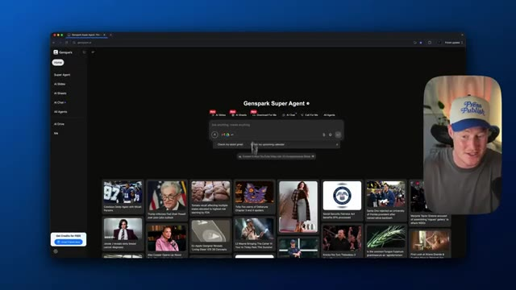
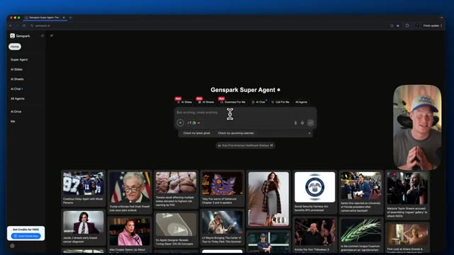
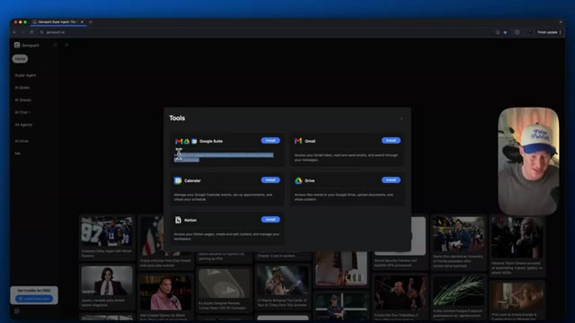
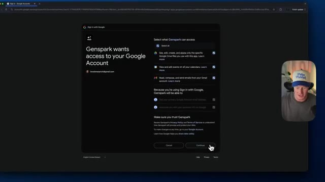
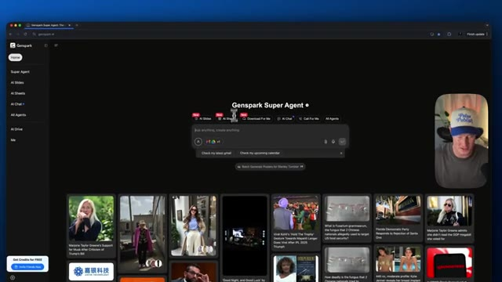
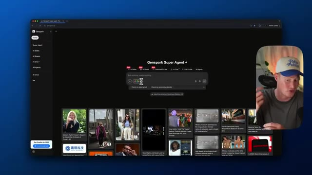
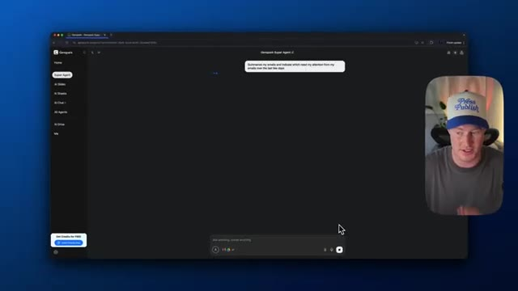
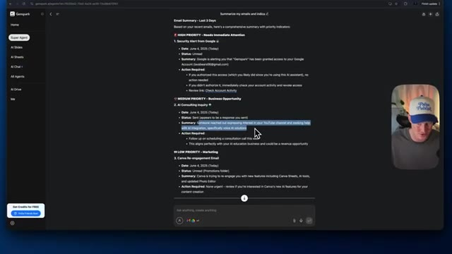
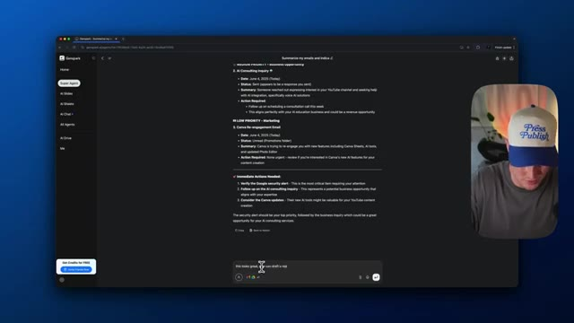
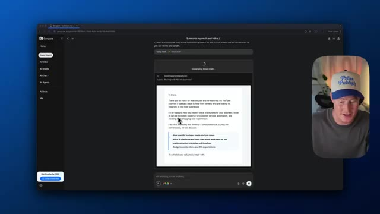

# 🎬 This AI Agent Does Everything for You (Genspark Update)

> **Chaîne** : [Brock Mesarich | AI for Non Techies](https://www.youtube.com/@BrockMesarich)  
> **Lien YouTube** : [https://www.youtube.com/watch?v=TR18AkGQTpA](https://www.youtube.com/watch?v=TR18AkGQTpA)  
> **Date de publication** : 20250605  
> **Durée** : 00:07:28  
> **Identifiant vidéo** : `TR18AkGQTpA`  
> **Transcription & Analyse** : `whisper-v3-large-turbo+gemini-3.5-flash-lite`  

---

## 📌 Synthèse Exécutive & Outils

### 💡 Résumé
Dans cette vidéo intitulée **Cet agent IA fait tout pour vous : les nouveautés de Genspark**, Alex Carter détaille une approche stratégique et pratique du trading et de l'automatisation par agents IA.

### 🛠️ Outils, Modèles & Logiciels Présentés
- **TradingView & Claude Code** : Analyse technique avancée et automatisation algorithmique.

### 🔑 Points Clés & Enseignements Stratégiques
- Respect rigoureux du ratio risque/rendement et du money management.
- Automatisation méthodique des déclencheurs d'ordres via des agents intelligents.

---

## ⏱️ Chronologie & Transcription Complète Audio & Visuelle (Mot pour Mot)

### ⏱️ `[00:00:00 - 00:00:35]` | Segment #01

**🔊 Audio (Transcription Intégrale Mot pour Mot en Français) :**
> Cet agent IA me fait gagner des heures chaque semaine. C'est probablement mon outil IA préféré, et c'est peu dire puisque utiliser ces outils est littéralement mon travail. Il s'appelle GenSpark. Pensez-y comme à la rencontre de Google et de ChatGPT, mais qui accomplit vraiment du travail pour vous. Cette nouvelle mise à jour le rend encore plus incroyable et je ne savais pas que c'était possible. Donc dans cette vidéo, je vais vous montrer exactement comment vous pouvez utiliser ses nouvelles fonctionnalités extraordinaires. Plongeons donc dans le vif du sujet. Très bien les gars, je suis donc ici dans GenSpark et vous pouvez voir que c'est notre super agent GenSpark. Il y a tellement de choses différentes que notre agent peut faire pour nous. Il peut faire des recherches approfondies. Il peut générer des diaporamas IA ou

**👁️ Analyse Visuelle d'Écran (gemini-3.5-flash-lite) :**
**Interface & Outils** : Navigateur web affichant l'application GenSpark Super Agent.

**Contenu textuel & Code** : Barre de recherche centrale avec suggestions de prompts et grille de vignettes d'actualités/contenus récents en bas de page.

**Action / Démonstration** : Navigation et présentation de l'interface principale de l'agent IA GenSpark par le créateur.

*⏱️ 00:00:26 — Capture d'écran du navigateur affichant l'interface principale de Genspark Super Agent avec une barre de recherche centrale et des vignettes de contenu en bas.*

---

### ⏱️ `[00:00:35 - 00:01:11]` | Segment #02

**🔊 Audio (Transcription Intégrale Mot pour Mot en Français) :**
> présentations. Elle pourrait ajouter, elle pourrait fondamentalement créer des bases de données entières avec, par exemple, Google Sheets, elle pourrait télécharger différents fichiers pour nous. Mais ce que je veux aller de l'avant et vous montrer, c'est la capacité de connecter réellement ceci à vos applications Google. Et c'est absolument époustouflant d'ajouter cela à notre fonctionnalité à l'intérieur de GenSpark. Donc ce que vous voulez faire, c'est venir ici. Vous allez cliquer sur cette petite ceinture à outils, et cela nous permet fondamentalement d'accéder à nos outils personnalisés. Donc pour les besoins de cette vidéo, je vais installer la suite Google. Elle pourrait donc fondamentalement accéder à mon espace de travail Google, y compris Gmail, l'agenda, Drive, et je pourrais aussi lui faire accéder à ma page Notion également. Je vais donc cliquer sur installer ici. Ça va prendre

**👁️ Analyse Visuelle d'Écran (gemini-3.5-flash-lite) :**
**Interface & Outils** : Navigateur web affichant la plateforme IA Genspark Super Agent (genspark.ai) et sa fenêtre de gestion des outils.

**Contenu textuel & Code** : Champ d'invite IA ("Ask anything, create anything"), raccourcis d'action ("Check my latest gmail", "Check my upcoming calendar"), modules d'intégration (Google Suite, Gmail, Calendar, Drive, Notion).

**Action / Démonstration** : Navigation sur l'interface de Genspark Super Agent et affichage des options de connexion d'outils et d'applications tierces.

*⏱️ 00:00:44 — Page d'accueil de la plateforme Genspark Super Agent montrant la barre de recherche d'IA et la grille de cartes d'actualités et sujets tendance.*

*⏱️ 00:01:02 — Fenêtre modale "Tools" dans Genspark affichant les intégrations disponibles (Google Suite, Gmail, Calendar, Drive, Notion) avec boutons d'installation.*

---

### ⏱️ `[00:01:11 - 00:01:31]` | Segment #03

**🔊 Audio (Transcription Intégrale Mot pour Mot en Français) :**
> ...m'amène à ceci et je pourrais en gros simplement me connecter ici à GenSpark. Et je vais personnellement lui donner accès à toutes ces informations pour pouvoir voir, modifier et créer certaines choses à l'intérieur de mes espaces de travail Google. Et maintenant, en gros, cela a du contexte sur mes applications Google, comme par exemple Google Agenda, Gmail, et cela peut exécuter des actions pour nous en notre nom. D'accord. Alors voici le prompt.

**👁️ Analyse Visuelle d'Écran (gemini-3.5-flash-lite) :**
**Interface & Outils** : Google Accounts (authentification OAuth), navigateur Web, Genspark Super Agent.

**Contenu textuel & Code** : Autorisations d'accès Google Workspace (Drive, Calendar, Gmail), options Genspark Super Agent (AI Slides, AI Sheets, AI Chat, AI Drive), suggestions de requêtes "Check my latest gmail" et "Check my upcoming calendar".

**Action / Démonstration** : Connexion et accréditation de l'agent IA Genspark à l'écosystème Google Workspace pour lui donner accès au contexte des données personnelles.

*⏱️ 00:01:16 — Écran d'autorisation OAuth Google demandant de valider les accès de Genspark à Google Drive, Calendrier et Gmail.*

*⏱️ 00:01:21 — Page d'accueil de la plateforme Genspark Super Agent avec la barre de saisie de prompts et les raccourcis vers les outils IA.*

*⏱️ 00:01:26 — Vue de l'interface Genspark Super Agent affichant les icônes de connexion aux services Google au sein du champ de saisie.*

---

### ⏱️ `[00:01:32 - 00:02:07]` | Segment #04

**🔊 Audio (Transcription Intégrale Mot pour Mot en Français) :**
> Je vais lui demander de résumer mes e-mails et d'indiquer lesquels nécessitent mon attention parmi mes e-mails. Disons simplement au cours des derniers jours. Donc, il va maintenant procéder à la recherche dans cette boîte de réception d'e-mail à laquelle je lui ai donné accès. Vous pouvez donc voir qu'il utilise cet outil de recherche Gmail et qu'il identifie déjà certains de mes e-mails précédents. J'utilise une sorte d'e-mail fictif ici parce que je veux montrer tous les e-mails personnalisés que j'ai dans ma boîte de réception. Donc, cela a l'air super. Il a essentiellement résumé mes e-mails des trois derniers jours. Je n'ai pas beaucoup de haute priorité, sécurité Google de Google, priorité moyenne. Il montre une opportunité commerciale. Donc, voici un e-mail de conseil en IA

**👁️ Analyse Visuelle d'Écran (gemini-3.5-flash-lite) :**
**Interface & Outils** : Application Genspark (interface web avec un panneau de chat et menu latéral).

**Contenu textuel & Code** : Le prompt saisi : "Summarize my emails and indicate which need my attention from my emails over the last few days" et le présentateur dans une vignette vidéo incrustée.

**Action / Démonstration** : Saisie et envoi d'une instruction à l'agent IA pour traiter et résumer les e-mails récents.

*⏱️ 00:01:40 — Capture d'écran montrant l'interface de Genspark avec une invite de commande et une petite vignette du présentateur en bas à droite.*

---

### ⏱️ `[00:02:07 - 00:02:26]` | Segment #05

**🔊 Audio (Transcription Intégrale Mot pour Mot en Français) :**
> C'est en fait un faux e-mail que je me suis envoyé, mais jetons-y un coup d'œil. Donc, quelqu'un a pris contact en exprimant son intérêt pour votre chaîne YouTube, cherchant de l'aide pour l'intégration de l'IA, plus précisément des solutions d'IA vocale, et a même créé comme une sorte d'actions à mener ici. Donc ce que je vais faire maintenant, c'est que je peux en fait aussi aller enregistrer ça dans Notion. Si j'avais connecté mon Notion, je pourrais l'enregistrer sur une page particulière si je le voulais.

**👁️ Analyse Visuelle d'Écran (gemini-3.5-flash-lite) :**
**Interface & Outils** : Interface web de Gemspark (générateur/assistant d'e-mails par IA).

**Contenu textuel & Code** : Résumé d'e-mails classés en trois catégories de priorité : Haute (alerte de sécurité Google), Moyenne (opportunité de conseil en IA liée à une chaîne YouTube) et Faible (marketing Canva).

**Action / Démonstration** : Le curseur de la souris met en surbrillance le texte du résumé concernant la demande de conseil en IA.

*⏱️ 00:02:12 — Capture d'écran montrant l'interface d'un assistant de messagerie basé sur l'IA (Gemspark) qui résume des e-mails classés par ordre de priorité.*

---

### ⏱️ `[00:02:26 - 00:02:48]` | Segment #06

**🔊 Audio (Transcription Intégrale Mot pour Mot en Français) :**
> Mais venons simplement ici et disons simplement, cela a l'air super. Maintenant, peux-tu rédiger une réponse à la demande de consultation ? Et juste comme ça, il génère effectivement un brouillon d'e-mail ici. Et il est en fait extrêmement rapide pour aller de l'avant et faire cela. Et une chose qui est incroyable avec ceci, c'est qu'il ne rédige pas seulement un e-mail textuel d'apparence très générique.

**👁️ Analyse Visuelle d'Écran (gemini-3.5-flash-lite) :**
**Interface & Outils** : Application web GenSpark (module Super Agent / AI Chat).

**Contenu textuel & Code** : - Prompt utilisateur : "this looks great. can you draft a rep..."
- Données affichées : Résumé d'e-mail "AI Consulting Inquiry" (prospect intéressé par les solutions d'IA vocale).
- Brouillon d'e-mail IA : Destinataire (brockmesarich@gmail.com), Objet ("Re: Help with AI in my business?"), points de discussion pour un rendez-vous (besoins métier, outils IA vocale, budget, ROI).

**Action / Démonstration** : Demande de rédaction d'e-mail à l'agent IA via un prompt, suivie de la génération en temps réel du projet de réponse.

*⏱️ 00:02:31 — Interface de la plateforme GenSpark affichant le résumé d'un e-mail relatif à une demande de consultation IA et la saisie d'un prompt dans la zone de texte.*

*⏱️ 00:02:42 — Interface de GenSpark générant automatiquement un brouillon d'e-mail structuré en réponse à la demande de consultation IA.*

---

### ⏱️ `[00:02:48 - 00:03:08]` | Segment #07

**🔊 Audio (Transcription Intégrale Mot pour Mot en Français) :**
> Regardez un peu la structure de tout ça, que j'ai directement créée à l'intérieur de GenSpark. C'est assez dingue. Je pourrais soit l'envoyer dès maintenant, soit l'enregistrer en tant que brouillon. Laissez-moi juste cliquer sur envoyer et voir comment cela va fonctionner. Donc, e-mail envoyé. Laissez-moi vérifier s'il a bien été envoyé. Et boum, voilà. Nous avons cet e-mail extrêmement bien rédigé. Ça a l'air absolument incroyable.

**👁️ Analyse Visuelle d'Écran (gemini-3.5-flash-lite) :**
**Interface & Outils** : Présentation ou face-caméra explicatif du trader sans interface logicielle partagée.

**Contenu textuel & Code** : Explications orales des stratégies et mise en contexte méthodologique du marché.

**Action / Démonstration** : Explications face caméra et analyse conceptuelle des marchés.

---

### ⏱️ `[00:03:08 - 00:03:29]` | Segment #08

**🔊 Audio (Transcription Intégrale Mot pour Mot en Français) :**
> Je ne sais même pas quoi dire à ça. Très bien. Donc ce cas d'usage suivant est absolument dingue que GenSpark a réellement présenté dans son annonce aujourd'hui. Donc il s'agit fondamentalement d'examiner un tas de CVs de candidats à un poste différents parce qu'il a la capacité de télécharger ces images Google Drive, de les analyser, et ensuite fondamentalement, sur la base de spécifications pour le poste, d'identifier quels sont les meilleurs candidats.

**👁️ Analyse Visuelle d'Écran (gemini-3.5-flash-lite) :**
**Interface & Outils** : Présentation ou face-caméra explicatif du trader sans interface logicielle partagée.

**Contenu textuel & Code** : Explications orales des stratégies et mise en contexte méthodologique du marché.

**Action / Démonstration** : Explications face caméra et analyse conceptuelle des marchés.

---

### ⏱️ `[00:03:29 - 00:03:48]` | Segment #09

**🔊 Audio (Transcription Intégrale Mot pour Mot en Français) :**
> So let me go ahead and watch this video so you can see what I'm talking about. Next, here's an AI product manager application from Steven Sanchez. Email plus resume attachment. But wait, there are 49 more just like this. Just tell GenSpark, download all resumes to AI Drive and Screen candidates.

**👁️ Analyse Visuelle d'Écran (gemini-3.5-flash-lite) :**
**Interface & Outils** : Présentation ou face-caméra explicatif du trader sans interface logicielle partagée.

**Contenu textuel & Code** : Explications orales des stratégies et mise en contexte méthodologique du marché.

**Action / Démonstration** : Explications face caméra et analyse conceptuelle des marchés.

---

### ⏱️ `[00:03:49 - 00:04:09]` | Segment #10

**🔊 Audio (Transcription Intégrale Mot pour Mot en Français) :**
> GenSpark a rapidement accompli la tâche, téléchargé tous les CV et identifié cinq candidats remarquables parmi les 50 postulants. Il a résumé les points forts de chaque candidat. Notre équipe a examiné ces recommandations, discuté des candidats et effectué notre sélection finale. Puis, en un seul prompt, GenSpark rédige cinq réponses par e-mail personnalisées.

**👁️ Analyse Visuelle d'Écran (gemini-3.5-flash-lite) :**
**Interface & Outils** : Présentation ou face-caméra explicatif du trader sans interface logicielle partagée.

**Contenu textuel & Code** : Explications orales des stratégies et mise en contexte méthodologique du marché.

**Action / Démonstration** : Explications face caméra et analyse conceptuelle des marchés.

---

### ⏱️ `[00:04:09 - 00:04:28]` | Segment #11

**🔊 Audio (Transcription Intégrale Mot pour Mot en Français) :**
> Il félicite les candidats au prochain tour d'entretien comme Steven, en mettant en avant son parcours d'ingénieur senior et son expertise en moteurs de recommandation, tout en planifiant un entretien d'une heure et en demandant ses disponibilités. Enfin, il suffit de cliquer sur envoyer et les cinq e-mails partent instantanément, personnalisés à grande échelle, simple et efficace.

**👁️ Analyse Visuelle d'Écran (gemini-3.5-flash-lite) :**
**Interface & Outils** : Présentation ou face-caméra explicatif du trader sans interface logicielle partagée.

**Contenu textuel & Code** : Explications orales des stratégies et mise en contexte méthodologique du marché.

**Action / Démonstration** : Explications face caméra et analyse conceptuelle des marchés.

---

### ⏱️ `[00:04:28 - 00:04:48]` | Segment #12

**🔊 Audio (Transcription Intégrale Mot pour Mot en Français) :**
> Oh, that's absolutely insane because think about it this way. If you have a whole bunch of emails you need to analyze, it could go through, it could actually download those resumes, analyze it, and then create personalized responses based on who actually fits that criteria for that job. That's just one use case that is insane to me. All right. So this next use case might be the craziest one yet that I'm going to showcase.

**👁️ Analyse Visuelle d'Écran (gemini-3.5-flash-lite) :**
**Interface & Outils** : Présentation ou face-caméra explicatif du trader sans interface logicielle partagée.

**Contenu textuel & Code** : Explications orales des stratégies et mise en contexte méthodologique du marché.

**Action / Démonstration** : Explications face caméra et analyse conceptuelle des marchés.

---

### ⏱️ `[00:04:48 - 00:05:07]` | Segment #13

**🔊 Audio (Transcription Intégrale Mot pour Mot en Français) :**
> So what I'm going to do is I'm going to come here and I have this list of fake emails here and I'm going to upload this to Genspark. and this is basically a leads list. What I'm gonna say is take this leads list and turn it into a spreadsheet. So I'm gonna give it that. We're gonna test out the AI Sheets feature inside of GenSpark.

**👁️ Analyse Visuelle d'Écran (gemini-3.5-flash-lite) :**
**Interface & Outils** : Présentation ou face-caméra explicatif du trader sans interface logicielle partagée.

**Contenu textuel & Code** : Explications orales des stratégies et mise en contexte méthodologique du marché.

**Action / Démonstration** : Explications face caméra et analyse conceptuelle des marchés.

---

### ⏱️ `[00:05:07 - 00:05:30]` | Segment #14

**🔊 Audio (Transcription Intégrale Mot pour Mot en Français) :**
> Et puis à partir d'ici, ce que je vais faire, c'est qu'il a leurs e-mails intégrés dans cette feuille de calcul qu'il va créer pour moi. Et je vais lui faire contacter automatiquement chacune de ces personnes dans cette feuille de calcul par e-mail. Et il aura du contexte sur qui elles sont. Donc il va créer un e-mail personnalisé et l'envoyer à chacune des personnes de cette liste d'e-mails. Très bien, donc voici notre feuille de calcul ici qu'il a créée avec toutes ces informations de prospects.

**👁️ Analyse Visuelle d'Écran (gemini-3.5-flash-lite) :**
**Interface & Outils** : Présentation ou face-caméra explicatif du trader sans interface logicielle partagée.

**Contenu textuel & Code** : Explications orales des stratégies et mise en contexte méthodologique du marché.

**Action / Démonstration** : Explications face caméra et analyse conceptuelle des marchés.

---

### ⏱️ `[00:05:30 - 00:05:48]` | Segment #15

**🔊 Audio (Transcription Intégrale Mot pour Mot en Français) :**
> So next up comes the fun part. I'm going to ask it to write a personalized outreach message to each of these people. Here is a prompt that I gave it. You are an email marketing expert. Based on the context you have about each lead in this spreadsheet, draft a hyper personalized email to each person. We are an AI consulting company and we are trying to get them to book an initial consultation meeting with our team.

**👁️ Analyse Visuelle d'Écran (gemini-3.5-flash-lite) :**
**Interface & Outils** : Présentation ou face-caméra explicatif du trader sans interface logicielle partagée.

**Contenu textuel & Code** : Explications orales des stratégies et mise en contexte méthodologique du marché.

**Action / Démonstration** : Explications face caméra et analyse conceptuelle des marchés.

---

### ⏱️ `[00:05:48 - 00:06:10]` | Segment #16

**🔊 Audio (Transcription Intégrale Mot pour Mot en Français) :**
> So let's give it that, run with it and see what it does. It's looking like it actually added a column here called personalized email draft for each of these people that is hyper personalized for each of these different leads. However, the problem here is that we actually wanted to go ahead and send these emails. So let's just say basically saying go ahead and create the email drafts for me in Gmail for the first five leads on this list.

**👁️ Analyse Visuelle d'Écran (gemini-3.5-flash-lite) :**
**Interface & Outils** : Présentation ou face-caméra explicatif du trader sans interface logicielle partagée.

**Contenu textuel & Code** : Explications orales des stratégies et mise en contexte méthodologique du marché.

**Action / Démonstration** : Explications face caméra et analyse conceptuelle des marchés.

---

### ⏱️ `[00:06:10 - 00:06:43]` | Segment #17

**🔊 Audio (Transcription Intégrale Mot pour Mot en Français) :**
> Let's see if it's able to understand this instruction. OK, so it's actually using this tool email draft. So it's going through and it's actually doing it. OK, so we have our first email draft here. So hi, Michael. Michael's the first person on the list. It's going to the email address, Tammy. And it's basically like it understands that they work at this firm here. This is insane. And the fact that I can actually go in and actually change certain things about the email in here so I can improve the writing. Let's go ahead and just like click on this. Let's click improve writing. And it's actually going ahead and it's changing that writing for the specific line of this email. Guys,

**👁️ Analyse Visuelle d'Écran (gemini-3.5-flash-lite) :**
**Interface & Outils** : Présentation ou face-caméra explicatif du trader sans interface logicielle partagée.

**Contenu textuel & Code** : Explications orales des stratégies et mise en contexte méthodologique du marché.

**Action / Démonstration** : Explications face caméra et analyse conceptuelle des marchés.

---

### ⏱️ `[00:06:43 - 00:07:16]` | Segment #18

**🔊 Audio (Transcription Intégrale Mot pour Mot en Français) :**
> GenSpark is insane. I know that word gets used a ton in this AI space, but this is next level stuff that they're releasing and it seems to be on a day-to-day basis at this point so i'm just blown away here so now we have all five of these emails drafted let's just go ahead send this one send that one we could save them as a draft guys there we have it that's absolutely crazy all right guys pretty crazy let me know what you guys think in the comments of this new feature that gen spark released how do you use gen spark are you going to use it now after this video i do want to mention if you enjoyed this video leave a like subscribe to the channel i cover all things

**👁️ Analyse Visuelle d'Écran (gemini-3.5-flash-lite) :**
**Interface & Outils** : Présentation ou face-caméra explicatif du trader sans interface logicielle partagée.

**Contenu textuel & Code** : Explications orales des stratégies et mise en contexte méthodologique du marché.

**Action / Démonstration** : Explications face caméra et analyse conceptuelle des marchés.

---

### ⏱️ `[00:07:16 - 00:07:28]` | Segment #19

**🔊 Audio (Transcription Intégrale Mot pour Mot en Français) :**
> AI for Non-Techies, I show everyday people like yourself and me how they can use AI tools to make their life a bit more efficient. So if that sounds right for you, make sure to subscribe to the channel. That being said, I'll see you guys in the next video. Cheers.

**👁️ Analyse Visuelle d'Écran (gemini-3.5-flash-lite) :**
**Interface & Outils** : Présentation ou face-caméra explicatif du trader sans interface logicielle partagée.

**Contenu textuel & Code** : Explications orales des stratégies et mise en contexte méthodologique du marché.

**Action / Démonstration** : Explications face caméra et analyse conceptuelle des marchés.

---

