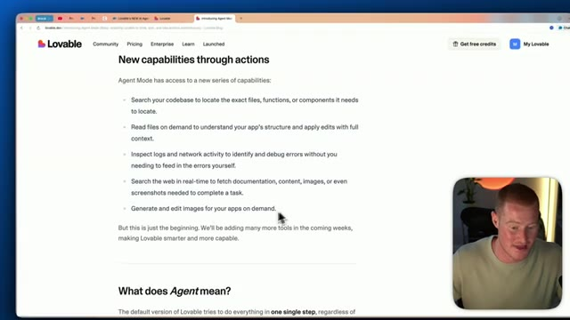

# 🎬 NEW Lovable Agent Mode (Build Anything)

> **Chaîne** : [Brock Mesarich | AI for Non Techies](https://www.youtube.com/@BrockMesarich)  
> **Lien YouTube** : [https://www.youtube.com/watch?v=XainJ6GMs1w](https://www.youtube.com/watch?v=XainJ6GMs1w)  
> **Date de publication** : 20250809  
> **Durée** : 00:11:34  
> **Identifiant vidéo** : `XainJ6GMs1w`  
> **Transcription & Analyse** : `whisper-v3-large-turbo+gemini-3.5-flash-lite`  

---

## 📌 Synthèse Exécutive & Outils

### 💡 Résumé
Dans cette vidéo intitulée **NEW Lovable Agent Mode (Build Anything)**, Alex Carter détaille une approche stratégique et pratique du trading et de l'automatisation par agents IA.

### 🛠️ Outils, Modèles & Logiciels Présentés
- **TradingView & Claude Code** : Analyse technique avancée et automatisation algorithmique.

### 🔑 Points Clés & Enseignements Stratégiques
- Respect rigoureux du ratio risque/rendement et du money management.
- Automatisation méthodique des déclencheurs d'ordres via des agents intelligents.

---

## ⏱️ Chronologie & Transcription Complète Audio & Visuelle (Mot pour Mot)

### ⏱️ `[00:00:00 - 00:00:32]` | Segment #01

**🔊 Audio (Transcription Intégrale Mot pour Mot en Français) :**
> Lovable Agent vient tout juste de sortir et nous allons le tester en conditions réelles dans cette vidéo. Tout d'abord, Lovable fait fureur dans le monde entier. L'entreprise est passée de 0 dollar à une valorisation de 1,9 milliard de dollars en moins de neuf mois. Amusant, j'ai en fait été l'une des toute premières personnes à faire une vidéo sur ce produit, mais ils viennent de sortir quelque chose de très intéressant. Ça s'appelle le mode Agent. Dans cette vidéo, je vais le tester et présenter les principales différences pour que vous puissiez comprendre exactement ce que c'est et comment l'utiliser. Sans plus attendre, plongeons-nous là-dedans. Très bien, alors en ce moment nous regardons l'interface utilisateur de Lovable. Mais avant d'aller de l'avant et de tester ceci,

**👁️ Analyse Visuelle d'Écran (gemini-3.5-flash-lite) :**
**Interface & Outils** : Présentation ou face-caméra explicatif du trader sans interface logicielle partagée.

**Contenu textuel & Code** : Explications orales des stratégies et mise en contexte méthodologique du marché.

**Action / Démonstration** : Explications face caméra et analyse conceptuelle des marchés.

---

### ⏱️ `[00:00:32 - 00:01:08]` | Segment #02

**🔊 Audio (Transcription Intégrale Mot pour Mot en Français) :**
> Allons sur leur page de lancement de produit et identifions concrètement les principaux changements ici. Et ensuite, je vais les tester dans cette vidéo. Voici donc les nouvelles fonctionnalités en action. Le mode agent a donc accès à une série de capacités. Il peut chercher dans votre base de code pour localiser des fichiers, fonctions ou composants exacts, lire des fichiers à la demande, inspecter les journaux et l'activité réseau pour identifier et déboguer les erreurs sans que vous n'ayez besoin de trouver les erreurs vous-même. Et puis, il a réellement la capacité de chercher sur le Web en temps réel pour récupérer de la documentation, du contenu, des images ou des captures d'écran nécessaires pour accomplir une tâche. C'est vraiment énorme et je suis ravi de l'essayer dans cette vidéo. Ce

**👁️ Analyse Visuelle d'Écran (gemini-3.5-flash-lite) :**
**Interface & Outils** : Présentation ou face-caméra explicatif du trader sans interface logicielle partagée.

**Contenu textuel & Code** : Explications orales des stratégies et mise en contexte méthodologique du marché.

**Action / Démonstration** : Explications face caméra et analyse conceptuelle des marchés.

---

### ⏱️ `[00:01:08 - 00:01:26]` | Segment #03

**🔊 Audio (Transcription Intégrale Mot pour Mot en Français) :**
> va changer la façon dont nous créons des applications en utilisant des plateformes comme Lovable. Je suis donc ravi de parler de cela. Et puis, il peut aussi générer et modifier des images pour vos applications à la demande. C'est une autre fonctionnalité vraiment très cool ici. Alors, que signifie réellement « agent » ? La version par défaut de Lovable essaie de tout faire en une seule étape, quelle que soit la complexité de la tâche.

**👁️ Analyse Visuelle d'Écran (gemini-3.5-flash-lite) :**
**Interface & Outils** : Navigateur web affichant le site Lovable.dev

**Contenu textuel & Code** : Texte listant les capacités du mode agent : recherche dans la base de code, lecture de fichiers, inspection des logs, recherche web en temps réel, et génération/édition d'images.

**Action / Démonstration** : Le présentateur commente la liste des fonctionnalités affichées à l'écran concernant Lovable Agent Mode.

*⏱️ 00:01:12 — Capture d'écran montrant la page web de Lovable présentant les nouvelles fonctionnalités d'Agent Mode, avec une incrustation vidéo du présentateur en bas à droite.*

---

### ⏱️ `[00:01:26 - 00:01:47]` | Segment #04

**🔊 Audio (Transcription Intégrale Mot pour Mot en Français) :**
> Avec cette mise à jour, Lovable va commencer à agir davantage comme un vrai développeur. C'est donc très intéressant. Nous voulons évidemment que Lovable agisse comme s'il s'agissait d'un développeur à part entière. Voyons donc si nous sommes capables de faire cela dans cette vidéo. Pour chaque demande d'utilisateur, il va d'abord interpréter ce que vous essayez de faire, ce que vous demandez, explorer la base de code selon les besoins, révéler le contexte manquant, apporter les bonnes modifications, corriger automatiquement les problèmes au fur et à mesure qu'ils surviennent et conclure par un résumé clair.

**👁️ Analyse Visuelle d'Écran (gemini-3.5-flash-lite) :**
**Interface & Outils** : Présentation ou face-caméra explicatif du trader sans interface logicielle partagée.

**Contenu textuel & Code** : Explications orales des stratégies et mise en contexte méthodologique du marché.

**Action / Démonstration** : Explications face caméra et analyse conceptuelle des marchés.

---

### ⏱️ `[00:01:47 - 00:02:07]` | Segment #05

**🔊 Audio (Transcription Intégrale Mot pour Mot en Français) :**
> Donc, au lieu d'avoir à faire des allers-retours avec notre, vous savez, prompt Lovable ici, nous devrions être capables de décrire ce que nous essayons de construire, et il devrait pouvoir tout parcourir, itérer, faire des modifications et vraiment raisonner et réfléchir à la meilleure façon d'exécuter une tâche sans que nous ayons réellement besoin d'intervenir directement. Et rapidement, abordons la question de la tarification ici, car c'est aussi une mise à jour importante. Le mode Agent a une tarification différente de nos autres modèles.

**👁️ Analyse Visuelle d'Écran (gemini-3.5-flash-lite) :**
**Interface & Outils** : Présentation ou face-caméra explicatif du trader sans interface logicielle partagée.

**Contenu textuel & Code** : Explications orales des stratégies et mise en contexte méthodologique du marché.

**Action / Démonstration** : Explications face caméra et analyse conceptuelle des marchés.

---

### ⏱️ `[00:02:07 - 00:02:40]` | Segment #06

**🔊 Audio (Transcription Intégrale Mot pour Mot en Français) :**
> In our current default in chat mode, each message costs one credit regardless of the complexity of the edit. And then agent mode uses usage-based pricing requests that can cost less than one credit or several credits depending on their complexity. Simple requests may cost less than one credit, So we don't really know how much each of these prompts will actually cost us when it comes to credits. So that'll be interesting to play around with. You can see it actually shows how many credits it used for each different iteration that it makes. All right. Now that we understand kind of what the new features are, let's go ahead and battle test it here so we can actually see

**👁️ Analyse Visuelle d'Écran (gemini-3.5-flash-lite) :**
**Interface & Outils** : Présentation ou face-caméra explicatif du trader sans interface logicielle partagée.

**Contenu textuel & Code** : Explications orales des stratégies et mise en contexte méthodologique du marché.

**Action / Démonstration** : Explications face caméra et analyse conceptuelle des marchés.

---

### ⏱️ `[00:02:40 - 00:03:12]` | Segment #07

**🔊 Audio (Transcription Intégrale Mot pour Mot en Français) :**
> what's different with it. All right. So here's the prompt that I'm actually going to give lovable. Let's create an AI tool directory for my YouTube channel called Brock AI for non-techies. So the reason that I actually did this is because this will actually have the ability to go and search on the internet and do research about my YouTube channel to gain context in order to actually build this platform that is going to be tailored directly to my YouTube audience, which is you guys. From there, the goal is to showcase all the top tools that I talk about on the channel to act as a resource for my audience to leverage AI tools in their lives. So think of this as one

**👁️ Analyse Visuelle d'Écran (gemini-3.5-flash-lite) :**
**Interface & Outils** : Présentation ou face-caméra explicatif du trader sans interface logicielle partagée.

**Contenu textuel & Code** : Explications orales des stratégies et mise en contexte méthodologique du marché.

**Action / Démonstration** : Explications face caméra et analyse conceptuelle des marchés.

---

### ⏱️ `[00:03:12 - 00:03:46]` | Segment #08

**🔊 Audio (Transcription Intégrale Mot pour Mot en Français) :**
> single website that has all the different tools that I talk about on my YouTube in order for my audience to actually go and use it as a resource. So the reason I'm doing this use case is because I want to see if it has the ability to research me and then pull the actual tools that I literally talk about in all of my YouTube videos and put them there. So let's go ahead. Let's start with that. I'm going to click send here and lovable agent is now going to begin going and crafting this for us. Let's quickly talk about what's different right here, right off the bat with lovable agent. So right now we could see that it's actually thinking and reasoning through the best

**👁️ Analyse Visuelle d'Écran (gemini-3.5-flash-lite) :**
**Interface & Outils** : Présentation ou face-caméra explicatif du trader sans interface logicielle partagée.

**Contenu textuel & Code** : Explications orales des stratégies et mise en contexte méthodologique du marché.

**Action / Démonstration** : Explications face caméra et analyse conceptuelle des marchés.

---

### ⏱️ `[00:03:46 - 00:04:21]` | Segment #09

**🔊 Audio (Transcription Intégrale Mot pour Mot en Français) :**
> way to actually go ahead and tackle this task here. So instead of just getting an immediate response or, you know, having Lovable just go off and immediately do this, it has to go ahead and actually think through this. So this is really important when we're trying to actually build fully functioning applications, because it seems great for it to be really quick, but we actually want it to build the full product more so than just giving us a really quick output. First thing I notice is this has been running for about a minute and a half. So it is taking quite a bit more time than it usually would. But again, this is good because it should give us a, you know, more carefully thought through response and looks like it actually went ahead and gave us a response here

**👁️ Analyse Visuelle d'Écran (gemini-3.5-flash-lite) :**
**Interface & Outils** : Présentation ou face-caméra explicatif du trader sans interface logicielle partagée.

**Contenu textuel & Code** : Explications orales des stratégies et mise en contexte méthodologique du marché.

**Action / Démonstration** : Explications face caméra et analyse conceptuelle des marchés.

---

### ⏱️ `[00:04:21 - 00:04:55]` | Segment #10

**🔊 Audio (Transcription Intégrale Mot pour Mot en Français) :**
> as we could hear our little notification there. Let's take a look. All right. So right off the bat, this is actually what it gave us. This is pretty good. However, it doesn't actually show the actual tools that I talk about on my YouTube channel. It might not have understood my initial prompt. So let's just come over to lovable and just say, I want you to go ahead and research all the top tools I talk about on my YouTube channel over the last two months. And I want you to create a section called Brock's favorite AI tools with all those tools that I showcase on my YouTube video. I'm going to give that over to lovable agent. It's going to think through again, exactly how to tackle this task. It's going to go ahead and search on YouTube. Let's take a look.

**👁️ Analyse Visuelle d'Écran (gemini-3.5-flash-lite) :**
**Interface & Outils** : Présentation ou face-caméra explicatif du trader sans interface logicielle partagée.

**Contenu textuel & Code** : Explications orales des stratégies et mise en contexte méthodologique du marché.

**Action / Démonstration** : Explications face caméra et analyse conceptuelle des marchés.

---

### ⏱️ `[00:04:55 - 00:05:29]` | Segment #11

**🔊 Audio (Transcription Intégrale Mot pour Mot en Français) :**
> You can see it's now searching. It went ahead and searched my YouTube. That's really cool. The fact that it can actually pull information from the internet, it never was able to do that before. And this gets really interesting when we're trying to actually build in, you know, APIs and actually implement other apps into our own app. So if we're trying to use an app that has an API access, sometimes it's really difficult for us to figure out how that API documentation is set up and you have to go and manually copy, paste, and give it a lovable. Now it could actually go ahead and scour the documentation in order for it to easily implement the API for different platforms, if that

**👁️ Analyse Visuelle d'Écran (gemini-3.5-flash-lite) :**
**Interface & Outils** : Présentation ou face-caméra explicatif du trader sans interface logicielle partagée.

**Contenu textuel & Code** : Explications orales des stratégies et mise en contexte méthodologique du marché.

**Action / Démonstration** : Explications face caméra et analyse conceptuelle des marchés.

---

### ⏱️ `[00:05:29 - 00:06:03]` | Segment #12

**🔊 Audio (Transcription Intégrale Mot pour Mot en Français) :**
> makes sense. All right, so that took maybe a minute or so. And you can see we now have a page here called Brock's Favorite AI Tools. And these are AI tools personally tested and featured by Brock on his YouTube channel. These are all actually platforms that I have talked about on my channel. So we have Abacus AI, ChatLL of Teams. We have GenSpark AI, which is one of my favorite AI tools. I absolutely love GenSpark. We have SynthFlow, which is an AI voice and calling platform. We have Bolt.new. We have Lovable, DataButton, Manus, Google Opal. All of these are different platforms that I've actually covered on my YouTube channel. That feature is actually working now. That's pretty cool to be able to do that. So I'm going to go ahead. I want to change

**👁️ Analyse Visuelle d'Écran (gemini-3.5-flash-lite) :**
**Interface & Outils** : Présentation ou face-caméra explicatif du trader sans interface logicielle partagée.

**Contenu textuel & Code** : Explications orales des stratégies et mise en contexte méthodologique du marché.

**Action / Démonstration** : Explications face caméra et analyse conceptuelle des marchés.

---

### ⏱️ `[00:06:03 - 00:06:29]` | Segment #13

**🔊 Audio (Transcription Intégrale Mot pour Mot en Français) :**
> up the user interface of this platform a little bit. So let me go ahead and do that. All right. So this is pretty cool. I think this user interface looks a bit better than before. It's nothing too crazy, but this is off just our first initial prompts that we gave it. But one thing I really wanna mention here to showcase the, you know, kind of capability of agent mode here is if I go ahead and click on one of these, you know, tools, for example, on AI agent, these are the different AI agent tools that I've covered on my YouTube channel, which it went ahead and actually searched for.

**👁️ Analyse Visuelle d'Écran (gemini-3.5-flash-lite) :**
**Interface & Outils** : Présentation ou face-caméra explicatif du trader sans interface logicielle partagée.

**Contenu textuel & Code** : Explications orales des stratégies et mise en contexte méthodologique du marché.

**Action / Démonstration** : Explications face caméra et analyse conceptuelle des marchés.

---

### ⏱️ `[00:06:30 - 00:06:48]` | Segment #14

**🔊 Audio (Transcription Intégrale Mot pour Mot en Français) :**
> And if I click on this, it will pull me directly to the video where I actually talk about this platform. So you could see in this video, I talk about Genspark AI agent, the best AI agent I've ever used. That is really cool. Same thing for Manus. If I click on this, it will take me to a video where I actually use Manus AI. And that is really cool.

**👁️ Analyse Visuelle d'Écran (gemini-3.5-flash-lite) :**
**Interface & Outils** : Présentation ou face-caméra explicatif du trader sans interface logicielle partagée.

**Contenu textuel & Code** : Explications orales des stratégies et mise en contexte méthodologique du marché.

**Action / Démonstration** : Explications face caméra et analyse conceptuelle des marchés.

---

### ⏱️ `[00:06:48 - 00:07:07]` | Segment #15

**🔊 Audio (Transcription Intégrale Mot pour Mot en Français) :**
> It's actually pulling real live information. So let me go ahead and make some more changes to our app here. Actually, something I want to mention, I didn't even notice before, is it actually breaks down what I talk about in the video. So Brock's favorite AI agent that does everything from researching, from creating presentations to marketing materials, all in one productivity powerhouse. That is literally words that it pulled from my YouTube channel.

**👁️ Analyse Visuelle d'Écran (gemini-3.5-flash-lite) :**
**Interface & Outils** : Présentation ou face-caméra explicatif du trader sans interface logicielle partagée.

**Contenu textuel & Code** : Explications orales des stratégies et mise en contexte méthodologique du marché.

**Action / Démonstration** : Explications face caméra et analyse conceptuelle des marchés.

---

### ⏱️ `[00:07:08 - 00:07:33]` | Segment #16

**🔊 Audio (Transcription Intégrale Mot pour Mot en Français) :**
> So I'm really impressed so far with lovable agent because this adds new capability when we're actually vibe coding with platforms. The fact that it could really search the internet and pull real live information. Now what I'm going to do is I'm actually going to ask it to pull the real logos of the companies that I talk about for each of these. So I'm interested if it will be able to do that. All right. So on top of that, I said, let's create a futuristic minimalistic logo for AI for non techies to show at the top of the page along with the headers.

**👁️ Analyse Visuelle d'Écran (gemini-3.5-flash-lite) :**
**Interface & Outils** : Présentation ou face-caméra explicatif du trader sans interface logicielle partagée.

**Contenu textuel & Code** : Explications orales des stratégies et mise en contexte méthodologique du marché.

**Action / Démonstration** : Explications face caméra et analyse conceptuelle des marchés.

---

### ⏱️ `[00:07:33 - 00:07:54]` | Segment #17

**🔊 Audio (Transcription Intégrale Mot pour Mot en Français) :**
> So what I'm going to try to do is actually use the image generation capabilities inside of lovable that it supposedly has now with agent mode and actually generate a logo to put right here at the top of our tool directory. Let's give it that. Now it's going to go through again. It's going to plan the best way to actually go through and execute this plan. And it's going to go off, do this, make the changes that needs to without my back and forth.

**👁️ Analyse Visuelle d'Écran (gemini-3.5-flash-lite) :**
**Interface & Outils** : Présentation ou face-caméra explicatif du trader sans interface logicielle partagée.

**Contenu textuel & Code** : Explications orales des stratégies et mise en contexte méthodologique du marché.

**Action / Démonstration** : Explications face caméra et analyse conceptuelle des marchés.

---

### ⏱️ `[00:07:54 - 00:08:12]` | Segment #18

**🔊 Audio (Transcription Intégrale Mot pour Mot en Français) :**
> And we'll be presented with a hopefully pretty good output. All right. It is using a tool called generating image, which is really cool. I wonder how it's doing this. I'd assume it's probably using the 4.0 image generation from Chachapiti. I haven't tested this yet, so I'm pretty interested to see what it's actually gonna look like. It could be really bad or it could be good.

**👁️ Analyse Visuelle d'Écran (gemini-3.5-flash-lite) :**
**Interface & Outils** : Présentation ou face-caméra explicatif du trader sans interface logicielle partagée.

**Contenu textuel & Code** : Explications orales des stratégies et mise en contexte méthodologique du marché.

**Action / Démonstration** : Explications face caméra et analyse conceptuelle des marchés.

---

### ⏱️ `[00:08:12 - 00:08:31]` | Segment #19

**🔊 Audio (Transcription Intégrale Mot pour Mot en Français) :**
> All right, so after a bit of time, this is actually what it gave us. It went ahead and created this logo here. As you can see, it says AI. It's nothing crazy. It's a very simple logo. Probably use Chachapiti 4.0 image generation to do that. Nothing too wild, but if I come down here, you could see that it actually does not show the, you know, the platform's logos aside from Chachapiti, which it was able to actually pull.

**👁️ Analyse Visuelle d'Écran (gemini-3.5-flash-lite) :**
**Interface & Outils** : Présentation ou face-caméra explicatif du trader sans interface logicielle partagée.

**Contenu textuel & Code** : Explications orales des stratégies et mise en contexte méthodologique du marché.

**Action / Démonstration** : Explications face caméra et analyse conceptuelle des marchés.

---

### ⏱️ `[00:08:31 - 00:08:51]` | Segment #20

**🔊 Audio (Transcription Intégrale Mot pour Mot en Français) :**
> I'm not sure if it tried to pull these images, like actual images from the internet by searching for them, or if it was trying to generate them with AI, which it seems like it was actually trying to generate. For whatever reason, that did not work. But let's go ahead and move on and actually try to add a database to our application. And I want to see how simple this is using Lovable Agent compared to, you know, the normal Lovable.

**👁️ Analyse Visuelle d'Écran (gemini-3.5-flash-lite) :**
**Interface & Outils** : Présentation ou face-caméra explicatif du trader sans interface logicielle partagée.

**Contenu textuel & Code** : Explications orales des stratégies et mise en contexte méthodologique du marché.

**Action / Démonstration** : Explications face caméra et analyse conceptuelle des marchés.

---

### ⏱️ `[00:08:51 - 00:09:09]` | Segment #21

**🔊 Audio (Transcription Intégrale Mot pour Mot en Français) :**
> So I'm just going to come over to Ask Lovable here and say, let's go ahead and now add a database to our application. Basically, I want to be able to submit an AI tool. And once that is submitted, I want it to actually store in the entire app and always show that tool, even if I refresh the application.

**👁️ Analyse Visuelle d'Écran (gemini-3.5-flash-lite) :**
**Interface & Outils** : Présentation ou face-caméra explicatif du trader sans interface logicielle partagée.

**Contenu textuel & Code** : Explications orales des stratégies et mise en contexte méthodologique du marché.

**Action / Démonstration** : Explications face caméra et analyse conceptuelle des marchés.

---

### ⏱️ `[00:09:09 - 00:09:28]` | Segment #22

**🔊 Audio (Transcription Intégrale Mot pour Mot en Français) :**
> So let's go ahead and send that off. I feel like I know what's going to happen. It's going to probably prompt me to set up Supabase or it actually might go ahead and set up Supabase for me, which would be new in the lovable agent. Looks like a thought for five seconds to add database functionality. You'll need to connect your lovable project to Supabase. So let me go ahead and just click on Supabase here.

**👁️ Analyse Visuelle d'Écran (gemini-3.5-flash-lite) :**
**Interface & Outils** : Présentation ou face-caméra explicatif du trader sans interface logicielle partagée.

**Contenu textuel & Code** : Explications orales des stratégies et mise en contexte méthodologique du marché.

**Action / Démonstration** : Explications face caméra et analyse conceptuelle des marchés.

---

### ⏱️ `[00:09:28 - 00:09:49]` | Segment #23

**🔊 Audio (Transcription Intégrale Mot pour Mot en Français) :**
> I'm going to connect it to my Supabase account. All right, so went ahead and actually connected my Supabase account. That was extremely simple. So let me go ahead and it looks like I actually don't have the ability to add a tool. So I'm just going to come over here and say, let's add the ability to add an AI tool to store on our tool directory. So now it's going ahead, writing all this fancy code here, actually creating the rules for my database in order for this to work.

**👁️ Analyse Visuelle d'Écran (gemini-3.5-flash-lite) :**
**Interface & Outils** : Présentation ou face-caméra explicatif du trader sans interface logicielle partagée.

**Contenu textuel & Code** : Explications orales des stratégies et mise en contexte méthodologique du marché.

**Action / Démonstration** : Explications face caméra et analyse conceptuelle des marchés.

---

### ⏱️ `[00:09:49 - 00:10:12]` | Segment #24

**🔊 Audio (Transcription Intégrale Mot pour Mot en Français) :**
> Looks like I could actually just apply the changes. Should be good to go and running now. Actually looks like it just caught an error without me actually having to go and, you know, find that. So that's pretty interesting. Looks like the security issue is now fixed and it's gonna go ahead and begin implementing this and creating this database. All right, so went ahead, add database. It ran into multiple errors, but it caught the errors before me even actually having to try and tell it to fix itself.

**👁️ Analyse Visuelle d'Écran (gemini-3.5-flash-lite) :**
**Interface & Outils** : Présentation ou face-caméra explicatif du trader sans interface logicielle partagée.

**Contenu textuel & Code** : Explications orales des stratégies et mise en contexte méthodologique du marché.

**Action / Démonstration** : Explications face caméra et analyse conceptuelle des marchés.

---

### ⏱️ `[00:10:13 - 00:10:37]` | Segment #25

**🔊 Audio (Transcription Intégrale Mot pour Mot en Français) :**
> So that's great. I guess the agent is doing its thing and I'm gonna come here. Let's just come and just say, add a tool. Let me go ahead and add all this and we'll come back to this. All right, so I added a tool. You can see Chachapi T is inside of my super base now. That is great. And now we have it added to our database that Lovable was able to actually just build for us. All right, so now that we tested the power of Lovable Agent, let's go ahead and check the amount of credits that have been used to see actually, you know, how cost efficient this is.

**👁️ Analyse Visuelle d'Écran (gemini-3.5-flash-lite) :**
**Interface & Outils** : Présentation ou face-caméra explicatif du trader sans interface logicielle partagée.

**Contenu textuel & Code** : Explications orales des stratégies et mise en contexte méthodologique du marché.

**Action / Démonstration** : Explications face caméra et analyse conceptuelle des marchés.

---

### ⏱️ `[00:10:37 - 00:10:57]` | Segment #26

**🔊 Audio (Transcription Intégrale Mot pour Mot en Français) :**
> All right, so if I come over to my credits, you can see I have 91.7 of my 130 credits left based on the plan that I'm on. So it looks like I have 130 credits per month and I simply used Lovable just for this video. All right, so let's actually go ahead and calculate how many credits I used for this video. So 130 minus 91.7.

**👁️ Analyse Visuelle d'Écran (gemini-3.5-flash-lite) :**
**Interface & Outils** : Présentation ou face-caméra explicatif du trader sans interface logicielle partagée.

**Contenu textuel & Code** : Explications orales des stratégies et mise en contexte méthodologique du marché.

**Action / Démonstration** : Explications face caméra et analyse conceptuelle des marchés.

---

### ⏱️ `[00:10:57 - 00:11:19]` | Segment #27

**🔊 Audio (Transcription Intégrale Mot pour Mot en Français) :**
> So it looks like I used actually 38 credits. That's pretty interesting. So hopefully that gives you an understanding of how Lovable Agent actually utilizes your credit since the credit system is a bit different since it actually has to go ahead and go through reasoning and searching the internet and it actually uses credits in order to do that instead of just like one credit per one response, if that makes any sense.

**👁️ Analyse Visuelle d'Écran (gemini-3.5-flash-lite) :**
**Interface & Outils** : Présentation ou face-caméra explicatif du trader sans interface logicielle partagée.

**Contenu textuel & Code** : Explications orales des stratégies et mise en contexte méthodologique du marché.

**Action / Démonstration** : Explications face caméra et analyse conceptuelle des marchés.

---

### ⏱️ `[00:11:19 - 00:11:34]` | Segment #28

**🔊 Audio (Transcription Intégrale Mot pour Mot en Français) :**
> All right, guys, there you have it. That is Lovable Agent. If you guys wanna try out Lovable, there is a link in the description. If you enjoyed this video, make sure to subscribe to the channel for more content like this. If you want to learn AI as a non-techie, I cover it all on this channel. With that being said, guys, thank you for staying to the end. See you in the next video.

**👁️ Analyse Visuelle d'Écran (gemini-3.5-flash-lite) :**
**Interface & Outils** : Présentation ou face-caméra explicatif du trader sans interface logicielle partagée.

**Contenu textuel & Code** : Explications orales des stratégies et mise en contexte méthodologique du marché.

**Action / Démonstration** : Explications face caméra et analyse conceptuelle des marchés.

---

