# 🎬 NEW Google "Nano Banana" Image Generation (Scary Good)

> **Chaîne** : [Brock Mesarich | AI for Non Techies](https://www.youtube.com/@BrockMesarich)  
> **Lien YouTube** : [https://www.youtube.com/watch?v=XD_oNAlJ_PA](https://www.youtube.com/watch?v=XD_oNAlJ_PA)  
> **Date de publication** : 20250827  
> **Durée** : 00:07:31  
> **Identifiant vidéo** : `XD_oNAlJ_PA`  
> **Transcription & Analyse** : `whisper-v3-large-turbo+gemini-3.5-flash-lite`  

---

## 📌 Synthèse Exécutive & Outils

### 💡 Résumé

Cette vidéo de la chaîne *Brock Mesarich | AI for Non Techies* explore les capacités révolutionnaires de la nouvelle génération de génération et d'édition d'images de Google, baptisée sous le nom intrigant de « Nano Banana » (intégrée à Gemini). L'analyste y démontre à quel point ce modèle redéfinit les standards de l'intelligence artificielle générative grâce à un ensemble de fonctionnalités avancées : modification par prompt textuel unique en langage naturel, cohérence de personnage phénoménale, fusion d'images précise et, surtout, une vitesse d'exécution fulgurante de 2 à 5 secondes. Contrairement aux solutions traditionnelles comme ChatGPT qui nécessitent des temps de traitement longs et peinent à maintenir l'identité des sujets d'une modification à l'autre, cette technologie s'appuie sur la compréhension contextuelle et les connaissances du monde réel de Gemini. 

À travers une série de cas d'usage concrets — allant du remplacement d'objets (substituer un chien par un lion ou un Diet Coke par un Diet Pepsi) à la manipulation temporelle et contextuelle (s'insérer dans le décor de l'Empire romain) — la vidéo met en lumière la redoutable efficacité de l'outil pour préserver la structure exacte d'une photo originale tout en ciblant des modifications chirurgicales. L'analyse démontre également le potentiel commercial massif de cette technologie, notamment dans la mode avec le transfert de vêtements sur un même mannequin sous différents angles, ou encore dans l'aménagement d'intérieur en modifiant l'ambiance lumineuse et thermique d'un salon à partir d'une simple annonce immobilière.

Au-delà du divertissement, cette percée technologique annonce un changement de paradigme pour les secteurs du e-commerce, du marketing de produits et de la création de contenu visuel. En éliminant la lourdeur des workflows traditionnels de design et de retouche, « Nano Banana » démocratise la production d'assets visuels hyper-personnalisés et cohérents. Cette agilité opérationnelle permet d'envisager une automatisation poussée de la production graphique, réduisant drastiquement les coûts de production tout en ouvrant la voie à des stratégies marketing ultra-réactives basées sur l'IA générative.

### 🛠️ Outils, Modèles & Logiciels Présentés

* **Google Nano Banana / Gemini** : Le nouveau modèle de pointe de Google pour la génération et l'édition d'images ultra-rapide, doté d'une cohérence de personnage inégalée et d'une profonde compréhension contextuelle du monde réel.
* **ChatGPT** : Modèle conversationnel et de génération d'images (mentionné pour comparaison), dont les temps de traitement pour les modifications visuelles sont jugés nettement plus lents que la nouvelle solution de Google.
* **n8n** : Outil d'automatisation de flux de travail no-code/low-code puissant, souvent associé dans les stratégies d'IA pour orchestrer des pipelines de données complexes.
* **Zapier** : Plateforme d'automatisation cloud de référence pour connecter rapidement différentes applications logicielles entre elles sans compétences en programmation.
* **Make** : Outil visuel d'automatisation et d'intégration de processus hautement modulaires pour connecter des API et automatiser des tâches répétitives.
* **Grok** : Modèle d'intelligence artificielle conversationnelle développé par xAI, intégré dans l'écosystème technologique global des outils d'avant-garde.
* **Claude** : Modèle linguistique avancé développé par Anthropic, réputé pour sa précision analytique, textuelle et sa grande fenêtre de contexte.
* **Prompt Engineering** : Méthodologie et art structuré de concevoir des instructions textuelles précises pour guider les modèles d'IA vers les résultats escomptés de manière optimale.

### 🔑 Points Clés & Enseignements Stratégiques

* **Édition par prompt unique en langage naturel** : Capacité à modifier une image existante ou générée en formulant simplement un ordre textuel intuitif (ex: « ajouter une bibliothèque » ou « remplacer le chien par un lion »), éliminant les processus de masquage complexes.
* **Cohérence de personnage phénoménale** : Maintien rigoureux des traits faciaux, de la morphologie et de l'identité d'un sujet à travers différentes générations, résolvant l'un des plus grands écueils des IA génératives concurrentes.
* **Fusion et superposition d'images de haute précision** : Aptitude remarquable à combiner des éléments spécifiques de plusieurs photos tout en conservant le réalisme des textures, des ombres et des perspectives.
* **Vitesse d'exécution ultra-rapide (2 à 5 secondes)** : Réduction drastique de la latence de traitement, permettant une boucle de rétroaction instantanée (« trial and error ») et une productivité accrue par rapport aux solutions plus lentes du marché (comme ChatGPT).
* **Connaissance contextuelle du monde réel via Gemini** : Intégration de données historiques, culturelles et spatiales permettant à l'IA de comprendre et de recréer avec exactitude des contextes complexes (comme l'époque de l'Empire romain).
* **Disruption de l'industrie de la mode et du e-commerce** : Remplacement potentiel des mannequins traditionnels et des séances photo onéreuses en transférant virtuellement des vêtements (robes, accessoires) sur un même modèle sous des angles et des poses variables.
* **Personnalisation instantanée du marketing visuel** : Possibilité d'adapter des arrière-plans, des couleurs ou des ambiances en quelques secondes pour répondre aux exigences spécifiques de campagnes publicitaires ciblées.
* **Révolution de la conception d'intérieurs et de l'immobilier** : Utilisation de photos de base (comme des annonces Zillow) pour simuler des modifications de mobilier, d'éclairage et d'ambiance thermique (chaleur visuelle, décoration), réduisant le besoin initial d'un architecte d'intérieur.
* **Agilité dans la création de miniatures (Thumbnails)** : Application directe au growth hacking et à l'optimisation des taux de clic (CTR) sur YouTube par le détourage, l'intégration et la fusion rapide de visages sur des compositions à fort engagement.
* **Optimisation des workflows créatifs non-techniques** : Démocratisation des outils de pointe permettant aux utilisateurs sans compétences techniques avancées de produire des visuels complexes de qualité professionnelle en un temps record.

---

## ⏱️ Chronologie & Transcription Complète Audio & Visuelle (Mot pour Mot)

### ⏱️ `[00:00:00 - 00:00:34]` | Segment #01

**🔊 Audio (Transcription Intégrale Mot pour Mot en Français) :**
> Donc avant qu'on entre et qu'on commence réellement à utiliser ceci, je vais expliquer ce qu'il y a de nouveau avec Nano Banana. Aussi, c'est quoi ce bordel avec ce nom ? Ça a l'air ridicule. Et je vous promets que je vais passer à travers ça très rapidement parce que je sais que vous voulez le voir en action. Parmi les principales choses à mentionner ici, c'est que nous avons l'édition basée sur un seul prompt. Donc on lui dit essentiellement quoi changer avec du langage naturel, comme par exemple ajouter une bibliothèque, et il va effectivement l'ajouter à l'image. Nous pouvons prendre une image existante que nous avons, ou nous pouvons lui faire générer une image et ensuite ajouter des choses à cette image générée, si c'est clair. Ensuite, c'est probablement la partie la plus importante, la cohérence des personnages est phénoménale donc essentiellement nous pouvons pratiquement soit télécharger un

**👁️ Analyse Visuelle d'Écran (gemini-3.5-flash-lite) :**
**Interface & Outils** : Interface vidéo avec incrustation d'image (picture-in-picture) montrant une image générée par IA.

**Contenu textuel & Code** : Image illustrative d'une femme peintre dans un atelier avec une étiquette "Artist".

**Action / Démonstration** : Présentation visuelle d'un exemple généré par intelligence artificielle pour illustrer le sujet abordé.

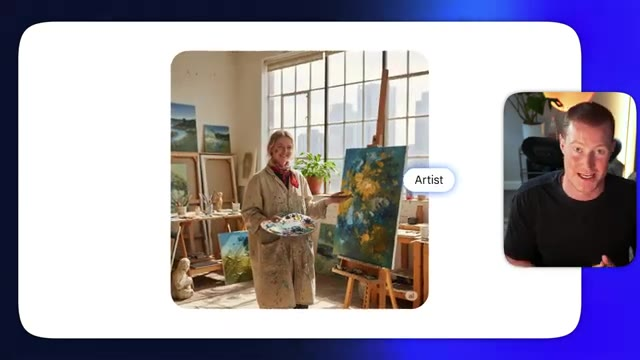
*⏱️ 00:00:17 — Affichage d'une image générée représentant une artiste dans son atelier avec un tag "Artist", et le présentateur visible en médaillon.*

---

### ⏱️ `[00:00:34 - 00:01:07]` | Segment #02

**🔊 Audio (Transcription Intégrale Mot pour Mot en Français) :**
> image d'un personnage ou générer l'image d'un personnage et y apporter des modifications ou créer différentes images à partir de cela et il conserve cette cohérence de personnage que beaucoup de ces autres modèles d'images n'ont tout simplement pas et je vais vous montrer exactement ce que je veux dire dans cette vidéo ensuite nous pouvons réellement fusionner plusieurs images ensemble et il est très doué pour faire cela non seulement il est doué pour avoir une sorte de cohérence de personnage mais il est doué pour fusionner des photos et garder vous savez des parties spécifiques d'une image et ensuite fusionner cela avec autre chose. Ensuite nous avons un rendu ultra rapide. Je parle de deux à cinq secondes pour qu'il génère réellement une modification et donne un

**👁️ Analyse Visuelle d'Écran (gemini-3.5-flash-lite) :**
**Interface & Outils** : Interface de génération d'images IA avec superposition vidéo du présentateur en médaillon.

**Contenu textuel & Code** : Prompt textuel : "Create an image where the woman in the photo is cuddling the dog on a basketball court" et image générée correspondante.

**Action / Démonstration** : Démonstration de la génération d'une image basée sur un personnage cohérent avec modification de scène.

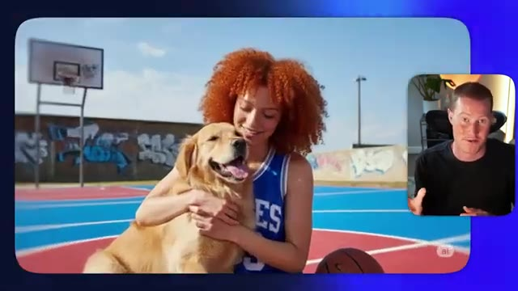
*⏱️ 00:00:59 — Résultat de la génération d'image montrant une femme rousse en maillot de basket câlinant un chien sur un terrain de basket extérieur.*

---

### ⏱️ `[00:01:07 - 00:01:27]` | Segment #03

**🔊 Audio (Transcription Intégrale Mot pour Mot en Français) :**
> résultat pour vous. C'est assez époustouflant. Si vous utilisez ChatGPT, la génération d'images prend une éternité. C'est extrêmement rapide et ça m'épate honnêtement. Ensuite, nous avons des connaissances du monde réel grâce à Gemini. Donc notre modèle d'image comprend réellement les choses. Vous pourriez dire, hé, je veux que tu génères une image qui a l'air de dater de l'époque de l'Empire romain et il va extraire des images de l'Empire romain et comprend le contexte et tout le reste.

**👁️ Analyse Visuelle d'Écran (gemini-3.5-flash-lite) :**
**Interface & Outils** : Navigateur web affichant un article de documentation technique Google for Developers.

**Contenu textuel & Code** : Texte de présentation de Gemini 2.5 Flash Image, modèles de génération et d'édition d'images par IA.

**Action / Démonstration** : Le présentateur commente l'actualité et les fonctionnalités des nouveaux modèles d'intelligence artificielle de Google.

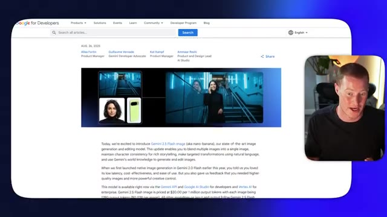
*⏱️ 00:01:17 — Page web de Google for Developers présentant l'annonce de Gemini 2.5 Flash Image avec le présentateur en médaillon.*

---

### ⏱️ `[00:01:28 - 00:01:50]` | Segment #04

**🔊 Audio (Transcription Intégrale Mot pour Mot en Français) :**
> Tout cela ensemble fait de celui-ci un modèle de génération d'images vraiment percutant et c'est de loin le meilleur que j'ai vu. Je suis donc impatient de vous montrer ce que je veux dire maintenant. Très bien, je suis donc à l'intérieur de Gemini ici et je vais vous montrer exactement à quel point il est facile de commencer à utiliser la génération d'images Nano Banana dès maintenant. Tout d'abord, ce que je vais faire, c'est donner un exemple de cas d'utilisation ici même. Je vais pratiquement télécharger cette image que j'ai trouvée de ce type et de son chien.

**👁️ Analyse Visuelle d'Écran (gemini-3.5-flash-lite) :**
**Interface & Outils** : Navigateur web affichant l'interface utilisateur de Google Gemini.

**Contenu textuel & Code** : Page d'accueil de Gemini avec message personnalisé "Hello, Brock", barre de saisie de prompt ("Ask Gemini"), icônes d'outils et sélecteur de modèle (2.5 Flash).

**Action / Démonstration** : Le présentateur introduit l'interface de Google Gemini à l'écran pour montrer la plateforme en direct.

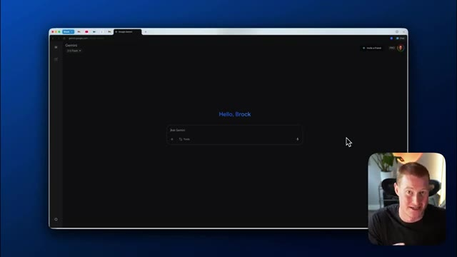
*⏱️ 00:01:39 — Vue de l'interface de l'application web Google Gemini (mode sombre) avec la mention de bienvenue "Hello, Brock" et un champ de saisie, accompagnée d'un petit encadré vidéo du présentateur en bas à droite.*

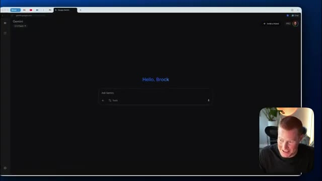
*⏱️ 00:01:44 — Vue similaire de l'interface Google Gemini avec le champ de texte "Ask Gemini" et la webcam du présentateur en incrustation.*

---

### ⏱️ `[00:01:50 - 00:02:24]` | Segment #05

**🔊 Audio (Transcription Intégrale Mot pour Mot en Français) :**
> Voici donc cette image, et ce que je vais faire, c'est que je vais littéralement me contenter de dire : remplace le chien par un lion. Je vais donc venir sur Gemini, remplacer ce chien par un lion, en lui donnant littéralement une consigne aussi simple que ça. Et regardez à quelle vitesse il est capable de générer une modification de cette image exacte. Boum. Et voilà, ça a pris environ cinq secondes. Regardez cette image ici. Je vais afficher un avant et un après pour que nous puissions voir exactement à quel point elle est similaire. Très bien. Nous avons donc un avant sur le côté gauche et un après sur le côté droit. C'est pratiquement la même image. Et c'est pourquoi la nouvelle génération d'images Google nano banana est en fait époustouflante.

**👁️ Analyse Visuelle d'Écran (gemini-3.5-flash-lite) :**
**Interface & Outils** : Interface web Google Gemini et visionneuse d'images macOS.

**Contenu textuel & Code** : Invite de commande textuelle "Replace this dog with a lion" et affichage côte à côte des images source et générée.

**Action / Démonstration** : Modification d'une image en remplaçant un chien par un lion via une simple consigne textuelle.

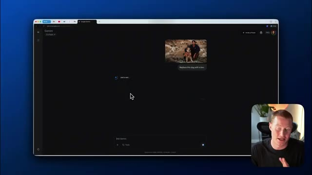
*⏱️ 00:01:58 — Interface Google Gemini affichant une image avec la consigne "Replace this dog with a lion" et le présentateur en bas à droite.*

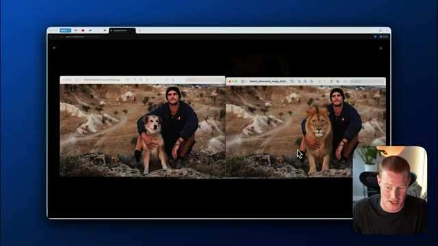
*⏱️ 00:02:15 — Comparaison avant/après montrant l'image originale avec le chien à gauche et l'image modifiée avec le lion à droite.*

---

### ⏱️ `[00:02:24 - 00:02:56]` | Segment #06

**🔊 Audio (Transcription Intégrale Mot pour Mot en Français) :**
> parce que la cohérence des personnages et la cohérence dans la capacité à modifier une photo exacte sont assez fous. Donc ensuite, ce que je vais faire, c'est que je vais venir dans un nouveau chat ici et j'ai un cas d'utilisation amusant. Donc en fait, j'étais juste en voyage au Portugal. J'ai obtenu certaines de ces photos argentiques incroyables. Très bien. Voici donc quelques-unes des photos argentiques que j'ai réellement prises quand j'étais au Portugal et regardez-moi faire des modifications dessus. Donc tout d'abord, prenons cette image ici de moi avec ce petit décor. Et je vais fondamentalement changer complètement cette image et faire comme si j'étais de l'époque de l'Empire romain. Je vais donc télécharger ceci sur

**👁️ Analyse Visuelle d'Écran (gemini-3.5-flash-lite) :**
**Interface & Outils** : Navigateur web (Google Gemini), macOS Finder, Visionneuse d'images.

**Contenu textuel & Code** : Interface utilisateur de Gemini, photos personnelles de voyage au Portugal, gestionnaire de fichiers.
[DESC_IMAGE_3] Présentation d'images de voyage et ouverture d'une interface de chat IA.

**Action / Démonstration** : Explications face caméra et analyse conceptuelle des marchés.

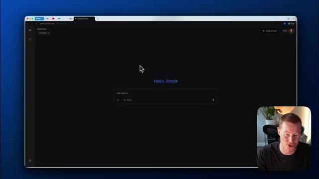
*⏱️ 00:02:32 — Interface du navigateur affichant l'accueil de Gemini avec un thème sombre.*

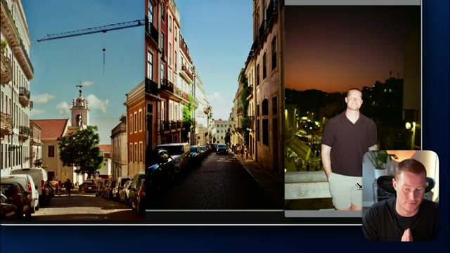
*⏱️ 00:02:40 — Affichage côte à côte de plusieurs photographies prises lors d'un voyage au Portugal, montrant des rues de ville et une photo du présentateur.*

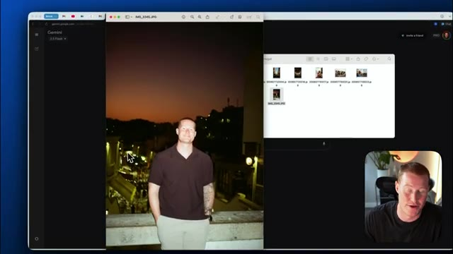
*⏱️ 00:02:48 — Bureau d'ordinateur montrant une fenêtre ouverte avec une photo du présentateur de voyage et un explorateur de fichiers miniatures.*

---

### ⏱️ `[00:02:56 - 00:03:19]` | Segment #07

**🔊 Audio (Transcription Intégrale Mot pour Mot en Français) :**
> Gemini. Je vais essentiellement dire, prends cette image et fais du fond l'Empire romain. Encore une fois, je lui donne un prompt super simple. Et en gros, en cinq à dix secondes, nous allons obtenir ici un résultat de cette modification de fou. Et assurez-vous de regarder cette vidéo jusqu'à la fin, parce que je vais expliquer exactement pourquoi c'est un tel bouleversement et comment ça va tout changer. C'est parti. Nous avons exactement la même image ici, mais maintenant on dirait que je suis, tu sais, en train de regarder un décor qui est l'Empire romain.

**👁️ Analyse Visuelle d'Écran (gemini-3.5-flash-lite) :**
**Interface & Outils** : Interface web de Google Gemini (gemini.google.com) avec incrustation vidéo du présentateur en bas à droite.

**Contenu textuel & Code** : Importation d'une photo et prompt utilisateur : "Take this image and make the background the Roman Empire" avec un indicateur de chargement "Just a sec...".

**Action / Démonstration** : Saisie du prompt de modification d'image et attente de la génération du résultat par l'intelligence artificielle Gemini.

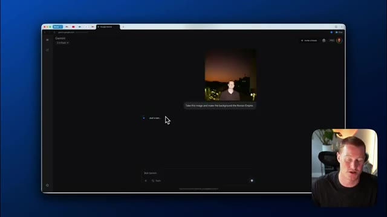
*⏱️ 00:03:02 — Interface Google Gemini affichant une conversation avec une image importée et le prompt textuel demandant de modifier l'arrière-plan pour représenter l'Empire romain.*

---

### ⏱️ `[00:03:19 - 00:03:44]` | Segment #08

**🔊 Audio (Transcription Intégrale Mot pour Mot en Français) :**
> L'une des choses vraiment géniales avec ça, c'est que ça a réellement cette connaissance que Gemini possède sur le monde. Donc c'est capable de comprendre à quoi ressemble même l'Empire romain ? Ça extrait donc tout ce contexte de là et est capable d'apporter ces modifications à nos images. Très bien, voici donc un autre cas d'usage. J'ai cette photo de moi tenant un Diet Coke. Et ce que je vais faire, c'est que je vais donner ça à Gemini et en gros lui dire : prends cette image, mais remplace la canette de Diet Coke par un Diet Pepsi.

**👁️ Analyse Visuelle d'Écran (gemini-3.5-flash-lite) :**
**Interface & Outils** : Navigateur web affichant l'interface de l'intelligence artificielle Google Gemini.

**Contenu textuel & Code** : Interface utilisateur de Gemini avec des zones de texte "Ask Gemini" et l'affichage d'images générées ou modifiées par l'IA.

**Action / Démonstration** : Navigation et présentation des capacités de modification d'images de Gemini intégrant des contextes historiques.

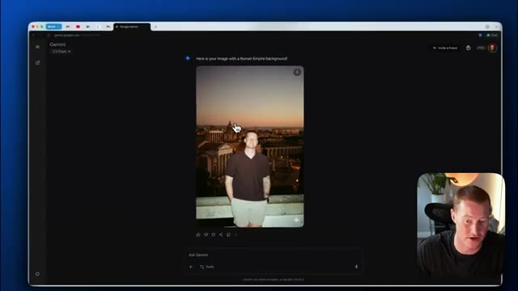
*⏱️ 00:03:26 — Interface du navigateur affichant Google Gemini avec une image modifiée montrant le présentateur intégré dans un décor de l'Empire romain.*

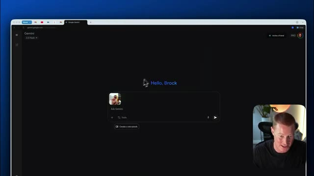
*⏱️ 00:03:38 — Interface de l'outil Google Gemini sur le navigateur web avec un message d'accueil personnalisé "Hello, Brock".*

---

### ⏱️ `[00:03:44 - 00:04:06]` | Segment #09

**🔊 Audio (Transcription Intégrale Mot pour Mot en Français) :**
> Très bien, donc je lui dis essentiellement de prendre cette image exacte et de remplacer la canette par un style de canette différent. Et c'est aussi simple que ça, nous avons exactement la même image, mais au lieu que je tienne une canette de Diet Coke, cela me montre en train de tenir du Diet Pepsi. C'est assez fou. Très bien, alors ensuite, je vais vous montrer comment cela pourrait potentiellement être l'avenir des mannequins et de la façon dont nous présentons réellement les vêtements et différents produits en ligne.

**👁️ Analyse Visuelle d'Écran (gemini-3.5-flash-lite) :**
**Interface & Outils** : Navigateur web affichant l'interface de Gemini Google avec des images générées par IA.

**Contenu textuel & Code** : Interface utilisateur de Gemini avec aperçu d'images générées et zone de saisie de prompt.

**Action / Démonstration** : Le présentateur commente la modification d'éléments spécifiques sur une image générée par IA.

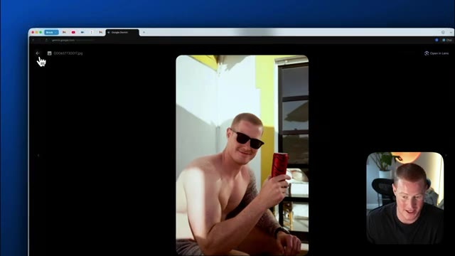
*⏱️ 00:03:55 — Une interface web montrant une image générée avec le présentateur tenant une canette rouge, avec une miniature vidéo du présentateur en bas à droite.*

---

### ⏱️ `[00:04:06 - 00:04:28]` | Segment #10

**🔊 Audio (Transcription Intégrale Mot pour Mot en Français) :**
> Donc voici cette image de cette fille qui porte cette robe rouge. Je vais télécharger ça ici. Et j'ai aussi cette image de cette robe bleu clair que je veux en fait faire porter à ce modèle. Donc je vais télécharger cette image également. Viens sur Gemini et dis essentiellement, prends cette image du modèle portant la robe rouge, mais à la place, fais-lui porter la robe bleue. Donc ça devrait essentiellement modifier cette image exacte, mais en la faisant porter cette robe bleue.

**👁️ Analyse Visuelle d'Écran (gemini-3.5-flash-lite) :**
**Interface & Outils** : Interface web de Google Gemini.

**Contenu textuel & Code** : Zone de saisie de texte avec miniatures d'images importées.

**Action / Démonstration** : Téléchargement et ajout successifs d'images de vêtements dans l'interface de l'intelligence artificielle pour une manipulation ultérieure.

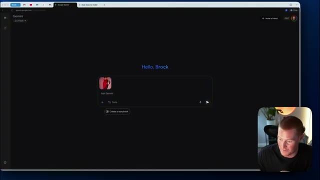
*⏱️ 00:04:12 — Interface Google Gemini affichant une image téléchargée d'une personne en robe rouge dans la zone de texte.*

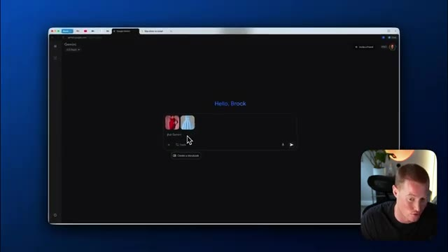
*⏱️ 00:04:23 — Interface Google Gemini montrant deux images téléchargées (une robe rouge et une robe bleu clair) dans la zone de texte.*

---

### ⏱️ `[00:04:28 - 00:04:52]` | Segment #11

**🔊 Audio (Transcription Intégrale Mot pour Mot en Français) :**
> Et voilà, nous avons cette image. La cohérence des personnages est parfaite. Voici l'image de la génération que nous avons réellement créée. Et ensuite, laissez-moi vous montrer l'image que nous avons réellement téléchargée ici. Nous avons donc exactement le même modèle. Elle a exactement la même apparence, la même pose et tout le reste, à part qu'elle porte cette robe que nous avons réellement téléchargée. Et puis, à partir de là, ce que je vais dire, c'est : super, maintenant prends cette image et montre-la dans une pose différente, sous un angle différent.

**👁️ Analyse Visuelle d'Écran (gemini-3.5-flash-lite) :**
**Interface & Outils** : Navigateur web affichant l'interface de Google Gemini et le bureau Mac.

**Contenu textuel & Code** : Interface de chat IA de Google Gemini, invites de modification d'image, images générées de mannequins en robe.

**Action / Démonstration** : Comparaison visuelle entre l'image originale téléchargée et l'image générée par l'IA pour démontrer la cohérence du personnage.

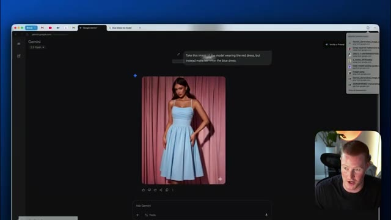
*⏱️ 00:04:34 — Interface Google Gemini affichant une image générée avec le prompt demandant de changer la robe rouge en robe bleue.*

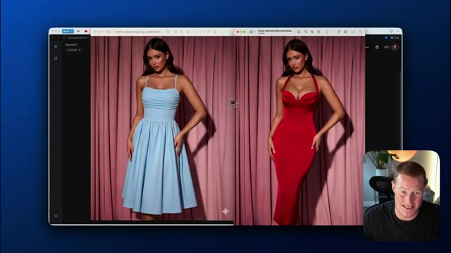
*⏱️ 00:04:40 — Comparaison côte à côte de deux fenêtres montrant la même modèle avec une robe bleue et une robe rouge pour illustrer la cohérence des personnages.*

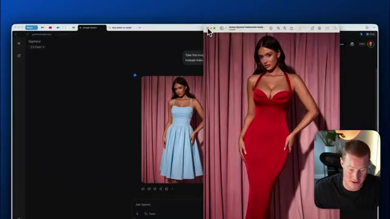
*⏱️ 00:04:46 — Interface montrant l'image téléchargée d'origine (modèle en robe rouge) juxtaposée avec l'interface de génération Gemini.*

---

### ⏱️ `[00:04:52 - 00:05:13]` | Segment #12

**🔊 Audio (Transcription Intégrale Mot pour Mot en Français) :**
> Et voilà. Nous avons exactement le même modèle et la même robe, mais maintenant sous un angle différent. Disons simplement qu'on prend cette même image exacte, mais je veux que l'arrière-plan soit de couleur rouge clair. Boum, les gars, voilà. C'est assez époustouflant quand on y pense vraiment, car maintenant nous pouvons commencer à créer des images avec une cohérence de personnage incroyablement bonne.

**👁️ Analyse Visuelle d'Écran (gemini-3.5-flash-lite) :**
**Interface & Outils** : Interface web de Google Gemini (navigateur).

**Contenu textuel & Code** : Interface de chat avec une image générée montrant une femme portant une robe bleue dans une pose différente, illustrant la modification d'angle.

**Action / Démonstration** : Le présentateur commente la génération d'images modifiées par l'IA sous différents angles.

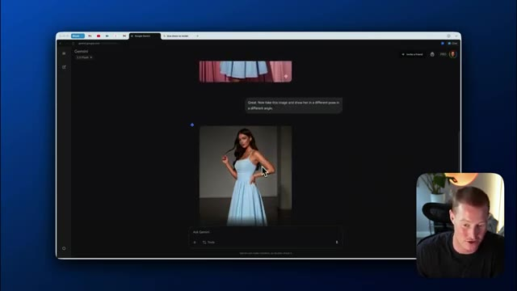
*⏱️ 00:04:57 — Capture d'écran montrant l'interface de Google Gemini avec une image générée d'un modèle portant une robe bleue sous un autre angle, et le présentateur en médaillon.*

---

### ⏱️ `[00:05:13 - 00:05:37]` | Segment #13

**🔊 Audio (Transcription Intégrale Mot pour Mot en Français) :**
> Et ça va changer le commerce électronique et la façon dont nous concevons, vous savez, les séances photo, les mannequins et le marketing de produits, et cetera. Très bien, maintenant ce que nous allons faire, nous allons prendre cette miniature de Mr. Beast et je vais essayer de recréer exactement la même chose avec une image de moi-même. Donc ce que je vais faire, je vais simplement télécharger une sur Gemini et ensuite je vais la télécharger avec cette image de moi-même. Et je vais fondamentalement dire, prenez cette image miniature de Mr. Beast et remplacez-la par cette image exacte de moi-même.

**👁️ Analyse Visuelle d'Écran (gemini-3.5-flash-lite) :**
**Interface & Outils** : Navigateur web avec l'interface de Google Gemini.

**Contenu textuel & Code** : Invite de texte et affichage d'une image de miniature YouTube (Mr. Beast).

**Action / Démonstration** : Sélection et manipulation d'une image pour démonstration dans l'outil d'IA.

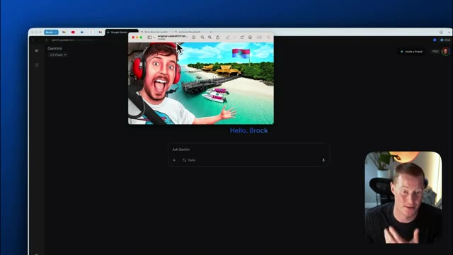
*⏱️ 00:05:25 — Interface Google Gemini avec une fenêtre superposée montrant une miniature YouTube de Mr. Beast.*

---

### ⏱️ `[00:05:37 - 00:05:58]` | Segment #14

**🔊 Audio (Transcription Intégrale Mot pour Mot en Français) :**
> Très bien, voilà ce que ça nous a donné. Ce n'est pas parfait. Vous pouvez voir qu'il a juste superposé mon visage sur le sien. On peut encore voir un petit peu de son visage derrière, mais c'est plutôt cool. Si je peux faire un changement ici, ça va probablement le régler. Ça a l'air bien, mais retirez le casque derrière ma tête. Ça n'a pas l'air correct. Une chose que je tiens à mentionner ici, les gars, c'est que comme vous l'avez vu dans cette vidéo, les modifications que ça demande, ça prend seulement genre cinq à dix secondes max.

**👁️ Analyse Visuelle d'Écran (gemini-3.5-flash-lite) :**
**Interface & Outils** : Navigateur web, interface de Google Gemini.

**Contenu textuel & Code** : Conversation avec Gemini affichant une image générée avec le visage du présentateur superposé.

**Action / Démonstration** : Le présentateur commente le résultat de la génération d'image par l'IA sur Google Gemini.

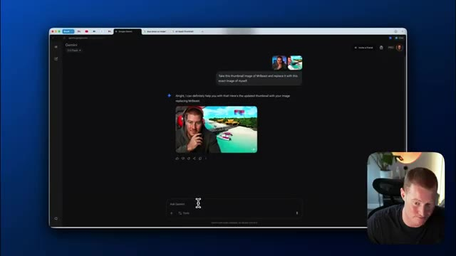
*⏱️ 00:05:48 — Interface de Google Gemini affichant le résultat de la génération d'image où le visage du présentateur a été incrusté sur une miniature YouTube.*

---

### ⏱️ `[00:05:58 - 00:06:19]` | Segment #15

**🔊 Audio (Transcription Intégrale Mot pour Mot en Français) :**
> C'est vraiment, vraiment rapide. Et c'est assez époustouflant de voir à quel point c'est rapide. Et c'est une amélioration massive par rapport à quelque chose comme la génération d'images de ChatGPT. Très bien, le voilà. Ce n'est toujours rien d'extraordinaire, mais je suppose qu'on teste les capacités dans cette vidéo. Très bien, un autre cas d'utilisation auquel j'ai pensé, c'est que je déménage dans environ une semaine. Et voici un exemple de l'à quoi ressemble le salon d'après l'annonce Zillow.

**👁️ Analyse Visuelle d'Écran (gemini-3.5-flash-lite) :**
**Interface & Outils** : Navigateur web, interface de l'outil d'intelligence artificielle Gemini (Google).

**Contenu textuel & Code** : Interface utilisateur de Gemini affichant une conversation avec une image générée (« My apologies for that oversight... ») et un champ de saisie texte (« Ask Gemini » / « Hello, Brock »).

**Action / Démonstration** : Présentation et test en direct de l'outil Gemini avec affichage des résultats visuels générés par l'IA.

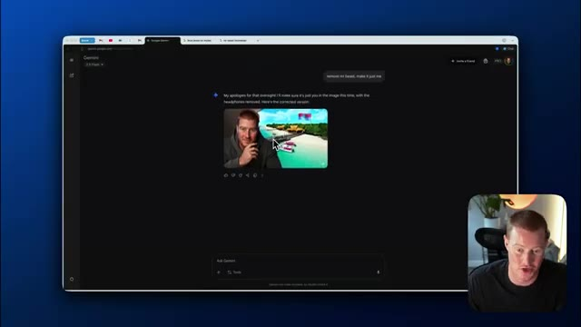
*⏱️ 00:06:09 — Capture d'écran du navigateur affichant l'interface de l'intelligence artificielle Gemini avec le résultat d'une génération d'image et le présentateur en médaillon.*

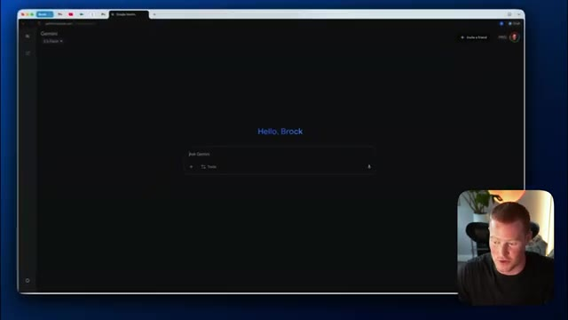
*⏱️ 00:06:14 — Interface de l'outil Gemini avec l'écran d'accueil et la barre de saisie pour interagir avec l'IA.*

---

### ⏱️ `[00:06:19 - 00:06:38]` | Segment #16

**🔊 Audio (Transcription Intégrale Mot pour Mot en Français) :**
> Donc je vais télécharger cette image et en gros dire, prends cette image de ce salon, utilise exactement les mêmes meubles, mais je veux que tu le rendes encore plus chaleureux. Donc voyons ce qu'il peut faire ici. Juste pour me donner une idée de la façon dont je pourrais potentiellement décorer ceci et faire en sorte que ça ressemble plus à chez moi. Et voilà. C'est en fait une assez bonne idée. Donc il y a des bougies ici. Vous pouvez voir qu'il y a d'autres lampes.

**👁️ Analyse Visuelle d'Écran (gemini-3.5-flash-lite) :**
**Interface & Outils** : Navigateur web affichant l'interface de Google Gemini.

**Contenu textuel & Code** : Prompt utilisateur : "Take this image of this living room, use the exact same furniture, but I want you to make it even more cozy."

**Action / Démonstration** : Téléchargement d'une image de salon dans Gemini et formulation d'une requête de modification de design d'intérieur.

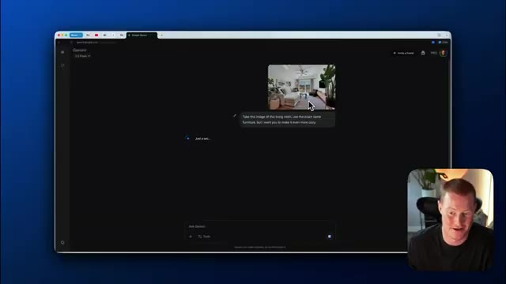
*⏱️ 00:06:29 — Interface de Gemini affichant une image importée d'un salon avec un prompt textuel demandant de rendre la pièce plus chaleureuse en conservant les mêmes meubles.*

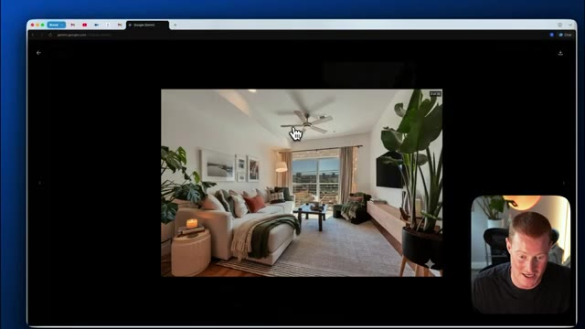
*⏱️ 00:06:33 — Gros plan sur l'image d'un salon lumineux et décoré affichée en plein écran dans le navigateur.*

---

### ⏱️ `[00:06:38 - 00:06:56]` | Segment #17

**🔊 Audio (Transcription Intégrale Mot pour Mot en Français) :**
> Il y a ces lumières ici. Il y a ces couleurs douces et neutres. Ça a l'air beaucoup plus chaleureux que cette image originale que je lui ai donnée. Disons juste de rendre ça encore plus chaleureux. Je veux que ce soit tellement chaleureux que j'ai envie de faire une sieste. Pensez à ceci si vous essayez de concevoir l'intérieur de votre maison. Cela va potentiellement remplacer le besoin d'avoir un architecte d'intérieur. C'est parti. Ça a l'air encore plus chaleureux.

**👁️ Analyse Visuelle d'Écran (gemini-3.5-flash-lite) :**
**Interface & Outils** : Interface web de Google Gemini (gemini.google.com) affichée dans un navigateur, avec une fenêtre vidéo du présentateur.

**Contenu textuel & Code** : Historique de chat avec des images de salon générées et du texte de prompt demandant de rendre l'image plus chaleureuse.

**Action / Démonstration** : Navigation et présentation de l'interface de génération d'images de Google Gemini pour modifier l'ambiance lumineuse d'un salon.

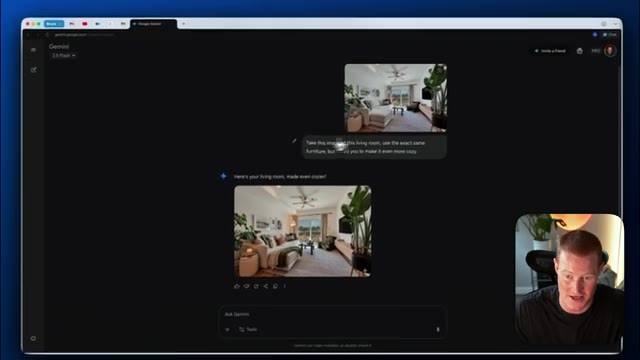
*⏱️ 00:06:42 — Interface Google Gemini affichant une conversation avec une image générée d'un salon chaleureux, avec une webcam du présentateur en bas à droite.*

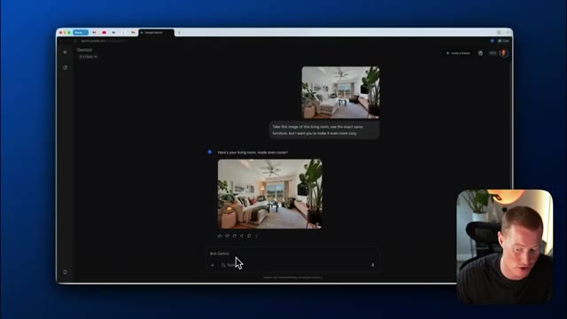
*⏱️ 00:06:47 — Interface Google Gemini montrant le champ de saisie de texte "Ask Gemini" en bas de l'écran, avec le chat et l'image générée au-dessus.*

---

### ⏱️ `[00:06:57 - 00:07:30]` | Segment #18

**🔊 Audio (Transcription Intégrale Mot pour Mot en Français) :**
> Je veux dire, dès que je m'assois sur ce canapé, je vais avoir envie de faire une sieste. Donc c'est plutôt cool. Très bien. Maintenant, je m'amuse juste avec ça. Je lui ai dit de m'ajouter sur le canapé et il a fini par ajouter ceci. C'est plutôt marrant. À la place, je veux que tu en fasses une boisson réconfortante que je tiens réellement. C'est assez marrant, on dirait que je tiens vraiment, je ne sais même pas, une chope en verre ou un truc du genre qui est, tu sais, probablement du café, c'est assez hilarant. Mais les gars, c'est le nouveau Google Nano Banana, je n'y ai accès que depuis environ la dernière heure, alors je veux montrer des choses que j'ai pu faire avec. J'espère que vous avez tiré de la valeur de cette vidéo, je vais laisser un lien pour l'essayer ci-dessous, assurez-vous de vous abonner à la chaîne pour plus de contenu comme celui-ci, merci d'être restés là et à plus les gars.

**👁️ Analyse Visuelle d'Écran (gemini-3.5-flash-lite) :**
**Interface & Outils** : Navigateur web affichant l'interface Google Gemini et une page de blog officielle.

**Contenu textuel & Code** : Interface utilisateur de chat de Gemini avec des exemples de modification d'image par prompt (Reimagine your photos with a prompt).

**Action / Démonstration** : Navigation sur le web et démonstration de l'outil de génération/modification d'images de Gemini.

---

### ⏱️ `[00:07:30 - 00:07:31]` | Segment #19

**🔊 Audio (Transcription Intégrale Mot pour Mot en Français) :**
> dans la prochaine vidéo

**👁️ Analyse Visuelle d'Écran (gemini-3.5-flash-lite) :**
**Interface & Outils** : Webcam / Vidéo YouTube standard sans interface technique.

**Contenu textuel & Code** : Aucun graphique, code, terminal ou donnée financière affiché (gros plan statique du présentateur).

**Action / Démonstration** : Le présentateur s'adresse à son audience.

---

