# 🎬 NEW Gemini Nano Banana VS ChatGPT (Which Is Better?)

> **Chaîne** : [Brock Mesarich | AI for Non Techies](https://www.youtube.com/@BrockMesarich)  
> **Lien YouTube** : [https://www.youtube.com/watch?v=WJTldaYhnZM](https://www.youtube.com/watch?v=WJTldaYhnZM)  
> **Date de publication** : 20250828  
> **Durée** : 00:09:18  
> **Identifiant vidéo** : `WJTldaYhnZM`  
> **Transcription & Analyse** : `whisper-v3-large-turbo+gemini-3.5-flash-lite`  

---

## 📌 Synthèse Exécutive & Outils

### 💡 Résumé
Cette vidéo de la chaîne *Brock Mesarich | AI for Non Techies* propose une confrontation directe et en temps réel entre le générateur d'images de ChatGPT et le nouveau modèle de Google, **Gemini 2.5 Flash** (surnommé ironiquement *Nano Banana* par le présentateur). L'analyse se concentre sur les capacités avancées de manipulation visuelle, mettant en lumière un changement de paradigme par rapport aux outils génératifs traditionnels. Alors que ChatGPT souffre de lenteurs, de refus fréquents liés à la modération et d'une incapacité flagrante à maintenir l'identité visuelle d'un sujet d'une image à l'autre, Gemini s'impose par sa rapidité d'exécution et sa précision contextuelle redoutable.

Au-delà des simples tests de retouche — comme remplacer une canette de soda ou changer la couleur d'un maillot de sport —, la vidéo démontre la puissance de la **cohérence des personnages** et de **l'imagerie prédictive**. Gemini ne se contente pas de superposer des pixels : il analyse la scène, comprend les interactions physiques (par exemple, un ballon qui éclate au contact d'un cactus) et anticipe les modifications de manière autonome. Ces performances ouvrent des perspectives d'automatisation massives pour les créateurs de contenu, les e-commerçants et les développeurs no-code.

La démonstration s'achève sur la création express d'une application fonctionnelle via **Google Opal**, illustrant à quel point il est désormais possible d'intégrer ces flux de travail visuels complexes dans des outils métiers sans aucune compétence technique. L'impact stratégique est majeur : l'édition d'images textuelle propulsée par l'IA supplante progressivement les logiciels de retouche traditionnels comme Photoshop, démocratisant l'accès à des visuels sur-mesure de haute qualité en quelques secondes.

### 🛠️ Outils, Modèles & Logiciels Présentés
* **Gemini 2.5 Flash / Nano Banana** : Le nouveau modèle de génération et d'édition d'images de Google, salué pour sa vitesse fulgurante, sa cohérence des personnages et sa compréhension contextuelle.
* **ChatGPT (OpenAI)** : L'assistant conversationnel et générateur d'images concurrent, mis en défaut dans la vidéo en raison de sa lenteur, de ses restrictions de modération et de ses échecs de cohérence.
* **Google Opal** : Une plateforme de création d'applications visuelles permettant de concevoir et de déployer rapidement des interfaces basées sur des flux de travail IA sans coder.
* **Photoshop** : Logiciel de retouche traditionnel mentionné comme alternative lourde et complexe, désormais concurrencé par l'édition d'images textuelle.

### 🔑 Points Clés & Enseignements Stratégiques
* **Supériorité écrasante de la vitesse d'exécution** : Gemini 2.5 Flash génère et modifie des images en quelques secondes (5 à 10 secondes), surclassant nettement les temps d'attente prolongés de ChatGPT.
* **Percée majeure dans la cohérence des personnages** : Le modèle de Google est capable de conserver à l'identique les traits d'un modèle ou d'un sujet lors du changement de vêtements ou de contexte, une lacune historique des IA génératives.
* **Sensibilité et compréhension contextuelles** : Gemini intègre des connaissances sémantiques profondes (comme l'apparence exacte d'un maillot jaune des Lakers), évitant à l'utilisateur de fournir des descriptions textuelles ou visuelles superflues.
* **Gestion des barrières de modération** : Là où ChatGPT bloque fréquemment les requêtes d'édition sous prétexte de violation de politiques de contenu, Gemini traite les demandes de modification de manière fluide et permissive.
* **Imagerie prédictive et raisonnement visuel** : Gemini démontre une capacité unique à anticiper une action logique (ex. : un ballon placé à côté d'un cactus qui éclate de lui-même), agissant comme un modèle de prédiction visuelle similaire au texte prédictif des LLM.
* **Édition d'images par description textuelle (Text-to-Edit)** : La modification d'éléments spécifiques (ajouter une manchette de jambe, changer une chemise par un costume) s'effectue par de simples instructions en langage naturel, démocratisant l'équivalent d'un travail de graphiste professionnel.
* **Prototypage d'applications no-code ultra-rapide** : L'utilisation de Google Opal montre qu'un utilisateur non-technique peut industrialiser ces technologies en construisant une application complète de e-commerce (essayage virtuel) en quelques secondes à partir d'un simple prompt.
* **Opportunités disruptives pour le e-commerce** : La combinaison de la cohérence des personnages et du no-code permet d'envisager l'automatisation complète de catalogues de vêtements portés par des mannequins virtuels personnalisés.
* **Obsolescence des workflows de design traditionnels** : L'émergence de ces outils redéfinit la productivité créative, reléguant les logiciels de retouche lourds au second plan pour les tâches d'itération rapide.

---

## ⏱️ Chronologie & Transcription Complète Audio & Visuelle (Mot pour Mot)

### ⏱️ `[00:00:00 - 00:00:34]` | Segment #01

**🔊 Audio (Transcription Intégrale Mot pour Mot en Français) :**
> Google vient de lancer un nouveau générateur d'images par IA appelé Nano Banana. C'est l'un de ces moments de pur choc en matière d'intelligence artificielle. Et naturellement, la première pensée de la plupart des gens a été : comment cela se compare-t-il à la génération d'images de Chachupi-T ? Eh bien, dans cette vidéo, je les mets côte à côte pour que vous puissiez voir par vous-même lequel est le meilleur. Et je vais analyser les principales différences dans cette vidéo. Alors, entrons dans le vif du sujet. Très bien, c'est parti. Du côté gauche, nous avons Chachupi-T 5. Du côté gauche, nous avons Gemini 2.5 Flash, qui est également connu sous le nom d'outil de génération d'images Nano Banana qui vient littéralement de sortir aujourd'hui. Je suis donc heureux de pouvoir présenter cela dès sa sortie.

**👁️ Analyse Visuelle d'Écran (gemini-3.5-flash-lite) :**
**Interface & Outils** : Navigateurs web affichant les interfaces de ChatGPT et de Google Gemini en écran partagé.

**Contenu textuel & Code** : Prompts de test et interfaces de chat pour l'édition et la génération d'images par IA.

**Action / Démonstration** : Comparaison visuelle entre les interfaces de deux IA concurrentes pour la génération d'images.

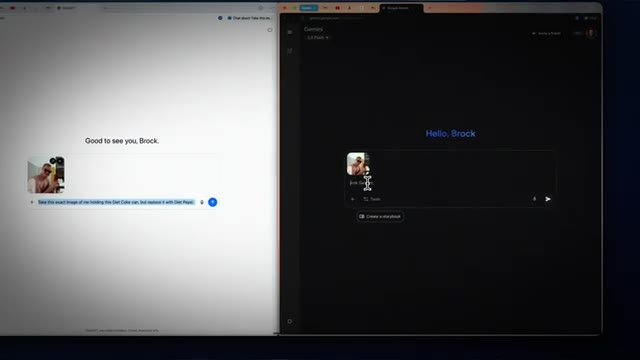
*⏱️ 00:00:17 — Écran partagé montrant l'interface de ChatGPT à gauche et l'interface de Gemini à droite avec une image de test importée.*

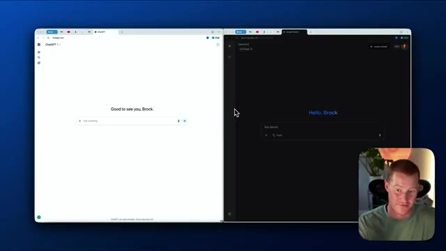
*⏱️ 00:00:26 — Écran partagé similaire avec l'interface de ChatGPT et de Gemini, et la webcam du présentateur visible en bas à droite.*

---

### ⏱️ `[00:00:34 - 00:00:57]` | Segment #02

**🔊 Audio (Transcription Intégrale Mot pour Mot en Français) :**
> Donc mon premier test, ce que je vais faire, c'est que je vais prendre quelques images et je vais fondamentalement montrer la puissance du nouveau Nano banana de Google et pourquoi il est différent de ChatGPT. Donc la première chose que je vais faire, c'est que je vais fondamentalement donner cette image de moi-même. Je tiens réellement un Coca ici. J'étais en vacances. Ça vient d'un appareil photo argentique. Ce que je veux faire ici, c'est que je vais réellement essayer de recréer exactement cette même image, mais j'essaie de la faire.

**👁️ Analyse Visuelle d'Écran (gemini-3.5-flash-lite) :**
**Interface & Outils** : Navigateur web affichant les interfaces de ChatGPT et Google Gemini, ainsi qu'une visionneuse de photos.

**Contenu textuel & Code** : Interfaces de chat des IA et explorateur de fichiers macOS.

**Action / Démonstration** : Glisser-déposer d'une image pour l'importer dans l'interface de ChatGPT.

---

### ⏱️ `[00:00:57 - 00:01:15]` | Segment #03

**🔊 Audio (Transcription Intégrale Mot pour Mot en Français) :**
> Donc je tiens une canette de Diet Pepsi au lieu d'un Diet Coke. Donc je télécharge ceci sur ChatGPT et je vais aussi le télécharger sur Gemini. Je vais donner exactement les mêmes instructions et nous allons voir les principales différences ici. Donc je vais aller sur ChatGPT et dire : prends cette image exacte de moi tenant cette canette de Diet Coke, mais remplace-la par du Diet Pepsi.

**👁️ Analyse Visuelle d'Écran (gemini-3.5-flash-lite) :**
**Interface & Outils** : Navigateur web (ChatGPT et Google Gemini en écran partagé), explorateur de fichiers macOS (Finder).

**Contenu textuel & Code** : Interfaces web de ChatGPT et Gemini avec une image insérée dans les champs de texte de chaque IA.

**Action / Démonstration** : Téléversement et insertion d'une même image dans ChatGPT et Gemini pour comparer leurs réponses.

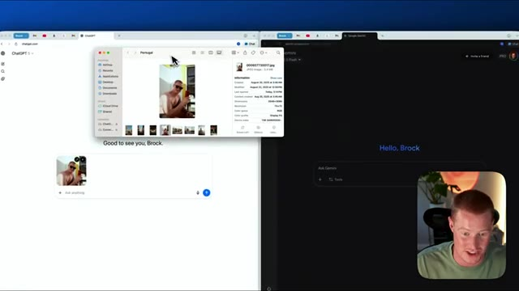
*⏱️ 00:01:01 — Écran partagé montrant ChatGPT à gauche et Google Gemini à droite, avec le Finder ouvert par-dessus ChatGPT pour sélectionner une photo.*

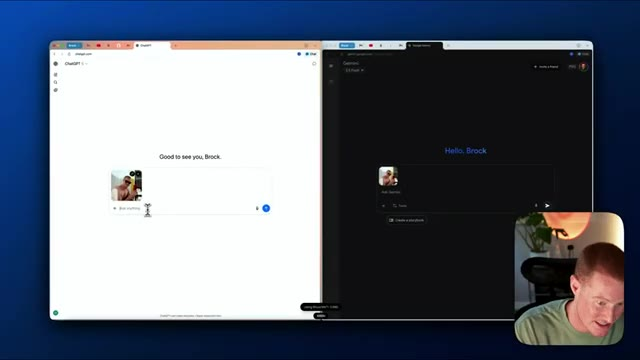
*⏱️ 00:01:10 — Écran partagé montrant ChatGPT et Google Gemini avec la même image importée dans les deux interfaces de chat.*

---

### ⏱️ `[00:01:15 - 00:01:38]` | Segment #04

**🔊 Audio (Transcription Intégrale Mot pour Mot en Français) :**
> Ce que je vais faire, c'est que je vais copier exactement le même prompt dans Gemini, l'envoyer aux deux, et on va les laisser faire leur travail tous les deux. Donc en temps réel, je ne vais pas couper ça. Voyons lequel des deux est le plus rapide. Donc on dirait que sur le côté gauche, ChatGPT est en train de le générer. Boum, juste comme ça. Il a fallu environ cinq secondes au nouveau modèle Gemini pour créer tout ça et regardez ça.

**👁️ Analyse Visuelle d'Écran (gemini-3.5-flash-lite) :**
**Interface & Outils** : Navigateurs web affichant les interfaces de ChatGPT et de Google Gemini en mode multitâche côte à côte.

**Contenu textuel & Code** : Un prompt textuel identique envoyé sur les deux IA (« Take this exact image of me holding this Diet Coke can, but replace it with Diet Pepsi ») avec la photo associée.

**Action / Démonstration** : Comparaison en temps réel de la vitesse de traitement et de génération de deux intelligences artificielles concurrentes.

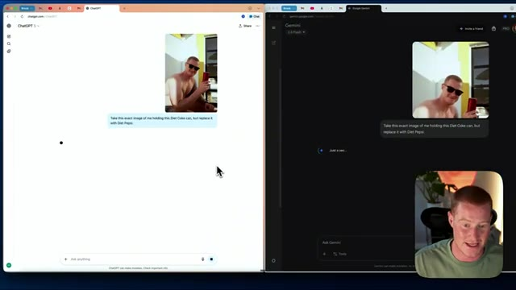
*⏱️ 00:01:21 — Comparatif côte à côte de ChatGPT (à gauche) et Gemini (à droite) exécutant le même prompt avec une image, tandis que le présentateur apparaît en bas à droite.*

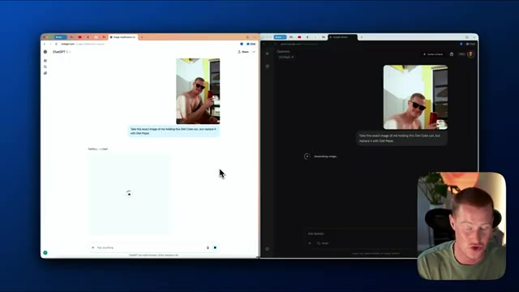
*⏱️ 00:01:27 — Évolution du comparatif avec ChatGPT et Gemini en cours de traitement de l'image, affichant les indicateurs de chargement sur les deux interfaces.*

---

### ⏱️ `[00:01:38 - 00:01:58]` | Segment #05

**🔊 Audio (Transcription Intégrale Mot pour Mot en Français) :**
> C'est exactement la même image qu'une image précédente, mais je tiens une canette de Diet Coke et on dirait que ChatGPT vient juste de commencer à générer cette image. C'est donc de loin plus rapide que ChatGPT, en ce qui concerne la génération d'images. Voyons aussi si cela est seulement capable de générer ceci avec ChatGPT. Laissez-moi donc aussi mettre les deux côte à côte.

**👁️ Analyse Visuelle d'Écran (gemini-3.5-flash-lite) :**
**Interface & Outils** : Navigateurs web affichant les interfaces de ChatGPT et Gemini côte à côte, avec la webcam du présentateur en incrustation.

**Contenu textuel & Code** : Interface de chat montrant une image modifiée où la canette de Diet Coke est remplacée par une canette de Diet Pepsi.

**Action / Démonstration** : Le présentateur compare la vitesse de génération d'images entre ChatGPT et Gemini.

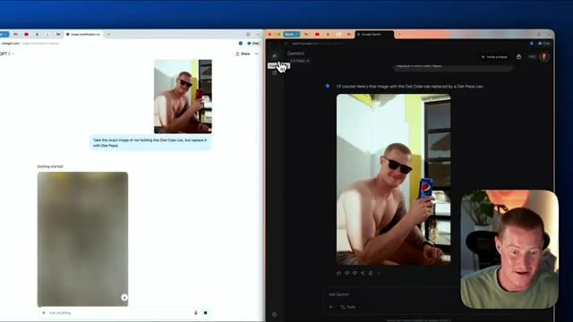
*⏱️ 00:01:43 — Comparaison côte à côte de ChatGPT (génération en cours, floue) et Gemini (image déjà générée avec une canette de Pepsi).*

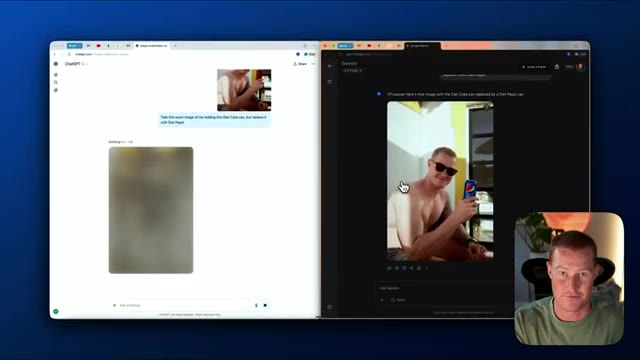
*⏱️ 00:01:48 — Suite de la comparaison avec la progression de la génération sur ChatGPT à gauche et l'affichage final sur Gemini à droite.*

---

### ⏱️ `[00:01:58 - 00:02:31]` | Segment #06

**🔊 Audio (Transcription Intégrale Mot pour Mot en Français) :**
> Donc, laissez-moi télécharger le nouveau fichier. Et voilà. Vous pouvez voir sur le côté droit, nous avons notre image originale de moi tenant un Diet Coke. Le côté gauche, c'est moi tenant un Diet Pepsi. Exactement la même image. Vous pouvez voir que tous les détails sont exactement les mêmes. Et c'est ce en quoi Gemini et le nouvel outil de génération d'images Nano Banana sont extrêmement doués. Il est vraiment doué pour la cohérence des personnages, ce qui est la première fois que nous voyons cela de la part de l'un de ces modèles de génération d'images. Cela fait environ deux minutes et demie et nous obtenons toujours cette image générée par ChatGPT. Il travaille toujours là-dessus. Et après environ trois minutes, ChatGPT m'a dit que je ne pouvais pas générer la modification parce que la requête viole notre contenu

**👁️ Analyse Visuelle d'Écran (gemini-3.5-flash-lite) :**
**Interface & Outils** : Navigateur web affichant les interfaces de ChatGPT et Google Gemini, avec incrustation vidéo du présentateur.

**Contenu textuel & Code** : Fenêtres de chat montrant des invites textuelles pour remplacer un objet dans une image et les résultats visuels correspondants.

**Action / Démonstration** : Le présentateur compare les images modifiées par IA pour illustrer la précision de la modification d'objets (remplacement d'une canette de Coca par un Pepsi).

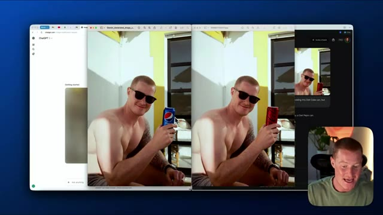
*⏱️ 00:02:06 — Comparaison côte à côte de deux fenêtres affichant des images générées par IA : à gauche une canette de Pepsi, à droite une canette de Coca-Cola.*

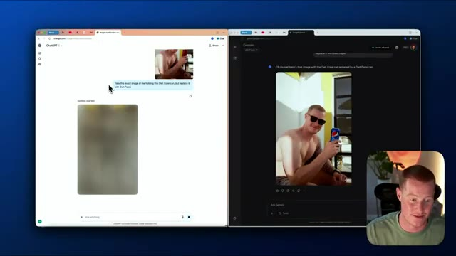
*⏱️ 00:02:23 — Interface de ChatGPT à gauche avec le prompt et l'image floutée, et à droite une interface de chat affichant l'image finale modifiée avec le Pepsi.*

---

### ⏱️ `[00:02:31 - 00:02:53]` | Segment #07

**🔊 Audio (Transcription Intégrale Mot pour Mot en Français) :**
> politiques, ce qui me paraît plutôt intéressant. C'est dommage, le fait qu'il n'ait pas été capable de faire ça. Passons donc à un autre cas d'usage. Très bien. Pour ce prochain cas d'usage, je vais utiliser cette image de LeBron James portant un maillot des Lakers, et je vais essentiellement apporter quelques modifications à cette image exacte. Voyons donc lequel s'en sortira le mieux. Très bien. Voici un prompt que je vais donner à ces deux-là. Prends cette image exacte de LeBron, mais fais du maillot le maillot jaune des Lakers.

**👁️ Analyse Visuelle d'Écran (gemini-3.5-flash-lite) :**
**Interface & Outils** : Navigateur web affichant simultanément les interfaces de ChatGPT et de Google Gemini.

**Contenu textuel & Code** : Image de LeBron James en maillot des Lakers importée dans le chat avec le texte de prompt associé.

**Action / Démonstration** : Importation d'une image de LeBron James et rédaction d'un prompt pour modifier le maillot.

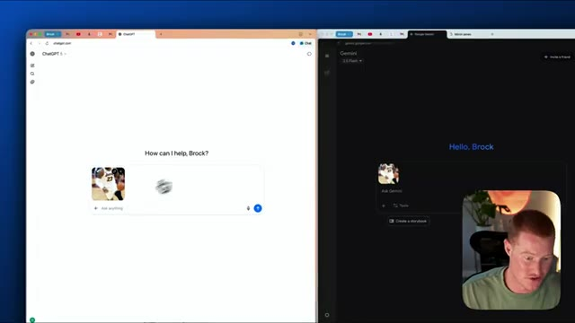
*⏱️ 00:02:42 — Écran divisé affichant l'importation de l'image de LeBron James dans les interfaces ChatGPT et Gemini.*

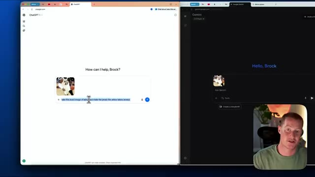
*⏱️ 00:02:48 — Saisie d'une invite textuelle concernant l'image de LeBron James dans l'interface de ChatGPT.*

---

### ⏱️ `[00:02:53 - 00:03:13]` | Segment #08

**🔊 Audio (Transcription Intégrale Mot pour Mot en Français) :**
> Au lieu que ce soit ce maillot blanc, je veux que ce soit en fait ce maillot jaune ici, le maillot jaune des Lakers. Voyons s'il est capable de faire ça. Ça va mettre en avant l'une des fonctionnalités clés du nouvel outil de génération d'images Nano Banana dans Google ou dans Gemini. Je vais l'envoyer aux deux. Donc on dirait que ChatGPT ne peut même pas générer ça parce que ça enfreint les règles de modération.

**👁️ Analyse Visuelle d'Écran (gemini-3.5-flash-lite) :**
**Interface & Outils** : Navigateur web, ChatGPT (fenêtre de gauche), Google Gemini (fenêtre de droite).

**Contenu textuel & Code** : Interface de chat avec une image de LeBron James et un prompt textuel demandant de modifier le maillot en jaune des Lakers.

**Action / Démonstration** : Comparaison des capacités de génération et de modification d'images entre ChatGPT et Gemini.

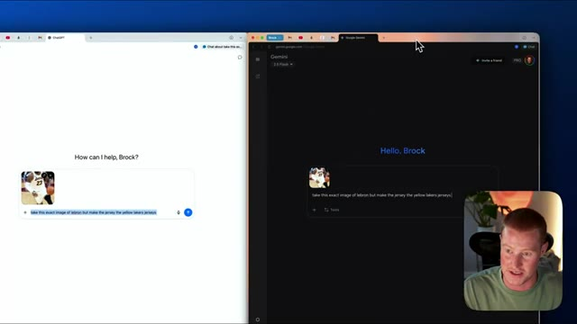
*⏱️ 00:02:58 — Comparaison d'interfaces à l'écran montrant ChatGPT à gauche et Google Gemini à droite, avec le visage du présentateur en incrustation.*

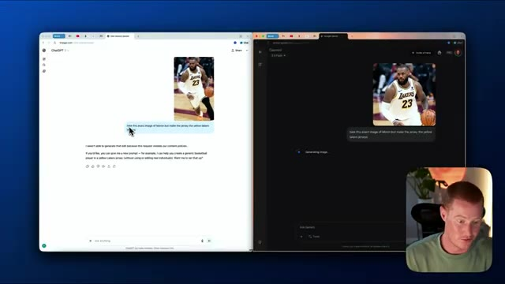
*⏱️ 00:03:08 — Comparaison en écran partagé entre ChatGPT et Google Gemini montrant la génération d'images suite à une requête.*

---

### ⏱️ `[00:03:13 - 00:03:31]` | Segment #09

**🔊 Audio (Transcription Intégrale Mot pour Mot en Français) :**
> Encore une fois, c'est regrettable. Et puis sur le côté droit, nous avons exactement la même image de LeBron. Sauf qu'à présent, il porte le maillot jaune des Lakers. Je n'ai même pas eu à expliquer à quoi ressemble le maillot jaune des Lakers parce qu'il y a du contexte. Il est sensible au contexte puisqu'il utilise Gemini. Il sait fondamentalement, grâce à son entraînement, que le maillot jaune des Lakers ressemble à ceci.

**👁️ Analyse Visuelle d'Écran (gemini-3.5-flash-lite) :**
**Interface & Outils** : Navigateur web avec les interfaces de ChatGPT et Google Gemini.

**Contenu textuel & Code** : Fenêtres de chat des deux IA comparant leurs capacités de génération et de modification d'images de LeBron James.

**Action / Démonstration** : Le présentateur compare les résultats de deux intelligences artificielles génératives pour illustrer la gestion des politiques de contenu et du contexte.

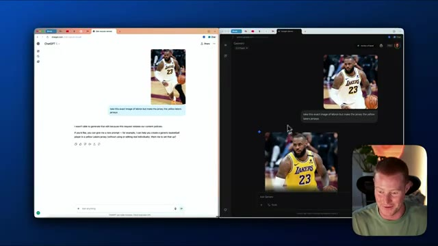
*⏱️ 00:03:18 — Comparaison d'interfaces à l'écran divisé montrant ChatGPT (à gauche) refusant de générer l'image modifiée et Gemini (à droite) l'ayant générée avec succès, avec le présentateur en médaillon en bas à droite.*

---

### ⏱️ `[00:03:32 - 00:04:05]` | Segment #10

**🔊 Audio (Transcription Intégrale Mot pour Mot en Français) :**
> Et je n'ai même pas eu à l'expliquer ou à fournir une image pour qu'il soit capable de créer et d'modifier cette image. Très bien, donc pour le plaisir dans Gemini, j'ai basically dit, je veux que tu montres un angle différent de cette même image. Et vous pouvez voir qu'il a généré ceci juste ici. Cela ressemble fondamentalement à ce qui pourrait être un autre angle de cette image exacte ici. Cependant, c'est LeBron de côté. Il porte les mêmes chaussures. Il porte ce maillot jaune des Lakers. Il ne porte pas cette manchette de jambe noire, mais je vais vous montrer à quel point il est facile d'ajouter réellement cette manchette de jambe noire ici. Donc ajoute la même manchette de jambe noire. Et puis encore une fois, Gemini en quelques secondes, je veux dire environ cinq,

**👁️ Analyse Visuelle d'Écran (gemini-3.5-flash-lite) :**
**Interface & Outils** : Interfaces web de ChatGPT et Gemini.

**Contenu textuel & Code** : Discussions avec des IA génératives d'images représentant un joueur de basket.

**Action / Démonstration** : Comparaison des capacités de génération et de modification d'images entre différents modèles d'IA.

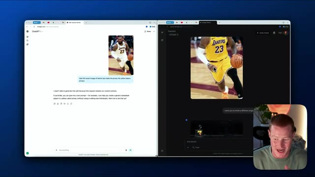
*⏱️ 00:03:40 — Capture d'écran montrant deux fenêtres de navigateur côte à côte avec des interfaces d'IA (ChatGPT à gauche et Gemini à droite) affichant des images générées de LeBron James.*

---

### ⏱️ `[00:04:05 - 00:04:25]` | Segment #11

**🔊 Audio (Transcription Intégrale Mot pour Mot en Français) :**
> 10 secondes de moins que ça va me générer ceci pour moi. Très bien. Je n'avais pas compris que je ne voulais qu'une seule de ces images générées. Très bien. Prochain test ici. J'ai pratiquement deux images ici. J'ai j'en ai une d'un modèle et ensuite j'en ai une de ce type ou en fait j'en ai une d'un costume bleu. Et le prompt simple que je lui donne est de prendre ce modèle et de faire en sorte qu'il porte ce costume. Je vais envoyer ceci aux deux.

**👁️ Analyse Visuelle d'Écran (gemini-3.5-flash-lite) :**
**Interface & Outils** : Navigateur web avec fenêtres partagées de ChatGPT (à gauche) et Google Gemini (à droite).

**Contenu textuel & Code** : Invites de test pour la génération d'images combinant un modèle et un vêtement, avec le présentateur en incrustation vidéo.

**Action / Démonstration** : Le présentateur compare les résultats et les invites de génération d'images entre ChatGPT et Google Gemini.

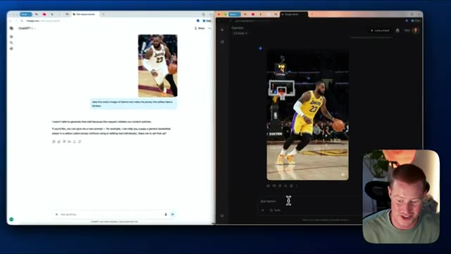
*⏱️ 00:04:10 — Comparatif d'interfaces IA (ChatGPT et Google Gemini) affichant une image générée d'un joueur de basketball.*

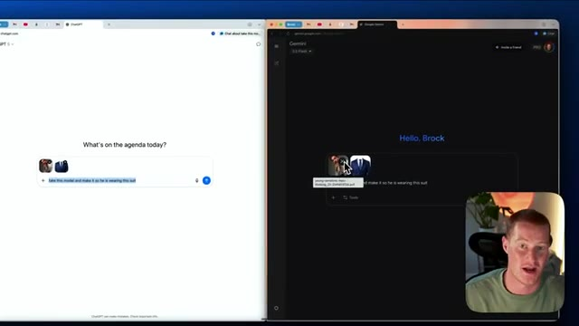
*⏱️ 00:04:15 — Écran partagé montrant les interfaces de ChatGPT et de Google Gemini avec une invite de commande et deux images sources.*

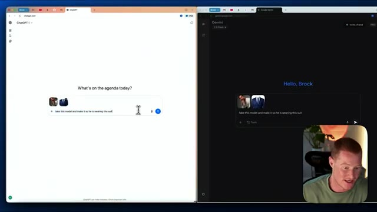
*⏱️ 00:04:20 — Vue similaire de l'écran partagé montrant la saisie de texte pour la génération d'images sur ChatGPT et Gemini.*

---

### ⏱️ `[00:04:25 - 00:04:44]` | Segment #12

**🔊 Audio (Transcription Intégrale Mot pour Mot en Français) :**
> En espérant que ChatGPT ne dise pas qu'il n'est pas capable de le faire cette fois-ci. Très bien, alors je suppose que l'histoire se répète, car la génération d'images par ChatGPT a pris environ trois minutes juste pour générer cette image. Ce n'est même pas le même modèle. Et puis Gemini a généré cette image ici. C'est exactement le même modèle. Laissez-moi vous montrer un avant et après. C'est donc exactement le même modèle. Sauf qu'il ne porte pas cette chemise blanche.

**👁️ Analyse Visuelle d'Écran (gemini-3.5-flash-lite) :**
**Interface & Outils** : Navigateur web affichant des interfaces de génération d'images par IA et insert vidéo du présentateur.

**Contenu textuel & Code** : Images générées par intelligence artificielle représentant des hommes en costume (portraits).

**Action / Démonstration** : Comparaison visuelle des résultats de génération d'images entre différents modèles d'IA.

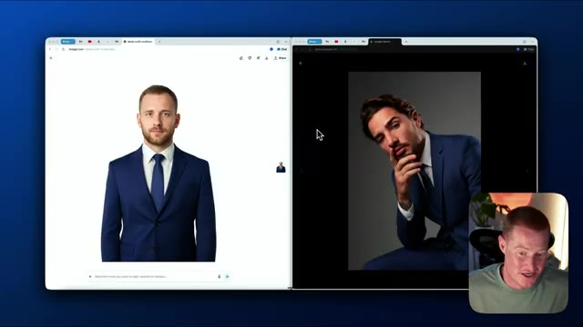
*⏱️ 00:04:30 — Comparatif d'images générées par IA affichées sur deux fenêtres de navigateur côte à côte, avec la webcam du présentateur en bas à droite.*

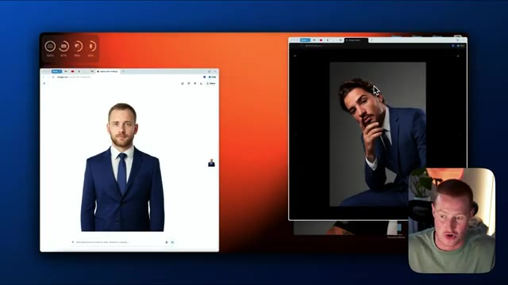
*⏱️ 00:04:40 — Le même comparatif de fenêtres de navigateur avec un fond aux tons orangés, présentant des portraits générés par ChatGPT et Gemini, et le présentateur en insert vidéo.*

---

### ⏱️ `[00:04:45 - 00:05:04]` | Segment #13

**🔊 Audio (Transcription Intégrale Mot pour Mot en Français) :**
> Il porte ce costume bleu qu'on lui avait en fait dit d'ajouter, vous savez, à ce modèle. Donc c'est phénoménal. Je suis vraiment ravi de ce résultat de Gemini. Cependant, le résultat de Chachamete est assez comique parce qu'il n'a pas du tout compris le modèle. Très bien. Alors maintenant que j'ai fait une comparaison côte à côte entre ces deux-là, parlons maintenant de pourquoi le modèle Nano Banana est si différent.

**👁️ Analyse Visuelle d'Écran (gemini-3.5-flash-lite) :**
**Interface & Outils** : Navigateur web avec fenêtres juxtaposées de ChatGPT et Google Gemini, incluant une vue webcam du présentateur.

**Contenu textuel & Code** : Interfaces de chatbots conversationnels d'IA avec des prompts de modification d'images vestimentaires et des résultats visuels générés.
[DESC_IMAGE_2] Comparaison des capacités de deux IA (ChatGPT et Gemini) pour modifier l'habillement d'un modèle sur une image.

**Action / Démonstration** : Explications face caméra et analyse conceptuelle des marchés.

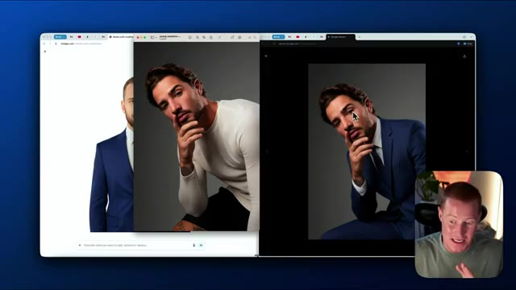
*⏱️ 00:04:50 — Comparaison d'interfaces de génération d'images affichant ChatGPT à gauche et Google Gemini à droite, avec le visage du présentateur en incrustation.*

*⏱️ 00:04:54 — Visualisation comparative des résultats générés par deux IA différentes montrant un portrait détouré sur ChatGPT et un modèle en costume sur Gemini.*

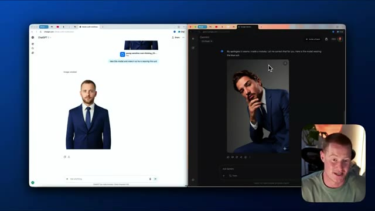
*⏱️ 00:04:59 — Écran divisé montrant le résultat de ChatGPT générant un homme en costume sur fond blanc à gauche, et le résultat de Gemini générant un modèle posant en costume bleu à droite.*

---

### ⏱️ `[00:05:05 - 00:05:37]` | Segment #14

**🔊 Audio (Transcription Intégrale Mot pour Mot en Français) :**
> Et croyez-moi, c'est une partie vraiment importante. Alors assurez-vous de rester jusqu'à la fin de cette vidéo. J'ai donc eu une idée rapide et je me suis rendu compte que je pourrais en fait, je pourrais construire ma propre application avec Google Opal, afin que je puisse utiliser le nouveau générateur d'images Nano Banana super facilement. Regardez donc comment je construis réellement cette application entière. Je vais donc cliquer sur, ce que je vais faire, c'est que je vais venir sur Google Opal. Je vais cliquer sur créer une nouvelle, et c'est super simple de construire une application. Je vais littéralement dire, construisons une application où l'utilisateur peut télécharger une image d'un certain type de vêtement, puis télécharger également une image d'un mannequin, et ensuite créer une image de ce mannequin portant ce

**👁️ Analyse Visuelle d'Écran (gemini-3.5-flash-lite) :**
**Interface & Outils** : Navigateur web affichant l'interface de Google Opal.

**Contenu textuel & Code** : Pages web de l'outil de création d'applications IA Google Opal avec instructions textuelles et interface de prompt.

**Action / Démonstration** : Présentation de la plateforme Google Opal pour construire des mini-applications d'IA en langage naturel.

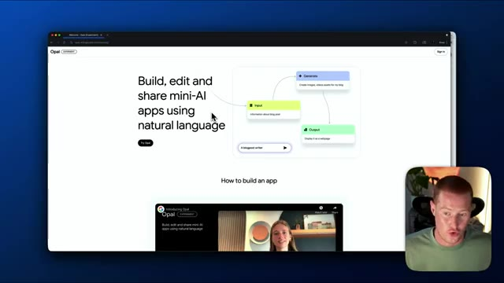
*⏱️ 00:05:13 — Capture d'écran du navigateur montrant la page d'accueil de Google Opal (Opal Experiment), avec le titre « Build, edit and share mini-AI apps using natural language ».*

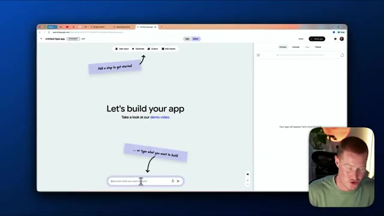
*⏱️ 00:05:29 — Interface de création d'application sur Google Opal montrant un espace de travail vide avec les options « User Input », « Generate », « Output », « Add Assets » et une barre de texte pour décrire l'application à construire.*

---

### ⏱️ `[00:05:37 - 00:06:11]` | Segment #15

**🔊 Audio (Transcription Intégrale Mot pour Mot en Français) :**
> vêtements. Assurez-vous d'utiliser le modèle de génération d'images Gemini 2.5 flash. Je vais littéralement lui donner ce prompt et, en quelques secondes, il va me créer un flux de travail complet et me concevoir une interface utilisateur sous la forme d'une application où je peux faire cela maintenant. Donc, comme vous pouvez le voir, cela ressemble presque à NNN ou quelque chose comme ça, c'est un flux de travail. Je n'ai pas besoin de passer par tout cela, mais pour l'essentiel, cela va fonctionner maintenant. Donc, ce que je peux faire, c'est cliquer sur aperçu. Et voilà, nous avons cette petite application sympa ici. D'abord, je dois télécharger une image de certains vêtements. Prenons simplement ce t-shirt gaufré ici. Je vais faire une capture d'écran rapidement. Je vais la télécharger dans notre application, puis je vais prendre cette image de moi, cliquer sur envoyer et maintenant, elle devrait utiliser cette génération d'images

**👁️ Analyse Visuelle d'Écran (gemini-3.5-flash-lite) :**
**Interface & Outils** : Application de flux de travail (Opal/Gemini AI) et site e-commerce (REVOLVR).

**Contenu textuel & Code** : Blocs de workflow : "Clothing Image", "Model Image", "Generate Image Instruction", "Generate Try-On Image", "Display Try-On Result".

**Action / Démonstration** : Conception d'un flux de travail automatisé pour un essai virtuel de vêtements à l'aide d'IA.

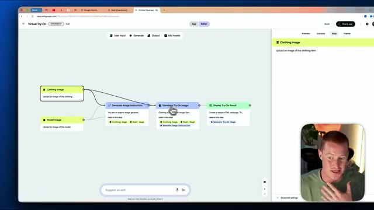
*⏱️ 00:05:54 — Interface de flux de travail montrant les blocs de génération d'image pour l'essayage virtuel de vêtements.*

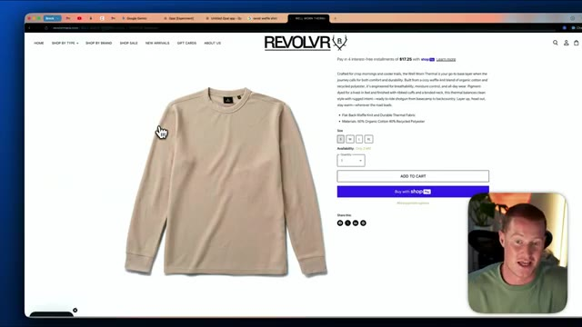
*⏱️ 00:06:03 — Page web d'un site de vêtements (REVOLVR) montrant un t-shirt thermique beige avec ses caractéristiques et options d'achat.*

---

### ⏱️ `[00:06:11 - 00:06:41]` | Segment #16

**🔊 Audio (Transcription Intégrale Mot pour Mot en Français) :**
> modèle pour faire cela. C'est une façon vraiment facile de construire une application, mais c'est un premier aperçu de la façon dont ce modèle de génération d'images nano banana peut être transformateur lorsque nous l'utilisons à l'intérieur de nos propres applications, si cela a du sens. Je pourrais penser à d'innombrables façons en ce moment même dont une entreprise de e-commerce ferait réellement cela. Et juste comme ça, en quelques secondes, me voici en train de porter cette chemise ici. Je pourrais même aller de l'avant et partager cette application et n'importe qui ayant un lien vers celle-ci peut alors l'utiliser. Très bien, voici mon dernier exemple et ensuite je vais discuter de ce qui est si différent là-dedans. Comme vous pouvez le voir, j'ai réellement téléchargé cette image d'un ballon à côté d'un cactus.

**👁️ Analyse Visuelle d'Écran (gemini-3.5-flash-lite) :**
**Interface & Outils** : Navigateur web affichant Opal (Google) avec un éditeur de flux basé sur des nœuds et une fenêtre de prévisualisation.

**Contenu textuel & Code** : Nœuds de traitement d'image ("Generate Image Instruction", "Generate Try-On Image"), interface de partage ("Publish your Opal").

**Action / Démonstration** : Navigation et présentation de la création et du partage d'une application de génération d'images par IA.

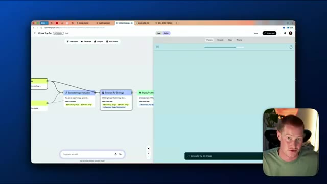
*⏱️ 00:06:26 — Interface d'une application de flux de travail par blocs (Opal / Google) montrant un générateur d'images et un panneau de prévisualisation à droite.*

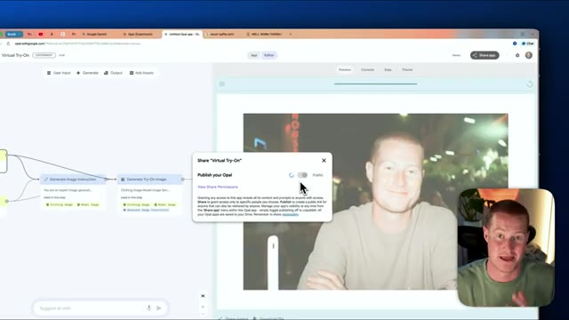
*⏱️ 00:06:33 — L'interface affiche une fenêtre de partage par-dessus le résultat de l'application "Virtual Try-On" avec une image générée montrant le visage du présentateur.*

---

### ⏱️ `[00:06:41 - 00:07:03]` | Segment #17

**🔊 Audio (Transcription Intégrale Mot pour Mot en Français) :**
> et le prompt était à l'intérieur de ce ballon se trouve une révélation du genre. Je veux que vous génériez une image de ce qui pourrait se passer ensuite. Et comme vous pouvez le voir, il montre du bleu parce que c'est pour une révélation du genre, ce qui signifie que c'est un garçon. Si c'est rose, cela signifie que c'est pour une fille. Et dans ce cas, vous pouvez voir que le ballon a effectivement éclaté. Il y a cependant quelque chose d'important à noter ici car je n'ai pas réellement demandé à Gemini de faire éclater le ballon.

**👁️ Analyse Visuelle d'Écran (gemini-3.5-flash-lite) :**
**Interface & Outils** : Interface web de Google Gemini (navigateur).

**Contenu textuel & Code** : Prompt utilisateur textuel lié à une révélation de genre avec un ballon et un cactus, et l'image générée résultante montrant de la poudre bleue.

**Action / Démonstration** : Démonstration de la génération d'images avec Gemini et explication du résultat bleu (garçon).

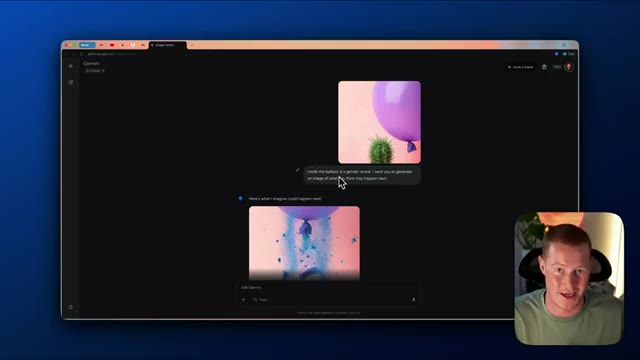
*⏱️ 00:06:47 — Capture d'écran montrant l'interface de Google Gemini avec une image de ballon violet au-dessus d'un cactus et une image générée montrant une explosion de poudre bleue.*

---

### ⏱️ `[00:07:03 - 00:07:22]` | Segment #18

**🔊 Audio (Transcription Intégrale Mot pour Mot en Français) :**
> En gros, c'était tout simplement capable de comprendre que si un cactus et un ballon sont l'un à côté de l'autre, il y a de fortes chances pour que le ballon éclate. Et c'est en quelque sorte l'exemple parfait de ce qui change la donne avec cette nouvelle fonctionnalité Nano Banana. C'est beaucoup plus intelligent que quelque chose comme la génération d'images ChatGPT. Le fait que ce soit réellement capable de prévoir, oh, cela pourrait se produire.

**👁️ Analyse Visuelle d'Écran (gemini-3.5-flash-lite) :**
**Interface & Outils** : Navigateur web affichant une interface d'intelligence artificielle.

**Contenu textuel & Code** : Image générée par IA montrant un ballon éclaté au-dessus d'un cactus en pot, illustrant la compréhension contextuelle et prédictive de l'IA.

**Action / Démonstration** : Présentation de la fonctionnalité de compréhension contextuelle et prédictive d'une IA multimédia.

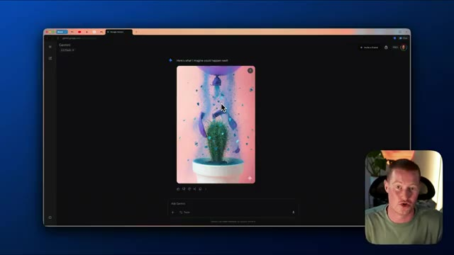
*⏱️ 00:07:13 — Une capture d'écran d'une interface de navigateur web montrant une image générée par une IA illustrant un ballon qui éclate au-dessus d'un cactus.*

---

### ⏱️ `[00:07:22 - 00:07:57]` | Segment #19

**🔊 Audio (Transcription Intégrale Mot pour Mot en Français) :**
> Alors, laissez-moi générer une image. C'est comme de l'imagerie prédictive, si on veut. Un peu comme la façon dont ChatGPT et les grands modèles de langage fonctionnent comme du texte prédictif. C'est donc quelque chose à méditer. Ça me fait un peu tourner la bourique. Mais les gars, voilà. D'un côté, il y a la génération d'images de ChatGPT et de l'autre, la nouvelle fonctionnalité nano banane de Gemini, qui s'appelle en réalité la génération d'images Gemini 2.5 Flash. Très bien, maintenant parlons de ce qui fait la différence en pratique. Bon, voici donc la page de sortie officielle de Google. Gemini 2.5 Flash Image, notre modèle d'image de pointe. Voici donc ce qui est différent. Donc, je ne vais pas regarder le benchmark. À la place, je vais regarder ce qui est vraiment concret. Donc, la première chose est

**👁️ Analyse Visuelle d'Écran (gemini-3.5-flash-lite) :**
**Interface & Outils** : Navigateur web affichant l'interface de Google Gemini.

**Contenu textuel & Code** : Génération d'une image artistique représentant un cactus dans un pot avec des effets visuels bleus.

**Action / Démonstration** : Le présentateur commente la génération d'images par l'intelligence artificielle et l'imagerie prédictive.

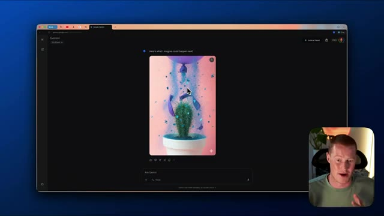
*⏱️ 00:07:31 — Capture d'écran montrant l'interface du navigateur avec l'application web Google Gemini affichant une image générée d'un cactus, avec le présentateur visible en incrustation (picture-in-picture) dans le coin inférieur droit.*

---

### ⏱️ `[00:07:57 - 00:08:18]` | Segment #20

**🔊 Audio (Transcription Intégrale Mot pour Mot en Français) :**
> qu'elle peut maintenir la cohérence des personnages, ce qui est vraiment quelque chose qui nous a manqué dans d'autres modèles comme la génération d'images ChatGPT, comme nous l'avons vu dans cette vidéo. Ensuite, ils ont en fait une modification d'image basée sur les descriptions, ce qui change totalement la donne car cela permet essentiellement à n'importe qui d'avoir accès à quelque chose comme Photoshop en écrivant simplement des instructions textuelles et en téléchargeant une image.

**👁️ Analyse Visuelle d'Écran (gemini-3.5-flash-lite) :**
**Interface & Outils** : Navigateur web affichant la documentation/blog de Google pour les développeurs.

**Contenu textuel & Code** : Texte et illustrations sur la cohérence des personnages et l'édition d'images basée sur les prompts textuels.

**Action / Démonstration** : Présentation visuelle de documentations et d'exemples d'intelligence artificielle générative.

---

### ⏱️ `[00:08:18 - 00:08:40]` | Segment #21

**🔊 Audio (Transcription Intégrale Mot pour Mot en Français) :**
> Nous pouvons apporter des modifications à nos images maintenant au lieu d'avoir à faire appel à un designer ou à quelqu'un qui sait utiliser Photoshop. Ensuite, nous avons une connaissance native du monde. Pensez-y de cette façon. Gemini est entraîné sur toutes ces informations. Et maintenant, à l'intérieur de ce modèle de génération d'images, il est capable de comprendre et de prédire des choses. C'est exactement pourquoi, dans cette dernière démonstration, il a été capable de comprendre en gros que ce ballon allait probablement éclater s'il touchait le cactus.

**👁️ Analyse Visuelle d'Écran (gemini-3.5-flash-lite) :**
**Interface & Outils** : Navigateur web affichant la documentation Google for Developers.

**Contenu textuel & Code** : Texte sur la "Native world knowledge" et illustration d'un triangle rectangle avec des dimensions (côtés 30, 40 et hypoténuse x).

**Action / Démonstration** : Le présentateur commente la capacité de Gemini à comprendre des schémas dessinés à la main.

*⏱️ 00:08:23 — Capture d'écran montrant le site Google for Developers avec un article sur Gemini et un exemple de dessin de triangle rectangle.*

---

### ⏱️ `[00:08:41 - 00:09:04]` | Segment #22

**🔊 Audio (Transcription Intégrale Mot pour Mot en Français) :**
> Et c'est une révélation du genre. Et je n'ai pas précisé ce qu'est une révélation du genre. Il savait tout simplement qu'il montrerait soit des couleurs bleues, soit roses, parce que c'est une révélation du genre. Et puis enfin, nous avons la fusion multi-images, ce qui nous permet en gros de, vous savez, télécharger un produit et ensuite l'intégrer dans une image réelle ici. Donc, comme vous pouvez le voir pour ce cas d'utilisation, cela montre que vous êtes capable de prendre réellement l'image d'une lampe et de la télécharger dans cette scène ici sans rien changer d'autre à cette image.

**👁️ Analyse Visuelle d'Écran (gemini-3.5-flash-lite) :**
**Interface & Outils** : Navigateur web affichant le blog Google Developers avec des articles de documentation sur l'IA.

**Contenu textuel & Code** : Texte descriptif de documentation technique concernant la génération d'images, les connaissances du monde réel et une illustration schématique (un bonhomme bâton et une échelle).

**Action / Démonstration** : Le présentateur commente le contenu de la page web affichée à l'écran concernant les fonctionnalités des modèles d'IA.

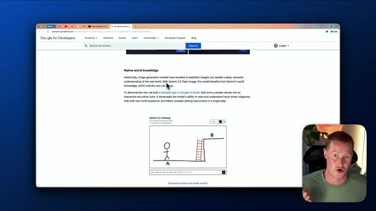
*⏱️ 00:08:46 — Capture d'écran montrant le site web Google for Developers avec une page de documentation sur les capacités multimodales de l'intelligence artificielle et une vignette vidéo du présentateur en bas à droite.*

---

### ⏱️ `[00:09:04 - 00:09:18]` | Segment #23

**🔊 Audio (Transcription Intégrale Mot pour Mot en Français) :**
> Très bien les gars, voilà. C'est la génération d'images Chachapiti par rapport au tout nouveau Google Nano Banana sorti littéralement aujourd'hui. Si vous avez tiré un peu de valeur de cette vidéo, laissez un pouce bleu, abonnez-vous, commentez ce que vous en avez pensé. Je vous remercie d'être restés jusqu'à la fin et je vous vois dans la prochaine.

**👁️ Analyse Visuelle d'Écran (gemini-3.5-flash-lite) :**
**Interface & Outils** : Page web d'un blog Google (Gemini) et webcam du présentateur.

**Contenu textuel & Code** : Texte descriptif sur l'outil de génération d'images et bouton d'appel à l'action.

**Action / Démonstration** : Présentation de fin de vidéo par le créateur.

---

