# 🎬 Stop Building UGLY AI Apps (Do This Instead)

> **Chaîne** : [Brock Mesarich | AI for Non Techies](https://www.youtube.com/@BrockMesarich)  
> **Lien YouTube** : [https://www.youtube.com/watch?v=pIkb3QOf7L0](https://www.youtube.com/watch?v=pIkb3QOf7L0)  
> **Date de publication** : 20250829  
> **Durée** : 00:10:13  
> **Identifiant vidéo** : `pIkb3QOf7L0`  
> **Transcription & Analyse** : `whisper-v3-large-turbo+gemini-3.5-flash-lite`  

---

## 📌 Synthèse Exécutive & Outils

### 💡 Résumé
Cette vidéo présentée par Brock Mesarich pour la chaîne *AI for Non Techies* s'attaque à un écueil majeur du développement no-code et du prototypage assisté par intelligence artificielle : la production systématique d'interfaces utilisateur (UI) fades, génériques et immédiatement identifiables comme « faites par l'IA ». L'analyste démontre qu'il est désormais possible de s'affranchir de cette limite esthétique en combinant des plateformes de création d'applications intuitives avec des bibliothèques de composants de pointe. À travers le cas concret de la création de « PayPilot », une application gratuite de génération de factures pilotée par le langage naturel, la démonstration expose méthodiquement comment élever la qualité visuelle d'un produit brut au rang d'une application professionnelle haut de gamme.

La stratégie présentée repose sur un couplage technologique astucieux entre **Base44**, un environnement de développement d'applications par IA, et **21st.dev**, une bibliothèque spécialisée de composants d'interface utilisateur. L'approche méthodologique consiste à ne pas laisser l'intelligence artificielle concevoir l'intégralité du design à partir d'une feuille blanche, mais à lui injecter chirurgicalement des prompts précis, des motifs d'arrière-plan sophistiqués (comme des dégradés animés), des effets typographiques dynamiques (animations de frappe) et des cartes ergonomiques sourcés sur des plateformes de design de référence. 

Au-delà de la simple revue d'outils, la vidéo met en lumière l'importance cruciale de l'expérience utilisateur (UX) dans l'adoption d'un logiciel. En exploitant des fonctionnalités d'édition visuelle ciblée, l'animateur montre comment injecter du contexte contextuel et fonctionnel directement dans les composants importés, garantissant ainsi que l'esthétique serve la proposition de valeur de l'application (ici, la rapidité et l'intuitivité de la facturation textuelle). Cette méthodologie itérative transforme radicalement le rendu final, prouvant qu'un utilisateur sans compétences techniques avancées en codage peut concevoir des prototypes dotés d'un design soigné, fluide et hautement concurrentiel.

### 🛠️ Outils, Modèles & Logiciels Présentés
* **Base44** : Plateforme de codage intuitif et de création d'applications assistée par IA permettant de générer rapidement des structures logicielles et des pages de destination fonctionnelles.
* **21st.dev** : Bibliothèque riche de composants d'interface utilisateur (UI) haut de gamme offrant des prompts prêts à l'emploi pour intégrer des éléments de design modernes (animations, dégradés, cartes).
* **ChatGPT** : Modèle conversationnel d'intelligence artificielle généraliste souvent mobilisé pour la génération de texte et l'assistance au prompt engineering.
* **Claude** : Assistant IA de pointe réputé pour ses capacités de raisonnement logique, d'écriture et de structuration de code complexe.
* **Gemini** : Modèle multimodal de Google intégré dans divers flux de travail pour l'analyse de données et la génération de contenu.
* **Grok** : Modèle d'intelligence artificielle conversationnelle axé sur le traitement en temps réel et l'interaction textuelle avancée.
* **n8n** : Outil d'automatisation de flux de travail (workflow automation) open-source et flexible pour connecter différentes applications.
* **Zapier** : Plateforme cloud leader d'automatisation sans code permettant de relier des milliers d'applications web entre elles.
* **Make** : Outil visuel d'intégration et d'automatisation puissant pour concevoir des scénarios complexes multi-applications.

### 🔑 Points Clés & Enseignements Stratégiques
* **Dépassement du design générique de l'IA** : Lutte active contre l'uniformité visuelle des applications générées par intelligence artificielle en évitant les interfaces basiques et prédictibles.
* **Couplage d'outils spécialisés** : Synergie stratégique entre une plateforme de génération d'applications (Base44) et une bibliothèque de composants UI haut de gamme (21st.dev) pour un rendu visuel professionnel.
* **Utilisation de prompts de composants** : Extraction et réutilisation de prompts spécifiques fournis par des bibliothèques de design pour reproduire fidèlement des éléments graphiques complexes dans l'application cible.
* **Intégration d'arrière-plans immersifs** : Implémentation rapide de dégradés animés pour capter immédiatement l'attention de l'utilisateur dès la page d'atterrissage (*landing page*).
* **Effets typographiques dynamiques** : Ajout d'animations de frappe (*typing animations*) sur les sections clés (*hero sections*) pour dynamiser la lecture et mettre en valeur la proposition de valeur centrale.
* **Édition visuelle ciblée** : Recours aux fonctionnalités d'édition par sélection de blocs (division d'interface) pour appliquer des modifications précises sans perturber la structure globale de l'application.
* **Préservation de la cohérence contextuelle** : Veille à ce que les composants importés de bibliothèques externes s'adaptent sémantiquement au domaine fonctionnel de l'application (ici, la facturation automatisée).
* **Personnalisation des cartes UI** : Sélection et intégration de cartes esthétiques dotées d'effets lumineux et d'une hiérarchie visuelle claire pour structurer les fonctionnalités et les témoignages clients.
* **Validation instantanée du prototype** : Test immédiat des flux utilisateurs (comme la génération d'une facture par simple description textuelle) pour s'assurer que l'esthétique ne nuit pas à la performance fonctionnelle.
* **Démocratisation du design de haut niveau** : Démonstration qu'un non-technicien peut atteindre un niveau de finition d'interface digne d'une agence de design grâce à l'assistance combinée des outils modernes.

---

## ⏱️ Chronologie & Transcription Complète Audio & Visuelle (Mot pour Mot)

### ⏱️ `[00:00:00 - 00:00:18]` | Segment #01

**🔊 Audio (Transcription Intégrale Mot pour Mot en Français) :**
> Arrêtez de créer les mêmes applications moches avec l'IA. Dans cette vidéo, je vais vous montrer comment créer des interfaces utilisateur magnifiques qui ne donnent pas l'impression d'avoir été faites par l'IA. Si vous avez déjà fait du codage intuitif, vous savez exactement de quoi je parle. Et si vous avez eu ce problème ou si vous débutez dans le codage intuitif, c'est la vidéo parfaite pour vous. Ceci étant dit, entrons dans le vif du sujet. C'est parti, les gars.

**👁️ Analyse Visuelle d'Écran (gemini-3.5-flash-lite) :**
**Interface & Outils** : Navigateur web affichant une bibliothèque de composants d'interface utilisateur (UI).

**Contenu textuel & Code** : Catalogue de composants web, modèles de design et sections de tarification.

**Action / Démonstration** : Navigation et présentation de designs d'interfaces utilisateur.

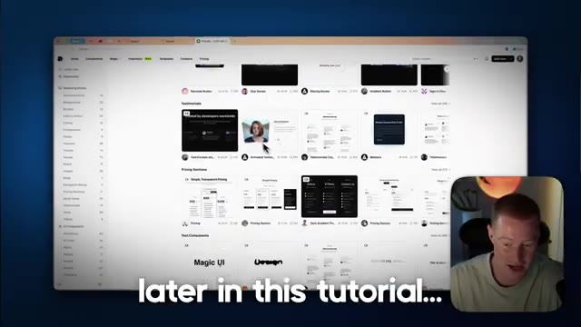
*⏱️ 00:00:05 — Capture d'écran montrant l'interface d'un site web de composants UI avec le présentateur en médaillon en bas à droite.*

---

### ⏱️ `[00:00:18 - 00:00:37]` | Segment #02

**🔊 Audio (Transcription Intégrale Mot pour Mot en Français) :**
> Donc nous allons créer notre application avec l'IA en utilisant Base44, qui est une plateforme formidable pour faire du codage intuitif et construire des applications qui ont un aspect incroyable. Mais je vais vous montrer tout un tas d'astuces différentes dans cette vidéo sur la façon de créer des applications à l'apparence vraiment professionnelle qui n'ont pas l'air d'avoir été générées par une application. Tout d'abord, je vais cliquer sur commencer à créer ici et laissez-moi aller saisir mon prompt ici.

**👁️ Analyse Visuelle d'Écran (gemini-3.5-flash-lite) :**
**Interface & Outils** : Navigateur web affichant la plateforme Base44.

**Contenu textuel & Code** : Page d'accueil du site Base44 avec le slogan "Let's make your dream a reality. Right now" et un champ de saisie de prompt ("What do you want to build?").

**Action / Démonstration** : Présentation de la plateforme Base44 pour le développement d'applications par IA.

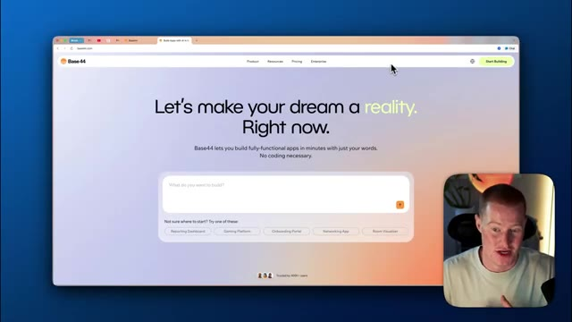
*⏱️ 00:00:28 — Capture d'écran du site web Base44 avec le présentateur en incrustation vidéo en bas à droite.*

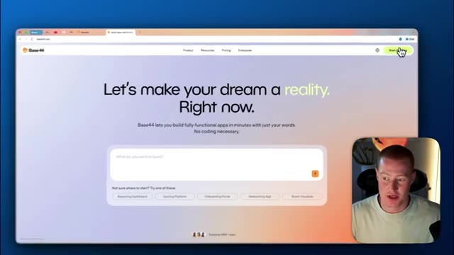
*⏱️ 00:00:32 — Vue similaire du site web Base44 montrant la page d'accueil de la plateforme de création d'applications sans code.*

---

### ⏱️ `[00:00:37 - 00:00:57]` | Segment #03

**🔊 Audio (Transcription Intégrale Mot pour Mot en Français) :**
> Comme nous le savons avec ces plateformes, afin de lancer notre processus de création d'applications, voici le prompt que je vais utiliser. Crée une application appelée PayPilot. L'application sera une alternative gratuite aux générateurs de factures. Elle vous permet de créer automatiquement une facture en utilisant des invites en langage naturel, ce qui revient essentiellement à envoyer des SMS tout simplement comme ceci, en fait, vous savez, avec quoi nous interagissons ici.

**👁️ Analyse Visuelle d'Écran (gemini-3.5-flash-lite) :**
**Interface & Outils** : Navigateur web affichant la plateforme de création d'applications Base 44.

**Contenu textuel & Code** : Le champ de texte affiche le prompt : « create an app called PayPilot. The app is going to be a free alternative to invoice generators. It allows you to automatically create an invoice using natural language prompts. » Des catégories d'applications et un historique des applications récentes (PayPilot) sont également visibles.

**Action / Démonstration** : Le présentateur saisit le prompt de création d'application dans l'interface de la plateforme Base 44.

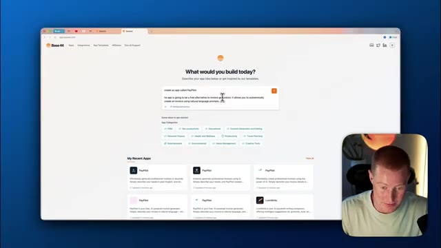
*⏱️ 00:00:42 — Capture d'écran montrant l'interface de Base 44 avec la zone de saisie du prompt pour créer l'application PayPilot, ainsi que le présentateur en incrustation vidéo en bas à droite.*

---

### ⏱️ `[00:00:57 - 00:01:18]` | Segment #04

**🔊 Audio (Transcription Intégrale Mot pour Mot en Français) :**
> L'utilisateur peut taper à qui est destinée la facture, pour quel montant, la date, etc. Et ensuite, cela crée automatiquement une facture en utilisant l'IA. Créez une page de destination devant l'application que tous les utilisateurs pourront voir dès qu'ils verront l'application. Nous allons donc construire une page de destination magnifique devant notre application. Et c'est le prompt initial que j'ai. Cependant, je vais parler de la façon dont je vais réellement rendre l'interface utilisateur magnifique dès maintenant.

**👁️ Analyse Visuelle d'Écran (gemini-3.5-flash-lite) :**
**Interface & Outils** : Navigateur web affichant l'interface de la plateforme Base 44.

**Contenu textuel & Code** : Champ de texte interactif avec le prompt saisi : "Create a landing page infront of the app that all users can see right when they see the app." et des catégories d'applications suggérées.

**Action / Démonstration** : Le présentateur démontre la saisie de instructions textuelles pour générer automatiquement une page d'accueil avec l'intelligence artificielle.

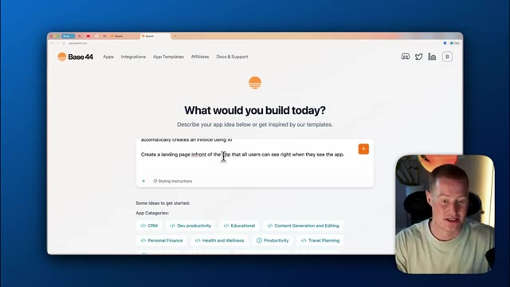
*⏱️ 00:01:08 — Une interface web (Base 44) montrant un champ de texte où l'utilisateur saisit des instructions pour l'application d'IA.*

---

### ⏱️ `[00:01:18 - 00:01:39]` | Segment #05

**🔊 Audio (Transcription Intégrale Mot pour Mot en Français) :**
> On pourrait simplement envoyer ça à Base44 et on obtiendrait, vous savez, une super application et, vous savez, une interface utilisateur sympa. Mais il y a fort à parier qu'elle ait l'air d'avoir été générée par IA. Laissez-moi donc vous montrer une astuce rapide et comment nous allons rendre notre application incroyable grâce à ce petit truc. Tout d'abord, ce que je vais faire, c'est aller sur 21st.dev et, en gros, c'est une bibliothèque de composants d'interface utilisateur.

**👁️ Analyse Visuelle d'Écran (gemini-3.5-flash-lite) :**
**Interface & Outils** : Navigateur web, plateforme Base44.

**Contenu textuel & Code** : Interface utilisateur de création d'applications par IA avec des prompts textuels.

**Action / Démonstration** : Le présentateur navigue sur la plateforme Base44 puis ouvre un nouvel onglet de navigateur.

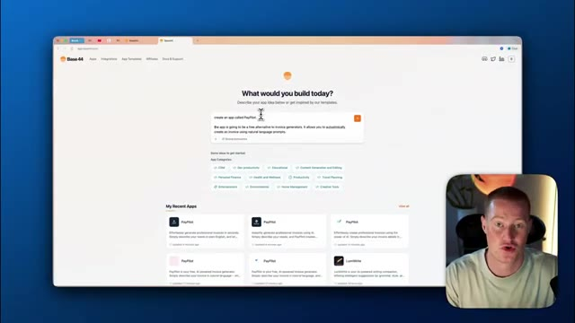
*⏱️ 00:01:24 — Interface de la plateforme Base44 montrant la barre de prompt et les applications récentes.*

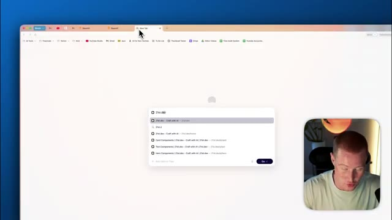
*⏱️ 00:01:34 — Navigateur web avec l'ouverture d'un nouvel onglet et la recherche d'un site de développement.*

---

### ⏱️ `[00:01:39 - 00:02:15]` | Segment #06

**🔊 Audio (Transcription Intégrale Mot pour Mot en Français) :**
> Donc, si vous ne savez pas ce que c'est, c'est essentiellement comme toutes les différentes choses sur notre application. Pensez à ceci ici comme à un composant d'interface utilisateur ou à ceux-ci ici, ce sont des boutons, qui sont des composants d'interface utilisateur pour notre application. C'est ici que nous allons puiser de l'inspiration et fondamentalement reproduire exactement certaines de ces différentes idées sur ce site web ici. Donc, premièrement, j'ai fondamentalement parcouru 21st.dev et j'ai trouvé différents composants d'interface utilisateur que je veux ajouter à notre site web et à notre application pour lui donner un aspect extrêmement, vous savez, attrayant à regarder. Donc, vous pouvez voir ce petit motif d'arrière-plan ainsi que, vous savez, celui-ci ici. Je veux dire, tout cela a l'air vraiment solide et ce ne sont pas juste des applications d'IA d'apparence générique, vous savez, qui ont été construites en utilisant

**👁️ Analyse Visuelle d'Écran (gemini-3.5-flash-lite) :**
**Interface & Outils** : Navigateur web présentant une plateforme de composants d'interface utilisateur (Magic UI).

**Contenu textuel & Code** : Galerie de composants UI, boutons, cartes de design et sections de navigation.

**Action / Démonstration** : Navigation et défilement dans la bibliothèque de composants UI pour illustrer leur utilisation.

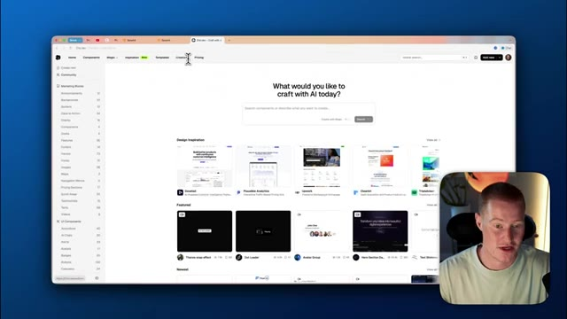
*⏱️ 00:01:48 — Vue d'ensemble d'une application web avec des briques d'interface utilisateur et une barre de recherche.*

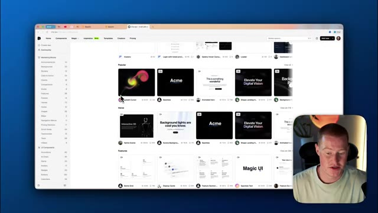
*⏱️ 00:01:57 — Défilement vers le bas affichant différentes sections populaires et héros d'éléments d'interface utilisateur.*

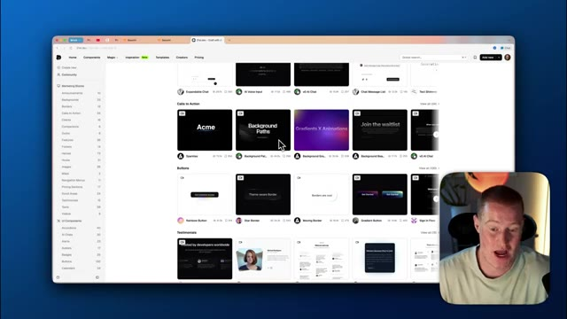
*⏱️ 00:02:06 — Gros plan sur la section des boutons d'interface utilisateur et des appels à l'action.*

---

### ⏱️ `[00:02:15 - 00:02:51]` | Segment #07

**🔊 Audio (Transcription Intégrale Mot pour Mot en Français) :**
> L'IA, évidemment. Donc ce que je vais faire, je vais aller sur mon compte où j'ai effectivement mis certains de ceux-ci en favori. Et j'aime vraiment cet arrière-plan en dégradé animé. Je trouve que ça a vraiment l'air solide. Laissez-moi vous montrer exactement comment je pourrais intégrer quelque chose comme ça dans mon application. Tout ce que j'ai à faire, c'est de venir ici et de cliquer sur copier le prompt. Vous pouvez voir que je peux simplement copier ce prompt ici. Et ce que ça va faire, c'est que ça rédige essentiellement le prompt pour que cela soit reproduit à l'intérieur de mon application. Donc j'ai littéralement juste besoin d'aller sur base 44. Et ensuite, je peux simplement dire, utilise ceci comme arrière-plan pour notre page d'accueil et notre application. Et ensuite, je vais juste coller ce prompt ici et ça va commencer à l'implémenter. Donc maintenant, ça va

**👁️ Analyse Visuelle d'Écran (gemini-3.5-flash-lite) :**
**Interface & Outils** : Navigateur web affichant une bibliothèque de composants (21st.dev) et une plateforme de développement d'applications par IA (Base 44).

**Contenu textuel & Code** : Code source React/JSX pour un composant d'arrière-plan animé, options de prompt IA et invite textuelle pour créer une landing page.

**Action / Démonstration** : Le présentateur navigue entre les composants web, ouvre une boîte de dialogue pour copier un prompt IA et consulte une interface de création d'applications.

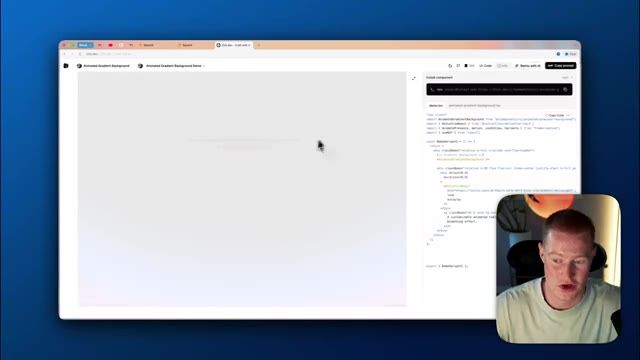
*⏱️ 00:02:24 — Capture d'écran montrant l'interface d'un site web de composants avec du code source et une prévisualisation d'arrière-plan.*

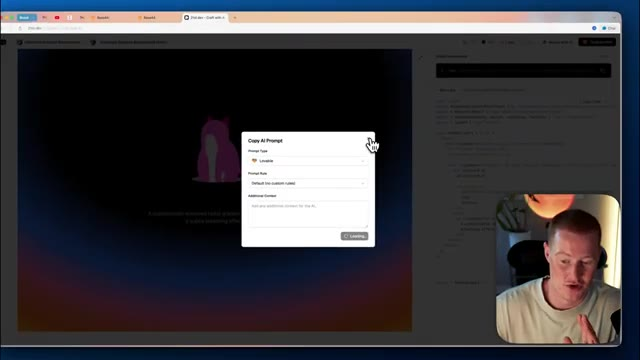
*⏱️ 00:02:33 — Fenêtre contextuelle "Copy AI Prompt" affichée par-dessus un aperçu d'arrière-plan dégradé et du code source.*

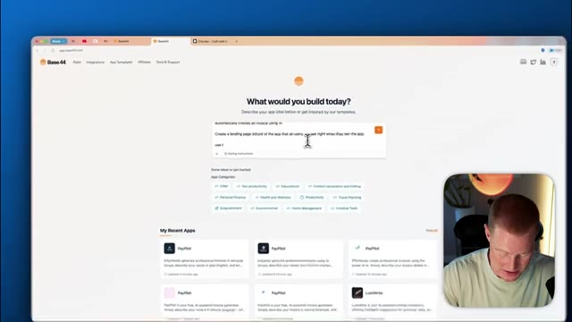
*⏱️ 00:02:42 — Interface de création d'applications avec un champ de saisie de texte "What would you build today?" et des applications récentes.*

---

### ⏱️ `[00:02:51 - 00:03:27]` | Segment #08

**🔊 Audio (Transcription Intégrale Mot pour Mot en Français) :**
> vas-y, ça va créer la page d'atterrissage. Ça va créer l'application et nous aurons un prototype initial. Et je suis vraiment curieux de voir comment il va intégrer ce composant 21st.dev, qui est cet arrière-plan de notre application. Très bien. Et voilà, regardez cette page d'atterrissage que nous avons réellement. Nous avons paypilot, créer des factures avec le langage naturel. Ça a l'air vraiment solide et cet arrière-plan est intégré de manière très, très similaire à, vous savez, celui-ci juste ici que nous avons effectivement récupéré de 21st.dev. C'est donc un très bon début. Grâce à l'utilisation de 21st.dev ainsi que de base 44, parce que base 44 est déjà doué, vous savez, pour créer une belle interface utilisateur, j'aime vraiment beaucoup ça ici, donc paypilot générateur de factures par IA sarah johnson pour le design du logo

**👁️ Analyse Visuelle d'Écran (gemini-3.5-flash-lite) :**
**Interface & Outils** : Navigateur web affichant une application de création de sites/applications par IA et flux vidéo du présentateur.

**Contenu textuel & Code** : Interface utilisateur de l'application PayPilot avec sections de texte, boutons d'appel à l'action et journal de création des composants.

**Action / Démonstration** : Navigation et démonstration visuelle d'une page d'atterrissage créée automatiquement par l'IA.

---

### ⏱️ `[00:03:27 - 00:04:01]` | Segment #09

**🔊 Audio (Transcription Intégrale Mot pour Mot en Français) :**
> travail 800 dû le 25 décembre incluant 10 de taxe c'est vraiment génial que ça montre en fait genre un petit extrait d'une fonctionnalité de notre application c'est un excellent point de départ laissez-moi regarder l'application elle-même donc décrivez votre facture vous savez nous pourrions taper notre facture ici disons simplement que je vais cliquer sur générer cette facture et voyons si c'est réellement capable de le faire. Et juste comme ça, regardez, nous avons une facture pour John Smith de 800 dollars. C'est super solide. Le fait qu'il ait fait ça du premier coup. Maintenant que nous avons cette interface utilisateur et cette application qui ont l'air assez simples, apportons quelques modifications et faisons en sorte que cela ait l'air encore plus

**👁️ Analyse Visuelle d'Écran (gemini-3.5-flash-lite) :**
**Interface & Outils** : Navigateur web affichant l'application SaaS "PayPilot" (développée sur Base44).

**Contenu textuel & Code** : Interface utilisateur avec section de description de facture ("Invoice: John Smith for logo design work, $800, due December 30th") et exemples de prompts.

**Action / Démonstration** : Navigation et démonstration interactive des fonctionnalités de l'application de facturation par IA.

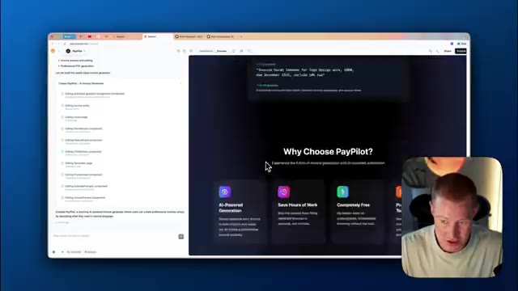
*⏱️ 00:03:35 — Vue d'ensemble de l'application web de génération de factures "PayPilot" avec le présentateur visible en incrustation.*

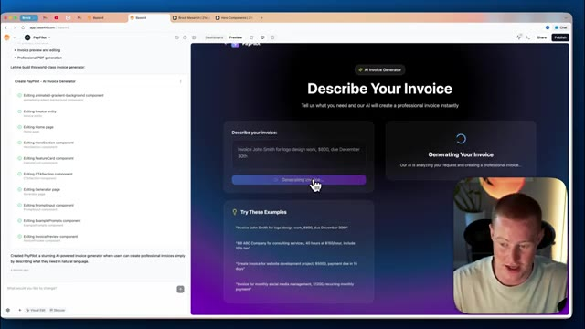
*⏱️ 00:03:44 — Interface de test montrant le champ de saisie "Describe your invoice" avec un exemple de facture et un bouton de génération.*

---

### ⏱️ `[00:04:01 - 00:04:22]` | Segment #10

**🔊 Audio (Transcription Intégrale Mot pour Mot en Français) :**
> Phénoménal. Donc ensuite, un truc que j'aime bien, c'est que j'aime vraiment cette animation de frappe. Alors, et si on essayait d'implémenter cette animation de frappe en haut de notre application juste ici ? C'est ce qu'on appelle la section "hero". Donc je vais aller de l'avant et ajouter ça, vous savez, ça a ce genre d'interface utilisateur de frappe. Je vais à nouveau cliquer sur "copier le prompt". Je vais le ramener sur Base 44 et dire : "Ajoutons ceci à notre section 'hero'."

**👁️ Analyse Visuelle d'Écran (gemini-3.5-flash-lite) :**
**Interface & Outils** : Navigateur web affichant une bibliothèque de composants UI et une application web de génération de factures (PayPilot).

**Contenu textuel & Code** : Code source React, commandes d'installation npm, configuration de prompts IA et interface de prévisualisation web.
[DESC_IMAGE_3] Navigation dans la bibliothèque de composants et sélection d'éléments pour les intégrer dans l'application.

**Action / Démonstration** : Explications face caméra et analyse conceptuelle des marchés.

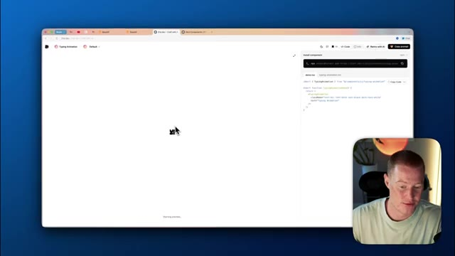
*⏱️ 00:04:06 — Interface d'un site de composants UI affichant une animation de frappe et du code React à droite.*

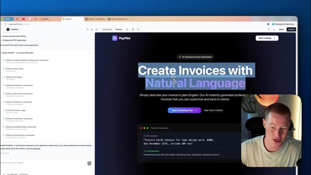
*⏱️ 00:04:12 — Aperçu de l'application "PayPilot" en cours d'édition avec le titre "Create Invoices with Natural Language".*

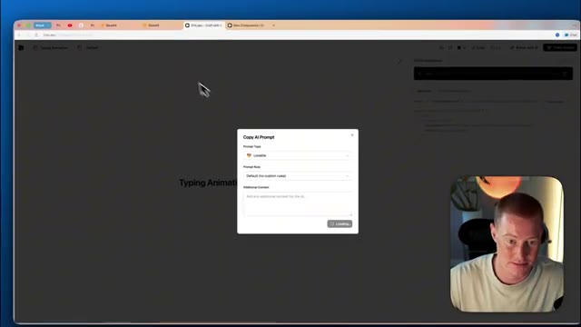
*⏱️ 00:04:17 — Fenêtre modale "Copy AI Prompt" ouverte sur le site de composants UI.*

---

### ⏱️ `[00:04:22 - 00:04:55]` | Segment #11

**🔊 Audio (Transcription Intégrale Mot pour Mot en Français) :**
> Et si je veux être plus précis, je pourrais en fait cliquer sur la ligne exacte, vous savez, ou sur le texte exact auquel je voulais réellement appliquer ceci. Donc je vais dire, ajoutons ceci à notre texte ici. Et donc je vais simplement coller ce prompt. Et maintenant, ce que ça devrait faire, c'est que ça devrait ajouter cette animation de frappe à cette partie de notre page de destination. Et ce que ça devrait faire, c'est que ça devrait en fait conserver exactement la même police que nous avons, ainsi que la même couleur et le même texte. Donc ça devrait dire « natural language », mais ça va maintenant l'écrire caractère par caractère. C'est plutôt cool. Laissons-lui une seconde pour voir ce que ça donne. Boum. Et juste comme ça, environ 15 secondes plus tard, ça a fait cette modification. Alors regardez, maintenant quand je rafraîchis

**👁️ Analyse Visuelle d'Écran (gemini-3.5-flash-lite) :**
**Interface & Outils** : Application web de génération de code et d'interface PayPilot.

**Contenu textuel & Code** : Code source React/JSX et interface visuelle d'édition de page web en langage naturel.

**Action / Démonstration** : Sélection et modification ciblée d'un élément textuel de la page web à l'aide d'un prompt textuel.

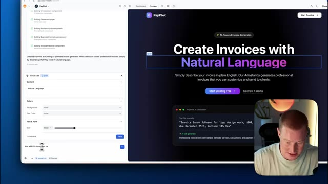
*⏱️ 00:04:31 — Interface de développement web montrant une application PayPilot avec un panneau d'édition visuelle à gauche et un aperçu du site à droite.*

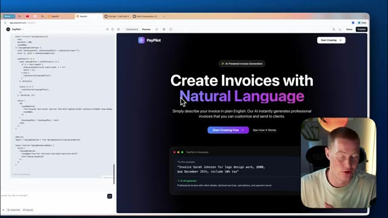
*⏱️ 00:04:39 — Affichage du code source du composant textuel dans le volet gauche avec l'aperçu du site PayPilot à droite.*

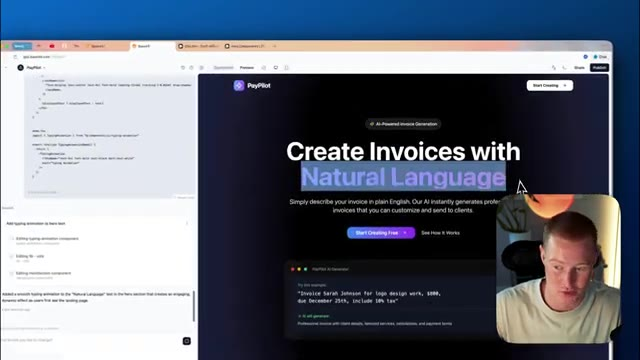
*⏱️ 00:04:47 — Modification du texte "Natural Language" sélectionné sur l'interface PayPilot avec le volet de configuration IA ouvert en bas à gauche.*

---

### ⏱️ `[00:04:55 - 00:05:28]` | Segment #12

**🔊 Audio (Transcription Intégrale Mot pour Mot en Français) :**
> ceci, ça montre l'animation de frappe ici qui dit créer des factures avec le langage naturel. Les gars, ça a déjà l'air incroyable et je vais continuer à faire des changements pour que ça ait l'air encore mieux. Donc j'ai hâte de vous montrer le résultat final. Et je tiens à dire que c'est tellement amusant de commencer à s'amuser avec. Si vous n'avez jamais utilisé 21st.dev auparavant, ça va être vraiment amusant pour vous de vous amuser avec et de commencer à créer des applications parce que ça donne l'impression que vous créez réellement quelque chose d'apparence professionnelle au lieu que ce soit juste une application ou un site web générique, vous savez, généré par IA. Très bien. Alors en revenant sur 21st.dev, regardons certaines des autres choses

**👁️ Analyse Visuelle d'Écran (gemini-3.5-flash-lite) :**
**Interface & Outils** : Navigateur web affichant l'interface de PayPilot (Bolt/StackBlitz ou plateforme similaire de développement no-code/IA).

**Contenu textuel & Code** : Titre principal de la page web 'Create Invoices with Natural Language', texte descriptif et instructions, ainsi qu'un panneau latéral listant des modifications de code ou des composants d'interface.

**Action / Démonstration** : Présentation de la page d'accueil de l'application PayPilot avec son interface de génération de factures en langage naturel et les modifications associées.

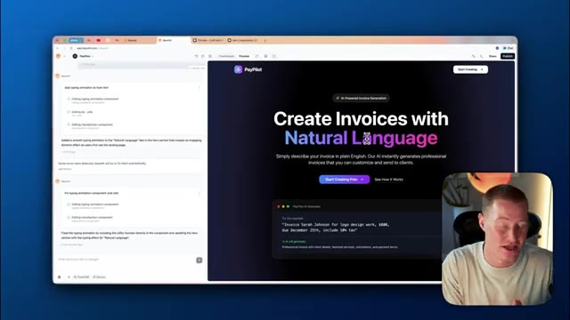
*⏱️ 00:05:03 — Capture d'écran montrant l'interface d'un outil de création de factures par IA nommé PayPilot, avec le texte principal 'Create Invoices with Natural Language' et une vue du code ou des composants dans le panneau latéral.*

---

### ⏱️ `[00:05:28 - 00:05:47]` | Segment #13

**🔊 Audio (Transcription Intégrale Mot pour Mot en Français) :**
> que j'ai en fait marqué d'un signet ici. Donc j'aime vraiment beaucoup ça ici. Donc je veux l'ajouter à notre page de destination. Vous savez, je trouve que c'est sympa d'avoir le texte qui défile comme ça. Je trouve que ça ajoute juste une jolie touche professionnelle. Donc je vais copier ce prompt à nouveau, je vais le ramener sur base 44 et dire, je vais l'ajouter en dessous de cette section ici. Donc ce que je vais faire, c'est que je vais cliquer sur les modifications visuelles.

**👁️ Analyse Visuelle d'Écran (gemini-3.5-flash-lite) :**
**Interface & Outils** : Navigateur web, plateforme de composants UI (21st.dev / Craft with AI), éditeur de page de destination.

**Contenu textuel & Code** : Composant de texte défilant (Text Marquee), code source React/Tailwind, commandes d'installation npm, et interface de génération de factures par IA (PayPilot).

**Action / Démonstration** : Navigation parmi les composants UI, sélection et consultation du code source d'un texte défilant pour intégration sur une page de destination.

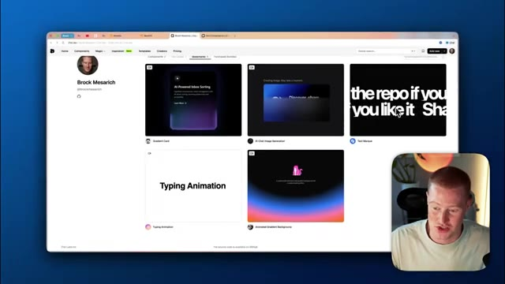
*⏱️ 00:05:32 — Interface de composants web avec une sélection de vignettes, dont le composant de texte défilant ('Text Marquee').*

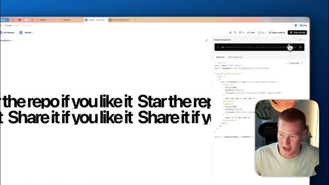
*⏱️ 00:05:37 — Visualisation d'un composant de texte défilant à l'écran avec le code source et le panneau d'installation sur la droite.*

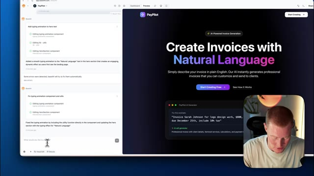
*⏱️ 00:05:42 — Aperçu d'une page de destination ('PayPilot') en cours de modification avec des outils de génération et d'IA.*

---

### ⏱️ `[00:05:47 - 00:06:06]` | Segment #14

**🔊 Audio (Transcription Intégrale Mot pour Mot en Français) :**
> Je vais cliquer là-dessus et ensuite je vais dire sous la div que j'ai sélectionnée. Donc, en utilisant la fonction d'éditions visuelles, ça vous rend vraiment les choses faciles pour faire des changements au lieu de devoir genre taper comme, oh, j'aimerais que tu, tu sais, édites cette partie de l'appli, tu sais, ça isole vraiment ça. Donc on sait exactement ce qu'on essaie d'éditer, si ça a du sens.

**👁️ Analyse Visuelle d'Écran (gemini-3.5-flash-lite) :**
**Interface & Outils** : Interface web de développement (Lovable ou outil similaire de no-code/IA) avec panneau de prévisualisation et options de style (Visual Edit).

**Contenu textuel & Code** : Options d'édition visuelle (Colors, Spacing, Tailwind Classes) et champ de saisie de prompt textuel.

**Action / Démonstration** : Sélection d'un élément (div) sur la page web pour appliquer des modifications visuelles guidées par l'IA.

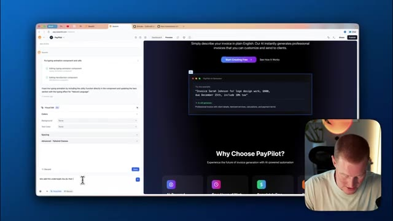
*⏱️ 00:05:52 — Capture d'écran montrant l'interface d'édition visuelle avec un panneau de code/prompt à gauche et le site web prévisualisé à droite.*

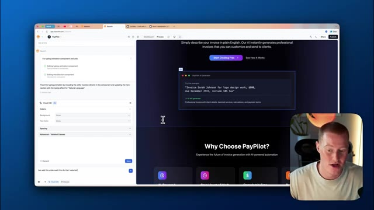
*⏱️ 00:06:01 — Capture d'écran similaire à l'image 1, montrant la sélection d'une div sur la page web pour l'édition visuelle.*

---

### ⏱️ `[00:06:06 - 00:06:38]` | Segment #15

**🔊 Audio (Transcription Intégrale Mot pour Mot en Français) :**
> Donc et ensuite je vais simplement coller notre prompt ici que 21st.dev nous a donné les gars. Ça a l'air plutôt solide jusqu'à présent. Je suis vraiment impressionné. Très bien. Alors regardez notre page d'accueil maintenant. C'est absolument magnifique. Voici cette section ici que nous avons ajoutée, facturation alimentée par l'IA, modèles professionnels entièrement gratuits. Ça a l'air vraiment solide. Non seulement ça ressemble au composant à l'intérieur de 21st.dev, mais c'est en fait personnalisé pour notre application parce que ça a du contexte sur notre application. Donc ça comprend que c'est de la facturation alimentée par l'IA. Je n'avais même pas besoin de lui donner le texte à ajouter réellement là. Ça a l'air vraiment solide. Passons à la partie suivante de cette page d'accueil afin de rendre cela aussi spectaculaire que possible.

**👁️ Analyse Visuelle d'Écran (gemini-3.5-flash-lite) :**
**Interface & Outils** : Navigateur web affichant une interface de développement ou de prévisualisation de type no-code / low-code (21st.dev / Bolt.new) avec caméra incrustée du présentateur en bas à droite.

**Contenu textuel & Code** : Code source, panneau de chat interactif avec l'IA, et aperçu de la landing page de l'application 'PayPilot'.

**Action / Démonstration** : Le présentateur fait défiler et présente la page d'accueil générée par l'intelligence artificielle.

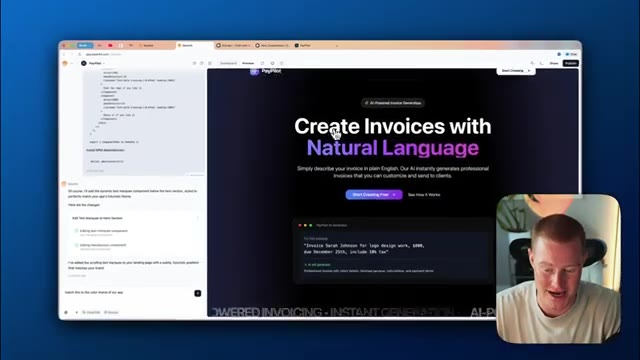
*⏱️ 00:06:14 — Aperçu d'une page d'accueil web en cours de développement montrant le titre principal 'Create Invoices with Natural Language' avec un panneau de code et de chat sur la gauche.*

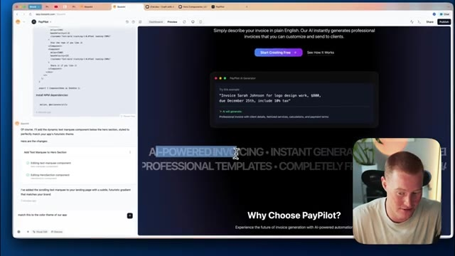
*⏱️ 00:06:30 — Aperçu de la page d'accueil avec défilement vers le bas, mettant en évidence une section de texte animé et le titre 'Why Choose PayPilot ?'.*

---

### ⏱️ `[00:06:38 - 00:07:04]` | Segment #16

**🔊 Audio (Transcription Intégrale Mot pour Mot en Français) :**
> Donc ensuite, ce que je veux changer, allons-y et changeons ces cartes ici. C'est donc comme ça que ça s'appelle, ce sont des cartes individuelles. Je vais aller de l'avant et trouver une carte qui me plaît sur 21st.dev. Je vais donc littéralement venir ici et puis cliquer sur "cartes", et ensuite nous pourrons commencer à regarder les différentes cartes qui nous plaisent, dont nous pensons qu'elles conviendraient réellement au, vous savez, thème de notre application. Donc celle-ci a l'air plutôt solide en fait, j'aime vraiment celle-ci. Donc fondamentalement, encore une fois, tout ce que je vais faire, c'est de cliquer sur "copier le prompt".

**👁️ Analyse Visuelle d'Écran (gemini-3.5-flash-lite) :**
**Interface & Outils** : Navigateur web affichant l'application PayPilot et la plateforme 21st.dev.

**Contenu textuel & Code** : Composants d'interface utilisateur (cartes, grille Bento, blocs marketing) et instructions textuelles de modification de code.

**Action / Démonstration** : Navigation sur le site 21st.dev pour sélectionner et intégrer un composant de carte personnalisé.

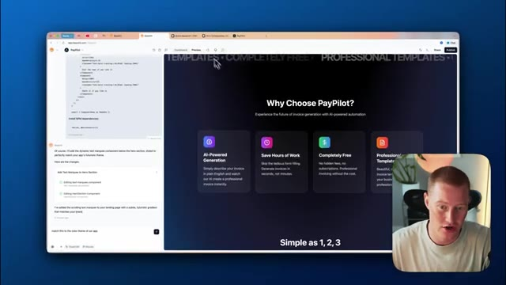
*⏱️ 00:06:44 — Interface de prévisualisation de l'application PayPilot avec code et panneau latéral de modification.*

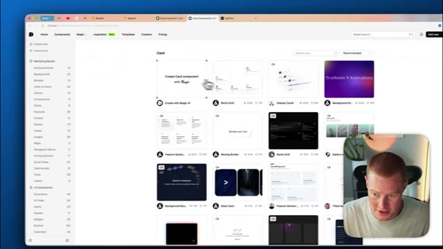
*⏱️ 00:06:51 — Catalogue de composants de l'interface 21st.dev affichant différentes options de cartes interactives.*

---

### ⏱️ `[00:07:04 - 00:07:22]` | Segment #17

**🔊 Audio (Transcription Intégrale Mot pour Mot en Français) :**
> Ça va commencer à copier ceci et ce que je vais faire, le ramener à Base 44. Je vais cliquer sur les modifications visuelles et ce que je vais faire, c'est que je vais cliquer sur ceci. Comprend donc que ce sont les cartes dont je parle et ensuite dire, fais en sorte que les cartes que j'ai sélectionnées ressemblent à ça, colle ce prompt, laisse Base 44 faire son travail et nous y reviendrons sous peu.

**👁️ Analyse Visuelle d'Écran (gemini-3.5-flash-lite) :**
**Interface & Outils** : Navigateur web, constructeur de site no-code, interface de chat d'IA.

**Contenu textuel & Code** : Interface utilisateur de PayPilot avec une section « Why Choose PayPilot? » contenant quatre blocs de cartes informatives.

**Action / Démonstration** : Sélection et modification des cartes de fonctionnalités de la page web via l'interface de l'outil no-code.

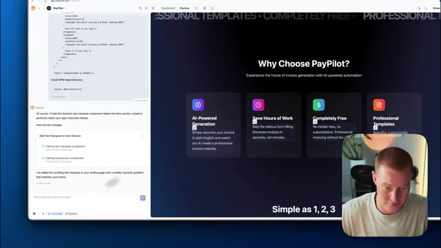
*⏱️ 00:07:09 — Aperçu du site web de PayPilot affichant quatre cartes de fonctionnalités et le présentateur dans l'encadré en bas à droite.*

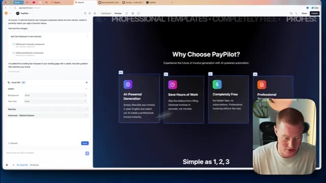
*⏱️ 00:07:13 — Le panneau de modification visuelle s'ouvre sur le côté gauche pendant que les quatre cartes sont sélectionnées.*

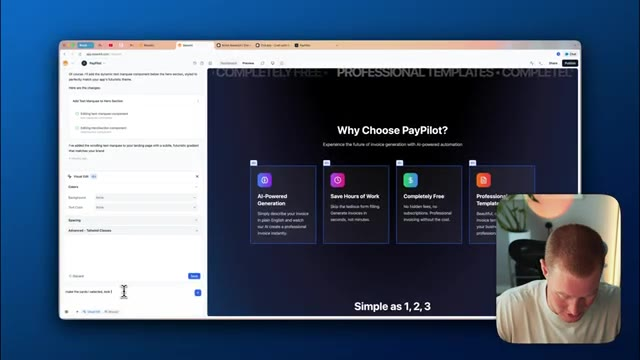
*⏱️ 00:07:18 — Le curseur tape un prompt dans la barre de texte pour modifier les cartes sélectionnées dans le constructeur de site.*

---

### ⏱️ `[00:07:22 - 00:07:58]` | Segment #18

**🔊 Audio (Transcription Intégrale Mot pour Mot en Français) :**
> Très bien. Donc voici la page d'atterrissage que nous avons. J'ai fait quelques changements différents. J'ai fait quelques modifications sur les boutons. Vous pouvez voir qu'il y a cette section ici. pourquoi choisir paypilot nous avons cette petite fonctionnalité lumineuse sur toutes nos différentes cartes et aspects de notre interface utilisateur nous avons cette section des invites à la facture instantanément c'est en fait l'interface utilisateur de notre générateur de factures ce qui est vraiment cool vous pouvez voir cet effet lumineux derrière et puis nous avons aussi ceci ici qui sont les témoignages ce qui je veux dire regardez ça c'est vraiment cool paypilot a transformé mon processus de facturation complètement l'ia comprend exactement ce dont j'ai besoin je dis juste facture pour développement web 2500 je veux dire c'est super cool tout cela vient de

**👁️ Analyse Visuelle d'Écran (gemini-3.5-flash-lite) :**
**Interface & Outils** : Navigateur web affichant une interface de prévisualisation de page d'atterrissage avec un éditeur/assistant d'IA sur le côté gauche.

**Contenu textuel & Code** : Section 'Why Choose PayPilot?' avec des cartes de fonctionnalités, et l'historique ou le journal des modifications de l'IA sur la gauche.

**Action / Démonstration** : Présentation de la page d'atterrissage et explication des modifications apportées aux composants et aux boutons par l'assistant IA.

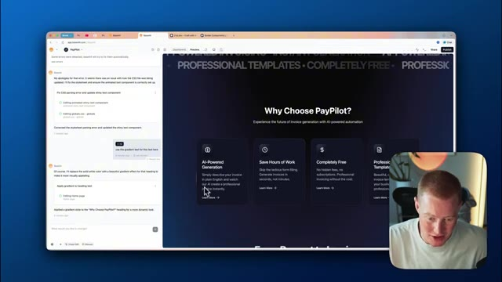
*⏱️ 00:07:31 — Capture d'écran montrant le navigateur avec une application web (PayPilot) et son panneau d'édition latéral en cours de modification.*

---

### ⏱️ `[00:07:58 - 00:08:16]` | Segment #19

**🔊 Audio (Transcription Intégrale Mot pour Mot en Français) :**
> 21st.dev et base 44. Ensuite, si je clique sur commencer la création, c'est exactement à quoi ressemble notre générateur de factures. Nous pouvons alors venir ici, cliquer sur ceci, cliquer sur générer la facture. Elle va commencer à générer notre facture ici et rapidement, en genre 10 secondes, nous obtenons un résultat. Et nous pouvons même aller de l'avant et modifier notre facture directement. Comme vous pouvez le voir, nous pourrions modifier différents composants de celle-ci.

**👁️ Analyse Visuelle d'Écran (gemini-3.5-flash-lite) :**
**Interface & Outils** : Navigateur web affichant l'interface de l'application (type plateforme de développement/génération de factures par IA).

**Contenu textuel & Code** : Interface utilisateur avec des champs de texte "Describe your invoice", "Invoice Preview", et un panneau latéral gauche affichant l'historique des modifications ou des erreurs résolues.

**Action / Démonstration** : Présentation de l'interface utilisateur et démonstration visuelle du générateur de factures par IA.

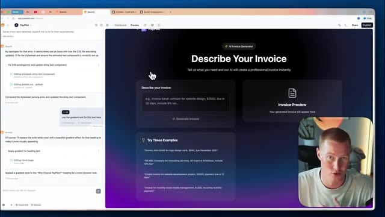
*⏱️ 00:08:03 — Interface du générateur de factures avec un assistant de description de facture et un panneau de chat à gauche, montrant également une miniature vidéo du présentateur en bas à droite.*

---

### ⏱️ `[00:08:17 - 00:08:49]` | Segment #20

**🔊 Audio (Transcription Intégrale Mot pour Mot en Français) :**
> C'est super, super cool. Le fait que nous ayons créé ceci très rapidement. Laissez-moi aller de l'avant et faire quelques changements sur notre interface utilisateur ici même sur notre application actuelle maintenant. Donc ce que je vais faire, laissez-moi venir sur 21st.dev et j'aime l'idée de ceci ici donc c'est fondamentalement comme générer une image si vous avez déjà utilisé la génération d'image de chatgpt c'est quelque chose de très similaire à cela donc ce que je vais faire, je vais copier ce prompt voyez comme vous pouvez voir ça révèle fondamentalement ceci a ce texte ici en haut montrant que cela génère en fait une facture pour nous donc ce sera parfait pour notre application de génération de facture ici donc tout ce que je vais faire c'est venir ici

**👁️ Analyse Visuelle d'Écran (gemini-3.5-flash-lite) :**
**Interface & Outils** : Navigateur web, plateforme de composants UI 21st.dev, éditeur d'application PayPilot.

**Contenu textuel & Code** : Code source React/JSX pour composant d'interface, instructions de génération d'images, interface utilisateur d'application web.

**Action / Démonstration** : Navigation sur le site de composants 21st.dev pour modifier l'interface utilisateur de l'application.

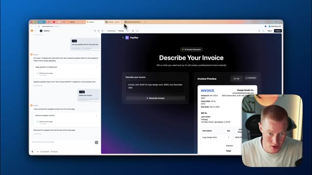
*⏱️ 00:08:25 — Interface de l'application 'PayPilot' en cours de modification avec aperçu de facture et panneau de contrôle latéral.*

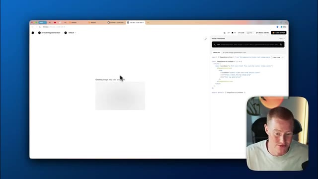
*⏱️ 00:08:33 — Navigation sur le site 21st.dev affichant un composant de génération d'images par chat IA et son code source React.*

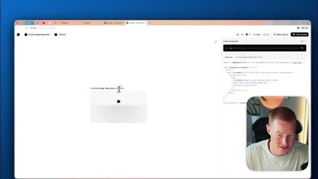
*⏱️ 00:08:41 — Visualisation du composant 21st.dev en cours de chargement avec la création d'une image.*

---

### ⏱️ `[00:08:49 - 00:09:25]` | Segment #21

**🔊 Audio (Transcription Intégrale Mot pour Mot en Français) :**
> je vais cliquer sur les modifications visuelles ou en fait je vais juste dire d'implémenter ceci pour quand nous générons une facture. Voilà. Très bien. Donc ça devrait être implémenté. Maintenant, laissez-moi aller cliquer sur générer une facture. Boum. C'est parti. Vous voyez ceci juste ici. Ça a l'air vraiment super. Création de la facture. Cela peut prendre un moment et boum, juste comme ça. Nous avons maintenant notre facture là. Ça a l'air extrêmement solide. Je suis super enthousiaste par ce que nous avons construit jusqu'à présent. Nous pourrions aller de l'avant et faire tellement de changements différents, en implémentant différents composants de 21st.dev dans base 44. Et puis une chose qui est vraiment cool, c'est une fois que nous avons effectivement implémenté ceux-ci dans notre application. Comme vous pouvez le voir, si je viens sur le tableau de bord, je viens sur le code, je viens sur

**👁️ Analyse Visuelle d'Écran (gemini-3.5-flash-lite) :**
**Interface & Outils** : Navigateur web, interface de développement de type IDE/SaaS et application de génération de factures par IA.

**Contenu textuel & Code** : Code source, interface de description de facture, exemples de prompts et aperçu de facture structurée.

**Action / Démonstration** : Génération et affichage d'une facture professionnelle à partir d'une description textuelle.

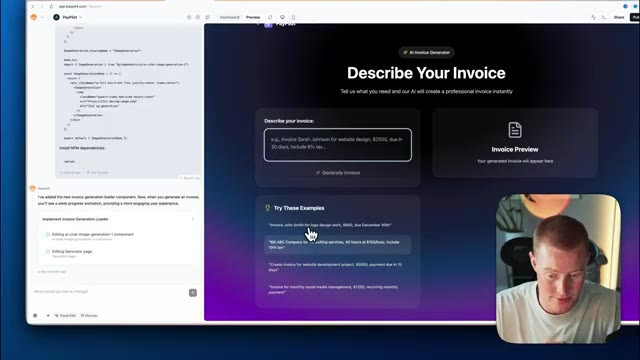
*⏱️ 00:08:58 — Interface de développement affichant le générateur de factures avec le code source à gauche et l'interface utilisateur à droite.*

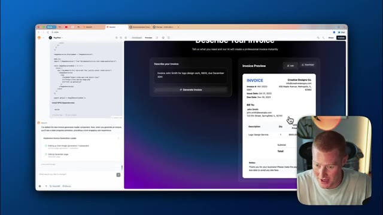
*⏱️ 00:09:07 — Aperçu d'une facture générée affichant les détails d'un client, la description du service et les montants.*

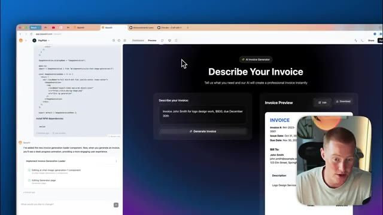
*⏱️ 00:09:16 — Retour à l'écran de description du générateur de factures après la génération de la facture précédente.*

---

### ⏱️ `[00:09:25 - 00:09:47]` | Segment #22

**🔊 Audio (Transcription Intégrale Mot pour Mot en Français) :**
> composants et cliquez sur composants d'interface utilisateur. Vous pouvez voir que ce sont tous les différents composants d'interface utilisateur qui ont réellement été implémentés dans notre application. Et nous pouvons simplement faire référence à cela chaque fois que nous voulons ajouter quelque chose de similaire. Vous pourriez vous dire, oh, je veux utiliser la carte en dégradé pour cette carte que je veux que vous génériez, ou je veux que vous ajoutiez un bouton dans le même style que les boutons que nous avons eus précédemment, ou juste n'importe quoi de ce genre. Donc c'est super, super cool.

**👁️ Analyse Visuelle d'Écran (gemini-3.5-flash-lite) :**
**Interface & Outils** : Navigateur web affichant une application de développement/design d'interface, avec le présentateur en médaillon dans le coin inférieur droit.

**Contenu textuel & Code** : Liste de dossiers et de composants d'interface utilisateur (comme animated-gradient-background, typing-animation, text-marquee, gradient-card, etc.) et aperçu de code dans le panneau de gauche.

**Action / Démonstration** : Le curseur de la souris clique sur un composant de la liste pour afficher ou modifier ses fichiers et son code source dans l'application.

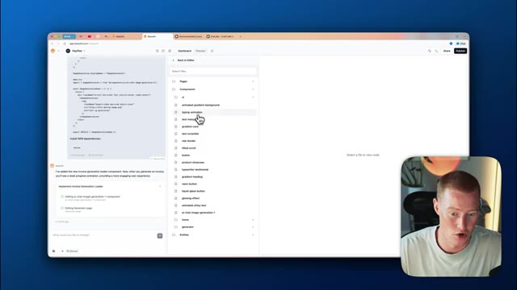
*⏱️ 00:09:30 — Capture d'écran montrant une interface de développement web avec un panneau latéral listant divers composants d'interface utilisateur (composants UI) et un éditeur de code.*

---

### ⏱️ `[00:09:47 - 00:10:13]` | Segment #23

**🔊 Audio (Transcription Intégrale Mot pour Mot en Français) :**
> Les gars, voilà comment créer des interfaces utilisateur d'aspect professionnel en utilisant base 44 et le "vibe coding". Vous n'avez plus besoin de créer des applications à l'aspect très générique avec l'IA. Nous pouvons réellement commencer à créer des applications magnifiques grâce à des astuces simples comme celle-ci. Si vous avez retiré de la valeur de cette vidéo, assurez-vous de laisser un pouce bleu, de vous abonner à cette chaîne YouTube. Je montre aux personnes non techniques comment utiliser l'IA dans leur vie de tous les jours, tout comme je l'ai fait dans cette vidéo. Donc, si vous avez retiré de la valeur, assurez-vous de vous abonner à la chaîne. Cela étant dit les gars, merci infiniment d'être restés jusqu'à la fin et je vous vois dans la prochaine vidéo.

**👁️ Analyse Visuelle d'Écran (gemini-3.5-flash-lite) :**
**Interface & Outils** : Navigateur web, interface de développement no-code / IA (Lovable.dev / Base 44).

**Contenu textuel & Code** : Interface utilisateur générée par IA ("Create Invoices with Natural Language"), code source, et bannière promotionnelle avec code promo "BROCK10".

**Action / Démonstration** : Démonstration de création d'interface utilisateur professionnelle via l'intelligence artificielle.

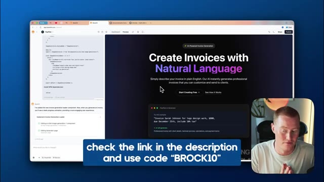
*⏱️ 00:09:53 — Capture d'écran montrant l'interface d'un outil de développement web ou d'application (Lovable/Base 44) affichant un site de génération de factures avec du code source à gauche et le rendu visuel professionnel à droite.*

---

