# 🎬 Turn Figma Designs Into Apps with AI (In Minutes)

> **Chaîne** : [Brock Mesarich | AI for Non Techies](https://www.youtube.com/@BrockMesarich)  
> **Lien YouTube** : [https://www.youtube.com/watch?v=1uYyQVk_7N4](https://www.youtube.com/watch?v=1uYyQVk_7N4)  
> **Date de publication** : 20250902  
> **Durée** : 00:09:55  
> **Identifiant vidéo** : `1uYyQVk_7N4`  
> **Transcription & Analyse** : `whisper-v3-large-turbo+gemini-3.5-flash-lite`  

---

## 📌 Synthèse Exécutive & Outils

### 💡 Résumé
Cette vidéo présentée par Brock Mesarich explore l'une des demandes les plus populaires de sa communauté : transformer des maquettes de design Figma en applications web et sites fonctionnels en quelques minutes grâce à l'intelligence artificielle et au concept du « vibe coding ». En partant d'un modèle de design SaaS trouvé dans Figma, la démonstration montre comment exporter et importer ce plan visuel dans une plateforme spécialisée, en l'occurrence l'outil Rocket, pour automatiser la conversion des calques, des images et de la structure en code brut (JavaScript, Tailwind CSS, Next.js). 

La vidéo démontre ensuite la puissance de l'interaction en langage naturel pour itérer sur le design converti. Sans compétences techniques de développement avancées, il est possible d'ajuster le formatage, d'ajouter de nouvelles pages interactives, et de injecter du contexte textuel spécifique (comme l'identité de l'entreprise fictive TrailSafeAI) pour transformer un simple prototype statique en un site web dynamique et publiable en un seul clic.

### 🛠️ Outils, Modèles & Logiciels Présentés
* **Figma** : L'application de référence pour les designers permettant d'esquisser, de concevoir et de prototyper des interfaces utilisateur et des structures de sites web.
* **Rocket** : Une plateforme de création d'applications web par IA qui convertit les liens d'importation Figma en code fonctionnel (Next.js, JavaScript, Tailwind CSS) modifiable par le texte.
* **ChatGPT** : Mentionné dans l'écosystème global de l'IA pour la génération de texte et le prompt engineering.
* **Claude** : Modèle d'intelligence artificielle conversationnelle souvent utilisé pour le codage et l'analyse de structures complexes.
* **Grok** : Modèle d'IA conversationnelle développé par xAI pour le traitement d'informations en temps réel.
* **Gemini** : L'assistant d'intelligence artificielle de Google intégré pour l'analyse de données et la génération de contenu.
* **Make** : Une plateforme d'automatisation de flux de travail (anciennement Integromat) pour connecter différentes applications sans coder.
* **n8n** : Un outil d'automatisation de workflows open-source et auto-hégeable pour interconnecter des services numériques.
* **Zapier** : Un outil SaaS d'automatisation no-code reliant des applications web pour déclencher des actions automatisées.

### 🔑 Points Clés & Enseignements Stratégiques
1. **Convergence du design et du code** : L'IA permet de combler instantanément le fossé entre la conception graphique sous Figma et le déploiement technique d'une application web fonctionnelle.
2. **Le concept du « Vibe Coding »** : Remplacer l'écriture manuelle de lignes de code par des instructions en langage naturel pour piloter la création et l'évolution d'un logiciel.
3. **Sélection de modèles prêts à l'emploi** : Utiliser les templates existants de Figma (comme les pages de destination SaaS) permet de gagner un temps précieux par rapport à une construction de zéro.
4. **Exportation via lien de partage** : Le processus de transition vers les outils de génération d'applications se fait simplement en copiant le lien de partage du projet Figma.
5. **Personnalisation de la pile technologique (Tech Stack)** : Configuration guidée permettant de choisir des frameworks modernes et robustes comme Next.js, JavaScript et Tailwind CSS lors de l'importation.
6. **Traduction automatique des éléments visuels** : La plateforme d'importation analyse et convertit automatiquement les calques, groupes d'images et structures de mise en page en code structuré.
7. **Édition granulaire par invite textuelle** : Possibilité de cibler des éléments précis de l'interface (en-têtes, boutons, textes) pour appliquer des modifications instantanées (ex: forcer un texte sur une seule ligne).
8. **Création de pages dynamiques** : L'IA peut générer de nouvelles pages fonctionnelles (comme une page « En savoir plus ») et lier automatiquement les boutons d'action pour assurer la navigation.
9. **Injection de contexte contextuel d'entreprise** : Fournir des données métier précises (nom, mission, slogan) permet à l'IA d'adapter le contenu textuel généré aux spécificités de la marque (ex: TrailSafeAI).
10. **Valorisation des compétences des designers** : Maîtriser Figma devient un levier stratégique majeur, transformant les concepteurs en créateurs capables de présenter des prototypes fonctionnels interactifs à leurs clients en quelques minutes.
11. **Publication en un clic** : Simplification extrême de la mise en ligne du site web généré, permettant un passage immédiat du stade de prototype à une application accessible sur le web.

---

## ⏱️ Chronologie & Transcription Complète Audio & Visuelle (Mot pour Mot)

### ⏱️ `[00:00:00 - 00:00:22]` | Segment #01

**🔊 Audio (Transcription Intégrale Mot pour Mot en Français) :**
> C'est l'une des vidéos les plus demandées sur ma chaîne. Comment transformer des designs Figma en de véritables applications et sites web en quelques minutes. Si vous ne connaissez pas Figma, c'est l'application que les meilleurs designers utilisent pour esquisser et prototyper des interfaces de classe mondiale. En gros, les plans sous les applications que vous utilisez tous les jours. Mais voici le plus fou. Avec l'IA et le "vibe coding", nous pouvons désormais prendre ces plans et les transformer instantanément en applications entièrement fonctionnelles.

**👁️ Analyse Visuelle d'Écran (gemini-3.5-flash-lite) :**
**Interface & Outils** : Interface web de Figma (Figma Make / Community)

**Contenu textuel & Code** : Galerie de projets et de prototypes communautaires Figma affichant des aperçus graphiques et des titres d'applications.

**Action / Démonstration** : Présentation visuelle de la plateforme Figma et de ses fonctionnalités de prototypage et de création d'applications.

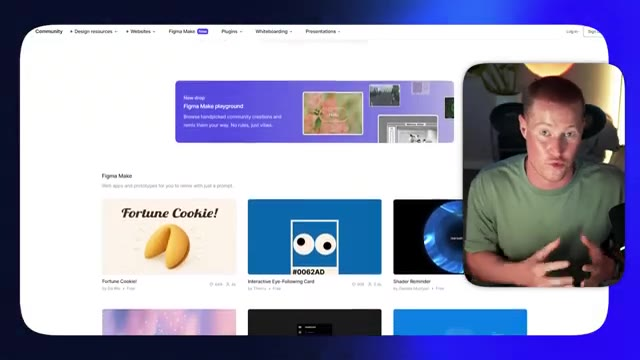
*⏱️ 00:00:11 — Capture d'écran montrant l'interface Web de Figma avec des exemples de projets communautaires (Figma Make) affichés en grille, tandis que le présentateur apparaît dans un encadré vidéo.*

---

### ⏱️ `[00:00:22 - 00:00:43]` | Segment #02

**🔊 Audio (Transcription Intégrale Mot pour Mot en Français) :**
> Et dans cette vidéo, je vais vous montrer exactement comment faire, étape par étape. Très bien, allons-y. Très bien, les gars. Donc tout d'abord, nous allons commencer dans Figma. Et je vais vous montrer exactement comment prendre soit un modèle, soit un design préexistant que vous avez créé dans Figma, si vous êtes un designer Figma, et le transformer en une application Web entièrement fonctionnelle ou un site Web dans ce cas. Première chose, vous pouvez voir que nous avons accès à Figma ici.

**👁️ Analyse Visuelle d'Écran (gemini-3.5-flash-lite) :**
**Interface & Outils** : Figma (navigateur web)

**Contenu textuel & Code** : Galerie de modèles de design et ressources de la communauté Figma (Templates and tools from Community)

**Action / Démonstration** : Navigation et sélection d'un modèle ou design préexistant dans l'interface de Figma

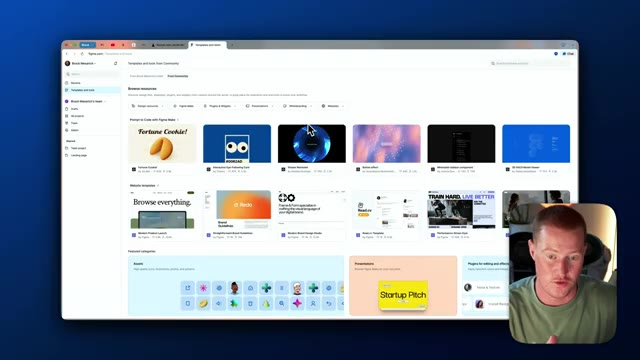
*⏱️ 00:00:27 — Interface du logiciel Figma affichant des modèles de design et de la communauté, avec une incrustation vidéo du présentateur en bas à droite.*

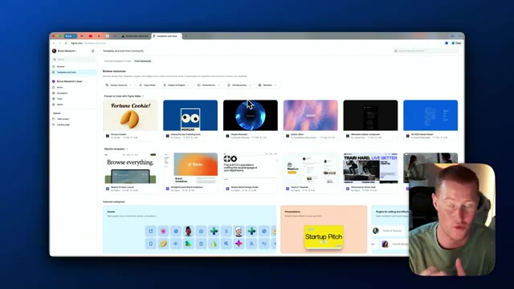
*⏱️ 00:00:38 — Interface du logiciel Figma similaire à l'image 1 montrant la navigation dans les templates communautaires, avec l'incrustation vidéo du présentateur.*

---

### ⏱️ `[00:00:43 - 00:01:09]` | Segment #03

**🔊 Audio (Transcription Intégrale Mot pour Mot en Français) :**
> Nous avons un tas de modèles différents. Pour les besoins de cette vidéo, je vais vous montrer comment réellement implémenter un modèle au lieu de construire un design entièrement complet à partir de zéro avec Figma. Donc ce que je vais faire ici, c'est simplement faire défiler certains des modèles ici pour vous montrer comment les implémenter. Donc nous pourrions aller voir toutes ces choses différentes. Je vais parcourir les sites web et jetons juste un coup d'œil aux pages de destination rapidement afin que je puisse avoir une idée de ce que je vais essayer de transformer réellement en un site web fonctionnel.

**👁️ Analyse Visuelle d'Écran (gemini-3.5-flash-lite) :**
**Interface & Outils** : Navigateur web affichant l'interface de Figma Community avec un encart vidéo du présentateur en bas à droite.

**Contenu textuel & Code** : Catalogue de modèles de design, bannières visuelles, catégories de ressources graphiques et kits d'interface utilisateur.

**Action / Démonstration** : Navigation et défilement à travers la galerie de modèles Figma pour sélectionner une ressource à implémenter.

---

### ⏱️ `[00:01:09 - 00:01:27]` | Segment #04

**🔊 Audio (Transcription Intégrale Mot pour Mot en Français) :**
> Donc j'aime celui-ci pour un produit SaaS. Alors imaginez que nous ayons un produit SaaS que nous essayons de lancer. J'aime vraiment ce modèle. Laissez-moi y jeter un coup d'œil de plus près. Si je clique sur ce bouton de lecture ici en haut à droite de cet écran ici, je peux maintenant voir exactement à quoi ressemblera ce site web. Donc parcourez tout, vous savez, ça montre ce petit tableau de bord sympa ici.

**👁️ Analyse Visuelle d'Écran (gemini-3.5-flash-lite) :**
**Interface & Outils** : Navigateur web affichant l'interface de Figma.

**Contenu textuel & Code** : Maquette de site web pour un produit SaaS, avec le titre "Browse everything." et des graphiques d'efficacité.

**Action / Démonstration** : Clic sur le bouton de lecture en haut à droite pour lancer l'aperçu du modèle de conception.

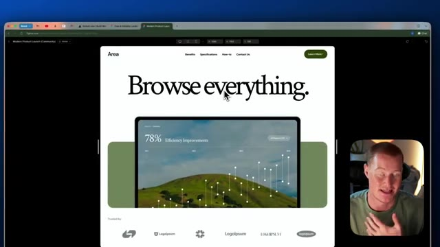
*⏱️ 00:01:23 — Image montrant le mode aperçu interactif du modèle de site web sélectionné, affichant la maquette finale en plein écran.*

---

### ⏱️ `[00:01:28 - 00:01:48]` | Segment #05

**🔊 Audio (Transcription Intégrale Mot pour Mot en Français) :**
> Je veux dire, c'est un modèle qui a l'air vraiment solide pour un site web. Et ce que je veux faire, c'est essentiellement transformer ceci en un site web réellement fonctionnel où je pourrais cliquer sur les boutons et tout le tralala. Donc pour que je puisse réellement transformer ceci en un site web fonctionnel, ce que je dois faire, c'est venir ici et cliquer essentiellement sur cette partie juste ici, qui est la page d'accueil. Donc ce que je vais faire, je vais cliquer là-dessus et je vais le copier.

**👁️ Analyse Visuelle d'Écran (gemini-3.5-flash-lite) :**
**Interface & Outils** : Navigateur web, Figma, webcam du présentateur.

**Contenu textuel & Code** : Maquettes de design de sites web, structure de page, blocs de composants graphiques.

**Action / Démonstration** : Navigation et présentation visuelle d'un prototype de design de site web.

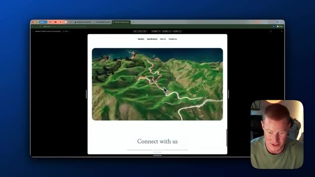
*⏱️ 00:01:33 — Aperçu du prototype de site web dans un navigateur, affichant une image aérienne et le texte 'Connect with us', avec le présentateur en médaillon.*

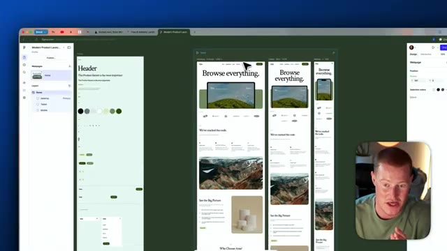
*⏱️ 00:01:43 — Interface complète du logiciel Figma montrant les maquettes de pages web (versions bureau, tablette, mobile) et les panneaux de conception.*

---

### ⏱️ `[00:01:48 - 00:02:22]` | Segment #06

**🔊 Audio (Transcription Intégrale Mot pour Mot en Français) :**
> Et ce que je vais faire, c'est que je vais revenir aux fichiers dans Figma. Je vais cliquer sur design et je vais essentiellement coller ceci dans un nouveau projet. Comme vous pouvez le voir ici, nous avons juste cette page d'accueil que nous allons essayer de transformer en un site Web fonctionnel. Très bien. Donc ensuite, ce que je vais faire, c'est que je vais cliquer sur le bouton de partage ici en haut à droite. Je vais cliquer sur copier le lien et je vais l'emmener sur notre plateforme de création d'applications web appelée Rocket. Donc si vous ne savez pas ce qu'est Rocket, Rocket vous permet en fait de créer des applications et des sites Web entièrement fonctionnels en utilisant l'IA et de simples invites textuelles comme certains de ces autres créateurs d'applications Web textuelles. Il y a ce bouton ici qui dit importer Figma.

**👁️ Analyse Visuelle d'Écran (gemini-3.5-flash-lite) :**
**Interface & Outils** : Figma, Navigateur web (Rocket)

**Contenu textuel & Code** : Maquette de design de site web sur Figma, interface de génération de projet sur Rocket

**Action / Démonstration** : Navigation et présentation des maquettes graphiques destinées à être transformées en site web fonctionnel

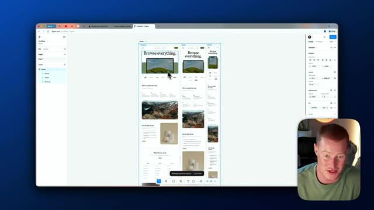
*⏱️ 00:01:57 — Interface du logiciel Figma montrant le design d'une page d'accueil de site web avec différentes sections et aperçus.*

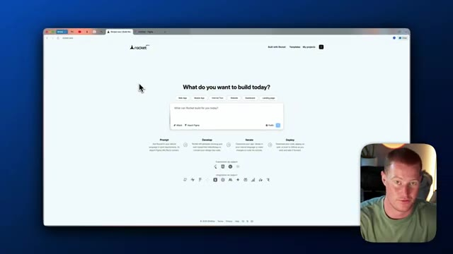
*⏱️ 00:02:13 — Page web du service Rocket affichant une interface de création avec la question "What do you want to build today?" et une zone de texte pour les prompts.*

---

### ⏱️ `[00:02:22 - 00:02:59]` | Segment #07

**🔊 Audio (Transcription Intégrale Mot pour Mot en Français) :**
> Tout ce que je vais faire, c'est cliquer là-dessus. Je vais coller ce lien que je viens juste d'obtenir dans Figma juste ici. Encore une fois, tout ce que vous avez à faire, c'est de cliquer sur partager et de cliquer sur copier le lien ici. Et ensuite, je vais le ramener dans Rocket et cliquer sur lancer l'importation. Maintenant, ce que Rocket va faire en arrière-plan, c'est essentiellement prendre ce modèle Figma ici avec tout ça. Il va le convertir en code. Il est donc capable de recréer cela de manière très similaire et ensuite nous aurons un modèle pour commencer réellement à construire notre site web, et ensuite le truc cool avec ça, vous vous demandez peut-être : Brock, en quoi c'est seulement utile ? Ce que je vais faire, c'est en gros l'importer dans Rocket et ensuite je pourrai tout simplement personnaliser l'ensemble de ceci

**👁️ Analyse Visuelle d'Écran (gemini-3.5-flash-lite) :**
**Interface & Outils** : Navigateur web, plateformes Rocket.new et Figma.

**Contenu textuel & Code** : URL de partage Figma et structures de pages web maquettées (desktop, tablette, mobile).
[DESC_IMAGE_3] Importation d'un lien de design Figma dans l'outil de génération de site web Rocket.new.

**Action / Démonstration** : Explications face caméra et analyse conceptuelle des marchés.

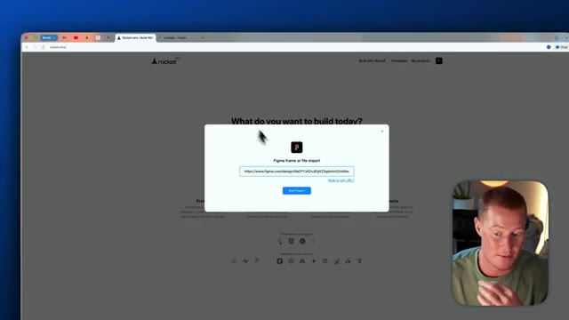
*⏱️ 00:02:31 — Interface de Rocket.new avec une modale d'importation de lien Figma et une URL collée.*

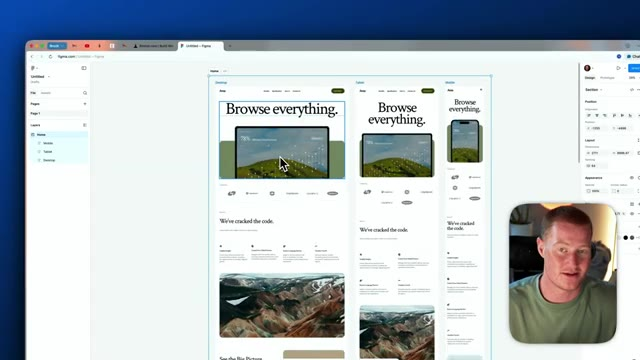
*⏱️ 00:02:41 — Interface de Figma affichant un design de site web responsive avec les vues bureau, tablette et mobile.*

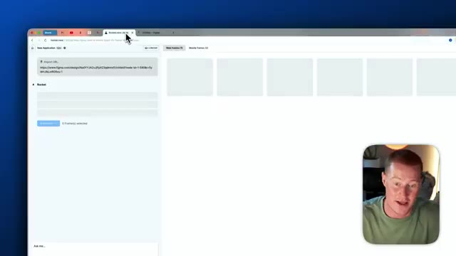
*⏱️ 00:02:50 — Interface de l'application Rocket montrant le champ d'importation d'URL Figma et les emplacements de cadres.*

---

### ⏱️ `[00:02:59 - 00:03:36]` | Segment #08

**🔊 Audio (Transcription Intégrale Mot pour Mot en Français) :**
> site web en utilisant des invites textuelles en langage naturel, ce qui signifie en gros que je tape du texte et qu'il effectue réellement des changements. Par exemple, au lieu que ceci dise « parcourir tout » ou d'avoir ce tableau de bord, je pourrais simplement écrire une consigne, je dirais « je veux que tu changes ce texte par ce texte différent » ou « je veux que tu changes ces logos par un logo différent ». Je vais vous montrer exactement comment faire cela dans cette vidéo, mais j'espère que cela répond à votre question : pourquoi est-ce seulement utile ? Et une chose que je tiens à mentionner, c'est que si vous maîtrisez déjà l'utilisation d'un outil comme Figma, cela devient une compétence vraiment considérable, car vous pouvez commencer à transformer des modèles que vous avez réellement conçus dans Figma en applications fonctionnelles maintenant, ce qui, si vous êtes designer, a pas mal d'impact, car

**👁️ Analyse Visuelle d'Écran (gemini-3.5-flash-lite) :**
**Interface & Outils** : Navigateur web, Figma

**Contenu textuel & Code** : Maquettes de sites web, interfaces graphiques, sections de design d'interface utilisateur (UI)

**Action / Démonstration** : Présentation et démonstration de maquettes de sites web créées à l'aide d'outils de design.

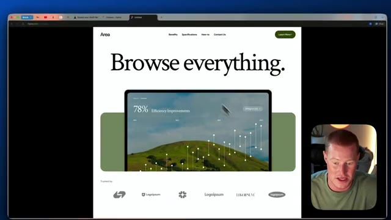
*⏱️ 00:03:08 — Aperçu d'une maquette web avec le titre 'Browse everything.' et des graphiques épurés.*

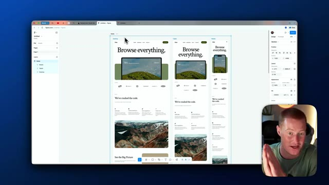
*⏱️ 00:03:27 — Interface de conception Figma montrant plusieurs maquettes de pages web réactives.*

---

### ⏱️ `[00:03:36 - 00:04:01]` | Segment #09

**🔊 Audio (Transcription Intégrale Mot pour Mot en Français) :**
> ensuite vous pourriez commencer réellement à montrer cela comme des prototypes à un client et vous l'avez juste fait avec l'IA. Donc l'étape suivante dans Rocket, tout ce que j'ai à faire est de sélectionner sur cette page ici. Petite parenthèse, si nous avions plusieurs pages différentes que nous voulions réellement connecter, nous cliquerions simplement sur ce bouton de partage et nous aurions plusieurs pages différentes ici à sélectionner, mais nous n'en avons qu'une pour ce cas d'utilisation. C'est juste la page d'accueil. Donc je vais cliquer dessus, cliquer sur démarrer l'importation. Et cela demande fondamentalement comment nous voulons personnaliser notre pile technologique. Je ne suis pas un développeur. Je ne sais pas vraiment.

**👁️ Analyse Visuelle d'Écran (gemini-3.5-flash-lite) :**
**Interface & Outils** : Interface web de l'outil Rocket (convertisseur Figma vers code) affichée dans un navigateur, avec une incrustation vidéo du présentateur en bas à droite.

**Contenu textuel & Code** : URL d'importation Figma, options de sélection de frames web et mobiles, et boutons de conversion.

**Action / Démonstration** : Le présentateur sélectionne et manipule les frames de conception importées depuis Figma pour préparer leur conversion en code.

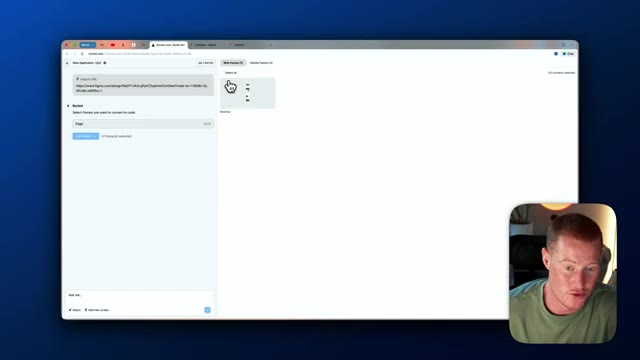
*⏱️ 00:03:42 — Interface web montrant l'importation de liens Figma et la sélection de frames dans l'outil Rocket.*

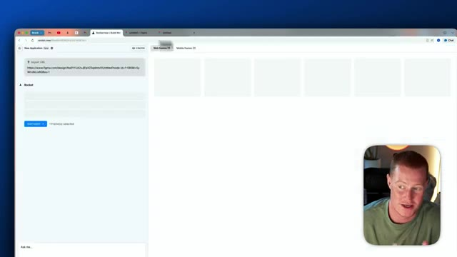
*⏱️ 00:03:49 — Poursuite de la sélection et du chargement des frames web au sein de l'application.*

---

### ⏱️ `[00:04:01 - 00:04:33]` | Segment #10

**🔊 Audio (Transcription Intégrale Mot pour Mot en Français) :**
> Donc ce que je vais faire, c'est simplement cliquer sur Next.js à partir de là. Je vais juste cliquer sur JavaScript comme langage, un peu de patience, nous avons presque terminé ce processus. Et ensuite, à partir de là, je vais cliquer sur Tailwind CSS. Donc maintenant, ce qu'il fait, c'est qu'il récupère réellement ce design Figma. Comme vous pouvez le voir ici, il montre ce processus. Il télécharge ces images d'écran. Il va optimiser les groupes et les calques, télécharger les éléments de design, tout ça. Et ensuite, il va commencer à écrire du code. C'est la puissance d'utiliser une plateforme comme Rocket. Il est capable de coder avec du langage naturel, alias le "vibe coding". Ensuite, on nous présente ce prompt ici.

**👁️ Analyse Visuelle d'Écran (gemini-3.5-flash-lite) :**
**Interface & Outils** : Navigateur web affichant l'application Rocket / outil de conversion de design en code.

**Contenu textuel & Code** : Options de configuration de la pile technique (Tech stack), choix du framework (Next.js), du langage (JavaScript), du système de design (Tailwind CSS) et étapes de progression (Fetching Figma, Writing Code).

**Action / Démonstration** : Configuration des options techniques et lancement de l'importation et de la génération du code à partir des designs Figma.

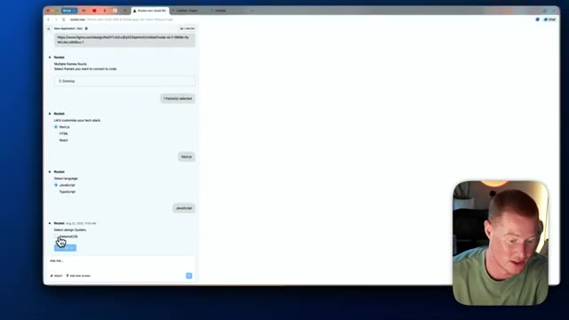
*⏱️ 00:04:09 — Capture montrant l'interface de l'outil de génération de code avec la sélection des options de configuration (Next.js, JavaScript, Tailwind CSS).*

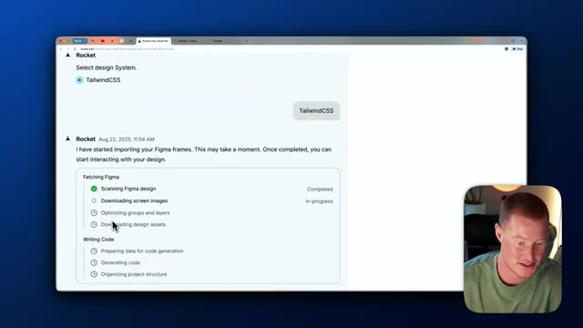
*⏱️ 00:04:17 — Capture montrant l'écran de chargement avec le processus d'importation des cadres Figma et de génération du code.*

---

### ⏱️ `[00:04:33 - 00:05:05]` | Segment #11

**🔊 Audio (Transcription Intégrale Mot pour Mot en Français) :**
> Donc ça dit que ça prendra cinq à sept minutes pour construire selon notre demande. Donc je vais laisser Rocket faire son travail et on se retrouve une fois que ce sera terminé. Je dois dire que ça ne devrait pas, ça ne sera probablement pas parfait, mais nous pourrions facilement apporter des modifications et rendre ça phénoménal. Très bien les gars, donc j'ai donné environ cinq minutes et voici ce que nous avons réellement obtenu de Rocket. Nous voyons sur le côté gauche que nous avons notre interaction avec Rocket et ensuite sur le côté droit nous avons effectivement notre site web ici. Laissez-moi jouer un peu avec ça et voir à quel point c'est fonctionnel. Nous avons ceci de très similaire, en fait vous savez quoi je vais faire, je vais montrer côte à côte ici donc nous

**👁️ Analyse Visuelle d'Écran (gemini-3.5-flash-lite) :**
**Interface & Outils** : Navigateur web affichant l'application de génération de code et de design Rocket.

**Contenu textuel & Code** : Étapes de génération (scanning Figma design, downloading screen images, generating code) et interface utilisateur générée automatiquement.

**Action / Démonstration** : Attente de la fin de la génération et visualisation du résultat final de la page web créée par l'intelligence artificielle.

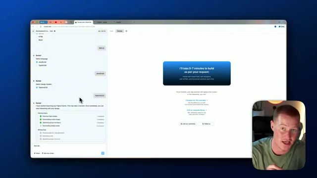
*⏱️ 00:04:41 — Interface de l'outil Rocket affichant un écran de chargement indiquant que la génération de l'application prendra 5 à 7 minutes.*

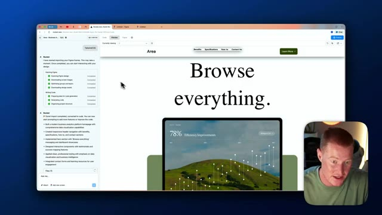
*⏱️ 00:04:49 — Aperçu de la page web générée par l'IA avec le titre "Browse everything" et un graphique de performance montrant une amélioration d'efficacité de 78%.*

---

### ⏱️ `[00:05:05 - 00:05:39]` | Segment #12

**🔊 Audio (Transcription Intégrale Mot pour Mot en Français) :**
> obtenir une meilleure comparaison. Très bien. Donc sur le côté gauche, nous avons Rocket. Sur le côté droit, nous avons en fait celui qui a réellement été généré à l'intérieur de Figma. Donc laissez-moi faire défiler vers le bas jusqu'à Rocket. Donc ça a l'air très, très similaire. Vous pouvez voir que la mise en page est un peu différente en ce qui concerne cet en-tête "parcourir tout" ici, mais c'est un point de départ vraiment solide. Et nous pouvons maintenant y apporter des modifications très simplement juste en tapant du texte. Donc laissez-moi continuer à faire défiler vers le bas ici. Le formatage est légèrement décalé, mais encore une fois, c'est un très bon début. Donc ce que je vais faire maintenant, c'est que je vais commencer à apporter des modifications à l'intérieur de Rocket sur notre site web. Donc dès le départ, ce que nous pouvons faire, c'est que si nous voulons changer ce texte pour le mettre sur la même ligne,

**👁️ Analyse Visuelle d'Écran (gemini-3.5-flash-lite) :**
**Interface & Outils** : Interface web de Rocket.new et Figma affichée dans un navigateur avec webcam du présentateur en incrustation.

**Contenu textuel & Code** : Pages web comparant le design original Figma et le résultat généré par l'IA avec des sections de contenu textuel et visuel.

**Action / Démonstration** : Le présentateur fait défiler la page web pour comparer les différentes sections générées par rapport au design d'origine.

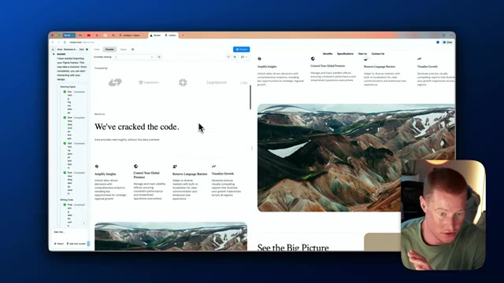
*⏱️ 00:05:13 — Comparaison côte à côte d'une page web générée montrant les sections de texte et d'images de paysages montagneux.*

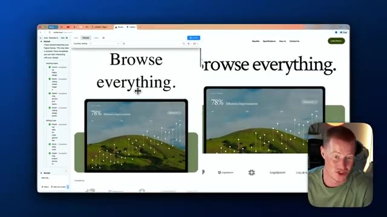
*⏱️ 00:05:22 — Comparaison côte à côte du design web montrant le titre 'Browse everything' avec des graphiques de données intégrés.*

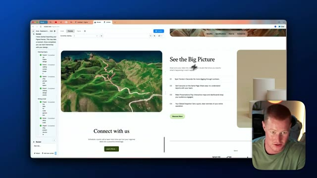
*⏱️ 00:05:31 — Comparaison côte à côte de la suite de la page web avec la section 'See the Big Picture' et des visuels de cartes.*

---

### ⏱️ `[00:05:39 - 00:06:02]` | Segment #13

**🔊 Audio (Transcription Intégrale Mot pour Mot en Français) :**
> juste comme cette maquette Figma, nous pouvons venir ici, cliquer sur sélectionner l'édition et réellement sélectionner l'en-tête ici. Nous pourrions donc sélectionner différents composants d'interface utilisateur à l'intérieur de Rocket, puis fondamentalement lui dire de changer. En gros, je vais cliquer sur cet en-tête et dire, faisons tenir le texte sur une seule ligne et en lui donnant un prompt textuel très simple comme ça. Maintenant, Rocket devrait commencer à apporter cette modification simple à notre application et nous pourrions faire cela pour tous les petits changements que nous avons.

**👁️ Analyse Visuelle d'Écran (gemini-3.5-flash-lite) :**
**Interface & Outils** : Interface web de l'outil Rocket / application de génération de code à partir de maquettes Figma.

**Contenu textuel & Code** : Panneau latéral de configuration et de modification de code, arborescence d'importation Figma, aperçu d'une page web avec graphiques de données et typographie.
[DESC_ACTION_2] Sélection et modification d'éléments d'interface utilisateur dans l'aperçu du site web généré par l'IA.

**Action / Démonstration** : Explications face caméra et analyse conceptuelle des marchés.

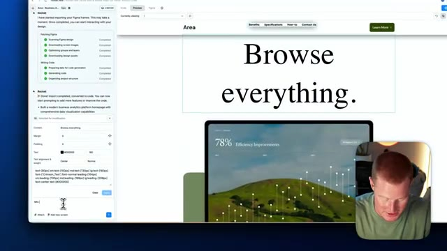
*⏱️ 00:05:51 — Interface de l'outil Rocket affichant un aperçu de page web avec le titre "Browse everything" et un panneau d'édition latérale, avec la caméra du présentateur incrustée en bas à droite.*

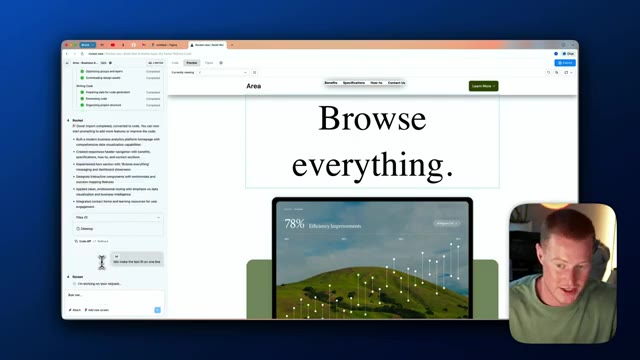
*⏱️ 00:05:56 — Vue plus large de l'interface Rocket montrant le code importé d'une maquette Figma et un aperçu de site web d'entreprise, avec la webcam du présentateur en incrustation.*

---

### ⏱️ `[00:06:02 - 00:06:38]` | Segment #14

**🔊 Audio (Transcription Intégrale Mot pour Mot en Français) :**
> Boum, et voilà, en l'espace d'environ 15 secondes, nous avons maintenant cette texture correctement formatée et en gros ce qu'on pourrait faire maintenant c'est qu'on pourrait alors commencer à rendre ces boutons de notre application fonctionnels pour qu'ils nous emmènent vraiment quelque part au lieu que ce soit juste, vous savez, juste un bouton non fonctionnel ici. Voici donc le prompt que je lui ai donné. En utilisant exactement le même thème, la même police, les mêmes couleurs, etc. pour notre site web, ajoutons maintenant une autre page appelée En savoir plus. Cela en dira plus sur qui nous sommes en tant qu'entreprise une fois qu'ils auront cliqué sur le bouton en savoir plus et cela les y amènera réellement. Nous voulons rendre ce bouton fonctionnel ici. J'espère donc que cela va vraiment le faire. Ce que ça va commencer à faire, c'est que ça va aller de l'avant et ajouter une nouvelle page dans notre

**👁️ Analyse Visuelle d'Écran (gemini-3.5-flash-lite) :**
**Interface & Outils** : Navigateur web, interface de l'outil de développement d'application web (Rocket.new).

**Contenu textuel & Code** : Code source associé (page.jsx), instructions textuelles demandant l'ajout d'une nouvelle page et de rendre les boutons fonctionnels.

**Action / Démonstration** : Saisie d'un nouveau prompt pour modifier l'application web et connecter les boutons de navigation.

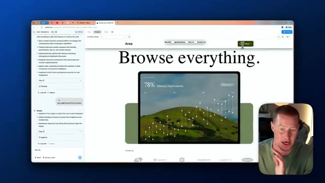
*⏱️ 00:06:11 — Aperçu du site web en cours de création avec le titre 'Browse everything.' et le présentateur en médaillon.*

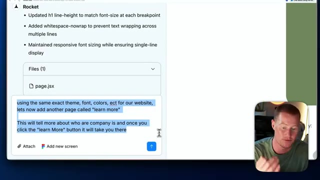
*⏱️ 00:06:20 — Interface de l'outil de développement affichant un prompt textuel pour ajouter une page 'Learn more' en conservant le même thème.*

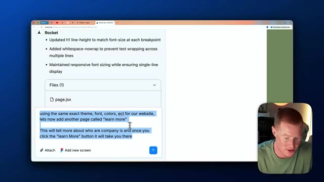
*⏱️ 00:06:29 — Vue similaire de l'interface montrant la zone de saisie du prompt pour configurer la navigation des boutons de l'application.*

---

### ⏱️ `[00:06:38 - 00:07:10]` | Segment #15

**🔊 Audio (Transcription Intégrale Mot pour Mot en Français) :**
> application qui, en gros, quand nous cliquons sur ce bouton, nous y emmène. Donc au lieu que ce soit juste, vous savez, ce modèle très basique que nous avons créé dans Figma, nous commençons réellement le processus de transformer ceci, un modèle simplifié, en un site Web complet et entier. Très rapidement, en plus de construire réellement un site Web entièrement fonctionnel à partir d'un design Figma, je vais également vous montrer comment publier ce site Web en littéralement un clic. Et c'est vraiment simple à faire. Donc avant de vous montrer réellement comment publier ceci, allons voir si cela a effectué ces changements. Donc si je clique sur ce bouton en savoir plus maintenant, cela m'amène maintenant vers une nouvelle page, transformer les données en avantage stratégique.

**👁️ Analyse Visuelle d'Écran (gemini-3.5-flash-lite) :**
**Interface & Outils** : Navigateur web affichant une application de création de site web / outil de prototypage IA.

**Contenu textuel & Code** : Page web générée affichant le texte "Browse everything.", un graphique de performance (78% Efficiency Improvements) et des options de navigation.

**Action / Démonstration** : Présentation de la transition du prototype vers un site web complet et fonctionnel.

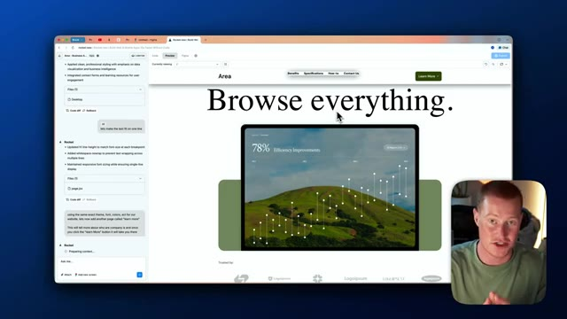
*⏱️ 00:06:46 — Aperçu du site web en cours de développement avec un titre principal, des graphiques et une barre de navigation, ainsi qu'une incrustation vidéo du présentateur en bas à droite.*

---

### ⏱️ `[00:07:10 - 00:07:35]` | Segment #16

**🔊 Audio (Transcription Intégrale Mot pour Mot en Français) :**
> Ce que je pourrais faire si j'avais vraiment un site web que j'essaye de construire ici, je donne simplement les informations pour l'entreprise que j'ai, et cela personnaliserait réellement ces informations en fonction, vous savez, exactement de ce que j'essaye de construire ici. Laisse-moi aller de l'avant et lui fournir des données afin qu'il puisse réellement personnaliser ceci en fonction du logiciel réel que nous essayons de promouvoir ici sur notre site web. Très bien, donc j'ai pris les devants et j'ai effectivement fourni un certain contexte sur cette entreprise pour laquelle nous essayons de créer un site web. J'ai donc dit, pour la page en savoir plus, voici quelques informations sur notre entreprise.

**👁️ Analyse Visuelle d'Écran (gemini-3.5-flash-lite) :**
**Interface & Outils** : Interface de développement web (Rocket New / outil de création de site assisté par IA) avec panneau latéral de chat et d'arborescence de fichiers.

**Contenu textuel & Code** : Arborescence de fichiers JSX (`learn-more/page.jsx`, `app/page.jsx`, `Header.jsx`) et saisie de prompt textuel décrivant l'entreprise TrailSafe AI.

**Action / Démonstration** : Saisie d'informations textuelles dans l'outil d'IA pour personnaliser le contenu du site web en cours de construction.

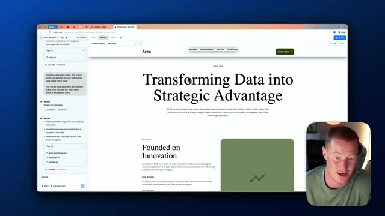
*⏱️ 00:07:17 — Interface de développement web montrant un aperçu de site avec le titre 'Transforming Data into Strategic Advantage' et un panneau latéral de code et de discussion avec l'IA.*

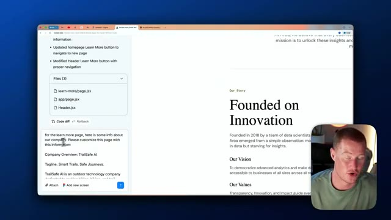
*⏱️ 00:07:29 — Gros plan sur le panneau latéral de l'interface de développement montrant un prompt textuel où l'utilisateur saisit des informations sur son entreprise ('TrailSafe AI').*

---

### ⏱️ `[00:07:35 - 00:07:54]` | Segment #17

**🔊 Audio (Transcription Intégrale Mot pour Mot en Français) :**
> Veuillez personnaliser cette page avec ces informations. L'entreprise est donc TrailSafeAI, le slogan est Sentiers intelligents, voyages sûrs, et cela résume essentiellement notre mission, notre lieu de fondation, son fonctionnement, tout ce genre de choses. Je vais donc envoyer ceci à Rocket et, espérons-le, cela devrait commencer à personnaliser cette page de notre site Web en fonction de tout ce contexte que j'ai fourni.

**👁️ Analyse Visuelle d'Écran (gemini-3.5-flash-lite) :**
**Interface & Outils** : Interface de l'outil de développement web no-code/AI Rocket.new et aperçu de page web.

**Contenu textuel & Code** : Texte de présentation de l'entreprise TrailSafeAI, nom des fichiers de code JSX (learn-more/page.jsx, app/page.jsx, Header.jsx) et description du fonctionnement de l'application.

**Action / Démonstration** : Modification et personnalisation du contenu textuel de la page web avec les informations de l'entreprise TrailSafeAI via l'assistant IA.

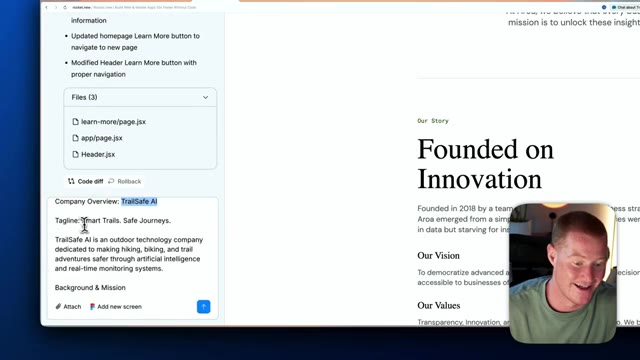
*⏱️ 00:07:40 — Interface de développement web montrant la section Company Overview avec le nom TrailSafe AI et le slogan Smart Trails. Safe Journeys.*

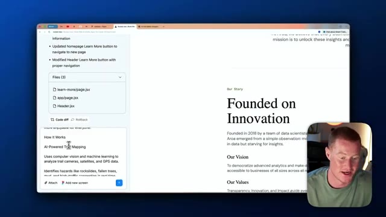
*⏱️ 00:07:44 — Interface web montrant la section How It Works et l'explication de la cartographie des sentiers propulsée par l'IA.*

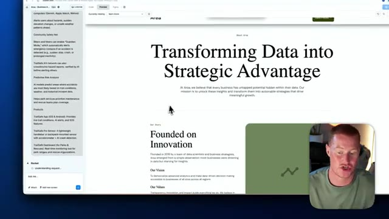
*⏱️ 00:07:49 — Aperçu de la page web finale intitulée Transforming Data into Strategic Advantage avec l'historique de l'entreprise.*

---

### ⏱️ `[00:07:54 - 00:08:18]` | Segment #18

**🔊 Audio (Transcription Intégrale Mot pour Mot en Français) :**
> Très bien, après environ une minute, nous avons en fait cette nouvelle page sur notre site web maintenant appelée Smart Trails Safe Journeys. Et elle détaille essentiellement notre histoire en fonction des informations que je lui ai fournies ici, fondée en 2021 à Boulder, dans le Colorado. Et comme vous pouvez le voir, cela se reflète ici sur notre site web, fondée en 2021 à Boulder, dans le Colorado, détaillant notre mission, nos valeurs, comment ça fonctionne, l'intelligence des sentiers propulsée par l'IA, tout ce truc.

**👁️ Analyse Visuelle d'Écran (gemini-3.5-flash-lite) :**
**Interface & Outils** : Navigateur web affichant une page de site internet (Rocket.new / Figma).

**Contenu textuel & Code** : Texte du site web 'Smart Trails. Safe Journeys.' et 'Outdoor Innovation Meets Space Technology' avec la mention 'Founded in 2021 in Boulder, Colorado'.

**Action / Démonstration** : Navigation et défilement sur la page web en cours de création pour présenter le contenu textuel.

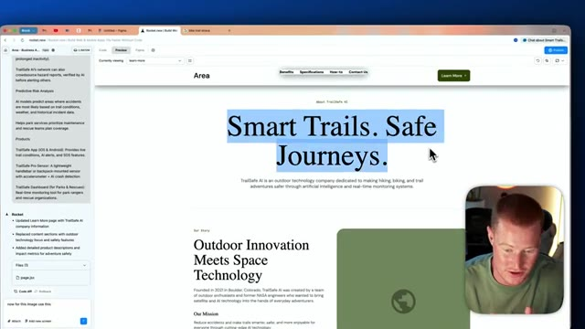
*⏱️ 00:08:00 — Aperçu du site web 'Smart Trails Safe Journeys' montrant le titre principal avec une sélection de texte bleue et le présentateur en médaillon.*

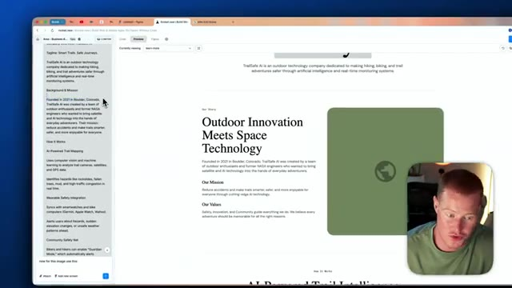
*⏱️ 00:08:06 — Défilement de la page web montrant la section 'Our Story' avec le texte de fond et de mission, et le présentateur en bas à droite.*

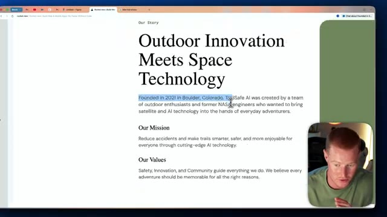
*⏱️ 00:08:12 — Gros plan sur le texte de l'histoire du site web mentionnant la fondation en 2021 à Boulder, Colorado.*

---

### ⏱️ `[00:08:18 - 00:08:44]` | Segment #19

**🔊 Audio (Transcription Intégrale Mot pour Mot en Français) :**
> Donc maintenant, nous avons réellement un site Web adapté à notre entreprise à partir d'un design Figma que nous avions déjà comme modèle, et nous le transformons ici en un site Web réellement pleinement fonctionnel. Celui-ci, comme vous pouvez le voir, n'a pas d'image. Laissez-moi donc rapidement ajouter une image et vous montrer à quel point nous pouvons faire cela facilement. Encore une fois, je vais cliquer sur la fonction de sélection et d'édition ici. Je vais cliquer sur cette division et je vais dire que nous voulons utiliser cette image ici et je vais simplement télécharger ceci sur Rocket et en environ 20 secondes ou à peu près, nous devrions avoir une mise à jour de ceci.

**👁️ Analyse Visuelle d'Écran (gemini-3.5-flash-lite) :**
**Interface & Outils** : Navigateur web affichant l'éditeur du site web et la webcam du présentateur en incrustation.

**Contenu textuel & Code** : Maquette de site web intitulée 'TrailSafe AI' avec des sections de texte explicatives et des options de personnalisation d'image.

**Action / Démonstration** : Le présentateur montre l'intégration et la configuration d'éléments visuels sur le site web en développement.

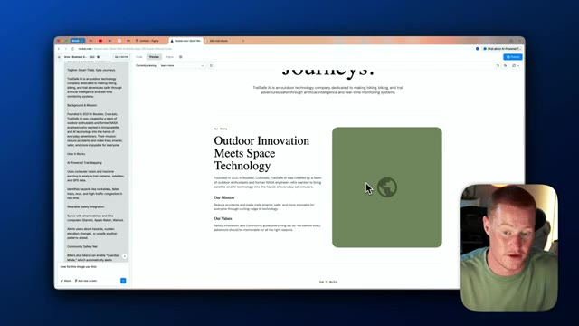
*⏱️ 00:08:24 — Aperçu d'un site web en cours de création avec une section textuelle et un espace réservé pour une image de type globe.*

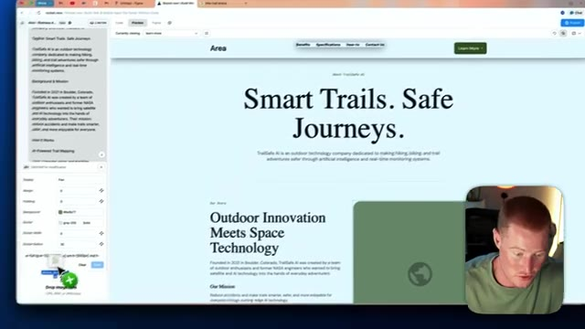
*⏱️ 00:08:38 — Modification des paramètres d'image dans l'éditeur du site web avec un panneau latéral permettant de glisser-déposer des fichiers.*

---

### ⏱️ `[00:08:44 - 00:09:10]` | Segment #20

**🔊 Audio (Transcription Intégrale Mot pour Mot en Français) :**
> Très bien. Donc maintenant nous avons notre site web et nous avons ajouté cette image ici. Donc vous pouvez maintenant commencer à voir à quel point il est facile de commencer réellement à ajouter des modifications à notre site web ou à notre application à partir de cette conception Figma avec laquelle nous avons réellement commencé à l'intérieur de Rocket. Et puis très rapidement, petite astuce, si vous voulez ajouter différents composants d'interface utilisateur, tout comme vous pouvez le voir ici, vous pouvez voir que j'ai changé cette section principale ici. Donc le texte a en fait ce petit effet de flou. Genre, est-ce que ça n'a pas l'air plutôt cool ? Donc j'ai utilisé 21st.dev pour faire ça. Je suis juste venu ici.

**👁️ Analyse Visuelle d'Écran (gemini-3.5-flash-lite) :**
**Interface & Outils** : Navigateur web, outil de développement web Rocket.new, éditeur de code source, prévisualisation Figma.

**Contenu textuel & Code** : Code source JavaScript/React, aperçu du site web "TrailSafe AI", structure des fichiers du projet.

**Action / Démonstration** : Navigation et démonstration des modifications apportées au site web à partir d'une conception Figma.

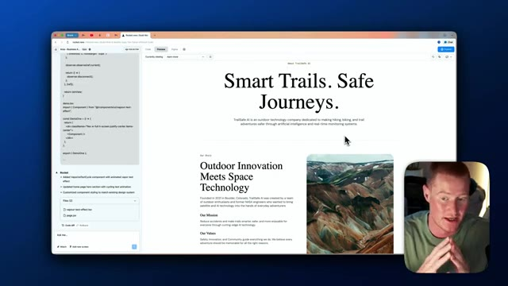
*⏱️ 00:08:51 — Aperçu du site web en cours de développement avec un panneau de code à gauche et une webcam du présentateur en bas à droite.*

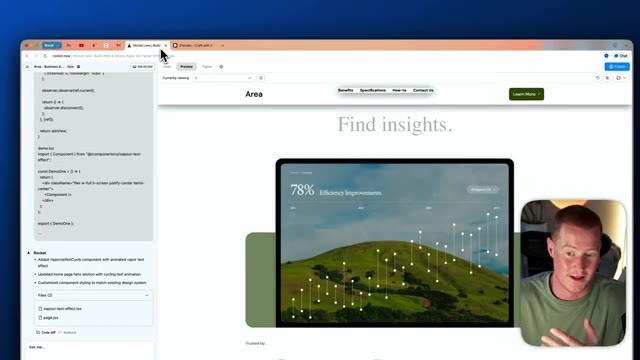
*⏱️ 00:08:57 — Navigation sur le site web en cours de développement montrant une section avec un graphique d'efficacité de 78%.*

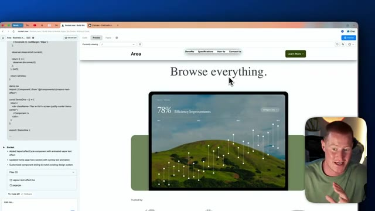
*⏱️ 00:09:04 — Défilement de la page web montrant le titre "Browse everything" et l'interface utilisateur interactive.*

---

### ⏱️ `[00:09:10 - 00:09:28]` | Segment #21

**🔊 Audio (Transcription Intégrale Mot pour Mot en Français) :**
> J'ai fondamentalement pris un composant d'interface utilisateur à partir de là. Et ouais, je l'ai fondamentalement ajouté à notre application. Donc maintenant qu'on a effectivement construit notre site web, allons-y et publions ça. Pour le publier, tout ce qu'on a à faire c'est de venir ici et de cliquer sur ce bouton bleu "publier". Tu peux voir que je l'ai déjà publié. Tu cliquerais juste sur publier et on pourrait même ajouter un domaine personnalisé. De cette façon, ça a sa propre URL spécifique.

**👁️ Analyse Visuelle d'Écran (gemini-3.5-flash-lite) :**
**Interface & Outils** : Navigateur web, outil de développement web et d'IA (vibe coding / builder), interface utilisateur de prévisualisation.

**Contenu textuel & Code** : Code source React/JSX dans le panneau latéral, fichiers du projet (vapour-text-effect.tsx, page.tsx), interface de prévisualisation du site web.
[DESC_IMAGE_3] Navigation dans l'interface de développement, ajout de composants UI et publication du site web créé.

**Action / Démonstration** : Explications face caméra et analyse conceptuelle des marchés.

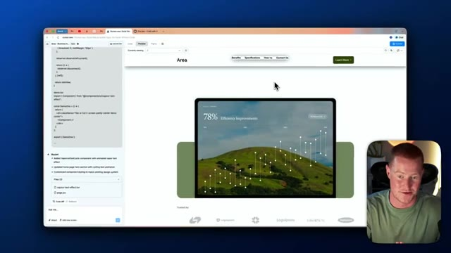
*⏱️ 00:09:15 — Aperçu du site web en cours de construction dans un éditeur de code/interface web avec un composant d'interface utilisateur affichant "78% Efficiency Improvements".*

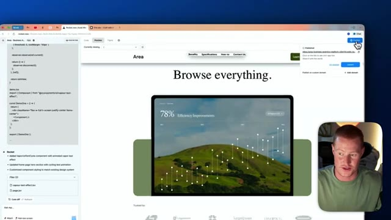
*⏱️ 00:09:19 — Le panneau de publication du site web ouvert dans l'interface, affichant le lien de publication et le bouton "Publish".*

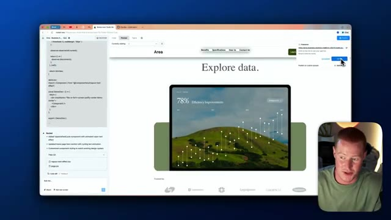
*⏱️ 00:09:24 — L'interface affichant le site web mis à jour avec le texte "Explore data." et le panneau de publication actif dans le coin supérieur droit.*

---

### ⏱️ `[00:09:28 - 00:09:47]` | Segment #22

**🔊 Audio (Transcription Intégrale Mot pour Mot en Français) :**
> Et c'est aussi simple que ça, si je viens sur cette URL ici, vous pouvez maintenant voir notre site web en direct avec toutes ces informations que nous avons fournies. Et nous avons fait tout cela en utilisant Figma et Rocket. J'espère que vous avez tiré de la valeur de cette vidéo. C'était une vidéo très attendue par vous les gars. Vous m'avez demandé de faire cela, donc je suis heureux d'avoir pu vous l'apporter. Si vous n'êtes pas déjà abonnés, abonnez-vous à la chaîne.

**👁️ Analyse Visuelle d'Écran (gemini-3.5-flash-lite) :**
**Interface & Outils** : Navigateur web affichant un site internet créé via Figma et Rocket.

**Contenu textuel & Code** : Page web responsive contenant des sections de texte, des images paysagères et des graphiques statistiques stylisés.

**Action / Démonstration** : Navigation et présentation du site web finalisé en direct dans le navigateur.

---

### ⏱️ `[00:09:47 - 00:09:54]` | Segment #23

**🔊 Audio (Transcription Intégrale Mot pour Mot en Français) :**
> Je couvre tout ce qui touche à l'IA pour les non-techniciens, vous tenant informés de toutes les nouvelles tendances en matière d'IA. Cela étant dit, les gars, merci d'être restés jusqu'à la fin, et j'espère vous voir dans la prochaine.

**👁️ Analyse Visuelle d'Écran (gemini-3.5-flash-lite) :**
**Interface & Outils** : YouTube (page de la chaîne).

**Contenu textuel & Code** : Miniatures de vidéos liées à l'IA, outils no-code et applications mobiles.

**Action / Démonstration** : Conclusion de la vidéo et incitation à s'abonner.

---

