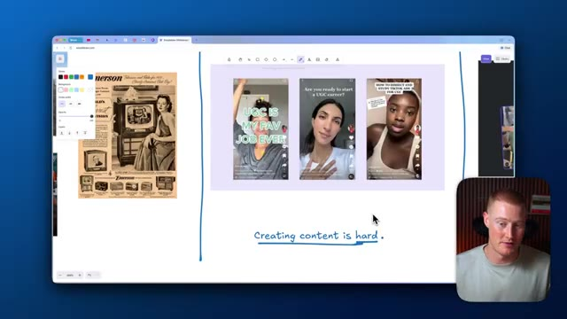
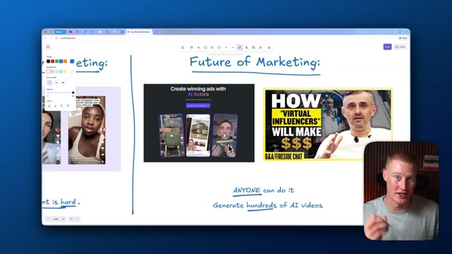

# 🎬 How to Create VIRAL UGC Ads with Sora 2 (INSTANTLY)

> **Chaîne** : [Brock Mesarich | AI for Non Techies](https://www.youtube.com/@BrockMesarich)  
> **Lien YouTube** : [https://www.youtube.com/watch?v=wR3KqfipDmU](https://www.youtube.com/watch?v=wR3KqfipDmU)  
> **Date de publication** : 20251020  
> **Durée** : 00:09:57  
> **Identifiant vidéo** : `wR3KqfipDmU`  
> **Transcription & Analyse** : `whisper-v3-large-turbo+gemini-3.5-flash-lite`  

---

## 📌 Synthèse Exécutive & Outils

### 💡 Résumé
Dans cette vidéo intitulée **Comment créer des publicités UGC virales avec Sora 2 (INSTANTANÉMENT)**, Alex Carter détaille une approche stratégique et pratique du trading et de l'automatisation par agents IA.

### 🛠️ Outils, Modèles & Logiciels Présentés
- **TradingView & Claude Code** : Analyse technique avancée et automatisation algorithmique.

### 🔑 Points Clés & Enseignements Stratégiques
- Respect rigoureux du ratio risque/rendement et du money management.
- Automatisation méthodique des déclencheurs d'ordres via des agents intelligents.

---

## ⏱️ Chronologie & Transcription Complète Audio & Visuelle (Mot pour Mot)

### ⏱️ `[00:00:00 - 00:00:35]` | Segment #01

**🔊 Audio (Transcription Intégrale Mot pour Mot en Français) :**
> En ce moment, Sora 2 ressemble à un terrain de jeu. Tout le monde s'amuse simplement à créer des clips viraux et des mèmes. Mais voici la vérité : c'est le début d'un changement complet dans la façon dont les créateurs et les marques créent du contenu. Parce que bientôt, les personnes qui sauront utiliser Sora de manière stratégique pour raconter des histoires, rassembler des audiences et vendre des produits vont conquérir Internet et gagner beaucoup d'argent en le faisant. Dans cette vidéo, je vais vous montrer exactement comment prendre une longueur d'avance, et à la fin, vous serez capable de créer des vidéos Sora virales, que ce soit pour votre propre activité ou pour celle de vos clients. Alors, entrons dans le vif du sujet. Très bien, avant de vous montrer comment tirer parti de cette opportunité, nous devons parler de ce qui est en jeu ici et de la raison pour laquelle il s'agit réellement d'une si grande opportunité. Alors d'abord, je veux parler

**👁️ Analyse Visuelle d'Écran (gemini-3.5-flash-lite) :**
**Interface & Outils** : Aucune interface informatique technique, plateforme de trading ou terminal de code affiché.

**Contenu textuel & Code** : Textes explicatifs graphiques et illustrations conceptuelles sur le changement d'usage de l'IA créative.

**Action / Démonstration** : Séquence d'illustration et d'animation visuelle accompagnant l'introduction du sujet sur Sora et l'IA créative.

---

### ⏱️ `[00:00:35 - 00:01:08]` | Segment #02

**🔊 Audio (Transcription Intégrale Mot pour Mot en Français) :**
> à propos du marketing traditionnel. Pensez à des choses comme les panneaux d'affichage, les annonces dans les journaux et, plus récemment, les publicités télévisées. C'était ainsi que fonctionnait toute l'industrie du marketing. Et il y avait un très gros problème avec cela. Il fallait avoir beaucoup d'argent pour pouvoir faire cela. Il fallait être une grande entreprise pour pouvoir diffuser ces publicités à la télévision ou pour pouvoir acheter des espaces publicitaires sur des panneaux. Cela nous amène donc à notre forme de marketing moderne, dont vous avez probablement conscience et que vous comprenez probablement. Il s'agit du contenu UGC que vous voyez soit sur Instagram, TikTok, ou des plateformes comme YouTube. Cela a créé un

**👁️ Analyse Visuelle d'Écran (gemini-3.5-flash-lite) :**
**Interface & Outils** : Excalidraw (navigateur web)

**Contenu textuel & Code** : Images d'illustrations marketing (panneau publicitaire McDonald's, spot TV Coca-Cola, vidéos TikTok/UGC) et annotations textuelles

**Action / Démonstration** : Présentation magistrale et comparaison conceptuelle des ères du marketing sans démonstration technique ni code

---

### ⏱️ `[00:01:08 - 00:01:44]` | Segment #03

**🔊 Audio (Transcription Intégrale Mot pour Mot en Français) :**
> une toute nouvelle façon pour les gens de commercialiser leurs produits. Et le meilleur dans tout ça, c'est que cela a démocratisé tout le secteur du marketing. Donc maintenant, n'importe qui avec un iPhone peut créer du contenu et commencer à se commercialiser. Mais il y a un hic avec cela, c'est que créer du contenu est vraiment difficile. Si vous n'êtes pas quelqu'un qui aime être devant la caméra, cela peut être assez difficile pour vous. Et vous comprenez peut-être déjà l'opportunité en tant que créateur de contenu généré par les utilisateurs, mais vous ne voulez pas faire de contenu vous-même. Et cela nous amène à l'avenir du marketing. Et c'est l'utilisation de l'intelligence artificielle pour générer réellement des vidéos et des vidéos virales pour vous. Donc si vous savez qui est Gary V, Gary V est un entrepreneur qui a toujours une longueur d'avance sur la technologie avant qu'elle n'arrive. Et il est vraiment

**👁️ Analyse Visuelle d'Écran (gemini-3.5-flash-lite) :**
**Interface & Outils** : Navigateur web affichant l'application de tableau blanc Excalidraw (excalidraw.com).

**Contenu textuel & Code** : - Annotations manuscrites : « Creating content is hard. », « Future of Marketing: », « ANYONE can do it », « Generate hundreds of AI videos ».
- Visuels intégrés : exemples de vidéos de créateurs UGC, encadré publicitaire « Create winning ads with AI Actors », et miniature vidéo sur les « Virtual Influencers ».

**Action / Démonstration** : Le créateur expose et schématise l'évolution de la création de contenu, en comparant les difficultés du marketing UGC manuel aux opportunités offertes par la génération de vidéos avec des avatars IA.

*⏱️ 00:01:26 — Tableau blanc interactif Excalidraw affichant une publicité vintage, des exemples de vidéos UGC TikTok et l'annotation manuscrite « Creating content is hard ».*

*⏱️ 00:01:35 — Tableau blanc Excalidraw présentant la section « Future of Marketing: » avec des références aux acteurs IA et aux influenceurs virtuels.*

---

### ⏱️ `[00:01:44 - 00:02:05]` | Segment #04

**🔊 Audio (Transcription Intégrale Mot pour Mot en Français) :**
> très favorable à l'idée des influenceurs virtuels et que les grandes marques vont commencer à créer leurs propres influenceurs avec l'intelligence artificielle. Et ce sera l'avenir de la manière de commercialiser vos produits. Et le meilleur dans tout ça, c'est que n'importe qui peut le faire. Et vous pouvez générer des centaines de vidéos par IA à grande échelle que vous pouvez tester au lieu de devoir réellement aller de l'avant et faire ces vidéos vous-même si vous êtes un créateur UGC moderne.

**👁️ Analyse Visuelle d'Écran (gemini-3.5-flash-lite) :**
**Interface & Outils** : Présentation ou face-caméra explicatif du trader sans interface logicielle partagée.

**Contenu textuel & Code** : Explications orales des stratégies et mise en contexte méthodologique du marché.

**Action / Démonstration** : Explications face caméra et analyse conceptuelle des marchés.

---

### ⏱️ `[00:02:05 - 00:02:25]` | Segment #05

**🔊 Audio (Transcription Intégrale Mot pour Mot en Français) :**
> Maintenant que nous comprenons cela, parlons de la façon exacte dont nous pourrions commencer à faire cela nous-mêmes. Très bien, donc nous allons utiliser Arcad pour générer réellement ces vidéos virales en utilisant Sora 2 et d'autres modèles de génération de vidéos que la plateforme utilise réellement. Je vais venir sur notre plateforme et ce que nous allons vouloir faire, c'est que nous allons vouloir cliquer sur nouveau projet. et c'est ici que nous sommes réellement capables de commencer à générer nos vidéos.

**👁️ Analyse Visuelle d'Écran (gemini-3.5-flash-lite) :**
**Interface & Outils** : Présentation ou face-caméra explicatif du trader sans interface logicielle partagée.

**Contenu textuel & Code** : Explications orales des stratégies et mise en contexte méthodologique du marché.

**Action / Démonstration** : Explications face caméra et analyse conceptuelle des marchés.

---

### ⏱️ `[00:02:25 - 00:02:45]` | Segment #06

**🔊 Audio (Transcription Intégrale Mot pour Mot en Français) :**
> Laissez-moi vous expliquer rapidement comment exactement nous pourrions faire cela et comment la plateforme fonctionne réellement. Si nous allons sélectionner ceci ici, vous pouvez voir que nous avons tout un tas d'options différentes. Nous avons des acteurs qui parlent, nous avons des vidéos, nous avons des scènes, nous pourrions montrer notre application, nous avons des POV de déballage, toutes ces différentes choses. Voyez cela comme différents modèles que nous pourrions utiliser afin de rendre notre processus de génération de vidéo encore plus simple.

**👁️ Analyse Visuelle d'Écran (gemini-3.5-flash-lite) :**
**Interface & Outils** : Présentation ou face-caméra explicatif du trader sans interface logicielle partagée.

**Contenu textuel & Code** : Explications orales des stratégies et mise en contexte méthodologique du marché.

**Action / Démonstration** : Explications face caméra et analyse conceptuelle des marchés.

---

### ⏱️ `[00:02:45 - 00:03:06]` | Segment #07

**🔊 Audio (Transcription Intégrale Mot pour Mot en Français) :**
> I'm gonna go ahead and select talking actors right now and show you exactly what that means. So inside of Arcads, we actually have a collection of different actors that are basically these AI avatars that we could actually use and customize. So we could find any of these people that we think would be perfect for our brand or for our advertisement. So let me go ahead and find a couple that I actually want to use for my first video.

**👁️ Analyse Visuelle d'Écran (gemini-3.5-flash-lite) :**
**Interface & Outils** : Présentation ou face-caméra explicatif du trader sans interface logicielle partagée.

**Contenu textuel & Code** : Explications orales des stratégies et mise en contexte méthodologique du marché.

**Action / Démonstration** : Explications face caméra et analyse conceptuelle des marchés.

---

### ⏱️ `[00:03:07 - 00:03:26]` | Segment #08

**🔊 Audio (Transcription Intégrale Mot pour Mot en Français) :**
> All right. So I selected three here. And what I could do is I could just select each of these, click on add actors. And the cool part about this is I could generate three different videos in just one single prompt. So I could basically have all of them say the exact same thing or create the same type of ad just with one prompt here. So let me go ahead, add a script and we're gonna generate this.

**👁️ Analyse Visuelle d'Écran (gemini-3.5-flash-lite) :**
**Interface & Outils** : Présentation ou face-caméra explicatif du trader sans interface logicielle partagée.

**Contenu textuel & Code** : Explications orales des stratégies et mise en contexte méthodologique du marché.

**Action / Démonstration** : Explications face caméra et analyse conceptuelle des marchés.

---

### ⏱️ `[00:03:26 - 00:03:47]` | Segment #09

**🔊 Audio (Transcription Intégrale Mot pour Mot en Français) :**
> So here's the very simple prompt that we're gonna use. I just built this app entirely with AI. It lets you upload an image of yourself and lets you try on any clothes that you want. So imagine that we actually built this app, which I actually did with AI. And if we wanna market this, we could actually basically make these actors say whatever we want. And we're gonna start with this dialogue here. So what I could do is I could actually add expression to this.

**👁️ Analyse Visuelle d'Écran (gemini-3.5-flash-lite) :**
**Interface & Outils** : Présentation ou face-caméra explicatif du trader sans interface logicielle partagée.

**Contenu textuel & Code** : Explications orales des stratégies et mise en contexte méthodologique du marché.

**Action / Démonstration** : Explications face caméra et analyse conceptuelle des marchés.

---

### ⏱️ `[00:03:47 - 00:04:06]` | Segment #10

**🔊 Audio (Transcription Intégrale Mot pour Mot en Français) :**
> So instead of it just being a flat video with no emotion, we could actually change this. So let's just say excited here, add that. And then all I have to do is click send and it's gonna begin actually generating these. All right, so now these are generated. Let's go ahead and take a look at these. I just built this app entirely with AI. It lets you upload an image of yourself and lets you try on any clothes you want.

**👁️ Analyse Visuelle d'Écran (gemini-3.5-flash-lite) :**
**Interface & Outils** : Présentation ou face-caméra explicatif du trader sans interface logicielle partagée.

**Contenu textuel & Code** : Explications orales des stratégies et mise en contexte méthodologique du marché.

**Action / Démonstration** : Explications face caméra et analyse conceptuelle des marchés.

---

### ⏱️ `[00:04:06 - 00:04:25]` | Segment #11

**🔊 Audio (Transcription Intégrale Mot pour Mot en Français) :**
> So that's actually pretty solid. Dialogue matches her lips pretty well. It looks very natural as if it's like an actual influencer on TikTok or something. Then we have this one as well. I just built this app entirely with AI. It lets you upload an image of yourself and lets you try on any clothes you want. Again, that one's really solid. And then here's the last one here. I just built this app entirely with AI.

**👁️ Analyse Visuelle d'Écran (gemini-3.5-flash-lite) :**
**Interface & Outils** : Présentation ou face-caméra explicatif du trader sans interface logicielle partagée.

**Contenu textuel & Code** : Explications orales des stratégies et mise en contexte méthodologique du marché.

**Action / Démonstration** : Explications face caméra et analyse conceptuelle des marchés.

---

### ⏱️ `[00:04:25 - 00:04:43]` | Segment #12

**🔊 Audio (Transcription Intégrale Mot pour Mot en Français) :**
> It lets you upload an image of yourself and lets you try on any clothes you want. All right. So those are really solid, but that's pretty basic. I'm going to actually show you other examples that we could actually begin using that makes these feel a little bit more dynamic. All right. So here's actually another one I went ahead and generated. I think this one looks the best so far and he's actually holding a phone.

**👁️ Analyse Visuelle d'Écran (gemini-3.5-flash-lite) :**
**Interface & Outils** : Présentation ou face-caméra explicatif du trader sans interface logicielle partagée.

**Contenu textuel & Code** : Explications orales des stratégies et mise en contexte méthodologique du marché.

**Action / Démonstration** : Explications face caméra et analyse conceptuelle des marchés.

---

### ⏱️ `[00:04:43 - 00:05:13]` | Segment #13

**🔊 Audio (Transcription Intégrale Mot pour Mot en Français) :**
> So I think that's a perfect example for trying to make an ad on basically a mobile phone app that we created Yo, I just built this app entirely with ai and I have no idea how to code This is actually insane if you think about it. That sounds really good The emotion is really good And then what I could do is I could actually generate a video like this where it's him showing our app in real time And let me show you exactly how to do that now So we're just going to come over to our script right here We're going to click on show your app And all we have to do is basically drag in a screenshot of whatever our mobile app is.

**👁️ Analyse Visuelle d'Écran (gemini-3.5-flash-lite) :**
**Interface & Outils** : Présentation ou face-caméra explicatif du trader sans interface logicielle partagée.

**Contenu textuel & Code** : Explications orales des stratégies et mise en contexte méthodologique du marché.

**Action / Démonstration** : Explications face caméra et analyse conceptuelle des marchés.

---

### ⏱️ `[00:05:13 - 00:05:34]` | Segment #14

**🔊 Audio (Transcription Intégrale Mot pour Mot en Français) :**
> All right. So now that I added a screenshot, you could see my app right here. Basically, I could just go ahead and select any of the actors that we want. So let me select Julian here. I think this one looks really good. I'm going to add actor and literally just send this off. And it's going to go ahead and generate this video for me. All right. So here we go. Here is the video that was generated. You can see that we have our actor Julian here. And our app is literally showing on this phone.

**👁️ Analyse Visuelle d'Écran (gemini-3.5-flash-lite) :**
**Interface & Outils** : Présentation ou face-caméra explicatif du trader sans interface logicielle partagée.

**Contenu textuel & Code** : Explications orales des stratégies et mise en contexte méthodologique du marché.

**Action / Démonstration** : Explications face caméra et analyse conceptuelle des marchés.

---

### ⏱️ `[00:05:34 - 00:05:52]` | Segment #15

**🔊 Audio (Transcription Intégrale Mot pour Mot en Français) :**
> And there's even reflections on our phone that make it look extremely realistic. All right, so now I'm gonna show you something a little bit different, and this is actually really fun to play around with. And this is how I think you're gonna make some really dynamic ads that you can use, and this is a really simple way to do it. So we're gonna come over to our project, and I'm just gonna select video.

**👁️ Analyse Visuelle d'Écran (gemini-3.5-flash-lite) :**
**Interface & Outils** : Présentation ou face-caméra explicatif du trader sans interface logicielle partagée.

**Contenu textuel & Code** : Explications orales des stratégies et mise en contexte méthodologique du marché.

**Action / Démonstration** : Explications face caméra et analyse conceptuelle des marchés.

---

### ⏱️ `[00:05:52 - 00:06:13]` | Segment #16

**🔊 Audio (Transcription Intégrale Mot pour Mot en Français) :**
> And you can see that I'm gonna select Sora 2 Pro, which is our best video generation model, and it's pretty crazy. You're gonna see the output here. But what I'm gonna do is I could just describe a video. We could think of any video we want, and it's actually gonna go ahead and generate that for us. So here's the prompt that I'm going to use. Basically the TLDR of this is we're going to create a video of a girl and a guy laying in bed together.

**👁️ Analyse Visuelle d'Écran (gemini-3.5-flash-lite) :**
**Interface & Outils** : Présentation ou face-caméra explicatif du trader sans interface logicielle partagée.

**Contenu textuel & Code** : Explications orales des stratégies et mise en contexte méthodologique du marché.

**Action / Démonstration** : Explications face caméra et analyse conceptuelle des marchés.

---

### ⏱️ `[00:06:14 - 00:06:34]` | Segment #17

**🔊 Audio (Transcription Intégrale Mot pour Mot en Français) :**
> And the guy is sleeping in the girlfriend basically says, Oh, I bet he's thinking about other girls, but really what it's going to do is it's going to show him in a dream. And he's dreaming about clash of clans, which is actually pretty hilarious. This would make for a great ad. If you were trying to promote clash of clans, for example, this is just a use case that I thought would be fun to showcase. And let's go ahead and send that off.

**👁️ Analyse Visuelle d'Écran (gemini-3.5-flash-lite) :**
**Interface & Outils** : Présentation ou face-caméra explicatif du trader sans interface logicielle partagée.

**Contenu textuel & Code** : Explications orales des stratégies et mise en contexte méthodologique du marché.

**Action / Démonstration** : Explications face caméra et analyse conceptuelle des marchés.

---

### ⏱️ `[00:06:34 - 00:06:52]` | Segment #18

**🔊 Audio (Transcription Intégrale Mot pour Mot en Français) :**
> It's going to begin crafting this now. All right. And just like that, our video has been generated. Let's go ahead and take a look at this. He's probably thinking about it. All right. So that's honestly pretty hilarious. And we did that with one single prompt here. You could see this is how simple the prompt was.

**👁️ Analyse Visuelle d'Écran (gemini-3.5-flash-lite) :**
**Interface & Outils** : Présentation ou face-caméra explicatif du trader sans interface logicielle partagée.

**Contenu textuel & Code** : Explications orales des stratégies et mise en contexte méthodologique du marché.

**Action / Démonstration** : Explications face caméra et analyse conceptuelle des marchés.

---

### ⏱️ `[00:06:52 - 00:07:25]` | Segment #19

**🔊 Audio (Transcription Intégrale Mot pour Mot en Français) :**
> I actually went ahead. I got this from ChatGPT. I said, hey, help me make a prompt to actually give to an AI video generation model to create an ad about somebody dreaming about Clash of Clans. All right. So I just created this project here called Close Skit Clips. And basically, here is a prompt that I'm going to use. So we obviously have our app that allows us to try on any clothes with AI just by uploading an image of ourselves So let's now create ads for this So here's the prompt I'm going to use show a girl unboxing clothes that look totally different from the website She groans. Why does this always happen? Her roommate laughs. You should use the AI try-on app. You get the point

**👁️ Analyse Visuelle d'Écran (gemini-3.5-flash-lite) :**
**Interface & Outils** : Présentation ou face-caméra explicatif du trader sans interface logicielle partagée.

**Contenu textuel & Code** : Explications orales des stratégies et mise en contexte méthodologique du marché.

**Action / Démonstration** : Explications face caméra et analyse conceptuelle des marchés.

---

### ⏱️ `[00:07:25 - 00:08:00]` | Segment #20

**🔊 Audio (Transcription Intégrale Mot pour Mot en Français) :**
> That's going to be our prompt that we're going to use here We're just going to click on videos and then use Sora to pro to actually generate this. All right So here's an example of one that was actually generated Always happen. You should have used the AI try-on app. It literally shows how you look before you buy okay wait actually okay so it's pretty solid like the character consistency is really good however it's not perfect so what we could do is let's go ahead and click download i'm going to save this now and i'm going to pull up a video editor and i'm using capca here and let me just drag this in and i'm just going to clip this up a little bit all right so i literally just took

**👁️ Analyse Visuelle d'Écran (gemini-3.5-flash-lite) :**
**Interface & Outils** : Présentation ou face-caméra explicatif du trader sans interface logicielle partagée.

**Contenu textuel & Code** : Explications orales des stratégies et mise en contexte méthodologique du marché.

**Action / Démonstration** : Explications face caméra et analyse conceptuelle des marchés.

---

### ⏱️ `[00:08:00 - 00:08:28]` | Segment #21

**🔊 Audio (Transcription Intégrale Mot pour Mot en Français) :**
> this video i clipped it up and i basically took a screen recording of me actually using this app as you can see here and basically just overlaid this onto our ad so now this is what it looks like and this was made in literally like two minutes. Why does this always happen? You should have used the AI try on app. It literally shows how you'll look before you buy. Okay, wait, that's actually cheap. So you probably get the point. You could generate hundreds of different videos and clip them up if you need to and actually use those for different advertising.

**👁️ Analyse Visuelle d'Écran (gemini-3.5-flash-lite) :**
**Interface & Outils** : Présentation ou face-caméra explicatif du trader sans interface logicielle partagée.

**Contenu textuel & Code** : Explications orales des stratégies et mise en contexte méthodologique du marché.

**Action / Démonstration** : Explications face caméra et analyse conceptuelle des marchés.

---

### ⏱️ `[00:08:28 - 00:09:00]` | Segment #22

**🔊 Audio (Transcription Intégrale Mot pour Mot en Français) :**
> All right, so here's another example that again, I made in like 30 seconds here. Bro, why does nothing ever fit right? Dude, just use that new AI try on app. You upload a pic and it shows exactly how clothes look on you. All right, so I decided to do one more example of this clash of Clans video and this one's actually pretty hilarious. He's probably thinking about other girls. Clash of Clans, what your boyfriend is actually thinking about. All right, so there you have it. Now you know how to actually create these Sora 2 videos that you could either use as ad or organic content to post on social media to promote either yours or a client's brand. You

**👁️ Analyse Visuelle d'Écran (gemini-3.5-flash-lite) :**
**Interface & Outils** : Présentation ou face-caméra explicatif du trader sans interface logicielle partagée.

**Contenu textuel & Code** : Explications orales des stratégies et mise en contexte méthodologique du marché.

**Action / Démonstration** : Explications face caméra et analyse conceptuelle des marchés.

---

### ⏱️ `[00:09:00 - 00:09:32]` | Segment #23

**🔊 Audio (Transcription Intégrale Mot pour Mot en Français) :**
> have multiple ways you could go about this. You could go ahead and you could actually choose which actors you want to use, make them say specific things, or you could come ahead and actually choose videos here use Sora 2 and then basically just describe what you want your video to be and it will actually create that full entire video and not just them talking like think of the clash of clans example that i showed you could easily recreate something like that just by writing in a prompt and the thing to note here is the more specific your prompt is the better the video is going to be and one thing i want to mention is these videos are not perfect right now with Sora 2

**👁️ Analyse Visuelle d'Écran (gemini-3.5-flash-lite) :**
**Interface & Outils** : Présentation ou face-caméra explicatif du trader sans interface logicielle partagée.

**Contenu textuel & Code** : Explications orales des stratégies et mise en contexte méthodologique du marché.

**Action / Démonstration** : Explications face caméra et analyse conceptuelle des marchés.

---

### ⏱️ `[00:09:32 - 00:09:54]` | Segment #24

**🔊 Audio (Transcription Intégrale Mot pour Mot en Français) :**
> and the video models that are out this second but believe me these models are going to get incredibly good, have a whole bunch of context on things that resonate with people, and you're going to be able to make entire advertisements with one single prompt that are basically flawless. So learning how to do this right now, you're getting a big advantage because we're still very early on in this technology. If you guys want to try Arcads, there's a link in the comments below.

**👁️ Analyse Visuelle d'Écran (gemini-3.5-flash-lite) :**
**Interface & Outils** : Présentation ou face-caméra explicatif du trader sans interface logicielle partagée.

**Contenu textuel & Code** : Explications orales des stratégies et mise en contexte méthodologique du marché.

**Action / Démonstration** : Explications face caméra et analyse conceptuelle des marchés.

---

### ⏱️ `[00:09:54 - 00:09:57]` | Segment #25

**🔊 Audio (Transcription Intégrale Mot pour Mot en Français) :**
> Appreciate you staying to the end of this video, and I'll see you guys in the next one.

**👁️ Analyse Visuelle d'Écran (gemini-3.5-flash-lite) :**
**Interface & Outils** : Présentation ou face-caméra explicatif du trader sans interface logicielle partagée.

**Contenu textuel & Code** : Explications orales des stratégies et mise en contexte méthodologique du marché.

**Action / Démonstration** : Explications face caméra et analyse conceptuelle des marchés.

---

