# 🎬 I Tried the NEW ChatGPT Browser (Atlas Review)

> **Chaîne** : [Brock Mesarich | AI for Non Techies](https://www.youtube.com/@BrockMesarich)  
> **Lien YouTube** : [https://www.youtube.com/watch?v=Nd1-gX3rauk](https://www.youtube.com/watch?v=Nd1-gX3rauk)  
> **Date de publication** : 20251021  
> **Durée** : 00:06:25  
> **Identifiant vidéo** : `Nd1-gX3rauk`  
> **Transcription & Analyse** : `whisper-v3-large-turbo+gemini-3.5-flash-lite`  

---

## 📌 Synthèse Exécutive & Outils

### 💡 Résumé
Cette vidéo de la chaîne *Brock Mesarich | AI for Non Techies* explore en avant-première les capacités révolutionnaires du nouveau navigateur agentique **ChatGPT Atlas**. En s'appuyant sur une démonstration en direct, l'animateur met en lumière le passage d'une interaction textuelle classique avec l'intelligence artificielle à une exécution autonome et multi-tâches directement dans l'environnement du navigateur web. L'outil est capable d'agir comme un véritable assistant opérationnel, capable de naviguer de manière autonome, de passer des commandes sur des plateformes e-commerce comme Instacart tout en gérant des quantités précises, et d'interagir avec des réseaux professionnels comme LinkedIn pour extraire et synthétiser des messages en temps réel.

Au-delà des simples fonctionnalités d'automatisation, la vidéo aborde un aspect crucial pour les utilisateurs avancés : la persistance contextuelle. Contrairement à d'autres navigateurs autonomes concurrents, ChatGPT Atlas intègre l'historique complet de la mémoire ChatGPT et des sessions de brainstorming antérieures de l'utilisateur. Cette centralisation des données contextuelles permet d'itérer de manière fluide entre des recherches complexes, la gestion de projets personnels et des flux de travail professionnels, préfigurant un changement de paradigme dans la manière dont les professionnels interagissent avec leurs postes de travail.

Bien que le positionnement de la vidéo s'adresse à un public large, les implications en matière d'automatisation des flux de travail (« workflows ») rappellent les logiques d'orchestration de processus que l'on retrouve dans l'ingénierie de données ou l'exécution de stratégies algorithmiques. La capacité à déléguer des tâches répétitives à des agents autonomes connectés à des comptes réels ouvre la voie à une optimisation drastique du temps opérationnel, tout en soulevant des questions fondamentales de sécurité, de gestion des risques liés aux accès authentifiés et de concurrence sur le marché des navigateurs dopés à l'IA.

### 🛠️ Outils, Modèles & Logiciels Présentés
* **ChatGPT Atlas** : Le nouveau navigateur agentique développé par OpenAI, conçu pour exécuter des tâches complexes de manière autonome directement dans les pages web.
* **ChatGPT** : Le modèle de langage et l'écosystème conversationnel fournissant la mémoire contextuelle et le moteur décisionnel sous-jacent au navigateur Atlas.
* **Perplexity Comet** : Le navigateur concurrent développé par Perplexity, doté de capacités de recherche et d'automatisation similaires.
* **Dia Browser** : Un navigateur alternatif évoqué pour ses fonctionnalités de chat intégrées et son accès direct aux onglets ouverts.
* **Instacart** : Une plateforme de livraison de courses en ligne utilisée dans la démonstration pour tester l'agent mode et l'achat automatisé d'ingrédients.
* **LinkedIn** : Le réseau social professionnel exploité par l'agent pour extraire, analyser et synthétiser les derniers messages reçus.
* **Make** : Mentionné dans le contexte global des outils d'automatisation de workflows no-code/low-code.
* **n8n** : Évoqué comme solution alternative d'orchestration et d'automatisation de processus complexes.
* **Zapier** : Cité parmi les plateformes de référence pour connecter des applications tierces et automatiser des tâches répétitives.
* **Gemini** : Modèle d'intelligence artificielle concurrent développé par Google, mentionné dans le paysage technologique global.
* **Grok** : Modèle conversationnel d'intelligence artificielle développé par xAI.

### 🔑 Points Clés & Enseignements Stratégiques
* **Transition vers les navigateurs agentiques** : Le passage d'assistants textuels statiques à des navigateurs autonomes (comme Atlas) redéfinit l'interaction homme-machine en permettant à l'IA d'agir directement sur les interfaces web.
* **Exécution de tâches en arrière-plan (Agent Mode)** : La possibilité de déléguer des actions multi-étapes complexes — telles que la recherche de recettes et l'ajout automatisé d'articles dans un panier — libère l'utilisateur des frictions opérationnelles.
* **Gestion granulaire des paramètres** : L'agent montre une capacité de précision élevée, par exemple en calculant et sélectionnant des quantités exactes (comme 3,25 livres de poulet) selon les besoins de la recette.
* **Intégration de la mémoire contextuelle** : La force stratégique majeure de ChatGPT Atlas réside dans sa capacité à fusionner l'historique des discussions de l'utilisateur avec sa navigation en cours, permettant de retrouver instantanément des idées de projets ou de brainstorming passées.
* **Arbitrage entre outils concurrents** : La comparaison avec *Perplexity Comet* démontre que la valeur ajoutée d'un écosystème réside dans la persistance des données et la centralisation de l'historique utilisateur plutôt que dans la simple exécution graphique.
* **Protocoles de sécurité et authentification** : L'utilisation du mode agent sur des comptes connectés (e-commerce, réseaux sociaux) introduit des avertissements de sécurité inhérents aux risques d'accès automatisé aux données personnelles.
* **Validation humaine (« Human-in-the-Loop »)** : Bien que l'agent automatise la recherche et l'ajout au panier, l'étape finale du paiement reste sous le contrôle direct de l'utilisateur, garantissant un filet de sécurité financier.
* **Extraction et synthèse de données professionnelles** : La capacité à se connecter à des plateformes comme LinkedIn pour extraire les trois derniers messages et générer un résumé en une phrase illustre le potentiel de gain de temps pour la veille et la prospection.
* **Fluidité du multi-tâches opérationnel** : L'utilisateur peut initier une tâche lourde (comme une commande de courses) tout en demandant simultanément à l'agent d'exécuter une autre action sur un onglet différent.
* **Adoption technologique rapide** : La vidéo souligne l'importance d'tester immédiatement les nouveaux outils du marché pour évaluer leur pertinence et potentiellement remplacer les navigateurs traditionnels comme Google Chrome.

---

## ⏱️ Chronologie & Transcription Complète Audio & Visuelle (Mot pour Mot)

### ⏱️ `[00:00:00 - 00:00:34]` | Segment #01

**🔊 Audio (Transcription Intégrale Mot pour Mot en Français) :**
> I just got access to the new Chachapiti Atlas agentic browser and right now I actually have it going and responding to my LinkedIn messages for me automatically all while it's finding a recipe for me to make pasta for tonight and it's adding these ingredients to my Instacart all while my hands are off of the keyboard. In this video I'm going to break down what the Chachapiti Atlas release is, how this AI web browser might be the future of how we interact with AI and interact with our computers and by the end you'll see exactly what it is capable of. What I'm going to do is I'm going to come here. There's a link in the description to actually sign up and download this.

**👁️ Analyse Visuelle d'Écran (gemini-3.5-flash-lite) :**
**Interface & Outils** : Navigateur web avec interface agentique ChatGPT Atlas et encart vidéo du présentateur.

**Contenu textuel & Code** : Fenêtre de chat latérale avec commandes textuelles et affichage des actions automatisées en cours.

**Action / Démonstration** : Automatisation des interactions sur les réseaux sociaux et recherche autonome de recettes de cuisine.

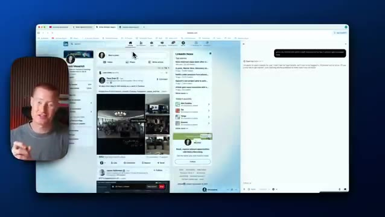
*⏱️ 00:00:09 — Démonstration du navigateur agentique ChatGPT Atlas interagissant automatiquement avec LinkedIn.*

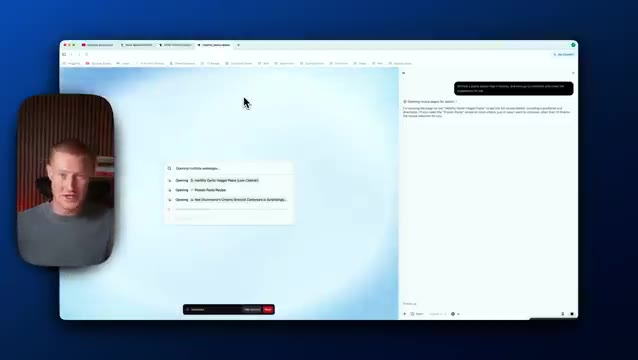
*⏱️ 00:00:17 — Le navigateur agentique effectue des recherches sur le web pour trouver des recettes de pâtes.*

---

### ⏱️ `[00:00:34 - 00:01:09]` | Segment #02

**🔊 Audio (Transcription Intégrale Mot pour Mot en Français) :**
> I'm going to download this live right now to my Mac. Here we go. We have our app. We're going to download this and I'm going to open it up right now. So first of all, it looks like it's asking me to log in with ChatGPT. So let me go ahead and do this. I'm going to click log into ChatGPT. Also guys, I'm trying really hard to get this video as quickly as possible. I'm going to try to get it out within an hour of the actual live stream and the unavailing of this platform. All right, so I logged in. Now what I need to do is actually start importing. So you can see I can actually import this from Google Chrome or Safari, whatever I'm using. So I use Chrome and actually

**👁️ Analyse Visuelle d'Écran (gemini-3.5-flash-lite) :**
**Interface & Outils** : Navigateur web Mac et interface de l'application Atlas.

**Contenu textuel & Code** : Page de présentation de l'application Atlas avec le bouton de connexion "Log in with ChatGPT".

**Action / Démonstration** : Le présentateur s'apprête à cliquer sur le bouton de connexion pour ouvrir l'application sur son Mac.

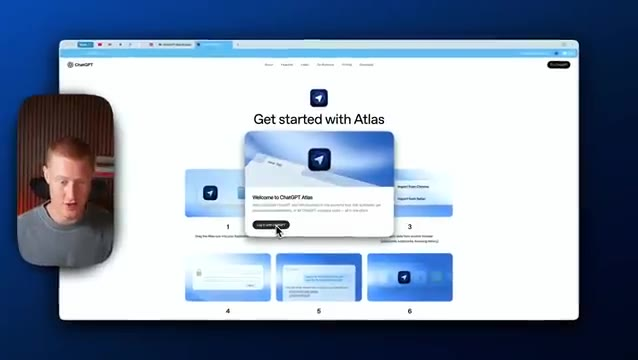
*⏱️ 00:00:43 — Un navigateur web affichant la page de téléchargement "Get started with Atlas", avec une fenêtre pop-up de bienvenue invitant à se connecter avec ChatGPT.*

---

### ⏱️ `[00:01:09 - 00:01:41]` | Segment #03

**🔊 Audio (Transcription Intégrale Mot pour Mot en Français) :**
> actually dia browser. So I'm going to import that right now. I'm going to allow access. It's asking if I want to turn on browser memory. So this will essentially have the ability to search through all of your inquiries that you've had with ChatGPT Atlas. And for the sake of this video, I'm going to turn this on, but that's up to you if you want to actually give them permission to do that. Next, we could ask Chachabiti on any website. I'm going to continue with this, make your cursor a collaborator. Okay. So it's just breaking down all of the features for me to use and boom, just like that. We have Chachabiti Atlas. That whole process took basically about

**👁️ Analyse Visuelle d'Écran (gemini-3.5-flash-lite) :**
**Interface & Outils** : Navigateur web ChatGPT Atlas et assistant vidéo de présentation.

**Contenu textuel & Code** : Menus de configuration initiale, options d'importation et de configuration du navigateur Atlas.

**Action / Démonstration** : Navigation à travers les étapes de configuration et de paramétrage initial de ChatGPT Atlas.

---

### ⏱️ `[00:01:41 - 00:02:17]` | Segment #04

**🔊 Audio (Transcription Intégrale Mot pour Mot en Français) :**
> like two minutes and let me go ahead and play around with this now. So what I'm going to do, let me just ask for it to actually go ahead and find me a recipe. Then I'm going to see if it actually order these ingredients for me using the agent mode which is the really interesting part of this release all right so here we go here's my prompt and this i'm interacting with this just as if it were chachapiti i write in the prompt and you can see it's actually beginning to search right now all right so this all looks good it actually gave me this recipe creamy cottage cheese pasta and veggies let me go ahead and actually tell it to go go and order this for me i'm asking can you go

**👁️ Analyse Visuelle d'Écran (gemini-3.5-flash-lite) :**
**Interface & Outils** : Navigateur web, interface de ChatGPT.

**Contenu textuel & Code** : Texte de prompt demandant une recette saine riche en protéines et réponse générée avec des ingrédients et étapes.

**Action / Démonstration** : Saisie d'une requête textuelle pour obtenir une recette de cuisine via l'interface conversationnelle.

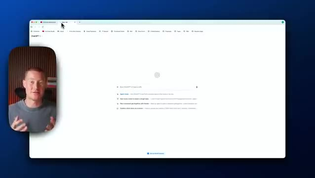
*⏱️ 00:01:50 — Interface principale d'un navigateur avec l'application ChatGPT ouverte.*

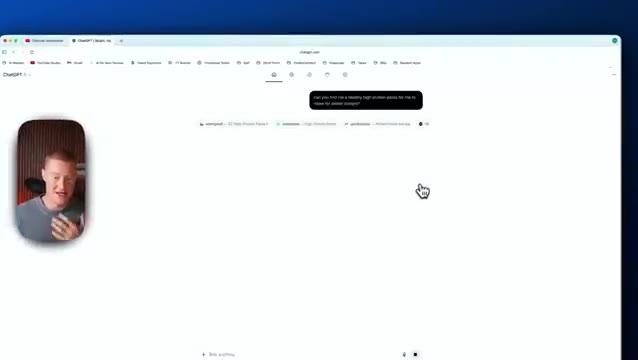
*⏱️ 00:01:59 — Interface de ChatGPT affichant un prompt textuel soumis par l'utilisateur concernant une recette de cuisine.*

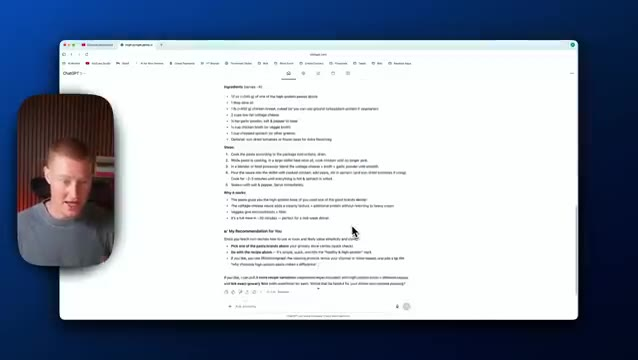
*⏱️ 00:02:08 — Résultat affiché par l'IA détaillant une liste d'ingrédients et des instructions de cuisine.*

---

### ⏱️ `[00:02:17 - 00:02:43]` | Segment #05

**🔊 Audio (Transcription Intégrale Mot pour Mot en Français) :**
> go ahead and order these ingredients for me on Instacart. And I'm just clicking this plus button, clicking on agent mode. And now what it's going to do is it's going to go ahead and actually log into my Instacart account and begin actually adding this to my cart. And I'm going to show you exactly how this works. So I'm getting this message here. So agent mode may introduce risk. So logged in, when logged in, Chachibiki can access your logged in accounts, making it faster to complete tasks.

**👁️ Analyse Visuelle d'Écran (gemini-3.5-flash-lite) :**
**Interface & Outils** : Navigateur web, interface ChatGPT

**Contenu textuel & Code** : Texte de recettes de cuisine, liste d'ingrédients et boîte de dialogue d'avertissement pour le mode agent.

**Action / Démonstration** : Interaction avec l'interface pour activer le mode agent de l'intelligence artificielle afin de commander des ingrédients sur une application externe.

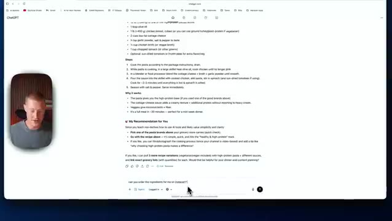
*⏱️ 00:02:23 — L'écran montre une interface de navigateur web avec ChatGPT affichant une liste d'ingrédients et de recettes, avec le présentateur incrusté en médaillon dans le coin inférieur gauche.*

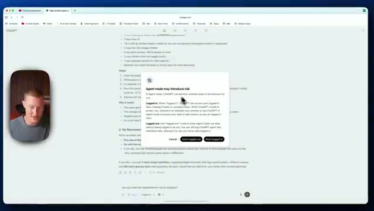
*⏱️ 00:02:37 — L'interface affiche une fenêtre pop-up d'avertissement concernant le mode agent (« Agent mode may introduce risk ») sur ChatGPT, avec des options pour démarrer connecté ou déconnecté.*

---

### ⏱️ `[00:02:43 - 00:03:11]` | Segment #06

**🔊 Audio (Transcription Intégrale Mot pour Mot en Français) :**
> D'accord, c'est donc un préambule que nous essayons de faire en matière de sécurité. Si vous voulez vous connecter à vos comptes, vous pouvez le faire. Sinon, vous pouvez refuser si vous ne voulez pas qu'il ait accès à vos comptes. C'est mon compte Instacart. Je ne m'inquiète pas trop pour la confidentialité ici. Je vais donc procéder et activer ceci. Et juste comme ça, il lance ce flux de travail GenAI où il fait défiler Instacart, clique sur ces différents ingrédients, les ajoute au panier, et il va procéder à la commande pour moi.

**👁️ Analyse Visuelle d'Écran (gemini-3.5-flash-lite) :**
**Interface & Outils** : Présentation ou face-caméra explicatif du trader sans interface logicielle partagée.

**Contenu textuel & Code** : Explications orales des stratégies et mise en contexte méthodologique du marché.

**Action / Démonstration** : Explications face caméra et analyse conceptuelle des marchés.

---

### ⏱️ `[00:03:11 - 00:03:30]` | Segment #07

**🔊 Audio (Transcription Intégrale Mot pour Mot en Français) :**
> recherche tous ces ingrédients. Et une chose que je veux mentionner, c'est que si vous avez déjà utilisé l'agent ChatGPT, il fonctionne de manière très similaire, mais au lieu d'être dans ChatGPT, il est directement intégré ici dans votre navigateur. Très bien, alors pendant que ChatGPT Atlas poursuit et exécute cette tâche, laissez-moi voir si je peux effectivement effectuer une autre tâche pendant que cela se produit.

**👁️ Analyse Visuelle d'Écran (gemini-3.5-flash-lite) :**
**Interface & Outils** : Présentation ou face-caméra explicatif du trader sans interface logicielle partagée.

**Contenu textuel & Code** : Explications orales des stratégies et mise en contexte méthodologique du marché.

**Action / Démonstration** : Explications face caméra et analyse conceptuelle des marchés.

---

### ⏱️ `[00:03:30 - 00:04:05]` | Segment #08

**🔊 Audio (Transcription Intégrale Mot pour Mot en Français) :**
> Cliquez sur Mode Agent. Je vais simplement décrire la tâche que je voulais exécuter. Je veux que tu ailles sur mon LinkedIn et que tu trouves les trois derniers messages que j'ai reçus. Donne-moi un résumé en une phrase de chacun de ces messages. D'accord. Donc, je lui confie cette tâche. Je suis curieux de voir s'il peut réellement ouvrir mon LinkedIn, s'y connecter, et même accéder aux messages que j'ai reçus en naviguant sur mon profil, en ouvrant cet onglet de navigateur ici. Les gars, c'est tellement cool de voir ça en action. Je sais que Perplexity.com fait déjà quelque chose de similaire, mais le fait qu'on puisse avoir un navigateur qui fait défiler l'écran et exécute des tâches pour nous est

**👁️ Analyse Visuelle d'Écran (gemini-3.5-flash-lite) :**
**Interface & Outils** : Navigateur web, interface de ChatGPT (Mode Agent) et site web LinkedIn.

**Contenu textuel & Code** : Interface utilisateur de ChatGPT avec options de prompts et fenêtre de navigateur affichant les publications et le fil d'actualité LinkedIn.

**Action / Démonstration** : Navigation et exécution d'une tâche automatisée d'analyse des messages reçus sur LinkedIn via le mode Agent de ChatGPT.

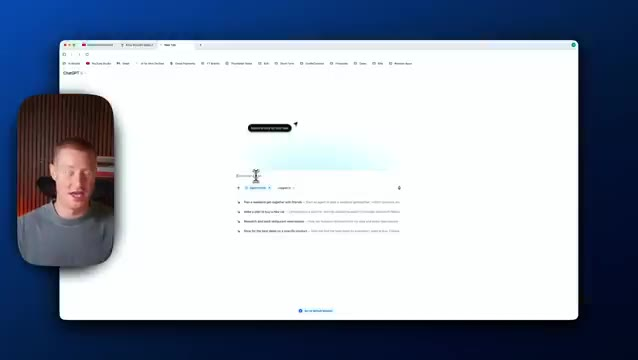
*⏱️ 00:03:39 — Capture montrant le présentateur dans un encadré à gauche et la fenêtre du navigateur affichant l'interface de ChatGPT avec le mode Agent activé.*

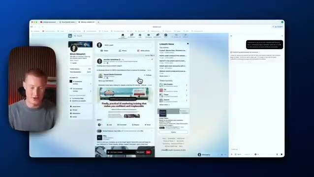
*⏱️ 00:03:56 — Capture montrant le présentateur à gauche et le navigateur affichant le flux d'actualités et le profil LinkedIn de l'utilisateur pendant son utilisation par l'agent IA.*

---

### ⏱️ `[00:04:05 - 00:04:39]` | Segment #09

**🔊 Audio (Transcription Intégrale Mot pour Mot en Français) :**
> assez fou et c'est intégré directement avec ChatGPT maintenant en cliquant sur chacun de ces messages ici les gars c'est vraiment cool boum et juste comme ça vous pouvez voir sur le côté droit il a extrait ces trois derniers messages si je veux ouvrir le menu de ChatGPT je pourrais juste l'ouvrir en plein écran et ensuite je pourrais juste vous savez décrire une autre tâche et il va s'exécuter et le faire donc maintenant que j'ai fait ça laissez-moi retourner sur Instacart et voir s'il a été capable de réellement faire ça pour nous alors nous y voilà tous nos ingrédients sont maintenant ajoutés vous pouvez voir qu'il a même compris combien de livres de poulet ajouter donc 3,25 livres de poulet et je n'ai pas eu besoin de

**👁️ Analyse Visuelle d'Écran (gemini-3.5-flash-lite) :**
**Interface & Outils** : Présentation ou face-caméra explicatif du trader sans interface logicielle partagée.

**Contenu textuel & Code** : Explications orales des stratégies et mise en contexte méthodologique du marché.

**Action / Démonstration** : Explications face caméra et analyse conceptuelle des marchés.

---

### ⏱️ `[00:04:39 - 00:05:02]` | Segment #10

**🔊 Audio (Transcription Intégrale Mot pour Mot en Français) :**
> allez-y et procédez au paiement pour moi, mais je pourrais cliquer sur aller au paiement et fondamentalement mettre mes informations de carte et régler ceci pour moi. Très bien, les gars, maintenant que vous pouvez voir un peu les capacités de ceci, laissez-moi parler de quelque chose à quoi beaucoup de gens pensent probablement, Perplexity Comet. Donc, si vous ne savez pas ce que c'est, c'est fondamentalement le propre navigateur de Perplexity qui fait fondamentalement exactement la même chose que le navigateur de ChatGPT fait.

**👁️ Analyse Visuelle d'Écran (gemini-3.5-flash-lite) :**
**Interface & Outils** : Navigateur web, site e-commerce (Instacart), interface de chat avec assistant IA (ChatGPT).

**Contenu textuel & Code** : Panier d'achats avec des ingrédients de type sportif/nutritionnels (pâtes protéinées, poitrine de poulet, bouillon), liste de courses et messages textuels de l'assistant IA.

**Action / Démonstration** : Navigation et démonstration d'un agent IA interagissant avec un site e-commerce pour ajouter des articles au panier.

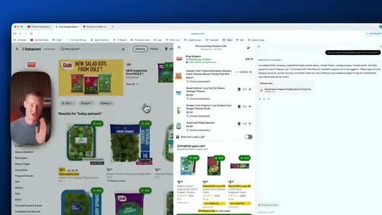
*⏱️ 00:04:45 — Capture d'écran montrant une interface de navigateur web avec un site de courses en ligne (Instacart) divisé en plusieurs panneaux incluant un panier d'achat et une fenêtre de chat avec une IA, tandis que le présentateur apparaît en médaillon.*

---

### ⏱️ `[00:05:03 - 00:05:29]` | Segment #11

**🔊 Audio (Transcription Intégrale Mot pour Mot en Français) :**
> La question qui m'intéresse de découvrir est de savoir lequel est le plus rapide, lequel peut faire plus de choses, et est-ce que ChatGPT Atlas, est-ce que ça a un contexte de mon historique ChatGPT réel quand je vais sur l'application ChatGPT réelle ? Ce sont des choses que je me demande parce que si ça a la capacité d'avoir un contexte sur mes conversations ChatGPT que j'ai, je pense que c'est beaucoup plus précieux que d'utiliser quelque chose comme perplexity.

**👁️ Analyse Visuelle d'Écran (gemini-3.5-flash-lite) :**
**Interface & Outils** : Navigateur web, interface utilisateur ChatGPT, application web d'intelligence artificielle.

**Contenu textuel & Code** : Texte de conversation avec des prompts de cuisine, résumés de messages professionnels, instructions textuelles et blocs de dialogue.

**Action / Démonstration** : Navigation et démonstration d'interactions textuelles avec l'assistant IA dans un navigateur.

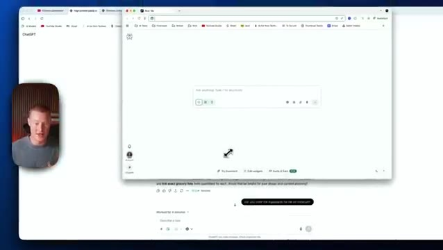
*⏱️ 00:05:09 — Le présentateur affiche une interface de navigateur web avec une fenêtre d'application ChatGPT active.*

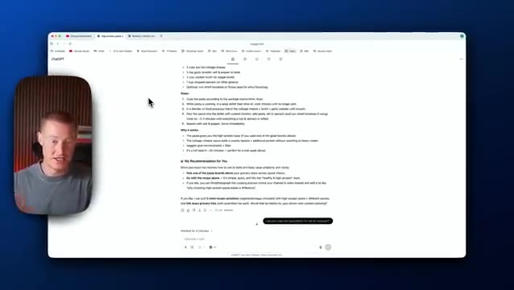
*⏱️ 00:05:16 — L'interface montre une réponse générée par ChatGPT avec une liste d'ingrédients de cuisine et des recommandations.*

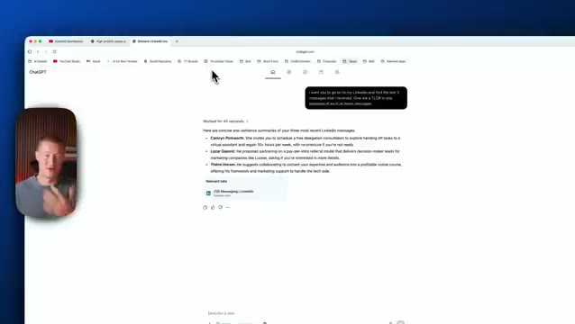
*⏱️ 00:05:22 — L'écran présente une interaction avec un assistant textuel analysant les messages récents d'un réseau professionnel.*

---

### ⏱️ `[00:05:29 - 00:05:55]` | Segment #12

**🔊 Audio (Transcription Intégrale Mot pour Mot en Français) :**
> Let me say, what is my last video idea I had because I was actually brainstorming with ChatGPT. Boom, okay, so this does have full context on me. So this is very interesting. The fact that I'm able to integrate this with all of my ChatGPT memory, this is gonna be really impactful for me to use. So right now, I've actually been using something called Dia Browser, which has similar capabilities.

**👁️ Analyse Visuelle d'Écran (gemini-3.5-flash-lite) :**
**Interface & Outils** : Navigateur Web / Interface ChatGPT

**Contenu textuel & Code** : Texte généré par l'IA faisant référence au "ChatGPT Atlas Browser" et aux idées de vidéos récentes du créateur.

**Action / Démonstration** : Le présentateur commente l'intégration de ChatGPT avec son historique et ses mémoires pour générer des idées de contenu.

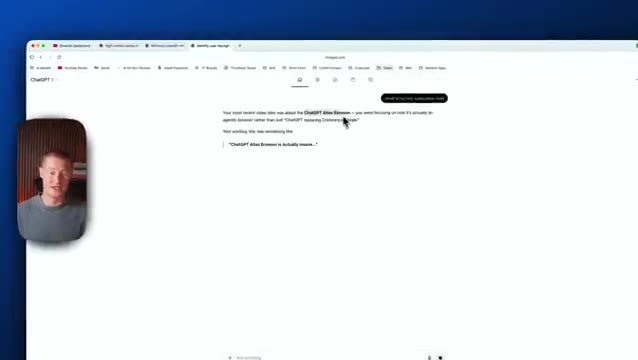
*⏱️ 00:05:35 — Capture d'écran montrant le navigateur avec l'interface de ChatGPT affichant les résultats d'une recherche sur les idées de vidéos du présentateur.*

---

### ⏱️ `[00:05:55 - 00:06:16]` | Segment #13

**🔊 Audio (Transcription Intégrale Mot pour Mot en Français) :**
> You could see I could pull up this chat window. It has access to any of my tabs that I have open, but I do think I'm gonna transition to Chachapiti Atlas to at least try it out and see how it works for myself. So guys, I know this video might've been all over the place. I just wanted to make a video as quickly as I could so you guys could get a breakdown on the new Chachapiti Atlas agentic browser.

**👁️ Analyse Visuelle d'Écran (gemini-3.5-flash-lite) :**
**Interface & Outils** : Navigateur web, site internet de ChatGPT Atlas, encart vidéo du présentateur.

**Contenu textuel & Code** : Page web présentant les étapes d'installation et d'utilisation de ChatGPT Atlas (tutoriel visuel en 6 étapes).

**Action / Démonstration** : Le présentateur navigue sur la page web pour expliquer les fonctionnalités du logiciel et montrer comment l'installer.

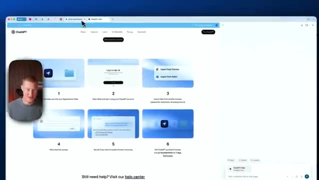
*⏱️ 00:06:00 — Vue d'ensemble du navigateur affichant le site de ChatGPT Atlas, avec le présentateur en médaillon à gauche.*

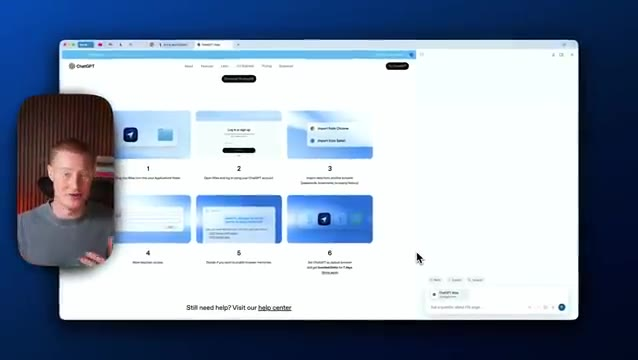
*⏱️ 00:06:05 — Poursuite de la présentation de ChatGPT Atlas avec le curseur de la souris visible et le présentateur en médaillon.*

---

### ⏱️ `[00:06:16 - 00:06:25]` | Segment #14

**🔊 Audio (Transcription Intégrale Mot pour Mot en Français) :**
> Donc j'espère que vous avez tiré de la valeur de ceci. Dites-moi ce que vous en pensez dans les commentaires ci-dessous. Est-ce que ça va remplacer Google Chrome pour vous ? Mais merci d'être restés jusqu'à la fin et je vous vois les gars dans la prochaine vidéo.

**👁️ Analyse Visuelle d'Écran (gemini-3.5-flash-lite) :**
**Interface & Outils** : Navigateur web affichant une page de téléchargement et d'installation avec un guide visuel en six étapes.

**Contenu textuel & Code** : Instructions d'installation illustrées par des vignettes numérotées (glisser l'application, connexion, import des données, raccourcis, paramètres et définition comme navigateur par défaut).

**Action / Démonstration** : Présentation des étapes de configuration et de téléchargement du nouveau navigateur pour conclure la vidéo.

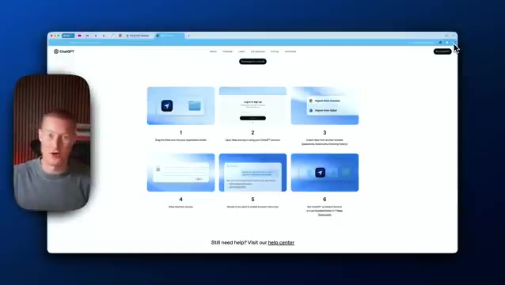
*⏱️ 00:06:18 — Capture d'écran montrant le site web de téléchargement d'un navigateur web avec des instructions étape par étape numérotées de 1 à 6, et une vignette vidéo incrustée du présentateur sur le côté gauche.*

---

