# 🎬 Did Claude Code Web Just Replace Vibe Coders?

> **Chaîne** : [Brock Mesarich | AI for Non Techies](https://www.youtube.com/@BrockMesarich)  
> **Lien YouTube** : [https://www.youtube.com/watch?v=3LvyPq7zWBM](https://www.youtube.com/watch?v=3LvyPq7zWBM)  
> **Date de publication** : 20251022  
> **Durée** : 00:07:59  
> **Identifiant vidéo** : `3LvyPq7zWBM`  
> **Transcription & Analyse** : `whisper-v3-large-turbo+gemini-3.5-flash-lite`  

---

## 📌 Synthèse Exécutive & Outils

### 💡 Résumé

La sortie récente de Claude Code pour le web suscite un engouement massif au sein de la communauté technologique, présentée par beaucoup comme la nouvelle frontière du « vibe coding ». Toutefois, en tant qu'analyste et utilisateur axé sur l'efficacité opérationnelle pour les non-techniciens, l'évaluation de cet outil révèle un gouffre critique entre la génération de code brute et le déploiement applicatif réel. Alors que des plateformes orientées grand public permettent de passer instantanément d'une simple invite textuelle à une application web interactive dotée d'API fonctionnelles et d'une URL partageable, Claude Code pour le web impose des frictions techniques majeures, notamment l'obligation de passer par des dépôts GitHub et l'absence de prévisualisation en temps réel (live preview). 

Pour un profil non technique ou un opérateur cherchant à automatiser rapidement des flux et des interfaces sans manipuler de terminaux complexes, cette barrière à l'entrée pénalise la productivité. La vidéo décortique précisément ce fossé en comparant l'approche native de Claude Code à des solutions hybrides de nouvelle génération comme Bolt.new (notamment sa version V2 intégrant directement les agents Claude). Ces plateformes conjuguent la puissance brute des modèles de pointe sous le capot avec une ergonomie simplifiée, autorisant la création, le test et la publication d'applications en un seul clic, sans jamais quitter le navigateur web.

Au-delà de l'effet de mode autour des interfaces de développement avancées, la stratégie gagnante en matière de no-code et de vibe coding réside dans l'abstraction de la complexité infrastructurelle. Si Claude Code brille par sa capacité à orchestrer des agents multiples exécutant des tâches parallèles et par son accessibilité sur mobile pour coder en déplacement, l'absence de boucle de rétroaction visuelle immédiate et de pipeline de publication intégré en fait un outil encore inadapté pour un prototypage rapide et itératif par rapport à des environnements intégrés clés en main.

### 🛠️ Outils, Modèles & Logiciels Présentés

* **Claude Code / Claude (Anthropic)** : Modèle et interface de pointe offrant désormais une version web et mobile permettant d'écrire du code et d'orchestrer des agents multiples directement depuis le navigateur.
* **Bolt.new (dont Bolt V2)** : Plateforme de référence pour le vibe coding intégrant nativement l'agent Claude, permettant de générer, prévisualiser et publier des applications web fonctionnelles en un clic à partir de simples prompts textuels.
* **Lovable** : Alternative populaire de vibe coding axée sur la simplicité d'utilisation pour les non-techniciens afin de concevoir des applications web interactives de zéro.
* **GitHub** : Plateforme de gestion de code source et de stockage de dépôts (repositories), indispensable pour connecter et sauvegarder le code généré via des outils de développement avancés comme Claude Code.
* **Gemini (Google)** : Modèle d'intelligence artificielle multimodal utilisé via des API intégrées pour des fonctionnalités dynamiques au sein des applications (ex. génération d'images).
* **ChatGPT (OpenAI)** : Modèle conversationnel de référence servant de étalon pour l'ergonomie des interfaces textuelles intuitives.
* **Grok** : Modèle conversationnel et agent textuel évoqué dans l'écosystème global des IAs génératives.
* **n8n & Make** : Outils d'automatisation de workflows et de connexion d'API (mentionnés dans le positionnement global de la chaîne axée sur l'automatisation).
* **Zapier** : Plateforme pionnière d'automatisation et d'intégration de services cloud.
* **Cursor** : Environnement de développement orienté « developer vibe coding » destiné aux utilisateurs techniques pour concevoir des logiciels de niveau professionnel.

### 🔑 Points Clés & Enseignements Stratégiques

* **La fracture du « Vibe Coding »** : Distinction fondamentale entre le *consumer vibe coding* (Bolt, Lovable), conçu pour les non-techniciens avec une interface ultra-simple et des résultats visuels immédiats, et le *developer vibe coding* (Cursor, Claude Code), qui nécessite des compétences en gestion de code et rebute les utilisateurs non techniques.
* **Le piège fonctionnel de Claude Code pour le Web** : Bien que puissant pour générer du code brut, l'outil souffre de l'absence totale de prévisualisation en temps réel et de pipeline de publication intégré, obligeant l'utilisateur à jongler avec des terminaux et des dépôts GitHub.
* **La supériorité des solutions hybrides (Bolt V2)** : L'intégration directe des agents Claude au sein de plateformes ergonomiques comme Bolt combine la puissance de calcul des meilleurs modèles avec une interface simplifiée, maximisant l'utilité pour les créateurs non techniques.
* **L'expérience utilisateur de bout en bout** : Une stratégie de développement efficace par IA ne se limite pas à la génération de code, elle englobe obligatoirement le test interactif (live sandbox) et le déploiement instantané (publication d'une URL fonctionnelle).
* **Gestion des intégrations d'API** : Capacité démontrée à intégrer nativement des services tiers complexes (comme la génération d'images via Gemini) dans une application fonctionnelle à partir d'un simple prompt textuel.
* **Collaboration multi-agents** : Avantage technique notable de Claude Code permettant d'exécuter des tâches en parallèle via plusieurs agents travaillant simultanément sur différentes parties de l'application.
* **Mobilité et flexibilité** : L'utilisation de Claude Code via l'application mobile permet de coder « en déplacement », bien que cette approche reste limitée par l'impossibilité de visualiser et de lancer l'application directement depuis l'appareil mobile.
* **Immortalisation et partage du code** : Utilisation de GitHub comme référentiel central de stockage, passage obligé pour structurer et versionner les projets issus des agents de codage avancés.
* **Personnalisation des déploiements** : Possibilité de basculer des URL générées automatiquement par la plateforme vers des domaines personnalisés (custom domains) pour professionnaliser le rendu final.
* **Arbitrage entre puissance brute et ergonomie** : Pour un opérateur non technique, le choix d'un outil doit se porter sur le ratio « temps de mise sur le marché / complexité technique » ; les interfaces unifiant génération, test et hébergement l'emportent systématiquement sur les environnements éclatés.

---

## ⏱️ Chronologie & Transcription Complète Audio & Visuelle (Mot pour Mot)

### ⏱️ `[00:00:00 - 00:00:26]` | Segment #01

**🔊 Audio (Transcription Intégrale Mot pour Mot en Français) :**
> Cloud Code pour le web vient de sortir, ce qui signifie que vous pouvez désormais utiliser Cloud Code directement dans leur application web, et tout le monde qualifie cela de futur du codage. Mais après l'avoir réellement testé, il y a quelque chose dont personne ne parle. Oui, c'est puissant. Vous pouvez créer de vraies applications directement dans Cloud sans terminal comme avant. Mais une fois que vous essayez réellement de lancer ou de prévisualiser votre application, vous vous rendez compte qu'il y a un piège énorme. Dans cette vidéo, je vais vous montrer ce que c'est, et je vais vous montrer une alternative dont personne ne parle. Passons donc aux choses sérieuses.

**👁️ Analyse Visuelle d'Écran (gemini-3.5-flash-lite) :**
**Interface & Outils** : Interface web de Claude Code (claude.ai/code) et interface de transition vidéo.

**Contenu textuel & Code** : Commandes Bash (npm run lint, npm run test, git add/commit/push), rapports de build (erreurs: 0, avertissements: 2), et options de création de pull request.

**Action / Démonstration** : Navigation et démonstration de la génération de code, exécution de tests et préparation d'une pull request via l'interface web de Claude Code.

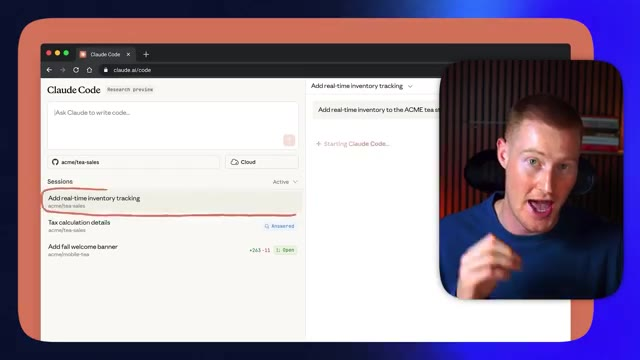
*⏱️ 00:00:06 — Interface web de Claude Code montrant une session active pour l'ajout d'un suivi de stock en temps réel sur le dépôt GitHub acme/tea-sales, avec le présentateur incrusté à droite.*

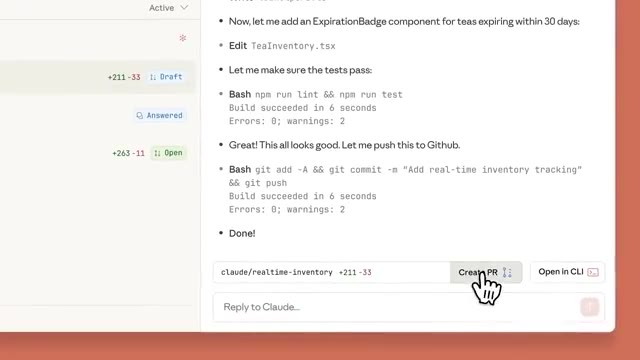
*⏱️ 00:00:13 — Détail du code et des commandes Bash exécutées par Claude Code (npm run lint, git commit), avec le curseur cliquant sur le bouton 'Create PR'.*

---

### ⏱️ `[00:00:26 - 00:00:52]` | Segment #02

**🔊 Audio (Transcription Intégrale Mot pour Mot en Français) :**
> Très bien, les amis, avant de vous montrer concrètement Cloud Code pour le Web et le mobile en action, nous devons aborder quelques sujets. Je veux d'abord parler du « vibe coding » traditionnel. Pensez à des plateformes comme Bolt.new et Lovable. Ces deux plateformes ont révolutionné la façon dont nous créons des applications en tant que non-techniciens. Et cette vidéo va vraiment s'adresser à ces personnes non techniques qui veulent créer des applications entièrement fonctionnelles à partir de zéro, simplement en écrivant des invites textuelles avec des plateformes comme Bolt, Lovable et Cloud Code.

**👁️ Analyse Visuelle d'Écran (gemini-3.5-flash-lite) :**
**Interface & Outils** : Navigateur web affichant un tableau blanc collaboratif (type Miro/Eraser) avec des captures de Bolt.new et Lovable.

**Contenu textuel & Code** : Texte « Traditional Vibe Coding » et captures d'écran des interfaces des plateformes Bolt.new et Lovable.

**Action / Démonstration** : Présentation visuelle des outils de vibe coding par le présentateur.

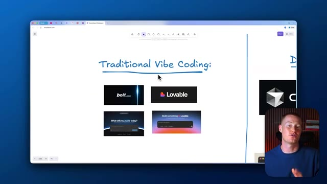
*⏱️ 00:00:33 — Vue d'ensemble du tableau blanc montrant le titre « Traditional Vibe Coding » et les logos des plateformes Bolt.new et Lovable, avec le présentateur en bas à droite.*

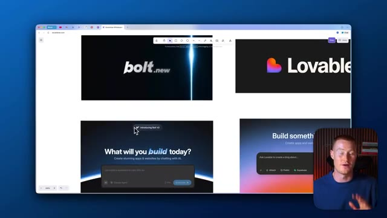
*⏱️ 00:00:39 — Gros plan sur le tableau blanc centré sur les interfaces de Bolt.new et Lovable présentées pour illustrer le vibe coding traditionnel.*

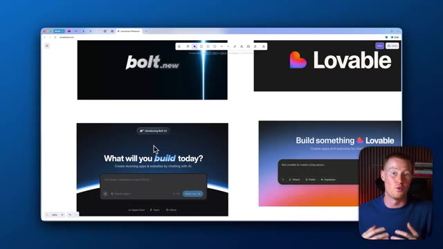
*⏱️ 00:00:46 — Vue rapprochée similaire de l'interface du tableau blanc montrant les illustrations des plateformes de développement assisté par IA.*

---

### ⏱️ `[00:00:52 - 00:01:23]` | Segment #03

**🔊 Audio (Transcription Intégrale Mot pour Mot en Français) :**
> Donc nous avions évidemment cette interface utilisateur qui était extrêmement simple. C'était comme ChatGPT. Nous tapons simplement un message textuel et cela commence réellement à construire notre application pour nous à partir de zéro. Non seulement cela construira notre application, écrira le code, mais cela nous montrera un aperçu de ce à quoi notre application va réellement ressembler. Par exemple, cette application a été construite dans Bolt.new en quelques messages textuels et elle a réellement des API intégrées pour que nous puissions réellement générer des images avec l'outil de génération d'images Gemini et cela s'est transformé en une application web fonctionnelle que nous pouvions réellement utiliser directement à l'intérieur de notre plateforme.

**👁️ Analyse Visuelle d'Écran (gemini-3.5-flash-lite) :**
**Interface & Outils** : Navigateur web affichant une plateforme de développement d'applications assistée par IA (style Lovable/Bolt).

**Contenu textuel & Code** : Zone de saisie textuelle (prompt) pour créer des applications ou des sites web par simple discussion avec l'IA.

**Action / Démonstration** : Présentation de l'interface utilisateur textuelle permettant de générer une application à partir de zéro.

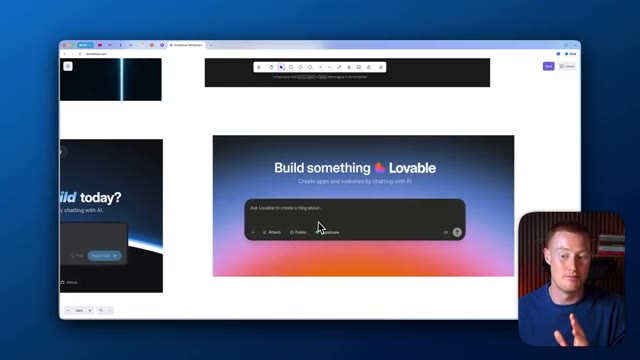
*⏱️ 00:01:00 — Interface web montrant un outil de création d'applications par IA avec une boîte de texte de type "chat".*

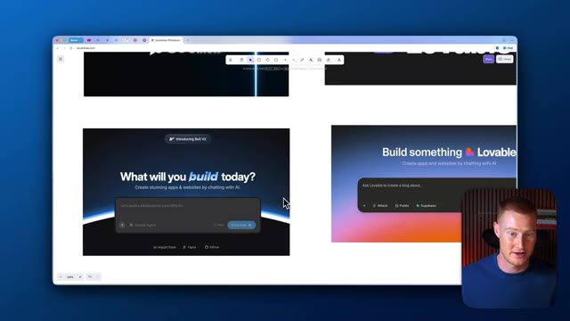
*⏱️ 00:01:07 — Interface similaire montrant une interface de génération d'applications avec un champ de saisie de prompt.*

---

### ⏱️ `[00:01:23 - 00:01:41]` | Segment #04

**🔊 Audio (Transcription Intégrale Mot pour Mot en Français) :**
> Non seulement cela, mais nous pourrions réellement cliquer sur publier, et ensuite nous pourrions effectivement aller de l'avant et partager ceci sous forme d'URL à des amis afin qu'ils puissent commencer à l'utiliser. Et nous faisons tout cela avec zéro expérience en codage. C'est donc ainsi que ces plateformes fonctionnent, Bolt et Lovable, c'est ainsi qu'elles fonctionnent. Mais passons à la phase suivante du vibe coding. Et cette phase s'appelle le developer vibe coding.

**👁️ Analyse Visuelle d'Écran (gemini-3.5-flash-lite) :**
**Interface & Outils** : Navigateur web affichant le tableau blanc Excalidraw (bolt.new, Lovable, Cursor, Claude Code).

**Contenu textuel & Code** : Logos et interfaces d'outils de développement assistés par IA (bolt.new, Lovable, Cursor, Claude Code).

**Action / Démonstration** : Présentation visuelle des différents outils de développement par IA sur un tableau blanc numérique.

---

### ⏱️ `[00:01:42 - 00:02:03]` | Segment #05

**🔊 Audio (Transcription Intégrale Mot pour Mot en Français) :**
> Et ce sont des plateformes comme Cursor et Cloud Code, dont je vais parler dans cette vidéo. Et si vous avez déjà utilisé ça auparavant et que vous n'êtes pas technique, vous voyez probablement ça et ça vous donne probablement envie de vomir. Personnellement, je suis un utilisateur d'IA non technique, je n'ai aucune idée de comment utiliser un truc comme ça. Regarder ça me fait juste peur, honnêtement, parce que, je veux dire, on dirait qu'il faut être un programmeur pour vraiment comprendre et utiliser ça.

**👁️ Analyse Visuelle d'Écran (gemini-3.5-flash-lite) :**
**Interface & Outils** : Éditeur de code Cursor, interface web de whiteboard/documentation.

**Contenu textuel & Code** : Code source en cours d'édition (Rust), interface de chat avec l'assistant IA et modifications proposées.

**Action / Démonstration** : Présentation des outils de développement assistés par IA (Cursor) pour les non-techniciens.

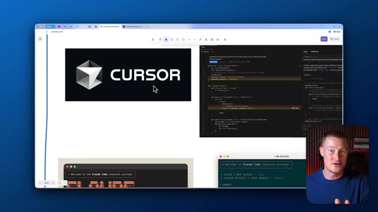
*⏱️ 00:01:47 — Capture montrant le logo Cursor et l'interface de l'éditeur de code, avec le présentateur en bas à droite.*

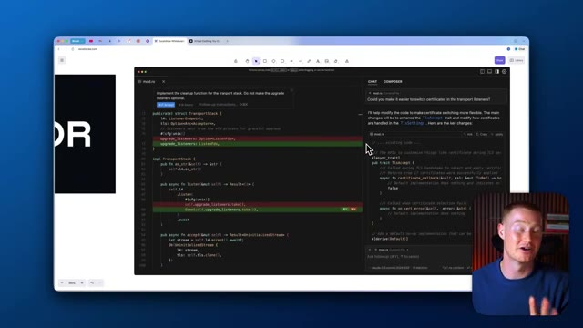
*⏱️ 00:01:58 — Capture montrant l'interface de l'éditeur de code Cursor avec un panneau de chat IA et du code source, et le présentateur en bas à droite.*

---

### ⏱️ `[00:02:03 - 00:02:23]` | Segment #06

**🔊 Audio (Transcription Intégrale Mot pour Mot en Français) :**
> Donc ces plateformes juste ici pourraient réellement vous aider à créer des applications pleinement fonctionnelles. Je parle de logiciels de niveau professionnel qui pourraient être déployés auprès de milliers et de dizaines de milliers d'utilisateurs, ce que des plateformes comme Bolt et Lovable auparavant n'étaient pas vraiment capables de faire. C'est la même chose pour Cloud Code. Cloud Code a complètement pris le monde d'assaut, mais c'est vraiment principalement destiné aux personnes techniques.

**👁️ Analyse Visuelle d'Écran (gemini-3.5-flash-lite) :**
**Interface & Outils** : Navigateur web affichant un tableau blanc, éditeur de code Cursor, et terminal Claude Code.

**Contenu textuel & Code** : Texte "Developer Vibe Coding", logo de l'éditeur Cursor, interface de l'outil Claude Code et lignes de commandes Git.
[DESC_ACTION] Présentation des outils de développement assistés par IA et de programmation au clavier.

**Action / Démonstration** : Explications face caméra et analyse conceptuelle des marchés.

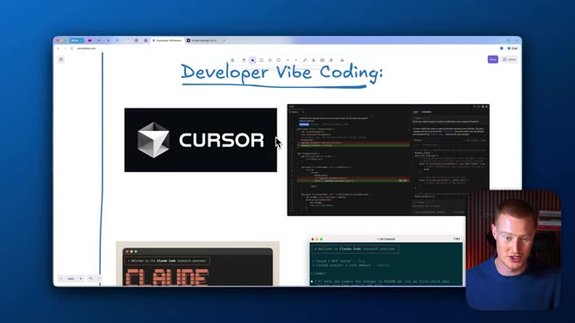
*⏱️ 00:02:08 — Capture d'écran montrant une interface de tableau blanc avec le titre "Developer Vibe Coding", le logo Cursor et des fenêtres de code.*

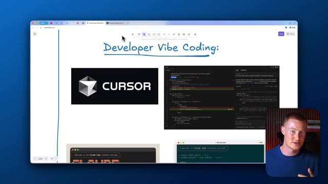
*⏱️ 00:02:13 — Capture d'écran identique à la précédente montrant le tableau blanc, le logo Cursor et l'éditeur de code.*

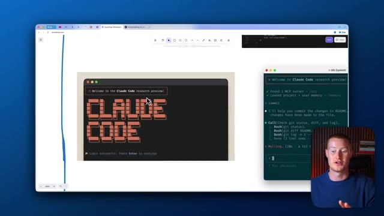
*⏱️ 00:02:18 — Capture d'écran montrant un zoom sur l'interface de Claude Code et un terminal Git Commit.*

---

### ⏱️ `[00:02:23 - 00:02:44]` | Segment #07

**🔊 Audio (Transcription Intégrale Mot pour Mot en Français) :**
> Si vous voulez utiliser Cloud Code, vous devez comprendre ce que sont des choses comme les dépôts GitHub. Ce sont fondamentalement des endroits où vous pouvez réellement prendre votre code, le stocker, et ensuite vous pouvez faire ce que vous voulez avec ce code à partir de là. Mais passons maintenant au futur du Vibe coding dont tout le monde parle désormais. Donc, voici Claude code sur le web. Cela signifie fondamentalement qu'à l'intérieur de Claude, vous pouvez venir directement sur Claude.

**👁️ Analyse Visuelle d'Écran (gemini-3.5-flash-lite) :**
**Interface & Outils** : Navigateur web affichant un outil de tableau blanc collaboratif (Eraser.io).

**Contenu textuel & Code** : Diagrammes visuels, illustrations et notes textuelles liées à "Claude Code on the web" et au "Future of Vibe Coding".
[DESC_IMAGE_1] (Voir l'image 1)
[DESC_IMAGE_2] (Voir l'image 2)
[DESC_IMAGE_3] (Voir l'image 3)

**Action / Démonstration** : Le présentateur explique les concepts liés au code et aux outils cloud en s'appuyant sur les schémas affichés à l'écran.

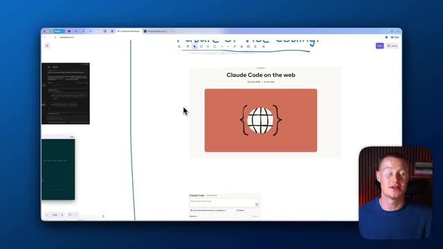
*⏱️ 00:02:33 — Une vue d'écran d'un tableau blanc virtuel (Eraser.io) montrant une page intitulée "Future of Vibe Coding" avec une illustration sur "Claude Code on the web", et le présentateur visible en incrustation dans le coin inférieur droit.*

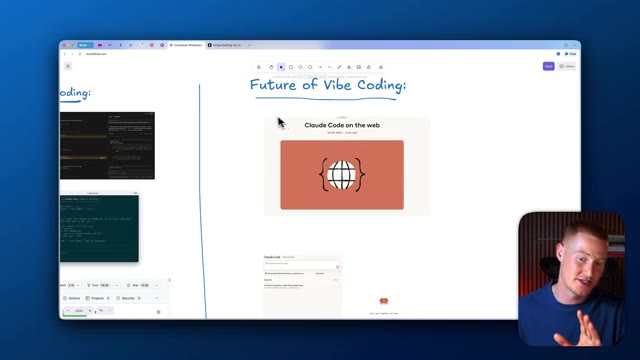
*⏱️ 00:02:39 — Une vue similaire du tableau blanc virtuel montrant le titre "Future of Vibe Coding" et des aperçus de code ou d'interface sur le côté gauche, avec le présentateur en incrustation en bas à droite.*

---

### ⏱️ `[00:02:44 - 00:03:04]` | Segment #08

**🔊 Audio (Transcription Intégrale Mot pour Mot en Français) :**
> Et directement à l'intérieur de ceci, vous pouvez instantanément cliquer sur ce bouton de code, et cela va ouvrir cette fenêtre de code Claude. Donc au lieu que nous ayons réellement à utiliser Cloud Code directement à l'intérieur de nos terminaux comme ça, genre vous ne voulez pas faire ça. Croyez-moi, si vous n'êtes pas technique, c'est un endroit effrayant où se trouver. Au lieu de cela, vous pouvez désormais y accéder directement à l'intérieur de votre application à l'intérieur de Cloud.

**👁️ Analyse Visuelle d'Écran (gemini-3.5-flash-lite) :**
**Interface & Outils** : Navigateur web, interface Claude Code, tableau blanc Excalidraw, dépôt GitHub.

**Contenu textuel & Code** : Interface utilisateur de Claude Code sur le web, extraits de code, interface de terminal et documentation GitHub.

**Action / Démonstration** : Présentation de l'interface web de Claude Code et explication de son utilisation par rapport au terminal.

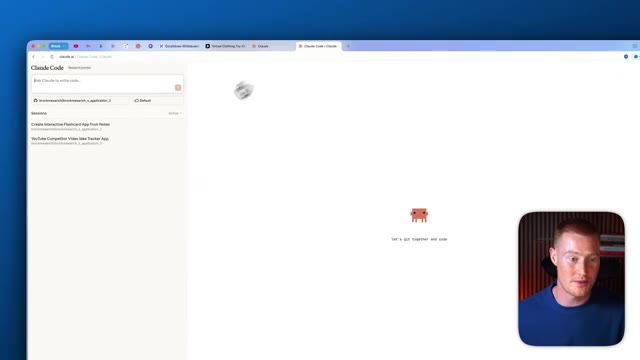
*⏱️ 00:02:49 — Interface web de Claude montrant un espace de travail de code et une zone de saisie.*

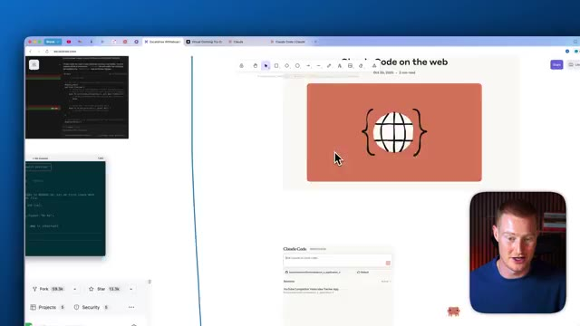
*⏱️ 00:02:54 — Tableau blanc virtuel affichant une illustration « Claude Code on the web » et des aperçus de code.*

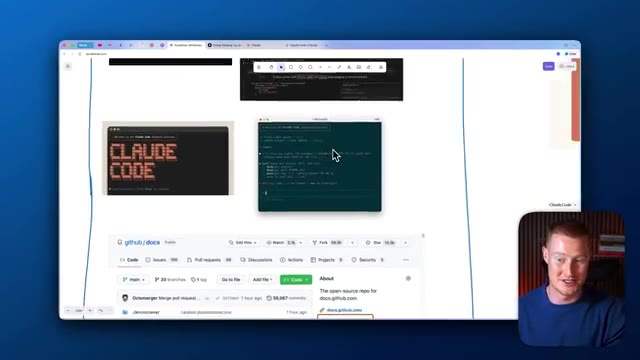
*⏱️ 00:02:59 — Tableau blanc virtuel avec des fenêtres de terminal, un dépôt GitHub et une illustration de Claude Code.*

---

### ⏱️ `[00:03:04 - 00:03:25]` | Segment #09

**🔊 Audio (Transcription Intégrale Mot pour Mot en Français) :**
> Donc maintenant, je vais parler de la façon d'utiliser ceci. Et je vais en fait comparer cela à Bolt afin que nous puissions voir lequel est le meilleur. Très bien. Alors, première chose à faire, à l'intérieur de Cloud Code, il y a quelque chose que nous devons faire. Nous devons en fait connecter ceci à GitHub. Donc si vous ne savez pas ce qu'est GitHub, GitHub est, encore une fois, fondamentalement un endroit où vous pouvez stocker tout votre code dans un dépôt. Et si vous n'êtes pas technique, cela peut être un petit peu un casse-tête.

**👁️ Analyse Visuelle d'Écran (gemini-3.5-flash-lite) :**
**Interface & Outils** : Présentation ou face-caméra explicatif du trader sans interface logicielle partagée.

**Contenu textuel & Code** : Explications orales des stratégies et mise en contexte méthodologique du marché.

**Action / Démonstration** : Explications face caméra et analyse conceptuelle des marchés.

---

### ⏱️ `[00:03:25 - 00:03:49]` | Segment #10

**🔊 Audio (Transcription Intégrale Mot pour Mot en Français) :**
> So let me go ahead and do this now. I'm going to click on Install App. I need to confirm my account. I'm going to click on this. And then we'll have our account all hooked up inside of Cloud Code. And you can see I could actually click on this. And this is a previous GitHub repository, which is basically where all of my code is stored that Cloud Code actually wrote. So what I'm going to do now is let me give a prompt to actually build an app and code something from scratch for both of these platforms.

**👁️ Analyse Visuelle d'Écran (gemini-3.5-flash-lite) :**
**Interface & Outils** : Présentation ou face-caméra explicatif du trader sans interface logicielle partagée.

**Contenu textuel & Code** : Explications orales des stratégies et mise en contexte méthodologique du marché.

**Action / Démonstration** : Explications face caméra et analyse conceptuelle des marchés.

---

### ⏱️ `[00:03:49 - 00:04:13]` | Segment #11

**🔊 Audio (Transcription Intégrale Mot pour Mot en Français) :**
> Donc le prompt que je vais utiliser est : « Crée-moi une application de cartes mémoire qui m'aide à faire un vidage cérébral de toutes mes notes, puis tu les transformes en cartes mémoire interactives. » Je vais confier cela à Bolt V2 et je vais également le confier à Claude Code, et voyons quelles sont ces principales différences ici. Pendant que ceux-ci se chargent, je veux en fait parler de quelque chose qui est vraiment important. Donc Bolt V2 vient de sortir il y a quelques semaines, et cela intègre en fait Claude Code directement dans leur plateforme.

**👁️ Analyse Visuelle d'Écran (gemini-3.5-flash-lite) :**
**Interface & Outils** : Présentation ou face-caméra explicatif du trader sans interface logicielle partagée.

**Contenu textuel & Code** : Explications orales des stratégies et mise en contexte méthodologique du marché.

**Action / Démonstration** : Explications face caméra et analyse conceptuelle des marchés.

---

### ⏱️ `[00:04:13 - 00:04:32]` | Segment #12

**🔊 Audio (Transcription Intégrale Mot pour Mot en Français) :**
> Think of most of the abilities that Cloud Code has independently and combine that with something that is very simple to use and has a simple interface like Bolt. And those two things collide. And that is exactly what we're looking at right now inside of Bolt 2. So we have our Cloud Agent here, which should be able to do most of the heavy lifting that Cloud Code could usually do.

**👁️ Analyse Visuelle d'Écran (gemini-3.5-flash-lite) :**
**Interface & Outils** : Navigateur web avec l'interface de développement Bolt (Bolt.new) et une incrustation vidéo du présentateur.

**Contenu textuel & Code** : Prompt utilisateur demandant de créer une application de flashcards ('build me a flashcard app...'), plan de développement étape par étape incluant la configuration de la base de données et des dépendances npm.

**Action / Démonstration** : Sélection de l'option 'Claude Agent' dans le menu contextuel de l'interface Bolt pour configurer l'agent de programmation IA.

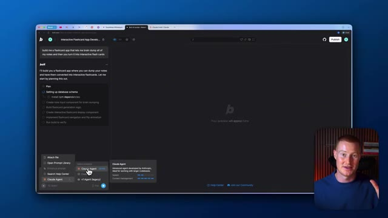
*⏱️ 00:04:18 — Interface du générateur Bolt montrant la sélection du mode 'Claude Agent' dans les options, avec une liste de tâches de développement en cours de génération à gauche.*

---

### ⏱️ `[00:04:32 - 00:04:53]` | Segment #13

**🔊 Audio (Transcription Intégrale Mot pour Mot en Français) :**
> All right. So we have Cloud Code on the left and we have Bolt on the right. You can see Bolt is planning this out. It's going ahead. It's actually building out our project now. And same thing for Cloud Code. It's going ahead. It's writing all this code here. And both of these should be done here shortly. All right. So inside of Bolt, you can see we now have this interface called Brain Dump Flashcards. And I don't want to focus on the complexity or the style of our apps in this video.

**👁️ Analyse Visuelle d'Écran (gemini-3.5-flash-lite) :**
**Interface & Outils** : Interfaces de développement Cloud Code et Bolt.new (StackBlitz).

**Contenu textuel & Code** : Plan de développement d'application ("Plan"), listes de tâches ("Update Todos"), code source et aperçu visuel d'une application de notes interactives.

**Action / Démonstration** : Génération automatique de code et construction d'une application fonctionnelle par les deux agents IA en parallèle.

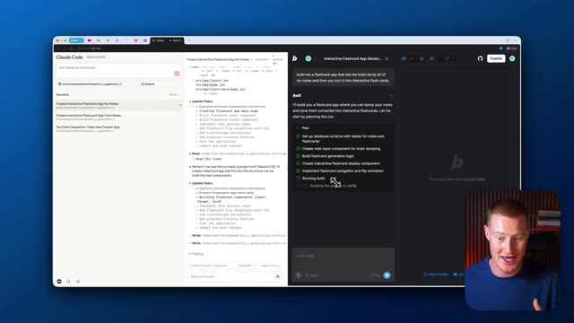
*⏱️ 00:04:37 — Vue côte à côte montrant Cloud Code à gauche et l'outil Bolt à droite en train de planifier et coder un projet de flashcards.*

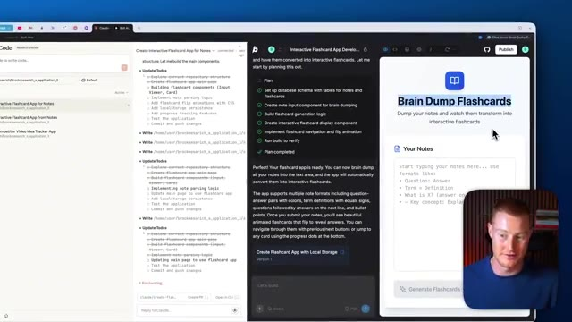
*⏱️ 00:04:48 — Aperçu de l'application de flashcards terminée ("Brain Dump Flashcards") générée et affichée dans Bolt à droite, avec Cloud Code toujours actif à gauche.*

---

### ⏱️ `[00:04:53 - 00:05:27]` | Segment #14

**🔊 Audio (Transcription Intégrale Mot pour Mot en Français) :**
> Je veux simplement parler de l'infrastructure qui fait fonctionner ces deux plateformes et les comparer. C'est une application très simple. Je tiens à le préciser. Mais je vais en fait procéder et coller mes notes que j'ai prises de l'IA ici. Et ce que je vais faire, c'est que je vais cliquer sur générer des cartes mémos et instantanément comme ça, nous avons ces cartes mémos générées. Notre application fonctionne correctement. Nous avons tout cela directement ici. Et ce que nous pouvons réellement faire si nous le voulons, c'est que nous pouvons cliquer sur ce bouton publier et cela va instantanément publier notre application sur le web avec laquelle nous pourrions réellement commencer à interagir. Et juste comme ça, nous avons notre application sur cette URL ici. Nous pouvons personnaliser cette URL directement à l'intérieur de Bolt.

**👁️ Analyse Visuelle d'Écran (gemini-3.5-flash-lite) :**
**Interface & Outils** : Bolt.new et Claude Code affichés simultanément en double écran de développement.

**Contenu textuel & Code** : Interface utilisateur d'application de flashcards, listes de tâches de développement ("Update Todos"), et code de génération de flashcards.

**Action / Démonstration** : Navigation et tests de l'application interactive de flashcards générée par l'IA avant publication.

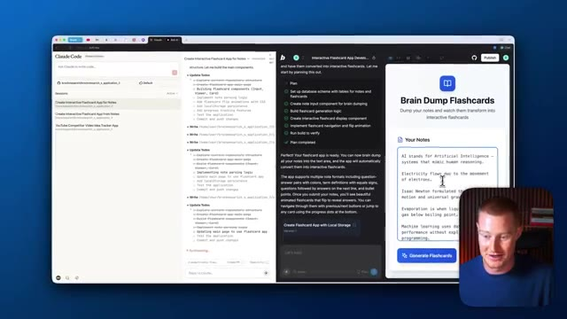
*⏱️ 00:05:02 — Interface de Bolt.new affichant une application de flashcards interactive "Brain Dump Flashcards" aux côtés de notes textuelles.*

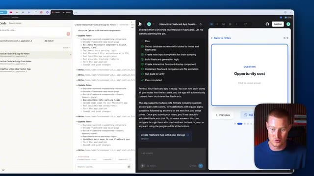
*⏱️ 00:05:10 — Affichage d'une carte flash interactive générée montrant une question "Opportunity cost" avec des options de navigation.*

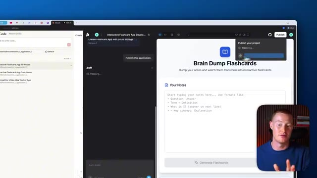
*⏱️ 00:05:19 — Fenêtre modale de publication du projet en cours de chargement sur l'interface de développement Bolt.new.*

---

### ⏱️ `[00:05:27 - 00:06:04]` | Segment #15

**🔊 Audio (Transcription Intégrale Mot pour Mot en Français) :**
> We can make it a custom domain that we actually have if we have one. And again, let me test out this app, you can see that our app is working properly directly inside of our web browser here. This is something really important that we're going to note when we compare this with CloudCode. So if I go back to this window, it looks like CloudCode is still actually writing the code and working on our app. So let's give it some time and then we'll come back to this. A couple minutes after Bolt actually finished coding our app, looks like CloudCode finished. And let's talk about something that's very important now. This is our output. Our output is the code that CloudCode wrote us. But the problem with this is we don't see our app live right here. In Bolt, you see that

**👁️ Analyse Visuelle d'Écran (gemini-3.5-flash-lite) :**
**Interface & Outils** : Présentation ou face-caméra explicatif du trader sans interface logicielle partagée.

**Contenu textuel & Code** : Explications orales des stratégies et mise en contexte méthodologique du marché.

**Action / Démonstration** : Explications face caméra et analyse conceptuelle des marchés.

---

### ⏱️ `[00:06:04 - 00:06:36]` | Segment #16

**🔊 Audio (Transcription Intégrale Mot pour Mot en Français) :**
> we actually have our app directly inside of our platform. You could see what it looks like. You could play around with it. You could interact with it and you could even launch it to a URL like I did here. Our app is now live that anybody can begin using. Inside of Claude Code, we don't have that ability. So what we could do is we could actually push this into GitHub. We now have all of our code stored there, but we're going to have to go ahead and integrate this into a terminal or something that is over the head of most non-technical users just to see what our app would look like in real time. This is why I really wanted to make this video because CloudCode for web is

**👁️ Analyse Visuelle d'Écran (gemini-3.5-flash-lite) :**
**Interface & Outils** : Navigateur web, interface de développement Bolt.new et Claude Code.

**Contenu textuel & Code** : Application web interactive de flashcards ("Brain Dump Flashcards") avec interface utilisateur et notes textuelles.

**Action / Démonstration** : Navigation et démonstration d'une application web interactive fraîchement générée et publiée en ligne.

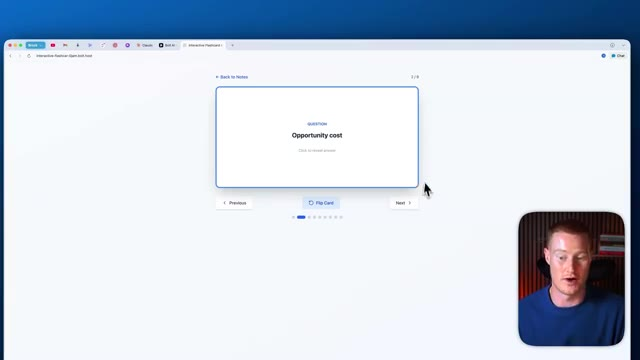
*⏱️ 00:06:12 — Capture montrant l'application interactive de flashcards lancée dans un navigateur web avec le présentateur en incrustation.*

*⏱️ 00:06:20 — Capture montrant une interface divisée affichant le code et l'aperçu de l'application web avec le présentateur en incrustation.*

---

### ⏱️ `[00:06:36 - 00:07:09]` | Segment #17

**🔊 Audio (Transcription Intégrale Mot pour Mot en Français) :**
> pretty cool and we're getting closer to being able to use this if you're non-technical. But Bolt already has this baked directly into their platform where you could use the CloudCode agent, which is basically the same thing that we have with CloudCode right here, but the interface is much simpler to use and the utility of this is much higher. One thing I do want to say with CloudCode is it's pretty cool that we could actually use this now directly inside of our mobile app. So if you have the Claude mobile app, you could actually begin using this right now. And this way you can actually code on the go. But again, the problem with this is that we can't actually see

**👁️ Analyse Visuelle d'Écran (gemini-3.5-flash-lite) :**
**Interface & Outils** : Navigateur web affichant l'interface de Bolt.new et l'application Claude Code.

**Contenu textuel & Code** : Interface utilisateur de Bolt avec le menu de sélection de l'agent "Claude Agent" et code source de l'application de flashcards.

**Action / Démonstration** : Navigation et démonstration de l'intégration de l'agent Claude au sein de la plateforme Bolt.

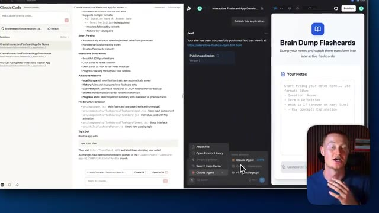
*⏱️ 00:06:45 — Interface divisée en deux montrant l'application Claude Code sur le panneau de gauche et la plateforme Bolt avec l'agent Claude activé sur le panneau de droite.*

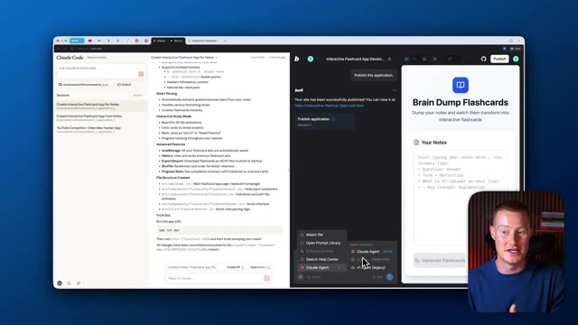
*⏱️ 00:06:53 — Vue similaire montrant l'interface complète de Bolt et Claude Code, avec le présentateur visible en bas à droite.*

---

### ⏱️ `[00:07:09 - 00:07:33]` | Segment #18

**🔊 Audio (Transcription Intégrale Mot pour Mot en Français) :**
> what our app will look like. And we can't very simply publish and launch our app. Another thing that is pretty cool with Claude code is we could actually have it doing multiple things at once. So we can have an agent working on one part of our app and another agent working on the other part. And we could have it doing different tasks at a different time. Right now, Bolt, you can only they have it perform one task. You could obviously create a pretty comprehensive prompt and we'll go off and do all these things like one by one and we'll like cross those off the to-do list.

**👁️ Analyse Visuelle d'Écran (gemini-3.5-flash-lite) :**
**Interface & Outils** : Navigateur web, Claude Code, interface Bolt, application web 'Brain Dump Flashcards'.

**Contenu textuel & Code** : Documentation de l'application, structure des fichiers React/JSX, commandes d'exécution (npm run dev) et interface de génération de flashcards.

**Action / Démonstration** : Présentation du déploiement de l'application et explication du fonctionnement multi-agent.

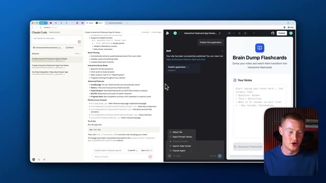
*⏱️ 00:07:15 — Interface de développement montrant Claude Code et Bolt avec un aperçu de l'application 'Brain Dump Flashcards'.*

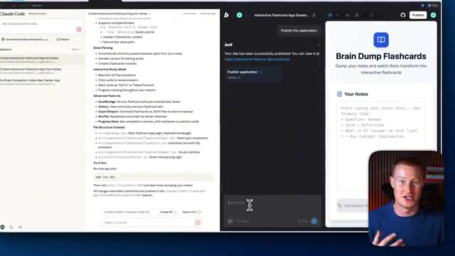
*⏱️ 00:07:27 — Interface de développement active avec un menu contextuel ouvert dans Bolt, illustrant la configuration d'agents.*

---

### ⏱️ `[00:07:33 - 00:07:52]` | Segment #19

**🔊 Audio (Transcription Intégrale Mot pour Mot en Français) :**
> Donc c'est une chose qui est plutôt cool à propos de CloudCode. Mais j'espère que si vous êtes restés jusqu'à la fin de cette vidéo, vous pouvez maintenant comprendre pourquoi moi personnellement j'utilise toujours Bolt qui a CloudCode intégré au lieu d'utiliser la nouvelle application web CloudCode dont tout le monde parle depuis son lancement hier. Si vous avez tiré de la valeur de cette vidéo, assurez-vous de laisser un pouce bleu et de commenter ce que vous en avez pensé.

**👁️ Analyse Visuelle d'Écran (gemini-3.5-flash-lite) :**
**Interface & Outils** : Présentation ou face-caméra explicatif du trader sans interface logicielle partagée.

**Contenu textuel & Code** : Explications orales des stratégies et mise en contexte méthodologique du marché.

**Action / Démonstration** : Explications face caméra et analyse conceptuelle des marchés.

---

### ⏱️ `[00:07:52 - 00:07:59]` | Segment #20

**🔊 Audio (Transcription Intégrale Mot pour Mot en Français) :**
> Abonnez-vous à la chaîne pour plus de contenu sur l'IA pour les non-techniciens cela étant dit les gars merci d'avoir regardé cette vidéo et je vous vois les gars dans la prochaine

**👁️ Analyse Visuelle d'Écran (gemini-3.5-flash-lite) :**
**Interface & Outils** : Présentation ou face-caméra explicatif du trader sans interface logicielle partagée.

**Contenu textuel & Code** : Explications orales des stratégies et mise en contexte méthodologique du marché.

**Action / Démonstration** : Explications face caméra et analyse conceptuelle des marchés.

---

