# 🎬 ChatGPT Atlas VS Perplexity Comet (Which is Better?)

> **Chaîne** : [Brock Mesarich | AI for Non Techies](https://www.youtube.com/@BrockMesarich)  
> **Lien YouTube** : [https://www.youtube.com/watch?v=ya9XWiXA3XM](https://www.youtube.com/watch?v=ya9XWiXA3XM)  
> **Date de publication** : 20251023  
> **Durée** : 00:14:07  
> **Identifiant vidéo** : `ya9XWiXA3XM`  
> **Transcription & Analyse** : `whisper-v3-large-turbo+gemini-3.5-flash-lite`  

---

## 📌 Synthèse Exécutive & Outils

### 💡 Résumé
Dans cette vidéo intitulée **ChatGPT Atlas VS Perplexity Comet (Which is Better?)**, Alex Carter détaille une approche stratégique et pratique du trading et de l'automatisation par agents IA.

### 🛠️ Outils, Modèles & Logiciels Présentés
- **TradingView & Claude Code** : Analyse technique avancée et automatisation algorithmique.

### 🔑 Points Clés & Enseignements Stratégiques
- Respect rigoureux du ratio risque/rendement et du money management.
- Automatisation méthodique des déclencheurs d'ordres via des agents intelligents.

---

## ⏱️ Chronologie & Transcription Complète Audio & Visuelle (Mot pour Mot)

### ⏱️ `[00:00:00 - 00:00:19]` | Segment #01

**🔊 Audio (Transcription Intégrale Mot pour Mot en Français) :**
> ChatGPT Atlas browser was just released yesterday, and everybody's asking how it compares to Perplexity Commons. If you don't know what either of these platforms are, they are agentic AI browsers that replace the need for Google Chrome, and can actually perform tasks across your computer. As you can see in this demo, it's actually controlling my computer, and my hands aren't even touching the keyboard.

**👁️ Analyse Visuelle d'Écran (gemini-3.5-flash-lite) :**
**Interface & Outils** : Navigateurs web, sites officiels de ChatGPT Atlas et Perplexity, interfaces d'agents d'automatisation.

**Contenu textuel & Code** : Pages de téléchargement de navigateurs IA et tableaux de bord d'agents logiciels connectés à différentes applications.

**Action / Démonstration** : Présentation des interfaces et comparaison des fonctionnalités des nouveaux navigateurs dotés d'intelligences artificielles agentiques.

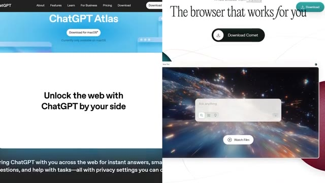
*⏱️ 00:00:09 — Comparaison côte à côte des sites web de deux navigateurs IA : ChatGPT Atlas à gauche et le navigateur de Perplexity à droite.*

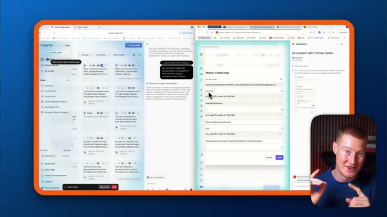
*⏱️ 00:00:14 — Capture d'écran d'un navigateur affichant une interface d'automatisation de tâches avec un panneau d'agents IA et une petite incrustation vidéo du présentateur en bas à droite.*

---

### ⏱️ `[00:00:19 - 00:01:00]` | Segment #02

**🔊 Audio (Transcription Intégrale Mot pour Mot en Français) :**
> In this video, I'm gonna test them side by side, break down the key differences, and by the end, you'll see exactly which browser is best for you, without the hype. So let's dive into this. All right guys, so without wasting any time, I want to dive right into this demo here, comparing these side by side. First things first, if you want to download Chachapiti Atlas, just look up Chachapiti Atlas, and then you could download this right now. It's only available for download for the Mac operating system. So if you do not have a Mac, unfortunately, you're not going to be able to try this out right now, but it's still worth it for you to stay to the end of this video to see what it's capable of. Same thing for Perplexity, make sure you go ahead and download Perplexity's CallMe app. These are both of the browsers that we're going to be testing side by side in this video. First things first, let me go ahead and

**👁️ Analyse Visuelle d'Écran (gemini-3.5-flash-lite) :**
**Interface & Outils** : Présentation ou face-caméra explicatif du trader sans interface logicielle partagée.

**Contenu textuel & Code** : Explications orales des stratégies et mise en contexte méthodologique du marché.

**Action / Démonstration** : Explications face caméra et analyse conceptuelle des marchés.

---

### ⏱️ `[00:01:00 - 00:01:19]` | Segment #03

**🔊 Audio (Transcription Intégrale Mot pour Mot en Français) :**
> and actually give a prompt to each of these. And then let's watch it go off. And I'm gonna break down exactly how it's going through each of these tasks. The first example that I have is I had this idea. So instead of doing some basic demo, like having it add groceries to Instacart or having it go and book flights for us, you've seen so many examples of those in previous videos.

**👁️ Analyse Visuelle d'Écran (gemini-3.5-flash-lite) :**
**Interface & Outils** : Présentation ou face-caméra explicatif du trader sans interface logicielle partagée.

**Contenu textuel & Code** : Explications orales des stratégies et mise en contexte méthodologique du marché.

**Action / Démonstration** : Explications face caméra et analyse conceptuelle des marchés.

---

### ⏱️ `[00:01:19 - 00:01:57]` | Segment #04

**🔊 Audio (Transcription Intégrale Mot pour Mot en Français) :**
> I'm actually gonna do something a little bit more advanced and this is a very meta. So what I'm gonna do, I'm gonna come to agent mode inside of Chachapiti. And this is where it's able to actually go off, open a browser and actually click and do different things with inside of Atlas. I had this idea, what if I gave it the task to actually build for me an agent? So I'm going to use Zapier agents to do this. So this is a very meta example of me using the Chachapiti agent and the perplexity agent to build an agent for me. This is going to be a little bit more of a complex task. Let me describe what I want my task to be now. So I want you to go inside of my Zapier agents account and I want you

**👁️ Analyse Visuelle d'Écran (gemini-3.5-flash-lite) :**
**Interface & Outils** : Présentation ou face-caméra explicatif du trader sans interface logicielle partagée.

**Contenu textuel & Code** : Explications orales des stratégies et mise en contexte méthodologique du marché.

**Action / Démonstration** : Explications face caméra et analyse conceptuelle des marchés.

---

### ⏱️ `[00:01:57 - 00:02:15]` | Segment #05

**🔊 Audio (Transcription Intégrale Mot pour Mot en Français) :**
> to build me a Zapier agent, not a Zap. And the point of this agent is to be able to scour my email inbox in Gmail and identify every single email that comes in and figure out if that is a potential sponsorship inquiry. If it is, I want you to label it as sponsorship inside of my email.

**👁️ Analyse Visuelle d'Écran (gemini-3.5-flash-lite) :**
**Interface & Outils** : Présentation ou face-caméra explicatif du trader sans interface logicielle partagée.

**Contenu textuel & Code** : Explications orales des stratégies et mise en contexte méthodologique du marché.

**Action / Démonstration** : Explications face caméra et analyse conceptuelle des marchés.

---

### ⏱️ `[00:02:15 - 00:02:45]` | Segment #06

**🔊 Audio (Transcription Intégrale Mot pour Mot en Français) :**
> Et ensuite, à partir de là, je veux que vous ajoutiez réellement cette entreprise avec une URL pour essayer le produit dans une base de données Notion, ainsi qu'un résumé en une phrase de ce qu'est cette plateforme. Comme ça, je pourrais avoir toutes ces informations résumées pour moi. Très bien. Donc, c'est mon prompt ici. Je vais coller exactement la même chose dans perplexity.com. Donc, ce que je dois faire, c'est en fait me connecter à mon compte Zapier pour m'assurer qu'il ne va pas me demander de me connecter. C'est donc quelque chose que nous devons savoir avec ces plateformes : si vous n'êtes pas connecté à une plateforme ou si elle n'a pas de contexte dans votre navigateur, alors elle ne pourra en fait pas exécuter ces tâches.

**👁️ Analyse Visuelle d'Écran (gemini-3.5-flash-lite) :**
**Interface & Outils** : Présentation ou face-caméra explicatif du trader sans interface logicielle partagée.

**Contenu textuel & Code** : Explications orales des stratégies et mise en contexte méthodologique du marché.

**Action / Démonstration** : Explications face caméra et analyse conceptuelle des marchés.

---

### ⏱️ `[00:02:45 - 00:03:05]` | Segment #07

**🔊 Audio (Transcription Intégrale Mot pour Mot en Français) :**
> Donc on dirait que Zapier, je suis connecté sur ChatDBT. Laissez-moi aller sur Zapier sur Perplexity. Et voilà. Nous sommes connectés aux deux. Donc ce que je vais faire, laissez-moi revenir à nos onglets ici et je vais cliquer sur exécuter pour les deux. Très bien, donc comme vous pouvez le voir, Perplexity est en fait déjà en train d'ouvrir un navigateur ici, donc si je viens sur cet onglet Zapier, il l'a ouvert tout seul.

**👁️ Analyse Visuelle d'Écran (gemini-3.5-flash-lite) :**
**Interface & Outils** : Navigateur web affichant Zapier, ChatGPT et un second assistant IA (Perplexity/agent).

**Contenu textuel & Code** : Interface Zapier de gestion des zaps, prompts de configuration d'un agent IA pour automatiser le traitement des e-mails Gmail et l'ajout dans Notion, et réponses textuelles des assistants.

**Action / Démonstration** : Navigation et configuration d'agents d'automatisation d'IA en parallèle sur deux plateformes différentes.

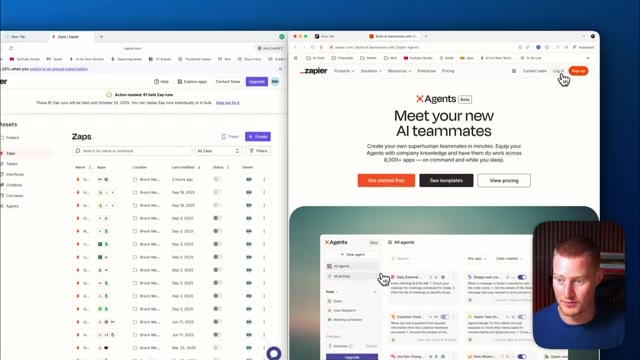
*⏱️ 00:02:50 — Vue partagée montrant l'interface Zapier et sa page de présentation avec un encart vidéo du présentateur.*

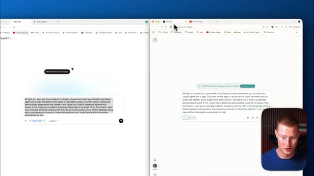
*⏱️ 00:02:55 — Affichage de deux fenêtres de navigateur côte à côte avec des interfaces d'IA de type chat (ChatGPT et Perplexity/autre) affichant des prompts textuels.*

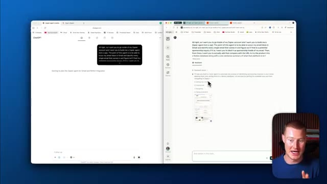
*⏱️ 00:03:00 — Exécution des requêtes sur les deux interfaces d'IA côte à côte montrant des réponses textuelles générées en temps réel.*

---

### ⏱️ `[00:03:05 - 00:03:43]` | Segment #08

**🔊 Audio (Transcription Intégrale Mot pour Mot en Français) :**
> Mes mains ne sont plus sur le clavier. Je n'ai pas pris les devants pour faire cela. Il est maintenant à l'intérieur de mon compte Zapier et essaie de comprendre exactement comment commencer à concevoir cet agent et, comme vous pouvez le voir sur le côté gauche, ChatGPT Atlas fait exactement la même chose. Chaque fois que vous voyez ce cercle bleu autour de chacun de ces différents navigateurs, cela signifie que l'intelligence artificielle est réellement à l'intérieur d'un navigateur cloud et qu'elle pointe, clique et tape directement dans notre interface. Très bien, je vais donc décortiquer chacun de ces flux de travail à mesure que je vois chacun de ces navigateurs exécuter cette tâche. Vous pouvez donc voir que Perplexity a ouvert Copilot à l'intérieur de Zapier et a essentiellement dit exactement ce que je veux que mon agent

**👁️ Analyse Visuelle d'Écran (gemini-3.5-flash-lite) :**
**Interface & Outils** : Navigateur web, interface Zapier, assistant IA, macOS.

**Contenu textuel & Code** : Configuration d'un agent IA sur Zapier pour surveiller les e-mails Gmail, détecter les demandes de parrainage et automatiser les actions dans Notion.

**Action / Démonstration** : L'agent IA navigue de manière autonome dans le compte Zapier et interagit avec l'interface pour concevoir l'agent personnalisé sans intervention humaine.

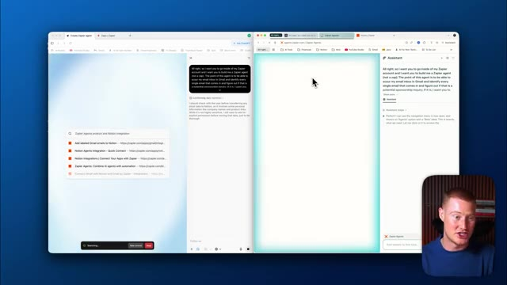
*⏱️ 00:03:14 — Vue d'écran partagée montrant l'interaction d'un agent IA naviguant sur Zapier à gauche et l'assistant conversationnel à droite, avec la vidéo du présentateur en incrustation.*

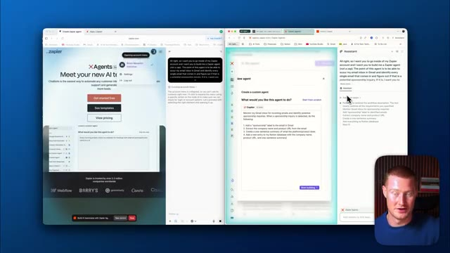
*⏱️ 00:03:33 — Vue de l'interface Zapier divisée en deux fenêtres avec l'agent IA en train de configurer la création d'un agent personnalisé et l'assistant textuel à droite.*

---

### ⏱️ `[00:03:43 - 00:04:17]` | Segment #09

**🔊 Audio (Transcription Intégrale Mot pour Mot en Français) :**
> perform. So it sent this off to Copilot, which is basically Zapier's way of helping you build agents with basically just natural language. So you can just write in text, explain what you want to build, and it will actually help create the instructions on how to actually build it. And if I expand this, you could see that there are these instructions here now that Perplexity Comet actually gave to my Zapier agent. ChatGPT Atlas is a little bit behind. You could see that it just now opened up, create a new agent. It's actually trying to figure out how to perform this task. To be honest, I'm really impressed with how quickly Perplexity Comet was able to actually

**👁️ Analyse Visuelle d'Écran (gemini-3.5-flash-lite) :**
**Interface & Outils** : Présentation ou face-caméra explicatif du trader sans interface logicielle partagée.

**Contenu textuel & Code** : Explications orales des stratégies et mise en contexte méthodologique du marché.

**Action / Démonstration** : Explications face caméra et analyse conceptuelle des marchés.

---

### ⏱️ `[00:04:17 - 00:04:53]` | Segment #10

**🔊 Audio (Transcription Intégrale Mot pour Mot en Français) :**
> get to this stage because it's in the process now of building this agent you could see that it's configuring each of these different steps that is extremely interesting here so so far this workflow that each of these are going through looks very similar it looks like perplexity agent has finished the workflow but i think it might be actually testing it to make sure that it's actually working so you could see that it says the workflow is ready to activate would you like me to make any adjustments, but it is still, you know, working here because again, you could see this blue ring around our page here. I'm going to pull up the Chachapi T Atlas page just so you could get a

**👁️ Analyse Visuelle d'Écran (gemini-3.5-flash-lite) :**
**Interface & Outils** : Présentation ou face-caméra explicatif du trader sans interface logicielle partagée.

**Contenu textuel & Code** : Explications orales des stratégies et mise en contexte méthodologique du marché.

**Action / Démonstration** : Explications face caméra et analyse conceptuelle des marchés.

---

### ⏱️ `[00:04:53 - 00:05:28]` | Segment #11

**🔊 Audio (Transcription Intégrale Mot pour Mot en Français) :**
> pleine conscience de ce qu'il est en train de faire en ce moment. Donc c'est comme, encore une fois, ce qui est ici, ce n'est pas moi qui touche le clavier. C'est lui qui fait réellement défiler cette page. Il sélectionne différentes choses. Il sélectionne différents champs. En ce moment, on dirait qu'il essaie réellement de configurer cette page Notion. Donc chaque fois que j'aura un nouveau demande de parrainage, non seulement il ajoutera une étiquette, mais il l'ajoutera aussi à ma base de données Notion avec toutes les différentes entreprises et un résumé de ce qu'est la plateforme. Donc on dirait que Comet et Atlas ont tous les deux bloqué juste au niveau de la partie Notion. En gros, il essaie de comprendre à quelle page Notion je veux qu'il soit ajouté. Pour les besoins de la cause, je n'ai en fait pas de page configurée dans Notion. Donc ce que je vais faire, c'est que je vais venir aux deux

**👁️ Analyse Visuelle d'Écran (gemini-3.5-flash-lite) :**
**Interface & Outils** : Présentation ou face-caméra explicatif du trader sans interface logicielle partagée.

**Contenu textuel & Code** : Explications orales des stratégies et mise en contexte méthodologique du marché.

**Action / Démonstration** : Explications face caméra et analyse conceptuelle des marchés.

---

### ⏱️ `[00:05:28 - 00:06:02]` | Segment #12

**🔊 Audio (Transcription Intégrale Mot pour Mot en Français) :**
> et dire : Je veux que tu ailles réellement créer une base de données Notion spécifique puis que tu l'utilises. Donc ils sont tous les deux bloqués au même point ici. Je vais envoyer ça et ils vont commencer réellement à essayer de configurer ceci. Donc je ne serais pas surpris s'ils ouvrent tous les deux mon Notion, essaient de se connecter à Notion et créent réellement celles-ci à partir de zéro. Et les gars, assurez-vous de rester jusqu'à la fin de cette vidéo où non seulement je vais montrer les résultats de ceci, but je vais analyser lequel de ceux-ci je pense est le meilleur et lequel vous devriez réellement utiliser. D'accord, donc il semble que ChattyBT Atlas soit maintenant à l'intérieur de Notion. Il y a cette page maintenant appelée

**👁️ Analyse Visuelle d'Écran (gemini-3.5-flash-lite) :**
**Interface & Outils** : Navigateur web, interface Zapier, assistant IA Copilot, Notion.

**Contenu textuel & Code** : Configuration de workflows Zapier, sélection de champs de base de données Notion, instructions d'automatisation pour le traitement de e-mails de sponsoring.

**Action / Démonstration** : Configuration d'un agent Zapier et interaction avec l'assistant IA pour automatiser la création de pages Notion à partir de messages reçus.

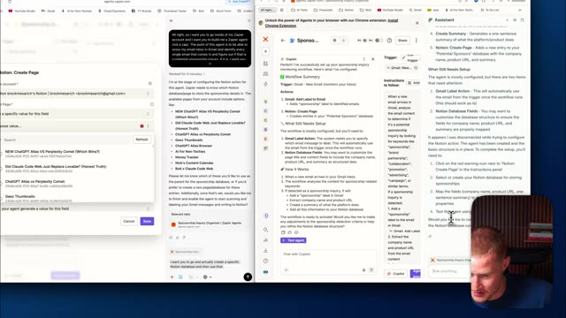
*⏱️ 00:05:36 — Interface de configuration Zapier divisée en deux fenêtres avec assistant IA, montrant la configuration d'une action Notion (création de page) et un panneau de discussion, avec la webcam du présentateur en bas à droite.*

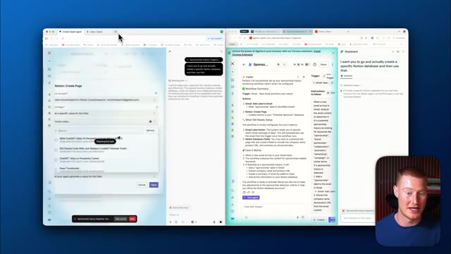
*⏱️ 00:05:45 — Vue similaire de l'interface Zapier montrant l'éditeur de workflow, un assistant IA et un menu déroulant pour sélectionner ou créer une base de données Notion.*

---

### ⏱️ `[00:06:02 - 00:06:23]` | Segment #13

**🔊 Audio (Transcription Intégrale Mot pour Mot en Français) :**
> Demandes de parrainage. Il est allé ajouter ces différentes lignes. Il a le nom, le lien vers la plateforme, puis le résumé. C'est exactement ce que je voulais qu'il fasse. Il va donc de l'avant et fait cela sans que j'aie besoin de l'aider. Et maintenant qu'il a configuré cette base de données Notion, il est en train de configurer cela dans Zapier. Il connecte donc simplement Zapier à cette page Notion spécifique.

**👁️ Analyse Visuelle d'Écran (gemini-3.5-flash-lite) :**
**Interface & Outils** : Présentation ou face-caméra explicatif du trader sans interface logicielle partagée.

**Contenu textuel & Code** : Explications orales des stratégies et mise en contexte méthodologique du marché.

**Action / Démonstration** : Explications face caméra et analyse conceptuelle des marchés.

---

### ⏱️ `[00:06:23 - 00:06:45]` | Segment #14

**🔊 Audio (Transcription Intégrale Mot pour Mot en Français) :**
> So that way it knows where to actually map this information, if that makes sense. All right, so Perplexity Comet said, I see I was disconnected again. Let me continue where we left off. I can check the existing sponsorship inquiries. It's basically asking if it should proceed So let me just say yes, please. Meanwhile, Chachabiti Atlas is off doing all this without me needing to kind of assist what it needs to do.

**👁️ Analyse Visuelle d'Écran (gemini-3.5-flash-lite) :**
**Interface & Outils** : Présentation ou face-caméra explicatif du trader sans interface logicielle partagée.

**Contenu textuel & Code** : Explications orales des stratégies et mise en contexte méthodologique du marché.

**Action / Démonstration** : Explications face caméra et analyse conceptuelle des marchés.

---

### ⏱️ `[00:06:45 - 00:07:03]` | Segment #15

**🔊 Audio (Transcription Intégrale Mot pour Mot en Français) :**
> All right, let's take a quick break and take a step back. You might be asking, Brock, why are you trying to create an agent inside of Zapier instead of just letting Atlas or Comet do this for us? And the reason for that is because right now, these two browsers are not able to go off and be triggered by a specific event.

**👁️ Analyse Visuelle d'Écran (gemini-3.5-flash-lite) :**
**Interface & Outils** : Navigateur web, interface Notion, interface Zapier Central / Assistant.

**Contenu textuel & Code** : Pages Notion intitulées "Sponsorship Database" et "Sponsorship Inquiries", panneau de discussion d'un assistant IA avec des instructions textuelles et des étapes d'automatisation.

**Action / Démonstration** : Démonstration de la manipulation de bases de données Notion et de l'automatisation via un agent Zapier.

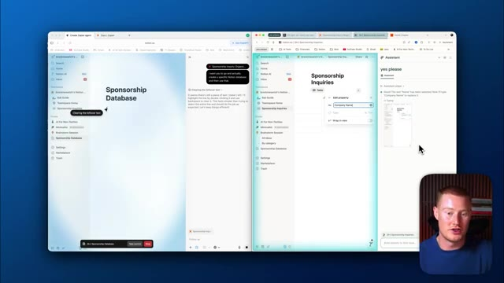
*⏱️ 00:06:49 — Capture d'écran divisée montrant des fenêtres de navigateur avec Notion et un assistant virtuel Zapier, ainsi que le présentateur en bas à droite.*

---

### ⏱️ `[00:07:03 - 00:07:39]` | Segment #16

**🔊 Audio (Transcription Intégrale Mot pour Mot en Français) :**
> Donc ce que je veux dire par là, c'est que l'agent que je configure dans Zapier est déclenché lorsqu'un nouvel e-mail arrive. Si un nouvel e-mail arrive dans mon compte Gmail, cela déclenchera automatiquement cet agent ou ce flux de travail. Il va parcourir, il va analyser s'il s'agit d'une demande de contrat de marque, puis étiqueter cela. Mais avec Atlas et Comet, il n'est pas capable de faire cela. Donc pour l'instant, ces navigateurs, vous devez leur donner une certaine forme d'entrée. Je dois dire, hé, peux-tu aller créer ça pour moi ? Ou pourrais-tu parcourir ma boîte de réception d'e-mails, analyser quelles sont les demandes de parrainage potentielles, puis les ajouter à Notion. Je devrais en quelque sorte lui donner cette entrée. Donc la raison pour laquelle je voulais montrer ce cas d'utilisation de moi essayant de construire un agent

**👁️ Analyse Visuelle d'Écran (gemini-3.5-flash-lite) :**
**Interface & Outils** : Présentation ou face-caméra explicatif du trader sans interface logicielle partagée.

**Contenu textuel & Code** : Explications orales des stratégies et mise en contexte méthodologique du marché.

**Action / Démonstration** : Explications face caméra et analyse conceptuelle des marchés.

---

### ⏱️ `[00:07:39 - 00:08:04]` | Segment #17

**🔊 Audio (Transcription Intégrale Mot pour Mot en Français) :**
> avec ces agents est de montrer essentiellement un peu la différence là-dedans. Mais non seulement ça, je voulais mettre en valeur la puissance de pouvoir donner une tâche à ces plateformes et ensuite de les laisser faire et comprendre comment l'exécuter étape par étape. Si vous aviez cela, donc si vous aviez cette question, j'espère que cela clarifie. Maintenant, retournons à l'observation de leur exécution de cette tâche. En ce moment, il semble qu'Atlas soit à l'étape de la création effective de cette base de données à l'intérieur de ma page Notion.

**👁️ Analyse Visuelle d'Écran (gemini-3.5-flash-lite) :**
**Interface & Outils** : Navigateur web, Notion, assistants IA.

**Contenu textuel & Code** : Bases de données Notion ("Sponsorship Database", "Sponsorship Inquiries"), panneaux de configuration de propriétés et fenêtres de chat d'assistant IA.

**Action / Démonstration** : Démonstration et comparaison de l'exécution étape par étape d'une tâche par des agents IA sur Notion.

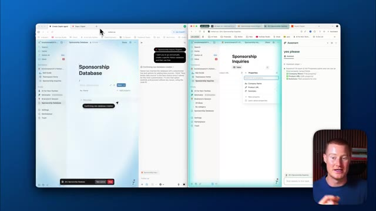
*⏱️ 00:07:45 — Capture d'écran montrant une démonstration comparative de deux fenêtres de navigateur avec l'interface Notion et des assistants IA en action, tandis que le présentateur apparaît en bas à droite.*

---

### ⏱️ `[00:08:04 - 00:08:26]` | Segment #18

**🔊 Audio (Transcription Intégrale Mot pour Mot en Français) :**
> Donc nous pouvons voir ici que c'est écrit nom de l'entreprise. Il est en train d'ajouter ces différentes propriétés ici. On dirait qu'il va réellement ajouter le lien aussi pour cette entreprise ainsi que le résumé. Et ensuite, si nous ouvrons Perplexity, il vient juste de passer par ce même processus. Il a donc pu réellement aller ajouter cette information ici à l'intérieur de mon Notion. Encore une fois, pendant qu'Atlas est en train d'exécuter cette tâche, on dirait que Perplexity s'est bloqué à nouveau.

**👁️ Analyse Visuelle d'Écran (gemini-3.5-flash-lite) :**
**Interface & Outils** : Navigateur web, Notion, Zapier Agents, interface vidéo incrustée du présentateur.

**Contenu textuel & Code** : Base de données Notion ("Sponsorship Database", "Sponsorship Inquiries"), propriétés configurées (Company Name, Product URL, Summary), interface de chatbot/assistant IA et panneau de configuration d'agent Zapier.

**Action / Démonstration** : Le présentateur configure et ajoute dynamiquement des propriétés (URL, résumé) à une base de données Notion via une automatisation par IA.

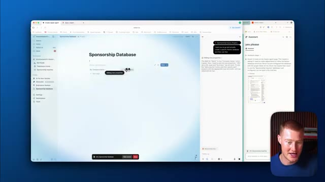
*⏱️ 00:08:09 — Image #1 montre l'interface de Notion où le présentateur ajoute de nouvelles propriétés à une base de données de parrainage, avec une fenêtre d'assistant IA à droite et sa caméra en bas à droite.*

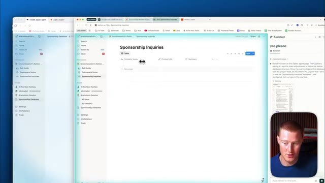
*⏱️ 00:08:15 — Image #2 affiche la base de données Notion intitulée "Sponsorship Inquiries" avec les colonnes configurées "Company Name", "Product URL" et "Summary".*

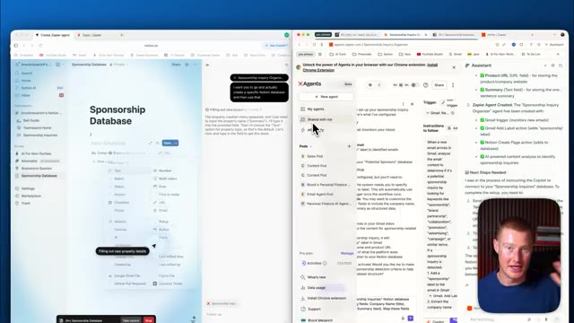
*⏱️ 00:08:20 — Image #3 présente le menu de configuration des types de propriétés dans Notion (Text, Number, Select, URL, etc.) aux côtés de l'interface Zapier Central/Agents.*

---

### ⏱️ `[00:08:26 - 00:08:49]` | Segment #19

**🔊 Audio (Transcription Intégrale Mot pour Mot en Français) :**
> Donc il est écrit que les prochaines étapes sont nécessaires. J'étais en train de donner des instructions à Copilot pour qu'il se connecte à la base de données des demandes de parrainage. Il doit faire ces trois choses maintenant, mais pour une raison quelconque, ça a été coupé. Alors laissez-moi dire de procéder à ces tâches. Très bien. Donc une chose que j'ai remarquée, c'est qu'Atlas est resté bloqué sur la création de cette base de données Notion pendant un bon moment et il a en fait fait tout ce qu'il fallait, mais il a ajouté cinq onglets de résumé différents ici.

**👁️ Analyse Visuelle d'Écran (gemini-3.5-flash-lite) :**
**Interface & Outils** : Présentation ou face-caméra explicatif du trader sans interface logicielle partagée.

**Contenu textuel & Code** : Explications orales des stratégies et mise en contexte méthodologique du marché.

**Action / Démonstration** : Explications face caméra et analyse conceptuelle des marchés.

---

### ⏱️ `[00:08:49 - 00:09:07]` | Segment #20

**🔊 Audio (Transcription Intégrale Mot pour Mot en Français) :**
> Il n'avait besoin d'en ajouter qu'un seul. On aurait dit qu'il était en quelque sorte bloqué sur cette tâche et qu'il ne comprenait pas qu'il devait en fait aller de l'avant et créer notre agent et le connecter à Notion. Au lieu de cela, il se concentrait uniquement sur la partie Notion. C'est donc quelque chose que je voulais souligner, il avait un peu de mal avec ça, mais maintenant il est de retour, il est sur la tâche et, espérons-le, devrait terminer d'ici peu.

**👁️ Analyse Visuelle d'Écran (gemini-3.5-flash-lite) :**
**Interface & Outils** : Navigateur web, interface de configuration d'agent Zapier (Zapier Central / Agents Zapier), éditeur d'instructions de workflow et intégration Gmail/Notion.

**Contenu textuel & Code** : Instructions textuelles détaillées pour l'agent IA : déclencheur sur réception de nouvel e-mail Gmail, analyse du contenu pour repérer les demandes de partenariat, ajout d'un libellé "Sponsorship", extraction d'URL produit, rédaction d'un résumé et création d'une entrée dans une base de données Notion.

**Action / Démonstration** : Le créateur montre l'interface de configuration de l'agent Zapier et discute de ses instructions et de sa logique de fonctionnement avec les applications connectées.

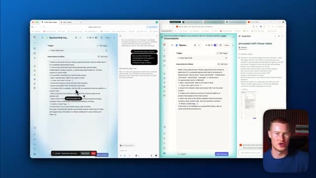
*⏱️ 00:08:58 — Interface de création d'agent Zapier partagée en deux fenêtres côte à côte montrant les instructions de l'agent pour connecter Gmail à Notion, avec une petite incrustation vidéo du présentateur en bas à droite.*

---

### ⏱️ `[00:09:07 - 00:09:25]` | Segment #21

**🔊 Audio (Transcription Intégrale Mot pour Mot en Français) :**
> Si nous retournons aux commentaires, il est en train de mapper les champs Notion. Comme vous pouvez le voir pour la page parente, il a sélectionné la bonne page Notion et ensuite pour le titre, il a extrait le nom de l'entreprise, puis a ajouté un résumé d'une phrase de ce que fait réellement la plateforme. Il est donc en train de connecter Notion à notre agent ici.

**👁️ Analyse Visuelle d'Écran (gemini-3.5-flash-lite) :**
**Interface & Outils** : Présentation ou face-caméra explicatif du trader sans interface logicielle partagée.

**Contenu textuel & Code** : Explications orales des stratégies et mise en contexte méthodologique du marché.

**Action / Démonstration** : Explications face caméra et analyse conceptuelle des marchés.

---

### ⏱️ `[00:09:25 - 00:09:45]` | Segment #22

**🔊 Audio (Transcription Intégrale Mot pour Mot en Français) :**
> Une chose que je veux noter ici, les gars, c'est que ça prend pas mal de temps. Je crois que je fais ça depuis environ 15 minutes maintenant. Ils ont rencontré leurs propres types d'erreurs. J'espère donc que cela vous montre où en est cette technologie en ce moment. C'est vraiment le début de cette nouvelle révolution où des agents de navigation accomplissent des tâches à votre place, mais vous devez être très précis dans votre formulation.

**👁️ Analyse Visuelle d'Écran (gemini-3.5-flash-lite) :**
**Interface & Outils** : Présentation ou face-caméra explicatif du trader sans interface logicielle partagée.

**Contenu textuel & Code** : Explications orales des stratégies et mise en contexte méthodologique du marché.

**Action / Démonstration** : Explications face caméra et analyse conceptuelle des marchés.

---

### ⏱️ `[00:09:46 - 00:10:07]` | Segment #23

**🔊 Audio (Transcription Intégrale Mot pour Mot en Français) :**
> And it does take quite a bit of time. It would have been easier for me to go and do this myself instead of sitting here and trying to instruct on how to actually perform this task. All right, I'm not gonna lie. That was not the smoothest process for either of these browsers, But let me show you what actually went down. So I went ahead, I tested our agent on both. That they went ahead and built, I just clicked this test agent button and it ran our workflow.

**👁️ Analyse Visuelle d'Écran (gemini-3.5-flash-lite) :**
**Interface & Outils** : Présentation ou face-caméra explicatif du trader sans interface logicielle partagée.

**Contenu textuel & Code** : Explications orales des stratégies et mise en contexte méthodologique du marché.

**Action / Démonstration** : Explications face caméra et analyse conceptuelle des marchés.

---

### ⏱️ `[00:10:07 - 00:10:26]` | Segment #24

**🔊 Audio (Transcription Intégrale Mot pour Mot en Français) :**
> Si je viens sur celui que j'ai fait avec Chachabiti Atlas, vous pouvez voir qu'il a ajouté ces différentes pages à l'intérieur de la page Notion, mais c'est le mauvais endroit. Je voulais en fait qu'ils ajoutent ceci. Vous pouvez donc voir que j'ai celui-ci juste ici, Sketchflow. Il montre l'entreprise, il montre le contact, l'e-mail, il montre l'URL du produit et le résumé du produit. Donc ça, ça fonctionne.

**👁️ Analyse Visuelle d'Écran (gemini-3.5-flash-lite) :**
**Interface & Outils** : Navigateur web affichant les interfaces de Notion et d'un outil d'agents IA (Zapier Central / xAgents).

**Contenu textuel & Code** : Pages de gestion de partenariats Notion, instructions d'automatisation d'agents et détails de formulaires de contact.

**Action / Démonstration** : Navigation et explication de la structure des pages créées automatiquement dans Notion pour les demandes de partenariat.

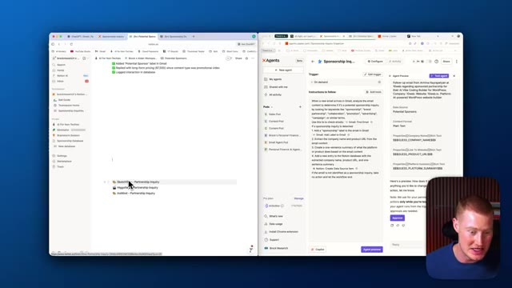
*⏱️ 00:10:12 — Vue d'ensemble de l'écran partagé montrant Notion à gauche et l'outil d'automatisation des agents IA à droite, avec une liste de pages de partenariat incluant Sketchflow.*

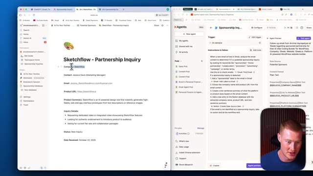
*⏱️ 00:10:21 — Gros plan sur la page Notion de Sketchflow montrant les détails de la demande de partenariat (contact, email, résumé du produit).*

---

### ⏱️ `[00:10:26 - 00:10:53]` | Segment #25

**🔊 Audio (Transcription Intégrale Mot pour Mot en Français) :**
> Il montre même les détails de la demande ainsi que le statut et la date de réception. C'ప్పటికీ c'est plutôt sympa, mais il ne l'a pas ajouté à la base de données exacte à laquelle je voulais l'ajouter. Je voulais qu'il l'ajoute à cette base de données et qu'il le télécharge simplement ici dans ces différentes cellules comme s'il s'agissait d'un tableur, par exemple. Il n'a pas compris que c'était ce que nous voulions faire. C'était donc le résultat final ici pour Chatgpt Atlas. Et si je viens sur Perplexity Comet, laissez-moi vous montrer ce que cela a fait. Et je dirai que ce n'était pas aussi bien que Chatgpt Atlas.

**👁️ Analyse Visuelle d'Écran (gemini-3.5-flash-lite) :**
**Interface & Outils** : Navigateur web affichant Notion et une plateforme de création d'agents d'automatisation (Agents.zapier.com).

**Contenu textuel & Code** : Instructions d'agents pour analyser les emails de demande de partenariat, extraire les informations et les ajouter à une base de données Notion.

**Action / Démonstration** : Navigation et présentation de l'intégration entre l'agent d'automatisation et la base de données de suivi des partenariats.

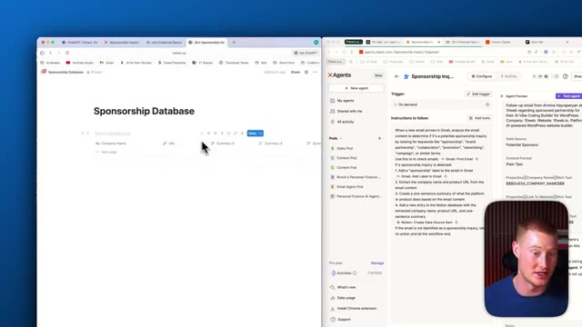
*⏱️ 00:10:33 — Vue partagée montrant une base de données Notion à gauche et une interface de configuration d'agent d'automatisation à droite.*

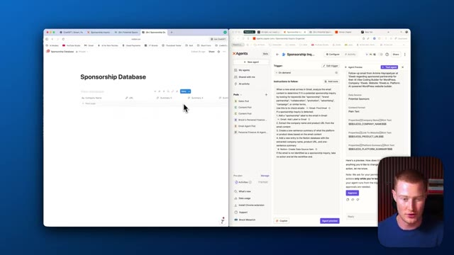
*⏱️ 00:10:40 — Vue similaire avec le curseur de la souris positionné au milieu de l'écran entre les deux fenêtres d'application.*

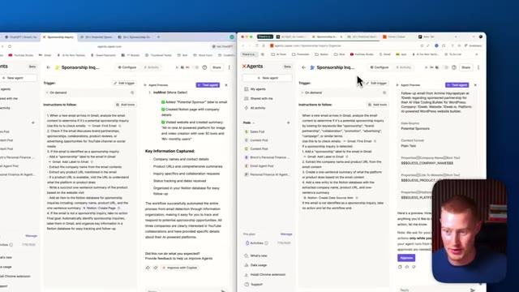
*⏱️ 00:10:46 — Affichage côte à côte de l'interface d'automatisation montrant les résultats d'exécution de l'agent et les données capturées.*

---

### ⏱️ `[00:10:53 - 00:11:14]` | Segment #26

**🔊 Audio (Transcription Intégrale Mot pour Mot en Français) :**
> Vous pouvez voir que cela a ajouté ces éléments dans la base de données de ce sponsor potentiel, mais c'est la mauvaise base de données de sponsors potentiels. Et si vous regardez ceci, vous pouvez voir que les données à l'intérieur ne sont pas correctement formatées. Donc c'est écrit nom de l'entreprise invité, URL du produit invité, résumé de la plateforme invité. Et ensuite, cela montre bien le résumé de la demande actuelle ici, ce qui, je suppose, est cool.

**👁️ Analyse Visuelle d'Écran (gemini-3.5-flash-lite) :**
**Interface & Outils** : Présentation ou face-caméra explicatif du trader sans interface logicielle partagée.

**Contenu textuel & Code** : Explications orales des stratégies et mise en contexte méthodologique du marché.

**Action / Démonstration** : Explications face caméra et analyse conceptuelle des marchés.

---

### ⏱️ `[00:11:14 - 00:11:51]` | Segment #27

**🔊 Audio (Transcription Intégrale Mot pour Mot en Français) :**
> But again, this did not work as seamless as we wanted to. Maybe obviously our instructions that we gave both Comet and Atlas weren't as specific as it needed to be. in order to go ahead and craft this prompt and build this agent for us. But let me go ahead and now talk about the key differences when it comes to this platform, aside from just using the agent mode for each of these browsers. All right, so right off the bat, the user interface of both of these browsers are very similar. Again, you can see that we have the Chachabut logo here, we have the Perplexity logo, and we have this box here that we could input our prompt, obviously, or our search. Inside of Chachabut Atlas, we have this agent mode that we could just toggle on. And then

**👁️ Analyse Visuelle d'Écran (gemini-3.5-flash-lite) :**
**Interface & Outils** : Présentation ou face-caméra explicatif du trader sans interface logicielle partagée.

**Contenu textuel & Code** : Explications orales des stratégies et mise en contexte méthodologique du marché.

**Action / Démonstration** : Explications face caméra et analyse conceptuelle des marchés.

---

### ⏱️ `[00:11:51 - 00:12:24]` | Segment #28

**🔊 Audio (Transcription Intégrale Mot pour Mot en Français) :**
> Nous pourrions aussi aller de l'avant et cliquer sur n'importe laquelle de ces autres choses. Donc nous avons les différents produits que ChatGPT a, mais directement dans notre navigateur ici. Vous pouvez donc voir que nous avons une recherche approfondie, nous pourrions créer des images, nous avons canvas, étude et apprentissage, nous avons accès à toutes ces applications auxquelles nous avons accès à l'intérieur du ChatGPT normal. C'est donc ainsi que cela fonctionne. Et puis c'est la même chose pour Perplexity, vous pouvez voir que nous pourrions venir ici, cela nous donne ces pré-prompts que nous pourrions réellement utiliser. Par exemple, je pourrais simplement cliquer là-dessus et cela va parcourir et réellement chercher cela pour moi ou réellement commencer à exécuter ces tâches. Et puis pour les deux, si je cherche simplement quelque chose, disons par exemple le calendrier des Dallas Cowboys.

**👁️ Analyse Visuelle d'Écran (gemini-3.5-flash-lite) :**
**Interface & Outils** : Présentation ou face-caméra explicatif du trader sans interface logicielle partagée.

**Contenu textuel & Code** : Explications orales des stratégies et mise en contexte méthodologique du marché.

**Action / Démonstration** : Explications face caméra et analyse conceptuelle des marchés.

---

### ⏱️ `[00:12:24 - 00:12:43]` | Segment #29

**🔊 Audio (Transcription Intégrale Mot pour Mot en Français) :**
> So for example, I just searched Dallas Cowboys schedule. And this is what Chachapiti Atlas shows me. I think that this looks a little bit more minimalistic. And I think this is more pleasing to the eye than perplexity has right here. This looks kind of dry, if that's the right word. I just don't think the interface of this looks the best. But for perplexity, we have this button up here where it is the AI assistant where we could pull it up.

**👁️ Analyse Visuelle d'Écran (gemini-3.5-flash-lite) :**
**Interface & Outils** : Présentation ou face-caméra explicatif du trader sans interface logicielle partagée.

**Contenu textuel & Code** : Explications orales des stratégies et mise en contexte méthodologique du marché.

**Action / Démonstration** : Explications face caméra et analyse conceptuelle des marchés.

---

### ⏱️ `[00:12:43 - 00:13:02]` | Segment #30

**🔊 Audio (Transcription Intégrale Mot pour Mot en Français) :**
> We could ask further questions or we could even have it go off and perform tasks for us. And then the same exact thing for Chachapiti. I could click this ask chat to PT button. It'll pull up this side window where we could either chat with whatever is on this page or we could then just click on agent mode and tell it to go perform different tasks for us. So both of these platforms have very similar user interface and functionality.

**👁️ Analyse Visuelle d'Écran (gemini-3.5-flash-lite) :**
**Interface & Outils** : Présentation ou face-caméra explicatif du trader sans interface logicielle partagée.

**Contenu textuel & Code** : Explications orales des stratégies et mise en contexte méthodologique du marché.

**Action / Démonstration** : Explications face caméra et analyse conceptuelle des marchés.

---

### ⏱️ `[00:13:02 - 00:13:25]` | Segment #31

**🔊 Audio (Transcription Intégrale Mot pour Mot en Français) :**
> Je dirai qu'après avoir testé ceux-ci côte à côte, en les comparant pour créer un agent dans Zapier Agents, je pense que ChatGPT Atlas était un peu meilleur pour faire cela. Aucun des deux n'était parfait, je tiens à le mentionner, mais je lui ai donné une tâche plus complexe au lieu de lui demander simplement de me trouver des vols pas chers ou quelque chose comme ça. Je voulais proposer quelque chose d'un peu plus dynamique. Je suis surpris que les deux aient réellement réussi à lancer un agent qui fonctionnait vraiment.

**👁️ Analyse Visuelle d'Écran (gemini-3.5-flash-lite) :**
**Interface & Outils** : Présentation ou face-caméra explicatif du trader sans interface logicielle partagée.

**Contenu textuel & Code** : Explications orales des stratégies et mise en contexte méthodologique du marché.

**Action / Démonstration** : Explications face caméra et analyse conceptuelle des marchés.

---

### ⏱️ `[00:13:25 - 00:13:43]` | Segment #32

**🔊 Audio (Transcription Intégrale Mot pour Mot en Français) :**
> It didn't work the best, but both of them were good. I think Atlas was a little bit better. I will say another thing I like about Atlas is the fact that it has all of my context on Chachabiti. So I can just pull this up and this is like my actual Chachabiti account here. So I can ask any of the questions regarding myself or any of my previous conversations I've had and it has context to that.

**👁️ Analyse Visuelle d'Écran (gemini-3.5-flash-lite) :**
**Interface & Outils** : Présentation ou face-caméra explicatif du trader sans interface logicielle partagée.

**Contenu textuel & Code** : Explications orales des stratégies et mise en contexte méthodologique du marché.

**Action / Démonstration** : Explications face caméra et analyse conceptuelle des marchés.

---

### ⏱️ `[00:13:43 - 00:14:04]` | Segment #33

**🔊 Audio (Transcription Intégrale Mot pour Mot en Français) :**
> So I use Chachabiti every single day, like lots of times. So the fact that it has context to all of these things how I perform different tasks different things that needs to know about my business and stuff That was just much smoother than perplexity comment was for me personally Anyways, guys, thank you so much for saying that in this video If you got some value leave a like leave a comment. Let me know what you think Which platform are you going to use and again?

**👁️ Analyse Visuelle d'Écran (gemini-3.5-flash-lite) :**
**Interface & Outils** : Présentation ou face-caméra explicatif du trader sans interface logicielle partagée.

**Contenu textuel & Code** : Explications orales des stratégies et mise en contexte méthodologique du marché.

**Action / Démonstration** : Explications face caméra et analyse conceptuelle des marchés.

---

### ⏱️ `[00:14:04 - 00:14:07]` | Segment #34

**🔊 Audio (Transcription Intégrale Mot pour Mot en Français) :**
> Merci d'avoir dit cela dans cette vidéo et je vous vois les gars dans la prochaine

**👁️ Analyse Visuelle d'Écran (gemini-3.5-flash-lite) :**
**Interface & Outils** : Présentation ou face-caméra explicatif du trader sans interface logicielle partagée.

**Contenu textuel & Code** : Explications orales des stratégies et mise en contexte méthodologique du marché.

**Action / Démonstration** : Explications face caméra et analyse conceptuelle des marchés.

---

