# 🎬 Google AI Studio Just Replaced Every AI App Builder (It’s FREE)

> **Chaîne** : [Brock Mesarich | AI for Non Techies](https://www.youtube.com/@BrockMesarich)  
> **Lien YouTube** : [https://www.youtube.com/watch?v=oHhv-0bm2is](https://www.youtube.com/watch?v=oHhv-0bm2is)  
> **Date de publication** : 20251029  
> **Durée** : 00:08:46  
> **Identifiant vidéo** : `oHhv-0bm2is`  
> **Transcription & Analyse** : `whisper-v3-large-turbo+gemini-3.5-flash-lite`  

---

## 📌 Synthèse Exécutive & Outils

### 💡 Résumé
Dans cette vidéo intitulée **Google AI Studio Just Replaced Every AI App Builder (It’s FREE)**, Alex Carter détaille une approche stratégique et pratique du trading et de l'automatisation par agents IA.

### 🛠️ Outils, Modèles & Logiciels Présentés
- **TradingView & Claude Code** : Analyse technique avancée et automatisation algorithmique.

### 🔑 Points Clés & Enseignements Stratégiques
- Respect rigoureux du ratio risque/rendement et du money management.
- Automatisation méthodique des déclencheurs d'ordres via des agents intelligents.

---

## ⏱️ Chronologie & Transcription Complète Audio & Visuelle (Mot pour Mot)

### ⏱️ `[00:00:00 - 00:00:29]` | Segment #01

**🔊 Audio (Transcription Intégrale Mot pour Mot en Français) :**
> Google just made vibe coding completely free and this might have just killed every paid AI app builder like Lovable or Repli. Their new update to Google AI Studio basically lets anyone vibe code entire apps without paying any money. And after testing it all weekend, I'm really excited to showcase this because I know a lot of you guys are tired of paying for AI subscriptions, so I'm glad there's now a free alternative for you. In this video, I'm going to break down how to use it and show a side-by-side comparison to Lovable so you can see for yourself just how good it is.

**👁️ Analyse Visuelle d'Écran (gemini-3.5-flash-lite) :**
**Interface & Outils** : Navigateur web et captures de présentation.

**Contenu textuel & Code** : Texte d'article de blog sur Google AI Studio et sous-titres animés.
[DESC_IMAGE_1] Présentation visuelle d'une annonce de Google AI Studio.
[DESC_IMAGE_2] Illustration du travail de développement ou de test du présentateur.
[DESC_IMAGE_3] Présentation parlée par le créateur de contenu.

**Action / Démonstration** : Présentation d'une nouveauté logicielle et introduction au sujet de la vidéo.

---

### ⏱️ `[00:00:29 - 00:00:48]` | Segment #02

**🔊 Audio (Transcription Intégrale Mot pour Mot en Français) :**
> Très bien, entrons dans le vif du sujet. Très bien, parlons donc rapidement de quelque chose qui est probablement un point de friction auquel nous avons tous été confrontés auparavant. Il s'agit d'utiliser une plateforme comme Lovable ou Replay ou n'importe laquelle de ces autres applications de codage intuitif et de développer son projet, tout se passe bien au début, puis on se heurte à cet obstacle. Vous devez payer parce que vous n'avez plus de crédits sur votre compte.

**👁️ Analyse Visuelle d'Écran (gemini-3.5-flash-lite) :**
**Interface & Outils** : Présentation ou face-caméra explicatif du trader sans interface logicielle partagée.

**Contenu textuel & Code** : Explications orales des stratégies et mise en contexte méthodologique du marché.

**Action / Démonstration** : Explications face caméra et analyse conceptuelle des marchés.

---

### ⏱️ `[00:00:48 - 00:01:21]` | Segment #03

**🔊 Audio (Transcription Intégrale Mot pour Mot en Français) :**
> Comme vous pouvez le voir ici, il me reste seulement environ 20 crédits. Et si vous cliquez sur mettre à niveau, je vais devoir payer 100 dollars par mois pour mettre à niveau mon abonnement. Et je n'ai vraiment pas envie de faire ça. Je vais donc maintenant vous montrer une alternative à cela qui est entièrement gratuite pour vous permettre de commencer le vibe coding sans avoir à payer quoi que ce soit. Donc ce que je vais faire, c'est que je vais venir sur Google AI Studio. Si vous ne savez pas ce que c'est, c'est essentiellement la suite d'IA de Google composée de différentes applications qu'ils ont au sein de leur écosystème. Et c'est sur cela que nous voulons nous concentrer ici, build. Cette nouvelle fonctionnalité ici vous permet essentiellement de faire du vibe coding.

**👁️ Analyse Visuelle d'Écran (gemini-3.5-flash-lite) :**
**Interface & Outils** : Présentation ou face-caméra explicatif du trader sans interface logicielle partagée.

**Contenu textuel & Code** : Explications orales des stratégies et mise en contexte méthodologique du marché.

**Action / Démonstration** : Explications face caméra et analyse conceptuelle des marchés.

---

### ⏱️ `[00:01:21 - 00:01:44]` | Segment #04

**🔊 Audio (Transcription Intégrale Mot pour Mot en Français) :**
> en utilisant Google AI Studio et c'est gratuit à utiliser. Et je vais vous montrer exactement comment l'utiliser maintenant. Donc nous allons voir cette interface ici où il est écrit de construire vos idées avec Gemini. Vous pouvez sélectionner le modèle que vous voulez utiliser. Je tiens à mentionner quelque chose ici. L'une des choses qui est intéressante avec Bolt et Lovable ou Replit est que vous pouvez choisir entre quel modèle de codage vous voulez, que vous vouliez utiliser GPT-5 ou Clog 4.5 Sonnet ou Gemini.

**👁️ Analyse Visuelle d'Écran (gemini-3.5-flash-lite) :**
**Interface & Outils** : Présentation ou face-caméra explicatif du trader sans interface logicielle partagée.

**Contenu textuel & Code** : Explications orales des stratégies et mise en contexte méthodologique du marché.

**Action / Démonstration** : Explications face caméra et analyse conceptuelle des marchés.

---

### ⏱️ `[00:01:44 - 00:02:08]` | Segment #05

**🔊 Audio (Transcription Intégrale Mot pour Mot en Français) :**
> À la place, à l'intérieur d'AI Studio, vous allez en fait devoir utiliser le modèle Gemini. Donc nous allons utiliser Gemini 2.5 Pro. C'est l'une de ces choses qui pourrait être un peu gênante, mais croyez-moi, si vous voulez faire du vibe coding gratuitement, c'est votre meilleure chance de le faire. Donc tout d'abord, ce que vous allez voir, c'est que vous pouvez voir que nous pouvons suralimenter notre application avec l'IA. Donc nous avons Nano Banana, qui est le modèle de génération d'images de Gemini, qui est le meilleur outil de génération d'images par IA du marché.

**👁️ Analyse Visuelle d'Écran (gemini-3.5-flash-lite) :**
**Interface & Outils** : Google AI Studio (navigateur web)

**Contenu textuel & Code** : Interface d'accueil "Build your ideas with Gemini", sélection du modèle Gemini 2.5 Pro, zone de saisie de prompt "Describe your idea".

**Action / Démonstration** : Présentation de la plateforme Google AI Studio et sélection du modèle Gemini 2.5 Pro pour le développement.

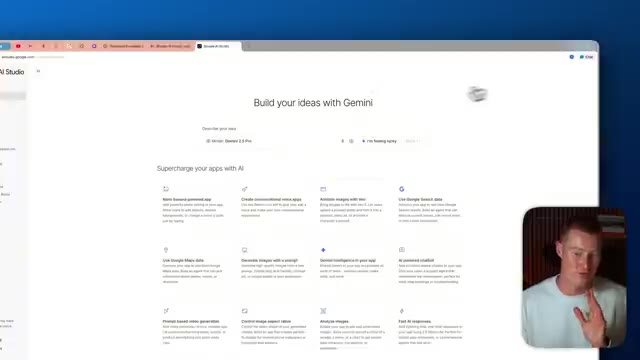
*⏱️ 00:01:50 — Capture d'écran du navigateur affichant l'interface de Google AI Studio avec le modèle Gemini 2.5 Pro sélectionné.*

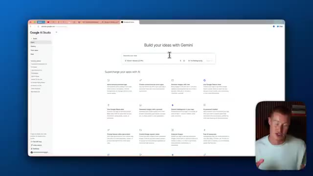
*⏱️ 00:01:56 — Capture d'écran similaire montrant l'interface de Google AI Studio avec le curseur positionné dans la zone de prompt principale.*

---

### ⏱️ `[00:02:09 - 00:02:28]` | Segment #06

**🔊 Audio (Transcription Intégrale Mot pour Mot en Français) :**
> We have other things such as VO3, which is a video model from Gemini. We could use Google search data. So all of these right here are AI products that are directly integrated with the Google and Gemini ecosystem. And we could easily use these in our app. And I'm gonna show you exactly how to do that. All right, so this is the prompt that I'm actually giving to Google AI Studio.

**👁️ Analyse Visuelle d'Écran (gemini-3.5-flash-lite) :**
**Interface & Outils** : Google AI Studio

**Contenu textuel & Code** : Interface web listant les capacités et outils d'intelligence artificielle de l'écosystème Google/Gemini (« Build your ideas with Gemini »).

**Action / Démonstration** : Présentation des différentes options de l'écosystème Google AI Studio intégrables dans une application.

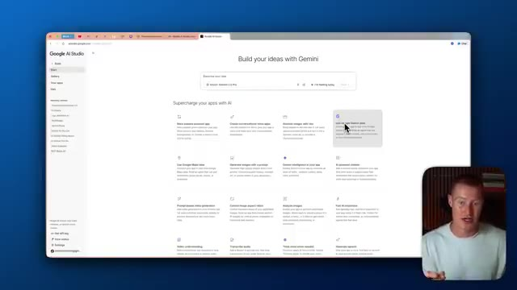
*⏱️ 00:02:18 — Interface de Google AI Studio affichant les différentes options de modèles et d'outils de l'écosystème Gemini, avec la webcam du présentateur en incrustation.*

---

### ⏱️ `[00:02:28 - 00:02:48]` | Segment #07

**🔊 Audio (Transcription Intégrale Mot pour Mot en Français) :**
> Alors, construis-moi une application qui apporte des modifications à tes miniatures en téléchargeant une image miniature et tu pourrais changer l'expression de la personne dans la miniature. Donc, disons que mon monteur crée réellement une miniature pour moi, mais je veux changer mon expression sur l'image et je ne veux pas prendre de photo. Je pourrais simplement remplacer automatiquement cette image de moi par une image générée via Nano Banana directement à l'intérieur de cette application.

**👁️ Analyse Visuelle d'Écran (gemini-3.5-flash-lite) :**
**Interface & Outils** : Présentation ou face-caméra explicatif du trader sans interface logicielle partagée.

**Contenu textuel & Code** : Explications orales des stratégies et mise en contexte méthodologique du marché.

**Action / Démonstration** : Explications face caméra et analyse conceptuelle des marchés.

---

### ⏱️ `[00:02:49 - 00:03:10]` | Segment #08

**🔊 Audio (Transcription Intégrale Mot pour Mot en Français) :**
> So I'm just going to click on build and it's just like any of these other vibe coding apps It's gonna begin spinning up a preview and writing out the code for our app here. While this is doing its thing, one thing I do wanna mention is I'm really impressed with how quick this is actually generating a response. If you're using something like Lovable, sometimes it takes a couple of minutes to actually make an update or give you a working prototype.

**👁️ Analyse Visuelle d'Écran (gemini-3.5-flash-lite) :**
**Interface & Outils** : Présentation ou face-caméra explicatif du trader sans interface logicielle partagée.

**Contenu textuel & Code** : Explications orales des stratégies et mise en contexte méthodologique du marché.

**Action / Démonstration** : Explications face caméra et analyse conceptuelle des marchés.

---

### ⏱️ `[00:03:10 - 00:03:46]` | Segment #09

**🔊 Audio (Transcription Intégrale Mot pour Mot en Français) :**
> This has been very seamless and pretty quick when I've been testing it compared to Lovable. All right, so we have our working prototype. It's actually following the theme of the screenshot that I provided. I basically gave it an example app that I wanted to replicate so we could have similar typography and a similar user interface as you can see here. So let me go ahead and try this out. I'm going to upload an image. Let me upload a thumbnail and it looks like it's not showing the full image here. So let me just come here and make a change. One thing that is pretty cool about build inside of Google AI Studio is we have this annotate button. So if we click this, we can actually draw on our screen. So I'm just going to go like this and draw on this. So it knows exactly what I'm talking about. I could even put

**👁️ Analyse Visuelle d'Écran (gemini-3.5-flash-lite) :**
**Interface & Outils** : Présentation ou face-caméra explicatif du trader sans interface logicielle partagée.

**Contenu textuel & Code** : Explications orales des stratégies et mise en contexte méthodologique du marché.

**Action / Démonstration** : Explications face caméra et analyse conceptuelle des marchés.

---

### ⏱️ `[00:03:46 - 00:04:08]` | Segment #10

**🔊 Audio (Transcription Intégrale Mot pour Mot en Français) :**
> an arrow there or I could like add text, for example. So this is an easier way to go ahead and make edits to your app if you don't want to like text with a prompt. Let me send that off and it's probably going to make this fix in one shot. All right, let's take a look at our app now. So as you can see, our text says, perfect your thumbnail expression, upload a thumbnail and change the person expression in seconds. So let me go ahead. I'm going to upload a new photo here.

**👁️ Analyse Visuelle d'Écran (gemini-3.5-flash-lite) :**
**Interface & Outils** : Présentation ou face-caméra explicatif du trader sans interface logicielle partagée.

**Contenu textuel & Code** : Explications orales des stratégies et mise en contexte méthodologique du marché.

**Action / Démonstration** : Explications face caméra et analyse conceptuelle des marchés.

---

### ⏱️ `[00:04:08 - 00:04:27]` | Segment #11

**🔊 Audio (Transcription Intégrale Mot pour Mot en Français) :**
> And as you can see, we have this thumbnail image and I could basically click any of these expressions. So let's just say, let's make him surprised. I guess I should say me because this is me. And now we have this little slider function so we can see before and after and boom, there we go. I do definitely look surprised. Let me just try one more. Maybe let's say make me look happy.

**👁️ Analyse Visuelle d'Écran (gemini-3.5-flash-lite) :**
**Interface & Outils** : Présentation ou face-caméra explicatif du trader sans interface logicielle partagée.

**Contenu textuel & Code** : Explications orales des stratégies et mise en contexte méthodologique du marché.

**Action / Démonstration** : Explications face caméra et analyse conceptuelle des marchés.

---

### ⏱️ `[00:04:27 - 00:04:54]` | Segment #12

**🔊 Audio (Transcription Intégrale Mot pour Mot en Français) :**
> All right, there you go. I guess I'm smiling. That's kind of funny. But guys, let's now talk about what makes this different because this was built in like one or two prompts here using the Google AI Studio. But the thing that is really impactful about this is the fact that not only is it free, but I did not have to integrate any API in order to be able to integrate this image generation model. Let me go to lovable and use the same exact prompt that I used to build this app.

**👁️ Analyse Visuelle d'Écran (gemini-3.5-flash-lite) :**
**Interface & Outils** : Navigateur web affichant l'interface de l'application "Thumbnail Expression Editor" sous Google AI Studio.

**Contenu textuel & Code** : Interface utilisateur avec des options textuelles (« Perfect Your Thumbnail Expression », sélecteurs d'expressions comme Happy, Surprised, Serious, etc.) et une prévisualisation visuelle de miniature.

**Action / Démonstration** : Le présentateur présente et commente l'interface utilisateur de l'application web générée par IA.

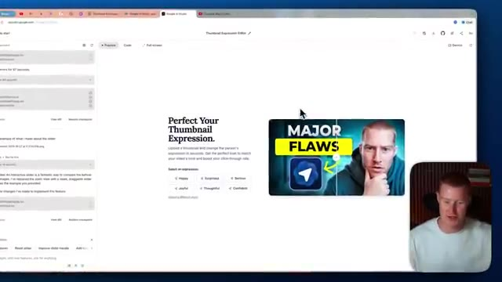
*⏱️ 00:04:34 — Capture montrant un navigateur web affichant une interface d'outil de modification d'expression de miniature ("Thumbnail Expression Editor") avec le présentateur en incrustation.*

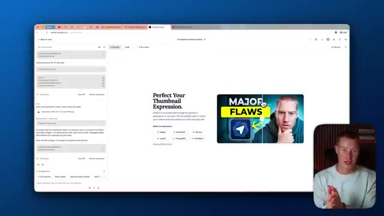
*⏱️ 00:04:47 — Capture similaire à l'image 1 avec le navigateur affichant l'application web de retouche de miniatures YouTube et le présentateur en bas à droite.*

---

### ⏱️ `[00:04:54 - 00:05:28]` | Segment #13

**🔊 Audio (Transcription Intégrale Mot pour Mot en Français) :**
> Et ensuite, je vais en fait prendre une capture d'écran pour essayer de lui faire fabriquer exactement la même application. Nous verrons à quel point il s'en rapproche réellement. Et je vais envoyer ceci, prêt à partir. Tout d'abord, si vous n'aviez pas déjà un compte Lovable payant, vous obtiendriez quelques crédits afin de pouvoir réellement lancer quelques aperçus pour votre application, mais je peux vous garantir qu'avant d'obtenir un prototype fonctionnel ou un produit fonctionnel terminé, vous devrez réellement passer à un forfait payant, ce que vous n'avez pas à faire avec Google AI Studio. Très bien, alors Lovable a construit cette application, elle a l'air plutôt similaire relativement, donc ce que je vais faire, c'est que je vais la tester et voir comment elle fonctionne réellement.

**👁️ Analyse Visuelle d'Écran (gemini-3.5-flash-lite) :**
**Interface & Outils** : Présentation ou face-caméra explicatif du trader sans interface logicielle partagée.

**Contenu textuel & Code** : Explications orales des stratégies et mise en contexte méthodologique du marché.

**Action / Démonstration** : Explications face caméra et analyse conceptuelle des marchés.

---

### ⏱️ `[00:05:28 - 00:06:00]` | Segment #14

**🔊 Audio (Transcription Intégrale Mot pour Mot en Français) :**
> so I upload an image let's say that I look surprised and there we go that actually worked surprisingly well better than I thought it would and one thing I want to note is there is a new thing inside of Lovable called Lovable Cloud has built-in databases, has the ability to add any large language model or AI to our app without any setup. So for example, I didn't have to go ahead and set up the API in order to integrate this into my app. I also didn't have to inside of Google AI Studio. But one thing I do want to mention is inside of Lovable, this is bound to just images

**👁️ Analyse Visuelle d'Écran (gemini-3.5-flash-lite) :**
**Interface & Outils** : Lovable (plateforme de développement web par IA) et navigateur web.

**Contenu textuel & Code** : Options de Lovable Cloud, fonctionnalités de base de données, stockage, authentification, et intégration de modèles de langage (LLM).

**Action / Démonstration** : Navigation et explication des fonctionnalités cloud intégrées dans l'interface de Lovable.

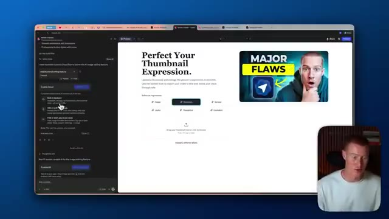
*⏱️ 00:05:36 — Interface de Lovable montrant un aperçu de l'application de modification de miniatures YouTube avec des options de cloud activées et une webcam du présentateur en bas à droite.*

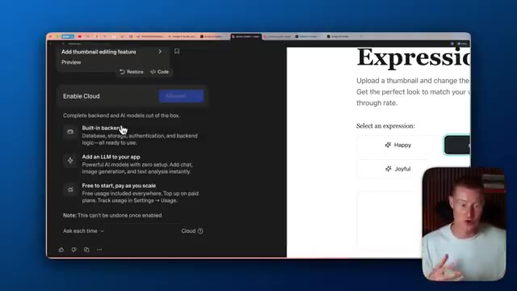
*⏱️ 00:05:44 — Gros plan sur les paramètres « Enable Cloud » de Lovable détaillant les fonctionnalités de backend intégré et d'intégration de LLM.*

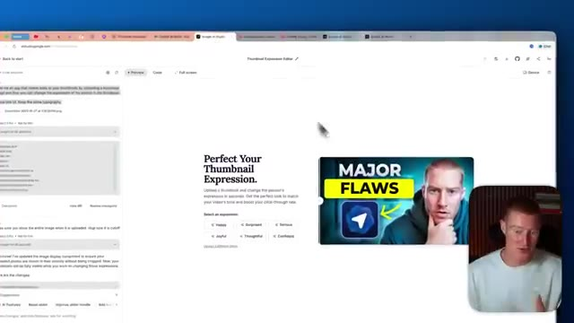
*⏱️ 00:05:52 — Vue de l'interface de développement de l'application avec le panneau de prévisualisation affichant la page de modification d'expression de miniature.*

---

### ⏱️ `[00:06:00 - 00:06:32]` | Segment #15

**🔊 Audio (Transcription Intégrale Mot pour Mot en Français) :**
> and text-based AI usage. Say for example, I want to add some AI text feature in here to help me come up with titles or something, I would still have to pay, but I wouldn't have to add my own API key from OpenAI in order to integrate this. But if I want to create a video generation app where I could take an image and then generate a video using VO3 from that or any of these different video models, I would have to pay to actually use my own API key. And I would also have to set up my own API key, which might be a pain to do so. Inside of Google AI Studio, I actually built this app that allows

**👁️ Analyse Visuelle d'Écran (gemini-3.5-flash-lite) :**
**Interface & Outils** : Présentation ou face-caméra explicatif du trader sans interface logicielle partagée.

**Contenu textuel & Code** : Explications orales des stratégies et mise en contexte méthodologique du marché.

**Action / Démonstration** : Explications face caméra et analyse conceptuelle des marchés.

---

### ⏱️ `[00:06:32 - 00:07:04]` | Segment #16

**🔊 Audio (Transcription Intégrale Mot pour Mot en Français) :**
> vous permet de télécharger une image, d'écrire une consigne, et nous transformerons cela en vidéo. Laissez-moi vous montrer très rapidement comment cela fonctionne. Et cela m'a pris littéralement une seule consigne à construire. Très bien, donc cela a pris cette image ici, tout ce chat, et l'a transformée en cette vidéo. Vous pouvez soit télécharger cette vidéo, soit en créer une autre. Mais la raison pour laquelle je voulais même faire cela, c'est parce que ce que j'aurais dû faire, c'est intégrer ma propre clé API, ce qui aurait été un peu pénible à faire. Google AI Studio rend cela extrêmement facile pour intégrer des modèles vidéo. Je veux revenir à cet exemple de notre application d'édition de miniatures. Donc oui, Lovable a été capable de faire vraiment

**👁️ Analyse Visuelle d'Écran (gemini-3.5-flash-lite) :**
**Interface & Outils** : Présentation ou face-caméra explicatif du trader sans interface logicielle partagée.

**Contenu textuel & Code** : Explications orales des stratégies et mise en contexte méthodologique du marché.

**Action / Démonstration** : Explications face caméra et analyse conceptuelle des marchés.

---

### ⏱️ `[00:07:04 - 00:07:40]` | Segment #17

**🔊 Audio (Transcription Intégrale Mot pour Mot en Français) :**
> easily because of the new Lovable cloud that they just added to their platform. However, I do want to mention that on top of paying for your monthly subscription to use Lovable in order to have access to a bunch of different credits inside of your platform, you're going to also have to pay on top of that for usage for whatever AI model you're using. This is using Nano Banana, which is Gemini's image generation model just like our app in AI studio is doing but we're gonna have to pay on top of our subscription per image generation and that's going to be charged to the card we have on file inside of lovable. I do want to mention the only thing that we need to pay

**👁️ Analyse Visuelle d'Écran (gemini-3.5-flash-lite) :**
**Interface & Outils** : Navigateur web affichant l'interface de l'application Lovable et le visage du présentateur en incrustation.

**Contenu textuel & Code** : Page de test d'une application web intitulée "Perfect Your Thumbnail Expression" avec options d'expressions (Happy, Surprised, Serious, etc.).

**Action / Démonstration** : Présentation des fonctionnalités de l'application web créée sur Lovable et de ses options d'intégration cloud.

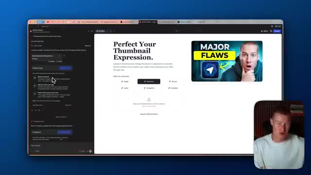
*⏱️ 00:07:13 — Interface web montrant un outil d'édition de miniatures avec le titre "Perfect Your Thumbnail Expression" et une application en cours de développement.*

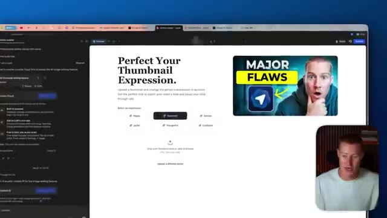
*⏱️ 00:07:31 — Vue similaire de l'interface de développement avec un aperçu de miniature vidéo à droite et le panneau latéral de configuration.*

---

### ⏱️ `[00:07:40 - 00:08:15]` | Segment #18

**🔊 Audio (Transcription Intégrale Mot pour Mot en Français) :**
> for inside of AI studio for Google is we need to pay for the API usage for whenever it does generate an image here or a video for example so we will need to actually set up some form of credit card to be able to do that. But a big point I want to make is we don't have to build an app that is using an AI model that's going to charge us per usage. For example, I built this app in one prompt that is basically Tinder, but for different clothes. And of course, this app is not perfect. It took me one prompt, but I just want to show you like this doesn't use any image generation models or anything. This is just a simple app that we could go ahead and build directly inside of AI

**👁️ Analyse Visuelle d'Écran (gemini-3.5-flash-lite) :**
**Interface & Outils** : Google AI Studio / Interface web de développement d'application.

**Contenu textuel & Code** : Éditeur d'expérience de miniatures vidéo, panneau de chat à gauche et aperçu visuel interactif à droite.

**Action / Démonstration** : Présentation et démonstration de la création d'une application de modification d'expression de miniatures via Google AI Studio.

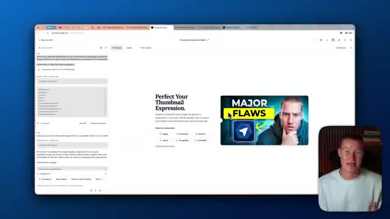
*⏱️ 00:07:57 — Interface de Google AI Studio / application web de génération de miniatures vidéo avec aperçu et chat latéral.*

---

### ⏱️ `[00:08:15 - 00:08:46]` | Segment #19

**🔊 Audio (Transcription Intégrale Mot pour Mot en Français) :**
> Studio and it would be completely free. You wouldn't have to pay for anything. So guys, there we have it. That is the new Google AI studio build feature that allows you to vibe code. I think this is the perfect place for you to start if you're new to vibe coding and you don't want to have to pay for subscriptions for lovable or repler or some of these other platforms. So if you guys got some value from this video, make sure to leave a like comment below what you think of it. Subscribe to this channel. This channel is a after non techies where I basically break down complex things for non-technical people to understand. So you can stay ahead in this fast moving world of AI. Anyways, guys, thank you for saying that in this video and I'll see you guys in the next one.

**👁️ Analyse Visuelle d'Écran (gemini-3.5-flash-lite) :**
**Interface & Outils** : Présentation ou face-caméra explicatif du trader sans interface logicielle partagée.

**Contenu textuel & Code** : Explications orales des stratégies et mise en contexte méthodologique du marché.

**Action / Démonstration** : Explications face caméra et analyse conceptuelle des marchés.

---

