# 🎬 How I’d Build a $1M App with Sora 2 (in 20 Minutes)

> **Chaîne** : [Brock Mesarich | AI for Non Techies](https://www.youtube.com/@BrockMesarich)  
> **Lien YouTube** : [https://www.youtube.com/watch?v=RxNKKTVwzjk](https://www.youtube.com/watch?v=RxNKKTVwzjk)  
> **Date de publication** : 20251104  
> **Durée** : 00:20:13  
> **Identifiant vidéo** : `RxNKKTVwzjk`  
> **Transcription & Analyse** : `whisper-v3-large-turbo+gemini-3.5-flash-lite`  

---

## 📌 Synthèse Exécutive & Outils

### 💡 Résumé
Dans cette vidéo intitulée **Comment je construirais une application à 1M$ avec Sora 2 (en 20 minutes)**, Alex Carter détaille une approche stratégique et pratique du trading et de l'automatisation par agents IA.

### 🛠️ Outils, Modèles & Logiciels Présentés
- **TradingView & Claude Code** : Analyse technique avancée et automatisation algorithmique.

### 🔑 Points Clés & Enseignements Stratégiques
- Respect rigoureux du ratio risque/rendement et du money management.
- Automatisation méthodique des déclencheurs d'ordres via des agents intelligents.

---

## ⏱️ Chronologie & Transcription Complète Audio & Visuelle (Mot pour Mot)

### ⏱️ `[00:00:00 - 00:00:36]` | Segment #01

**🔊 Audio (Transcription Intégrale Mot pour Mot en Français) :**
> Et si vous pouviez utiliser l'IA pour rétro-concevoir une idée à un million de dollars, en commençant non pas par le produit ou l'idée, mais par la vidéo virale qui la vend ? Dans cette vidéo, je vais vous montrer exactement comment je ferais. Utiliser l'IA pour trouver un concept de vidéo virale, puis construire l'application elle-même autour de cette idée en utilisant l'IA, et enfin utiliser Sora 2 pour créer les vidéos virales qui commercialisent votre application, le tout en moins de 30 minutes. Voici donc notre plan. Nous ne commençons pas par une application. Nous commençons par une idée de vidéo virale, le genre de concept qui vous donne instantanément envie d'arrêter de faire défiler votre écran. Pensez à quelque chose qui soit assez drôle, émotionnel ou époustouflant pour que vous ayez envie de l'envoyer par SMS à vos amis,

**👁️ Analyse Visuelle d'Écran (gemini-3.5-flash-lite) :**
**Interface & Outils** : Navigateur web avec une application de génération vidéo de type Sora 2.

**Contenu textuel & Code** : Interface utilisateur avec des miniatures de vidéos et une fenêtre de prélecture vidéo.

**Action / Démonstration** : Démonstration de l'utilisation d'outils d'IA vidéo pour la génération de contenu viral.

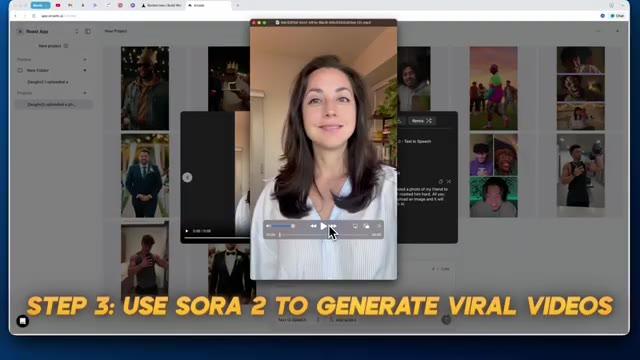
*⏱️ 00:00:18 — Une interface web montrant une application de génération vidéo avec une fenêtre de lecture au premier plan, et le texte "STEP 3: USE SORA 2 TO GENERATE VIRAL VIDEOS" affiché en bas.*

---

### ⏱️ `[00:00:36 - 00:01:11]` | Segment #02

**🔊 Audio (Transcription Intégrale Mot pour Mot en Français) :**
> parce que toutes ces plateformes de réseaux sociaux boostent désormais les vidéos qui sont envoyées à vos amis. Et une fois que nous aurons ce moment viral, nous allons travailler à l'envers et concevoir un produit alimenté par l'IA qui pourrait exister uniquement pour rendre cette vidéo réelle, puisque cette idée de vidéo est un succès potentiel. Donc, comme vous pouvez le voir, c'est un peu contraire à toute création d'application d'IA que vous avez probablement vue, parce que cette application n'est pas la grande idée ici. C'est l'attention. Et c'est ainsi que l'on fait réellement buzzer une application et qu'on la fait connaître à un tas d'utilisateurs différents. Donc, une fois que nous aurons cette idée de vidéo virale, nous allons en fait construire notre application avec Rocket.new, qui permet à n'importe qui de créer des applications avec l'IA. Et puis enfin,

**👁️ Analyse Visuelle d'Écran (gemini-3.5-flash-lite) :**
**Interface & Outils** : Aucune interface logicielle ou graphique affichée.

**Contenu textuel & Code** : Aucun code, indicateur ou donnée chiffrée.

**Action / Démonstration** : Le présentateur s'adresse directement à la caméra en faisant des gestes avec ses mains.

---

### ⏱️ `[00:01:11 - 00:01:44]` | Segment #03

**🔊 Audio (Transcription Intégrale Mot pour Mot en Français) :**
> nous allons utiliser Sora 2 pour créer les vidéos virales qui vont commercialiser notre application. L'objectif ici est de prouver qu'une seule personne utilisant l'IA peut créer ce qui prenait autrefois toute une équipe de startup, de la conception au produit jusqu'au lancement de notre application, ainsi que la création de matériel marketing en moins de 30 minutes. Donc, sans plus tarder, plongeons-nous là-dedans. Très bien, parlons rapidement d'un produit qui est devenu complètement viral grâce à une seule vidéo de lancement. Et nous allons essayer de recréer ce succès similaire qu'a eu cette publicité du Dollar Shave Club. L'auteur de ce livre est le suivant : L'auteur de ce livre est le suivant : Parlons-en dès maintenant. Le titre de ceci est Nos lames sont foutrement géniales. Elle a été faite en 2012. Le coût était inférieur à

**👁️ Analyse Visuelle d'Écran (gemini-3.5-flash-lite) :**
**Interface & Outils** : Aucune interface logicielle, aucun graphique ni terminal affiché (plans de coupe exclusifs du présentateur).

**Contenu textuel & Code** : Aucun code source, graphique technique, métrique ni configuration n'est visible.

**Action / Démonstration** : Le présentateur s'adresse directement à l'audience en expliquant le projet sans manipulation ni démonstration à l'écran.

---

### ⏱️ `[00:01:44 - 00:02:21]` | Segment #04

**🔊 Audio (Transcription Intégrale Mot pour Mot en Français) :**
> 4 500 dollars à produire, et c'était une vidéo explicative de 90 secondes avec de l'humour, de la simplicité et de l'authenticité. Et le résultat a été de 12 000 nouveaux clients inscrits instantanément, le trafic du site web a temporairement planté à cause du trafic et plus de 4 millions de vues la première semaine, et c'était en 2012. Laissez-moi vous montrer un petit extrait de cette vidéo ici. Donc en gros, comme vous pouvez le voir, juste avec ce petit extrait d'environ 10-15 secondes, tout le but de cette pub est simplement d'attirer votre attention.

**👁️ Analyse Visuelle d'Écran (gemini-3.5-flash-lite) :**
**Interface & Outils** : Navigateur web (YouTube) et document de notes numériques.

**Contenu textuel & Code** : Texte listant des métriques de performance et lecteur vidéo en ligne.

**Action / Démonstration** : Présentation des résultats d'une campagne vidéo.

---

### ⏱️ `[00:02:21 - 00:02:55]` | Segment #05

**🔊 Audio (Transcription Intégrale Mot pour Mot en Français) :**
> Vous ne vous souciez pas vraiment de ce qu'est le produit, c'est juste que la vidéo attire votre attention. Nous allons essayer de faire exactement la même chose, mais en utilisant des vidéos IA virales que nous allons créer avec Sora 2 à la fin de cette vidéo. Mais maintenant, allons-y et faisons de l'ingénierie inverse sur une idée de vidéo virale en utilisant l'IA. Et ensuite, nous allons faire de l'ingénierie inverse et construire cela avec rocket.new, qui permet à n'importe qui de créer des applications avec l'IA. Très bien, entrons dans le vif du sujet. Nous allons d'abord commencer par l'idée de vidéo. Donc ce que je vais faire, c'est utiliser le bon vieux ChatGPT pour m'aider réellement à trouver cette idée de vidéo virale. Et ensuite, nous allons faire de l'ingénierie inverse à partir de là et commencer à créer une application à partir de là, puis utiliser Sora 2 pour réellement fabriquer

**👁️ Analyse Visuelle d'Écran (gemini-3.5-flash-lite) :**
**Interface & Outils** : Navigateur web (YouTube, ChatGPT) et webcam du présentateur.

**Contenu textuel & Code** : Page de lecture vidéo YouTube avec métriques d'engagement et interface de chat de l'assistant IA ChatGPT.

**Action / Démonstration** : Navigation web et présentation parlée sans démonstration technique pertinente.

---

### ⏱️ `[00:02:55 - 00:03:30]` | Segment #06

**🔊 Audio (Transcription Intégrale Mot pour Mot en Français) :**
> ces vidéos générées par IA à grande échelle que nous pourrions publier pour faire exploser notre application. Voici un méta-prompt que je vais utiliser. Si vous voulez l'utiliser, il y a un lien dans la description qui le renverra comme ressource. Vous pouvez donc utiliser exactement le même prompt si vous le souhaitez, ou vous pouvez simplement faire une capture d'écran ici et l'utiliser. Ce que je vais faire, c'est que je vais amener ceci dans ChatGPT. Et le résumé en gros de ceci, c'est qu'on demande essentiellement à ChatGPT d'agir comme s'il était un stratège créatif, un expert en idéation de produits IA. L'objectif est de rétro-concevoir des idées de vidéos virales. Et ensuite, à partir de là, nous allons prendre, vous savez, cela et le transformer en une application que nous pourrions réellement construire. Je vais donc envoyer ceci à ChatGPT. Ça devrait probablement

**👁️ Analyse Visuelle d'Écran (gemini-3.5-flash-lite) :**
**Interface & Outils** : Navigateur web, Notion, interface ChatGPT.

**Contenu textuel & Code** : Méta-prompt et structure par étapes pour concevoir des applications et des vidéos virales propulsées par l'IA.

**Action / Démonstration** : Présentation et explication du méta-prompt utilisé pour générer des idées d'applications et de vidéos virales.

---

### ⏱️ `[00:03:30 - 00:04:04]` | Segment #07

**🔊 Audio (Transcription Intégrale Mot pour Mot en Français) :**
> faire des recherches approfondies ici. Très bien. Voici donc le résultat que nous avons obtenu. Nous avons plein d'idées différentes ici. Et comme vous pouvez le voir, vous pouvez voir que nous avons un concept de vidéo virale. Vous montrez donc votre téléphone, vous ouvrez une discussion avec vous-même d'il y a cinq ans, un message apparaît. Quand allons-nous acheter la caméra dont nous avons parlé ? Vous tapez, l'as-tu fait ? Puis il répond avec la voix de votre ancien vous et vous réagissez avec choc. Vous pouvez donc voir que cela commence fondamentalement par l'idée de vidéo et qu'ensuite, cela détaille même pourquoi elle pourrait devenir virale. La surprise, vous pouvez littéralement envoyer un SMS à votre jeune vous-même, toutes ces différentes choses. Cela détaille fondamentalement pourquoi il pense que chacune de ces vidéos deviendrait virale. Laissez-moi donc parcourir et en trouver une qui, selon moi, serait la meilleure. Très bien, j'adore personnellement cette idée.

**👁️ Analyse Visuelle d'Écran (gemini-3.5-flash-lite) :**
**Interface & Outils** : Navigateur web (ChatGPT), interface de discussion textuelle.

**Contenu textuel & Code** : Texte listant des concepts de vidéos virales ("What if you could talk to your past self's texts?", "AI just found my secret childhood diary"), des descriptions d'applications (TimeChat, DiaryDecoder), et des prompts de développement.

**Action / Démonstration** : Le présentateur présente à l'écran les concepts d'applications générées par IA et les idées de vidéos virales correspondantes.

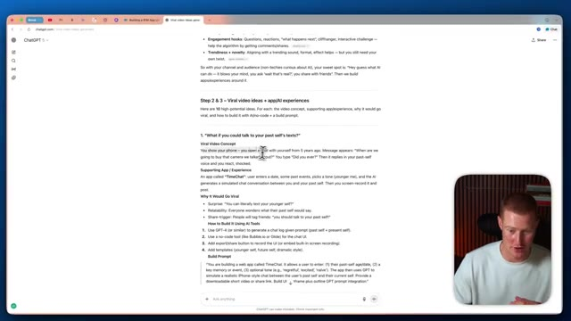
*⏱️ 00:03:39 — Capture d'écran montrant un navigateur affichant ChatGPT avec des idées de concepts de vidéos virales et d'applications d'IA, avec le présentateur en médaillon en bas à droite.*

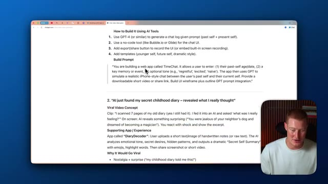
*⏱️ 00:03:56 — Capture d'écran de l'interface de ChatGPT détaillant la section de construction de prompts d'applications et les idées de concepts viraux, avec le présentateur incrusté en bas à droite.*

---

### ⏱️ `[00:04:05 - 00:04:37]` | Segment #08

**🔊 Audio (Transcription Intégrale Mot pour Mot en Français) :**
> Et voici l'accroche pour la vidéo. J'ai téléchargé une photo de mon ami sur cette IA et elle l'a vanné sévèrement. Ensuite, montrez l'application en train de générer des phrases de vanne drôles et personnalisées sur l'expression, la tenue ou l'ambiance de votre ami. Genre, le frérot a l'air de donner des discours de motivation à deux heures du matin dans des salons vocaux Discord. C'est plutôt drôle, franchement. Et si je descends ici, ça explique en gros pourquoi elle pense que ça pourrait devenir viral. Donc, de l'humour plus de la validation sociale, parfait pour les moments « montre ça à tes amis », ce qu'on veut vraiment créer parce qu'on veut une application qui puisse devenir virale. Et la meilleure façon d'y parvenir, c'est non seulement de capter l'attention sur des plateformes comme TikTok ou Instagram,

**👁️ Analyse Visuelle d'Écran (gemini-3.5-flash-lite) :**
**Interface & Outils** : Navigateur web (ChatGPT / interface textuelle)

**Contenu textuel & Code** : Texte décrivant un concept de vidéo virale (« Viral Video Concept »), une application de support (« RoastMyFriend.ai ») et les raisons pour lesquelles elle pourrait devenir virale (« Why It Would Go Viral »).

**Action / Démonstration** : Le présentateur explique et illustre le concept de la vidéo virale affiché à l'écran en le survolant avec la souris.

*⏱️ 00:04:13 — Capture d'écran montrant l'interface d'un navigateur web affichant une page avec un concept de vidéo virale et une section sur une application de vannes (« RoastMyFriend.ai »), avec le présentateur visible en incrustation vidéo dans le coin inférieur droit.*

---

### ⏱️ `[00:04:37 - 00:05:05]` | Segment #09

**🔊 Audio (Transcription Intégrale Mot pour Mot en Français) :**
> mais aussi de faire en sorte que tu aies envie d'envoyer ceci à un ami et d'interagir réellement avec lui, essentiellement. Il y a aussi écrit « barrière basse » ici. Tu peux donc charger, rire et partager. Et ensuite, boucle UGC. Les utilisateurs font leurs propres vannes, les publient, ce qui alimente la viralité. Ça détaille même la façon dont il utiliserait l'IA pour construire ces outils. Ça m'a également donné un prompt de création ici que nous pourrions utiliser à l'intérieur de notre générateur d'applications d'IA. Et ce que je vais faire, c'est que je vais maintenant me rendre sur rocket.new, qui est une plateforme que nous allons utiliser pour développer cette application. Tu n'as pas besoin de savoir coder.

**👁️ Analyse Visuelle d'Écran (gemini-3.5-flash-lite) :**
**Interface & Outils** : Navigateur web affichant ChatGPT et un document de conception de projet.

**Contenu textuel & Code** : Texte listant les facteurs de viralité (« Why It Would Go Viral »), les outils d'IA nécessaires (Replicate, GPT-4o, ElevenLabs) et un exemple de prompt de construction pour l'application.

**Action / Démonstration** : Le curseur sélectionne du texte à l'écran pour souligner les points clés relatifs à la facilité d'utilisation et aux fonctionnalités de l'application présentée.

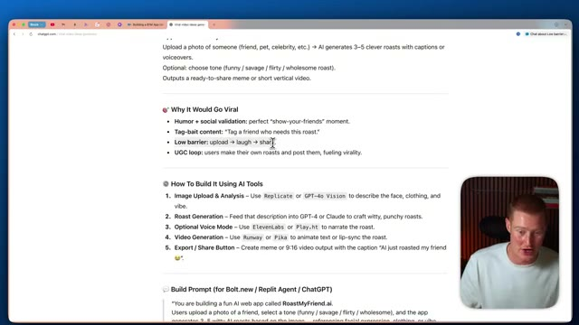
*⏱️ 00:04:44 — Capture d'écran montrant un document textuel dans un navigateur web avec les sections sur la viralité d'une application et la méthode de construction, ainsi que le présentateur en médaillon.*

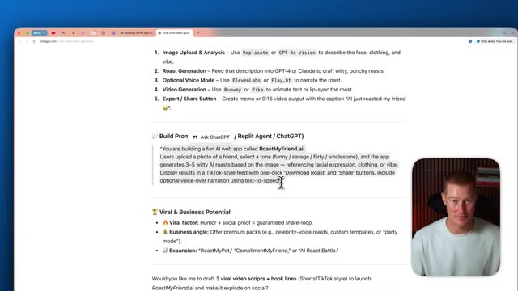
*⏱️ 00:04:58 — Capture d'écran du navigateur web affichant un prompt détaillé pour créer une application web d'intelligence artificielle (« RoastMyFriend.ai »), avec le présentateur visible en incrustation.*

---

### ⏱️ `[00:05:05 - 00:05:24]` | Segment #10

**🔊 Audio (Transcription Intégrale Mot pour Mot en Français) :**
> Si vous savez taper au clavier, vous pouvez fondamentalement créer une application en utilisant cette plateforme. Donc voici le prompt. J'utilise littéralement le prompt que ChatGPT m'a donné. Très bien, donc je vais transmettre ceci à Rocket. Il va commencer à créer notre application maintenant et nous reviendrons dans un instant. Très bien, donc Rocket me demande en fait quels écrans nous voulons créer pour commencer. Il est donc écrit : sélectionnez les écrans que vous souhaitez créer dans la liste ci-dessous.

**👁️ Analyse Visuelle d'Écran (gemini-3.5-flash-lite) :**
**Interface & Outils** : Navigateur web affichant l'interface de la plateforme no-code Rocket (rocket.new).

**Contenu textuel & Code** : Prompt utilisateur décrivant l'application RoastMyFriend.ai, et options de sélection d'écrans (Photo Upload, Roast Results, User Dashboard).

**Action / Démonstration** : Saisie et envoi d'un prompt d'application pour initialiser la génération automatique par l'intelligence artificielle Rocket.

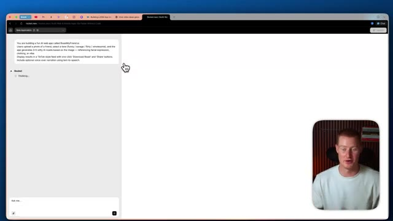
*⏱️ 00:05:14 — Interface de la plateforme de création d'applications "Rocket" montrant un prompt d'IA pour l'application "RoastMyFriend.ai" et un aperçu en cours de chargement.*

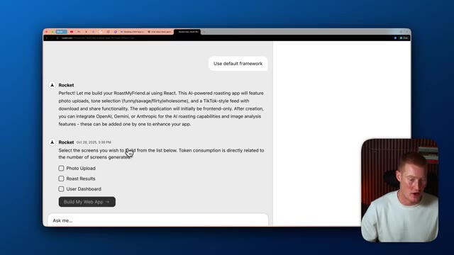
*⏱️ 00:05:19 — Interface de Rocket affichant la réponse de l'IA qui propose de construire l'application avec React et permet de sélectionner les écrans à générer.*

---

### ⏱️ `[00:05:24 - 00:05:43]` | Segment #11

**🔊 Audio (Transcription Intégrale Mot pour Mot en Français) :**
> La consommation de jetons est directement liée au nombre d'écrans générés. Téléchargement de photo, résultats de critique. Commençons simplement par cela car c'est la fonctionnalité principale de notre application. Et je vais cliquer sur créer mon application. Elle commence à le faire maintenant. Très bien. Donc, comme ça, nous avons notre application. Et laissez-moi vous expliquer en gros comment cela fonctionne. Je vais jouer avec. Donc d'abord, il est écrit de télécharger l'une des photos de vos amis.

**👁️ Analyse Visuelle d'Écran (gemini-3.5-flash-lite) :**
**Interface & Outils** : Navigateur web affichant l'outil de génération d'application no-code Rocket.

**Contenu textuel & Code** : Options de sélection d'écrans, messages d'état de l'IA, code source généré et interface utilisateur de prévisualisation.

**Action / Démonstration** : Clic sur le bouton de génération de l'application web et affichage du résultat en cours de construction.

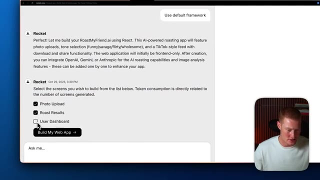
*⏱️ 00:05:29 — Interface de création d'application avec la sélection des écrans (Photo Upload, Roast Results) et le bouton de génération.*

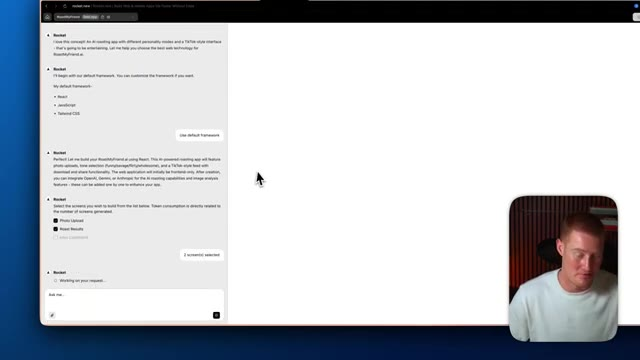
*⏱️ 00:05:33 — L'application commence à générer les écrans demandés avec le message de chargement.*

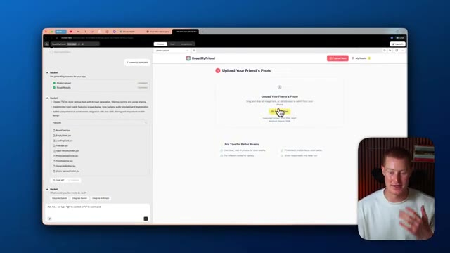
*⏱️ 00:05:38 — Affichage de l'interface générée de l'application "RoastMyFriend" avec la zone de téléchargement de photo.*

---

### ⏱️ `[00:05:43 - 00:06:02]` | Segment #12

**🔊 Audio (Transcription Intégrale Mot pour Mot en Français) :**
> Alors, laissez-moi aller chercher l'image à utiliser. Très bien, donc je viens de télécharger cette image de moi-même parce que je veux me faire clasher personnellement et vous pouvez choisir votre style de clash. Et les gars, ce n'est pas une seule et unique instruction. Nous pouvons apporter n'importe quel changement à notre application comme nous le souhaitons. Et je pourrais aussi rendre l'interface utilisateur un peu plus jolie. Pour qu'elle ait moins l'air générée par IA. Par exemple, allons-y et choisissons Sauvage.

**👁️ Analyse Visuelle d'Écran (gemini-3.5-flash-lite) :**
**Interface & Outils** : Application web (RoastMyFriend) affichée dans un navigateur sur le bureau.

**Contenu textuel & Code** : Interface utilisateur avec sections pour télécharger une photo, choisir un style de clash (Funny, Savage, Flirty, Wholesome) et générer les résultats.

**Action / Démonstration** : Démonstration de l'application web et téléchargement d'une photo personnelle pour tester le service.

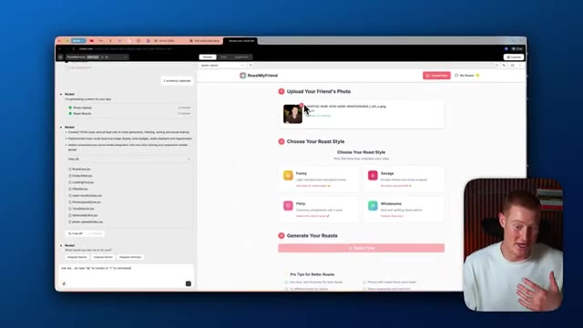
*⏱️ 00:05:48 — Capture d'écran montrant l'interface web de l'application 'RoastMyFriend' avec une photo téléchargée et différentes options de styles de clash.*

---

### ⏱️ `[00:06:02 - 00:06:37]` | Segment #13

**🔊 Audio (Transcription Intégrale Mot pour Mot en Français) :**
> Je veux que ce soit d'une honnêteté brutale et à la langue acérée. Aucune pitié, que du feu pur. Donc cette application est plutôt amusante et interactive et je pourrais cliquer sur générer un "roast" en faisant tourner cette interface utilisateur ici. Et je viens de réaliser quelque chose. Ce n'est pas encore connecté à l'IA, donc ça ne va pas vraiment me "roster". Donc si je viens dans notre chat à l'intérieur de Rocket, vous pouvez voir qu'il est écrit, que voudriez-vous que je fasse ensuite ? Et il m'a donné ces options d'intégration afin d'intégrer l'IA dans notre application. Je vais donc cliquer sur intégrer OpenAI. Et en gros, ça va intégrer ChatGPT. Il est donc capable d'analyser les images et ensuite d'écrire un commentaire amusant à ce sujet. De plus, je peux afficher ceci en mode mobile parce que c'est probablement

**👁️ Analyse Visuelle d'Écran (gemini-3.5-flash-lite) :**
**Interface & Outils** : Navigateur web, interface de développement de type Bolt/v0 ou assistant de code IA, application React en cours de développement.

**Contenu textuel & Code** : Liste de fichiers de composants JSX (RoastCard.jsx, EmptyState.jsx, FilterBar.jsx, ToneSelector.jsx, GenerateButton.jsx), boutons de téléchargement et de régénération dans l'interface, prompt "Integrate OpenAI with my application".

**Action / Démonstration** : Navigation et présentation de l'interface utilisateur de l'application de "roast" et interaction avec l'assistant de code.

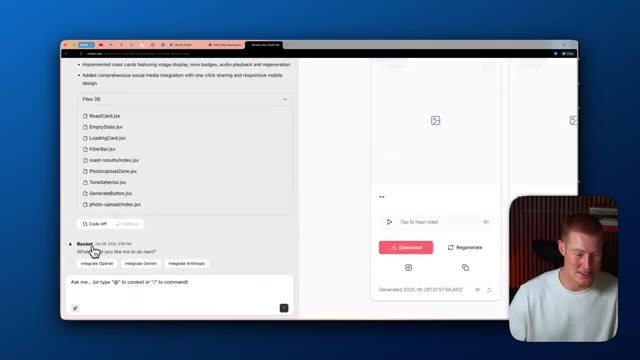
*⏱️ 00:06:20 — Interface de développement web montrant la liste des fichiers React (.jsx) d'une application de "roast" et un aperçu de l'interface utilisateur.*

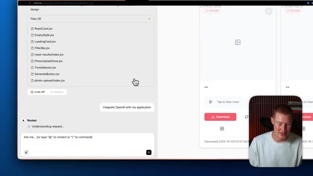
*⏱️ 00:06:29 — Interface montrant l'interaction avec l'assistant de code avec un message de prompt "Integrate OpenAI with my application".*

---

### ⏱️ `[00:06:37 - 00:07:13]` | Segment #14

**🔊 Audio (Transcription Intégrale Mot pour Mot en Français) :**
> ça va être une application qui est conçue pour le mobile, par exemple, parce que c'est comme ça qu'on va l'utiliser pour créer les vidéos. On va probablement concevoir cette application pour les utilisateurs mobiles parce que ce sera plus facile pour nous de créer de vraies vidéos virales si c'est sur un téléphone portable au lieu d'être juste, vous savez, une application pour ordinateur. Très bien. Donc, il demande ma clé API OpenAI. Alors laissez-moi aller la chercher maintenant, entrer une clé API, cliquer sur continuer. Et maintenant, il semble que notre intégration OpenAI devrait fonctionner correctement. Très bien. Donc maintenant nous avons cette application. J'ai un peu joué avec. Elle n'est pas totalement finalisée, mais notre application fonctionne maintenant. Elle est intégrée avec OpenAI. Donc elle est capable de vraiment critiquer nos images que nous téléchargeons. Alors laissez-moi continuer

**👁️ Analyse Visuelle d'Écran (gemini-3.5-flash-lite) :**
**Interface & Outils** : Navigateur web affichant un IDE de développement d'application et un aperçu mobile (Bolt / interface de code cloud).

**Contenu textuel & Code** : Fichiers de code source (JS/JSX), arborescence de projet, console de chat et prévisualisation d'interface utilisateur mobile.
[DESC_IMAGE_2] Aucun contenu visuel pertinent (plan fixe du présentateur).

**Action / Démonstration** : Explications face caméra et analyse conceptuelle des marchés.

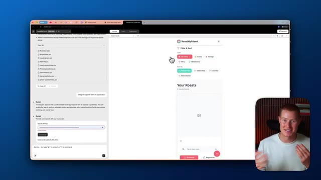
*⏱️ 00:06:46 — Interface de développement affichant le code d'une application mobile nommée "RoastMyFriend" avec une vue d'aperçu à droite et le présentateur en médaillon.*

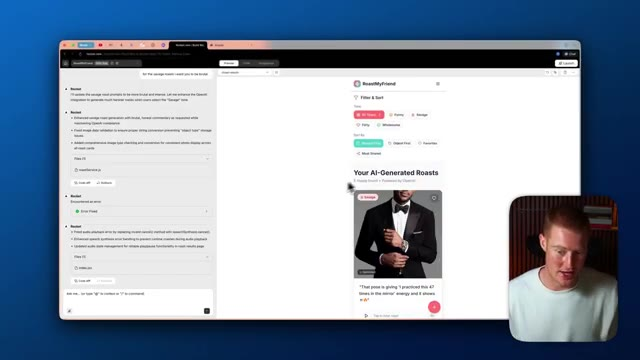
*⏱️ 00:07:04 — Aperçu de l'application mobile "RoastMyFriend" montrant les résultats générés par IA avec des images et du texte, et le présentateur en médaillon.*

---

### ⏱️ `[00:07:13 - 00:07:39]` | Segment #15

**🔊 Audio (Transcription Intégrale Mot pour Mot en Français) :**
> et de vous montrer comment ça marche. Je peux cliquer sur ce bouton plus, cliquer sur "importer une photo", et là je peux simplement importer n'importe quelle image. Très bien. J'ai donc importé cette sorte de miniature de mon visage que j'utilise pour mes miniatures. J'ai l'air un peu bizarre ici. Genre, je peux voir que ça va me détruire complètement pour ça. Donc ce que je vais faire, c'est que je peux maintenant choisir mon style. Je vais cliquer sur "sauvage". Je veux que ce soit aussi sauvage que possible. Alors cliquons sur "générer le tacle". Génération en cours, ça utilise l'IA pour analyser la photo et concocter le tacle personnalisé.

**👁️ Analyse Visuelle d'Écran (gemini-3.5-flash-lite) :**
**Interface & Outils** : Navigateur web, interface de développement / application web (Rocket.new), panneau de code latéral (fichiers JavaScript, logs de débogage).

**Contenu textuel & Code** : Interface utilisateur de l'application "RoastMyFriend", options de style (Savage, Funny, etc.), logs de génération de code et de correction d'erreurs.

**Action / Démonstration** : Importation d'une image miniature du visage du présentateur dans l'application web et sélection des options de style.

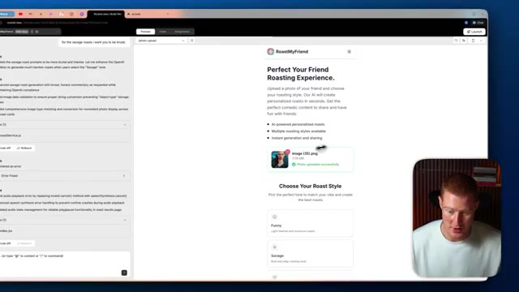
*⏱️ 00:07:20 — Interface d'une application web de type générateur de "roast" avec le panneau de code à gauche et l'application affichant l'image importée du visage du présentateur à droite.*

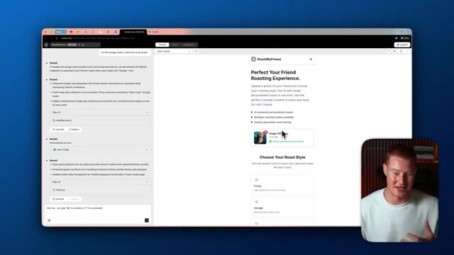
*⏱️ 00:07:26 — Vue similaire montrant l'application web avec l'image du visage téléchargée avec succès dans l'interface de test.*

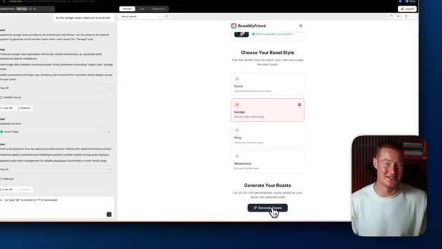
*⏱️ 00:07:33 — L'application web affichant les options de style de "roast" (Funny, Savage, Flirty, Wholesome) avec le bouton de génération en bas.*

---

### ⏱️ `[00:07:40 - 00:08:04]` | Segment #16

**🔊 Audio (Transcription Intégrale Mot pour Mot en Français) :**
> Donc, donnons-lui une seconde. Nous devrions avoir un résultat. Très bien. Donc, il est dit que cette pose assure. J'ai répété ça 47 fois devant le miroir, et ça se voit. Voilà. C'est un roast plutôt solide. Ce que je pourrais faire, c'est que je veux en fait apporter quelques modifications à notre application. Je veux m'assurer qu'elle montre la photo entière qui est téléchargée. Alors, laissez-moi venir ici et lui dire ça. Assurons-nous que lorsqu'une photo est téléchargée et que vous générez le roast, cela montre la photo entière qui a été téléchargée et n'en coupe aucune partie.

**👁️ Analyse Visuelle d'Écran (gemini-3.5-flash-lite) :**
**Interface & Outils** : Navigateur web affichant une application de génération de roasts assistée par IA, avec le présentateur en médaillon vidéo en bas à droite.

**Contenu textuel & Code** : Interface utilisateur affichant une photo avec une légende générée par IA : « That pose is giving 'I practiced this 47 times in the mirror' energy and it shows », ainsi que des journaux de modifications de code dans le volet latéral.

**Action / Démonstration** : Le curseur survole le résultat du roast et le présentateur commente le résultat affiché à l'écran.

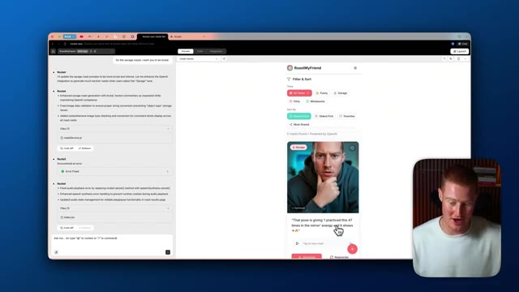
*⏱️ 00:07:46 — Capture d'écran montrant l'interface d'une application web de type "RoastMyFriend" avec un panneau de code/historique à gauche et le résultat du roast d'une photo à droite.*

---

### ⏱️ `[00:08:04 - 00:08:24]` | Segment #17

**🔊 Audio (Transcription Intégrale Mot pour Mot en Français) :**
> Très bien, c'est parti. Maintenant, ça fonctionne réellement correctement. Vous pouvez voir que ça montre la photo complète ici. Je pourrais même aimer chacune d'entre elles. Et ensuite, je pourrais parcourir le fil d'actualité et cela me montre toutes les différentes publications que j'ai téléversées. Cette application fonctionne plutôt correctement maintenant. Une chose que je tiens à mentionner, c'est que si je viens ici sur les intégrations en haut, il y a tout un tas de choses différentes que nous pourrions intégrer dans notre application.

**👁️ Analyse Visuelle d'Écran (gemini-3.5-flash-lite) :**
**Interface & Outils** : Navigateur web affichant l'interface de l'application 'RoastMyFriend' et l'outil de développement Rocket.

**Contenu textuel & Code** : Interface utilisateur avec des publications, des options de tri, des images téléchargées et un fil d'actualité de contenu généré par l'IA.

**Action / Démonstration** : Démonstration de l'affichage correct des photos complètes et navigation dans le fil d'actualité des publications téléversées.

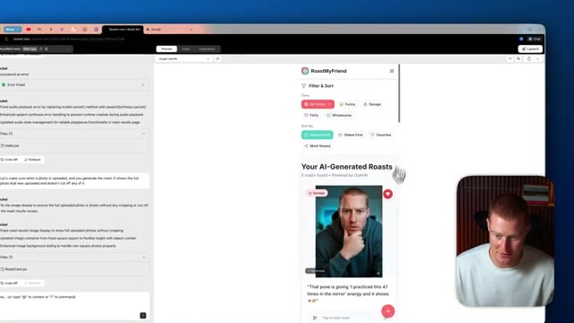
*⏱️ 00:08:09 — Aperçu de l'application web 'RoastMyFriend' affichant les publications et les photos générées par IA avec des options de filtrage et de notation.*

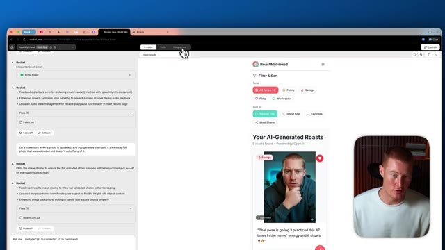
*⏱️ 00:08:19 — Navigation dans l'interface de développement avec le panneau de prévisualisation et le fil d'actualité de l'application.*

---

### ⏱️ `[00:08:24 - 00:08:59]` | Segment #18

**🔊 Audio (Transcription Intégrale Mot pour Mot en Français) :**
> Donc nous pourrions connecter ceci à une base de données, que nous utiliserions Supabase. Nous pourrions le connecter à Stripe afin de pouvoir réellement facturer l'utilisation de notre logiciel. Nous pourrions ajouter Perplexity, qui est un modèle d'IA, Anthropic, Gemini, AdSense, toutes ces différentes choses que nous pourrions réellement intégrer directement dans notre application. Disons que nous voulons vraiment avoir des utilisateurs de sorte que vous puissiez voir ce que vos amis publient, nous devrions configurer quelque chose comme Supabase. Laissez-moi donc vous montrer rapidement exactement comment vous feriez cela. Je vais donc cliquer sur ceci. En fait, je vais continuer, je vais créer un nouveau projet Supabase, je vais l'appeler roast app. Très bien, maintenant que Supabase est connecté, je vais simplement venir sur rocket et fondamentalement dire, ajoutons maintenant l'authentification des utilisateurs. De cette façon, il pourrait y avoir

**👁️ Analyse Visuelle d'Écran (gemini-3.5-flash-lite) :**
**Interface & Outils** : Navigateur web, plateforme de développement low-code / no-code avec interface de configuration des API.

**Contenu textuel & Code** : Paramètres d'intégration de services tiers (base de données Supabase, paiements Stripe, modèles d'IA comme Perplexity et OpenAI).

**Action / Démonstration** : Navigation à travers les menus d'intégration et configuration des clés d'API et bases de données pour l'application.

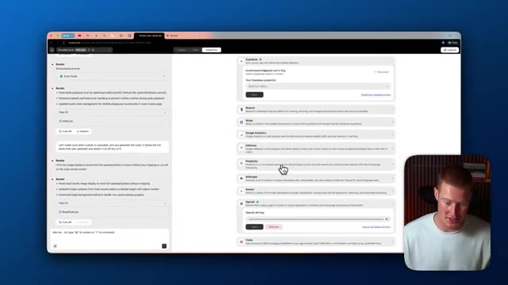
*⏱️ 00:08:33 — Interface de développement montrant les options d'intégration (Supabase, Stripe, Perplexity, OpenAI, etc.).*

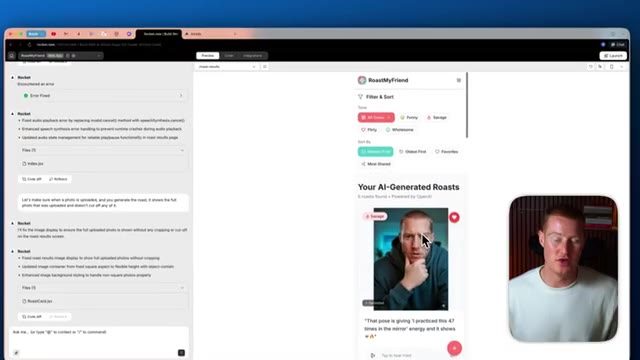
*⏱️ 00:08:41 — Aperçu de l'application 'RoastMyFriend' générant des contenus textuels et visuels par IA.*

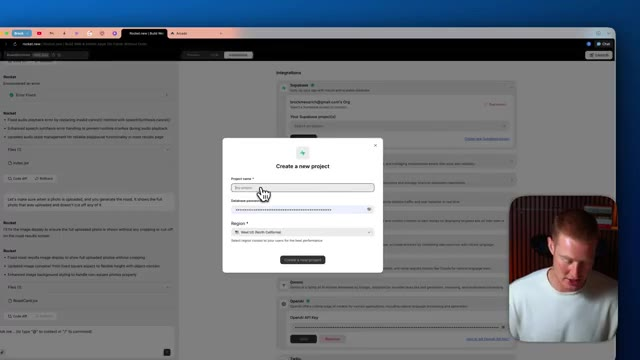
*⏱️ 00:08:50 — Fenêtre modale de création d'un nouveau projet Supabase avec saisie du nom, mot de passe et région.*

---

### ⏱️ `[00:08:59 - 00:09:36]` | Segment #19

**🔊 Audio (Transcription Intégrale Mot pour Mot en Français) :**
> différents utilisateurs qui pourraient télécharger leurs propres publications. Et de cette façon, nous pouvons réellement rendre notre application plus fonctionnelle et ensuite, une fois que nous aurons fait fonctionner cela correctement, passons à la façon dont nous allons réellement commercialiser notre application en utilisant Sora 2 et en générant des vidéos virales pour cette application, car c'est bien là tout le problème. Ajoutons maintenant l'authentification des utilisateurs afin qu'ils puissent s'inscrire et qu'ensuite cela affiche automatiquement toutes les publications générées par les utilisateurs sur le fil d'actualité. Très bien, nous avons donc maintenant la possibilité de nous connecter à un compte, nous avons donc l'authentification et la base de données configurées ici et je lui ai également dit de passer à GPT-5 pour générer réellement le "roast" ainsi que pour analyser ceci.

**👁️ Analyse Visuelle d'Écran (gemini-3.5-flash-lite) :**
**Interface & Outils** : Navigateur web, plateforme de développement no-code/AI, interface utilisateur mobile simulée.

**Contenu textuel & Code** : Code source, journaux de mise à jour, base de données connectée, écran de connexion utilisateur.

**Action / Démonstration** : Configuration et test de l'interface de connexion et de la base de données de l'application.

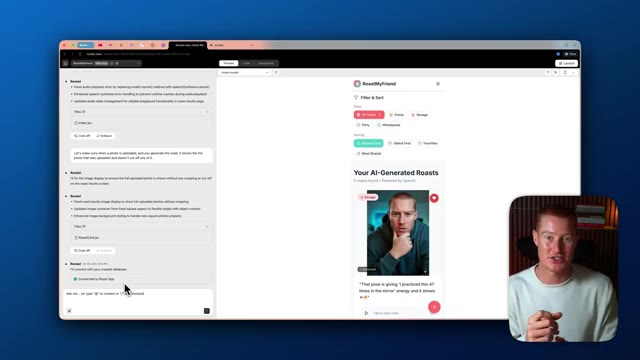
*⏱️ 00:09:08 — Interface de développement avec assistant IA à gauche et prévisualisation mobile de l'application 'RoastMyFriend' à droite.*

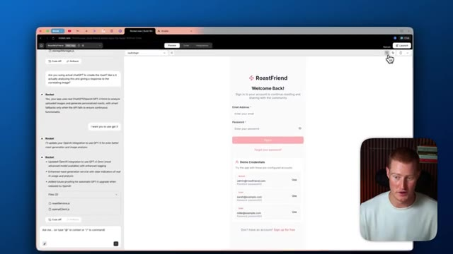
*⏱️ 00:09:26 — Interface de l'application affichant l'écran de connexion avec des identifiants de démonstration.*

---

### ⏱️ `[00:09:36 - 00:10:00]` | Segment #20

**🔊 Audio (Transcription Intégrale Mot pour Mot en Français) :**
> Donc ce que nous pourrions faire, c'est que vous pouvez voir que nous avons ce bouton s'inscrire maintenant. Donc nous pourrions cliquer sur s'inscrire ou nous pourrions cliquer sur se connecter. Je vais juste utiliser l'un de ces identifiants de démonstration ici, qui a déjà un compte créé. Et je pourrions instantanément juste télécharger une image et essayons cela maintenant. Je vais télécharger cette image de LeBron. Je vais cliquer sur le mode sauvage et boum, allons-y et générons ce "roast" pour nous. Très bien. Donc la confiance est admirable, mais l'angle ne vous rend aucun service, ma belle.

**👁️ Analyse Visuelle d'Écran (gemini-3.5-flash-lite) :**
**Interface & Outils** : Navigateur web affichant l'application RoastFriend sur la plateforme de développement Rocket.new.

**Contenu textuel & Code** : Interface utilisateur avec champs de connexion, panneau de chat à gauche et options de configuration de l'application web.

**Action / Démonstration** : Connexion à l'application en utilisant des identifiants de démonstration préconfigurés.

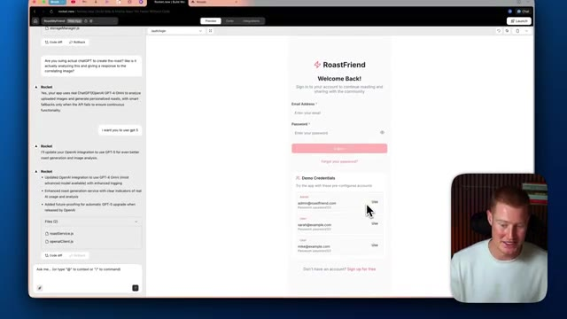
*⏱️ 00:09:42 — Page de connexion de l'application RoastFriend avec des identifiants de démonstration visibles en bas.*

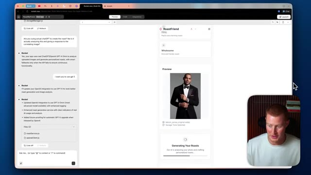
*⏱️ 00:09:54 — L'application RoastFriend connectée affiche une photo de LeBron James en prévisualisation avec un chargement de génération.*

---

### ⏱️ `[00:10:00 - 00:10:19]` | Segment #21

**🔊 Audio (Transcription Intégrale Mot pour Mot en Français) :**
> Et voilà. Voilà notre rôti sauvage. Nous pouvons ensuite l'envoyer à un ami. Nous pourrions télécharger ceci. Nous pourrions aussi toucher pour écouter le rôti. Il a donc comme une voix hors champ pour nous juste là. Je tiens à mentionner, évidemment, que si nous voulons créer une application complète que nous prévoyons de voir utilisée par des milliers de personnes, nous aurions probablement besoin de passer plus du temps que ce que nous avons fait dans cette vidéo.

**👁️ Analyse Visuelle d'Écran (gemini-3.5-flash-lite) :**
**Interface & Outils** : Application web de développement sans code avec interface de prévisualisation mobile et panneau de chat pour l'IA.

**Contenu textuel & Code** : Interface utilisateur de l'application 'RoastFriend' affichant des options de filtrage, des images générées et des boutons d'écoute audio et de téléchargement.

**Action / Démonstration** : Navigation et démonstration des fonctionnalités de l'application, notamment l'écoute audio et le téléchargement des résultats générés.

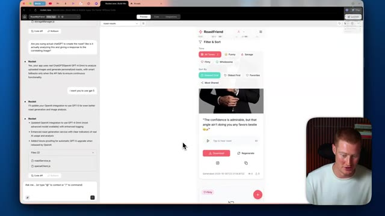
*⏱️ 00:10:04 — Interface de l'application de génération de roast avec le résultat affiché et les boutons d'interaction et de téléchargement.*

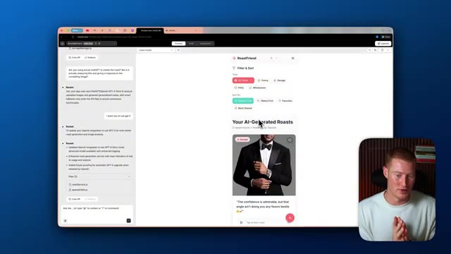
*⏱️ 00:10:14 — Vue de l'interface montrant les résultats des roasts générés par l'IA avec les options de filtre et de tri.*

---

### ⏱️ `[00:10:19 - 00:10:42]` | Segment #22

**🔊 Audio (Transcription Intégrale Mot pour Mot en Français) :**
> But I want to just basically show the capabilities of using a platform like Rocket to generate an app that is functional, even if you have no idea how to code. So I'm pretty happy with what we've done here in just a couple of minutes here. So now that we have our app and we might make some changes to this, but let's go ahead and actually start creating these advertisements using Sora 2 so we could really make our app blow up.

**👁️ Analyse Visuelle d'Écran (gemini-3.5-flash-lite) :**
**Interface & Outils** : Plateforme de développement d'applications no-code/AI Rocket.

**Contenu textuel & Code** : Interface utilisateur de création d'applications avec un volet de discussion conversationnel à gauche et un aperçu interactif de l'application "RoastFriend" intégrant des fonctionnalités d'IA à droite.

**Action / Démonstration** : Le présentateur démontre l'utilisation de la plateforme Rocket pour générer et prévisualiser une application fonctionnelle basée sur l'IA.

*⏱️ 00:10:30 — Interface de la plateforme Rocket montrant le constructeur d'application "RoastFriend" avec un panneau de chat à gauche et un aperçu mobile de l'application à droite.*

---

### ⏱️ `[00:10:42 - 00:11:00]` | Segment #23

**🔊 Audio (Transcription Intégrale Mot pour Mot en Français) :**
> Très bien. Donc, la plateforme que nous allons utiliser pour créer nos publicités UGC par IA — UGC signifie contenu généré par les utilisateurs, et c'est fondamentalement ce que vous voyez chaque fois que vous regardez une publicité sur TikTok, c'est simplement du contenu UGC. Donc, ce que nous allons faire, c'est que nous allons nous connecter à notre compte Arcades, et lorsque nous arrivons ici, ce que nous allons faire, c'est de cliquer sur ajouter un produit.

**👁️ Analyse Visuelle d'Écran (gemini-3.5-flash-lite) :**
**Interface & Outils** : Navigateur web affichant la plateforme SaaS Arcads.ai.

**Contenu textuel & Code** : Interface utilisateur de création de publicités UGC par IA, avec menus de projets et vignettes de prévisualisation vidéo.
[DESC_IMAGE_2] Navigation dans l'interface de l'outil de génération de vidéos publicitaires avec des acteurs IA.

**Action / Démonstration** : Explications face caméra et analyse conceptuelle des marchés.

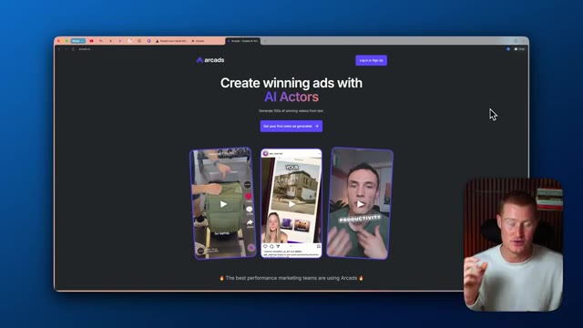
*⏱️ 00:10:46 — Page d'accueil du site web Arcads.ai affichant le titre 'Create winning ads with AI Actors' avec des exemples de vidéos publicitaires au format vertical.*

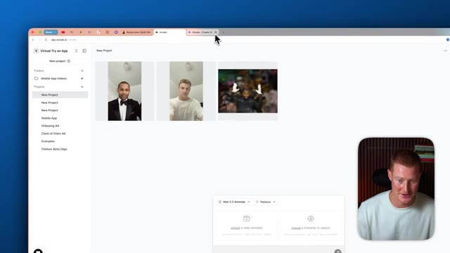
*⏱️ 00:10:55 — Interface du tableau de bord de la plateforme Arcads.ai montrant l'espace de gestion de projets et des aperçus de vidéos générées.*

---

### ⏱️ `[00:11:00 - 00:11:19]` | Segment #24

**🔊 Audio (Transcription Intégrale Mot pour Mot en Français) :**
> Je vais appeler cette application "roast app". Et nous allons voir cette interface ici. Et je vais vous montrer exactement comment vous pouvez commencer à créer de multiples types d'annonces publicitaires en utilisant l'intelligence artificielle en seulement quelques instructions. Très bien. Donc, avant d'aller de l'avant et de générer ma première annonce pour notre application, je veux vous montrer les fonctionnalités d'utilisation d'ArcAds.

**👁️ Analyse Visuelle d'Écran (gemini-3.5-flash-lite) :**
**Interface & Outils** : Navigateur web affichant une application web de montage et de génération vidéo par IA.

**Contenu textuel & Code** : Interface utilisateur avec des options de création de projets, de dossiers et de vignettes de vidéos d'acteurs.

**Action / Démonstration** : Navigation et présentation de l'interface de création d'annonces publicitaires basées sur l'intelligence artificielle.

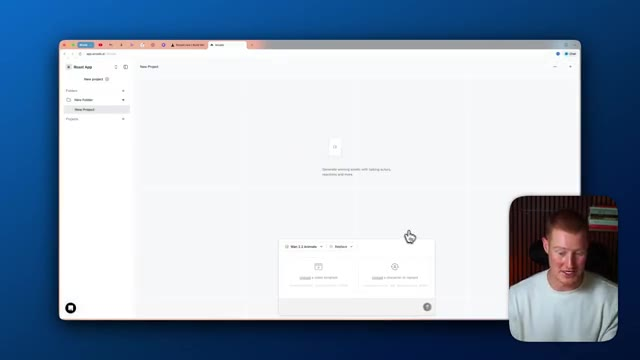
*⏱️ 00:11:05 — Interface d'une application de création de projets vidéo par IA avec le présentateur incrusté en bas à droite.*

*⏱️ 00:11:14 — Interface utilisateur montrant plusieurs vignettes de prévisualisation de vidéos générées pour un projet publicitaire.*

---

### ⏱️ `[00:11:19 - 00:11:41]` | Segment #25

**🔊 Audio (Transcription Intégrale Mot pour Mot en Français) :**
> Nous avons donc plusieurs choses différentes à l'intérieur d'ici. Nous avons des acteurs parlants, que nous pourrions venir ici et fondamentalement sélectionner parmi un groupe de différents acteurs qu'ils ont. Ce sont fondamentalement juste des avatars générés par IA que nous pouvons utiliser pour nos publicités de contenu généré par les utilisateurs. Nous avons également la possibilité de simplement générer une vidéo. Nous pourrions donc sélectionner notre modèle vidéo ici. Nous allons utiliser Sora 2 Pro pour ce cas d'utilisation parce que c'est tout simplement le meilleur modèle pour créer ce style de vidéos.

**👁️ Analyse Visuelle d'Écran (gemini-3.5-flash-lite) :**
**Interface & Outils** : Application web de génération de vidéos par IA, interface de sélection de personnages et de modèles.

**Contenu textuel & Code** : Galerie d'avatairs humains générés par IA, options de modèles (Sora, Kling, Veo).

**Action / Démonstration** : Sélection d'un acteur virtuel et exploration des options de génération vidéo.

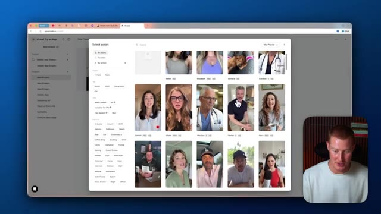
*⏱️ 00:11:24 — Interface de sélection d'acteurs virtuels (avatars IA) avec une grille de profils variés.*

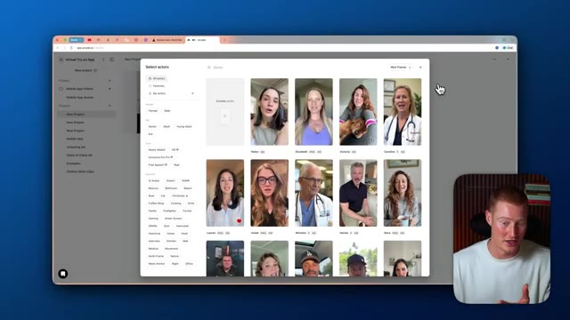
*⏱️ 00:11:30 — Navigation dans la bibliothèque d'avatars et de modèles vidéo par IA.*

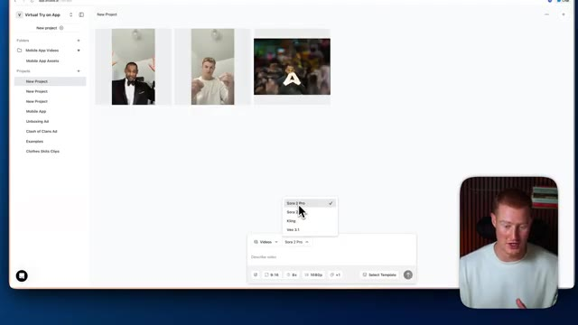
*⏱️ 00:11:35 — Menu déroulant de sélection de modèles vidéo (Sora 2 Pro, Kling, Veo 3.1) avec zone de prompt texte.*

---

### ⏱️ `[00:11:41 - 00:12:01]` | Segment #26

**🔊 Audio (Transcription Intégrale Mot pour Mot en Français) :**
> En plus de cela, nous avons aussi quelque chose qui s'appelle montre ton application. Donc si je retourne sur un autre projet, j'ai en fait construit cette application d'essayage virtuel. Et nous avons notre acteur ici qui tient un téléphone avec l'interface utilisateur de l'application sur notre téléphone. C'est donc une façon pour nous de pouvoir réellement intégrer notre application directement dans nos publicités. Ça a l'air honnêtement assez organique et ça ne fait même pas vraiment trop généré par IA.

**👁️ Analyse Visuelle d'Écran (gemini-3.5-flash-lite) :**
**Interface & Outils** : Navigateur web avec interface d'application de création vidéo / IA (Arcads.ai) et incrustation vidéo du présentateur.

**Contenu textuel & Code** : Interface utilisateur de l'application d'essayage virtuel avec options de téléchargement, acteur nommé Julien, et paramètres de caméra.

**Action / Démonstration** : Présentation et navigation dans une application de démonstration vidéo montrant un essayage virtuel sur mobile.

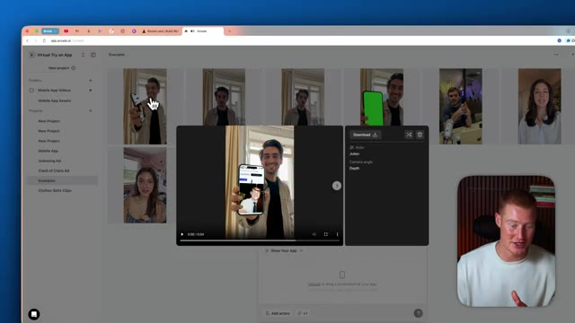
*⏱️ 00:11:46 — Interface web montrant un acteur tenant un téléphone affichant une application d'essayage virtuel, avec le présentateur incrusté en bas à droite.*

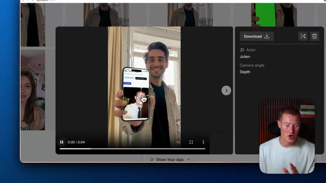
*⏱️ 00:11:51 — Gros plan sur la vidéo de démonstration de l'application d'essayage virtuel affichée sur le téléphone de l'acteur.*

---

### ⏱️ `[00:12:01 - 00:12:23]` | Segment #27

**🔊 Audio (Transcription Intégrale Mot pour Mot en Français) :**
> Ensuite, nous avons One 2.2 Anime, qui est fondamentalement ce modèle de génération vidéo qui vous permet de téléverser une vidéo de vous-même, puis de téléverser un personnage, et il imitera ce que vous faites dans cette vidéo. Laissez-moi donc vous montrer un rapide exemple. J'ai donc pris cette vidéo juste ici de moi-même en train de bouger mes mains et je vais vous montrer exactement quel est le résultat.

**👁️ Analyse Visuelle d'Écran (gemini-3.5-flash-lite) :**
**Interface & Outils** : Application Web de génération vidéo (Vidu 2.2 Animate), navigateur web, lecteur vidéo intégré.

**Contenu textuel & Code** : Menus de téléchargement de vidéo de référence, téléchargement d'image de personnage, et vignettes de projets récents.

**Action / Démonstration** : Le présentateur montre l'interface de l'outil d'IA et illustre le processus de téléchargement et de sélection des vidéos de référence.

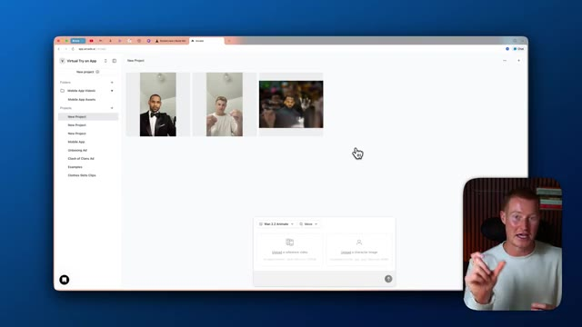
*⏱️ 00:12:12 — Interface Web d'un outil de génération vidéo par IA montrant le panneau de configuration pour "Vidu 2.2 Animate" avec des options de téléversement de vidéo et d'image de personnage.*

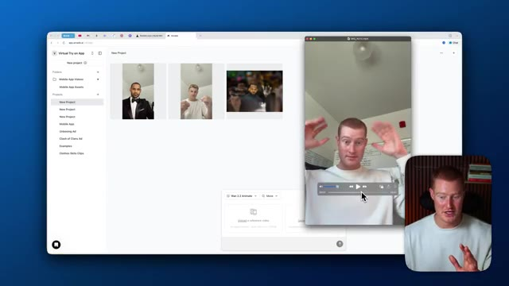
*⏱️ 00:12:18 — L'interface Web affiche en plus une fenêtre de prévisualisation vidéo active montrant le présentateur effectuant des mouvements de bras.*

---

### ⏱️ `[00:12:23 - 00:12:44]` | Segment #28

**🔊 Audio (Transcription Intégrale Mot pour Mot en Français) :**
> Voici LeBron James et c'est lui qui imite exactement ce que je fais dans la vidéo. C'est fou. Alors pensez à tous les cas d'utilisation différents. Vous pourriez fondamentalement juste télécharger soit l'un de nos acteurs que nous avons, ou juste un personnage. Et ensuite, vous pourriez fondamentalement juste faire ce que vous voulez et il imitera ce mouvement et tout ce que vous direz. Mais maintenant, passons à la génération effective de notre première publicité pour ce projet.

**👁️ Analyse Visuelle d'Écran (gemini-3.5-flash-lite) :**
**Interface & Outils** : Navigateur web (application de génération vidéo par IA, style Wan 2.2 Animate).

**Contenu textuel & Code** : Interface utilisateur avec des vignettes de vidéos générées, des options "Upload a reference video" et "Upload a character image".

**Action / Démonstration** : Navigation et présentation d'une interface de génération vidéo montrant des exemples de deepfake/animation de personnages.

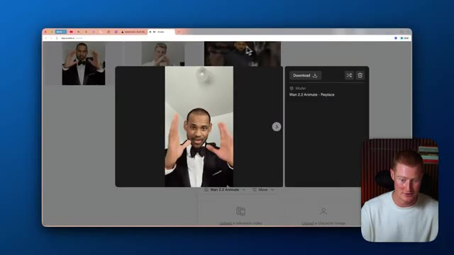
*⏱️ 00:12:28 — Navigateur affichant une application web de génération vidéo avec un aperçu montrant LeBron James en costume.*

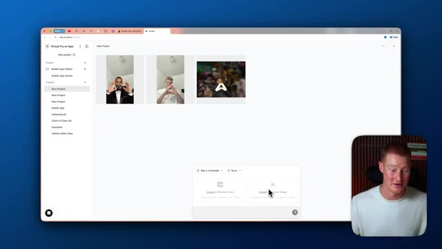
*⏱️ 00:12:39 — Interface de l'application web montrant des projets vidéo récents et des options de téléchargement (reference video / character image).*

---

### ⏱️ `[00:12:44 - 00:13:04]` | Segment #29

**🔊 Audio (Transcription Intégrale Mot pour Mot en Français) :**
> Très bien. Donc la première chose que je vais faire, c'est que je vais venir tester d'abord la fonctionnalité des acteurs parlants. Donc ce que cela va faire, c'est que cela va prendre un acteur unique et il va fondamentalement juste dire exactement ce que je lui demande de dire. Donc comme vous pouvez le voir, j'ai fondamentalement sélectionné les acteurs parlants. Et voici ce que je vais demander à notre acteur de dire. J'ai donc téléchargé une photo de mon ami de son IA et elle l'a clashé sévèrement.

**👁️ Analyse Visuelle d'Écran (gemini-3.5-flash-lite) :**
**Interface & Outils** : Application web (interface de création de contenu / IA, type Arcade.ai).

**Contenu textuel & Code** : Menu "Talking Actors", options "Text to Speech" et "Add actors", champ de saisie de texte pour le script de l'avatar.

**Action / Démonstration** : Saisie d'un texte dans l'interface web pour configurer le discours d'un acteur parlant virtuel.

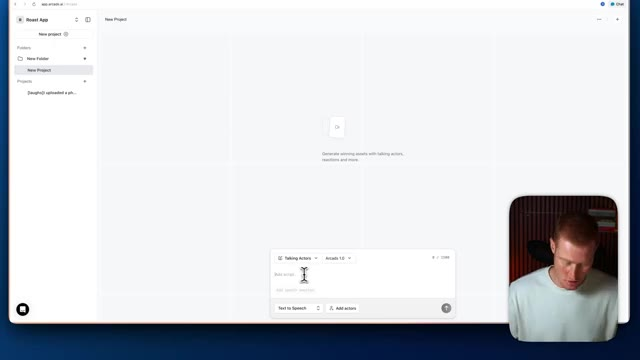
*⏱️ 00:12:49 — Interface web montrant un outil de génération d'acteurs parlants avec une zone de saisie de texte et la webcam du présentateur en médaillon.*

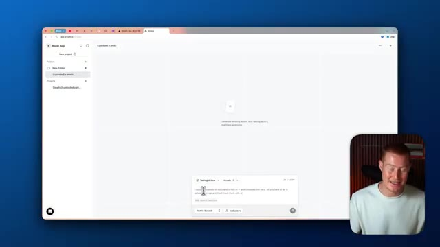
*⏱️ 00:12:59 — Interface web montrant le remplissage du script textuel pour la fonctionnalité "Talking Actors" avec la webcam du présentateur en médaillon.*

---

### ⏱️ `[00:13:04 - 00:13:40]` | Segment #30

**🔊 Audio (Transcription Intégrale Mot pour Mot en Français) :**
> Tout ce que vous avez à faire, c'est de télécharger une image et elle va le roaster avec l'IA. Et ensuite, ce que je vais faire au début de cette phrase, je vais cliquer sur la barre oblique, puis cliquer sur rires. Rires. Vous pouvez donc ajouter de l'émotion à tous vos différents acteurs parlants ici. Je vais donc commencer par ça. Je vais sélectionner Arcads 1.0 et je vais simplement sélectionner notre acteur. Et j'aime bien celui-ci. Je l'ai déjà utilisé. Je vais donc simplement utiliser celui-ci, cliquer sur "ajouter l'acteur". Et ce que je pourrais faire, c'est en fait en sélectionner plusieurs. Laissez-moi donc en sélectionner quelques-uns ici, cliquer sur "enregistrer les modifications". Et maintenant, nous avons ces trois personnes. Je clique simplement sur "envoyer". Et ce que ça va faire, c'est que ça va générer trois vidéos de personnes qui parlent maintenant à partir de celle-ci.

**👁️ Analyse Visuelle d'Écran (gemini-3.5-flash-lite) :**
**Interface & Outils** : Application web "Roast App" (Arcade AI) affichant une bibliothèque d'acteurs parlants.

**Contenu textuel & Code** : Grille de profils d'avatairs IA et options de filtrage par genre, âge et tags.

**Action / Démonstration** : Sélection d'acteurs virtuels dans l'interface de l'application.

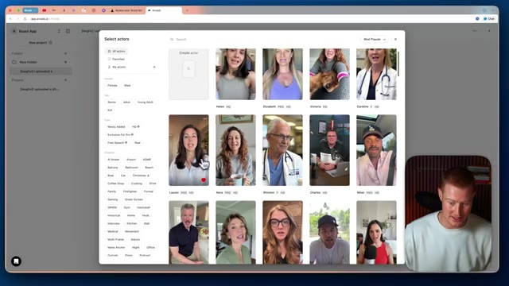
*⏱️ 00:13:22 — Interface de l'application de génération montrant une grille de sélection d'acteurs virtuels IA.*

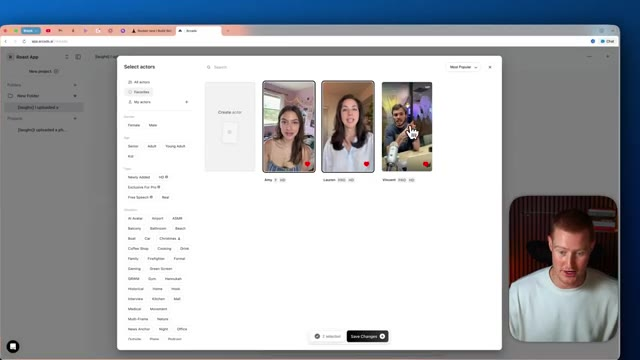
*⏱️ 00:13:31 — Vue rapprochée de la sélection des favoris parmi les acteurs parlants avec le bouton de sauvegarde.*

---

### ⏱️ `[00:13:40 - 00:14:16]` | Segment #31

**🔊 Audio (Transcription Intégrale Mot pour Mot en Français) :**
> singular prompt that I gave it. All right, so here is our output of our actor saying exactly what we want with Sora 2. So let's go take a look. I uploaded a photo of my friend to this AI and it roasted him hard. All you have to do is upload an image and it will roast them with AI. All right, so that is really solid. Honestly, I think that looks pretty good. And what we could do on top of this is edit a video inside of something like CapCut that just shows a clip of the app, throw some captions on there and that could be a good starting point for our ad but now what i'm going to do is i'm going to show you exactly how you could generate entire ads not just like talking

**👁️ Analyse Visuelle d'Écran (gemini-3.5-flash-lite) :**
**Interface & Outils** : Interface web d'application IA / Outil de génération vidéo de type Talking Actor

**Contenu textuel & Code** : Paramètres du modèle (Talking Actor 1.0 - Text to Speech), voix (Lauren - Default) et script audio correspondant au discours du présentateur.

**Action / Démonstration** : Démonstration du résultat de génération vidéo text-to-speech avec un acteur virtuel animé par l'intelligence artificielle.

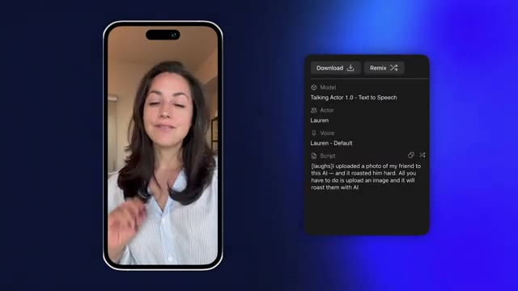
*⏱️ 00:13:49 — Aperçu d'une application IA affichant un acteur virtuel parlant (Lauren) sur smartphone à gauche et le script textuel à droite.*

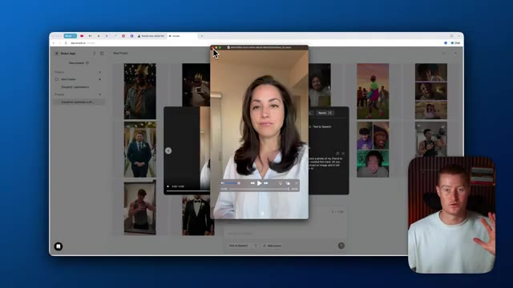
*⏱️ 00:13:58 — Interface de gestion de projets vidéo montrant le lecteur vidéo de l'acteur virtuel et la webcam du présentateur en bas à droite.*

---

### ⏱️ `[00:14:16 - 00:14:53]` | Segment #32

**🔊 Audio (Transcription Intégrale Mot pour Mot en Français) :**
> des clips de personnes mais comme un vrai petit sketch avec Sora 2 à l'intérieur d'Arcads. Bon, alors, en retournant sur ChatGPT et sur le prompt initial que je lui ai donné, voici donc une idée : je pourrais simplement copier ce prompt et le copier dans Arcads : un groupe d'amis traîne dehors au coucher du soleil en riant, un autre ami arrive dans une tenue absurde et, en gros, ils utilisent l'application "Roast your friends" pour le chambrer. Donc ce que je vais faire, c'est que je vais revenir sur Arcads, et au lieu de sélectionner des acteurs parlants, je vais simplement cliquer sur vidéos et je vais sélectionner Sora 2 Pro parce que c'est le meilleur modèle pour générer une vidéo, et voilà, je vais coller ce prompt ici et

**👁️ Analyse Visuelle d'Écran (gemini-3.5-flash-lite) :**
**Interface & Outils** : Navigateur web, ChatGPT, interface Arcads.ai

**Contenu textuel & Code** : Scripts de génération vidéo textuels et menus de configuration de l'outil de création vidéo Arcads.ai.

**Action / Démonstration** : Le présentateur parcourt et montre à l'écran les étapes de création de prompt et leur intégration dans l'outil de génération de vidéo.

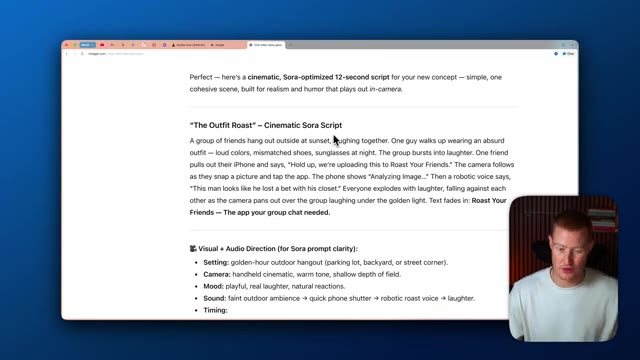
*⏱️ 00:14:25 — Capture montrant un navigateur web affichant une interface ChatGPT avec un prompt descriptif détaillé pour une vidéo cinématique de type Sora.*

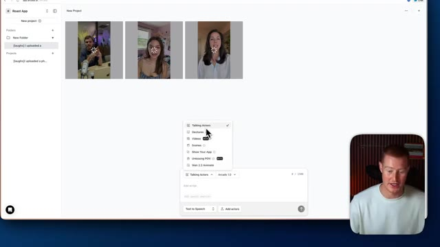
*⏱️ 00:14:43 — Capture montrant l'interface de l'application Arcads.ai avec un menu déroulant pour sélectionner des options de génération vidéo (Talking Actors, Gestures, Scenes).*

---

### ⏱️ `[00:14:53 - 00:15:14]` | Segment #33

**🔊 Audio (Transcription Intégrale Mot pour Mot en Français) :**
> Ce que je pourrais faire, c'est en fait sélectionner combien de vidéos je veux voir générées à partir de cette consigne initiale, alors sélectionnons-en juste trois, parce que, pour être honnête, utiliser Sora, c'est un peu quitte ou double à l'heure actuelle. Certaines sont fantastiques, vraiment très bien, et d'autres sont juste du genre à halluciner et ne sont pas les meilleures. Je suggère donc d'en faire deux ou trois. Comme ça, si l'une d'elles n'est pas bonne, vous avez d'autres options.

**👁️ Analyse Visuelle d'Écran (gemini-3.5-flash-lite) :**
**Interface & Outils** : Application web de génération de vidéos (interface de type Roast App avec options Sora 2 Pro).

**Contenu textuel & Code** : Interface utilisateur avec un prompt textuel décrivant une scène de groupe, et des paramètres de génération vidéo (format, durée, résolution).

**Action / Démonstration** : Le présentateur configure les paramètres pour générer trois variations de vidéos à partir d'un prompt textuel.

---

### ⏱️ `[00:15:14 - 00:15:50]` | Segment #34

**🔊 Audio (Transcription Intégrale Mot pour Mot en Français) :**
> Alors attendons simplement le résultat ici. Très bien, voici notre premier résultat. Nous en avons un sur trois de généré et ce que nous pouvons faire, c'est que si nous cliquons sur la vidéo, vous pouvez voir qu'elle affiche le prompt. Elle affiche notre vidéo, nous pouvons la regarder et ensuite nous pouvons aussi la télécharger. Donc je vais procéder au téléchargement et ensuite nous allons la lire. Qu'est-ce qu'il porte mon dieu attends une minute je récupère ça on met ça en ligne pour tes amis cet homme a l'air d'avoir perdu un pari avec son placard c'est parfait je veux dire les gars, obtenir ça à partir d'un seul et unique prompt en utilisant l'IA, c'est plutôt solide la cohérence des personnages est là, ça coupe entre différents

**👁️ Analyse Visuelle d'Écran (gemini-3.5-flash-lite) :**
**Interface & Outils** : Interface de génération vidéo Sora 2 Pro avec panneau de prompt et lecteur sur smartphone.

**Contenu textuel & Code** : Modèle Sora 2 Pro, texte complet du prompt décrivant une scène humoristique entre amis au coucher du soleil.
[DESC_IMAGE_3] Visualisation du résultat vidéo généré et lecture des détails du prompt associé.

**Action / Démonstration** : Explications face caméra et analyse conceptuelle des marchés.

*⏱️ 00:15:32 — Aperçu d'une vidéo générée affichée sur un smartphone virtuel avec le prompt détaillé du modèle Sora 2 Pro et un bouton de téléchargement.*

*⏱️ 00:15:41 — Suite de la lecture de la vidéo générée montrant la scène extérieure au coucher du soleil avec les options de gestion du prompt.*

---

### ⏱️ `[00:15:50 - 00:16:10]` | Segment #35

**🔊 Audio (Transcription Intégrale Mot pour Mot en Français) :**
> plans la qualité vidéo a l'air superbe genre ceux-là ont l'air de vraies personnes et ils ont l'air de vraies personnes aussi. Et puis à la fin, regardez, ça montre même un logo ici. Roast your friends, l'application dont votre groupe de discussion avait besoin. Donc ça vient juste d'une seule et unique consigne. Et j'ai obtenu cette consigne juste depuis Chat2BT. Donc vous pouvez commencer à voir les capacités de ceci à mesure que vous jouez avec ça de plus en plus.

**👁️ Analyse Visuelle d'Écran (gemini-3.5-flash-lite) :**
**Interface & Outils** : Navigateur web avec interface d'application vidéo (Roast App).

**Contenu textuel & Code** : Interface utilisateur avec panneau latéral listant des projets vidéo, une fenêtre de prévisualisation vidéo active avec le titre "Roast Your Friends" et un encart textuel descriptif.

**Action / Démonstration** : Présentation et démonstration visuelle d'une application de génération de vidéo par IA montrant un aperçu de clips vidéo et des prompts textuels associés.

*⏱️ 00:16:00 — Interface d'un navigateur affichant l'application 'Roast App' avec un aperçu vidéo central titré 'Roast Your Friends'.*

---

### ⏱️ `[00:16:11 - 00:16:33]` | Segment #36

**🔊 Audio (Transcription Intégrale Mot pour Mot en Français) :**
> Très bien. Donc voici une autre vidéo que j'ai générée. Comme vous pouvez le voir, voici le prompt que j'ai utilisé. Voici la vidéo qui a été générée. D'accord. Je teste ma propre application. Qu'est-ce qui pourrait mal tourner ? Tu as l'air du personnage principal d'un documentaire sur la fraude fiscale. Donc encore une fois, les gars, vous pouvez en faire à grande échelle.

**👁️ Analyse Visuelle d'Écran (gemini-3.5-flash-lite) :**
**Interface & Outils** : Navigateur web avec interface de génération vidéo par IA et panneau de prompt Sora 2 Pro.

**Contenu textuel & Code** : Le prompt complet décrivant la scène : un créateur testant sa propre application, téléchargeant une photo, et recevant un commentaire vocal sarcastique de l'IA.

**Action / Démonstration** : Présentation et démonstration d'une vidéo générée par IA illustrant un cas d'usage humoristique de l'application RoastMyFriend.ai.

*⏱️ 00:16:16 — Capture montrant une interface de génération vidéo affichant la vidéo d'un créateur devant son bureau et le panneau latéral contenant le prompt textuel utilisé avec le modèle Sora 2 Pro.*

*⏱️ 00:16:22 — Gros plan sur le rendu de l'application mobile 'RoastMyFriend.ai' affichée sur un smartphone simulé, avec le prompt textuel correspondant sur le côté droit.*

---

### ⏱️ `[00:16:33 - 00:16:53]` | Segment #37

**🔊 Audio (Transcription Intégrale Mot pour Mot en Français) :**
> Vous pourriez en faire 10, 20, 100 à la fois si vous voulez. Vous devrez payer pour faire cela. Mais c'est une façon de générer des publicités à grande échelle qui sont honnêtement plutôt drôles. Et je vais dire maintenant, Sora 2 est plutôt solide. Mais à mesure que ces modèles de génération vidéo s'améliorent de plus en plus, ceux-ci vont probablement devenir impossibles à distinguer de vraies vidéos.

**👁️ Analyse Visuelle d'Écran (gemini-3.5-flash-lite) :**
**Interface & Outils** : Navigateur web avec interface de génération vidéo et webcam du présentateur.

**Contenu textuel & Code** : Panneau latéral affichant les détails d'un modèle vidéo (Sora 2 Pro) et un prompt textuel.

**Action / Démonstration** : Présentation de la plateforme de génération de publicités vidéo par IA.

---

### ⏱️ `[00:16:53 - 00:17:12]` | Segment #38

**🔊 Audio (Transcription Intégrale Mot pour Mot en Français) :**
> Et c'est un énorme arbitrage dont vous pourriez profiter si vous essayez vraiment de faire exploser votre application et que vous voulez obtenir des utilisateurs payants pour votre application. Très bien, alors voici une nouvelle vidéo que j'ai générée. Encore une fois, vous pouvez voir le prompt et ensuite c'est une vidéo qui a été produite. Vous téléchargez la photo de votre témoin de mariage sur l'IA, en attendant un compliment. Cet homme a l'air de donner des conseils non sollicités sur la crypto aux enterrements.

**👁️ Analyse Visuelle d'Écran (gemini-3.5-flash-lite) :**
**Interface & Outils** : Interface web de génération de vidéos (Roast App) et affichage sur smartphone.

**Contenu textuel & Code** : Texte du prompt utilisé pour générer la vidéo IA (modèle Sora 2 Pro, description de la scène, voix off et réactions).

**Action / Démonstration** : Démonstration de la vidéo générée par l'IA et affichage du prompt textuel associé.

*⏱️ 00:17:02 — Capture d'écran d'un navigateur montrant l'interface d'une application de génération vidéo avec une fenêtre de lecture et un panneau de prompt.*

*⏱️ 00:17:07 — Gros plan sur un écran de smartphone affichant l'application en cours d'utilisation, avec un encadré textuel montrant les détails du prompt de génération.*

---

### ⏱️ `[00:17:16 - 00:17:35]` | Segment #39

**🔊 Audio (Transcription Intégrale Mot pour Mot en Français) :**
> Roastmyfriend.ai. Encore une fois, les gars, c'est vraiment solide et ça provient juste de requêtes uniques. Nous pourrions aussi le remixer si nous voulons y changer quelque chose. Vous pouvez simplement décrire comment vous voulez modifier la vidéo. Vous descendez ici, vous écrivez votre requête pour dire comment vous voulez la changer, et boum, vous pouvez générer tout ça. Et encore une fois, vous pouvez simplement en générer plusieurs à la fois en sélectionnant la quantité ici et en choisissant par exemple jusqu'à 10 si vous voulez.

**👁️ Analyse Visuelle d'Écran (gemini-3.5-flash-lite) :**
**Interface & Outils** : Présentation ou face-caméra explicatif du trader sans interface logicielle partagée.

**Contenu textuel & Code** : Explications orales des stratégies et mise en contexte méthodologique du marché.

**Action / Démonstration** : Explications face caméra et analyse conceptuelle des marchés.

---

### ⏱️ `[00:17:36 - 00:17:54]` | Segment #40

**🔊 Audio (Transcription Intégrale Mot pour Mot en Français) :**
> Très bien, jetons un œil à celui-ci. Celui-ci est un peu intéressant. Donc trois amis sont sur un appel FaceTime chaotique en train de rire. L'un d'eux dit, yo, télécharge la photo de Dylan sur cette application d'intelligence artificielle de critique. Et allons-y et regardons celui-ci maintenant. Frère, je ne peux pas respirer. Yo, télécharge la photo de Dylan sur cette application d'intelligence artificielle de critique. Cet homme a l'air de vapoter des citations inspirantes.

**👁️ Analyse Visuelle d'Écran (gemini-3.5-flash-lite) :**
**Interface & Outils** : Application web RoastMyFriend.ai affichée sur smartphone, interface de génération vidéo avec prompt textuel.

**Contenu textuel & Code** : Texte descriptif du prompt vidéo pour le modèle Sora 2 Pro détaillant une scène d'appel FaceTime entre trois amis et une application de critique par IA.

**Action / Démonstration** : Présentation et analyse du prompt textuel et de l'interface de l'application de génération de vidéo par IA.

*⏱️ 00:17:50 — Gros plan sur un écran de smartphone affichant l'application RoastMyFriend.ai avec une photo de profil et un encadré de description textuelle du prompt pour Sora 2 Pro à droite.*

---

### ⏱️ `[00:17:54 - 00:18:13]` | Segment #41

**🔊 Audio (Transcription Intégrale Mot pour Mot en Français) :**
> Pas question. Donc celui-là est plutôt solide. J'aime le côté dynamique. Ça donne vraiment l'impression qu'ils sont en train de faire un appel FaceTime. Ce sont des vidéos assez interactives qui, à mon avis, pourraient potentiellement bien marcher si vous les publiiez sur TikTok, par exemple. Très bien, donc une autre chose que je veux montrer, c'est allons-y et montrons notre application dans une vidéo.

**👁️ Analyse Visuelle d'Écran (gemini-3.5-flash-lite) :**
**Interface & Outils** : Interface web de gestion de projets vidéo et d'IA (navigateur web).

**Contenu textuel & Code** : Vignettes de projets vidéo, interface de génération de contenu avec des paramètres (durée, résolution, format 9:16) et prompts textuels.

**Action / Démonstration** : Navigation et présentation de l'interface de création vidéo par le présentateur.

---

### ⏱️ `[00:18:13 - 00:18:41]` | Segment #42

**🔊 Audio (Transcription Intégrale Mot pour Mot en Français) :**
> So what I'm gonna do, I'm gonna come back over to Rocket. I'm gonna screenshot what the user interface of our app looks like. Then I'm gonna come to Arcads, I'm gonna upload it. And then I'm basically just gonna select an actor and you can see that these actors are holding up a phone and showing off our app. So I like these two. Let me go ahead and select those actors. And then all I need to do is select upload and it's going to generate both of these videos here. And let's give it a second and take a look. A couple of minutes later, we have our AI generated video. Let's take a look at it.

**👁️ Analyse Visuelle d'Écran (gemini-3.5-flash-lite) :**
**Interface & Outils** : Présentation ou face-caméra explicatif du trader sans interface logicielle partagée.

**Contenu textuel & Code** : Explications orales des stratégies et mise en contexte méthodologique du marché.

**Action / Démonstration** : Explications face caméra et analyse conceptuelle des marchés.

---

### ⏱️ `[00:18:45 - 00:19:21]` | Segment #43

**🔊 Audio (Transcription Intégrale Mot pour Mot en Français) :**
> So as you can see, it's nothing crazy, but it is our actor holding up a screenshot of what our app looks like. So this is a way that we could either, you know, add B-roll into an existing video. Like for example, we could take this talking actor and then cut it up, throw that video on top of it in certain areas and then we also have our standalone videos like these ones right here that are just basically like skits that we could use for posting on TikTok or Instagram or wherever we want to promote our app. One thing I want to mention is a lot of this boils down to how creative you can get. So if you're using creative tools like Chachapiti, Claude, Perplexity, all of these

**👁️ Analyse Visuelle d'Écran (gemini-3.5-flash-lite) :**
**Interface & Outils** : Présentation ou face-caméra explicatif du trader sans interface logicielle partagée.

**Contenu textuel & Code** : Explications orales des stratégies et mise en contexte méthodologique du marché.

**Action / Démonstration** : Explications face caméra et analyse conceptuelle des marchés.

---

### ⏱️ `[00:19:21 - 00:19:55]` | Segment #44

**🔊 Audio (Transcription Intégrale Mot pour Mot en Français) :**
> différents outils d'IA pour vous aider à devenir plus créatif ou si vous avez vos propres goûts ou votre touche personnelle pour des sketchs humoristiques, c'est un excellent moyen de leur donner vie pour promouvoir votre application sans avoir réellement à aller de l'avant et filmer ces vidéos comme si vous étiez un cinéaste ou un réalisateur de publicité. Nous pouvons tous faire cela à grande échelle maintenant avec quelque chose comme Arcads et Sora 2, ainsi qu'en construisant notre propre application avec Rocket. Je veux donc vous laisser avec ceci. Nous vivons à des époques plutôt palpitantes où n'importe qui peut désormais construire n'importe quoi et non seulement le construire, mais il peut ensuite le commercialiser également. Vous n'avez pas besoin d'être un créateur de contenu comme moi pour pouvoir rendre une application virale. Alors les gars, si vous voulez

**👁️ Analyse Visuelle d'Écran (gemini-3.5-flash-lite) :**
**Interface & Outils** : Application web créative (interface de tableau de bord avec grille de vignettes vidéo)

**Contenu textuel & Code** : Vignettes de projets vidéo, interface de création de contenu et panneau de configuration de projet d'application

**Action / Démonstration** : Navigation et présentation de l'interface d'un outil de génération de vidéos publicitaires pour applications

*⏱️ 00:19:30 — Capture d'écran montrant l'interface d'une application web de génération de vidéos ou de contenu créatif avec une grille de projets visuels, et le présentateur visible en incrustation dans le coin inférieur droit.*

---

### ⏱️ `[00:19:55 - 00:20:13]` | Segment #45

**🔊 Audio (Transcription Intégrale Mot pour Mot en Français) :**
> pour essayer l'une ou l'autre de ces plateformes, il y a un lien dans la description pour le faire merci d'avoir dit ça dans cette vidéo abonnez-vous à cette chaîne si vous essayez de garder une longueur d'avance sur cette courbe de l'IA je couvre tout ce qui touche à l'IA pour les non-techniciens donc si vous voulez garder une longueur d'avance sur l'IA mais que vous n'êtes pas super technique je simplifie les choses pour que vous puissiez comprendre tout comme dans cette vidéo donc merci d'avoir regardé jusqu'à la fin à les gars dans la prochaine j'espère que vous passez une bonne journée

**👁️ Analyse Visuelle d'Écran (gemini-3.5-flash-lite) :**
**Interface & Outils** : Interface de la plateforme YouTube (page d'accueil d'une chaîne).

**Contenu textuel & Code** : Vignettes de vidéos YouTube sur l'intelligence artificielle ("How to instantly connect...", "OpenAI Agent Builder Sucks...", etc.).

**Action / Démonstration** : Navigation et présentation des contenus de la chaîne YouTube pour encourager l'abonnement.

*⏱️ 00:20:04 — Capture de la chaîne YouTube du présentateur montrant la grille de ses différentes vidéos avec des vignettes sur l'IA.*

---

