# 🎬 AI Agents Won’t Make You Rich in 2026… (This Will)

> **Chaîne** : [Brock Mesarich | AI for Non Techies](https://www.youtube.com/@BrockMesarich)  
> **Lien YouTube** : [https://www.youtube.com/watch?v=cV3LtqngaIE](https://www.youtube.com/watch?v=cV3LtqngaIE)  
> **Date de publication** : 20251117  
> **Durée** : 00:52:26  
> **Identifiant vidéo** : `cV3LtqngaIE`  
> **Transcription & Analyse** : `whisper-v3-large-turbo+gemini-3.5-flash-lite`  

---

## 📌 Synthèse Exécutive & Outils

### 💡 Résumé

Cette interview exclusive de Rourke Heath par Brock Mesarich (pour la chaîne *AI for Non Techies*) explore l'état actuel et l'avenir de l'intelligence artificielle créative, dressant un parallèle saisissant avec les opportunités colossales du marketing moderne et de l'automatisation des flux de travail. À travers le parcours de Rourke – passé de zéro à plus d'un million d'abonnés et générant 350 000 dollars par mois –, la discussion lève le voile sur la réalité économique du secteur. Loin des simples gadgets, l'IA s'impose comme un levier de transformation radical pour des industries pesant des milliards, telles que la publicité et le cinéma, où la demande de compétences spécialisées surpasse largement l'offre actuelle.

La stratégie maîtresse repose sur le concept du "haut de l'entonnoir" (*top-of-funnel marketing*) : transformer sa propre marque personnelle et ses créations visuelles en une vitrine d'exposition de niveau mondial. En testant en avant-première les innovations de géants technologiques (Meta, Google, Adobe, Freepik), les créateurs s'imposent comme des partenaires incontournables capables de décrocher des contrats B2B lucratifs, oscillant entre 15 000 et 40 000 euros par projet. L'épisode démontre qu'avec une maîtrise pointue des prompts, des outils vidéo génératifs et une structuration tarifaire audacieuse, n'importe quel praticien peut intégrer le top 1 % mondial d'un marché encore largement vierge.

### 🛠️ Outils, Modèles & Logiciels Présentés

* **Make** : Plateforme d'automatisation de flux de travail complexe permettant de connecter différentes applications et modèles d'IA sans coder.
* **n8n** : Outil d'automatisation open-source puissant et flexible, idéal pour orchestrer des tunnels de vente et des processus métiers automatisés.
* **Zapier** : Solution d'intégration rapide et intuitive pour automatiser des tâches répétitives entre divers logiciels et outils marketing.
* **ChatGPT** : Modèle de langage conversationnel de pointe utilisé pour la structuration de contenu, la stratégie et le prompt engineering.
* **Claude** : Assistant IA réputé pour ses capacités d'analyse textuelle approfondie, de rédaction stratégique et de synthèse de documents complexes.
* **Gemini** : Écosystème multimodal de Google mobilisé pour le traitement d'informations textuelles, visuelles et l'optimisation des flux créatifs.
* **Grok** : Modèle d'IA conversationnelle orienté vers le traitement de données en temps réel et l'interaction dynamique sur les réseaux sociaux.

### 🔑 Points Clés & Enseignements Stratégiques

* **Une fenêtre d'opportunité ultra-précoce** : Le marché mondial ne compte qu'une poignée d'experts (environ 250 personnes) capables de fournir un travail client en IA de niveau élite, offrant un avantage de premier entrant massif.
* **Monétisation rapide et élevée** : Des studios créatifs débutants parviennent à facturer des missions entre 15 000 et 40 000 euros dès leurs premières semaines grâce à la forte valeur perçue de l'IA.
* **Le modèle de la vitrine "Top-of-Funnel"** : Utiliser ses réseaux sociaux (notamment Instagram) non pas comme un simple hobby, mais comme un catalogue vivant de démonstrations produits haut de gamme pour attirer les plus grandes marques mondiales.
* **Partenariats de co-marketing avec les géants de la tech** : Agir en tant que testeur et rampe de lancement pour des leaders comme Adobe, Google ou Meta permet d'obtenir une visibilité organique fulgurante.
* **Création de contenu axée sur l'effet "Wouah"** : Capter l'attention des utilisateurs dès les premières secondes en démontrant des prouesses visuelles inédites avant d'expliquer la méthodologie sous-jacente.
* **Éducation et prestation de services hybrides** : Structurer une double source de revenus en combinant une entreprise éducative de masse (ex: Gen HQ) et des prestations d'agence B2B hautement rémunérées.
* **Navigation dans le flou tarifaire** : Puisque l'industrie de l'IA créative n'a pas d'historique, les pionniers doivent inventer leurs propres grilles de prix basées sur la valeur et l'impact commercial mesurable pour les clients.
* **Ciblage des décideurs (B2B)** : Concevoir chaque élément de contenu avec l'objectif précis qu'il soit visionné par un PDG ou un directeur marketing de grandes multinationales (ex: McDonald's, The North Face).
* **Transition du statut de non-technique à praticien d'élite** : Démystifier l'IA pour prouver que les compétences de prompt engineering et de direction artistique s'acquièrent rapidement sans bagage technique lourd.
* **Potentiel de revenus confortables et scalables** : Atteindre une liberté financière et un train de vie stable (de 5 000 à 50 000 dollars/euros par mois) en capitalisant sur l'automatisation et la production de contenu vidéo dopé à l'IA.

---

## ⏱️ Chronologie & Transcription Complète Audio & Visuelle (Mot pour Mot)

### ⏱️ `[00:00:00 - 00:00:22]` | Segment #01

**🔊 Audio (Transcription Intégrale Mot pour Mot en Français) :**
> Nous en sommes encore au tout, tout, tout tout premier moment où vous pouvez vous impliquer dans tout ça. Ce tsunami de folie qui arrive vers nous en ce moment même. Il y a l'industrie de la publicité, qui est une industrie d'un millier de milliards de dollars, et vous avez l'industrie du cinéma, qui représente un demi-millier de milliards de dollars. Et il y a, honnêtement, je pense environ 250 personnes dans le monde qui peuvent fournir un travail client en IA à un niveau vraiment, vraiment très élevé.

**👁️ Analyse Visuelle d'Écran (gemini-3.5-flash-lite) :**
**Interface & Outils** : AUCUNE

**Contenu textuel & Code** : AUCUNE

**Action / Démonstration** : AUCUNE

---

### ⏱️ `[00:00:23 - 00:00:45]` | Segment #02

**🔊 Audio (Transcription Intégrale Mot pour Mot en Français) :**
> Nous avons eu des gens qui sont venus chez Gen HQ et ont décroché des projets de 40 000 euros dans les trois premières semaines suivant leur adhésion, sans expérience en IA. C'était un studio de création à Amsterdam qui a fait cela et ils ont facturé 15 000 euros pour ce projet. Vous pouvez totalement faire de l'IA, avoir une vie et gagner une vie très confortable entre, disons, 5 000 et 50 000 par mois.

**👁️ Analyse Visuelle d'Écran (gemini-3.5-flash-lite) :**
**Interface & Outils** : Aucun outil technique, graphique ou terminal pertinent (uniquement une page web marketing de GenHQ).

**Contenu textuel & Code** : Mention textuelle d'un montant financier (« €40,000 projects ») et informations sur la communauté GenHQ.

**Action / Démonstration** : Présentation du sujet et témoignage sans démonstration technique ni manipulation logicielle.

---

### ⏱️ `[00:00:45 - 00:01:06]` | Segment #03

**🔊 Audio (Transcription Intégrale Mot pour Mot en Français) :**
> C'est tellement accessible, vraiment tellement accessible. Les outils de création par IA comme ceux-ci offrent aux gens d'immenses opportunités financières et une grande liberté, mais la plupart des gens n'ont toujours aucune idée de la façon d'en tirer réellement profit. Aujourd'hui, je m'entretiens avec Rourke Heath, le plus grand créateur d'IA sur Internet avec plus d'un million de followers, et il gagne actuellement plus de 350 000 dollars par mois.

**👁️ Analyse Visuelle d'Écran (gemini-3.5-flash-lite) :**
**Interface & Outils** : Aucune interface technique, graphique financier ou terminal de code n'est présenté.

**Contenu textuel & Code** : Aucun indicateur technique, code source, prompt ou donnée chiffrée n'est affiché.

**Action / Démonstration** : Aucune action technique, analyse graphique ou exécution de code n'est réalisée.

---

### ⏱️ `[00:01:06 - 00:01:34]` | Segment #04

**🔊 Audio (Transcription Intégrale Mot pour Mot en Français) :**
> Il conseille des marques comme The North Face, Vans, Dickies et Timberland sur la façon d'utiliser réellement ces outils vidéo d'IA. Littéralement, il n'y a personne de plus qualifié que Rourke pour parler de cela. Dans cet épisode, nous allons décortiquer certaines des meilleures vidéos d'IA qu'il a créées, pourquoi c'est l'une des plus grandes opportunités de la décennie, comment il est passé de zéro à 1 million d'abonnés en deux ans, et les premiers pas que tout le monde peut franchir pour commencer à acquérir les compétences de création vidéo par IA, même si vous partez de zéro. Sans plus tarder, plongeons-nous directement dans le sujet.

**👁️ Analyse Visuelle d'Écran (gemini-3.5-flash-lite) :**
**Interface & Outils** : Interface vidéo et présentateur en plan fixe.

**Contenu textuel & Code** : Texte à puces annonçant le contenu de l'épisode sur l'intelligence artificielle.

**Action / Démonstration** : Présentation du sommaire de l'épisode par Brock Mesarich.

---

### ⏱️ `[00:01:35 - 00:02:08]` | Segment #05

**🔊 Audio (Transcription Intégrale Mot pour Mot en Français) :**
> Très bien, nous avons Rourke. Rourke, je suis tellement ravi de t'avoir sur le podcast, mec. Je sais qu'on s'est déjà rencontrés à San Francisco. Je suis sûr que mon audience a vu pas mal de ton contenu, donc je suis vraiment ravi de parler de l'espace de l'IA créative, d'abord de ce que tu fais en ce moment, mais aussi de vers où tout cela se dirige, et de parler un peu de l'opportunité qui arrive dans les, tu sais, dans les années et décennies à venir avec, tu sais, un changement de paradigme complet en matière de marketing créatif, donc je suis super enthousiaste à l'idée d'en parler. Rourke, ravi de t'avoir, et entrons dans le vif du sujet. Cool, merci mec. Oui, donc un peu de contexte pour ceux, euh, qui ne sauraient pas qui je suis, donc je m'appelle Rourke.

**👁️ Analyse Visuelle d'Écran (gemini-3.5-flash-lite) :**
**Interface & Outils** : Visioconférence standard sans graphique ni code.

**Contenu textuel & Code** : Aucun contenu technique, indicateur, code source ou données chiffrées.

**Action / Démonstration** : Conversation en podcast, aucune manipulation ni démonstration technique.

---

### ⏱️ `[00:02:08 - 00:02:42]` | Segment #06

**🔊 Audio (Transcription Intégrale Mot pour Mot en Français) :**
> Keith, hum, Brock et moi nous sommes en fait rencontrés, hum, à San Francisco, comme tu l'as mentionné, lors d'une fête des Chainsmokers avec Bolt, ce qui était très amusant. Euh, on s'est peut-être un peu trop amusés là-bas, mais c'était, c'était, c'était vraiment cool, on a passé un super moment. Hum, et depuis, on a en fait eu une conversation vraiment intéressante sur le développement des communautés et, hum, j'ai tiré beaucoup d'informations de ce voyage et j'ai créé ma propre entreprise d'éducation à l'IA créative appelée Gen HQ, et nous sommes une équipe de cinq en ce moment, donc cinq employés à temps plein, et nous avons essentiellement cette plateforme éducative qui

**👁️ Analyse Visuelle d'Écran (gemini-3.5-flash-lite) :**
**Interface & Outils** : AUCUNE

**Contenu textuel & Code** : AUCUN

**Action / Démonstration** : AUCUNE

---

### ⏱️ `[00:02:42 - 00:03:17]` | Segment #07

**🔊 Audio (Transcription Intégrale Mot pour Mot en Français) :**
> enseigne euh à la fois aux personnes non techniques mais ensuite aussi aux professionnels de la création sur la façon dont vous pouvez commencer à exploiter les outils d'IA créative dès maintenant euh et en fait devenir comme un créatif du top un pour cent à la fois du point de vue de la créativité mais ensuite aussi du point de vue des gains donc une grande partie de ce que nous enseignons est la façon dont vous pouvez réellement utiliser ces compétences créatives dès maintenant pour générer de l'argent parce que c'est pour ça que nous sommes tous ici alors ouais euh ouais donc j'ai en quelque sorte cette entreprise d'éducation en ce moment et ensuite j'ai aussi une marque personnelle sur les réseaux sociaux euh où nous faisons en quelque sorte

**👁️ Analyse Visuelle d'Écran (gemini-3.5-flash-lite) :**
**Interface & Outils** : Aucun

**Contenu textuel & Code** : Aucun

**Action / Démonstration** : Aucun

---

### ⏱️ `[00:03:17 - 00:03:50]` | Segment #08

**🔊 Audio (Transcription Intégrale Mot pour Mot en Français) :**
> comme le marketing en haut de entonnoir, qui ramène en quelque sorte à GenHQ. Oui, à 100 %. Et pour les spectateurs, vous allez évidemment voir dans l'intro en quelque sorte, vous savez, un petit aperçu du contenu qu'il crée. Et je veux creuser un peu plus le sujet maintenant, juste pour que les gens puissent voir, vous savez, les capacités que les gens ont de nos jours en matière de création de visuels, de vidéos, d'images, tout ce matériel marketing différent avec l'IA. Donc je pense que c'est le moment idéal pour passer à quelques exemples de votre travail. Et ensuite, nous approfondirons, vous savez, plus tard dans le podcast, comment vous pouvez commencer à créer des visuels comme celui-ci par vous-même, les premières étapes pour y parvenir.

**👁️ Analyse Visuelle d'Écran (gemini-3.5-flash-lite) :**
**Interface & Outils** : Visioconférence (aucun graphique, terminal ou code affiché).

**Contenu textuel & Code** : Aucun indicateur technique, code, prompt ou donnée chiffrée.

**Action / Démonstration** : Discussion en visioconférence entre les intervenants sans manipulation technique ni démonstration.

---

### ⏱️ `[00:03:50 - 00:04:26]` | Segment #09

**🔊 Audio (Transcription Intégrale Mot pour Mot en Français) :**
> Euh, ainsi que de aborder, tu sais, comment tu pourrais réellement commencer à travailler avec différentes entreprises et, tu sais, trouver des clients toi-même. Mais ouais, allons-y et faisons un partage d'écran si tu es partant pour ça. Ouais, faisons ça. Bienvenue sur mon Instagram tout le monde. Euh, donc c'est la façon dont nous abordons en quelque sorte les réseaux sociaux : mon Instagram est ma vitrine, d'accord ? Donc si je voulais qu'un certain client vienne potentiellement travailler avec nous, et en ce moment nous travaillons avec des géants comme Meta, Google, FreePick, Adobe, beaucoup de, genre, les meilleures entreprises créatives d'IA, nous travaillons avec eux en

**👁️ Analyse Visuelle d'Écran (gemini-3.5-flash-lite) :**
**Interface & Outils** : Navigateur web affichant la plateforme Instagram en mode sombre.

**Contenu textuel & Code** : Grille de miniatures vidéo axées sur l'intelligence artificielle (Topaz Upscaler, Leonardo AI, Qwen, AI Adobe, Custom Models).

**Action / Démonstration** : Navigation et présentation visuelle de reels Instagram sur l'IA lors du partage d'écran.

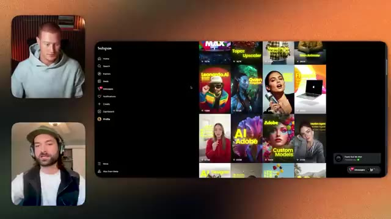
*⏱️ 00:04:08 — Partage d'écran affichant une interface de réseau social (Instagram) avec une grille de publications vidéo et de contenus liés à l'IA.*

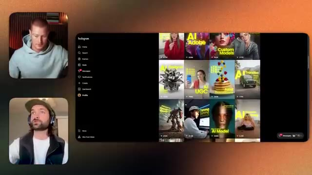
*⏱️ 00:04:17 — Vue actualisée du partage d'écran de l'interface Instagram montrant différents reels et créations artistiques générées par IA.*

---

### ⏱️ `[00:04:26 - 00:04:46]` | Segment #10

**🔊 Audio (Transcription Intégrale Mot pour Mot en Français) :**
> certaine capacité. Donc en ce moment, nous essayons de publier environ 20 éléments de contenu par mois. Environ 80 % d'entre eux sont de marque. Nous travaillons donc avec beaucoup de ces entreprises d'IA créative et nous servons de rampe de lancement sur le marché pour beaucoup de ces entreprises. Donc quand elles ont de nouvelles mises à jour qui sortent, nous les couvrons et nous agissons fondamentalement comme un testeur d'outils.

**👁️ Analyse Visuelle d'Écran (gemini-3.5-flash-lite) :**
**Interface & Outils** : Interface web d'Instagram et application de visioconférence.

**Contenu textuel & Code** : Grille de publications vidéo sur Instagram illustrant divers outils d'IA (ChatGPT x Photoshop, Topaz Upscaler, Leonardo.AI, Adobe) et menus de navigation latéraux.

**Action / Démonstration** : Présentation visuelle des contenus publiés par le créateur sur les réseaux sociaux.

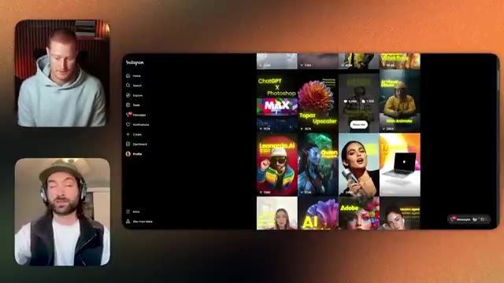
*⏱️ 00:04:31 — Capture d'écran montrant une visioconférence entre deux présentateurs à gauche, avec au centre un aperçu de l'interface d'Instagram affichant une grille de contenus vidéo axés sur l'intelligence artificielle (ChatGPT, Topaz, Adobe, etc.).*

---

### ⏱️ `[00:04:46 - 00:05:09]` | Segment #11

**🔊 Audio (Transcription Intégrale Mot pour Mot en Français) :**
> Nous allons tester les outils. Nous allons créer une sorte de belle vidéo packagée autour de ça. Et ensuite, nous allons en quelque sorte publier cela et le présenter au public. Donc, j'ai coupé l'audio ici juste pour pouvoir vous guider à travers quelques exemples visuels du genre de contenu que nous créons. Nous sommes donc hyper-concentrés et obsédés par, vous savez, le formatage et les différents styles de vidéo que nous pouvons créer.

**👁️ Analyse Visuelle d'Écran (gemini-3.5-flash-lite) :**
**Interface & Outils** : Application Instagram, interface de visioconférence en ligne.

**Contenu textuel & Code** : Vignettes de publications vidéo portant sur des thématiques d'intelligence artificielle (Topaz Upscaler, Leonardo.AI, Adobe, etc.).

**Action / Démonstration** : Présentation visuelle et navigation à travers des exemples de contenus publiés sur les réseaux sociaux.

---

### ⏱️ `[00:05:09 - 00:05:45]` | Segment #12

**🔊 Audio (Transcription Intégrale Mot pour Mot en Français) :**
> Mais une grande partie de ce que nous faisons, c'est de montrer aux gens ce qui est possible au début de nos vidéos. Donc si je rafraîchis ça ici, nous montrons aux gens ce qui est possible et nous fixons une attente pour vous. Et puis après ça, nous vous éduquons en quelque sorte sur le processus afin que vous puissiez maintenant commencer à l'utiliser dans vos flux de travail créatifs pour commencer à fournir ce genre de travail client pour les créatifs. J'ai également préparé un document, que je vais partager avec Brock et que vous pourrez réellement emporter, qui contient une liste de tarifs que tout le monde dans l'industrie pratique en ce moment pour que vous puissiez aussi apprendre quelles compétences les gens, quels outils...

**👁️ Analyse Visuelle d'Écran (gemini-3.5-flash-lite) :**
**Interface & Outils** : Instagram, application de visioconférence

**Contenu textuel & Code** : Publication Instagram avec des vidéos courtes et des commentaires textuels, ainsi que les flux vidéo des intervenants.

**Action / Démonstration** : Présentation d'exemples de vidéos de démonstration et discussion sur le format du contenu.

---

### ⏱️ `[00:05:45 - 00:06:19]` | Segment #13

**🔊 Audio (Transcription Intégrale Mot pour Mot en Français) :**
> les gens utilisent réellement dans le domaine de l'IA et combien les gens facturent pour cela aussi donc c'est vraiment super utile ouais ouais non genre la tarification est un point énorme dans cette industrie qui est très litigieux en ce moment beaucoup de gens n'ont aucune idée de ce qu'il faut facturer et la vérité est que c'est parce que personne n'a jamais fait ça auparavant donc en fait vous inventez au fur et à mesure et nous pouvons plonger dans la tarification et la façon dont nous structurons le travail de tarification de l'IA créative un peu plus tard dans le podcast mais pour vous donner juste une brève idée de ce que nous faisons nous faisons vraiment juste

**👁️ Analyse Visuelle d'Écran (gemini-3.5-flash-lite) :**
**Interface & Outils** : 

**Contenu textuel & Code** : 

**Action / Démonstration** : 

---

### ⏱️ `[00:06:19 - 00:06:54]` | Segment #14

**🔊 Audio (Transcription Intégrale Mot pour Mot en Français) :**
> jouer avec autant de flux de travail d'IA créatifs que possible afin que nous puissions essayer de créer comme autant de superbes démos de produits que nous verrions réellement les entreprises vouloir utiliser donc chaque élément de contenu que nous finissons par créer nous nous disons que nous voulons que le PDG ou quelqu'un dans cette entreprise voie cela afin qu'ils veuillent éventuellement nous contacter et travailler avec nous donc c'est notre système d'entonnoir et nous sommes très très tactiques quant au type de produits que nous utilisons pour démontrer différents flux de travail et tutoriels parce que c'est tout un aimant à prospects

**👁️ Analyse Visuelle d'Écran (gemini-3.5-flash-lite) :**
**Interface & Outils** : Navigateur web, Instagram, application de visioconférence.

**Contenu textuel & Code** : Publications Instagram, commentaires, interfaces de démonstration de flux de travail d'IA créative.

**Action / Démonstration** : Présentation et discussion autour de la création de contenus et de démos produits basées sur des flux de travail d'IA.

*⏱️ 00:06:28 — Visioconférence montrant deux intervenants et un partage d'écran de la plateforme Instagram avec des interfaces d'IA générative et de réseaux sociaux.*

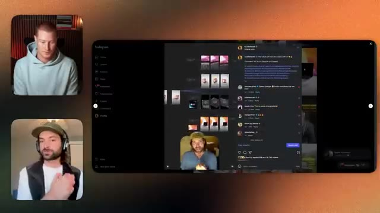
*⏱️ 00:06:36 — Visioconférence affichant les deux présentateurs et le fil d'actualité Instagram montrant des exemples de créations visuelles assistées par l'intelligence artificielle.*

---

### ⏱️ `[00:06:54 - 00:07:25]` | Segment #15

**🔊 Audio (Transcription Intégrale Mot pour Mot en Français) :**
> pour essayer d'attirer les bonnes personnes pour travailler avec nous, ouais, j'adore ça, je pense qu'on est tous les deux des geeks des réseaux sociaux parce qu'on est tous les deux en train de construire une marque personnelle, je m'y suis vraiment plongé ces deux dernières années. Donc voir ce que tu as fait là-dedans, du genre pour générer des prospects pour ton entreprise. Parce qu'évidemment, c'est comme tu l'as dit, c'est le haut de l'entonnoir pour non seulement attirer les gens vers Gen HQ, mais aussi pour que, par exemple, si c'est une pub McDonald's juste là, si quelqu'un de chez McDonald's voit cette vidéo que tu viens de montrer sur Instagram maintenant, c'est du genre, ils vont immédiatement se dire, oh mon dieu, j'ai besoin d'apprendre à faire ça avec l'IA.

**👁️ Analyse Visuelle d'Écran (gemini-3.5-flash-lite) :**
**Interface & Outils** : Visioconférence et interface web (Instagram / application de génération d'images avec options de modèles).

**Contenu textuel & Code** : Menus déroulants affichant des options de modèles de génération d'images (comme Flux 1.0 Realism, Flux 1.1, etc.) et publication Instagram avec commentaires.

**Action / Démonstration** : Présentation d'outils et de workflows de génération d'images par IA et discussion sur les réseaux sociaux.

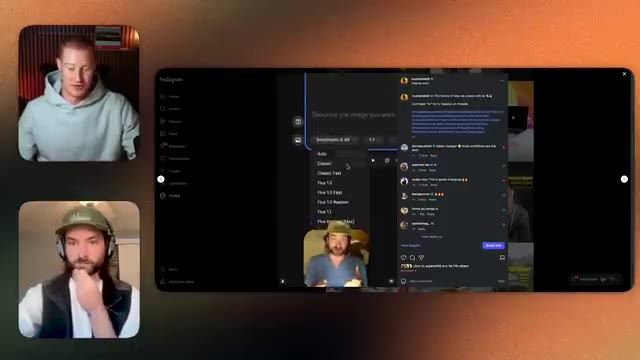
*⏱️ 00:07:02 — Capture d'écran montrant une visioconférence entre deux intervenants et, au centre, le partage d'écran d'une interface de type Instagram avec un menu déroulant de modèles d'IA.*

---

### ⏱️ `[00:07:25 - 00:07:58]` | Segment #16

**🔊 Audio (Transcription Intégrale Mot pour Mot en Français) :**
> Parce que c'est vers ça que les choses se dirigent. Nous pourrions générer ces vidéos à grande échelle, tu sais, à l'avenir, donc c'est juste, j'adore voir ça et euh nous allons en parler un peu plus et montrer comment nous pourrions commencer à faire ça, mais si tu y penses vraiment, en revenant à la question des prix, c'est intéressant parce que c'est quelque chose que ces entreprises voient et elles comprennent que nous avons besoin que nos employés apprennent à faire ça et il y a une opportunité folle d'apprendre à faire ça pour soit aller travailler en interne pour ces entreprises, soit, tu sais, lancer une agence autour des outils d'IA créative, je veux dire, celui-là est dingue, mec, genre le

**👁️ Analyse Visuelle d'Écran (gemini-3.5-flash-lite) :**
**Interface & Outils** : Interface d'Instagram sur navigateur web et application de visioconférence.

**Contenu textuel & Code** : Publications Instagram avec des plans numérotés (Shot 2, Shot 3) illustrant des ingrédients de burger générés par IA, accompagnés de légendes et de commentaires.

**Action / Démonstration** : Le présentateur commente des exemples de vidéos générées par IA et présentées sur les réseaux sociaux.

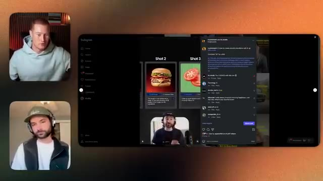
*⏱️ 00:07:33 — Capture d'écran montrant une visioconférence entre deux intervenants à gauche, et au centre une interface de réseau social (Instagram) affichant des publications vidéo sur les étapes de création d'un burger avec des visuels générés par IA.*

---

### ⏱️ `[00:07:58 - 00:08:30]` | Segment #17

**🔊 Audio (Transcription Intégrale Mot pour Mot en Français) :**
> Mec, je ne sais pas comment tu as fait ça, genre je sais que ça demande probablement un peu de montage, mais ça, ouais, c'est le niveau supérieur mec, genre ouais. Donc on peut, euh, on peut honnêtement aller dans n'importe quelle direction que tu veux, on peut montrer, genre, plus de comment les gens pourraient aussi y aller et aussi commencer à faire ça pour eux-mêmes, ou on peut parler littéralement de n'importe quelle partie de ça que tu veux, parce qu'il y a, il y a plusieurs angles sous lesquels regarder ça. Genre, tout d'abord, genre on est comme une plateforme éducative, n'est-ce pas ? Donc tu n'as peut-être pas envie d'être un éducateur, genre quiconque consomme ceci, tu n'as peut-être pas

**👁️ Analyse Visuelle d'Écran (gemini-3.5-flash-lite) :**
**Interface & Outils** : Instagram

**Contenu textuel & Code** : Publication Instagram ("How to create smooth transitions with AI" par marvinsuett & fbr.studio), vidéo de démonstration d'un burger généré/animé par IA et fil de commentaires.

**Action / Démonstration** : Présentation d'un exemple concret de rendu et transition vidéo IA publié sur Instagram.

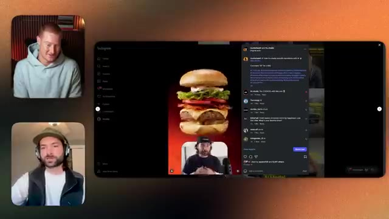
*⏱️ 00:08:06 — Interface Instagram affichant un Reel de démonstration sur la création de transitions fluides avec l'IA (animation de burger) à côté des deux intervenants en visioconférence.*

---

### ⏱️ `[00:08:30 - 00:09:08]` | Segment #18

**🔊 Audio (Transcription Intégrale Mot pour Mot en Français) :**
> voulez être un éducateur. Vous pourriez vouloir être un praticien à part entière et vous pourriez vouloir fournir du travail client en IA, n'est-ce pas ? Et soit dit en passant, je veux juste préambuler ceci dès maintenant. Nous en sommes encore au tout, tout, tout début où vous pouvez vous impliquer là-dedans. Je sais qu'il y a beaucoup de gens qui parlent d'IA, mais il y a très peu de gens qui exécutent réellement avec l'IA en ce moment. Ce que je dis en quelque sorte à tout le monde, c'est qu'il y a ce tsunami de fou qui arrive vers nous en ce moment, n'est-ce pas ? Où vous avez cette industrie de la publicité, qui est une industrie d'un billion de dollars, et vous avez l'industrie du cinéma, qui est une industrie d'un demi-billion de dollars. Et la vague de l'IA arrive comme

**👁️ Analyse Visuelle d'Écran (gemini-3.5-flash-lite) :**
**Interface & Outils** : Visioconférence et interface web type Instagram

**Contenu textuel & Code** : Aucun code, graphique TradingView, terminal ou donnée chiffrée

**Action / Démonstration** : Discussion entre les intervenants lors d'un appel vidéo

---

### ⏱️ `[00:09:08 - 00:09:41]` | Segment #19

**🔊 Audio (Transcription Intégrale Mot pour Mot en Français) :**
> qui s'abattent sur ces industries en ce moment. Et il y a vraiment, je pense, environ 250 personnes dans le monde en ce moment qui peuvent fournir un travail client en IA selon des spécifications très, très élevées. Et je ne plaisante pas quand je dis ça, c'est-à-dire qu'il y a vraiment une poignée de personnes et nous sommes tous dans une discussion de groupe, nous nous connaissons tous, c'est une toute petite industrie, mais il y a très peu de personnes qui peuvent réellement aller sur le terrain pour fournir un travail pour, vous savez, Samsung. Je veux dire, il y a eu la publicité de Coca-Cola qui est sortie récemment et qui a suscité beaucoup de réactions négatives en ligne parce que les gens disaient qu'elle n'était pas très bien exécutée

**👁️ Analyse Visuelle d'Écran (gemini-3.5-flash-lite) :**
**Interface & Outils** : Application Instagram et interface de visioconférence

**Contenu textuel & Code** : Publication Instagram avec légende, commentaires et images de démonstration (parachutiste) ainsi que le visage de deux intervenants.

**Action / Démonstration** : Présentation de contenu multimédia et discussion en visioconférence.

---

### ⏱️ `[00:09:41 - 00:10:05]` | Segment #20

**🔊 Audio (Transcription Intégrale Mot pour Mot en Français) :**
> Eh bien. Les gars qui ont fait ça sont Secret Level, et c'est une immense genre d'agence d'IA, vous savez, l'une des premières à faire ça en quelque sorte aussi. Et je pense qu'ils ont peut-être raté le coche sur celui-là. Mais il y a tellement d'autres agences qui poussent de nos jours et il y a tellement de parts du gâteau pour tout le monde. Genre, il y a tellement d'opportunités pour commencer à utiliser l'IA.

**👁️ Analyse Visuelle d'Écran (gemini-3.5-flash-lite) :**
**Interface & Outils** : Interface web d'Instagram et application de visioconférence.

**Contenu textuel & Code** : Grille de publications vidéo et d'images générées par IA sur un compte Instagram, avec des statistiques de vues et de mentions J'aime.

**Action / Démonstration** : Navigation et présentation visuelle d'un portfolio ou d'un flux de contenu sur les réseaux sociaux.

---

### ⏱️ `[00:10:05 - 00:10:42]` | Segment #21

**🔊 Audio (Transcription Intégrale Mot pour Mot en Français) :**
> Et nous pouvons aussi commencer à discuter de la façon dont, quels secteurs, comme nous pourrions nous plonger dans n'importe quel secteur, n'est-ce pas ? Disons donc l'immobilier. Pour les non-techniciens qui nous écoutent, si vous cherchez à savoir comment vous pouvez utiliser l'IA dans le monde de l'immobilier, eh bien, imaginez ceci. Vous trouvez un client dans l'immobilier. Donc, comme vous, vous allez en ligne et vous trouvez, par exemple en Angleterre, nous avons des sites web comme Zoopla ou Rightmove. Et nous avons ces sites web immobiliers auxquels vous pouvez accéder. Vous pouvez prendre les images qu'ils ont pour présenter leurs propriétés et vous pouvez utiliser des outils comme Google Nano Banana, qui est un modèle d'image d'IA.

**👁️ Analyse Visuelle d'Écran (gemini-3.5-flash-lite) :**
**Interface & Outils** : Navigateur web / Application Instagram, interface de visioconférence à double flux.

**Contenu textuel & Code** : Grille de contenu vidéo généré par IA, profils utilisateurs, métriques d'engagement (likes, commentaires) et interface de partage de médias sociaux.

**Action / Démonstration** : Navigation et présentation de exemples concrets de contenu visuel et vidéo généré par intelligence artificielle sur les réseaux sociaux.

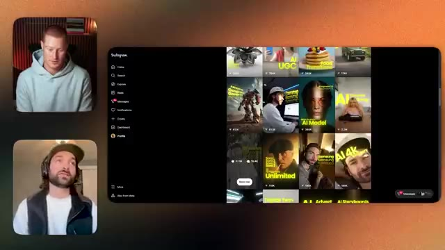
*⏱️ 00:10:14 — Vue d'une interface de type Instagram affichant une grille de publications et vidéos, aux côtés de deux intervenants en visioconférence.*

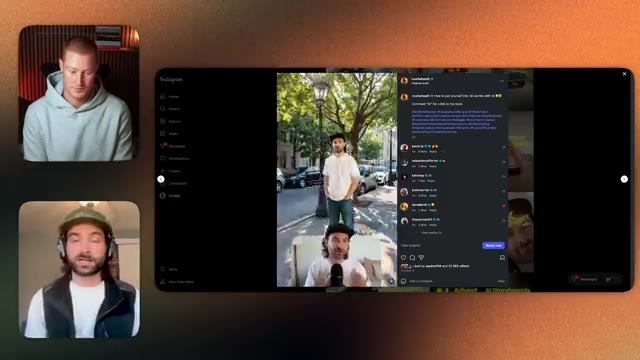
*⏱️ 00:10:23 — Affichage d'une publication vidéo Instagram spécifique en cours de lecture avec des commentaires et des détails sur le côté, à côté des deux intervenants.*

---

### ⏱️ `[00:10:42 - 00:11:10]` | Segment #22

**🔊 Audio (Transcription Intégrale Mot pour Mot en Français) :**
> et vous pouvez insérer soit un personnage dans une pièce, puis vous pouvez transformer cela en vidéo et faire en sorte que cet agent immobilier présente une vidéo de visite de propriété, simplement à partir des images qu'ils ont sur leur site web, et nous avons des gens qui proposent cela comme un service à des clients en ce moment même, vous savez, et ils sont capables de facturer des forfaits d'abonnement de l'ordre de 5 000 dollars à ceux-ci, qu'il s'agisse d'un petit agent immobilier ou d'un grand agent immobilier.

**👁️ Analyse Visuelle d'Écran (gemini-3.5-flash-lite) :**
**Interface & Outils** : Application de visioconférence et interface du réseau social Instagram.

**Contenu textuel & Code** : Publication Instagram contenant une vidéo générée par intelligence artificielle montrant un personnage dans une pièce.

**Action / Démonstration** : Discussion sur les cas d'usage de la génération de vidéos par IA pour les agents immobiliers.

---

### ⏱️ `[00:11:10 - 00:11:34]` | Segment #23

**🔊 Audio (Transcription Intégrale Mot pour Mot en Français) :**
> Mais toi et moi savons tous les deux, Brock, qu'il s'agit avant tout d'essayer de faire entrer les gens par la porte et aussi d'essayer de capter les gens grâce aux réseaux sociaux. Donc, beaucoup de gens dans ce domaine, en particulier dans l'immobilier, utilisent les réseaux sociaux pour essayer de trouver des acheteurs potentiels, surtout sur le marché de l'immobilier de luxe. C'est donc une opportunité énorme. Une autre encore, c'est de prendre des photos de biens immobiliers.

**👁️ Analyse Visuelle d'Écran (gemini-3.5-flash-lite) :**
**Interface & Outils** : Instagram (version Web, vue de publication Reel)

**Contenu textuel & Code** : Publication d'un créateur ("How to put yourself into 3D scenes with AI"), appel à l'action dans la légende ("Comment 'AI' for a link to the story"), section de commentaires et boutons d'engagement.

**Action / Démonstration** : Illustration d'une stratégie de captation d'audience et de génération de leads sur les réseaux sociaux grâce au contenu basé sur l'IA.

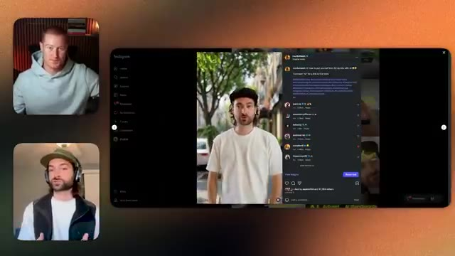
*⏱️ 00:11:16 — Interface Web d'Instagram affichant une publication vidéo sur l'intégration dans des scènes 3D avec l'IA, accompagnée de la vue webcam des intervenants.*

---

### ⏱️ `[00:11:35 - 00:11:57]` | Segment #24

**🔊 Audio (Transcription Intégrale Mot pour Mot en Français) :**
> Donc, comme peut-être des propriétés non meublées, puis en utilisant réellement Google Nano Banana pour les meubler, pour ajouter comme plein de mobiliers différents afin de leur montrer à quoi cela pourrait ressembler, et de changer ça de comme le jour, comme une image de la propriété du jour à la nuit. Et comme vous pouvez créer comme un pack d'images que vous pourriez ensuite proposer également à des clients de l'immobilier.

**👁️ Analyse Visuelle d'Écran (gemini-3.5-flash-lite) :**
**Interface & Outils** : Instagram (interface web)

**Contenu textuel & Code** : Publication Reel de @markmesarich intitulée "4 ways to put yourself into 3D worlds with AI", légende de la publication, espace commentaires et boutons d'engagement.

**Action / Démonstration** : Présentation d'un exemple concret de contenu Instagram démontrant des cas d'usage de l'IA applicables au domaine visuel et immobilier.

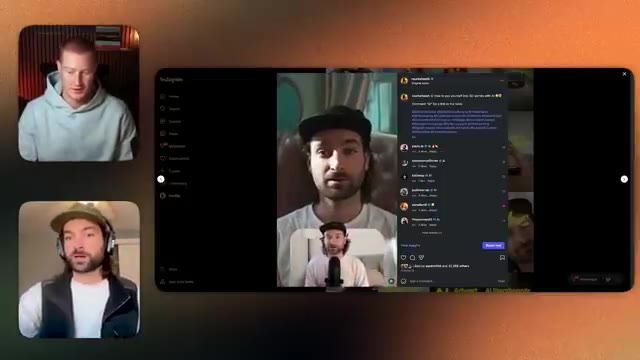
*⏱️ 00:11:40 — Capture d'écran montrant une publication Instagram Reel de @markmesarich sur l'utilisation de l'IA, encadrée par les vignettes vidéo des deux présentateurs à gauche.*

---

### ⏱️ `[00:11:57 - 00:12:19]` | Segment #25

**🔊 Audio (Transcription Intégrale Mot pour Mot en Français) :**
> La vérité, c'est que si vous cherchez des opportunités dans le domaine de la création par IA en ce moment, choisissez n'importe quel secteur d'activité et demandez-vous : de quoi ont-ils besoin ? Et ensuite, fournissez simplement cela comme un service avec des outils d'IA créative. Oui, ce qui m'enthousiasme vraiment là-dedans, c'est de revenir à l'exemple du Nano Banana pour la mise en valeur des annonces immobilières et tout le reste.

**👁️ Analyse Visuelle d'Écran (gemini-3.5-flash-lite) :**
**Interface & Outils** : Interface web d'Instagram (fil d'actualité Reels / profil avec vignettes vidéo) et application de visioconférence.

**Contenu textuel & Code** : Vignettes de vidéos avec du texte en surimpression lié à l'intelligence artificielle (ex: "AI UGC", "AI Model", "Unlimited", "AI 4K"), et les menus de navigation Instagram (Home, Search, Explore, Reels, Messages).

**Action / Démonstration** : Présentation d'exemples concrets de contenus créés par IA sur Instagram pour illustrer les opportunités dans ce secteur.

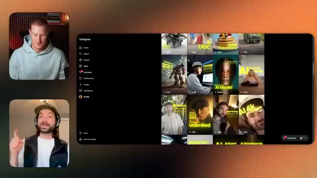
*⏱️ 00:12:03 — Capture d'écran montrant l'interface d'Instagram avec une grille de vidéos générées par IA, accompagnée de deux intervenants en visioconférence dans des encarts à gauche.*

---

### ⏱️ `[00:12:19 - 00:12:55]` | Segment #26

**🔊 Audio (Transcription Intégrale Mot pour Mot en Français) :**
> J'en ai parlé sur la chaîne, j'ai fait une vidéo pour expliquer en quoi c'est une grande opportunité. Ce qui est tellement intéressant là-dedans, c'est que, vous pourriez vous dire, bon, ces propriétaires d'entreprise connaissent tous ces outils d'IA pour pouvoir faire ça, mais ce n'est vraiment pas le cas, il y a ce fossé entre ce que les gens qui sont dans le domaine de l'IA comprennent et ce que les gens qui ne sont pas dans le domaine de l'IA comprennent, genre il y a un énorme fossé de connaissances, c'est ce que j'essaie de dire, donc quelque chose comme ça est un service tellement facile que vous pourriez proposer simplement parce qu'il y a un fossé de connaissances, et ce fossé de connaissances va être là, vous savez, probablement pas dans un avenir prévisible, on ne sait pas combien de temps cela va durer.

**👁️ Analyse Visuelle d'Écran (gemini-3.5-flash-lite) :**
**Interface & Outils** : Application de visioconférence et interface web d'Instagram.

**Contenu textuel & Code** : Vignettes et contenus vidéo liés à l'intelligence artificielle (génération d'images, modèles IA).

**Action / Démonstration** : Discussion en visioconférence illustrée par la navigation sur un flux de contenus IA.

---

### ⏱️ `[00:12:55 - 00:13:28]` | Segment #27

**🔊 Audio (Transcription Intégrale Mot pour Mot en Français) :**
> mais c'est là que tu pourrais commencer à offrir ces services très basiques et ensuite plus tard ou tu sais tout au long de ce processus tu pourrais commencer à créer comme les tu sais des vidéos de fou que tu fais évidemment qui sont un peu plus compliquées tu dois avoir beaucoup de compétences en matière de formulation d'invites mais il y a une barrière à l'entrée très basse pour certains de ces différents services créatifs d'IA que tu pourrais offrir mais il y a en quelque sorte des niveaux comme je le disais comme on en parlait tu sais ce que tu fais est un peu plus sophistiqué que d'avoir simplement la capacité de formuler des invites pour nano banana ou quelque chose comme ça mais ouais ouais ça me fait encore parler de ça parce que je sais qu'il y aura au moins deux personnes parmi nous

**👁️ Analyse Visuelle d'Écran (gemini-3.5-flash-lite) :**
**Interface & Outils** : Visioconférence (interface de type appel vidéo avec deux participants).

**Contenu textuel & Code** : Aucun code, graphique, indicateur technique ou élément chiffré visible.

**Action / Démonstration** : Discussion et échange verbal entre les intervenants de la vidéo.

---

### ⏱️ `[00:13:28 - 00:14:06]` | Segment #28

**🔊 Audio (Transcription Intégrale Mot pour Mot en Français) :**
> vidéo qui réalisent à quel point c'est une grande opportunité et voient le contenu que vous créez et ils vont faire quelque chose avec et ça me rend tellement enthousiaste de pouvoir, vous savez, aider les gens et faire ça oui donc je pense euh ce qui serait vraiment utile pour les gens afin que nous puissions donner du contexte sur les opportunités disponibles en ce moment c'est un si nous plongeons dans ce document que nous avons qui partage en quelque sorte les tarifs. Alors laissez-moi partager les tarifs et ensuite nous pourrons en quelque sorte plonger là-dedans. Donc nous allons examiner ce document et je vais vous montrer que toutes ces données ont été recueillies par un de mes amis appelé Sidi Sundar.

**👁️ Analyse Visuelle d'Écran (gemini-3.5-flash-lite) :**
**Interface & Outils** : Google Docs / Document partagé en ligne.

**Contenu textuel & Code** : Liste de cas d'usage professionnels et de tarifs avec des outils IA (FinTech Startup avec HeyGen, Fashion Startup avec Midjourney, Life Coach avec Descript/OpusClip, Executive Writer avec Claude, E-Commerce Seller avec Icon AI, Startup Founder avec GPT-4/Canva/Claude).

**Action / Démonstration** : Présentation et analyse d'un document listant des exemples concrets de tarification de services basés sur l'IA pour différents types de clients.

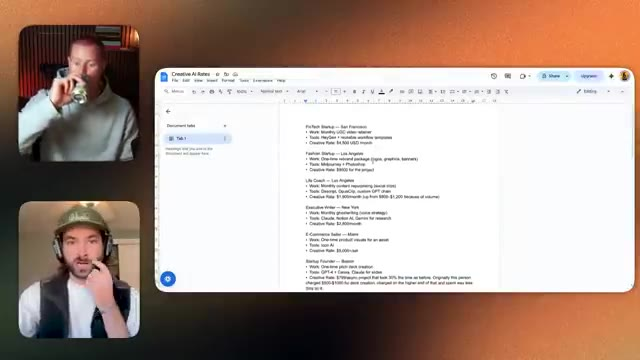
*⏱️ 00:13:56 — Vue en écran partagé montrant les deux interlocuteurs ainsi qu'un document Google Docs listant des tarifs de prestations en IA créative ("Creative AI Rates").*

---

### ⏱️ `[00:14:06 - 00:14:45]` | Segment #29

**🔊 Audio (Transcription Intégrale Mot pour Mot en Français) :**
> Elle était l'ancienne responsable de l'innovation chez Netflix et nous avons fait un podcast avec elle et elle a en quelque sorte décortiqué ces données pour nous. Et je pense que c'est vraiment intéressant, n'est-ce pas ? Donc si nous jetons un œil à certains de ces, disons, marqueurs, comme les plus grands projets ici, un projet de 50 000 dollars, qui était une vidéo de lookbook en mouvement ponctuelle pour la production. Pour ceux d'entre vous qui ne savent pas ce qu'est un lookbook, une entreprise de mode pourrait, disons, Vans par exemple, pourrait avoir une nouvelle collection d'un tas d'images qu'ils sortent, vous savez, de nouveaux vêtements qu'ils sortent. Et ils essaient de vendre leur collection de vêtements à des grossistes, imaginez ASOS par exemple. Ils vont envoyer un lookbook

**👁️ Analyse Visuelle d'Écran (gemini-3.5-flash-lite) :**
**Interface & Outils** : Google Docs, application de visioconférence.

**Contenu textuel & Code** : Document intitulé "Creative AI Rates" contenant des listes de rôles (Executive Writer, E-Commerce Seller, Startup Founder, Production Company, Streetwear Brand, Content Creator), des outils d'IA utilisés (Claude, Notion AI, Midjourney, Synthesia, etc.) et des tarifs associés.

**Action / Démonstration** : L'intervenant présente et commente le document textuel affichant les données et tarifs liés à l'IA.

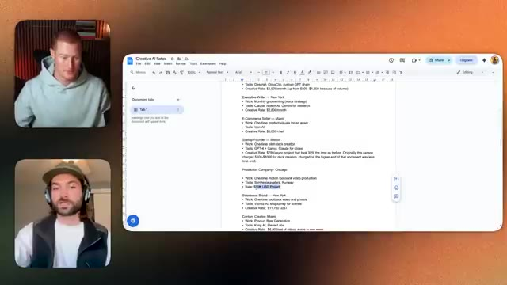
*⏱️ 00:14:16 — Capture d'écran montrant l'intervenant en visioconférence à gauche et un document Google Docs ouvert sur la droite avec des listes de données tarifaires.*

---

### ⏱️ `[00:14:45 - 00:15:21]` | Segment #30

**🔊 Audio (Transcription Intégrale Mot pour Mot en Français) :**
> ...à ASOS et dire : lesquels de nos vêtements voulez-vous vendre sur votre site web ? Et pour concevoir un lookbook, ils doivent avoir des visuels e-commerce des vêtements. Ils doivent avoir, vous savez, des images un peu plus stylisées, comme des photos posées avec les vêtements. Et je crois même que juste ici en bas, quelqu'un a fait un lookbook. Ouais, regardez, une suite de photos pour un lookbook. Donc c'est pour, je suppose que c'était une entreprise de vêtements. Et c'est un studio créatif d'Amsterdam qui a fait ça. Les outils qu'ils ont utilisés, c'est Freepik, que vous pouvez utiliser pour 32 $ par mois, je crois que c'est ça, pour avoir un nombre illimité d'images

**👁️ Analyse Visuelle d'Écran (gemini-3.5-flash-lite) :**
**Interface & Outils** : Google Docs et interface de visioconférence (type Google Meet ou Zoom).

**Contenu textuel & Code** : Texte listant divers rôles professionnels (E-Commerce Seller, Startup Founder, Production Company, Streetwear Brand), les outils d'IA utilisés (Loon AI, GPT-4, Canva, Claude, Synthesia, Runway, Vidu.ai, Midjourney) et les tarifs associés.

**Action / Démonstration** : Le présentateur explique et commente les différents cas d'usage et tarifs présentés dans le document texte à l'écran.

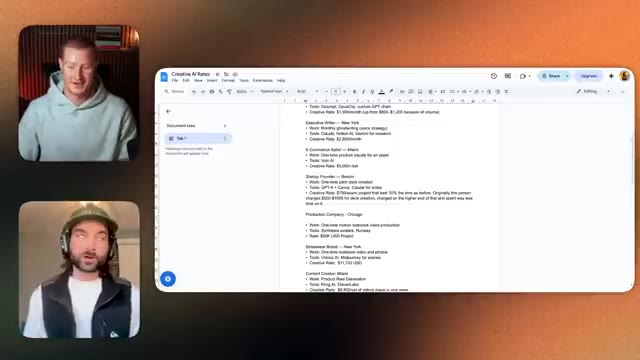
*⏱️ 00:14:54 — Un document Google Docs affichant une liste de tarifs et de cas d'usage pour l'IA créative, avec les deux participants visibles en vignettes vidéo sur la gauche.*

---

### ⏱️ `[00:15:21 - 00:15:55]` | Segment #31

**🔊 Audio (Transcription Intégrale Mot pour Mot en Français) :**
> génération. Et ensuite vous pouvez utiliser ceci et vous pouvez créer des images illimitées et ils facturent 15 000 euros pour ce projet. Celui-ci était une maison de couture à Berlin. Ils faisaient du montage vidéo mensuel en utilisant CapCut AI, 11 Labs, qui est comme un outil de voix IA que vous pouvez utiliser pour prompter et il va utiliser l'IA pour générer des voix récemment ils viennent en fait juste d'annoncer qu'ils ont payé pour la ressemblance de la voix de Michael Caine et ils achètent des voix de personnes iconiques pour que vous puissiez les utiliser aussi ce qui est vraiment cool c'est un tout autre terrier de lapin dans lequel nous pourrions

**👁️ Analyse Visuelle d'Écran (gemini-3.5-flash-lite) :**
**Interface & Outils** : Google Docs et interface de visioconférence

**Contenu textuel & Code** : Texte listant des tarifs de projets d'IA, des outils utilisés (Runway, DALL-E, Midjourney, CapCut AI, Eleven Labs) et des localisations (Los Angeles, Londres, Berlin, Amsterdam, Bangalore, Delhi).

**Action / Démonstration** : Le présentateur commente les tarifs et les outils d'IA utilisés pour différents projets professionnels.

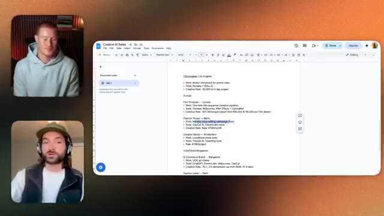
*⏱️ 00:15:29 — Un document Google Docs affichant des tarifs de projets d'IA créative, avec le présentateur et son invité dans des fenêtres vidéo à gauche.*

---

### ⏱️ `[00:15:55 - 00:16:31]` | Segment #32

**🔊 Audio (Transcription Intégrale Mot pour Mot en Français) :**
> [Séquence sonore / Ambiance musicale] Entrer dans une autre époque, ouais, une immense, une immense opportunité aussi, je veux dire, une immense opportunité là aussi. Si vous êtes un gros dépensier et que vous avez de l'argent derrière vous, acheter l'image de, genre, hum, et une propriété intellectuelle à certaines personnes, comme vous savez, Michael Caine est dans une position où il est sur le point d'y passer, vous savez, il est assez âgé, hum, il est dans une position où il pourrait mettre sa famille à l'abri pour des richesses générationnelles en vendant simplement sa voix et son image, et acheter cela et le posséder, c'est énorme, genre. Donc la propriété là-dedans est un sujet assez intéressant, et ce modèle existe depuis longtemps, imaginez.

**👁️ Analyse Visuelle d'Écran (gemini-3.5-flash-lite) :**
**Interface & Outils** : Google Docs, vignettes vidéo de visioconférence des intervenants.

**Contenu textuel & Code** : Document "Creative AI Rates" listant des cas pratiques par ville/région (Los Angeles, London, Berlin, Amsterdam, Bangalore) :
- Projets : Motion storyboard, One-time title sequence, Monthly video editing, Lookbook photo suite, UGC ad videos.
- Outils IA : Runway, DALL-E, Midjourney, ControlNet, CapCut AI, ElevenLabs, Freepik AI, ChatGPT.
- Tarifs et métriques : $3,900, €47,500, €12k/month, €15k/project.

**Action / Démonstration** : Présentation et analyse des opportunités financières, des tarifs du marché et des gains de productivité créative grâce aux outils d'IA générative.

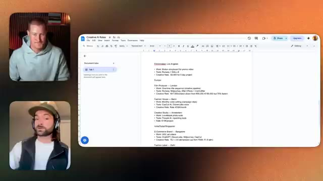
*⏱️ 00:16:04 — Document Google Docs affichant une liste d'études de cas et de tarifs de prestations ("Creative AI Rates"), détaillant les outils IA utilisés et les montants facturés selon les projets.*

---

### ⏱️ `[00:16:31 - 00:17:09]` | Segment #33

**🔊 Audio (Transcription Intégrale Mot pour Mot en Français) :**
> l'industrie de la musique et c'est aussi quelque chose qui vaut la peine d'être noté l'industrie de la musique genre tu peux acheter des genres de catalogues de genre Justin Bieber qui a vendu les droits de toute sa musique et beaucoup d'autres personnes font ça aussi pour un gros chèque mais quand il s'agit de ces modèles commerciaux qui existent déjà dans le monde traditionnel les plus grandes opportunités consistent à regarder les modèles commerciaux que les gens font en ce moment et puis à trouver juste une solution d'IA créative pour accomplir ça avec l'IA et genre tu pars pour la putain de lune pour être honnête genre tu pars absolument pour la lune avec genre une quantité illimitée d'opportunités. Je veux dire aussi, ce n'est pas facile. Genre ça

**👁️ Analyse Visuelle d'Écran (gemini-3.5-flash-lite) :**
**Interface & Outils** : Google Docs et interface de visioconférence.

**Contenu textuel & Code** : Document texte listant des tarifs de projets créatifs utilisant l'IA (Runway, DALL-E, Midjourney, etc.) selon différentes villes (Los Angeles, Londres, Berlin, Amsterdam, Bangalore).

**Action / Démonstration** : Le présentateur discute tout en affichant un document partagé contenant des exemples de tarifs de prestations créatives assistées par l'IA.

---

### ⏱️ `[00:17:09 - 00:17:44]` | Segment #34

**🔊 Audio (Transcription Intégrale Mot pour Mot en Français) :**
> l'industrie n'est pas facile. Genre, nous avons une plateforme d'éducation à l'IA créative. Et j'ai demandé récemment : « Combien d'entre vous gagnent de l'argent avec l'IA ? » Et je crois qu'on avait 39 % de notre audience qui gagne de l'argent avec l'IA créative. Et ce sont des gens qui apprennent vraiment et qui s'investissent et qui essaient vraiment de trouver du travail en ce moment. Je pense que si vous vous investissez vraiment, que vous êtes motivé pour apprendre ces compétences en IA créative, qui sont très basiques, d'ailleurs. Elles ne nécessitent pas de compétences techniques. La seule chose qui, selon moi, aide vraiment, c'est la vidéo

**👁️ Analyse Visuelle d'Écran (gemini-3.5-flash-lite) :**
**Interface & Outils** : Google Docs, visioconférence avec fenêtres vidéo des deux intervenants.

**Contenu textuel & Code** : Document texte listant des études de cas par région (Los Angeles, Europe, Inde/Singapour) : types de projets (motion storyboard, séquence de titres, montage vidéo), outils d'IA employés (Runway, DALL-E, Midjourney, ControlNet, ElevenLabs, CapCut, ChatGPT) et tarifs facturés ($3 500 pour 3 jours, €47 500 par projet, €12 000/mois).

**Action / Démonstration** : Présentation visuelle de données chiffrées illustrant les opportunités financières et les tarifs réels pratiqués par les créateurs utilisant l'IA.

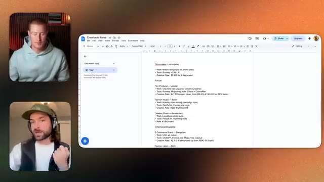
*⏱️ 00:17:18 — Document Google Docs intitulé « Creative AI Rates » détaillant des exemples de tarifs et revenus de projets d'IA créative selon les régions et outils utilisés, à côté des fenêtres vidéo des intervenants.*

---

### ⏱️ `[00:17:44 - 00:18:07]` | Segment #35

**🔊 Audio (Transcription Intégrale Mot pour Mot en Français) :**
> montage, que vous pouvez aussi apprendre sur le tas. Si vous vous y mettez vraiment, vous pouvez facilement décrocher ces projets. Nous avons vu des gens intégrer Gen HQ et décrocher des projets de 40 000 euros dès les trois premières semaines de leur adhésion, sans expérience en IA. Et, genre, ce n'est pas une anomalie. Nous avons des gens qui ont décroché des contrats de 28 000 euros et, genre, je ne cite même pas les meilleurs.

**👁️ Analyse Visuelle d'Écran (gemini-3.5-flash-lite) :**
**Interface & Outils** : Google Docs (ou outil de traitement de texte en ligne) et interface de visioconférence (type Zoom/Google Meet).

**Contenu textuel & Code** : Document intitulé 'Creative AI Rates' listant des tarifs de projets : 'Filmmaker - Los Angeles : $3,000 for 5-day project', 'Film Producer - London : €8,750/project', 'Fashion House - Berlin : €10k/month', 'Creative Studio - Amsterdam : €15k/project'. Outils mentionnés : Runway, DALL-E, Midjourney, After Effects, CapCut AI, ElevenLabs.

**Action / Démonstration** : Le présentateur et l'invité discutent en direct des opportunités et des tarifs pratiqués pour des projets d'intelligence artificielle, illustrés par le document affiché à l'écran.

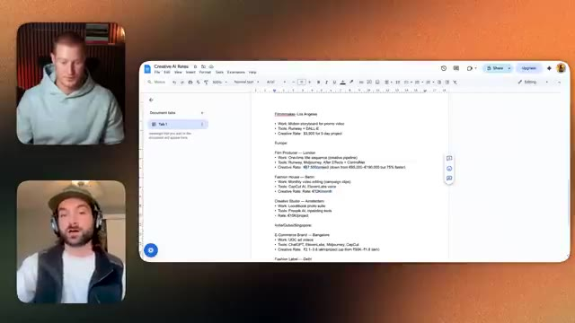
*⏱️ 00:17:50 — Capture d'écran montrant le présentateur et un invité en visioconférence à gauche, et un document texte partagé à droite listant des tarifs et des exemples de projets pour différents rôles créatifs liés à l'IA.*

---

### ⏱️ `[00:18:07 - 00:18:43]` | Segment #36

**🔊 Audio (Transcription Intégrale Mot pour Mot en Français) :**
> Ce sont juste des exemples généraux qui me viennent à l'esprit parce que j'ai vu le chiffre 40 000 ici. Genre il y a une quantité énorme d'opportunités, mais en tant que créatifs, nous passons maintenant à une position où nous devons réellement apprendre à nous commercialiser et à nous vendre à des clients, ce que nous n'avons jamais eu à faire parce que l'accès à tous ces outils d'IA créative vous donne une quantité énorme d'opportunités de travailler pour vous-même, n'est-ce pas ? Avoir cette flexibilité et cette liberté de travailler pour vous-même selon vos propres conditions, vos propres horaires. Mais la vérité, c'est que cela prend beaucoup d'heures, cela prend beaucoup de temps pour rester à jour. Et en quelque sorte, une fois qu'on commence, on est sur ce tapis roulant.

**👁️ Analyse Visuelle d'Écran (gemini-3.5-flash-lite) :**
**Interface & Outils** : Google Docs / Application de visioconférence

**Contenu textuel & Code** : Document textuel listant des exemples de tarifs et de tâches pour des rôles créatifs (Filmmaker, Film Producer, Fashion House) avec des outils d'IA et des montants chiffrés.

**Action / Démonstration** : Présentation visuelle de notes textuelles et de cas d'usage illustrant la discussion sur les tarifs et opportunités pour les créatifs.

---

### ⏱️ `[00:18:43 - 00:19:15]` | Segment #37

**🔊 Audio (Transcription Intégrale Mot pour Mot en Français) :**
> que pour être honnête, ça ne va jamais s'arrêter, parce que le rythme de production de l'IA, au niveau de ces outils qui deviennent de plus en plus performants, genre on va changer notre façon de créer genre toutes les deux semaines, pas vrai, euh, quand de nouveaux modèles sortent, et la moitié du travail, c'est d'apprendre à rester à jour. Ouais, à 100 %. Je... je vais... je vais parler au nom de mon public, j'imagine qu'ils pensent la même chose, genre une grande partie de ma chaîne YouTube couvre différents outils d'IA, pas vraiment dans le domaine de l'IA créative, c'est pour ça que je suis ravi de t'accueillir parce que tu es plus qualifié pour parler de ça.

**👁️ Analyse Visuelle d'Écran (gemini-3.5-flash-lite) :**
**Interface & Outils** : Google Docs (document de traitement de texte partagé à l'écran).

**Contenu textuel & Code** : Document récapitulatif "Creative AI Rates" comprenant :
- Rôles et lieux : Filmmaker (Los Angeles), Film Producer (London), Fashion House (Berlin), Creative Studio (Amsterdam).
- Outils IA mentionnés : Runway, DALL-E, Midjourney, CapCut AI, ElevenLabs voice, Freepik AI.
- Données chiffrées : Tarifs de création ($3,900 pour 5 jours, €47,500/projet, €10K/mois, €15K/projet) et métriques d'efficacité (ex: 75% plus rapide).

**Action / Démonstration** : Partage et analyse d'un document répertoriant les tarifs du marché et les stacks d'outils IA utilisés par des

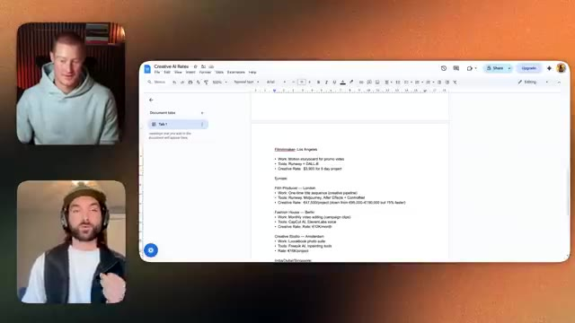
*⏱️ 00:18:51 — Document Google Docs intitulé "Creative AI Rates" détaillant des exemples de tarifs, de projets et d'outils d'IA utilisés par divers créatifs (Filmmaker, Film Producer, Fashion House).*

---

### ⏱️ `[00:19:15 - 00:19:47]` | Segment #38

**🔊 Audio (Transcription Intégrale Mot pour Mot en Français) :**
> Moi, mais genre mon public est vraiment intéressé par la façon de faire du vibe coding ou d'utiliser l'IA pour différents cas d'usage spécifiques dans leur entreprise et tout le reste, et ils, enfin mon public a vu que la quantité d'outils disponibles pouvait être extrêmement écrasante, et au fur et à mesure qu'il en sort d'autres, cela devient vraiment important de presque mettre des œillères et de se dire d'accord, j'ai besoin de comprendre les fondamentaux de ce qui fait un bon modèle d'image ou ce qui fait un bon modèle vidéo, puis en quelque sorte de s'en tenir à ça. Et puis aussi d'avoir quelqu'un comme toi qui est sur le terrain à apprendre ces trucs pour comprendre, d'accord, qu'est-ce qui est vraiment bon ?

**👁️ Analyse Visuelle d'Écran (gemini-3.5-flash-lite) :**
**Interface & Outils** : Visioconférence / enregistrement vidéo de podcast.

**Contenu textuel & Code** : Aucun code, graphique, terminal ou métrique affiché à l'écran.

**Action / Démonstration** : Discussion et échange verbal entre le présentateur et l'invité.

---

### ⏱️ `[00:19:47 - 00:20:06]` | Segment #39

**🔊 Audio (Transcription Intégrale Mot pour Mot en Français) :**
> Qu'est-ce que je devrais réellement utiliser ? Mais ouais, je suis 100 % d'accord. Et je pense qu'il y a quelque chose à noter aussi, en revenant sur la tarification, tu vois, de certains de ces projets que tu as mentionnés dans Gen HQ ou de certains de tes amis dans l'espace créatif de l'IA, c'est que ce sont les prix que les gens facturent en ce moment avec les capacités des modèles de vidéo et d'image à l'heure actuelle.

**👁️ Analyse Visuelle d'Écran (gemini-3.5-flash-lite) :**
**Interface & Outils** : Aucune interface logicielle ou plateforme affichée à l'écran.

**Contenu textuel & Code** : Aucun code source, graphique, prompt ou métrique affiché.

**Action / Démonstration** : Discussion/podcast vidéo entre l'hôte et son invité sans aucune démonstration ou manipulation à l'écran.

---

### ⏱️ `[00:20:06 - 00:20:31]` | Segment #40

**🔊 Audio (Transcription Intégrale Mot pour Mot en Français) :**
> Et ça ne va faire que s'améliorer. Vous savez, je pense qu'il y a ce paradigme selon lequel nous devons en quelque sorte surmonter cet obstacle quand il s'agit des gens qui voient des vidéos générées par IA. Et ils se disent, vous savez, j'ai vu en quelque sorte deux vidéos. Je pourrais avoir un petit blocage mental sur l'idée d'utiliser ceci pour le marketing. Ce n'est tout simplement pas encore assez bon. Mais une fois que cette barrière et cet obstacle seront, vous savez, abattus, les vannes vont simplement s'ouvrir parce qu'alors tout le monde va réaliser que, waouh, une grande partie de ce contenu que je consomme est de l'IA.

**👁️ Analyse Visuelle d'Écran (gemini-3.5-flash-lite) :**
**Interface & Outils** : Aucune

**Contenu textuel & Code** : Aucun

**Action / Démonstration** : Aucune (discussion/face caméra)

---

### ⏱️ `[00:20:31 - 00:20:49]` | Segment #41

**🔊 Audio (Transcription Intégrale Mot pour Mot en Français) :**
> Je ne connais même pas la différence et je dois trouver un moyen d'en profiter parce que tous les petits défauts ont été, tu sais, réglés, si on peut dire. Donc c'est vraiment ça qui m'enthousiasme, parce qu'on en est tout au début de ça, de cette adoption où les gens acceptent de voir des vidéos maintenant. Comme je vois celles que tu fais pour des marques comme Vans ou certaines de celles sur ton Instagram.

**👁️ Analyse Visuelle d'Écran (gemini-3.5-flash-lite) :**
**Interface & Outils** : Visioconférence / application d'appel vidéo

**Contenu textuel & Code** : Aucun contenu technique, code source ou graphique visible

**Action / Démonstration** : Discussion entre le présentateur et son invité

---

### ⏱️ `[00:20:49 - 00:21:15]` | Segment #42

**🔊 Audio (Transcription Intégrale Mot pour Mot en Français) :**
> Et je me dis, mec, ça capte tellement plus mon attention qu'une vidéo normale. Et je suis plus que ravi de la regarder parce que c'est juste tellement captivant. Et donc les gens réalisent que les gens vont vouloir l'adopter davantage, et ça va juste devenir un effet d'entraînement avec des opportunités qui grandissent de plus en plus. Ouais, je dirais qu'une grande partie de ce qui vous démarque encore dans ce monde de l'IA, c'est votre capacité naturelle à être toujours créatif.

**👁️ Analyse Visuelle d'Écran (gemini-3.5-flash-lite) :**
**Interface & Outils** : Visioconférence / appel vidéo à deux participants.

**Contenu textuel & Code** : Aucun graphique, code source, terminal ou indicateur technique affiché.
[COMPORTEMENT] Discussion en visio sans démonstration technique ni support visuel analytique.

**Action / Démonstration** : Explications face caméra et analyse conceptuelle des marchés.

---

### ⏱️ `[00:21:15 - 00:21:50]` | Segment #43

**🔊 Audio (Transcription Intégrale Mot pour Mot en Français) :**
> Je tiens à dire que, comme, les gens, comme j'ai fait des ateliers dans certaines salles où je suis entouré de créatifs qui n'ont jamais touché à des outils d'IA, mais ce sont des professionnels de la création, et quand vous allez dans une salle et que vous donnez à ces professionnels de la création qui sont naturellement très talentueux lorsqu'il s'agit d'avoir des idées, de visualiser des choses dans leur tête et d'être réellement capable de donner vie à cela, quand vous donnez ces outils à ces personnes, ils sont capables de créer des choses qui sont bien meilleures que les gens qui ne sont pas créatifs. Je vais juste être honnête. Donc si vous avez, genre,

**👁️ Analyse Visuelle d'Écran (gemini-3.5-flash-lite) :**
**Interface & Outils** : Visioconférence (aucun graphique technique, code ou interface de trading visible).

**Contenu textuel & Code** : Aucun contenu technique, indicateur, code source ou données chiffrées.

**Action / Démonstration** : Le présentateur parle à l'écran sans effectuer de manipulation graphique ou technique.

---

### ⏱️ `[00:21:50 - 00:22:14]` | Segment #44

**🔊 Audio (Transcription Intégrale Mot pour Mot en Français) :**
> un tout petit peu de créativité en vous, n'est-ce pas, vous avez déjà une énorme longueur d'avance. Le goût est un mot qui est beaucoup utilisé dans cette industrie, où votre goût est ce qui vous distingue, n'est-ce pas ? Vous pourriez utiliser un grand modèle de langage pour vous aider à prompter, n'est-ce pas ? Mais la plupart du temps, si vous le faites de manière générique et que vous demandez simplement à ChatGPT de vous aider à rédiger un prompt, vous allez obtenir ce prompt fade que tout le monde obtient également.

**👁️ Analyse Visuelle d'Écran (gemini-3.5-flash-lite) :**
**Interface & Outils** : AUCUNE

**Contenu textuel & Code** : AUCUN

**Action / Démonstration** : AUCUNE

---

### ⏱️ `[00:22:15 - 00:22:47]` | Segment #45

**🔊 Audio (Transcription Intégrale Mot pour Mot en Français) :**
> Donc, genre, une grande partie vient encore de, genre, ici. Et je tiens à dire, vous savez, si vous avez cette capacité innée à être créatif, c'est l'un des plus grands piliers qui, selon moi, entre en jeu dans ce que vous pouvez facturer pour votre travail. Je vais donc me pencher sur les trois piliers qui, selon moi, sont importants lorsqu'il s'agit de tarifer le travail lié à l'IA en ce moment pour les créatifs. L'un d'eux, comme je l'ai mentionné, est simplement votre capacité naturelle à être créatif. Si vous étiez dans une pièce avec cent personnes et que la créativité est, vous savez, est subjective, n'est-ce pas ? Mais dans une pièce, n'est-ce pas ? S'il y avait cent

**👁️ Analyse Visuelle d'Écran (gemini-3.5-flash-lite) :**
**Interface & Outils** : Visioconférence / Enregistrement vidéo

**Contenu textuel & Code** : Aucun élément visuel technique, graphique ou de code (simple plan de discussion).

**Action / Démonstration** : Le présentateur parle directement à la caméra sans manipuler d'interface ou de démonstration technique.

---

### ⏱️ `[00:22:47 - 00:23:20]` | Segment #46

**🔊 Audio (Transcription Intégrale Mot pour Mot en Français) :**
> parmi vous là, où pensez-vous que vous vous situez sur une échelle ? Si tout le monde se mettait en ligne, où pensez-vous que vous seriez en termes de créativité, que ce soit en photographie, en dessin, sur le plan artistique, du genre être capable de savoir dans votre tête, n'est-ce pas ? ce qui constitue une bonne image. Si vous pouvez, si vous êtes doué pour trouver cette limite, je pense que cela aide aussi vraiment, donc ça, c'est le premier pilier, à quel point êtes-vous naturellement créatif ? Le deuxième, une réserve ou pas une réserve, mais une chose à rajouter par-dessus tout ça, c'est que, pour ma part, je pense qu'il y a quand même un tout petit peu de capacité.

**👁️ Analyse Visuelle d'Écran (gemini-3.5-flash-lite) :**
**Interface & Outils** : Visioconférence (affichage en grille / incrustation PiP)

**Contenu textuel & Code** : Aucun contenu textuel, graphique technique ou interface de trading affiché (simple discussion en visio).

**Action / Démonstration** : Le présentateur s'adresse à son audience et discute d'une échelle de créativité sans manipuler d'outil technique.

---

### ⏱️ `[00:23:20 - 00:23:40]` | Segment #47

**🔊 Audio (Transcription Intégrale Mot pour Mot en Français) :**
> où la créativité est quelque chose qui est juste comme quelque chose que soit tu l'as ou soit tu ne l'as pas mais je pense vraiment qu'il y a un sentiment de genre là c'est un tout petit peu un muscle qu'on peut entraîner donc je serais intéressé d'entendre on n'a pas besoin d'en parler maintenant parce que je veux entendre d'autres piliers mais je pense que c'est quelque chose où à mesure que tu obtiens de plus en plus d'exposition au fait de t'amuser avec ces plateformes, tu n'es peut-être pas créatif maintenant, mais ça ne veut pas dire que tu ne peux pas être créatif.

**👁️ Analyse Visuelle d'Écran (gemini-3.5-flash-lite) :**
**Interface & Outils** : Visioconférence / Enregistrement vidéo.

**Contenu textuel & Code** : Aucun graphique, code, terminal ou élément technique affiché.

**Action / Démonstration** : Le présentateur s'exprime en faisant des gestes tandis que l'invité écoute attentivement.

---

### ⏱️ `[00:23:40 - 00:24:15]` | Segment #48

**🔊 Audio (Transcription Intégrale Mot pour Mot en Français) :**
> Je suis tout à fait d'accord, d'ailleurs. Je suis tout à fait d'accord parce que quand j'étais enfant dans une école d'art, enfin je ne suis pas allé dans une école d'art, désolé, mais quand je prenais des cours d'art, je ne savais pas dessiner, je ne savais pas peindre, je ne savais rien faire, mais j'avais comme la créativité dans ma tête. Et le premier média créatif que j'ai réellement apprécié a été le montage vidéo. C'était comme du numérique, vous savez, la création numérique, et c'est là que j'étais capable, et Photoshop a été un grand élément, où j'étais capable de concrètement exposer mes idées sous un aspect numérique, et puis quand l'IA est arrivée, elle

**👁️ Analyse Visuelle d'Écran (gemini-3.5-flash-lite) :**
**Interface & Outils** : Visioconférence (aucun graphique, code, terminal ou outil technique affiché).

**Contenu textuel & Code** : Aucun indicateur technique, code source, prompt ou donnée chiffrée.

**Action / Démonstration** : Le présentateur s'exprime face caméra dans le cadre d'une discussion, sans démonstration technique ni manipulation logicielle.

---

### ⏱️ `[00:24:15 - 00:24:49]` | Segment #49

**🔊 Audio (Transcription Intégrale Mot pour Mot en Français) :**
> ont tout simplement explosé, donc je serais tout à fait d'accord avec vous pour dire que ce n'est pas nécessairement une question de savoir quel est votre degré de créativité dans les médiums traditionnels, mais plutôt dans n'importe quel médium, est-ce que vous vous démarquez dans un médium créatif quelconque, et c'est un muscle qui peut être exercé et entraîné, et la meilleure façon d'améliorer votre créativité est de vous entourer et de consommer d'autres contenus créatifs, n'est-ce pas ? Imaginez cela comme des données d'entraînement pour un grand modèle de langage, et la qualité des données d'entraînement est telle que lorsque vous arrivez devant une barre de saisie pour commencer à créer quelque chose dans le monde créatif, votre

**👁️ Analyse Visuelle d'Écran (gemini-3.5-flash-lite) :**
**Interface & Outils** : Aucune interface logicielle, terminal, graphique ou outil technique présent à l'écran.

**Contenu textuel & Code** : Aucun code source, indicateur, prompt ou métrique affiché.

**Action / Démonstration** : Discussion/interview entre deux intervenants en format podcast vidéo sans support visuel technique.

---

### ⏱️ `[00:24:49 - 00:25:27]` | Segment #50

**🔊 Audio (Transcription Intégrale Mot pour Mot en Français) :**
> les données d'entraînement, c'est tout ce qu'il y a là-haut, c'est quelles vacances avez-vous prises, c'est quelles émissions de télévision de mon enfance ai-je regardées ? Quels films ai-je regardés récemment ? Et qu'est-ce que je vois quand je regarde par ma fenêtre ? Toutes ces choses s'ajoutent à vos données d'entraînement dans votre tête, ce qui vous permet ensuite de prompter et de créer. Donc pour moi, si vous pouvez consommer du contenu de haute qualité, alors vous finirez aussi par, cela vous amènera à créer vous-même du contenu de meilleure qualité. Et je vais aussi partager ce document avec Brock, hum, qui est en fait une liste de créateurs que vous devez suivre si vous êtes

**👁️ Analyse Visuelle d'Écran (gemini-3.5-flash-lite) :**
**Interface & Outils** : Visioconférence / appel vidéo.

**Contenu textuel & Code** : Aucun graphique, code, terminal ou élément technique pertinent.

**Action / Démonstration** : Le présentateur parle face caméra.

---

### ⏱️ `[00:25:27 - 00:26:03]` | Segment #51

**🔊 Audio (Transcription Intégrale Mot pour Mot en Français) :**
> intéressés par le fait de rester informés, d'apprendre et d'être inspirés par d'autres créatifs dans le monde de l'IA créative, afin que vous puissiez repartir de ce podcast de manière concrète, commencer à suivre ces personnes et ainsi voir vos connaissances s'accumuler dans ce domaine, euh, donc je vais partager mon écran, c'est tellement utile et pour l'audience, tous ces liens que Rourke mentionne seront simplement dans la description ci-dessous ainsi qu'épinglés dans le premier commentaire pour que vous puissiez y accéder juste en allant là-bas, donc je les ai classés par entreprises, ce sont des entreprises comme des entreprises d'IA créative qu'il est essentiel de suivre juste pour rester à jour par rapport à ce qu'elles publient, ensuite nous avons

**👁️ Analyse Visuelle d'Écran (gemini-3.5-flash-lite) :**
**Interface & Outils** : Logiciel de visioconférence et visionneuse de document PDF affichant une liste de comptes de réseaux sociaux.

**Contenu textuel & Code** : Document textuel listant des comptes de créateurs et d'entreprises à suivre dans le domaine de l'IA créative.

**Action / Démonstration** : Présentation d'une ressource partagée contenant une liste de créateurs et d'entreprises d'IA à suivre.

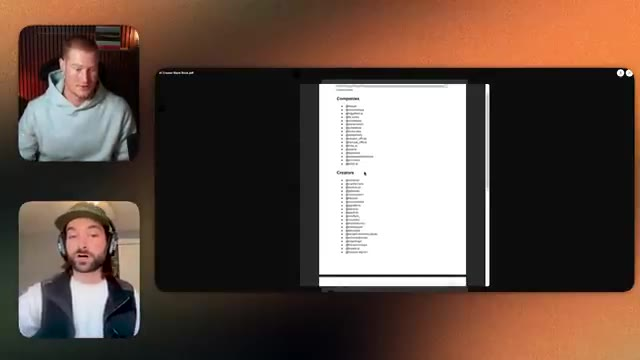
*⏱️ 00:25:36 — Capture montrant l'écran partagé avec une liste de créateurs et d'entreprises d'IA à l'écran principal, et les deux interlocuteurs en visioconférence sur le côté.*

---

### ⏱️ `[00:26:03 - 00:26:35]` | Segment #52

**🔊 Audio (Transcription Intégrale Mot pour Mot en Français) :**
> créateurs, ce sont des personnes qui utilisent l'ia et qui fournissent réellement un travail client en lien avec l'ia afin que vous puissiez apprendre de ce qu'ils font et il y a beaucoup de créateurs ici, certains d'entre eux sont des chaînes d'actualité afin que vous puissiez également apprendre des actualités sur l'ia créative et rien qu'en digérant ce contenu, j'ai aussi ajouté des artistes juste pour que vous puissiez obtenir un peu d'inspiration visuelle et tout cela sera dans la description, mais je dirais simplement qu'en suivant ces personnes, c'est la première étape que vous pouvez faire pour commencer à vous inspirer afin de créer un meilleur travail, euh, dans ce

**👁️ Analyse Visuelle d'Écran (gemini-3.5-flash-lite) :**
**Interface & Outils** : AUCUNE

**Contenu textuel & Code** : AUCUNE

**Action / Démonstration** : AUCUNE

---

### ⏱️ `[00:26:35 - 00:27:09]` | Segment #53

**🔊 Audio (Transcription Intégrale Mot pour Mot en Français) :**
> espace que oui c'est extrêmement utile je sais que j'ai peut-être j'essaie de ne pas avoir trop de personnes que je suis dans ce sens-là, parce que je veux avoir genre une liste assez sélective. Tu es tout en haut en ce qui concerne les trucs créatifs, tu sais, Sebastian aussi, Roberto, ce genre de gars. Mais ouais, c'est, c'est génial. Ça va être mis en lien dans la description ci-dessous. Alors, est-on passé au pilier numéro deux ou ? Ouais. Donc le pilier numéro deux, c'est combien de temps est-ce que tu as dans ta vie ? C'est ça ? Quels sont tes engagements temporels que tu as ? Est-ce que tu es du genre vraiment occupé à faire, tu sais, du code intuitif ? Est-ce que c'est ton travail à temps plein ? Tu sais, si tu es

**👁️ Analyse Visuelle d'Écran (gemini-3.5-flash-lite) :**
**Interface & Outils** : Visioconférence (type Zoom ou outil similaire) sans aucun graphique financier, terminal ou code affiché.

**Contenu textuel & Code** : Aucun contenu technique, indicateur, code source ou métrique financière visible à l'écran.
[DESC_IMAGE_3]

**Action / Démonstration** : Discussion en visio entre Brock Mesarich et son invité, sans manipulation de graphiques ni démonstration technique.

---

### ⏱️ `[00:27:09 - 00:27:44]` | Segment #54

**🔊 Audio (Transcription Intégrale Mot pour Mot en Français) :**
> à faire ça à temps plein ou quoi que ce soit, vous avez un autre boulot de neuf à cinq sur lequel vous travaillez. Si c'est ce que vous faites, genre, vous n'avez peut-être pas, vous avez peut-être genre trois heures de plus par jour pour vraiment livrer du travail d'IA à des clients et y tremper vos orteils avant de finir par vous engager à passer dans cette industrie. Donc c'est du genre, combien de temps est-ce que vous avez ? Et parce que si vous avez une quantité de temps très inconstante, alors votre valeur du temps est plus élevée, n'est-ce pas ? Juste naturellement, parce qu'il est plus difficile pour les gens de vous joindre. Un, c'est à quel point vous êtes créatif. Deux, c'est combien de temps vous avez par rapport à vos autres engagements temporels. Et puis numéro trois, c'est votre

**👁️ Analyse Visuelle d'Écran (gemini-3.5-flash-lite) :**
**Interface & Outils** : Visioconférence (aucun graphique ni terminal de trading affiché).

**Contenu textuel & Code** : Aucun code, indicateur technique, script ou graphique n'est visible dans ce segment.

**Action / Démonstration** : Discussion en visioconférence entre le présentateur et son invité sans support visuel technique.

---

### ⏱️ `[00:27:44 - 00:28:17]` | Segment #55

**🔊 Audio (Transcription Intégrale Mot pour Mot en Français) :**
> capacité et ensemble de compétences pour utiliser les outils. Et ce troisième pilier est quelque chose que tout le monde peut faire. Et tout le monde sera, si vous l'imaginez comme un graphique à barres, tout le monde sera à des niveaux différents pour chacun de ces piliers. Pour moi, ma capacité à utiliser ces outils est tout en haut, d'accord ? Ma créativité est quelque part aux trois quarts du chemin vers le haut et mon temps est très très bas, donc pour moi, genre, je ne suis pas la personne la plus créative de la pièce, mais j'ai genre un très très bon, je dirais

**👁️ Analyse Visuelle d'Écran (gemini-3.5-flash-lite) :**
**Interface & Outils** : Visioconférence (aucun graphique, terminal ou code affiché).

**Contenu textuel & Code** : Aucun contenu technique, graphique ou de code source présent.

**Action / Démonstration** : Discussion et explication verbale du présentateur illustrée par des gestes de la main.

---

### ⏱️ `[00:28:17 - 00:28:50]` | Segment #56

**🔊 Audio (Transcription Intégrale Mot pour Mot en Français) :**
> Disons que tu l'es, mais il y a un spectre à tout ça, mais tu as un spectre, je dirais que, évidemment, plus tu t'entoures de gens créatifs, moins tu te sens créatif, parce que tu te dis, putain, genre, ce type est un génie, genre, je ne suis rien en comparaison, tu vois, et là, le syndrome de l'imposteur débarque, et puis tout le reste. Mais ouais, je dirais, genre, ces trois piliers, et ça t'aidera, genre, à déterminer ce que tu devrais facturer en ce moment. Une chose que je mentionnerai aussi concernant la tarification pour le travail en IA, c'est que je recommanderai toujours d'accepter le travail.

**👁️ Analyse Visuelle d'Écran (gemini-3.5-flash-lite) :**
**Interface & Outils** : AUCUNE

**Contenu textuel & Code** : AUCUN

**Action / Démonstration** : AUCUNE

---

### ⏱️ `[00:28:50 - 00:29:23]` | Segment #57

**🔊 Audio (Transcription Intégrale Mot pour Mot en Français) :**
> before you're ready. You might be like, oh, I need to actually go and learn these creative AI tools first and then I can go and do the client work. Uh-uh. Like find the work first. Like I would, this is what I would do. Create, find a potential client, right? It could be in your freaking local town. Create some imagery for their brand or business, right? Using a tool like Google Nano Banana. You can pay 32 bucks on free pick, get that monthly subscription, unlimited image generations, and then create images for a company. It could be anyone. Just send it to them.

**👁️ Analyse Visuelle d'Écran (gemini-3.5-flash-lite) :**
**Interface & Outils** : Visioconférence (aucun graphique, terminal ou code affiché).

**Contenu textuel & Code** : Aucun contenu technique, indicateur ou code source n'est visible.

**Action / Démonstration** : Conversation en visioconférence entre les intervenants sans manipulation d'interface technique.

---

### ⏱️ `[00:29:23 - 00:29:56]` | Segment #58

**🔊 Audio (Transcription Intégrale Mot pour Mot en Français) :**
> Soyez complètement libre. Tenez. Voici quelques images que j'ai faites pour votre entreprise. Évidemment, jetez un œil à leur site web, voyez quel genre d'images ils créent. D'accord. Envoyez-les-leur par e-mail, sur leur Instagram, peu importe. Essayez d'avoir un appel avec eux et dites, nous pouvons faire des vidéos par IA. Nous pouvons faire des images par IA. Nous pouvons vous offrir cela sous forme de service forfaitaire. Ça coûte quatre mille cinq cents par mois et nous gérerons des publicités Facebook. Nous ferons toute cette merde. Genre, dites-leur simplement ce que vous pouvez faire, même si vous ne le pouvez pas, et ensuite débrouillez-vous, faites-vous payer pour apprendre, c'est la plus grande chose dans cette industrie, dans l'industrie de l'IA créative.

**👁️ Analyse Visuelle d'Écran (gemini-3.5-flash-lite) :**
**Interface & Outils** : Visioconférence (aucun graphique ni code source affiché).

**Contenu textuel & Code** : Aucun contenu technique, indicateur ou code source visible.
[DESC_ACTION] Discussion en visioconférence sans démonstration technique ni manipulation logicielle.

**Action / Démonstration** : Explications face caméra et analyse conceptuelle des marchés.

---

### ⏱️ `[00:29:56 - 00:30:32]` | Segment #59

**🔊 Audio (Transcription Intégrale Mot pour Mot en Français) :**
> si tu apprends les compétences comme ça puis que tu essaies de faire le travail, les trucs que tu viens juste d'apprendre vont devenir obsolètes donc tu dois être payé pour apprendre alors apprends sur le tas genre ne perds pas ton temps ton temps est précieux donc c'est genre l'une de mes grandes choses que j'enseigne dans Gen HQ une grande partie aussi c'est que tu apprends à avoir ou tu grandis tu grandis presque en quelque sorte avec le syndrome de l'imposteur pendant que tu apprends ces choses. C'est du genre, nous pensons au syndrome de l'imposteur comme à un truc du genre, je ne suis pas aussi bon que je dois l'être pour pouvoir faire la chose que je veux faire, mais tu ne vas pas pouvoir arriver là où tu es ici. Si tu ne vas pas réellement et commences genre à vendre ces services

**👁️ Analyse Visuelle d'Écran (gemini-3.5-flash-lite) :**
**Interface & Outils** : Visioconférence (appel vidéo à deux participants).

**Contenu textuel & Code** : Aucun graphique, code source ou élément technique affiché à l'écran.

**Action / Démonstration** : Discussion en visioconférence sans support visuel technique.

---

### ⏱️ `[00:30:32 - 00:31:05]` | Segment #60

**🔊 Audio (Transcription Intégrale Mot pour Mot en Français) :**
> et tout le tralala, parce que je ne sais pas, je gère ça tout le temps. Tu sais, j'ai beaucoup de gens qui demandent, Oh, est-ce que je devrais faire ça avant d'essayer vraiment d'avoir un client ? Mais la réponse, je suis d'accord. Tu devrais être payé pour apprendre et le faire en cours de route. Parce que je veux dire, c'est un train à grande vitesse et si tu n'es pas dedans, tu sais, tu vas te faire laisser pour compte. Donc, et vraiment, il s'agit juste de briser ces croyances limitantes que, tu sais, tout le monde a, j'en ai encore à ce jour, je sais que Rork a dit qu'il en a dans certains scénarios, genre c'est juste quelque chose qui est comme le coût des affaires, presque, c'est le coût des affaires, j'aime vraiment, tu sais, la façon dont tu formules ça, j'ai genre un exemple, allons-y, je vais partager mon écran à nouveau, allons-y

**👁️ Analyse Visuelle d'Écran (gemini-3.5-flash-lite) :**
**Interface & Outils** : Visioconférence (aucun outil, terminal ou graphique affiché).

**Contenu textuel & Code** : Aucun code, graphique, indicateur ou donnée chiffrée.

**Action / Démonstration** : Discussion générale entre le présentateur et son invité.

---

### ⏱️ `[00:31:05 - 00:31:43]` | Segment #61

**🔊 Audio (Transcription Intégrale Mot pour Mot en Français) :**
> Genre, jetez un œil à, je travaillais sur ça la nuit dernière, je travaillais sur genre une plateforme appelée Arcads, et en gros Arcads c'est genre ouais c'est genre un créateur d'UGC par IA, donc pour ceux d'entre vous qui ne savent pas, UGC signifie contenu généré par les utilisateurs. Imaginez, si je jette un œil ici, imaginez genre des gens sur leur iPhone enregistrant du contenu pour ladite marque ou n'importe quel produit, et ensuite utilisant ça comme genre vous pourriez utiliser ce contenu dans de la publicité payante sur Meta et des choses comme ça pour générer des ventes. Donc cette plateforme, n'est-ce pas, n'est qu'une plateforme parmi tant d'autres qui vous permet de créer du contenu UGC. Et soyons

**👁️ Analyse Visuelle d'Écran (gemini-3.5-flash-lite) :**
**Interface & Outils** : Application web Arcads et interface de visioconférence.

**Contenu textuel & Code** : Galerie de vidéos de démonstration de produits (UGC) mettant en scène différents acteurs virtuels ou générés par IA tenant des flacons.

**Action / Démonstration** : Présentation de la plateforme de création de contenu généré par les utilisateurs par IA.

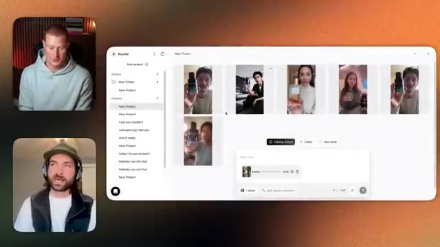
*⏱️ 00:31:14 — Capture d'écran montrant l'interface de la plateforme Arcads avec plusieurs vidéos UGC générées par IA au centre, et deux fenêtres de visioconférence avec les participants sur la gauche.*

---

### ⏱️ `[00:31:43 - 00:32:18]` | Segment #62

**🔊 Audio (Transcription Intégrale Mot pour Mot en Français) :**
> jetons un coup d'œil à euh un exemple ici et je veux juste genre préambuler tout ce que j'ai fait pour ça c'est que j'ai écrit une consigne en une seule phrase et j'ai téléchargé une image de référence de la bouteille de parfum Dior Sauvage et ce sont les résultats que nous pouvons obtenir d'accord ça pourrait être ma nouvelle obsession d'accord c'est bien ça sent juste bon oui alors qu'est-ce que vous dites de celui-là je ne peux pas m'empêcher de le porter n'est-ce pas c'est juste terrifiant ouais c'est juste terrifiant c'est terrifiant et la raison pour laquelle c'est une si grande opportunité n'est-ce pas

**👁️ Analyse Visuelle d'Écran (gemini-3.5-flash-lite) :**
**Interface & Outils** : Interface logicielle de création vidéo par intelligence artificielle (style Runway/Gen-2 ou similaire).

**Contenu textuel & Code** : Panneau de configuration affichant un prompt textuel détaillé incluant des références à la bouteille de parfum Dior Sauvage, ainsi qu'une fenêtre de prévisualisation vidéo.

**Action / Démonstration** : Le présentateur présente un exemple concret de génération vidéo obtenue à partir d'une consigne textuelle unique et d'une image de référence.

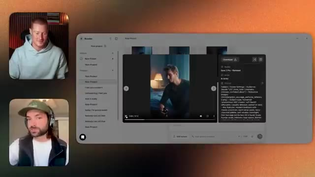
*⏱️ 00:31:51 — Capture d'écran montrant l'interface d'un outil de génération vidéo par IA avec un panneau latéral affichant les détails de la consigne (prompt) et une vidéo en cours de lecture.*

---

### ⏱️ `[00:32:18 - 00:32:50]` | Segment #63

**🔊 Audio (Transcription Intégrale Mot pour Mot en Français) :**
> maintenant c'est parce que combien est-ce que ça coûterait à l'origine pour une marque de partir et d'obtenir ce style de contenu vous devriez embaucher un acteur vous auriez besoin d'embaucher une équipe d'éclairage une équipe de caméra une personne de post-production comme toutes ces choses sont des dépenses pour ces entreprises donc si vous pouviez réduire la somme d'argent qu'elles doivent payer pour obtenir du contenu de haute qualité comme ça je veux dire c'est juste les les vannes sont ouvertes pour pouvoir facturer de l'argent pour ça et vous avez dit que vous avez fait ça vous avez fait ça en une seule invite n'est-ce pas c'était ouais donc je veux dire j'ai utilisé un peu un code de triche donc j'ai construit un comme sur je je vais

**👁️ Analyse Visuelle d'Écran (gemini-3.5-flash-lite) :**
**Interface & Outils** : Application web de génération vidéo / IA (type outil de création de clips publicitaires avec avatars ou acteurs virtuels).

**Contenu textuel & Code** : Aperçus de projets vidéo (dont un flacon de parfum Dior ou similaire et des personnages), interface de gestion de projets avec menus textuels et zone de saisie de prompt ("New prompt").

**Action / Démonstration** : Présentation d'un outil de génération de contenu vidéo marketing par intelligence artificielle.

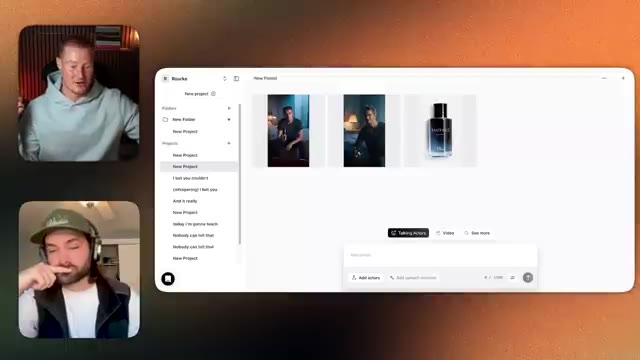
*⏱️ 00:32:26 — Capture d'écran montrant l'interface d'un logiciel de création de contenu vidéo par IA avec des aperçus de vidéos générées représentant des acteurs et un flacon de parfum, ainsi que les deux présentateurs en haut à gauche et en bas à gauche.*

---

### ⏱️ `[00:32:50 - 00:33:09]` | Segment #64

**🔊 Audio (Transcription Intégrale Mot pour Mot en Français) :**
> partager mon écran et vous le montrer mais genre j'ai créé un GPT personnalisé donc euh j'ai créé un GPT personnalisé qui et et c'est du genre si vous finissez par vous lancer dans le monde créatif, les GPT personnalisés c'est un peu tout parce que le prompting de base c'est juste genre c'est un super point de départ mais en plus ce n'est pas genre ce n'est pas le meilleur.

**👁️ Analyse Visuelle d'Écran (gemini-3.5-flash-lite) :**
**Interface & Outils** : Interface de logiciel de montage vidéo et visio-conférence.

**Contenu textuel & Code** : Projets créatifs, vignettes vidéo (acteurs et flacon de parfum) et panneaux de configuration de projet.

**Action / Démonstration** : Partage d'écran et présentation d'un outil de création assisté par IA.

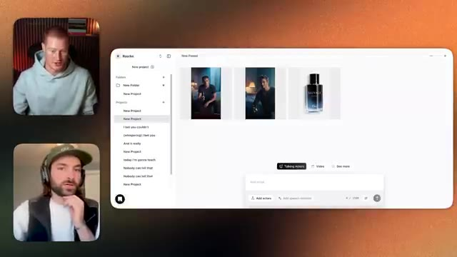
*⏱️ 00:32:55 — Capture d'écran montrant l'interface d'un logiciel de création vidéo avec des aperçus visuels et des vignettes de projets, ainsi que les deux intervenants en visio.*

---

### ⏱️ `[00:33:10 - 00:33:34]` | Segment #65

**🔊 Audio (Transcription Intégrale Mot pour Mot en Français) :**
> Voici mes GPTs. Nous avons environ 10 000 conversations avec des gens qui utilisent ces 5 000 sur celui-ci, en utilisant ces GPTs. Et fondamentalement, celui-ci est conçu pour Sora 2, n'est-ce pas ? Donc vous pouvez créer un GPT personnalisé pour chaque modèle d'image, chaque modèle de vidéo, de sorte à obtenir des résultats hyper personnalisés, c'est-à-dire meilleurs.

**👁️ Analyse Visuelle d'Écran (gemini-3.5-flash-lite) :**
**Interface & Outils** : Navigateur web (Google Chrome) affichant l'interface de gestion des GPTs personnalisés sur ChatGPT.

**Contenu textuel & Code** : Liste des GPTs personnalisés (« Prompting GPT », « Prompting GPT 2 », « GenAI Prompting Assistant », etc.) avec des métriques de conversations (par exemple, 5 000+ chats, 10 000+ chats).

**Action / Démonstration** : Présentation et navigation dans l'interface de gestion des GPTs personnalisés pour illustrer leur utilisation et leurs statistiques d'utilisation.

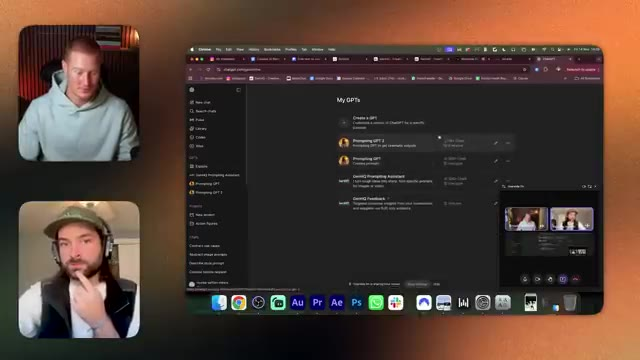
*⏱️ 00:33:16 — Capture d'écran montrant l'interface de ChatGPT avec la section 'My GPTs' affichée au centre, accompagnée des vignettes des participants en visio sur les côtés.*

---

### ⏱️ `[00:33:35 - 00:33:54]` | Segment #66

**🔊 Audio (Transcription Intégrale Mot pour Mot en Français) :**
> Et c'est ce que nous faisons. Donc celui-ci est pour Sora 2. Donc je peux dire par exemple, écris, je vais juste le dire à voix haute, écris-moi un prompt pour Sora 2 qui créera une publicité UGC pour quelqu'un tenant une bouteille de parfum Dior Sauvage. Et ils racontent à quel point ils l'adorent.

**👁️ Analyse Visuelle d'Écran (gemini-3.5-flash-lite) :**
**Interface & Outils** : Présentation ou face-caméra explicatif du trader sans interface logicielle partagée.

**Contenu textuel & Code** : Explications orales des stratégies et mise en contexte méthodologique du marché.

**Action / Démonstration** : Explications face caméra et analyse conceptuelle des marchés.

---

### ⏱️ `[00:33:54 - 00:34:13]` | Segment #67

**🔊 Audio (Transcription Intégrale Mot pour Mot en Français) :**
> Exactement. Et ce que ça fait, c'est que ça crache ensuite comme un tas de sorcellerie, qui a juste l'air d'un charabia absolu. Ça a l'air juste ridicule. Mais le ridicule ressemble à ça ici sur le côté. Mais ça se traduit. Je me débarrassais du mince, et je me suis dit, mince, c'est un prompt plutôt complet.

**👁️ Analyse Visuelle d'Écran (gemini-3.5-flash-lite) :**
**Interface & Outils** : Navigateur web (Google Chrome), interface ChatGPT et interface de génération vidéo Sora.

**Contenu textuel & Code** : Texte de prompt pour Sora demandant une publicité UGC pour un parfum (Dior Sauvage).

**Action / Démonstration** : Navigation et démonstration de prompts textuels générés pour l'outil de vidéo Sora.

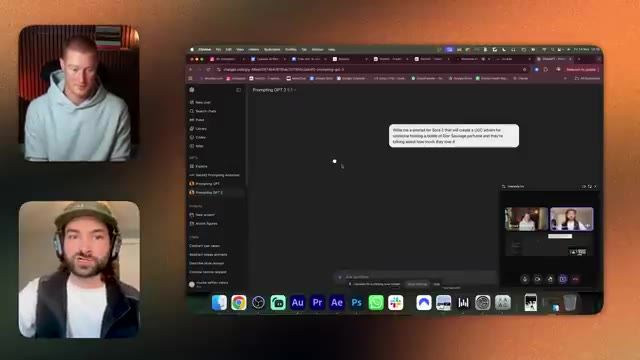
*⏱️ 00:33:59 — Interface ChatGPT affichant un prompt textuel lié à Sora.*

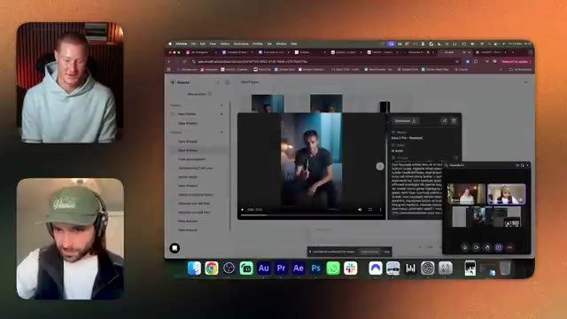
*⏱️ 00:34:08 — Interface de génération vidéo montrant un aperçu visuel issu de Sora avec des détails textuels en panneau latéral.*

---

### ⏱️ `[00:34:13 - 00:34:31]` | Segment #68

**🔊 Audio (Transcription Intégrale Mot pour Mot en Français) :**
> Mais je me doutais bien que tu utilisais quelque chose comme du sur-mesure. Ouais. Oh, ouais. Eh bien, ouais. Ouais. Donc c'est du total n'importe quoi, non ? C'est comme s'il écrivait même les décibels, tu vois, en termes de volume auquel les gens devraient parler. C'est intéressant. Ouais. J'ai beaucoup expérimenté avec ces plateformes.

**👁️ Analyse Visuelle d'Écran (gemini-3.5-flash-lite) :**
**Interface & Outils** : Navigateur web (Google Chrome / ChatGPT) et interface de visioconférence.

**Contenu textuel & Code** : Texte descriptif détaillé d'un prompt pour IA (génération de style influenceur, sujet humain tenant une bouteille Dior Sauvage, cadrage selfie, éclairage, mouvements, etc.).

**Action / Démonstration** : Présentation et lecture du prompt personnalisé utilisé pour générer du contenu ou des instructions pour une IA.

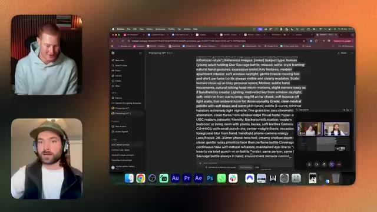
*⏱️ 00:34:17 — Capture d'écran montrant une interface de navigateur web avec le texte d'un prompt détaillé affiché à l'écran, ainsi que deux flux vidéo des participants sur le côté.*

---

### ⏱️ `[00:34:31 - 00:35:08]` | Segment #69

**🔊 Audio (Transcription Intégrale Mot pour Mot en Français) :**
> Comme j'ai fait deux vidéos sur Arcads ces deux dernières semaines. Et c'est une chose à laquelle je me suis heurté, c'est juste que parfois, la latence du genre, après qu'quelqu'un ait parlé avant que la scène suivante n'apparaisse. Des petits trucs comme ça dans un prompt très basique ne font tout simplement pas l'affaire. Alors désolé de t'interrompre, mais est-ce que ce GPT personnalisé sera une ressource gratuite pour les gens ? Ouais, c'est une ressource gratuite mec, c'est une ressource gratuite, euh ouais ouais, je te l'enverrai après ça et vous les gars, vous pourrez l'utiliser donc ouais, vous pouvez voir qu'il y a tellement de détails de fou là-dedans en termes d'effets sonores et tout ça est modifiable, n'est-ce pas ? Donc vous pouvez aller dedans et changer tout ce que vous voulez, vous savez.

**👁️ Analyse Visuelle d'Écran (gemini-3.5-flash-lite) :**
**Interface & Outils** : Interface web (ChatGPT ou similaire) et visioconférence.

**Contenu textuel & Code** : Texte de prompt détaillé pour la création de contenu vidéo UGC (User Generated Content) avec des paramètres de caméra, d'audio et de dialogues.

**Action / Démonstration** : Présentation et analyse d'un prompt complexe pour la génération de vidéos.

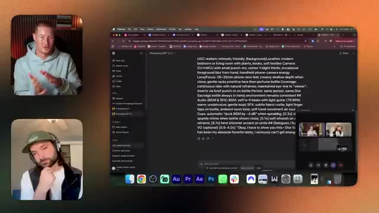
*⏱️ 00:34:40 — Capture d'écran montrant l'interface d'un navigateur avec un prompt détaillé pour la génération de vidéo par IA, aux côtés de deux participants en visio-conférence.*

---

### ⏱️ `[00:35:08 - 00:35:46]` | Segment #70

**🔊 Audio (Transcription Intégrale Mot pour Mot en Français) :**
> et à la fin du prompt il te donne le script, d'accord, je dois vous montrer ça, Dior Sauvage est mon absolu favori ces derniers temps. Je ne m'en lasse vraiment pas, n'est-ce pas ? Tu pourrais changer ça pour que ce soit n'importe quoi d'autre. Tu peux donc créer, genre tu pourrais mettre dans le même prompt et ensuite changer juste de très petits détails comme le script et faire de l'A/B testing sur environ un millier de publicités différentes. Et j'ai un de mes amis, Shabazz, qui dirige une entreprise de marketing à la performance, et il dépense 3 millions de dollars par mois en publicités sur Meta. Et on a fait une interview avec lui et Gen HQ, et il explique comment, tu sais, un client vient les voir et ils créent plus d'un millier de

**👁️ Analyse Visuelle d'Écran (gemini-3.5-flash-lite) :**
**Interface & Outils** : Interface web de ChatGPT (navigateur), application de visioconférence.

**Contenu textuel & Code** : Texte d'un prompt complet décrivant les spécifications visuelles, audio et textuelles pour une publicité vidéo (mentionnant "Dior Sauvage", éclairage, cadrage, audio, etc.).

**Action / Démonstration** : Le présentateur montre et lit un exemple de prompt de génération de contenu vidéo textuel.

*⏱️ 00:35:17 — Capture d'écran montrant l'interface de ChatGPT avec un prompt détaillé sur la création d'une publicité pour Dior Sauvage, accompagnée d'une visioconférence avec deux participants sur le côté.*

---

### ⏱️ `[00:35:46 - 00:36:22]` | Segment #71

**🔊 Audio (Transcription Intégrale Mot pour Mot en Français) :**
> différentes publicités créatives par IA euh et exécuter ça genre pour le client pour faire des tests A/B sur tout c'est tellement fou et c'est juste genre juste en créant un prompt supplémentaire tu sais genre tu peux créer ces vidéos à grande échelle bien sûr certaines de ces plateformes peuvent avoir un tout petit peu de barrière quand il s'agit de la quantité de crédits à utiliser et de combien coûte ton crédit par génération mais genre si tu as des clients et que les clients se rentabilisent essentiellement d'eux-mêmes parce qu'ils paient pour la plateforme et que tu peux simplement créer ces vidéos à grande échelle pour eux pour genre je suis mon cerveau bouillonne parce que je repense à l'époque où si tu étais genre une agence de publicité ou une agence marketing et tu étais

**👁️ Analyse Visuelle d'Écran (gemini-3.5-flash-lite) :**
**Interface & Outils** : Aucun

**Contenu textuel & Code** : Aucun

**Action / Démonstration** : Discussion entre le présentateur et son invité.

---

### ⏱️ `[00:36:22 - 00:36:58]` | Segment #72

**🔊 Audio (Transcription Intégrale Mot pour Mot en Français) :**
> créer ce genre de contenu pour une marque, imaginez que vous leur montrez le produit fini, ils se disent « pas fan, il faut aller tout rooshoter » ou « je ne sais pas trop comment vous faites, vous savez, le montage ce serait galère pour corriger toutes ces choses », maintenant vous pouvez simplement le faire dans un prompt, donc c'est juste dingue la façon dont vous pouvez faire de l'A/B testing sur toutes ces différentes publicités juste en, vous savez, en l'utilisant, ça me dépasse complètement, c'est euh assez hallucinant, et pour vous donner un exemple, on a fait un projet avec une vraie super star récemment, et le client est revenu, bon, pas question de citer de noms, mais c'est probablement la personne la plus célèbre de la planète, disons les choses ainsi, euh, et elle a dit, elle a fait « oh, le, on veut plus de »

**👁️ Analyse Visuelle d'Écran (gemini-3.5-flash-lite) :**
**Interface & Outils** : Visioconférence (appel vidéo à deux participants).

**Contenu textuel & Code** : Aucun code source, graphique technique, terminal ou donnée financière affichée.

**Action / Démonstration** : Discussion en visioconférence entre le créateur de contenu et son invité.

---

### ⏱️ `[00:36:58 - 00:37:21]` | Segment #73

**🔊 Audio (Transcription Intégrale Mot pour Mot en Français) :**
> variation dans les couleurs des fleurs en arrière-plan mais quelque chose d'aussi petit que ça, n'est-ce pas, nous pouvons intervenir et changer cela en post-production en utilisant l'IA. Mais le truc, c'est que cela signifie que nous générons évidemment des images et ensuite nous transformons des images en vidéos, n'est-ce pas ? Nous avons donc dû modifier chaque image de cette séquence, car dans l'arrière-plan de chaque plan se trouvent les fleurs.

**👁️ Analyse Visuelle d'Écran (gemini-3.5-flash-lite) :**
**Interface & Outils** : Visioconférence / enregistrement vidéo de type podcast.

**Contenu textuel & Code** : Aucun contenu graphique, technique, code ou métrique affiché.

**Action / Démonstration** : Discussion et explication orale par le présentateur sans support visuel de démonstration.

---

### ⏱️ `[00:37:21 - 00:37:50]` | Segment #74

**🔊 Audio (Transcription Intégrale Mot pour Mot en Français) :**
> Donc c'est fou. Tu as raison. C'est possible d'intervenir et de faire tous ces changements fous, mais ça prend toujours du temps et ça demande toujours des créatifs. Genre, je tiens vraiment à insister sur le fait qu'il y a beaucoup d'emplois qui disparaissent à cause de l'IA. Et je prends l'immense responsabilité d'essayer de créer autant de nouveaux emplois que possible dans cet espace de l'IA créative. Donc l'un de mes objectifs personnels est d'essayer de créer 100 000 nouveaux emplois dans le domaine de l'IA au cours des trois prochaines années.

**👁️ Analyse Visuelle d'Écran (gemini-3.5-flash-lite) :**
**Interface & Outils** : Visioconférence (aucun outil de trading, graphique ou terminal n'est affiché).

**Contenu textuel & Code** : Aucun contenu technique, graphique, code ou indicateur financier n'est visible.

**Action / Démonstration** : Discussion en visioconférence entre le présentateur et son invité sur l'impact de l'IA sur l'emploi.

---

### ⏱️ `[00:37:51 - 00:38:14]` | Segment #75

**🔊 Audio (Transcription Intégrale Mot pour Mot en Français) :**
> Et dans ce cadre-là, une grande partie pour moi, c’est que nous apprenions, grandissions et nous éduquions tous ensemble. Et si vous essayez d’apprendre ces choses par vous-même dans cette industrie, vous vous préparez malheureusement à l’échec. Vous devez vraiment vous appuyer sur la communauté parce qu’il y a tellement de choses qui changent tout le temps. Vous ne pouvez pas avoir les yeux rivés sur les réseaux sociaux toute la journée pour apprendre toutes ces nouveautés.

**👁️ Analyse Visuelle d'Écran (gemini-3.5-flash-lite) :**
**Interface & Outils** : Aucun graphique technique, terminal ou plateforme de trading affichée (simple visioconférence).

**Contenu textuel & Code** : Aucun code, indicateur technique, prompt ou donnée chiffrée.

**Action / Démonstration** : Discussion et échange verbal entre les intervenants sans manipulation d'interface technique.

---

### ⏱️ `[00:38:14 - 00:38:50]` | Segment #76

**🔊 Audio (Transcription Intégrale Mot pour Mot en Français) :**
> Mais si vous avez un endroit sur lequel vous pouvez compter pour que d'autres créatifs vous tiennent au courant, c'est pour cela que j'ai créé mon entreprise de formation, afin que les gens puissent tout apprendre dans un seul espace consolidé. 100, je suppose que j'aimerais parler un peu de Gen HQ maintenant, nous en parlions avant le podcast et il a eu l'idée quand nous étions à San Francisco, vous savez, il a vu d'autres personnes, de grandes communautés comme j'adore l'impact que vous avez, euh, et c'est donc cool de voir ce que vous avez construit maintenant, mais pourriez-vous donner une idée du type de, genre, combien d'étudiants vous avez, peut-être, genre, des revenus récurrents, ou un peu, ouais, faisons ça, c'est fait depuis, je serai intéressé par ça et

**👁️ Analyse Visuelle d'Écran (gemini-3.5-flash-lite) :**
**Interface & Outils** : Présentation ou face-caméra explicatif du trader sans interface logicielle partagée.

**Contenu textuel & Code** : Explications orales des stratégies et mise en contexte méthodologique du marché.

**Action / Démonstration** : Explications face caméra et analyse conceptuelle des marchés.

---

### ⏱️ `[00:38:50 - 00:39:24]` | Segment #77

**🔊 Audio (Transcription Intégrale Mot pour Mot en Français) :**
> Peut-être que tu t'y connais aussi en agence si c'est un sujet dont tu es ouvert à parler. Oui, faisons ça mec. Donc ça c'est Gen HQ, donc notre page d'école, nous avons 814 membres et on génère actuellement 76 000 de revenus récurrents mensuels avec ça, donc c'est vraiment excitant. Nous avons cinq, comme je l'ai mentionné, cinq membres du personnel à temps plein, donc on a trois monteurs à temps plein qui sont du genre de classe mondiale et ensuite on a, genre, j'embauche même ma femme aussi qui gère la production, donc on a un truc de dingue.

**👁️ Analyse Visuelle d'Écran (gemini-3.5-flash-lite) :**
**Interface & Outils** : Navigateur web affichant la plateforme communautaire Skool.

**Contenu textuel & Code** : Page de la communauté "Gen HQ" affichant le fil d'actualité des publications et les statistiques de la communauté (814 membres).

**Action / Démonstration** : Présentation et navigation sur le tableau de bord de la communauté en ligne.

*⏱️ 00:38:58 — Capture d'écran montrant l'interface de la plateforme Skool pour la communauté Gen HQ avec les deux interlocuteurs en visioconférence.*

---

### ⏱️ `[00:39:24 - 00:40:01]` | Segment #78

**🔊 Audio (Transcription Intégrale Mot pour Mot en Français) :**
> pipeline de production parce qu'on essaie de créer 97 morceaux de contenu sur mesure par mois en ce moment donc ça demande une planification intense et une organisation intense et j'essaie d'être devant la caméra pendant environ au moins trois heures par jour parfois jusqu'à six heures par jour à enregistrer du contenu éducatif pour Gen HQ euh donc ouais on en a beaucoup donc la façon dont la plateforme est structurée c'est qu'on a un concours hebdomadaire qui est comme un concours d'IA pour voir genre tu sais quoi euh on vous donne un brief donc on va faire semblant d'être un client puis vous devez aller réaliser notre brief client donc ça vous aide

**👁️ Analyse Visuelle d'Écran (gemini-3.5-flash-lite) :**
**Interface & Outils** : 

**Contenu textuel & Code** : 

**Action / Démonstration** : 

---

### ⏱️ `[00:40:01 - 00:40:35]` | Segment #79

**🔊 Audio (Transcription Intégrale Mot pour Mot en Français) :**
> désolé de t'interrompre c'est tellement intelligent on en revient au "sois payé pour apprendre" c'est un exemple parfait de ça genre j'adore vraiment cette idée ouais c'était vraiment important pour moi que lorsque les gens créent des choses pour le plaisir ils puissent aussi l'utiliser comme une partie de leur portfolio à construire donc nous fixons des défis hebdomadaires qui sont des choses concrètes que vous pouvez ensuite utiliser pour avoir réellement dans votre portfolio. Donc ce ne sera pas juste genre, faites une vidéo IA. Ce sera plutôt genre, faites un storyboard IA qui vous permet, tu sais, qui détaille tous vos plans et tout et qui va genre

**👁️ Analyse Visuelle d'Écran (gemini-3.5-flash-lite) :**
**Interface & Outils** : Navigateur web affichant une plateforme communautaire / LMS (GenHO), avec les flux vidéo des participants incrustés sur le côté gauche.

**Contenu textuel & Code** : Publications de cours, modules d'apprentissage, fils de discussion et classements de membres sur la plateforme GenHO.

**Action / Démonstration** : Navigation et présentation visuelle de la plateforme communautaire et des modules de formation en IA.

*⏱️ 00:40:10 — Capture d'écran montrant une visioconférence avec deux intervenants et, sur la partie droite, l'interface d'une plateforme éducative en ligne nommée "GenHO - Creative AI Education".*

---

### ⏱️ `[00:40:35 - 00:40:56]` | Segment #80

**🔊 Audio (Transcription Intégrale Mot pour Mot en Français) :**
> je vais vous apprendre exactement comment le faire. Nous ne vous demanderons rien de tel que nous n'avons pas enseigné, de sorte que nous vous donnerons une tâche. Vous pouvez aller apprendre à le faire, puis le fabriquer, puis l'utiliser dans votre portfolio pour vous aider à obtenir plus de clients. Et de cette façon, c'est un peu comme cette roue de cycle. C'est donc un aspect parmi d'autres ici. Nous avons tout un tas de ressources et différentes choses.

**👁️ Analyse Visuelle d'Écran (gemini-3.5-flash-lite) :**
**Interface & Outils** : Navigateur web affichant la plateforme communautaire GenHQ.

**Contenu textuel & Code** : Interface utilisateur de la communauté en ligne montrant divers modules de formation et discussions.

**Action / Démonstration** : Présentation de la plateforme de formation et des modules disponibles pour les membres.

---

### ⏱️ `[00:40:56 - 00:41:29]` | Segment #81

**🔊 Audio (Transcription Intégrale Mot pour Mot en Français) :**
> Certains d'entre eux, je les ai partagés avec Brock ici, donc vous pouvez les utiliser aussi. Et ensuite, nous avons la section de la classe, qui consiste fondamentalement à vous enseigner comment trouver du travail de client en IA, comment le tarifer. Et ces modules durent environ deux heures. Ils sont super détaillés, approfondis. Nous vous apprenons comment, par exemple, j'ai construit ma marque personnelle dans l'IA et j'ai en fait pleuré en filmant celui-ci parce que j'étais tellement passionné et ému par ce dont je parlais que j'ai réellement pleuré, ce qui est un peu embarrassant, mais euh, nous abordons ensuite tous les outils d'IA créative pour que vous puissiez tout apprendre

**👁️ Analyse Visuelle d'Écran (gemini-3.5-flash-lite) :**
**Interface & Outils** : Navigateur web affichant une plateforme de cours en ligne (GenAI / interface de formation).

**Contenu textuel & Code** : Vignettes de modules de formation : "Start Here", "Interviews", "Finding AI Work", "AI Pricing", "Personal Branding", "Viral Content", "AI Adverts", "Storyboarding", "Workflows".

**Action / Démonstration** : Navigation et présentation visuelle de modules de formation en ligne sur l'intelligence artificielle lors d'une visioconférence.

---

### ⏱️ `[00:41:29 - 00:42:05]` | Segment #82

**🔊 Audio (Transcription Intégrale Mot pour Mot en Français) :**
> tu as besoin et tout est consolidé, il y a tellement de bruit dans ce domaine en ce moment et nous t'enseignerons comme tout ce que tu as besoin de savoir afin que tu puisses simplement apprendre des meilleurs outils, euh et ensuite nous enseignons aux gens l'immobilier, comment tu peux utiliser l'immobilier pour t'aider et nous allons nous plonger dans différentes industries et ensuite nous interviewons, comme nous avons des podcasts hebdomadaires avec des experts de l'industrie qui fondamentalement te donnent la meilleure information que tu puisses possiblement obtenir dans l'industrie pour en quelque sorte garder une longueur d'avance et nous interviewons réellement les co-fondateurs ou des membres du personnel des plus grandes entreprises d'IA créative afin que tu puisses apprendre directement à la source, nous avons

**👁️ Analyse Visuelle d'Écran (gemini-3.5-flash-lite) :**
**Interface & Outils** : Application de visioconférence et plateforme éducative en ligne.

**Contenu textuel & Code** : Modules de formation affichés sous forme de cartes avec les titres "InfiniteTalk AI", "Beeble AI - Complete Guide" et "AI Real Estate".

**Action / Démonstration** : Présentation des différents modules et outils pédagogiques disponibles sur la plateforme.

---

### ⏱️ `[00:42:05 - 00:42:37]` | Segment #83

**🔊 Audio (Transcription Intégrale Mot pour Mot en Français) :**
> des gens comme PJ qui facture cent mille dollars et plus par publicité IA qui est juste comme un fou et il enseigne aux gens exactement comment vous pouvez aussi aller faire ça et c'est complètement sans filtre genre c'est juste l'information brute dont vous avez besoin pour vraiment genre obtenir les meilleures connaissances et c'est sur quoi nous sommes concentrés ouais j'adore ça et non seulement vous aidez à apporter de la valeur aux gens de votre communauté et évidemment à gagner beaucoup d'argent en faisant ça mais vous faites évidemment ça vous-même aussi vous savez nous avons brièvement parlé de votre instagram et des différentes entreprises en quelque sorte

**👁️ Analyse Visuelle d'Écran (gemini-3.5-flash-lite) :**
**Interface & Outils** : Navigateur web affichant une plateforme de contenu et de visioconférence.

**Contenu textuel & Code** : Interface utilisateur avec liste d'interviews industrielles et aperçu vidéo mentionnant la création de publicités IA à plus de 100 000 $.

**Action / Démonstration** : Présentation d'une interview vidéo et discussion autour des techniques de création publicitaire assistée par IA.

*⏱️ 00:42:13 — Capture d'écran montrant l'interface d'une plateforme web avec une vidéo incrustée intitulée 'MAKE A $100,000+ AI ADVERT WITH VEO3' aux côtés de deux intervenants en visio.*

---

### ⏱️ `[00:42:37 - 00:43:03]` | Segment #84

**🔊 Audio (Transcription Intégrale Mot pour Mot en Français) :**
> avec qui tu as travaillés, donc est-ce que tu pourrais nous plonger un peu dans ce à quoi ressemble une journée type de ton agence ou comment est ton agence, à quoi ça ressemble ? Oui, alors c'est difficile parce que nous avons plusieurs, encore une fois, piliers d'activité. L'un d'eux est le côté social des choses, nous produisons techniquement environ 15 publicités par mois, ce qui correspond aux pubs que tu vois sur les réseaux pour beaucoup de ces produits d'IA créative.

**👁️ Analyse Visuelle d'Écran (gemini-3.5-flash-lite) :**
**Interface & Outils** : Visioconférence standard.

**Contenu textuel & Code** : Aucun code, graphique, terminal ni métrique financière n'est affiché à l'écran.

**Action / Démonstration** : Discussion en visio entre le présentateur et son invité.

---

### ⏱️ `[00:43:03 - 00:43:27]` | Segment #85

**🔊 Audio (Transcription Intégrale Mot pour Mot en Français) :**
> So we're creating ads in that sense. And then we also create ads and we hop on projects with other big production studios who, you know, their sole job is to create AI ads. And for me, I am an educator. So that's where I focus all my time. But then I do hop on projects so that I can also learn how people are delivering that so that I can educate people on it too.

**👁️ Analyse Visuelle d'Écran (gemini-3.5-flash-lite) :**
**Interface & Outils** : AUCUNE

**Contenu textuel & Code** : AUCUNE

**Action / Démonstration** : AUCUNE

---

### ⏱️ `[00:43:27 - 00:44:00]` | Segment #86

**🔊 Audio (Transcription Intégrale Mot pour Mot en Français) :**
> Sinon je serais juste comme un faux éducateur, donc je trempe mes orteils de temps en temps mais une journée dans notre vie est probablement très différente de ce à quoi ressemblerait une agence typique, donc notre vie, je peux seulement parler d'après notre expérience, mais nous avons la plus grande partie de notre équipe basée au Royaume-Uni, donc des réunions à 9 heures, nous passons en revue tous les projets et je vais réellement partager mon écran et vous montrer parce que j'ai l'impression que c'est tout simplement la meilleure façon de le faire et je ne veux rien cacher, je préfère tout vous montrer, les aspects de démonstration de ces podcasts, c'est tellement génial de pouvoir non seulement en parler

**👁️ Analyse Visuelle d'Écran (gemini-3.5-flash-lite) :**
**Interface & Outils** : Visioconférence / appel vidéo montrant deux participants.

**Contenu textuel & Code** : Aucun élément visuel technique, graphique ou textuel pertinent (pas de code, de graphique financier ou de terminal).

**Action / Démonstration** : Discussion en visioconférence entre les intervenants.

---

### ⏱️ `[00:44:00 - 00:44:34]` | Segment #87

**🔊 Audio (Transcription Intégrale Mot pour Mot en Français) :**
> mais vous voyez, en coulisses, c'est tellement précieux, ouais, c'est euh, donc voilà comment nous structurons notre production, n'est-ce pas, donc tout ça ici, c'est en gros comme une vidéo qui doit être faite, euh, et tout a un code couleur pour que les monteurs sachent sur quoi ils doivent travailler. On essaie aussi d'intégrer des choses comme les relations publiques et euh d'essayer de s'assurer qu'on ne fait pas seulement le contenu, mais que les gens doivent aussi en être informés, donc on a genre certaines opportunités de relations publiques qu'on intègre aussi dans notre emploi du temps, c'est genre juste cette semaine par exemple, comme des livrables qu'on faisait hier et

**👁️ Analyse Visuelle d'Écran (gemini-3.5-flash-lite) :**
**Interface & Outils** : Navigateur web (calendrier de gestion de production) et visioconférence.

**Contenu textuel & Code** : Planning éditorial ou de production sous forme de calendrier avec des blocs de tâches de différentes couleurs.

**Action / Démonstration** : Le présentateur explique la structure de production et l'organisation du travail des monteurs.

---

### ⏱️ `[00:44:34 - 00:45:11]` | Segment #88

**🔊 Audio (Transcription Intégrale Mot pour Mot en Français) :**
> aujourd'hui tu sais et c'est un peu tout décomposé donc quand on s'assoit pour faire quelque chose tu sais on va regarder à travers ça et se dire ok tu sais untel dans notre équipe tu fais ça untel dans ton équipe tu fais ça des questions et la façon dont ça fonctionne c'est que je vais proposer un concept créatif et comme le format de ce à quoi la vidéo devrait ressembler en termes de structure pour l'idée de la publicité et ensuite on va la passer aux monteurs ils vont créer du contenu IA tu sais qui correspond à ma description et ensuite je vais passer par des cycles d'itérations dessus jusqu'à ce que ce soit parfait et ensuite

**👁️ Analyse Visuelle d'Écran (gemini-3.5-flash-lite) :**
**Interface & Outils** : Navigateur web (Google Chrome), outil de gestion de projet Mindday, et interface de visioconférence.

**Contenu textuel & Code** : Un calendrier ou tableau de bord ("Masterboard") avec des tâches réparties par code couleur et des participants en appel vidéo.

**Action / Démonstration** : Présentation ou discussion autour d'un calendrier de projet structuré et découpé en tâches d'équipe.

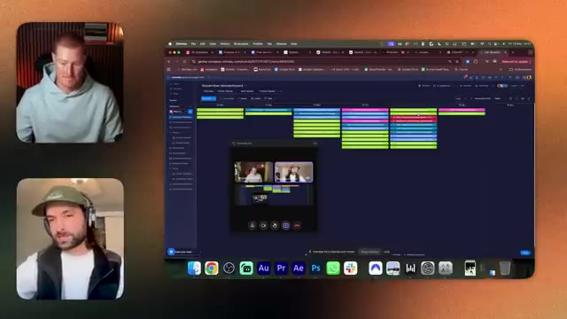
*⏱️ 00:44:43 — Un écran de navigateur affichant un outil de gestion de projet (Mindday) avec un calendrier coloré, et sur le côté deux flux vidéo de participants en visioconférence.*

---

### ⏱️ `[00:45:11 - 00:45:44]` | Segment #89

**🔊 Audio (Transcription Intégrale Mot pour Mot en Français) :**
> ils vont du côté du tutoriel pour montrer aux gens comment c'est fait après et ensuite je viens à la fin et j'enregistre par-dessus pour éduquer et apporter de la valeur mais ils éditent la viande euh et je suis juste les légumes tu es juste les légumes je dirais plus que ça non c'est fou donc c'est évidemment comme une équipe de production à part entière avec laquelle vous travaillez mais je suppose qu'un point que nous faisons dans cette vidéo c'est que vous n'avez pas besoin d'aller à cette échelle complète c'est à quoi ça ressemble vous n'avez pas vraiment de légitime vous savez comme une très grande agence et une entreprise éducative

**👁️ Analyse Visuelle d'Écran (gemini-3.5-flash-lite) :**
**Interface & Outils** : Navigateur web affichant un outil de gestion de projet (Monday.com) et application de visioconférence.

**Contenu textuel & Code** : Interface utilisateur de gestion de projet avec un calendrier du mois de novembre et des tâches planifiées.

**Action / Démonstration** : Discussion en visio-conférence entre les deux intervenants avec partage d'écran de l'interface de planification.

---

### ⏱️ `[00:45:44 - 00:46:23]` | Segment #90

**🔊 Audio (Transcription Intégrale Mot pour Mot en Français) :**
> ouais une présence sur les réseaux sociaux sur plusieurs plateformes différentes que ce soit YouTube ou Instagram ou TikTok ou tout ça mais ouais c'est c'est insensé juste de montrer et pour donner un peu de contexte sur toi en quelque sorte avant qu'on termine là-dessus genre est-ce que tu as de l'expérience auparavant avec tu sais soit le marketing ou la technologie ou est-ce que c'est quelque chose que tu as en quelque sorte pu apprendre sur le tas au cours des deux dernières années et en tirer profit Euh, ouais. Donc avant tout ça, j'étais un streamer en direct sur YouTube qui se filmait en train de dormir, c'est ça ? Je n'avais aucun droit. Je n'ai absolument aucun droit d'être un spécialiste du marketing. Tu sais, on pourrait soutenir que

**👁️ Analyse Visuelle d'Écran (gemini-3.5-flash-lite) :**
**Interface & Outils** : Visioconférence (type Zoom ou Google Meet) affichant deux interlocuteurs en disposition principal/vignette.

**Contenu textuel & Code** : Aucun contenu technique, graphique, code ou données financières affichés, uniquement les flux vidéo des intervenants.
[COMPORTEMENT] Discussion en direct, échange conversationnel sans démonstration logicielle ni analyse technique.

**Action / Démonstration** : Explications face caméra et analyse conceptuelle des marchés.

---

### ⏱️ `[00:46:23 - 00:46:47]` | Segment #91

**🔊 Audio (Transcription Intégrale Mot pour Mot en Français) :**
> it was clever marketing to try and achieve virality, but I used to have like a YouTube channel that an Instagram, oh sorry, a TikTok page, which got to like a million followers. And It was my first social platform like channel that I ran. And I was not a marketer, but I was just an idiot in a room who just loved social media and was just passionate about making things.

**👁️ Analyse Visuelle d'Écran (gemini-3.5-flash-lite) :**
**Interface & Outils** : Visioconférence (aucun graphique, code, terminal ou outil technique affiché).

**Contenu textuel & Code** : Aucun indicateur technique, code source ou donnée chiffrée n'est présent à l'écran.

**Action / Démonstration** : Conversation en visioconférence entre les deux intervenants.

---

### ⏱️ `[00:46:48 - 00:47:23]` | Segment #92

**🔊 Audio (Transcription Intégrale Mot pour Mot en Français) :**
> Et je pense que si vous êtes passionné par la création de choses, quand vous commencez à jouer avec ces outils, on n'a pas l'impression de travailler. Et donc, non, je n'ai absolument aucun droit d'être dans la position où je suis aujourd'hui. Les choses qui m'y ont mené sont une curiosité d'apprendre, une volonté de vouloir créer des choses et tout simplement de m'améliorer constamment. Je ne recommande pas d'avoir le calendrier de production que je viens de vous montrer, genre je n'ai pas de vie, d'accord ? Et si vous voulez avoir une vie, ne faites pas ce que je fais, mais je me suis fixé une sorte de mission où je veux avoir un impact énorme et je ne peux pas le faire à moins que je

**👁️ Analyse Visuelle d'Écran (gemini-3.5-flash-lite) :**
**Interface & Outils** : Visioconférence (aucun graphique, terminal ou code source affiché).

**Contenu textuel & Code** : Aucun contenu technique, indicateur, code ou données chiffrées.

**Action / Démonstration** : Discussion et échange verbal entre les intervenants sans manipulation de l'écran.

---

### ⏱️ `[00:47:23 - 00:47:55]` | Segment #93

**🔊 Audio (Transcription Intégrale Mot pour Mot en Français) :**
> sacrifier ces choses-là mais vous pouvez totalement genre faire de l'IA, avoir une vie et gagner une vie très confortable de genre n'importe où sur le spectre entre disons cinq à cinquante mille par mois et être parfaitement heureux, genre il y a tellement d'opportunités dans ce spectre pour que les gens existent en ce moment et et c'est tellement accessible, genre tellement accessible, ce sont juste des compétences de base en montage vidéo et en résolution de problèmes. Ouais, non, j'adore. Je suppose que pour finir le podcast, si vous pouviez

**👁️ Analyse Visuelle d'Écran (gemini-3.5-flash-lite) :**
**Interface & Outils** : Visioconférence (type Zoom ou appel vidéo en double écran).

**Contenu textuel & Code** : Aucun graphique, code, terminal, indicateur technique ou élément visuel pertinent.

**Action / Démonstration** : Discussion en visioconférence entre le présentateur et un invité.

---

### ⏱️ `[00:47:55 - 00:48:17]` | Segment #94

**🔊 Audio (Transcription Intégrale Mot pour Mot en Français) :**
> laisser genre au public genre juste quelques trucs que vous feriez maintenant afin de genre faire les premiers pas. Je sais qu'on a un peu parlé du genre d'exemples de choses qu'on pourrait faire, mais j'adorerais juste entendre les premiers pas, des choses tangibles. Qu'est-ce que vous feriez maintenant si vous étiez dans la position d'un téléspectateur qui voulait vraiment genre, ils regardent sur le long terme et veulent en profiter et veulent juste commencer aujourd'hui. Ouais, laisse-moi te montrer à nouveau.

**👁️ Analyse Visuelle d'Écran (gemini-3.5-flash-lite) :**
**Interface & Outils** : Visioconférence (pas d'interface de trading ou de code affichée).

**Contenu textuel & Code** : Aucun contenu technique, graphique, indicateur ou code source n'est visible.

**Action / Démonstration** : Discussion en direct entre le présentateur et son invité.

---

### ⏱️ `[00:48:17 - 00:48:53]` | Segment #95

**🔊 Audio (Transcription Intégrale Mot pour Mot en Français) :**
> Je préfère vous montrer plutôt que de vous raconter. Donc, pour les débutants, voici ce que je recommanderais aux gens, les abonnements réels auxquels vous pouvez commencer à vous abonner aujourd'hui et repartir de ce podcast avec des choses concrètes que vous pouvez commencer à faire et à pratiquer. Nous proposons donc ce genre de processus étape par étape pour vous dans Gen HQ, mais je vais le partager avec vous ici également. Abonnez-vous donc soit à Freepik, soit à Higgsfield. Ces deux éléments sont ce que nous appelons des suites d'IA. Ils offrent de nombreux outils de génération d'images et de vidéos différents sous un seul abonnement. Vous n'avez donc pas à payer pour une multitude d'abonnements différents. Tout est disponible au même endroit. J'adore Freepik. Pour 32

**👁️ Analyse Visuelle d'Écran (gemini-3.5-flash-lite) :**
**Interface & Outils** : Navigateur web affichant une plateforme de communauté ou de cours en ligne, avec une liste d'outils d'IA.

**Contenu textuel & Code** : Liste textuelle structurée d'outils d'IA recommandés : Freepik/Higgsfield, Google Veo 3, Nano Banana, Kling, Midjourney, ElevenLabs, HeyGen/Dreamina, Magnific AI/Topaz Labs.

**Action / Démonstration** : Le présentateur partage son écran pour montrer les abonnements et outils recommandés aux débutants pour se lancer concrètement.

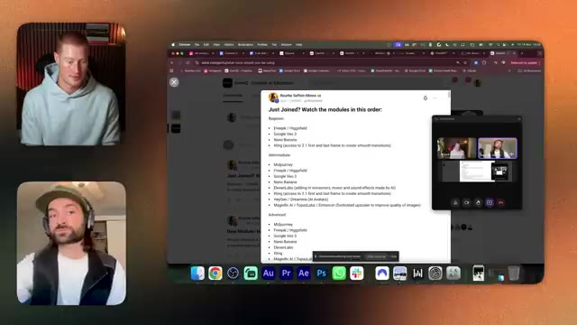
*⏱️ 00:48:26 — Capture d'écran montrant l'écran de l'ordinateur du présentateur avec une liste de recommandations d'outils d'IA organisée par niveaux (Débutant, Intermédiaire, Avancé), ainsi que les flux vidéo des participants.*

---

### ⏱️ `[00:48:53 - 00:49:30]` | Segment #96

**🔊 Audio (Transcription Intégrale Mot pour Mot en Français) :**
> bucks a month, you can get like unlimited image generation. So I really, really like FreePic. Google VO3, they offer either like a cheaper plan or a more expensive plan. And the cheaper plan is like 18 pounds, maybe like 20 bucks. And this one gives you the ability to take your images that you've created in FreePick and turn them into videos with people talking. Okay. So that is like a really great step. Start here, create some images, then take it here, make some videos of people talking, and you'll start to see the dots starting to connect in your head. The next step is to use

**👁️ Analyse Visuelle d'Écran (gemini-3.5-flash-lite) :**
**Interface & Outils** : Navigateur web (Google Chrome), application de visioconférence.

**Contenu textuel & Code** : Texte affichant un plan de cours structuré par niveaux (Beginner, Intermediate, Advanced) mentionnant divers outils d'IA générative (Freepik, Google Veo 3, Midjourney, Kling, etc.).

**Action / Démonstration** : Le présentateur commente et présente la liste des outils d'intelligence artificielle recommandés pour différents niveaux d'apprentissage.

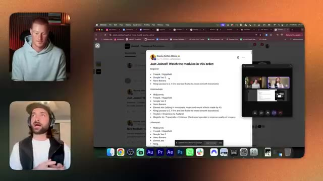
*⏱️ 00:49:02 — Capture d'écran montrant le présentateur dans une vignette vidéo à gauche et une fenêtre de navigateur principale affichant une liste de modules de formation sur l'IA (Freepik / Higgsfield, Google Veo 3, Nano Banana, etc.).*

---

### ⏱️ `[00:49:30 - 00:50:08]` | Segment #97

**🔊 Audio (Transcription Intégrale Mot pour Mot en Français) :**
> Nano Banana. Maintenant, Nano Banana est en fait disponible dans FreePick. Vous pouvez donc commencer dans FreePick, créer des images, mais ensuite commencer à vous intéresser à Nano Banana, car cela débloque la possibilité de créer des images sous plusieurs angles et d'intégrer également des produits dans vos scènes afin que vous puissiez réellement commencer à créer des vidéos dédiées à des fins publicitaires, à créer des personnages cohérents, des lieux et des plans cohérents. Et enfin, je vous recommanderais de vous abonner à Kling. Kling est un modèle vidéo IA similaire à Google VO3, mais Kling est ce que nous appelons un modèle très, il a un très bon respect des instructions.

**👁️ Analyse Visuelle d'Écran (gemini-3.5-flash-lite) :**
**Interface & Outils** : Navigateur web (Google Chrome), plateforme communautaire de cours en ligne.

**Contenu textuel & Code** : Texte affichant des modules de formation classés par niveau (Beginner, Intermediate, Advanced) mentionnant des outils comme Freepik, Google Veo, Nano Banana, Midjourney, etc.

**Action / Démonstration** : Le présentateur commente la structure des modules et l'utilisation de l'outil Nano Banana pour la création d'images.

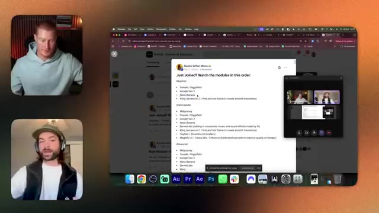
*⏱️ 00:49:40 — Capture d'écran montrant une page de cours ou de communauté en ligne avec une liste de modules de formation, ainsi que deux vignettes vidéo des intervenants sur les côtés.*

---

### ⏱️ `[00:50:08 - 00:50:32]` | Segment #98

**🔊 Audio (Transcription Intégrale Mot pour Mot en Français) :**
> cohérence. Et vous entendrez cette expression employée assez souvent. Et ce que cela signifie, c'est que si vous écriviez dans un prompt basique « le chien entre dans la scène et l1che le chat », il ferait exactement cela, n'est-ce pas ? C'est vraiment du genre à s'en tenir à ce que vous dites. Certains modèles vidéo ont une cohérence de prompt assez mauvaise et du genre, vous savez, un chien peut courir dans la scène et genre l1cher la chaise, n'est-ce pas ?

**👁️ Analyse Visuelle d'Écran (gemini-3.5-flash-lite) :**
**Interface & Outils** : Navigateur web (Google Chrome) affichant une publication sur une plateforme communautaire (semblable à Skool) et une interface de visioconférence.

**Contenu textuel & Code** : Liste de modules d'apprentissage avec des outils d'IA répertoriés : Beginner (Freepik / Higgsfield, Google Veo 3, Nano Banana, Kling), Intermediate (Midjourney, Freepik, Google Veo, ElevenLabs, etc.), Advanced.

**Action / Démonstration** : Le présentateur et son invité commentent la liste des outils d'IA recommandés et l'ordre de visionnage des modules de formation.

*⏱️ 00:50:14 — Capture d'écran montrant le présentateur et son invité en visioconférence sur le côté gauche, et une page web centralisée affichant une liste de modules d'apprentissage classés par niveau (Beginner, Intermediate, Advanced) avec des outils d'IA comme Kling, Midjourney, Google Veo 3 et ElevenLabs.*

---

### ⏱️ `[00:50:32 - 00:50:53]` | Segment #99

**🔊 Audio (Transcription Intégrale Mot pour Mot en Français) :**
> Et tu te dis, mince, genre ce n'est pas ce que je voulais. Mais Kling est vraiment solide. Du coup, tu ne finis pas par gaspiller des crédits. En gros, c'est comme si tu faisais du bowling et que tu avais les barrières de sécurité quand tu fais du bowling, tu vois ? Oui. Ouais, c'est exactement ça. Ouais, c'est une super analogie. Et ça t'aide à te remettre sur la bonne voie. Quoi que tu lui dises, il le fera. Donc Kling est du genre très adapté aux débutants pour cette raison.

**👁️ Analyse Visuelle d'Écran (gemini-3.5-flash-lite) :**
**Interface & Outils** : Navigateur web (Google Chrome) affichant une plateforme de cours en ligne, et application de visioconférence.

**Contenu textuel & Code** : Texte listant les modules d'apprentissage classés par niveau (Beginner, Intermediate, Advanced) incluant divers outils d'IA comme Freepik, Google Veo, Midjourney, Kling et ElevenLabs.

**Action / Démonstration** : Le présentateur commente la structure des modules de formation et met en avant l'utilisation de l'outil Kling pour la génération vidéo.

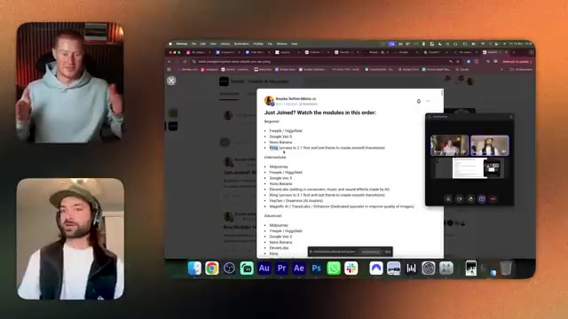
*⏱️ 00:50:37 — Capture d'écran montrant le présentateur et un invité en visioconférence ainsi qu'une page de cours listant des modules de formation sur l'IA, avec le mot 'Kling' mis en surbrillance.*

---

### ⏱️ `[00:50:54 - 00:51:18]` | Segment #100

**🔊 Audio (Transcription Intégrale Mot pour Mot en Français) :**
> Et plus vous jouez avec ces outils, plus vous apprendrez leur langage, d'accord ? Comme je l'ai mentionné, vous pouvez utiliser des GPT personnalisés. C'est pour plus tard. Ne vous inquiétez pas pour ça. Commencez juste, apprenez et jouez. Et vous commencerez à voir, oh, ça a marché. Ça n'a pas marché. Ça a marché. Ça n'a pas marché. Et il y a beaucoup d'essais et erreurs dans le monde de l'IA avec lesquels vous devez tâtonner et expérimenter afin d'arriver là où vous voulez être.

**👁️ Analyse Visuelle d'Écran (gemini-3.5-flash-lite) :**
**Interface & Outils** : Navigateur web (Google Chrome), application de visioconférence et interface communautaire en ligne.

**Contenu textuel & Code** : Liste structurée par niveaux (Beginner, Intermediate, Advanced) d'outils et de modules d'apprentissage (Freepik, Google Veo, Kling, Midjourney, ElevenLabs, etc.).

**Action / Démonstration** : Navigation et présentation des différents outils et modules de formation recommandés aux utilisateurs.

*⏱️ 00:51:00 — Capture d'écran montrant le présentateur et un invité en visioconférence, ainsi qu'une page web affichant une liste de modules de formation avec des outils d'IA.*

---

### ⏱️ `[00:51:18 - 00:51:52]` | Segment #101

**🔊 Audio (Transcription Intégrale Mot pour Mot en Français) :**
> donc ne vous frustrez pas quand vous commencez, genre soyez patients si vous rencontrez des problèmes, vous pouvez toujours genre me contacter, je suis toujours disponible, genre soit sur LinkedIn, vous pouvez m'envoyer un message et je vais genre essayer de vous aider, d'accord ? Mais vraiment ce que je dis c'est juste regardez, soyez patients et continuez à créer, continuez à apprendre en essayant de comprendre comment vous pouvez parler leur langage, à 100 %, ouais, j'apprécie cette explication et sans vouloir faire de hors-sujet, mais Nano Banana 2 sort bientôt je crois, et ça pourrait bien être un tout autre niveau. Donc Rourke, merci beaucoup mec. Je t'apprécie d'avoir donné à tout le monde

**👁️ Analyse Visuelle d'Écran (gemini-3.5-flash-lite) :**
**Interface & Outils** : Navigateur web, plateforme communautaire et interface de visioconférence.

**Contenu textuel & Code** : Texte listant des modules de cours classés par niveau (débutant, intermédiaire, avancé) avec des outils d'IA générative vidéo et image.

**Action / Démonstration** : Navigation et présentation d'un parcours de formation aux outils d'intelligence artificielle.

---

### ⏱️ `[00:51:52 - 00:52:14]` | Segment #102

**🔊 Audio (Transcription Intégrale Mot pour Mot en Français) :**
> en quelque sorte non seulement une analyse de ce à quoi ressemblent l'industrie et le secteur d'un point de vue, vous savez, de l'intérieur, mais aussi en donnant ces premiers gestes pour, vous savez, ce que les gens non techniques devraient faire s'ils veulent profiter de cette opportunité. Donc tout d'abord, bravo à vous et à tout ce que vous avez construit. Je suis tellement ravi de pouvoir vous voir le bâtir pour ainsi dire depuis zéro. C'est fou. Et ouais, je, j'apprécie tout ce que vous faites.

**👁️ Analyse Visuelle d'Écran (gemini-3.5-flash-lite) :**
**Interface & Outils** : Visioconférence (aucun graphique ni code affiché).

**Contenu textuel & Code** : Aucun contenu technique, métrique, indicateur ou code source.

**Action / Démonstration** : Entretien ou discussion en direct entre le présentateur et son invité.

---

### ⏱️ `[00:52:14 - 00:52:26]` | Segment #103

**🔊 Audio (Transcription Intégrale Mot pour Mot en Français) :**
> merci Brock, j'apprécie, merci de m'avoir invité et merci à tous de regarder. Oui, il y a un lien dans la description pour s'inscrire sur Gen HQ, c'est travail, école, communauté, c'est là que se trouvent toutes ces ressources ainsi que d'autres ressources, alors oui, on se voit dans la prochaine.

**👁️ Analyse Visuelle d'Écran (gemini-3.5-flash-lite) :**
**Interface & Outils** : Appel vidéo en écran partagé (type Zoom ou Google Meet).

**Contenu textuel & Code** : Aucun graphique, code, terminal ou indicateur technique affiché.

**Action / Démonstration** : Conversation finale et conclusion de l'entretien entre les intervenants.

---

