# 🎬 NEW Gemini 3 Designs UI Better Than Humans… (Seriously)

> **Chaîne** : [Brock Mesarich | AI for Non Techies](https://www.youtube.com/@BrockMesarich)  
> **Lien YouTube** : [https://www.youtube.com/watch?v=w8hRge2NiJc](https://www.youtube.com/watch?v=w8hRge2NiJc)  
> **Date de publication** : 20251118  
> **Durée** : 00:06:10  
> **Identifiant vidéo** : `w8hRge2NiJc`  
> **Transcription & Analyse** : `whisper-v3-large-turbo+gemini-3.5-flash-lite`  

---

## 📌 Synthèse Exécutive & Outils

### 💡 Résumé
Dans cette vidéo intitulée **Le nouveau Gemini 3 surpasse les humains en design UI… (Sérieusement)**, Alex Carter détaille une approche stratégique et pratique du trading et de l'automatisation par agents IA.

### 🛠️ Outils, Modèles & Logiciels Présentés
- **TradingView & Claude Code** : Analyse technique avancée et automatisation algorithmique.

### 🔑 Points Clés & Enseignements Stratégiques
- Respect rigoureux du ratio risque/rendement et du money management.
- Automatisation méthodique des déclencheurs d'ordres via des agents intelligents.

---

## ⏱️ Chronologie & Transcription Complète Audio & Visuelle (Mot pour Mot)

### ⏱️ `[00:00:00 - 00:00:30]` | Segment #01

**🔊 Audio (Transcription Intégrale Mot pour Mot en Français) :**
> Les gars, Gemini 3 est arrivé. Il vient tout juste de sortir et franchement, il est à la hauteur du battage médiatique. Ceci a été construit avec Gemini 3, tout comme ceci en une seule invite. Et dans cette vidéo, je vais vous montrer comment vous pouvez l'utiliser dès maintenant et gratuitement, car le design est insensé quand il s'agit de coder avec ce modèle. Cette application a également été créée en utilisant le nouveau Gemini 3.0 Pro, qui vous permet fondamentalement de tout importer et vous pouvez le transformer en diagramme interactif. Vous pouvez voir que j'ai importé ce plan d'étage et j'utilise réellement ce gestionnaire de plan interactif qui a entièrement été construit avec Gemini 3.

**👁️ Analyse Visuelle d'Écran (gemini-3.5-flash-lite) :**
**Interface & Outils** : Navigateur web, interface Google Labs / application web de démonstration.

**Contenu textuel & Code** : Interface utilisateur de création de site web et de plans architecturaux interactifs générés par IA.

**Action / Démonstration** : Présentation des capacités de Gemini 3 à travers des exemples de projets interactifs générés en une seule invite.

*⏱️ 00:00:07 — Image #1 montre une interface web avec un aperçu de site e-commerce minimaliste ("Quiet living").*

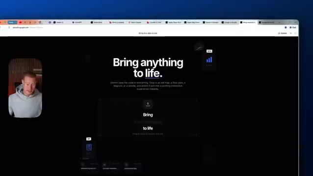
*⏱️ 00:00:15 — Image #2 montre la page d'accueil d'une application web Labs Google avec le texte "Bring anything to life".*

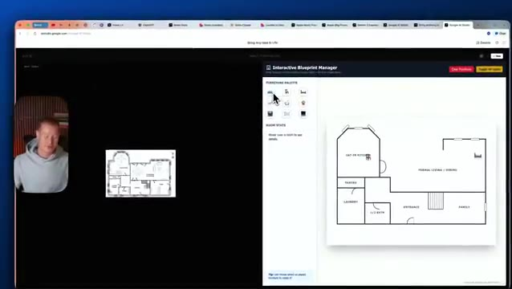
*⏱️ 00:00:22 — Image #3 montre un gestionnaire de plans interactif ("Interactive Blueprint Manager") avec un plan architectural et une palette de mobilier.*

---

### ⏱️ `[00:00:30 - 00:00:52]` | Segment #02

**🔊 Audio (Transcription Intégrale Mot pour Mot en Français) :**
> Alors les gars, dans cette vidéo, je vais vous montrer comment vous pouvez l'utiliser gratuitement, ainsi que des exemples pour vous montrer à quel point c'est bon. Très bien, les gars, entrons directement dans le vif du sujet. Voici donc un exemple que Google a réellement publié avec Gemini 3 à l'intérieur de Google AI Studio, conçu en une seule invite. Remarquez à quel point cela ne fait pas du tout code généré au feeling. Si vous avez déjà fait du code au feeling, vous connaissez l'interface à l'apparence générique que vous obtenez toujours lorsque vous utilisez ces modèles.

**👁️ Analyse Visuelle d'Écran (gemini-3.5-flash-lite) :**
**Interface & Outils** : Navigateur web affichant l'interface Google AI Studio / Studio de développement et de prévisualisation web.

**Contenu textuel & Code** : Page de prévisualisation d'un site web minimaliste intituté 'Aura - Quiet living' avec des sections de navigation et des images de paysages.

**Action / Démonstration** : Le présentateur présente un exemple d'application générée ou publiée par Google tout en commentant son utilisation.

---

### ⏱️ `[00:00:52 - 00:01:15]` | Segment #03

**🔊 Audio (Transcription Intégrale Mot pour Mot en Français) :**
> Par exemple, laissez-moi vous montrer une comparaison côte à côte. J'utilise Gemini 3 en une seule invite pour créer ce site Web ici même pour mon agence de marketing d'influence. Il a l'air extrêmement soigné et n'a pas du tout l'air d'avoir été généré par IA par rapport à Lovable, qui utilise toujours le modèle Gemini 2.5 ainsi que Claude et ChatGPT 5 et exactement la même invite.

**👁️ Analyse Visuelle d'Écran (gemini-3.5-flash-lite) :**
**Interface & Outils** : Navigateur web affichant un site internet minimaliste pour agence marketing généré par IA.

**Contenu textuel & Code** : Textes marketing, graphiques épurés, sections de présentation d'agence ("Scale your AI reality", études de cas, métriques chiffrées).

**Action / Démonstration** : Navigation et défilement du présentateur sur le site web généré par l'intelligence artificielle pour en démontrer le rendu visuel.

*⏱️ 00:00:58 — Aperçu d'un site Web généré avec un design épuré en noir et blanc, présentant le titre "SCALE YOUR AI REALITY" avec des métriques de performance sur le côté.*

*⏱️ 00:01:03 — Défilement de la page du site Web montrant la section "THE LUUME DIFFERENCE" avec du texte explicatif et un aperçu des études de cas.*

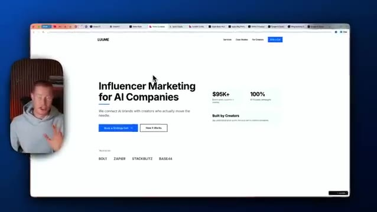
*⏱️ 00:01:09 — Vue alternative du site Web montrant la section d'en-tête "Influencer Marketing for AI Companies" avec des boutons d'appel à l'action.*

---

### ⏱️ `[00:01:15 - 00:01:33]` | Segment #04

**🔊 Audio (Transcription Intégrale Mot pour Mot en Français) :**
> Et ça m'a donné ce résultat ici. Donc vous pouvez voir la différence quant à la qualité du modèle Gemini 3 lorsqu'il s'agit de concevoir des interfaces utilisateur. Et les gars, ça me rend tellement enthousiaste parce que j'étais tellement fatigué d'utiliser ces plateformes de codage intuitif et d'avoir chaque application et chaque site web qui se ressemblent exactement et qui sont super basiques.

**👁️ Analyse Visuelle d'Écran (gemini-3.5-flash-lite) :**
**Interface & Outils** : Navigateur web affichant une interface utilisateur générée par un modèle d'intelligence artificielle, combinée à une application de prévisualisation de code et de design.

**Contenu textuel & Code** : Page web au design moderne avec des sections textuelles ("SCALE YOUR AI REALITY"), des statistiques financières ($95k+) et des logos d'outils (Bolt, Zapier, StackBlitz), ainsi qu'un panneau de prompts sur la gauche.

**Action / Démonstration** : Le présentateur commente et présente le résultat visuel d'une interface utilisateur générée par le modèle Gemini, démontrant la qualité du design obtenu.

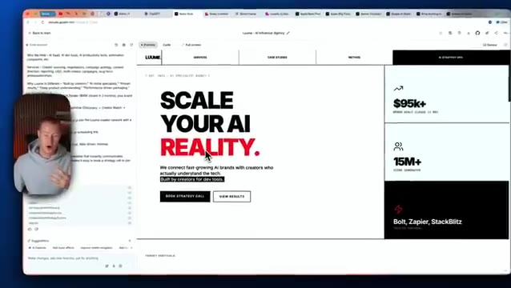
*⏱️ 00:01:19 — Capture d'écran montrant le présentateur dans un encadré à gauche et une interface web interactive à droite avec un design épuré, du texte en gros caractères ("SCALE YOUR AI REALITY.") et un panneau latéral de code/génération d'IA.*

*⏱️ 00:01:24 — Capture similaire montrant l'interface utilisateur web générée par IA avec le même design minimaliste noir et blanc et des accents rouges, avec la webcam du présentateur visible en incrustation.*

---

### ⏱️ `[00:01:33 - 00:01:53]` | Segment #05

**🔊 Audio (Transcription Intégrale Mot pour Mot en Français) :**
> Si nous revenons sur ce site web, encore une fois, celui-ci a été construit en un seul prompt et il a l'air extrêmement soigné. Nous avons donc « quiet living ». La typographie a l'air vraiment solide ici. Il a l'air vraiment bien, vraiment élégant. Et ensuite, il descend aussi et montre la collection. Je veux dire, cela a l'air vraiment soigné. Encore une fois, c'est seulement en un seul prompt que cela a été créé.

**👁️ Analyse Visuelle d'Écran (gemini-3.5-flash-lite) :**
**Interface & Outils** : Navigateur web affichant une application de prévisualisation de site web conçue par IA.

**Contenu textuel & Code** : Interface utilisateur d'un site e-commerce minimaliste généré en un seul prompt, nommé « Aura Quiet Living ».

**Action / Démonstration** : Navigation et défilement sur la page web pour présenter le design et la section des collections du site.

*⏱️ 00:01:38 — Vue d'ensemble du site web généré par IA nommé « Aura Quiet Living » avec une typographie soignée et un design élégant sur fond de paysage montagneux.*

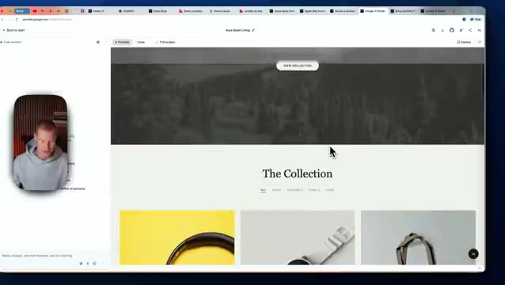
*⏱️ 00:01:43 — Défilement vers le bas du site web montrant la section « The Collection » avec des aperçus de produits en grille.*

*⏱️ 00:01:48 — Vue légèrement modifiée de la section « The Collection » avec un curseur pointant sur les options de filtrage des produits.*

---

### ⏱️ `[00:01:53 - 00:02:14]` | Segment #06

**🔊 Audio (Transcription Intégrale Mot pour Mot en Français) :**
> C'est pourquoi je suis si impressionné par cela. Je pense vraiment que c'est un changement de paradigme en matière de programmation intuitive. C'est donc un exemple parfait. Et puis celui-ci me rend super enthousiaste. Donc ce que vous pouvez faire, c'est que vous pouvez essentiellement tout importer. Par exemple, laissez-moi importer cette image ici. Et les gars, regardez ça. Ça a littéralement construit ce jeu à partir de ce croquis. Donc en gros, ça dit que je dois juste baisser mes doigts pour garder les paupières ouvertes.

**👁️ Analyse Visuelle d'Écran (gemini-3.5-flash-lite) :**
**Interface & Outils** : Navigateur web, explorateur de fichiers système et application de génération visuelle.

**Contenu textuel & Code** : Interface utilisateur web présentant un design minimaliste, une fenêtre pop-up de sélection de fichiers et des éléments graphiques interactifs.

**Action / Démonstration** : Navigation et démonstration d'importation de fichiers et d'interactions avec l'interface.

*⏱️ 00:01:59 — Aperçu d'un site web au design épuré avec un arrière-plan en niveaux de gris et le titre 'Quiet living'.*

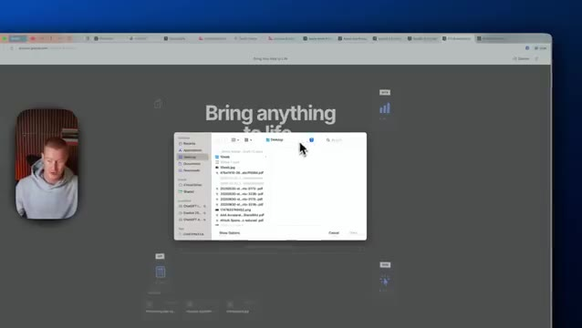
*⏱️ 00:02:04 — Interface de sélection de fichiers système ouverte sur un navigateur web pour importer du contenu.*

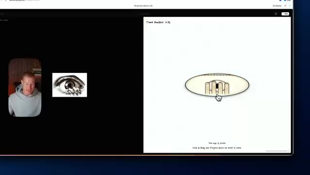
*⏱️ 00:02:09 — Démonstration interactive avec une image d'œil et un composant graphique dynamique sur la droite.*

---

### ⏱️ `[00:02:15 - 00:02:39]` | Segment #07

**🔊 Audio (Transcription Intégrale Mot pour Mot en Français) :**
> Et si les paupières se ferment et que je m'endors et bien fondamentalement je perds la partie. À quel punto c'est fou ? de littéralement prendre cette image pour la transformer en un jeu interactif comme celui-ci. Tout cela est construit avec le nouveau modèle Gemini 3.0 Pro. Et laissez-moi vous montrer comment vous pouvez commencer à l'utiliser dès maintenant gratuitement. Donc ce que vous allez faire, c'est que vous allez vous rendre sur Google AI Studio et vous allez cliquer sur Google AI Studio et vous allez vouloir venir dans la section de construction ici.

**👁️ Analyse Visuelle d'Écran (gemini-3.5-flash-lite) :**
**Interface & Outils** : Google AI Studio / Navigateur web Google Chrome

**Contenu textuel & Code** : Application web interactive avec minuteur ("Time Awake: 11.85") et illustration d'un œil.

**Action / Démonstration** : Démonstration du jeu interactif créé avec Gemini 3.0 Pro, montrant la mécanique de détection de fermeture des paupières.

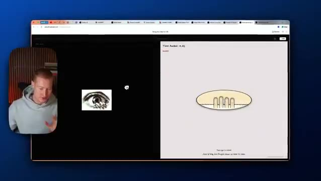
*⏱️ 00:02:21 — Interface Google AI Studio affichant une application web interactive avec un œil en cours de fermeture.*

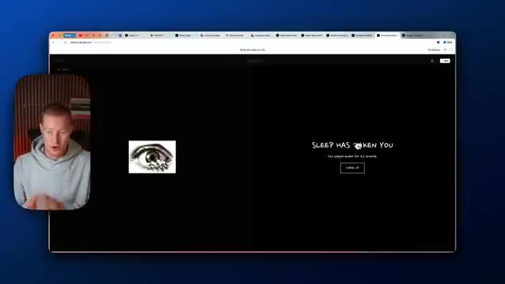
*⏱️ 00:02:27 — Interface Google AI Studio affichant l'écran de fin de jeu "SLEEP HAS TAKEN YOU".*

---

### ⏱️ `[00:02:39 - 00:03:12]` | Segment #08

**🔊 Audio (Transcription Intégrale Mot pour Mot en Français) :**
> Nous pouvons maintenant sélectionner le modèle d'aperçu Gemini 3 Pro. C'est le modèle qui a été utilisé pour créer tous ces différents jeux et sites web que je vous ai montrés ici. Et ce que nous allons faire, c'est simplement décrire notre idée ici. Une chose que je tiens à mentionner, c'est que si vous utilisez un prompt basique avec Gemini 3, cela va vous donner un résultat basique, comme nous avons l'habitude d'en voir avec d'autres LLM en matière de design d'interface utilisateur. Donc par exemple, ceci a été construit par Gemini 3 avec ce prompt très basique ici. C'est fondamentalement juste un prompt d'un seul paragraphe, pas super spécifique. Et ça a l'air un peu généré par IA. C'est mieux que ce que Claude nous aurait donné. C'est créatif, mais

**👁️ Analyse Visuelle d'Écran (gemini-3.5-flash-lite) :**
**Interface & Outils** : Google AI Studio (Navigateur web)

**Contenu textuel & Code** : Interface de génération d'applications, champ de description d'idées, sélecteur de modèle "Gemini 3 Pro Preview", et exemples de projets dans la galerie.

**Action / Démonstration** : Sélection du modèle d'aperçu Gemini 3 Pro et préparation de la saisie d'un prompt pour créer une application ou un site web.

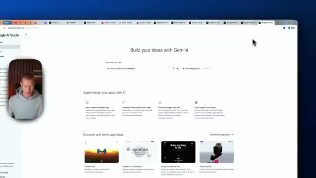
*⏱️ 00:02:47 — Vue d'ensemble de Google AI Studio avec l'interface de création d'applications Gemini et le sélecteur de modèle Gemini 3 Pro Preview.*

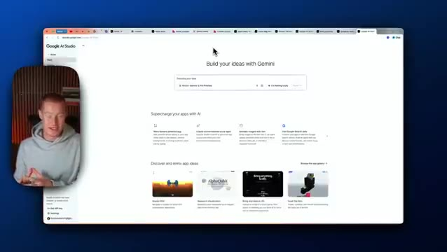
*⏱️ 00:02:56 — Gros plan sur la barre de saisie de Google AI Studio permettant de décrire une idée de projet avec le modèle Gemini 3 Pro Preview sélectionné.*

*⏱️ 00:03:04 — Interface de prévisualisation d'un site web généré par l'IA ("The Future of Influence is Intelligent") avec panneau de code latéral sur Google AI Studio.*

---

### ⏱️ `[00:03:12 - 00:03:42]` | Segment #09

**🔊 Audio (Transcription Intégrale Mot pour Mot en Français) :**
> il utilise toujours ces dégradés qui donnent l'impression que c'est généré par IA. Cependant, c'est exactement le même style de site web. Cependant, je lui ai donné ce prompt complet. Donc pour le prompt de celui-ci, j'ai dit : construis-moi un site web de style Apple pour mon agence de marketing d'influence. Et ensuite, je lui ai pour ainsi dire donné quelques instructions générales sur la façon dont je veux qu'il soit. Et il m'a donné ça, ça ne fait pas très style Apple, mais regardez celui-ci les gars, celui-ci a l'air impeccable. Je pense vraiment que ça a l'air extrêmement solide, très, très propre. Et tout ça parce que je lui ai donné ce prompt super approfondi.

**👁️ Analyse Visuelle d'Écran (gemini-3.5-flash-lite) :**
**Interface & Outils** : Navigateur web affichant l'interface de développement d'un site web et la webcam du présentateur.

**Contenu textuel & Code** : Texte de prompt de conception de site web de style Apple et aperçu de page d'accueil d'agence marketing.

**Action / Démonstration** : Navigation et présentation de la maquette de site web générée par IA.

*⏱️ 00:03:19 — Aperçu du site web de l'agence de marketing d'influence 'Luume' avec le titre 'Influencer Marketing for AI Companies'.*

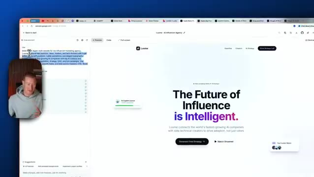
*⏱️ 00:03:27 — Interface de prévisualisation affichant un site au style Apple avec le titre en gros caractères 'The Future of Influence is Intelligent'.*

*⏱️ 00:03:34 — Vue détaillée du site web de Luume avec le code et les sections de configuration visibles dans le panneau latéral gauche.*

---

### ⏱️ `[00:03:42 - 00:04:01]` | Segment #10

**🔊 Audio (Transcription Intégrale Mot pour Mot en Français) :**
> Donc, si vous voulez utiliser le GPT personnalisé que j'ai créé pour cette vidéo, qui transformera vos invites de base en invites complètes afin de construire d'incroyables interfaces utilisateur à partir, vous savez, de quelques phrases expliquant ce que vous voulez construire, alors il y a un lien dans la description pour l'utiliser gratuitement. Très bien, alors essayons maintenant de construire réellement une interface utilisateur pour un site web.

**👁️ Analyse Visuelle d'Écran (gemini-3.5-flash-lite) :**
**Interface & Outils** : Navigateur web (Google Chrome / Studio), interface de prévisualisation web.

**Contenu textuel & Code** : Page web intitulée "Influencer Marketing for AI Companies" avec des boutons d'action et des sections de texte.

**Action / Démonstration** : Présentation de l'interface utilisateur construite à partir des invites.

*⏱️ 00:03:47 — Capture d'écran montrant un navigateur web affichant une interface utilisateur générée, avec un encart vidéo du présentateur en bas à gauche.*

---

### ⏱️ `[00:04:02 - 00:04:22]` | Segment #11

**🔊 Audio (Transcription Intégrale Mot pour Mot en Français) :**
> Très bien, donc je lui ai donné ce prompt. C'est assez complet. J'utilise ce GPT personnalisé ChatGPT que j'ai lié comme ressource. Je vais cliquer sur construire et passons en revue ce processus. Donc cela ne devrait probablement prendre qu'environ une minute ou un peu plus. Vous pouvez voir qu'il tourne avec le modèle Gemini 3 Pro juste ici. Mais les gars, il y a quelques choses que je veux mentionner pendant que j'attends que cela génère réellement ceci pour moi.

**👁️ Analyse Visuelle d'Écran (gemini-3.5-flash-lite) :**
**Interface & Outils** : Google AI Studio / Interface de développement web et de génération d'applications par IA.

**Contenu textuel & Code** : Prompt utilisateur détaillé ("Build me an ultra-minimal, Apple-inspired website..."), options de style, code/prévisualisation d'une page web et barre de statut de génération.

**Action / Démonstration** : Le présentateur lance la construction/génération d'une application web à partir d'un prompt complet dans Google AI Studio.

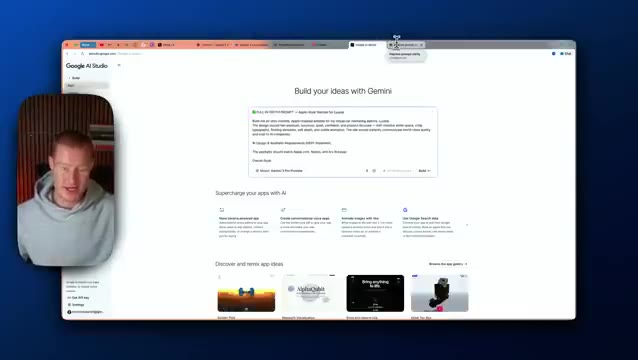
*⏱️ 00:04:07 — Interface de Google AI Studio montrant une boîte de prompt avec une maquette d'application "Apple-style Website for Luume".*

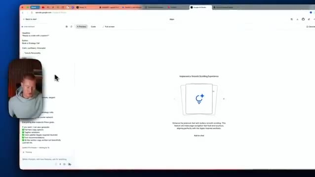
*⏱️ 00:04:12 — Interface de génération en cours avec affichage des éléments textuels et de l'aperçu du site web (section "Implement a Smooth Scrolling Experience").*

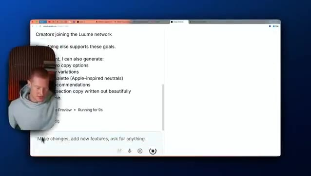
*⏱️ 00:04:17 — Vue détaillée du panneau de génération et de l'interface de prévisualisation web en cours d'exécution ("Running for 9s").*

---

### ⏱️ `[00:04:22 - 00:04:40]` | Segment #12

**🔊 Audio (Transcription Intégrale Mot pour Mot en Français) :**
> Donc encore une fois, Gemini 3 Pro est phénoménal lorsque vous lui donnez un prompt complet. Je dirai que si vous lui donnez un prompt basique, vous allez obtenir un résultat basique. Mais j'ai l'impression que nous avons eu un léger changement de paradigme avec la sortie de ce modèle, parce que nous étions coincés dans les the limbes en ce qui concerne le vibe coding depuis un petit moment maintenant.

**👁️ Analyse Visuelle d'Écran (gemini-3.5-flash-lite) :**
**Interface & Outils** : Navigateur web / Application de type LLM ou outil de génération de contenu.

**Contenu textuel & Code** : Texte généré à l'écran incluant des options de copie, des variations et des recommandations de palette de couleurs, avec un champ de saisie de prompt en bas.

**Action / Démonstration** : Le présentateur parle tandis que l'écran affiche l'interface d'un outil d'intelligence artificielle.

---

### ⏱️ `[00:04:40 - 00:05:01]` | Segment #13

**🔊 Audio (Transcription Intégrale Mot pour Mot en Français) :**
> Et c'est parce que les modèles étaient bons, mais ils n'étaient pas excellents. Et j'ai l'impression que c'est le premier grand modèle de codage, du moins pour le design d'interface utilisateur, parce que c'est tout ce que j'ai pu tester jusqu'à présent que l'on ait vu depuis très longtemps. Donc cela m'excite vraiment à l'approche de 2026 en tant que quelqu'un qui code au feeling tout le temps, parce que je pense vraiment que cela est tout simplement en train d'égaliser les chances pour quiconque ne sait pas coder.

**👁️ Analyse Visuelle d'Écran (gemini-3.5-flash-lite) :**
**Interface & Outils** : Navigateur web (Google / outil de développement web) avec incrustation vidéo du présentateur.

**Contenu textuel & Code** : Interface utilisateur d'un projet web avec options de prévisualisation et de code, et un élément central interactif lié au traitement audio.

**Action / Démonstration** : Le présentateur commente l'interface affichée à l'écran pour illustrer ses propos sur les modèles de codage et de design d'interface utilisateur.

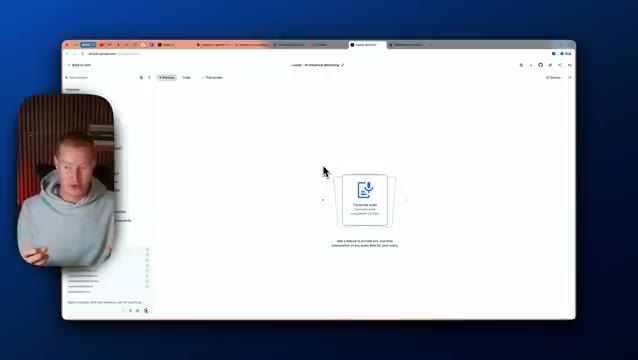
*⏱️ 00:04:45 — Capture d'écran montrant le présentateur dans une pastille vidéo et un navigateur web affichant une interface utilisateur de design ou de code (Google AI / outil de développement).*

---

### ⏱️ `[00:05:01 - 00:05:24]` | Segment #14

**🔊 Audio (Transcription Intégrale Mot pour Mot en Français) :**
> Au moment de cet enregistrement, des plateformes comme Lovable, Bolt ou Base44 n'ont pas Gemini 3 intégré dans leur plateforme pour l'instant. Mais si vous voulez commencer à créer des interfaces utilisateur et des interfaces front-end avec Gemini 3, vous pouvez utiliser Google AI Studio et il y a un lien dans la description pour le faire. Et c'est entièrement gratuit. Les gars, c'était un seul et unique prompt que nous avons donné à Gemini 3.

**👁️ Analyse Visuelle d'Écran (gemini-3.5-flash-lite) :**
**Interface & Outils** : Navigateur web (Google AI Studio) et incrustation vidéo.

**Contenu textuel & Code** : Interface web de Google AI Studio pour la création d'applications et d'interfaces.

**Action / Démonstration** : Le présentateur explique comment utiliser Google AI Studio pour créer des interfaces utilisateur avec Gemini 3.

*⏱️ 00:05:07 — Capture d'écran montrant le navigateur avec Google AI Studio ouvert, ainsi que la webcam du présentateur incrustée dans le coin inférieur gauche.*

---

### ⏱️ `[00:05:24 - 00:05:58]` | Segment #15

**🔊 Audio (Transcription Intégrale Mot pour Mot en Français) :**
> Ça a l'air phénoménal. Oh mon dieu, mec. Je suis trop enthousiaste. Je ne vais pas mentir. J'en avais tellement marre du "vibe coding" et d'avoir les mêmes résultats génériques. Les gars, c'est tellement solide. Regardez ça. Nous connectons les marques d'IA avec des créateurs qui stimulent la croissance. Je veux dire, ça a l'air tellement propre. J'ai l'impression d'en faire des tonnes, mais je suis vraiment, au plus profond de moi, impressionné par la conception de l'interface utilisateur avec ce nouveau modèle de codage. Très bien les gars, voilà qui est fait. Si vous avez apprécié cette vidéo, assurez-vous de vous abonner à cette chaîne. Je parle d'IA pour les non-techniciens. Donc si vous n'êtes pas techniques et que vous voulez quand même rester à jour avec l'IA

**👁️ Analyse Visuelle d'Écran (gemini-3.5-flash-lite) :**
**Interface & Outils** : Navigateur web affichant une application web ou un site de présentation (AI Influencer Marketing).

**Contenu textuel & Code** : Texte de présentation : "We connect AI brands with creators who drive growth" et des boutons d'action.

**Action / Démonstration** : Navigation et défilement sur la page web pour présenter l'interface et le concept de la plateforme.

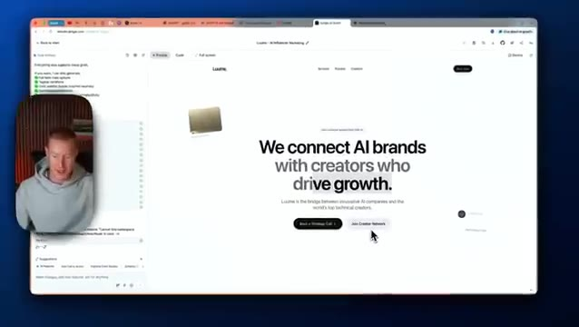
*⏱️ 00:05:41 — Vue de la page web principale montrant le titre principal "We connect AI brands with creators who drive growth".*

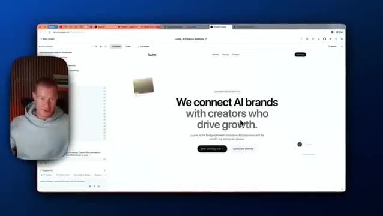
*⏱️ 00:05:49 — Vue similaire de la page d'accueil web avec le même titre principal et la mise en page de l'agence de marketing d'influence IA.*

---

### ⏱️ `[00:05:58 - 00:06:10]` | Segment #16

**🔊 Audio (Transcription Intégrale Mot pour Mot en Français) :**
> C'est l'endroit idéal pour le faire sur cette chaîne, commentez ci-dessous ce que vous en pensez les gars, je suis tellement enthousiaste à ce sujet, les ressources dont j'ai parlé dans cette vidéo sont dans la description ainsi que dans les commentaires. Cela étant dit, les gars, bon "vibe coding", et je vous vois les gars dans la prochaine vidéo.

**👁️ Analyse Visuelle d'Écran (gemini-3.5-flash-lite) :**
**Interface & Outils** : Navigateur web affichant une page d'accueil d'une startup avec un éditeur/prévisualisateur sur le côté gauche.

**Contenu textuel & Code** : Texte principal visible sur la page : "We connect AI brands with creators who drive growth."

**Action / Démonstration** : Présentation de la plateforme web et de l'interface utilisateur.

*⏱️ 00:06:01 — Capture d'écran montrant le présentateur incrusté en médaillon à gauche et une page web présentant une plateforme de marketing d'influence pour l'IA, Luome, à l'écran principal.*

---

