# 🎬 How to Vibe Code with Gemini 3 (for FREE)

> **Chaîne** : [Brock Mesarich | AI for Non Techies](https://www.youtube.com/@BrockMesarich)  
> **Lien YouTube** : [https://www.youtube.com/watch?v=maHDMKy4lNs](https://www.youtube.com/watch?v=maHDMKy4lNs)  
> **Date de publication** : 20251119  
> **Durée** : 00:04:59  
> **Identifiant vidéo** : `maHDMKy4lNs`  
> **Transcription & Analyse** : `whisper-v3-large-turbo+gemini-3.5-flash-lite`  

---

## 📌 Synthèse Exécutive & Outils

### 💡 Résumé
Cette vidéo de la chaîne *Brock Mesarich | AI for Non Techies* explore l'avènement du « vibe coding » (le codage intuitif) propulsé par les dernières avancées des modèles de langage de Google, présentés sous l'appellation Gemini 3. L'analyste y démontre comment passer d'interfaces utilisateur aux aspects artificiels et génériques — typiques des productions sous Claude, ChatGPT ou des versions antérieures comme Gemini 2.5 — à des créations de niveau professionnel, épurées et sophistiquées (notamment inspirées du design suisse haut de gamme), à partir d'un unique prompt. 

La démonstration se concentre sur l'utilisation pratique de Google AI Studio, un environnement gratuit permettant de prototyper rapidement des applications front-end hautement fonctionnelles. À travers des cas d'usage concrets — comme un générateur de produits dérivés par simple glisser-déposer de logo ou un outil de création de systèmes de design et de guides de marque exportables en PDF —, la vidéo illustre l'impact de l'ingénierie de prompt avancée. En combinant un méta-prompting structuré (souvent élaboré via ChatGPT) et la puissance des derniers modèles Google, les non-développeurs peuvent dorénavant concevoir des interfaces graphiques complexes et esthétiques sans compétences techniques préalables.

Bien que Google AI Studio offre une gratuité totale pour la génération d'interfaces front-end et le prototypage rapide, la stratégie de production comporte des nuances financières : l'intégration future de fonctionnalités d'IA natives (génération dynamique de texte, d'images ou de vidéos) et l'absence de backend intégré nécessiteront un passage vers des plateformes de déploiement tierces ou une tarification à l'usage. Cette approche redéfinit l'agilité dans le développement d'applications, permettant d'itérer à la vitesse de la pensée avant d'industrialiser les solutions.

### 🛠️ Outils, Modèles & Logiciels Présentés
* **Gemini 3 / Gemini 1.5 Pro Preview** : Le nouveau modèle de pointe de Google utilisé pour le « vibe coding », offrant des capacités de design d'interface utilisateur d'une qualité professionnelle saisissante.
* **Google AI Studio** : L'environnement de développement et de prototypage gratuit de Google permettant d'exploiter les modèles Gemini pour concevoir rapidement des applications front-end.
* **ChatGPT** : Utilisé comme assistant stratégique d'ingénierie de prompt pour concevoir des instructions complexes, détaillées et orientées vers des styles de design spécifiques (comme le design suisse haut de gamme).
* **Lovable** : Une plateforme de développement d'applications par IA tierce, mentionnée pour comparer les rendus d'interfaces basiques par rapport aux nouvelles performances de Gemini 3.
* **Bolt** : Une alternative de plateforme de *vibe coding* et de développement rapide d'applications assisté par IA.
* **Claude** : Le modèle concurrent d'Anthropic, utilisé comme point de comparaison pour évaluer la qualité et le caractère générique des interfaces générées par le passé.
* **Make / Zapier / n8n** : Des outils d'automatisation de flux de travail (évoqués dans l'écosystème global de l'IA pour non-techies, bien que non mobilisés directement dans la démo de code).
* **Grok** : Le modèle conversationnel d'xAI (mentionné dans le cadre de l'écosystème technologique global).

### 🔑 Points Clés & Enseignements Stratégiques
* **Rupture qualitative du *vibe coding*** : Le passage aux nouveaux modèles Gemini permet de s'affranchir du design "générique et typique de l'IA" pour produire des interfaces front-end au rendu professionnel, propre et esthétiquement soigné dès le premier essai.
* **Supériorité de l'ingénierie de prompt contextuelle** : Un prompt minimaliste génère un résultat basique et prévisible ; à l'inverse, l'injection de directives stylistiques précises (ex: design suisse haut de gamme, structures de composants, ergonomie des boutons) transforme radicalement la qualité de l'application générée.
* **Synergie inter-médias (ChatGPT + Google AI Studio)** : Utiliser ChatGPT pour élaborer et affiner le méta-prompt avant de l'exécuter dans Google AI Studio constitue une méthodologie optimale pour maximiser la pertinence et la complexité des applications créées.
* **Prototypage front-end à coût zéro** : Google AI Studio permet de concevoir, tester et itérer sur des interfaces graphiques complexes de manière totalement gratuite, abaissant drastiquement la barrière à l'entrée pour les créateurs non-tech.
* **Limitations architecturales initiales** : Google AI Studio se concentre actuellement sur le front-end et ne dispose pas de fonctionnalités de backend intégrées, nécessitant l'utilisation de plateformes complémentaires pour des applications web à part entière.
* **Arbitrage économique pour la production** : Si la conception d'interfaces et de pages de destination purement visuelles reste gratuite, l'intégration de fonctionnalités d'IA dynamiques en production (génération de texte, d'images ou de médias) entraînera des coûts d'utilisation à l'acte.
* **Cas d'usage pratique - Générateur de merchandising** : Démonstration de la capacité à créer instantanément une application fonctionnelle de produits dérivés permettant de mapper un logo (ex: Apple) sur divers textiles avec des curseurs de personnalisation et de prévisualisation.
* **Cas d'usage pratique - Générateur de systèmes de design** : Conception d'un outil capable d'analyser un logo importé, de structurer une charte graphique complète (palette de couleurs, typographie, composants de boutons, notes d'utilisation) et d'exporter l'ensemble sous forme de PDF exécutable.
* **Agilité dans l'expérimentation de produits** : La vitesse d'exécution du code par l'IA permet de valider des concepts de produits et des identités de marque en quelques secondes, redéfinissant la phase de validation d'idée (MVP).
* **Transition vers l'automatisation sans code avancé** : L'utilisation combinée de ces outils permet aux profils non techniques de prototyper des logiciels métiers complets, réduisant la dépendance initiale envers les équipes de développement traditionnelles.

---

## ⏱️ Chronologie & Transcription Complète Audio & Visuelle (Mot pour Mot)

### ⏱️ `[00:00:00 - 00:00:18]` | Segment #01

**🔊 Audio (Transcription Intégrale Mot pour Mot en Français) :**
> Google vient de sortir Gemini 3 et le design de l'interface utilisateur est tout simplement époustouflant. Voici quelques exemples de designs que j'ai réalisés en un seul prompt. Dans cette vidéo, je vais vous montrer comment vous pouvez l'utiliser gratuitement et comment tirer le meilleur parti de ce nouveau modèle de Google, car l'ère des applications qui ont l'air d'être faites par IA est révolue, puisque Gemini 3 conçoit désormais comme un professionnel.

**👁️ Analyse Visuelle d'Écran (gemini-3.5-flash-lite) :**
**Interface & Outils** : Navigateur web, interface Google AI Studio et site web au design épuré (LUUME).

**Contenu textuel & Code** : Exemples d'interfaces utilisateur générées par IA, design web moderne avec typographie audacieuse, et interface de développement de prompts.

**Action / Démonstration** : Présentation d'exemples de designs générés par intelligence artificielle et démonstration d'outils de développement.

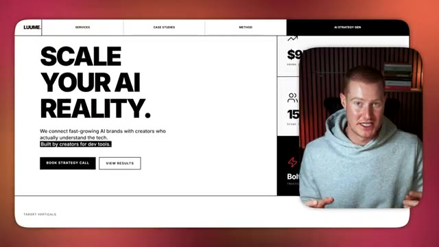
*⏱️ 00:00:05 — Capture d'écran montrant un exemple de design minimaliste et moderne pour le site web 'LUUME', avec le titre 'SCALE YOUR AI REALITY', accompagné d'une incrustation vidéo du présentateur en bas à droite.*

*⏱️ 00:00:09 — Interface de développement Google AI Studio montrant une application de génération de mock-ups de produits ('MerchGen.AI') avec un texte superposé 'LATER IN THIS VIDEO' et le présentateur en incrustation.*

---

### ⏱️ `[00:00:19 - 00:00:48]` | Segment #02

**🔊 Audio (Transcription Intégrale Mot pour Mot en Français) :**
> Alors allons-y. Très bien, voici donc la conception d'une page de destination que j'ai créée en une seule invite en utilisant le nouveau Gemini 3. Et si vous avez déjà fait du codage intuitif, c'est une amélioration majeure par rapport à ce que nous aurions obtenu auparavant. Cela a l'air extrêmement bien. Vous savez, c'est très propre et cela ne fait pas générique ou généré par l'IA. Donc si je viens sur Lovable, voici un exemple de ce à quoi nos interfaces utilisateur auraient ressemblé si nous avions utilisé quelque chose comme Claude, ChatGPT, ou même Gemini 2.5, le dernier modèle d'IA de Google.

**👁️ Analyse Visuelle d'Écran (gemini-3.5-flash-lite) :**
**Interface & Outils** : Navigateur web affichant une application de développement / génération de pages web (Google AI Studio).

**Contenu textuel & Code** : Page de destination conçue par IA pour une marque fictive ("Luume - AI Influencer Marketing") avec du texte, des boutons et des visuels.

**Action / Démonstration** : Présentation et démonstration de la page de destination générée en une seule invite.

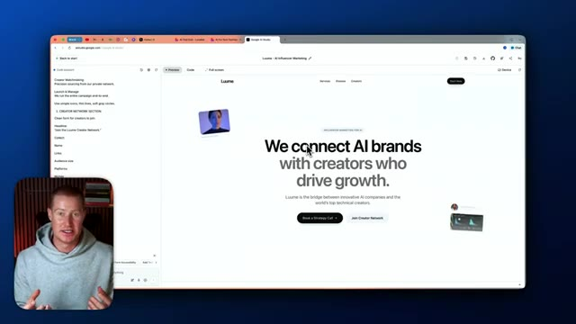
*⏱️ 00:00:26 — Capture d'écran montrant l'interface d'un navigateur avec un aperçu de page web générée par IA et le présentateur en médaillon.*

---

### ⏱️ `[00:00:48 - 00:01:09]` | Segment #03

**🔊 Audio (Transcription Intégrale Mot pour Mot en Français) :**
> Ça a l'air extrêmement basique. C'est un seul prompt et c'est ce que ça m'a donné. Ça a l'air absolument naze. Donc c'est ce qu'on est capable de construire maintenant. Et laissez-moi vous montrer un autre exemple maintenant qui a été créé avec Gemini 3 en littéralement un seul prompt. Donc voici un autre exemple, dans un style assez similaire. Et encore une fois, ça a été créé en un seul prompt. Laissez-moi vous montrer un autre exemple avec un style différent.

**👁️ Analyse Visuelle d'Écran (gemini-3.5-flash-lite) :**
**Interface & Outils** : Navigateur web, Google AI Studio, interface de développement / prévisualisation de site web.

**Contenu textuel & Code** : Interface web générée par IA avec le titre "We connect AI brands with creators who drive growth", menu de navigation et section de services.

**Action / Démonstration** : Navigation et démonstration du site web généré par l'intelligence artificielle à l'aide d'un prompt unique.

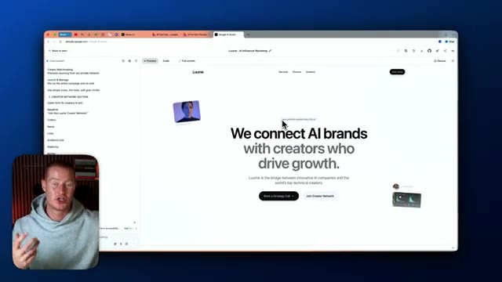
*⏱️ 00:00:59 — Capture d'écran d'un navigateur affichant l'interface de Google AI Studio avec un aperçu de site web minimaliste pour la marque "Luuine".*

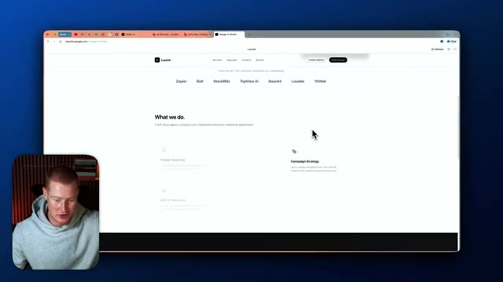
*⏱️ 00:01:04 — Défilement vers le bas de la page web du projet Luuine montrant la section "What we do" et les partenaires.*

---

### ⏱️ `[00:01:09 - 00:01:28]` | Segment #04

**🔊 Audio (Transcription Intégrale Mot pour Mot en Français) :**
> Donc j'ai essentiellement donné à Gemini 3 cette consigne ici, construis-moi un site web de style suisse haut de gamme. Et c'est une consigne assez complexe, qui explique fondamentalement exactement comment je veux que ça rende. J'utilise ChatGPT pour m'aider à trouver un style de design. Je voulais juste un site web de style suisse et il s'est étendu et m'a donné cette consigne à lui fournir. Mais les gars, regardez à quel point ce site a l'air épuré juste ici.

**👁️ Analyse Visuelle d'Écran (gemini-3.5-flash-lite) :**
**Interface & Outils** : Google AI Studio / Navigateur web (Google Chrome)

**Contenu textuel & Code** : Prompt textuel pour la création d'un site web de style suisse haut de gamme, code de génération d'interface et prévisualisation du site « Luume ».

**Action / Démonstration** : Le présentateur montre l'écran de prévisualisation d'un site web généré par IA et met en avant le prompt détaillé utilisé dans Google AI Studio.

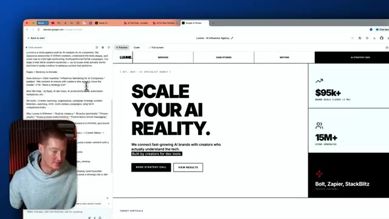
*⏱️ 00:01:14 — Interface Google AI Studio affichant le panneau de code à gauche et un aperçu du site web de style suisse « Luume » à droite, avec le présentateur en incrustation.*

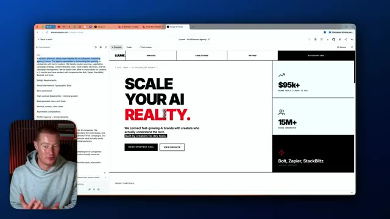
*⏱️ 00:01:18 — Interface Google AI Studio affichant un prompt détaillé pour un site web de style suisse haut de gamme avec le mot « REALITY » surligné en rouge, et le présentateur en incrustation.*

---

### ⏱️ `[00:01:28 - 00:01:48]` | Segment #05

**🔊 Audio (Transcription Intégrale Mot pour Mot en Français) :**
> Cela ne ressemble pas, à mon avis, du tout à du contenu généré par l'IA. Et laissez-moi vous montrer dès maintenant comment vous pouvez commencer à faire cela vous-même gratuitement. Très bien, alors tout d'abord, vous allez chercher Google AI Studio. Et lorsque vous êtes à l'intérieur de Google AI Studio, vous allez cliquer sur cette fonctionnalité de création juste ici. Et ensuite, vous pouvez voir que nous avons maintenant accès à Gemini 1.5 Pro Preview. C'est le modèle que nous allons utiliser pour faire du « vibe coding ».

**👁️ Analyse Visuelle d'Écran (gemini-3.5-flash-lite) :**
**Interface & Outils** : Google AI Studio et interface de prévisualisation web de type navigateur.

**Contenu textuel & Code** : Interface utilisateur de Google AI Studio, champ de saisie de prompt (« Describe your idea »), modèle Gemini 1.5 Pro-Preview.

**Action / Démonstration** : Navigation et présentation de l'interface Google AI Studio pour créer des applications ou des sites web par IA.

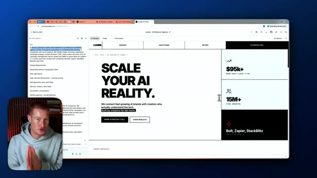
*⏱️ 00:01:33 — Aperçu d'un site web minimaliste généré (Luume AI Influencer Agency) avec panneau latéral de code et incrustation du présentateur en bas à gauche.*

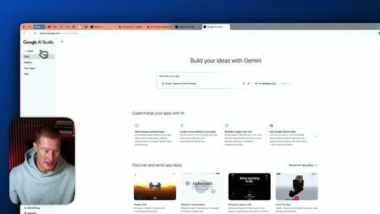
*⏱️ 00:01:38 — Interface d'accueil de Google AI Studio (« Build your ideas with Gemini ») montrant la barre de recherche et les options de modèles, avec la webcam du présentateur en bas à gauche.*

---

### ⏱️ `[00:01:48 - 00:02:06]` | Segment #06

**🔊 Audio (Transcription Intégrale Mot pour Mot en Français) :**
> Par exemple, je pourrais simplement cliquer là-dessus, dire que je me sens chanceux et lui demander de me construire un site web. Allons-y donc et regardons-le faire son travail. Très bien. C'est donc le résultat qu'il nous a donné. Et une chose que je tiens à mentionner ici, c'est que cela a l'air plutôt générique pour de l'IA. Ça a l'air généré par IA. Et la raison à cela est que je n'ai pas utilisé un bon prompt.

**👁️ Analyse Visuelle d'Écran (gemini-3.5-flash-lite) :**
**Interface & Outils** : Navigateur web, Google AI Studio

**Contenu textuel & Code** : Interface de création d'application web, arborescence de fichiers générés, options de prévisualisation et de code, zone de téléchargement de logo.

**Action / Démonstration** : Présentation du résultat généré par l'intelligence artificielle pour la création d'un site web de mockups de produits.

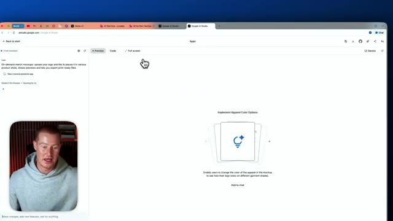
*⏱️ 00:01:52 — Image montrant Google AI Studio avec une interface de génération d'applications et la webcam du présentateur en bas à gauche.*

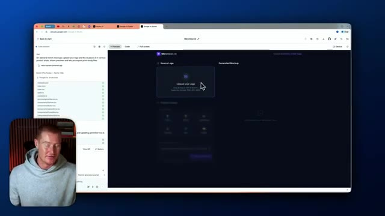
*⏱️ 00:01:57 — Image montrant l'application générée dans Google AI Studio ("MerchGen.AI") avec une zone de téléchargement de logo et la webcam du présentateur en bas à gauche.*

---

### ⏱️ `[00:02:06 - 00:02:39]` | Segment #07

**🔊 Audio (Transcription Intégrale Mot pour Mot en Français) :**
> J'ai utilisé un prompt très basique. Laissez-moi vous montrer exactement quel était ce prompt. Vous pouvez voir que c'est une seule phrase et je n'ai presque aucune instruction ici, surtout en ce qui concerne le style de la façon dont je veux que notre application soit générée. Donc ce que je vais faire, c'est en fait améliorer ce prompt. Je vais utiliser un GPT personnalisé que j'ai créé dans ChatGPT pour fondamentalement rendre l'instruction beaucoup plus approfondie. Très bien, je vais revenir sur Google AI Studio et simplement cliquer sur "build". C'est le prompt que j'ai obtenu de ChatGPT. Celui-ci, vous pouvez voir qu'il est super spécifique sur exactement à quoi nous voulons qu'il ressemble. Nous avons des styles de composants, nous avons des coins arrondis sur nos boutons, tous ces éléments différents.

**👁️ Analyse Visuelle d'Écran (gemini-3.5-flash-lite) :**
**Interface & Outils** : Navigateur web, interface de développement/génération d'applications (type outil de prototypage IA).

**Contenu textuel & Code** : Panneau de gauche avec un prompt et des exigences de design (style macOS/iOS, palette de couleurs neutres, typographie San Francisco, mode sombre).

**Action / Démonstration** : Le présentateur montre l'interface et les instructions textuelles utilisées pour générer l'application.

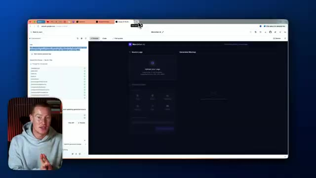
*⏱️ 00:02:23 — Interface d'un navigateur affichant un outil de développement web ou de génération par IA avec un panneau de code/prompt à gauche et un aperçu d'application à droite.*

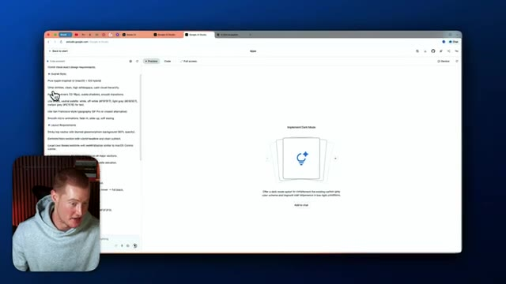
*⏱️ 00:02:31 — Vue rapprochée du panneau de configuration de l'application affichant des instructions de design (style Cupertino, palette de couleurs, exigences de mise en page).*

---

### ⏱️ `[00:02:39 - 00:03:01]` | Segment #08

**🔊 Audio (Transcription Intégrale Mot pour Mot en Français) :**
> choses. Donc, comparons et contrastons nos résultats ici. Et encore une fois, c'est totalement gratuit d'utilisation en utilisant Google AI Studio en ce moment. Et la raison pour cela, mais il y a une mise en garde. Donc, si nous décidons d'ajouter des fonctionnalités d'IA à notre application, comme soit la génération de texte avec Gemini, soit la génération d'images ou de vidéos, nous devrons payer par génération lorsque nous utiliserons réellement notre application en production.

**👁️ Analyse Visuelle d'Écran (gemini-3.5-flash-lite) :**
**Interface & Outils** : Navigateur web, Google AI Studio et interface d'application web.

**Contenu textuel & Code** : Instructions textuelles de conception, code d'interface, et aperçu de page web avec des blocs de statistiques ($95k+, 15M+).

**Action / Démonstration** : Navigation et présentation d'une application générée ou configurée via l'IA.

---

### ⏱️ `[00:03:01 - 00:03:20]` | Segment #09

**🔊 Audio (Transcription Intégrale Mot pour Mot en Français) :**
> Mais si nous ne faisons rien de tel, et que par exemple, nous construisons simplement une page de destination comme celle-ci, alors nous n'avons rien à payer. C'est donc un excellent moyen pour vous de commencer à tester ce nouveau modèle pour voir les capacités avant de l'utiliser à l'intérieur de quelque chose comme Lovable ou Bolt ou l'une de vos plateformes de *vibe coding* préférées. Et aussi en ce moment, Google AI Studio n'a pas de fonctionnalités de backend intégrées.

**👁️ Analyse Visuelle d'Écran (gemini-3.5-flash-lite) :**
**Interface & Outils** : Navigateur web affichant une application web de prévisualisation de page de destination (Google AI Studio ou outil similaire).

**Contenu textuel & Code** : Page web avec les textes "SCALE YOUR AI REALITY", des métriques comme "$95k+" et "15M+", et des exigences de design textuelles sur le panneau de gauche.

**Action / Démonstration** : Le présentateur commente l'aperçu de la page de destination générée et explique comment la tester gratuitement.

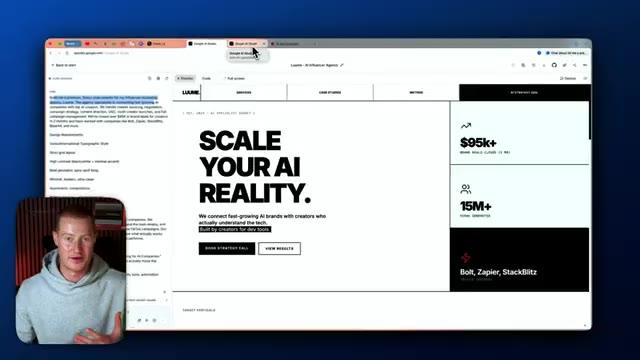
*⏱️ 00:03:06 — Capture d'écran montrant l'interface d'un navigateur avec un aperçu de page web minimaliste en noir et blanc pour une agence d'influenceurs IA (Luume), et le présentateur en médaillon.*

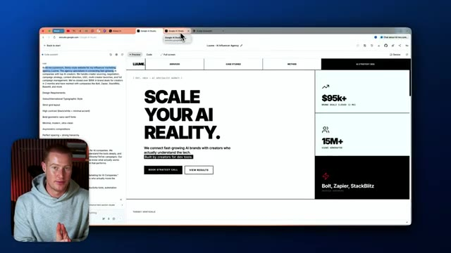
*⏱️ 00:03:11 — Vue similaire de l'aperçu de la page web Luume avec le présentateur parlant dans le coin inférieur gauche.*

---

### ⏱️ `[00:03:20 - 00:03:42]` | Segment #10

**🔊 Audio (Transcription Intégrale Mot pour Mot en Français) :**
> Donc on pouvait seulement faire l'interface front-end de notre application. Très bien. Donc on vient juste de construire cette application. Je crois qu'elle vous permet de générer des produits dérivés à partir du simple téléchargement de votre logo. Donc laissez-moi aller l'essayer maintenant. Je vais ajouter un logo Apple. Et puis comme vous pouvez le voir, nous avons ces différents produits ici. Donc laissez-moi prendre ce sac cabas en toile. Et on dirait qu'on peut en gros modifier ça comme ça avec ce curseur de glisser-déposer ici, ou on peut juste générer la maquette réaliste.

**👁️ Analyse Visuelle d'Écran (gemini-3.5-flash-lite) :**
**Interface & Outils** : Navigateur web affichant l'interface de développement Google AI Studio / application web MerchMocker AI.

**Contenu textuel & Code** : Interface utilisateur front-end avec des composants de prévisualisation de produits, grille de galerie et curseurs de configuration de position.

**Action / Démonstration** : Navigation et démonstration interactive des fonctionnalités de l'application de création de produits dérivés par IA.

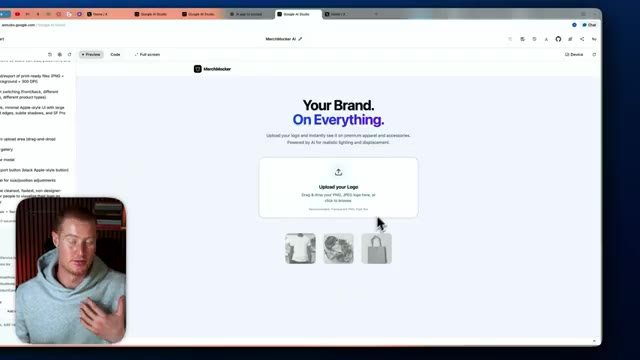
*⏱️ 00:03:26 — Interface principale de l'application MerchMocker AI montrant la zone de téléchargement du logo.*

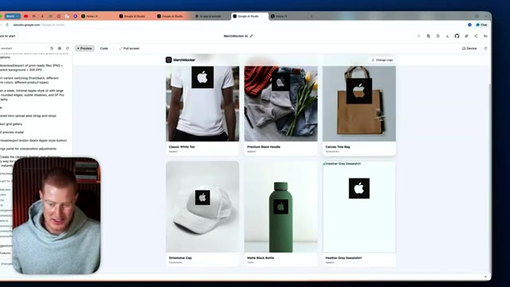
*⏱️ 00:03:31 — Galerie de produits dérivés générés automatiquement (t-shirts, sweats, sacs, casquettes, bouteilles) avec le logo appliqué.*

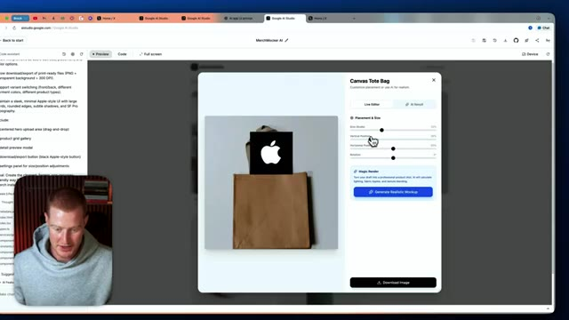
*⏱️ 00:03:37 — Fenêtre modale de personnalisation détaillée pour un sac en toile (Canvas Tote Bag) avec curseurs de positionnement et options de rendu.*

---

### ⏱️ `[00:03:42 - 00:04:15]` | Segment #11

**🔊 Audio (Transcription Intégrale Mot pour Mot en Français) :**
> Donc laissez-moi juste cliquer là-dessus et cela devrait maintenant ajouter notre logo à n'importe quel produit que nous avons ici et honnêtement l'interface utilisateur de ceci a l'air plutôt solide C'est un seul prompt donc nous pourrions devenir beaucoup plus complexes avec ça et voilà Ça a l'air vraiment solide Nous pourrions même télécharger l'image ici boum et juste comme ça nous avons une application de génération de produits dérivés à partir du simple téléchargement d'un logo Donc c'est un cas d'usage sympa que j'ai construit encore une fois, juste avec un seul prompt Très bien Alors encore une fois en un seul prompt j'ai créé ceci c'est un générateur de système de design Donc essentiellement il prend n'importe quel logo et crée ensuite un guide de marque de style suisse pour cette entreprise juste en se basant sur le logo

**👁️ Analyse Visuelle d'Écran (gemini-3.5-flash-lite) :**
**Interface & Outils** : Navigateur web affichant une application de création de mockups de produits et de génération de kits de marque.

**Contenu textuel & Code** : Interface utilisateur avec paramètres de personnalisation, panneaux de configuration, code et prévisualisations de produits de merchandising.

**Action / Démonstration** : Démonstration de l'ajout d'un logo sur des produits et présentation d'une application de génération de charte graphique.

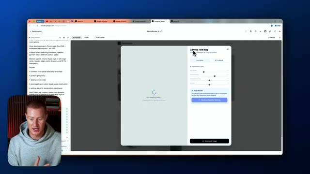
*⏱️ 00:03:50 — Interface d'une application web montrant la configuration d'un produit (sac en toile) avec des options de personnalisation et un indicateur de chargement de l'IA.*

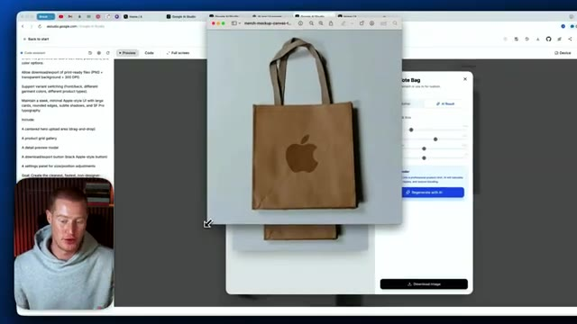
*⏱️ 00:03:59 — Aperçu d'un produit généré affichant un sac en papier aux couleurs neutres portant un logo similaire à celui d'Apple.*

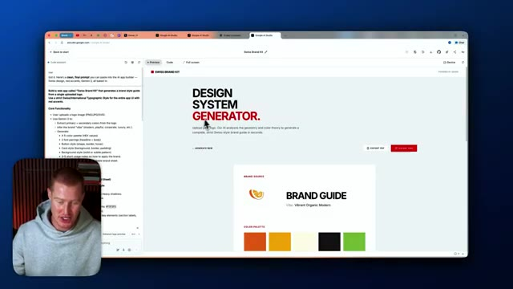
*⏱️ 00:04:07 — Interface d'une application web intitulée "Swiss Brand Kit" avec un générateur de système de design, incluant des palettes de couleurs et des guides de marque.*

---

### ⏱️ `[00:04:15 - 00:04:49]` | Segment #12

**🔊 Audio (Transcription Intégrale Mot pour Mot en Français) :**
> Donc j'ai téléchargé cette image ici qui dit frais. On dirait que c'est un guide de marque orange, orange vif, moderne. Ça montre notre palette de couleurs ici, ça montre même la typographie, ça montre nos libellés de boutons, notre style d'arrière-plan, les notes d'utilisation, la carte de contenu, tout ça ici. Donc nous avons un guide de marque et nous pouvons essentiellement l'exporter sous forme de PDF instantanément et maintenant nous avons ce PDF qui a été généré via notre application dans Gemini. Les gars, c'est fou, honnêtement c'est un cas d'utilisation tellement cool et je pense que le design de cette application a l'air impeccable, ça n'a pas l'air généré par IA, je suis super enthousiaste du résultat et tout ça a été fait à l'intérieur de Google IA.

**👁️ Analyse Visuelle d'Écran (gemini-3.5-flash-lite) :**
**Interface & Outils** : Navigateur web affichant Google AI Studio et une application web de génération de design de marque.

**Contenu textuel & Code** : Codes de couleur HEX, polices typographiques, composants d'interface utilisateur et notes d'utilisation.
[DESC_IMAGE_3] Visualisation et manipulation de la maquette d'un guide de style de marque généré par IA.

**Action / Démonstration** : Explications face caméra et analyse conceptuelle des marchés.

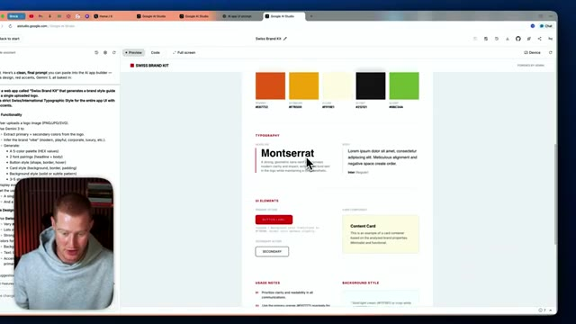
*⏱️ 00:04:24 — Aperçu du guide de style de marque Swiss Brand Kit affichant les palettes de couleurs, la typographie Montserrat et les éléments d'interface.*

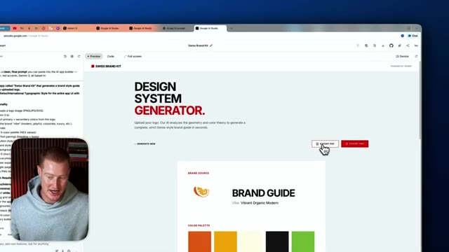
*⏱️ 00:04:32 — Interface du générateur de système de design montrant un guide de marque avec une icône d'orange et le titre 'Vibrant Organic Modern'.*

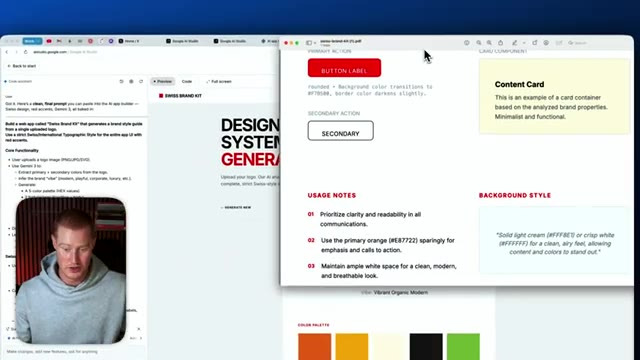
*⏱️ 00:04:40 — Fenêtre d'un document PDF exporté présentant les notes d'utilisation et le style d'arrière-plan du guide de marque.*

---

### ⏱️ `[00:04:49 - 00:04:59]` | Segment #13

**🔊 Audio (Transcription Intégrale Mot pour Mot en Français) :**
> studio que vous pouvez utiliser dès maintenant gratuitement donc les amis voilà c'est fait voilà Gemini 3 si vous avez tiré un peu de valeur de ceci assurez-vous de vous abonner de laisser un pouce bleu de me faire savoir ce que vous en pensez et bon codage intuitif je suis impatient de voir ce que vous allez construire avec ça

**👁️ Analyse Visuelle d'Écran (gemini-3.5-flash-lite) :**
**Interface & Outils** : Aucune interface technique, graphique ou de trading affichée.

**Contenu textuel & Code** : Aucun code, indicateur, prompt ou donnée chiffrée visible.

**Action / Démonstration** : Conclusion de la vidéo et salutations de fin par le présentateur.

---

