# 🎬 Nano Banana Pro + Gemini 3 is INSANE

> **Chaîne** : [Brock Mesarich | AI for Non Techies](https://www.youtube.com/@BrockMesarich)  
> **Lien YouTube** : [https://www.youtube.com/watch?v=P3ZQ9a1Q_aA](https://www.youtube.com/watch?v=P3ZQ9a1Q_aA)  
> **Date de publication** : 20251120  
> **Durée** : 00:09:29  
> **Identifiant vidéo** : `P3ZQ9a1Q_aA`  
> **Transcription & Analyse** : `whisper-v3-large-turbo+gemini-3.5-flash-lite`  

---

## 📌 Synthèse Exécutive & Outils

### 💡 Résumé

Cette vidéo présentée par Brock Mesarich pour la chaîne *AI for Non Techies* met en lumière la sortie majeure de Google : **Nano Banana Pro** couplé à **Gemini 3**, une mise à jour d'intelligence artificielle générative qui repousse les limites de la création multimodale et de la génération d'images. L'analyste y détaille l'écosystème d'accessibilité de ces technologies, de l'application mobile et web aux environnements de développement avancés comme Google Anti-Gravity et Google AI Studio, permettant ainsi aux utilisateurs non techniques de concevoir des applications fonctionnelles et interactives à partir d'un simple prompt textuel.

La démonstration s'articule ensuite autour de cas d'usage pratiques et bluffants, allant de la détection ultra-précise de fausses images générées par IA (combinant recherche web, analyse de métadonnées et vérification de filigranes) jusqu'à l'annotation d'images architecturales et historiques complexes. Le présentateur explore également la capacité inédite du modèle à fusionner jusqu'à six images sources distinctes en une seule génération cohérente, ainsi qu'à générer des représentations visuelles photoréalistes de personnalités publiques dans des contextes historiques précis, brouillant définitivement la frontière entre le réel et le virtuel.

Enfin, la vidéo s'achève sur un tutoriel pratique de développement no-code/low-code au sein de Google AI Studio. En exploitant la puissance de codage et de structuration logique de Gemini 3, le présentateur conçoit en quelques secondes une application complète d'essayage virtuel dotée d'une interface utilisateur sophistiquée basée sur des nœuds interactifs, illustrant concrètement l'immense potentiel d'automatisation et de prototypage rapide accessible à tous les créateurs.

### 🛠️ Outils, Modèles & Logiciels Présentés

* **Gemini 3** : Le nouveau modèle de pointe de Google, servant de moteur central pour le raisonnement complexe, la génération de code et l'analyse contextuelle avancée.
* **Nano Banana Pro** : Le modèle de génération et d'analyse d'images de dernière génération intégré à l'écosystème Gemini, capable de fusionner plusieurs visuels et de détecter les trucages.
* **Google AI Studio** : La plateforme de prototypage pour développeurs et créateurs non techniques permettant de générer des applications complètes et des interfaces interactives en un seul prompt.
* **Google Anti-Gravity** : Le nouvel IDE (environnement de développement) lancé par Google pour les développeurs, intégrant nativement Gemini 3 et Nano Banana Pro.
* **ChatGPT** : Utilisé en amont comme assistant textuel pour concevoir, structurer et affiner le prompt destiné à la création de l'application d'essayage virtuel.
* **Make** / **n8n** / **Zapier** / **Grok** / **Claude** : Mentionnés dans l'écosystème global de l'intelligence artificielle et de l'automatisation de flux de travail (bien que les démonstrations de cette vidéo se concentrent spécifiquement sur l'infrastructure Google).

### 🔑 Points Clés & Enseignements Stratégiques

* **Démocratisation du développement par le prompt** : La combinaison de Gemini 3 et de Google AI Studio permet de concevoir des applications complexes (comme une interface d'essayage virtuel à nœuds) en un seul prompt, s'affranchissant des barrières techniques traditionnelles.
* **Capacité de détection d'IA de haute précision** : Nano Banana Pro intègre des mécanismes d'analyse combinant recherche sur Internet, vérification de filigranes numériques et recoupements contextuels pour identifier avec une exactitude redoutable si une image est authentique ou générée par ordinateur.
* **Fusion multimodale avancée** : Le modèle surpasse les anciennes générations en parvenant à synthétiser jusqu'à six images sources différentes (visage, accessoires, vêtements, montres) dans une seule génération tout en maintenant une forte cohérence visuelle.
* **Exploitation des connaissances du monde réel** : Grâce à sa connexion native avec le moteur de recherche Google, le modèle ne se contente pas de dessiner, il contextualise et documente avec précision des monuments historiques, des stades ou des infrastructures.
* **Génération d'affiches éducatives et techniques** : Le modèle excelle dans la transformation d'une simple photographie en un support pédagogique annoté (schémas architecturaux, infographies historiques), combinant graphismes vectoriels et données factuelles vérifiées.
* **Réalisme photoréaliste et gestion des personnalités** : La modélisation de scènes complexes mettant en scène des personnalités publiques dans des contextes d'époque (ex. années 2000 avec des appareils argentiques) démontre le niveau de maturité critique atteint par les textures et l'éclairage générés.
* **Limites de la précision textuelle mineure** : Bien que les grands titres textuels et les informations globales soient extrêmement précis, les infographies denses générées par IA peuvent parfois laisser subsister de légères imperfections ou du "charabia" typographique sur les petits caractères.
* **Prototypage itératif rapide** : L'utilisation de ChatGPT en amont pour structurer l'idée d'une application avant de l'injecter dans Google AI Studio constitue une méthodologie de travail hautement efficace pour maximiser la pertinence du code généré.
* **Interface utilisateur interactive et modulaire** : La démonstration prouve qu'il est possible de générer par IA des interfaces dynamiques sophistiquées, dotées de fonctionnalités de glisser-déposer (*drag-and-drop*) et de liaisons relationnelles entre objets.
* **Évolution de la vérification visuelle** : À l'ère où les générateurs d'images simulent le grain des appareils photo argentiques et des conditions de prise de vue réelles avec autant de réalisme, la société entre dans une période critique nécessitant de nouveaux standards pour authentifier l'information visuelle.

---

## ⏱️ Chronologie & Transcription Complète Audio & Visuelle (Mot pour Mot)

### ⏱️ `[00:00:00 - 00:00:37]` | Segment #01

**🔊 Audio (Transcription Intégrale Mot pour Mot en Français) :**
> Google vient de lancer Nano Banana Pro aujourd'hui et franchement ils ont assuré cette semaine. Cela a été créé en une seule invite. Dans cette vidéo, je vais passer en revue tout ce qui est nouveau, des cas d'utilisation à essayer par vous-même et à la fin, je vais créer une application gratuitement avec Nano Banana Pro et Gemini 3 et vous montrer comment vous pouvez faire exactement la même chose. Donc, sans plus tarder, plongeons directement dans le sujet. Très bien, parlons rapidement de l'endroit où nous pouvons commencer à utiliser Gemini 3 dès maintenant pour que vous puissiez commencer à faire cela vous-même. Tout d'abord, dans l'application Gemini, vous pouvez l'utiliser soit sur l'application Web, soit sur l'application mobile. Et vous pouvez simplement cliquer sur ce bouton de création d'image et il utilise désormais Nano Banana Pro au lieu du modèle Nano Banana précédent. Ensuite, vous pouvez l'utiliser à l'intérieur de

**👁️ Analyse Visuelle d'Écran (gemini-3.5-flash-lite) :**
**Interface & Outils** : Navigateur web avec l'interface de Nano Banana Pro (Gemini/Google AI) et une pastille vidéo incrustée montrant le présentateur.

**Contenu textuel & Code** : Mention « Show thinking (Nano Banana Pro) » et affichage d'une image générée par IA.

**Action / Démonstration** : Présentation d'un exemple de génération d'image par Nano Banana Pro à l'écran.

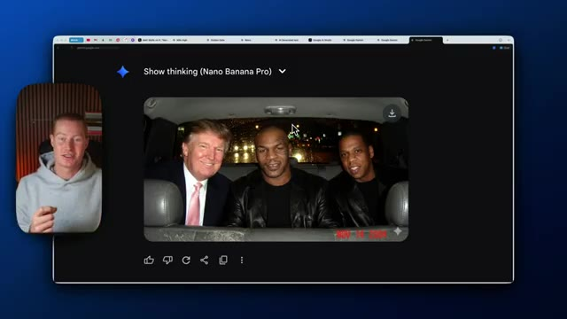
*⏱️ 00:00:10 — Capture d'écran montrant l'interface sombre de Nano Banana Pro avec une image générée représentant Donald Trump, Mike Tyson et Jay-Z assis ensemble à l'arrière d'un véhicule.*

---

### ⏱️ `[00:00:37 - 00:01:01]` | Segment #02

**🔊 Audio (Transcription Intégrale Mot pour Mot en Français) :**
> Google Anti-Gravity, qui est leur nouvel IDE qu'ils viennent de sortir pour les développeurs lundi avec Gemini 3. Donc si vous voulez créer des applications complètes avec Gemini 3, vous pouvez maintenant utiliser Nano Banana Pro à l'intérieur de celui-ci. Et ensuite, pour nous les non-techniciens qui ne savent pas comment utiliser un IDE ou qui ne le veulent pas, vous pouvez aller sur Google AI Studio. Vous pouvez créer une application directement à l'intérieur d'ici et vous pouvez utiliser Nano Banana comme modèle de génération d'images que vous utilisez.

**👁️ Analyse Visuelle d'Écran (gemini-3.5-flash-lite) :**
**Interface & Outils** : Navigateur web affichant les sites officiels de Google Antigravity et Google AI Studio.

**Contenu textuel & Code** : Présentation du nouvel IDE de Google pour développeurs et de l'interface Google AI Studio avec sélection de modèles et fonctionnalités d'IA.

**Action / Démonstration** : Navigation et présentation des interfaces de développement Google Antigravity et Google AI Studio par le présentateur.

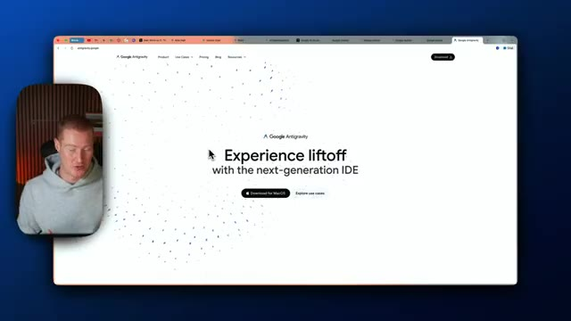
*⏱️ 00:00:43 — Page web du nouveau IDE Google Antigravity (« Experience liftoff with the next-generation IDE »).*

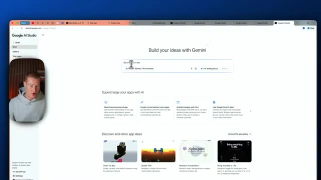
*⏱️ 00:00:55 — Interface de Google AI Studio permettant de créer des projets avec les modèles Gemini.*

---

### ⏱️ `[00:01:01 - 00:01:21]` | Segment #03

**🔊 Audio (Transcription Intégrale Mot pour Mot en Français) :**
> J'ai créé cette application avec Gemini 3 dans Nano Banana Pro en un seul prompt. Et puis à la fin de cette vidéo, je vais vous montrer exactement comment vous pouvez faire cela aussi. Vous pouvez donc télécharger une photo de vous, n'importe quel vêtement, cliquer sur générer. C'est cette interface basée sur des nœuds. Et comme vous pouvez le voir, cela a généré ceci avec une précision irréprochable. D'ici la fin de cette vidéo, je vais vous montrer comment vous pouvez construire cela aussi.

**👁️ Analyse Visuelle d'Écran (gemini-3.5-flash-lite) :**
**Interface & Outils** : Navigateur web affichant une application de flux de nœuds IA (style interface de nœuds type Google AI Studio / application custom).

**Contenu textuel & Code** : Interface graphique avec des blocs de connexion ("Base Portrait", "Jacket", "Outfit Generator") et un panneau latéral de prévisualisation d'image avec l'historique et un bouton bleu "Generate Outfit".

**Action / Démonstration** : Navigation et présentation de l'interface utilisateur d'une application d'essayage virtuel par IA.

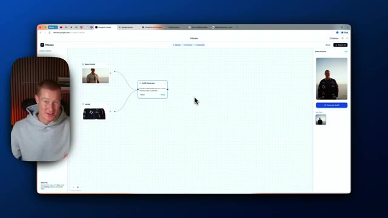
*⏱️ 00:01:06 — Interface d'une application de génération de vêtements par IA sous forme de nœuds (flow-based app) avec le présentateur incrusté en médaillon.*

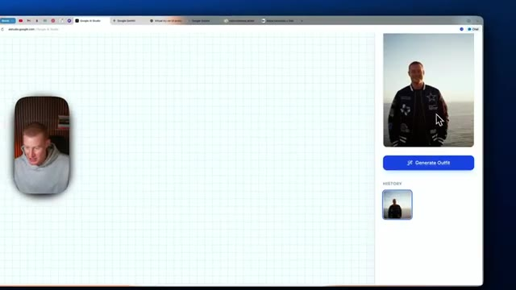
*⏱️ 00:01:16 — Gros plan sur le panneau de prévisualisation et le bouton "Generate Outfit" de l'application web avec le présentateur en médaillon.*

---

### ⏱️ `[00:01:21 - 00:01:46]` | Segment #04

**🔊 Audio (Transcription Intégrale Mot pour Mot en Français) :**
> Très bien, alors maintenant je vais vous montrer une par une certaines des nouveautés qui se trouvent dans Nano Banana Pro. Tout d'abord, il est capable de dire si une image est générée par IA ou non. Alors laissez-moi télécharger une image. Cette image n'est pas générée par IA. C'est simplement une image d'une vague. Et disons juste : est-ce que ceci est généré par IA ? Et je ne sais pas exactement comment il fait, mais il est assez phénoménal pour être capable de tester et de voir si quelque chose est généré par IA ou non, si nous voulons en quelque sorte vérifier les faits et voir si quelque chose est réel.

**👁️ Analyse Visuelle d'Écran (gemini-3.5-flash-lite) :**
**Interface & Outils** : Navigateur web affichant l'interface de l'application Gemini.

**Contenu textuel & Code** : Page d'accueil de l'interface Gemini avec le message de salutation "Hello, Brock" et une barre de prompt "Describe your image".

**Action / Démonstration** : Le présentateur introduit la démonstration de l'outil en montrant l'interface web de Gemini.

---

### ⏱️ `[00:01:46 - 00:02:05]` | Segment #05

**🔊 Audio (Transcription Intégrale Mot pour Mot en Français) :**
> Donc j'ai testé ceci avec plein d'images différentes. Il a réussi absolument chacune de celles que j'ai testées. Il est donc plutôt bon pour arriver à différencier ce qui est de l'IA et ce qui ne l'est pas. Très bien, et voici la réponse. Il est écrit, d'après l'analyse, est-ce une vraie photographie et non générée par IA ? Cela montre donc qu'il s'agit en fait de ce surfer tahitien, médaillé d'or 2024.

**👁️ Analyse Visuelle d'Écran (gemini-3.5-flash-lite) :**
**Interface & Outils** : Navigateur web, interface Google Gemini, incrustation vidéo de la webcam du présentateur.

**Contenu textuel & Code** : Texte généré par l'IA indiquant l'analyse d'une photo de surf (vérification du nom de fichier, filigrane SynthID, correspondance contextuelle).

**Action / Démonstration** : Le présentateur présente et commente les résultats de l'analyse d'authenticité d'une image par Google Gemini.

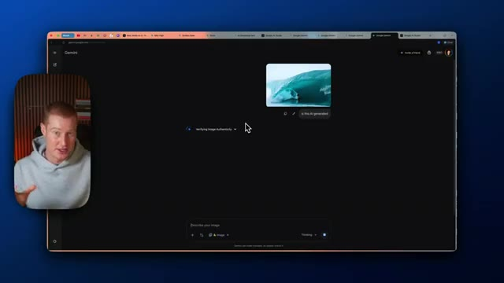
*⏱️ 00:01:51 — Interface Google Gemini affichant l'analyse en cours d'une image de vague de surf, avec la webcam du présentateur incrustée à gauche.*

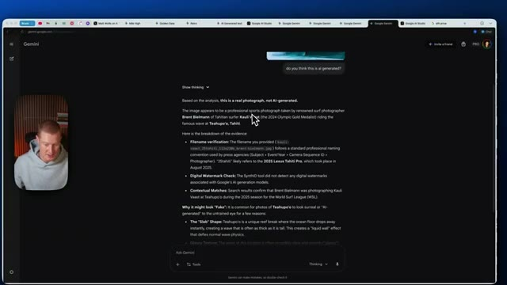
*⏱️ 00:01:56 — Interface Google Gemini affichant le texte de la réponse complète sur l'authenticité de la photographie, avec le présentateur incrusté à gauche.*

---

### ⏱️ `[00:02:05 - 00:02:23]` | Segment #06

**🔊 Audio (Transcription Intégrale Mot pour Mot en Français) :**
> Donc il a été capable de réellement faire des recherches à ce sujet en utilisant Google et en naviguant sur Internet. Et aussi, il jette un œil au nom du fichier ainsi qu'à la vérification du filigrane numérique. Donc il n'a aucun filigrane généré par IA. Et ensuite, les correspondances contextuelles, encore une fois, il a été capable de chercher les résultats ici. Il a même décomposé pourquoi cela pourrait sembler faux, même si ça ne l'est pas.

**👁️ Analyse Visuelle d'Écran (gemini-3.5-flash-lite) :**
**Interface & Outils** : Interface web de Google Gemini (navigateur).

**Contenu textuel & Code** : Texte d'analyse de l'IA détaillant la vérification du nom de fichier, le contrôle du filigrane numérique et les correspondances contextuelles.

**Action / Démonstration** : Présentation de l'analyse d'une image par l'intelligence artificielle pour prouver son authenticité.

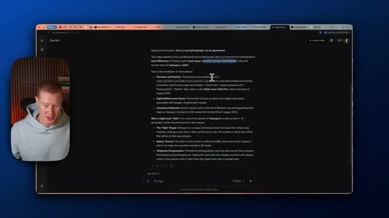
*⏱️ 00:02:09 — Capture d'écran montrant l'interface de Google Gemini avec une analyse textuelle détaillée confirmant qu'une photo de surf est authentique, avec le présentateur en médaillon à gauche.*

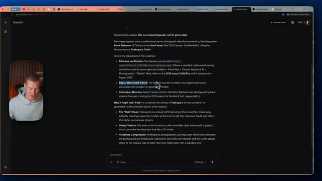
*⏱️ 00:02:14 — Capture d'écran similaire montrant la suite du texte de l'interface Gemini sur la vérification des fichiers et des filigranes numériques.*

---

### ⏱️ `[00:02:23 - 00:02:46]` | Segment #07

**🔊 Audio (Transcription Intégrale Mot pour Mot en Français) :**
> Très bien, donc le cas d'usage suivant avec lequel j'ai aimé m'amuser consiste à prendre des images et à créer des affiches informatives, éducatives ou historiques expliquant l'histoire de quelque chose ou expliquant fondamentalement la géographie de quelque chose. Donc là, j'ai téléchargé cette image du Mile High Stadium. C'est un stade de football américain des Denver Broncos, et je lui demande en gros d'en faire une affiche historique et éducative expliquant son histoire.

**👁️ Analyse Visuelle d'Écran (gemini-3.5-flash-lite) :**
**Interface & Outils** : Interface web de Google Gemini, avec incrustation vidéo du présentateur en bas à gauche.

**Contenu textuel & Code** : Le prompt textuel : « expand this image and then turn it into a historical educational poster explaining the history of this. make sure the text is big enough o read, dont make it too small » et une photo aérienne d'un stade.

**Action / Démonstration** : Saisie d'une consigne pour transformer une photo aérienne en affiche éducative et historique à l'aide de l'intelligence artificielle.

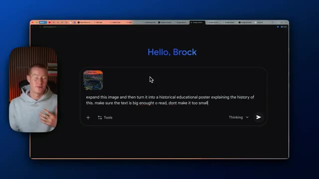
*⏱️ 00:02:29 — Interface Google Gemini affichant un prompt saisi par l'utilisateur avec une image téléchargée en miniature.*

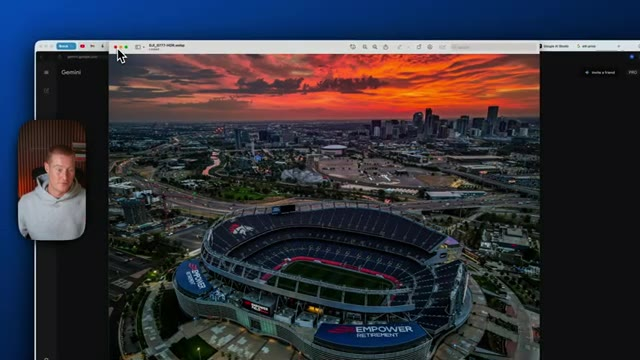
*⏱️ 00:02:41 — Interface Google Gemini affichant l'image originale d'un stade de football américain au coucher du soleil (Empower Field at Mile High).*

---

### ⏱️ `[00:02:46 - 00:03:15]` | Segment #08

**🔊 Audio (Transcription Intégrale Mot pour Mot en Français) :**
> Alors, laissez-moi envoyer ceci et vous montrer le résultat. Très bien. Et juste comme ça, environ 30 secondes plus tard, nous avons cette affiche éducative complète pleine d'informations qui explique l'histoire de ce stade ici. Et je peux même aller de l'avant et télécharger ceci ici. L'héritage du Mile High Stadium. C'est exact. Cela s'appelle le Mile High Stadium. Il a été construit en 1948 et il est resté là jusqu'en 2001. Et puis une nouvelle ère commence. Ils ont en fait reconstruit le stade, évolution moderne et changements de nom. Donc il mentionne même les noms précédents du stade.

**👁️ Analyse Visuelle d'Écran (gemini-3.5-flash-lite) :**
**Interface & Outils** : Navigateur web affichant l'interface de Google Gemini.

**Contenu textuel & Code** : Une affiche éducative intitulée "History of Empower Field at Mile High" avec du texte, des images historiques et aériennes du stade.

**Action / Démonstration** : Le présentateur commente le résultat généré par l'IA et montre l'affiche complète à l'écran.

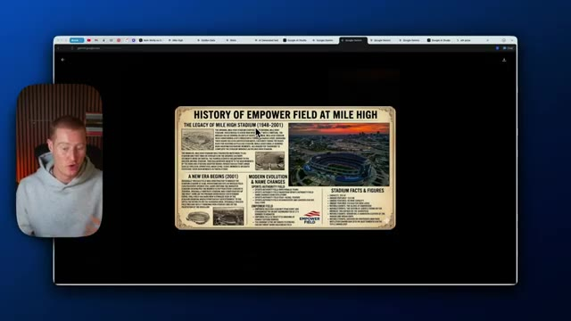
*⏱️ 00:02:54 — Capture d'écran montrant le présentateur dans un encadré à gauche et une affiche éducative générée par IA sur l'histoire du stade Empower Field at Mile High affichée au centre de l'écran.*

---

### ⏱️ `[00:03:15 - 00:03:36]` | Segment #09

**🔊 Audio (Transcription Intégrale Mot pour Mot en Français) :**
> Donc Sports Authority Field était leur ancien sponsor. Maintenant c'est Empower Field et ça décompose même les faits et chiffres du stade. On dirait qu'une partie de ce texte ici n'est pas correcte. On dirait que c'est un peu du charabia, mais si c'était du texte plus grand, ce serait presque 100 % correct. Comme par exemple, tout ce qui montre du texte grand, c'est entièrement exact.

**👁️ Analyse Visuelle d'Écran (gemini-3.5-flash-lite) :**
**Interface & Outils** : Navigateur web avec interface de visualisation d'image et incrustation vidéo du présentateur.

**Contenu textuel & Code** : Texte et images détaillant l'histoire du stade, l'évolution de son nom (Sports Authority Field, Empower Field) et des sections de faits et chiffres.

**Action / Démonstration** : Le présentateur commente les détails textuels et les imperfections visuelles ou erreurs générées sur l'infographie affichée à l'écran.

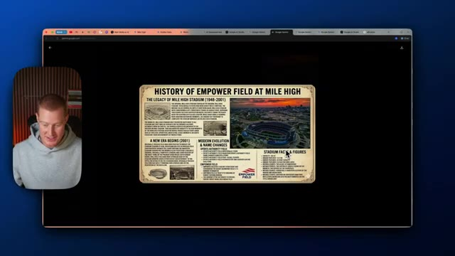
*⏱️ 00:03:20 — Une infographie historique et technique sur Empower Field à Mile High affichée dans un navigateur web avec le présentateur incrusté en médaillon.*

---

### ⏱️ `[00:03:36 - 00:04:11]` | Segment #10

**🔊 Audio (Transcription Intégrale Mot pour Mot en Français) :**
> Une autre chose que Nano Banana Pro fait vraiment très bien, et celle-ci est vraiment amusante à essayer, et je vois des cas d'utilisation incroyables pour l'avenir selon ce que vous utilisez ceci, c'est l'annotation d'images. Donc ce que je vais faire, c'est que je vais télécharger cette image du pont du Golden Gate et je vais lui donner cette invite. Créez un explicateur visuel simple de ce pont en écriture blanche et esquissez comme s'il avait été créé par un architecte. Donc je voulais essentiellement expliquer le pont, le décomposer pour que nous puissions comprendre ce qui se passe lorsqu'il s'agit de créer et de concevoir ce pont. Je veux prendre une petite seconde pour dire que si vous n'êtes pas abonné à cette chaîne, assurez-vous de l'être si vous appréciez cette vidéo. Je couvre

**👁️ Analyse Visuelle d'Écran (gemini-3.5-flash-lite) :**
**Interface & Outils** : Interface web de Gemini (Google) avec incrustation vidéo du présentateur.

**Contenu textuel & Code** : Une image du Golden Gate Bridge téléchargée dans l'interface et un prompt demandant d'analyser ou d'annoter l'image comme un architecte.

**Action / Démonstration** : Téléchargement et préparation de l'annotation d'une image dans l'intelligence artificielle Gemini.

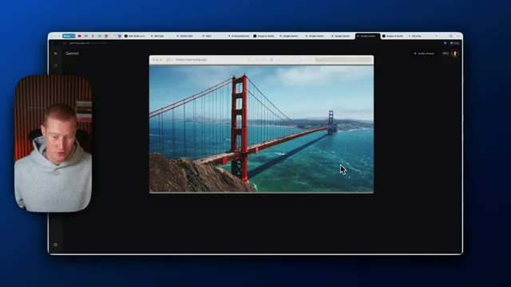
*⏱️ 00:03:44 — Capture d'écran montrant l'interface de Gemini avec une photo du Golden Gate Bridge affichée au centre et le présentateur dans une pastille vidéo à gauche.*

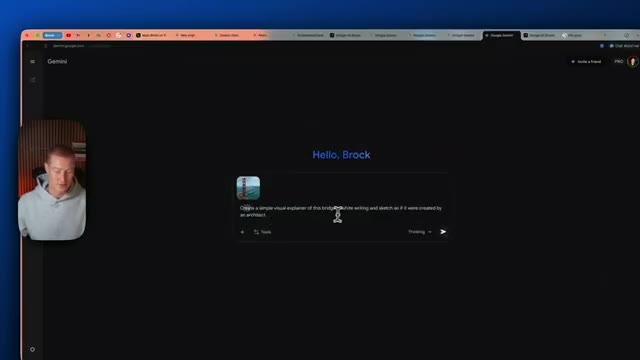
*⏱️ 00:03:53 — Capture d'écran montrant l'interface de Gemini avec un prompt textuel associé à l'image du pont pour demander une explication visuelle de type architectural.*

---

### ⏱️ `[00:04:11 - 00:04:41]` | Segment #11

**🔊 Audio (Transcription Intégrale Mot pour Mot en Français) :**
> L'intelligence artificielle pour les non-techniciens, décortiquant les sorties d'IA dès leur apparition, ainsi que des cas d'usage pratiques que vous pouvez utiliser même si vous n'êtes pas technique. Très bien. Et hop, regardez ça. Ça a l'air plutôt cool ici. Un câble de suspension, l'ancrage, ça montre la tour, sa hauteur. Ça montre le tablier de la route, la travée centrale, la longueur totale. Laissez-moi vérifier tout ça pour voir si c'est la bonne information. On dirait bien que le pont mesure 746 pieds de haut, comme il était dit dans ce graphique. Et ensuite, ça correspond bien, la longueur totale est de 8 981 pieds.

**👁️ Analyse Visuelle d'Écran (gemini-3.5-flash-lite) :**
**Interface & Outils** : Interface web de Gemini (Google) avec la caméra du présentateur incrustée dans un coin.

**Contenu textuel & Code** : Image annotée du Golden Gate Bridge générée par IA avec des dimensions et termes techniques en surimpression ("Main suspension cable", "Tower", "746 ft").

**Action / Démonstration** : Le présentateur commente les détails architecturaux affichés sur l'image générée par l'intelligence artificielle.

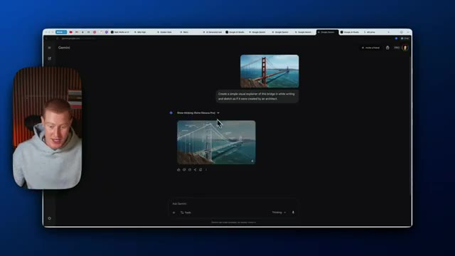
*⏱️ 00:04:18 — Interface Gemini montrant une image générée du pont du Golden Gate avec des annotations techniques et le prompt de création.*

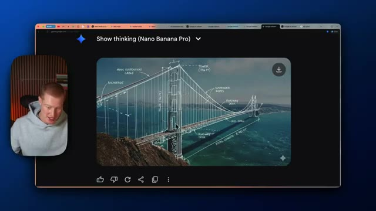
*⏱️ 00:04:26 — Gros plan sur l'image générée du pont du Golden Gate affichant des annotations architecturales détaillées (câbles, ancrage, tours).*

---

### ⏱️ `[00:04:41 - 00:05:18]` | Segment #12

**🔊 Audio (Transcription Intégrale Mot pour Mot en Français) :**
> Comme c'est écrit ici, il fait environ 1,7 miles de long, ce qui équivaut à 8 981 pieds. Non seulement le design et la précision de Nano Banana Pro sont bons, mais les informations qu'il possède sont incroyables. Si nous retournons à cet exemple ici, toutes ces informations sont correctes parce qu'il a du contexte puisqu'il pouvait effectuer des recherches sur Internet et comprend fondamentalement tout ce que nous recherchons. Très bien, avant de passer aux autres cas d'utilisation, qui sont vraiment incroyables, essayons encore une fois. Je vais donc télécharger cette image de l'Empire State Building à New York, puis dire fondamentalement, donnez-moi une analyse de la géographie et des monuments de cette image. Très bien, alors

**👁️ Analyse Visuelle d'Écran (gemini-3.5-flash-lite) :**
**Interface & Outils** : Interface web de Gemini (Google) et visionneuse d'images macOS.

**Contenu textuel & Code** : Images générées par IA avec texte explicatif, schémas techniques et infographies documentaires.

**Action / Démonstration** : Le présentateur commente la précision et la qualité des informations générées par l'intelligence artificielle.

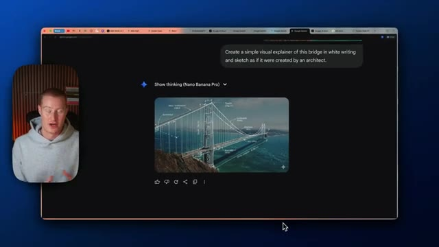
*⏱️ 00:04:51 — L'interface de Gemini affichant une image générée d'un pont avec des annotations de type architectural.*

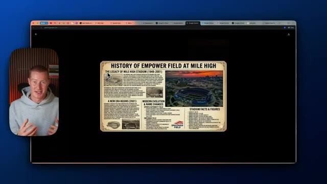
*⏱️ 00:05:00 — Une infographie historique détaillée sur l'Empower Field at Mile High générée par l'IA.*

---

### ⏱️ `[00:05:18 - 00:05:55]` | Segment #13

**🔊 Audio (Transcription Intégrale Mot pour Mot en Français) :**
> Il m'a donné ce guide des monuments historiques de New York. Donc évidemment, il a identifié l'Empire State Building, le One World Trade Center, en montrant le Chrysler Building, le Rockefeller Plaza. Je ne suis pas sûr que ce soit réellement le Rockefeller Plaza, mais c'est plutôt intéressant et plutôt solide d'être capable de comprendre des connaissances du monde réel ici. Très bien, alors ensuite, Nano Banana Pro pouvait en fait combiner jusqu'à six images en une seule génération. Donc comme vous pouvez le voir, je lui donne ces images, une image de moi, ces lunettes Gucci, une chemise Supreme, une casquette Supreme, une Rolex et cette chaîne cubaine pour me donner l'air du plus gros « hype beast » et connard possible, en fait. Donc ici

**👁️ Analyse Visuelle d'Écran (gemini-3.5-flash-lite) :**
**Interface & Outils** : Interface web de Google Gemini sur le navigateur.

**Contenu textuel & Code** : Image générée d'un guide touristique de New York avec des annotations textuelles pointant vers les gratte-ciels emblématiques.

**Action / Démonstration** : Le présentateur présente et commente le guide historique de New York généré par l'IA.

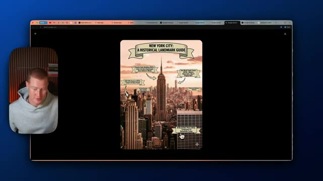
*⏱️ 00:05:27 — Un guide illustré des monuments historiques de New York affiché à l'écran, montrant des repères tels que l'Empire State Building et le One World Trade Center.*

---

### ⏱️ `[00:05:55 - 00:06:27]` | Segment #14

**🔊 Audio (Transcription Intégrale Mot pour Mot en Français) :**
> c'est ce qu'il a généré. Donc vous pouvez voir la cohérence, le chapeau est le même, les lunettes sont les mêmes, ainsi que la chaîne, le t-shirt Supreme, et puis la Rolex. Je dois dire que la Rolex a l'air un peu fausse ici, on dirait vraiment qu'elle a été ajoutée sur Photoshop, mais voilà, vous pouvez en fait combiner six images différentes en une seule et c'est une très, très grande partie de la sortie de Gemini Nano banana, vous savez, c'est de pouvoir lui donner plus de contexte et de lui faire assembler tout ça. Ensuite, voyons voir à quel point il est capable de créer réellement à partir de personnes existantes sur Internet. Créez donc une photo en gros plan des années 2000 de Donald Trump, Mike Tyson et Jay-Z dans un taxi. La porte du taxi est ouverte et ils

**👁️ Analyse Visuelle d'Écran (gemini-3.5-flash-lite) :**
**Interface & Outils** : Navigateur web affichant l'interface de Gemini (Google).

**Contenu textuel & Code** : Image générée par intelligence artificielle représentant une personne portant un t-shirt Supreme et une montre Rolex.

**Action / Démonstration** : Le présentateur commente la cohérence et les détails de l'image générée par l'IA.

---

### ⏱️ `[00:06:27 - 00:07:01]` | Segment #15

**🔊 Audio (Transcription Intégrale Mot pour Mot en Français) :**
> viennent d'arriver et leur ami est en train de les prendre en photo. Donc je vais envoyer ça et les gars c'est plutôt intéressant parce que j'ai testé quelques personnages différents dont vous pourriez penser que Gemini ou Google ne vous permettrait pas de créer des images, mais ça me le permet quand même. Donc je ne dis pas que vous devriez aller essayer de générer des images de célébrités, par exemple, mais je n'ai vraiment vu aucune barrière de sécurité là-dessus pour l'instant. Et remarquez bien, ceci est sorti il y a environ deux heures, donc ils pourraient changer ça. Voilà. Les gars, ça a l'air plutôt réaliste. On dirait vraiment que c'est une photo des années 2000. On a Donald Trump. On a Mike Tyson. On a Jay-Z.

**👁️ Analyse Visuelle d'Écran (gemini-3.5-flash-lite) :**
**Interface & Outils** : Navigateur web affichant l'interface de Gemini (Google).

**Contenu textuel & Code** : Prompt utilisateur textuel complexe décrivant une scène spécifique avec des personnalités publiques et résultat visuel généré.
[DESC_IMAGE_1] Interface Gemini montrant un prompt texte demandant de générer une photo de type années 2000 avec Donald Trump, Mike Tyson et Jay-Z dans un taxi.
[DESC_IMAGE_2] Résultat de l'image générée par Gemini montrant Donald Trump, Mike Tyson et Jay-Z assis à l'arrière d'un taxi jaune avec un effet de photo vintage des années 2000.

**Action / Démonstration** : Explications face caméra et analyse conceptuelle des marchés.

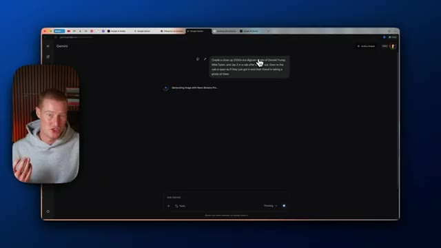
*⏱️ 00:06:36 — Interface Gemini montrant un prompt texte demandant de générer une photo de type années 2000 avec Donald Trump, Mike Tyson et Jay-Z dans un taxi.*

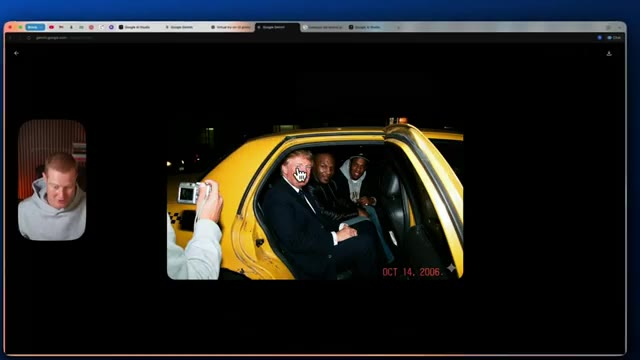
*⏱️ 00:06:53 — Résultat de l'image générée par Gemini montrant Donald Trump, Mike Tyson et Jay-Z assis à l'arrière d'un taxi jaune avec un effet de photo vintage des années 2000.*

---

### ⏱️ `[00:07:01 - 00:07:24]` | Segment #16

**🔊 Audio (Transcription Intégrale Mot pour Mot en Français) :**
> par ici. Très bien, donc j'ai créé celui-ci aussi. En gros, le prompt disait Mike Tyson, Donald Trump et Jay-Z sirotant du whisky dans un bureau correspondant à l'esthétique des années 2000, comme si la photo avait été prise avec un appareil argentique des années 2000. Les gars, c'est dingue. Si je voyais ça, je ne saurais pas que ça a été généré par IA et j'aurais pensé qu'il s'agissait d'une vraie réunion qui a eu lieu. Nous entrons vraiment dans une période intéressante pour comprendre ce qui est réel et ce qui ne l'est pas.

**👁️ Analyse Visuelle d'Écran (gemini-3.5-flash-lite) :**
**Interface & Outils** : Navigateur web affichant une image générée par intelligence artificielle.

**Contenu textuel & Code** : Image générée montrant Donald Trump, Mike Tyson et Jay-Z ensemble avec une esthétique de photo argentique datée du 21 décembre 2004.

**Action / Démonstration** : Le présentateur commente l'image générée par IA représentant les trois personnalités dans un style vintage.

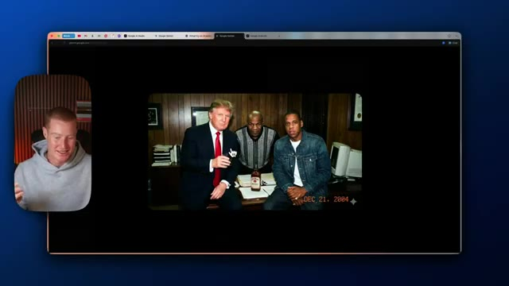
*⏱️ 00:07:07 — Capture d'écran montrant le présentateur à gauche et, au centre, une image générée par IA représentant Donald Trump, Mike Tyson et Jay-Z dans un bureau aux accents des années 2000 avec une date incrustée.*

---

### ⏱️ `[00:07:24 - 00:07:47]` | Segment #17

**🔊 Audio (Transcription Intégrale Mot pour Mot en Français) :**
> Très bien, les amis, c'est tout pour la génération d'images. Maintenant, je vais vous montrer comment vous pourriez construire une application avec Nano Banana Pro directement à l'intérieur de votre application. Donc, tout d'abord, vous allez venir sur Google AI Studio, vous allez réellement cliquer sur cette barre latérale de construction ici, et cela vous amènera à ceci. Et vous pouvez réellement avoir commencé à coder, commencer à coder avec Gemini 3. Si vous ne l'avez pas utilisé, c'est plutôt phénoménal et il peut coder des choses assez cool. Donc ce que nous pouvons faire, c'est simplement décrire notre idée d'application. Laissez-moi donc taper une invite maintenant.

**👁️ Analyse Visuelle d'Écran (gemini-3.5-flash-lite) :**
**Interface & Outils** : Navigateur web affichant Google AI Studio.

**Contenu textuel & Code** : Interface utilisateur de Google AI Studio avec les options de création d'applications et de sélection de modèles Gemini.

**Action / Démonstration** : Présentation de la plateforme Google AI Studio et navigation sur la page d'accueil pour montrer comment construire une application.

---

### ⏱️ `[00:07:48 - 00:08:22]` | Segment #18

**🔊 Audio (Transcription Intégrale Mot pour Mot en Français) :**
> Très bien. Donc, je suis en fait allé sur ChatGPT, j'ai pratiquement donné un exemple de ce que j'essaie de construire. C'est en gros une application d'essayage virtuel avec une interface basée sur des nœuds, qui possède des nœuds de type glisser-déposer que nous pouvons relier pour essayer concrètement tout ce que nous voulons. J'ai donc apporté ceci dans Google AI Studio, j'ai tapé ce prompt, et je vais cliquer sur « construire » et l'application va commencer à se construire maintenant. Les gars, Gemini 3 est tellement bon. J'ai été époustouflé. Mes quelques vidéos précédentes portaient sur ce sujet. Assurez-vous de regarder ça si vous voulez voir la pleine capacité et ce qu'il peut faire. Mais regardez ça. Il a construit cette application en un seul prompt. Je peux déplacer ces nœuds. Je peux les relier, je peux télécharger un portrait de base, ajouter un vêtement, tout ce genre de choses. Donc, laissez-moi aller

**👁️ Analyse Visuelle d'Écran (gemini-3.5-flash-lite) :**
**Interface & Outils** : Navigateur web (ChatGPT, Google AI Studio / interface de génération d'application)

**Contenu textuel & Code** : Texte de prompt décrivant une application d'essayage virtuel basée sur des nœuds, avec des objectifs d'interface utilisateur épurée et minimaliste (style Apple/Swiss design).

**Action / Démonstration** : Présentation du prompt généré par ChatGPT et démonstration de l'interface visuelle basée sur des nœuds pour l'application d'essayage virtuel.

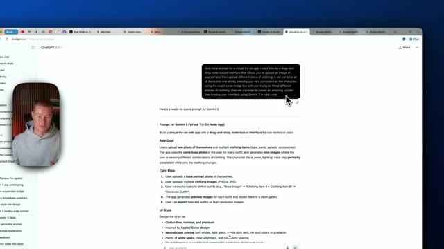
*⏱️ 00:07:56 — Capture d'écran de l'interface de ChatGPT affichant un prompt détaillé pour la création d'une application d'essayage virtuel à interface nodale.*

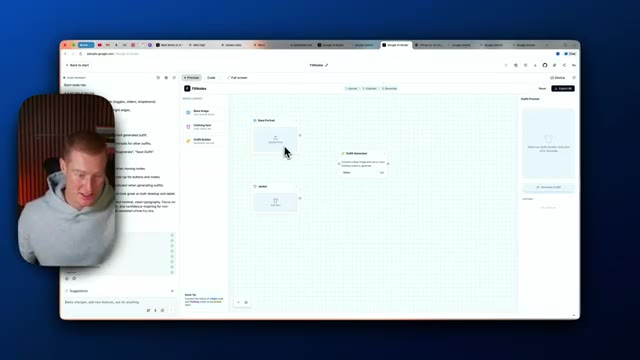
*⏱️ 00:08:13 — Capture d'écran montrant l'interface graphique de développement (type Google AI Studio / application web) avec des nœuds de glisser-déposer pour l'essayage virtuel.*

---

### ⏱️ `[00:08:22 - 00:08:43]` | Segment #19

**🔊 Audio (Transcription Intégrale Mot pour Mot en Français) :**
> allez-y et testez-le dès maintenant. Très bien. Donc j'ai cette image téléchargée de moi-même ici et je veux en fait recréer ceci parce que c'est vraiment génial. Je suis un fan des Dallas Cowboys. Donc laissez-moi copier ceci. Je ne vais pas amener cela sur AI Studio. Cliquez sur ajouter un élément. Téléchargez simplement mon image ici. Je suis curieux de voir à quel point c'est bon. Et puis tout ce que je peux faire, tout ce que j'ai à faire, c'est fondamentalement de connecter ces nœuds ici. Et les gars, encore une fois, cela a été construit avec l'IA en une seule invite.

**👁️ Analyse Visuelle d'Écran (gemini-3.5-flash-lite) :**
**Interface & Outils** : Navigateur web, site e-commerce et interface Google AI Studio.

**Contenu textuel & Code** : Fiche produit d'une veste bomber et interface de nœuds (nodes) d'IA pour application vestimentaire.

**Action / Démonstration** : Navigation sur le site e-commerce pour copier une image de veste, puis bascule vers Google AI Studio pour recréer le visuel.

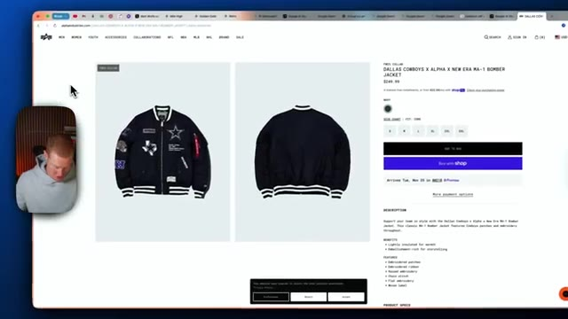
*⏱️ 00:08:27 — Page web affichant une veste des Dallas Cowboys sur un site e-commerce.*

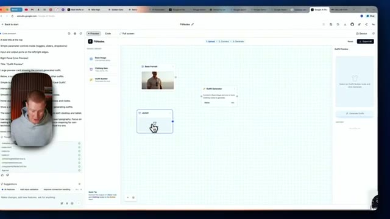
*⏱️ 00:08:32 — Interface de Google AI Studio / FitNodes montrant des nœuds de configuration pour l'essayage virtuel.*

---

### ⏱️ `[00:08:43 - 00:09:03]` | Segment #20

**🔊 Audio (Transcription Intégrale Mot pour Mot en Français) :**
> Alors voyons voir à quel point c'est bon. Alors générateur de sortie, cliquez sur générer la sortie, tenue, et je devrais obtenir une image ici bientôt générée avec Nano et un banana pro. Très bien. Alors jetez un œil à ça. Nous avons moi portant exactement cette même veste ici. C'est dingue. Je n'ai même pas besoin d'acheter cette veste maintenant. Je pourrais juste poster ça sur mon Instagram et frimer et économiser les 250 dollars.

**👁️ Analyse Visuelle d'Écran (gemini-3.5-flash-lite) :**
**Interface & Outils** : Interface web de génération d'images par nœuds (type application de flux visuel d'IA).

**Contenu textuel & Code** : Nœuds de flux de travail ('Base Portrait', 'Jacket', 'Outfit Generator') et panneau de prévisualisation de tenue ('Outfit Preview').

**Action / Démonstration** : Clic sur le bouton de génération pour combiner les nœuds et afficher le résultat visuel final dans l'interface.

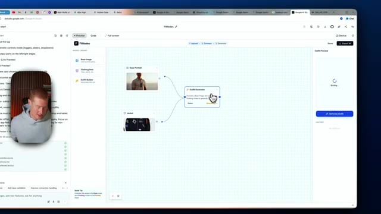
*⏱️ 00:08:48 — Interface d'un outil de génération par nœuds sur navigateur, montrant la connexion entre un portrait de base, une veste et un bloc 'Outfit Generator' en cours de chargement.*

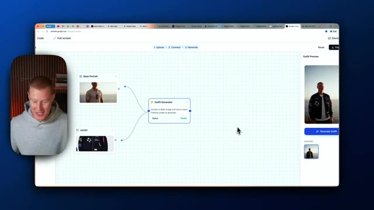
*⏱️ 00:08:53 — Le même éditeur par nœuds affichant l'image finale générée dans le panneau de prévisualisation à droite, où le personnage porte la veste sélectionnée.*

---

### ⏱️ `[00:09:03 - 00:09:23]` | Segment #21

**🔊 Audio (Transcription Intégrale Mot pour Mot en Français) :**
> C'est une blague, bien sûr. Mais les gars, regardez ça. J'ai construit cette application en utilisant Gemini 3 et Nano Banano Pro. Si vous voulez faire exactement la même chose, allez simplement sur Google AI Studio. C'est gratuit à utiliser en ce moment. Vous devez juste payer pour la génération d'images. Donc, chaque fois que vous générez une image, vous devrez payer pour cela via l'API. Alors les gars, si vous avez tiré de la valeur de cette vidéo, laissez un pouce bleu, abonnez-vous. Dites-moi ce que vous en pensez dans les commentaires ci-dessous.

**👁️ Analyse Visuelle d'Écran (gemini-3.5-flash-lite) :**
**Interface & Outils** : Google AI Studio / Interface de développement d'application visuelle (FitNodes)

**Contenu textuel & Code** : Nœuds de connexion (Base Portrait, Jacket, Outfit Generator), panneau de code à gauche, et aperçu de la tenue générée à droite.

**Action / Démonstration** : Manipulation d'éléments visuels et de nœuds dans l'application de génération de tenues basée sur l'IA.

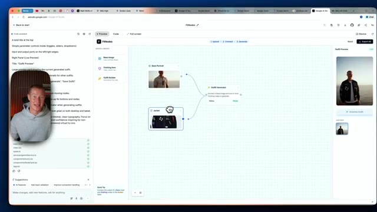
*⏱️ 00:09:08 — Interface Google AI Studio affichant un générateur de tenues par nœuds (FitNodes) avec le présentateur en médaillon.*

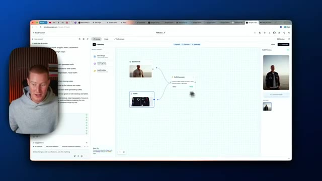
*⏱️ 00:09:13 — Interface Google AI Studio montrant l'application FitNodes en cours d'utilisation avec un aperçu de génération à droite.*

---

### ⏱️ `[00:09:23 - 00:09:29]` | Segment #22

**🔊 Audio (Transcription Intégrale Mot pour Mot en Français) :**
> Nano Banana Pro est vraiment incroyable. J'ai eu beaucoup de plaisir à l'essayer. Ça ne va faire que s'améliorer à partir de maintenant. Très bien, on se retrouve les gars dans la prochaine.

**👁️ Analyse Visuelle d'Écran (gemini-3.5-flash-lite) :**
**Interface & Outils** : Google AI Studio (interface web de programmation par nœuds) et navigateur web.

**Contenu textuel & Code** : Nœuds connectés (« Base Portrait », « Jacket », « Outfit Generator ») sur une grille de travail, avec un panneau de prévisualisation d'image à droite et des instructions textuelles à gauche.

**Action / Démonstration** : Le présentateur conclut la vidéo tout en montrant l'interface finale de l'application de génération de tenues basée sur l'IA.

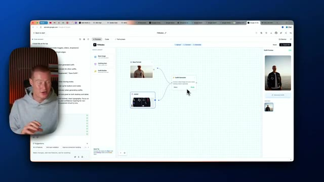
*⏱️ 00:09:25 — Capture d'écran montrant une interface de génération par nœuds sur Google AI Studio, avec un aperçu du présentateur dans une incrustation vidéo à gauche.*

---

