# 🎬 How to Make VIRAL UGC with Nano Banana Pro (INSTANTLY)

> **Chaîne** : [Brock Mesarich | AI for Non Techies](https://www.youtube.com/@BrockMesarich)  
> **Lien YouTube** : [https://www.youtube.com/watch?v=Bnqa7LVuPJs](https://www.youtube.com/watch?v=Bnqa7LVuPJs)  
> **Date de publication** : 20251124  
> **Durée** : 00:10:04  
> **Identifiant vidéo** : `Bnqa7LVuPJs`  
> **Transcription & Analyse** : `whisper-v3-large-turbo+gemini-3.5-flash-lite`  

---

## 📌 Synthèse Exécutive & Outils

### 💡 Résumé
Dans cette vidéo intitulée **Comment créer du contenu UGC VIRAL avec Nano Banana Pro (INSTANTANÉMENT)**, Alex Carter détaille une approche stratégique et pratique du trading et de l'automatisation par agents IA.

### 🛠️ Outils, Modèles & Logiciels Présentés
- **TradingView & Claude Code** : Analyse technique avancée et automatisation algorithmique.

### 🔑 Points Clés & Enseignements Stratégiques
- Respect rigoureux du ratio risque/rendement et du money management.
- Automatisation méthodique des déclencheurs d'ordres via des agents intelligents.

---

## ⏱️ Chronologie & Transcription Complète Audio & Visuelle (Mot pour Mot)

### ⏱️ `[00:00:00 - 00:00:32]` | Segment #01

**🔊 Audio (Transcription Intégrale Mot pour Mot en Français) :**
> Google vient de sortir Nano Banana Pro et les cas d'utilisation sont absolument fous. Je l'ai utilisé pour générer des personnages et des modèles d'IA qui peuvent être utilisés pour créer du contenu UGC hyperréaliste. Voici quelques-uns des exemples d'images que j'ai générées ainsi que les vidéos que j'ai faites qui peuvent être utilisées comme du contenu organique. Dans cette vidéo, je vais vous montrer quelques astuces et conseils secrets qui permettent à n'importe qui de faire cela en littéralement quelques minutes. Vous n'avez pas besoin de compétences spécifiques en matière de consignes. Littéralement n'importe qui peut le faire. Donc, avant de commencer à utiliser Nano Banana Pro pour créer du contenu viral UGC, je vais parler de la raison exacte pour laquelle c'est un tel bouleversement. Donc, tout d'abord

**👁️ Analyse Visuelle d'Écran (gemini-3.5-flash-lite) :**
**Interface & Outils** : AUCUNE

**Contenu textuel & Code** : AUCUNE

**Action / Démonstration** : AUCUNE

---

### ⏱️ `[00:00:32 - 00:00:57]` | Segment #02

**🔊 Audio (Transcription Intégrale Mot pour Mot en Français) :**
> tous, si vous ne savez pas ce qu'est Nano Banana Pro, c'est le nouveau modèle d'image de Google qui est construit par-dessus le modèle Nano Banana précédent. C'est leur version Pro, et elle a juste une longueur d'avance lorsqu'il s'agit d'images d'apparence plus réaliste et plus particulièrement de personnages que nous pouvons créer, ce sur quoi nous allons nous concentrer dans cette vidéo. Désormais, nos créateurs UGC que nous créons réellement avec l'IA dans ces images passent pour faits par des humains. Laissez-moi vous montrer quelques exemples de ce que j'ai fait dans cette vidéo ici même.

**👁️ Analyse Visuelle d'Écran (gemini-3.5-flash-lite) :**
**Interface & Outils** : AUCUNE

**Contenu textuel & Code** : AUCUNE

**Action / Démonstration** : AUCUNE

---

### ⏱️ `[00:00:57 - 00:01:22]` | Segment #03

**🔊 Audio (Transcription Intégrale Mot pour Mot en Français) :**
> Vous pouvez donc voir à quel point cela a l'air vraiment bien. Une autre chose qui est vraiment formidable avec Nano Banana Pro, c'est qu'il a une consistance de personnage incroyable, ce qui est très important pour le contenu UGC. Nous pouvons donc télécharger quatre à six images de référence et obtenir exactement la même personne avec différentes tenues, différentes scènes, différents angles, différentes émotions. Donc, par exemple, nous pourrions générer un personnage avec Nano Banana Pro, puis télécharger quelques images différentes de celui-ci pour en quelque sorte créer ce personnage.

**👁️ Analyse Visuelle d'Écran (gemini-3.5-flash-lite) :**
**Interface & Outils** : Interface web de Nano Banana Pro.

**Contenu textuel & Code** : Galerie d'images et panneau de détails avec description textuelle (prompt) d'un personnage généré.

**Action / Démonstration** : Navigation et affichage des options de génération et de cohérence de personnage.

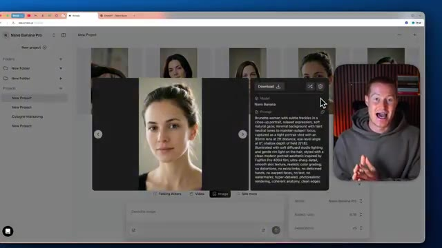
*⏱️ 00:01:09 — Interface de Nano Banana Pro affichant une image agrandie avec les détails du prompt et le présentateur incrusté en coin.*

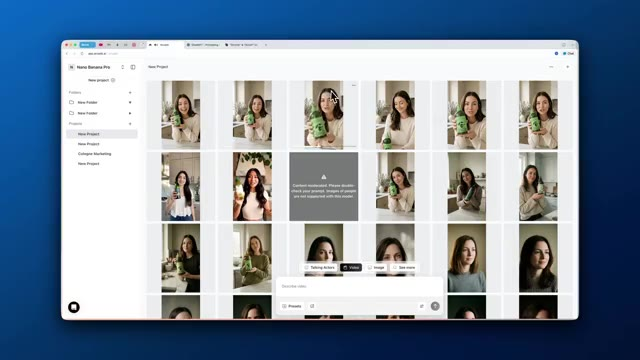
*⏱️ 00:01:16 — Interface de Nano Banana Pro présentant une grille de plusieurs images de référence générées par l'IA.*

---

### ⏱️ `[00:01:22 - 00:01:44]` | Segment #04

**🔊 Audio (Transcription Intégrale Mot pour Mot en Français) :**
> Et ensuite, nous pourrions alors générer une vidéo à partir de cela. Donc cela signifie que nous pourrions fondamentalement créer une personnalité d'influenceur complète instantanément, ce qui est énorme pour l'UGC répété, surtout si vous êtes une marque. Et enfin, la peau, la couleur des cheveux et les yeux naturels sont tellement meilleurs que le modèle Nano Banana précédent. Donc maintenant que nous savons ce que c'est et pourquoi c'est important pour l'UGC, parlons maintenant de la façon dont nous pourrions commencer à faire cela.

**👁️ Analyse Visuelle d'Écran (gemini-3.5-flash-lite) :**
**Interface & Outils** : Présentation vidéo avec incrustation d'image illustrative.

**Contenu textuel & Code** : Texte superposé "INFLUENCER persona" et exemple visuel d'une photo de personnage.

**Action / Démonstration** : Explication orale du concept de création de personnalités d'influenceurs virtuels pour l'UGC.

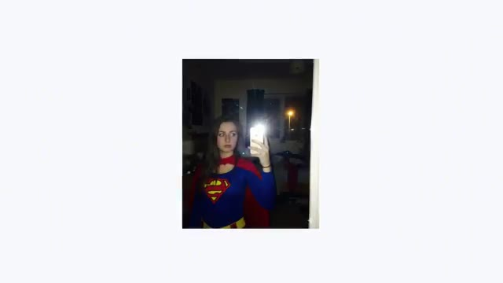
*⏱️ 00:01:33 — Une photo insérée au centre montre une personne déguisée en Superwoman prenant un selfie dans un miroir.*

---

### ⏱️ `[00:01:44 - 00:02:03]` | Segment #05

**🔊 Audio (Transcription Intégrale Mot pour Mot en Français) :**
> Très bien, alors créons un personnage de toutes pièces en utilisant Nano Banana Pro. Pour cette vidéo, nous allons utiliser Arcads, qui vous permet non seulement de générer de superbes contenus UGC par IA, comme vous pouvez le voir ici avec tous les différents modèles de génération de vidéo par IA, mais vous pouvez également utiliser Nano Banana Pro à l'intérieur pour pouvoir façonner notre personnage. Très bien, alors première chose à faire, à l'intérieur d'Arcads, nous allons créer un nouveau projet.

**👁️ Analyse Visuelle d'Écran (gemini-3.5-flash-lite) :**
**Interface & Outils** : Navigateur web affichant l'interface de la plateforme Arcads (app.arcads.ai).

**Contenu textuel & Code** : Page de présentation de la plateforme de génération de publicités par IA Arcads avec des aperçus vidéo et un bouton de création.

**Action / Démonstration** : Le présentateur navigue sur la plateforme Arcads et présente les différents modèles de génération de vidéos par IA.

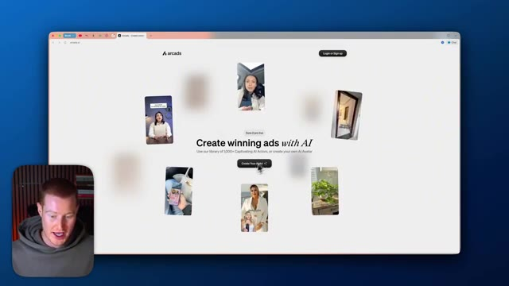
*⏱️ 00:01:48 — Capture d'écran montrant la page d'accueil de la plateforme Arcads avec des exemples de vidéos UGC générées par IA disposés en cercle autour du slogan principal.*

---

### ⏱️ `[00:02:03 - 00:02:21]` | Segment #06

**🔊 Audio (Transcription Intégrale Mot pour Mot en Français) :**
> J'ai un nouveau projet ici. Et ce que je pourrais faire, c'est que je pourrais vraiment aller voir, je pourrais regarder les acteurs IA ici. Cependant, nous allons concevoir les nôtres en utilisant Nano Banana Pro parce que c'est le but de cette vidéo. Et cela va vraiment faire passer au niveau supérieur notre contenu UGC que nous pouvons créer. Ensuite, nous avons différentes vidéos que nous pourrais décrire ici, mais je vais me concentrer sur les images maintenant. Donc nous pourrions réellement générer des images en utilisant Nano Banana Pro.

**👁️ Analyse Visuelle d'Écran (gemini-3.5-flash-lite) :**
**Interface & Outils** : Interface web de Nano Banana Pro (application de création de contenu et d'acteurs IA).

**Contenu textuel & Code** : Galerie de choix d'acteurs (avatars parlants) et options de génération (Video, Image, Talking Actors).

**Action / Démonstration** : Navigation dans la bibliothèque d'avatars et configuration d'un nouveau projet de création vidéo.

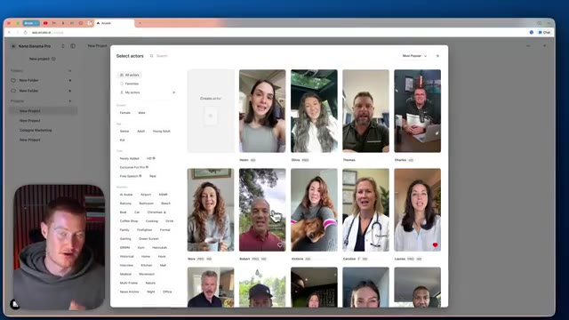
*⏱️ 00:02:07 — Interface de l'application montrant la sélection d'acteurs IA disponibles.*

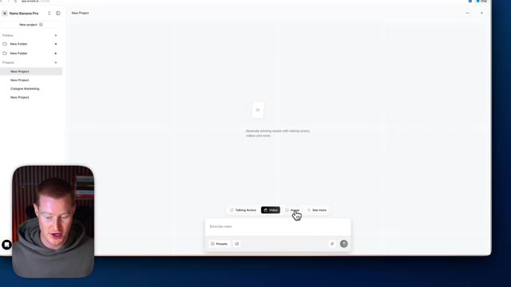
*⏱️ 00:02:17 — Interface de création de projet avec les options de génération vidéo et d'images.*

---

### ⏱️ `[00:02:21 - 00:02:41]` | Segment #07

**🔊 Audio (Transcription Intégrale Mot pour Mot en Français) :**
> Et je pourrais cliquer sur cette petite barre d'outils et m'assurer que nous utilisons Nano Banana Pro parce que c'est le modèle qui produira le meilleur résultat pour nous. Et nous pourrions également changer le format d'image. Utilisons le 9 par 16. C'est donc plutôt du style TikTok. Très bien. Vous pouvez donc aller générer un prompt de base à l'intérieur d'Arcads juste ici. Cependant, j'ai créé un GPT personnalisé qui sera dans la description pour que vous puissiez l'utiliser comme ressource.

**👁️ Analyse Visuelle d'Écran (gemini-3.5-flash-lite) :**
**Interface & Outils** : Application Web Arcads.ai (interface de génération de contenu vidéo/image par IA).

**Contenu textuel & Code** : Paramètres de génération d'images : sélection du modèle "Nano-Banana Pro", format d'image "9:16" et nombre de générations.

**Action / Démonstration** : Configuration des paramètres du projet et sélection du modèle d'IA et du format 9:16 (style TikTok) dans l'interface.

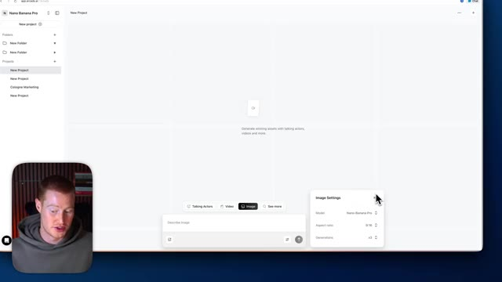
*⏱️ 00:02:26 — Capture d'écran montrant l'interface d'Arcads.ai avec un panneau de configuration des paramètres d'image ouvert (Image Settings) incluant le modèle Nano-Banana Pro et le format 9:16, avec la miniature vidéo du présentateur en bas à gauche.*

---

### ⏱️ `[00:02:41 - 00:03:17]` | Segment #08

**🔊 Audio (Transcription Intégrale Mot pour Mot en Français) :**
> Donc, ça va essentiellement prendre un prompt basique et le transformer en un prompt spécifique optimisé pour Nano Banana Pro. Donc par exemple, si je clique sur ceci, un portrait de samouraï, il va alors envoyer ce prompt et il va prendre ce prompt basique et le transformer en un prompt hyper spécifique. Et une chose que je veux mentionner, c'est qu'il montre même l'objectif différent que nous utilisons, le format d'image, tous ces termes techniques de caméra qui vont vraiment faire une énorme différence lorsqu'il s'agit de générer nos images. Parce que si nous lui donnons un prompt basique, nous allons obtenir un résultat basique. Donc ça va être super utile. Très bien. Donc c'est le prompt que je vais donner à notre GPT personnalisé, créer un gros plan d'une femme brune qui a quelques taches de rousseur sur son visage. Tu deviens plus spécifique,

**👁️ Analyse Visuelle d'Écran (gemini-3.5-flash-lite) :**
**Interface & Outils** : Interface web de ChatGPT (navigateur web).

**Contenu textuel & Code** : Prompts de génération d'images textuels ("Nano Banana Pro UGC Prompts"), instructions techniques (focal, distance, angle).

**Action / Démonstration** : Sélection d'un prompt prédéfini par l'utilisateur pour lancer la transformation en prompt optimisé.

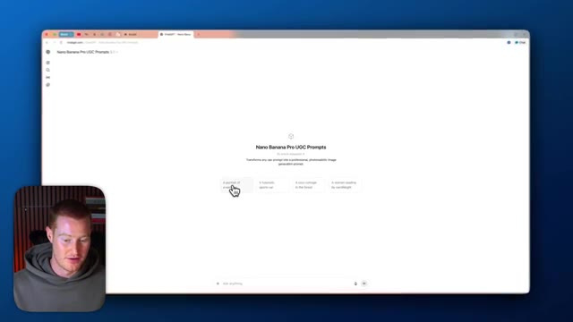
*⏱️ 00:02:50 — Interface ChatGPT affichant l'outil "Nano Banana Pro UGC Prompts" avec plusieurs suggestions de prompts de base cliquables.*

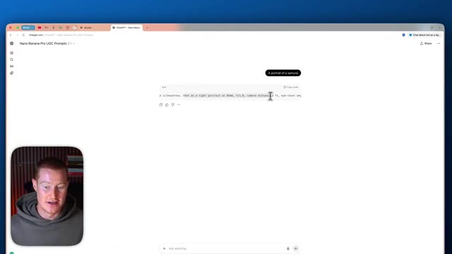
*⏱️ 00:02:59 — Réponse de l'IA générant un prompt détaillé et optimisé suite à la sélection du prompt de base "A portrait of a samurai".*

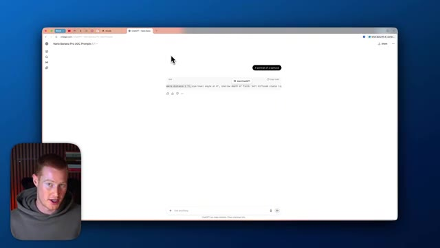
*⏱️ 00:03:08 — Suite du texte généré par l'IA affichant les paramètres techniques et descriptifs avancés du prompt optimisé.*

---

### ⏱️ `[00:03:17 - 00:03:51]` | Segment #09

**🔊 Audio (Transcription Intégrale Mot pour Mot en Français) :**
> mais le GPT va prendre ça et nous donner un prompt vraiment détaillé et on va devenir créatif par-dessus tout ça. Et c'est parti. On a notre résultat à nouveau, il montre quel type de caméra. Donc il utilise Fujifilm pro tous ces détails. Je ne comprends même pas, mais ça va nous aider à obtenir un résultat bien meilleur ici. Donc ce que je pourrais faire, c'est que je pourrais simplement coller ce prompt dans nos chats. Et ce que je vais faire, c'est que je vais en fait sélectionner cette petite barre d'outils ici, et je vais changer le nombre de générations. Ce que j'aime faire, c'est que j'aime générer peut-être environ trois à cinq images à la fois parce que parfois avec Nano Banana Pro et ces modèles d'images, vous n'obtenez pas le résultat exact que vous

**👁️ Analyse Visuelle d'Écran (gemini-3.5-flash-lite) :**
**Interface & Outils** : Navigateur web, interface ChatGPT et application web de génération de médias (Nano Banana Pro).

**Contenu textuel & Code** : Prompt détaillé mentionnant "Fujifilm Pro 400H film", "85mm lens at 2ft distance", et des réglages de génération d'images.

**Action / Démonstration** : Copie et collage d'un prompt textuel détaillé dans l'outil de génération d'images et configuration des paramètres de génération.

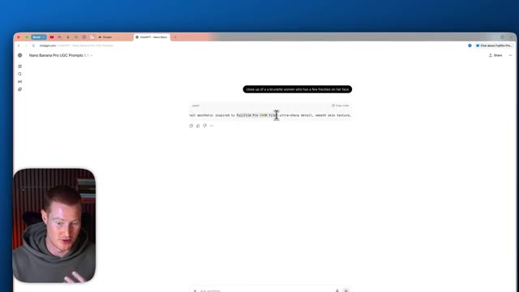
*⏱️ 00:03:26 — Interface ChatGPT affichant un prompt textuel généré concernant l'esthétique d'un portrait avec des références photographiques.*

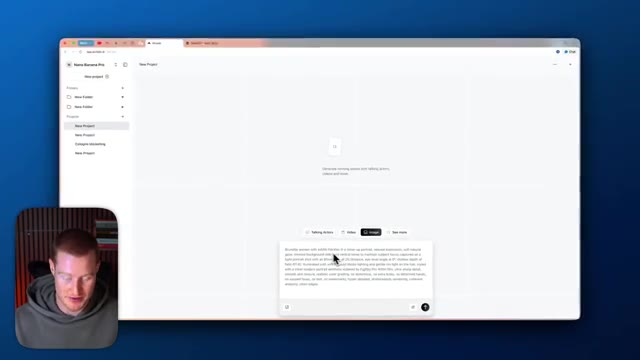
*⏱️ 00:03:34 — Interface d'une application web de création (Nano Banana Pro) avec un champ de saisie de texte intégrant le prompt détaillé.*

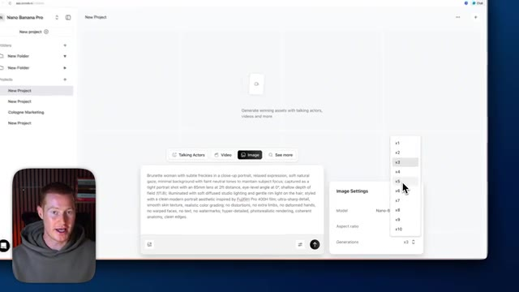
*⏱️ 00:03:43 — Interface de l'application web montrant les paramètres d'image avec un menu déroulant pour sélectionner le nombre de générations.*

---

### ⏱️ `[00:03:51 - 00:04:16]` | Segment #10

**🔊 Audio (Transcription Intégrale Mot pour Mot en Français) :**
> chercher dès le premier essai. C'est donc préférable d'en obtenir plusieurs en une seule fois. Et c'est pourquoi j'aime Arcads, qui rend cela vraiment facile à faire, non seulement avec la génération d'images, mais aussi avec la création de ces vidéos. Je vais donc en sélectionner cinq. Tout est prêt. Je vais simplement l'envoyer et cela va commencer à concevoir nos images. Très bien, c'est parti. Voici nos cinq résultats. Ils ont l'air vraiment bien. Jetez un œil à ceci. Regardez la texture de la peau. Regardez tout ici. On dirait littéralement que c'est une vraie personne. On ne peut même pas dire que c'est généré par IA. Mais ce que je veux faire, c'est apporter un léger changement à ceci.

**👁️ Analyse Visuelle d'Écran (gemini-3.5-flash-lite) :**
**Interface & Outils** : Application Arcads (interface web de génération de vidéos et d'images par IA).

**Contenu textuel & Code** : Paramètres de génération d'images avec le modèle Nano-Banana Pro, format 9:16 et 5 générations sélectionnées.

**Action / Démonstration** : Navigation et démonstration de l'outil de génération d'images de l'application Arcads.

---

### ⏱️ `[00:04:16 - 00:04:35]` | Segment #11

**🔊 Audio (Transcription Intégrale Mot pour Mot en Français) :**
> Je veux en fait donner à la photo un aspect un peu plus dramatique. Je vais donc simplement venir ici dans notre GPT personnalisé, dire de rendre l'éclairage un peu plus dramatique et sombre. Maintenant, nous avons notre invite améliorée ici. Je vais la ramener à nos chats. Et puis je vais faire exactement la même chose. Je vais juste en générer cinq pour voir à quel point ça a l'air bien. Très bien, alors c'est parti. Maintenant, nous avons environ 15 images différentes générées.

**👁️ Analyse Visuelle d'Écran (gemini-3.5-flash-lite) :**
**Interface & Outils** : Navigateur web, interface de GPT personnalisé et application de génération d'images par IA.

**Contenu textuel & Code** : Prompts textuels pour l'optimisation d'images et paramètres de génération (modèle Nano-Banana Pro).

**Action / Démonstration** : Saisie d'une demande de modification d'éclairage et transfert de l'invite vers l'outil de génération d'images.

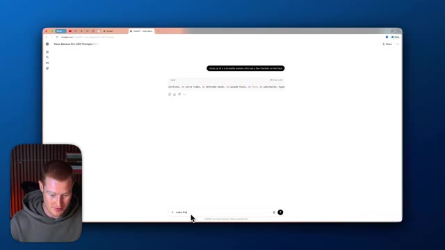
*⏱️ 00:04:21 — Vue de l'interface d'un GPT personnalisé dans le navigateur web montrant la saisie d'un prompt pour modifier l'éclairage.*

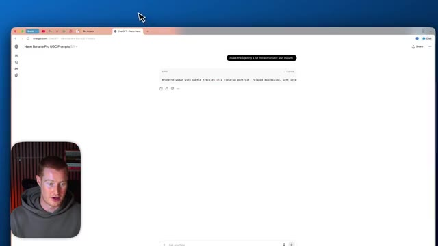
*⏱️ 00:04:26 — Affichage du résultat généré par le GPT personnalisé avec l'invite améliorée pour un éclairage plus dramatique.*

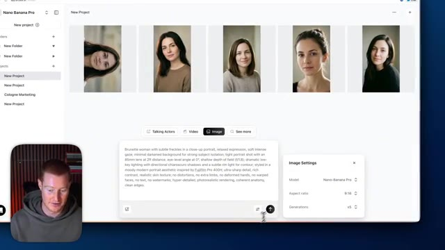
*⏱️ 00:04:30 — Interface de génération d'images avec les paramètres de modèle et la galerie de portraits générés.*

---

### ⏱️ `[00:04:35 - 00:04:54]` | Segment #12

**🔊 Audio (Transcription Intégrale Mot pour Mot en Français) :**
> J'aime vraiment beaucoup ces tout premiers. C'est un entre-deux, genre entre cette scène un peu sombre et celle-ci. Qui fait moins sombre. Donc je trouve qu'ils ont vraiment l'air super bien. Par exemple, regardez à quel point ça a l'air bien. Je veux dire, la texture de la peau, tout ça, ça n'a pas du tout l'air faux. Donc ce que je vais faire, c'est que je vais maintenant télécharger ces images et on va les utiliser comme références pour générer nos vidéos.

**👁️ Analyse Visuelle d'Écran (gemini-3.5-flash-lite) :**
**Interface & Outils** : Application web Nano Banana Pro affichée dans un navigateur web avec incrustation vidéo du présentateur.

**Contenu textuel & Code** : Galerie de portraits photographiques réalistes, invites textuelles (prompts) décrivant les détails de la peau et de l'éclairage.

**Action / Démonstration** : Navigation et sélection d'images générées par IA pour illustrer la qualité des textures de peau et des éclairages.

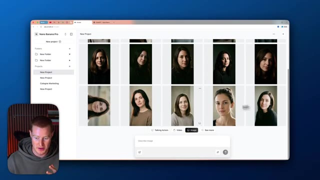
*⏱️ 00:04:40 — Interface d'une application web affichant une galerie de portraits générés par IA.*

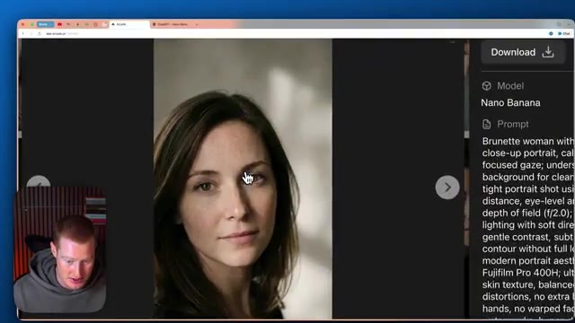
*⏱️ 00:04:44 — Gros plan sur un portrait de femme généré avec affichage du prompt détaillé sur le panneau latéral.*

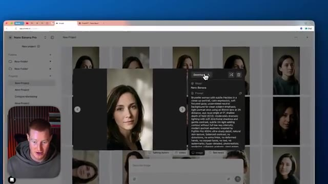
*⏱️ 00:04:49 — Vue modale d'un portrait sélectionné dans la grille avec options de téléchargement et de gestion.*

---

### ⏱️ `[00:04:54 - 00:05:29]` | Segment #13

**🔊 Audio (Transcription Intégrale Mot pour Mot en Français) :**
> Très bien, alors allons un peu plus loin. Je veux en fait générer une image ici. Je vais vous montrer ce prompt. Donc maintenant, je veux que vous créiez une image d'elle tenant cette bouteille d'huile d'olive. Nous allons utiliser cette image comme publicité pour une vidéo UGC de style TikTok. Et j'ai téléchargé cette image ici que nous allons en fait lui faire tenir. Et les gars, je ne le dirai jamais assez : utiliser ce GPT aide tellement en ce qui concerne les résultats et vous fera gagner tellement de temps. Assurez-vous donc de l'utiliser. Il y a un lien dans la description ainsi que dans le commentaire épinglé tout en haut pour l'utiliser. Très bien. J'ai ce prompt ici et laissez-moi juste le coller. Remarquez comment je n'ai même pas besoin d'ajouter une image de référence de cette bouteille d'huile d'olive. Donc je vais cliquer sur envoyer et

**👁️ Analyse Visuelle d'Écran (gemini-3.5-flash-lite) :**
**Interface & Outils** : Interface web de ChatGPT.

**Contenu textuel & Code** : Prompts textuels pour la génération d'images publicitaires UGC (style TikTok) avec une bouteille d'huile d'olive Graza et une femme brune.

**Action / Démonstration** : Saisie et envoi de prompts pour générer des images et affichage de l'historique de conversation.

---

### ⏱️ `[00:05:29 - 00:06:05]` | Segment #14

**🔊 Audio (Transcription Intégrale Mot pour Mot en Français) :**
> il va en fait aller de l'avant et générer ceux-ci. Très bien. Donc nous avons ces quatre résultats ici et les gars, c'est tellement bien. Regardez à quel point ces images ont l'air bien. Je veux dire, c'est impeccable. C'est exactement la même bouteille d'huile d'olive que j'ai téléchargée. Et encore une fois, je n'ai pas vraiment donné de référence quand j'ai téléchargé ceci sur Nano Banana Pro. La façon dont il est capable de faire cela, il a la capacité de faire des recherches sur le web et de trouver réellement différents produits parce que c'est un produit Google. Alors pensez à la façon dont Google est le plus grand moteur de recherche. Il est capable de chercher sur Internet et de trouver des références exactes de ce à quoi ressemble ce produit et cette bouteille. Celui-ci, celui-là n'est en fait pas correct, mais les autres

**👁️ Analyse Visuelle d'Écran (gemini-3.5-flash-lite) :**
**Interface & Outils** : Application web de génération d'images par IA (Nano Banana Pro) affichée dans un navigateur web.

**Contenu textuel & Code** : Prompt textuel détaillé décrivant une femme brune tenant une bouteille d'huile d'olive Graza dans une cuisine moderne, avec des paramètres de style photographique (objectif 35 mm, éclairage, etc.).

**Action / Démonstration** : Présentation et revue visuelle des images générées par l'intelligence artificielle à partir d'une image téléchargée de la bouteille.

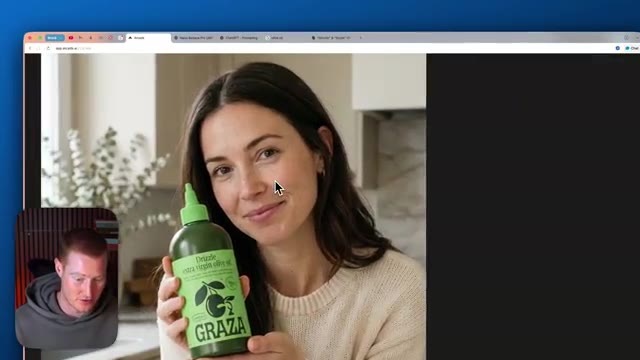
*⏱️ 00:05:38 — Capture d'écran montrant l'interface d'une application web avec le résultat de la génération d'image d'une femme tenant une bouteille d'huile d'olive Graza, avec la petite webcam du présentateur en bas à gauche.*

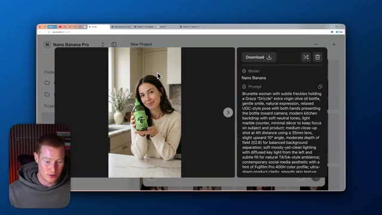
*⏱️ 00:05:56 — Capture d'écran montrant l'interface avec l'image générée d'une femme tenant une bouteille d'huile d'olive, accompagnée du panneau latéral affichant le prompt textuel détaillé utilisé.*

---

### ⏱️ `[00:06:05 - 00:06:38]` | Segment #15

**🔊 Audio (Transcription Intégrale Mot pour Mot en Français) :**
> ont l'air extrêmement solides. Celui-ci, par exemple, a l'air vraiment très bien. On dirait que le logo est un tout petit peu raté sur celui-ci, mais c'est pour ça que c'est bien d'en générer plusieurs en même temps, comme ça on peut faire notre choix. Donc celui-ci a l'air bien. Je vais télécharger celui-ci ainsi que celui-là qui a l'air absolument phénoménal. On dirait une vraie séance photo. Donc je vais le télécharger. Et les gars, je pense que ça va donner des vidéos de style UGC vraiment réussies, je ne vais pas mentir. Donc maintenant, étant donné qu'on est dans nos "CADs" [créations], on va simplement y aller et au lieu de cliquer sur images, on va aller sur vidéos. Et ce que je vais faire, c'est que je vais cliquer sur ce petit truc d'image de référence ici. Je vais importer notre image. Et ensuite, à partir de là, on peut simplement commencer

**👁️ Analyse Visuelle d'Écran (gemini-3.5-flash-lite) :**
**Interface & Outils** : Navigateur web affichant l'interface de l'application Nano Banana Pro.

**Contenu textuel & Code** : Galerie d'images générées par IA, panneau de détails avec prompt textuel et options de téléchargement.

**Action / Démonstration** : Navigation et sélection d'une image générée parmi plusieurs options pour téléchargement.

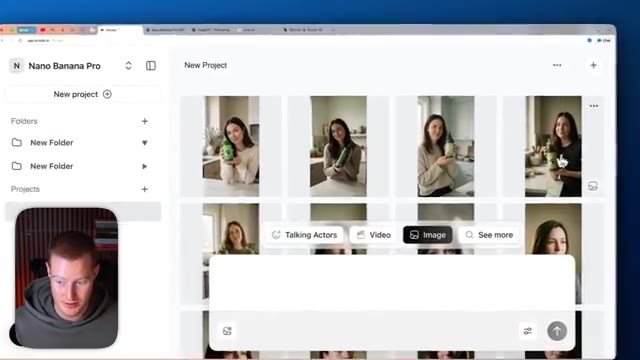
*⏱️ 00:06:13 — Interface de Nano Banana Pro affichant une galerie de projets avec des images générées de femmes tenant une bouteille.*

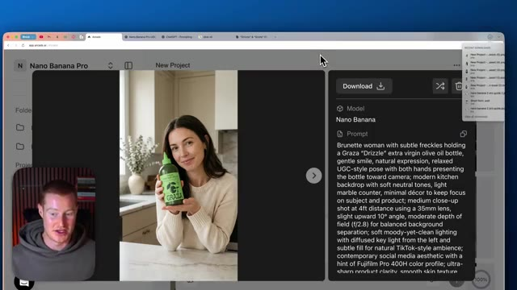
*⏱️ 00:06:22 — Vue détaillée d'une image générée avec le panneau latéral affichant le modèle Nano Banana et le prompt textuel détaillé.*

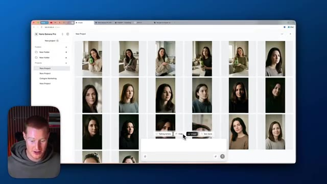
*⏱️ 00:06:30 — Vue d'ensemble de la galerie de Nano Banana Pro montrant un grand nombre d'images générées de manière simultanée.*

---

### ⏱️ `[00:06:38 - 00:07:12]` | Segment #16

**🔊 Audio (Transcription Intégrale Mot pour Mot en Français) :**
> générer nos vidéos. Très bien. Donc ce que je vais faire, c'est que je vais aller sur un autre GPT personnalisé créé par mon bon ami Rourke. Si vous n'avez pas vu notre podcast, il est le roi en matière de vidéo UGC par IA. Et j'ai fait un podcast formidable avec lui. Il nous a fourni cette ressource. Et ça va changer la donne pour la création de nos vidéos. Très bien. Donc voici ce que je vais faire. Je vais télécharger cette image de notre acteur ici que nous avons générée avec Nano banana pro et j'ai dit : crée une vidéo de notre personnage tenant cette bouteille d'huile d'olive, ce sera la première image de notre vidéo. Si vous ne savez pas ce qu'est une première image, c'est essentiellement là où la vidéo va commencer, donc elle commencera avec cette image exacte ici et ensuite nous

**👁️ Analyse Visuelle d'Écran (gemini-3.5-flash-lite) :**
**Interface & Outils** : Navigateur web (interface ChatGPT / GPTs personnalisés).

**Contenu textuel & Code** : Interface d'un GPT personnalisé (« Prompting GPT 2 » par Rourke Sefton-Minns) et un exemple de prompt textuel pour générer une vidéo UGC.

**Action / Démonstration** : Navigation et démonstration de l'utilisation d'un GPT personnalisé pour la création de vidéos par IA.

---

### ⏱️ `[00:07:12 - 00:07:47]` | Segment #17

**🔊 Audio (Transcription Intégrale Mot pour Mot en Français) :**
> générer la vidéo à partir de là et cela va nous aider à maintenir ce personnage et ce sera beaucoup plus cohérent donc nous allons juste envoyer ça et nous allons faire optimiser ce prompt merci Rourke de nous avoir fourni cette ressource parce que cela a fait une énorme différence pour générer des vidéos d'IA pour moi personnellement très bien donc nous avons cet énorme texte ici nous n'avons pas besoin de savoir exactement ce que tout cela est. Mais par exemple, à la fin ici, cela montre ce que nous voulons que notre personnage dise. Donc si nous voulions changer ce que nous voulons qu'il dise, nous pourrions simplement remplacer ce texte ici. Laissez-moi continuer. Je vais ramener ceci dans Arcads. Je vais maintenant sélectionner la vidéo juste ici. Je vais coller ce prompt et je vais en fait sélectionner

**👁️ Analyse Visuelle d'Écran (gemini-3.5-flash-lite) :**
**Interface & Outils** : Interface web de ChatGPT / LLM

**Contenu textuel & Code** : Texte détaillé de prompt pour génération de vidéo (character description, scene settings, camera, lighting, audio, dialogues)

**Action / Démonstration** : Affichage et lecture d'un prompt textuel optimisé pour la génération de vidéo par IA

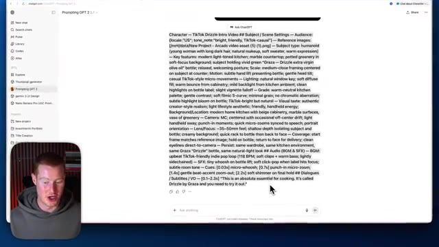
*⏱️ 00:07:29 — Capture d'écran montrant l'interface d'un outil de type ChatGPT affichant un prompt détaillé pour la génération de vidéo, avec la webcam du présentateur incrustée en bas à gauche.*

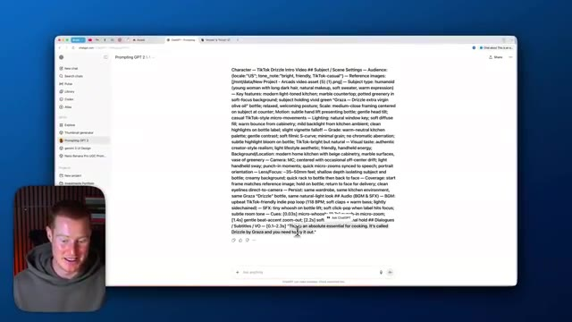
*⏱️ 00:07:38 — Vue similaire de l'interface avec le texte du prompt détaillé affiché à l'écran et la webcam du présentateur en bas à gauche.*

---

### ⏱️ `[00:07:47 - 00:08:24]` | Segment #18

**🔊 Audio (Transcription Intégrale Mot pour Mot en Français) :**
> une image de départ. Et c'est parti. Voici notre acteur qui lève cette bouteille. Je vais en générer trois de ce type. Comme ça, nous avons plusieurs résultats parmi lesquels choisir. Très bien. C'est donc parti. Nous avons nos trois résultats ici et j'en ai en fait généré trois de plus également, donc nous avons plus d'options à tester, mais laissez-moi vous montrer le résultat maintenant et les gars, c'est vraiment très bien. Nano Banana Pro vous offre une bien meilleure capacité à créer des personnages cohérents qui ont vraiment fière allure et que vous pourriez utiliser pour votre vidéo. Donc les gars, je suis plutôt impressionné par celui-ci. Il a même ajouté

**👁️ Analyse Visuelle d'Écran (gemini-3.5-flash-lite) :**
**Interface & Outils** : Interface web de génération vidéo Arcads (app.arcads.ai) avec le modèle Veo 3.1.

**Contenu textuel & Code** : Prompts textuels pour la génération vidéo incluant les caractéristiques du personnage, le décor (cuisine lumineuse) et les mouvements subtils de la bouteille.
[DESC_IMAGE_3] Visualisation d'une vidéo générée en cours de lecture avec son interface de contrôle et le panneau des métadonnées du modèle Veo 3.1.

**Action / Démonstration** : Explications face caméra et analyse conceptuelle des marchés.

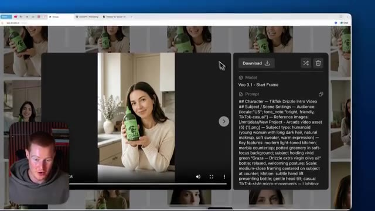
*⏱️ 00:07:56 — Interface de génération vidéo montrant le modèle Veo 3.1 avec le prompt textuel détaillé sur le panneau de droite et le résultat visuel affiché au centre.*

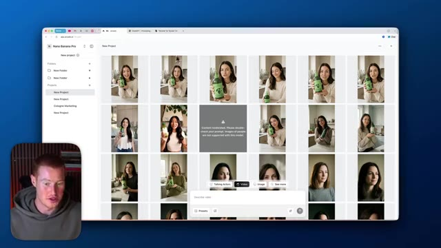
*⏱️ 00:08:05 — Grille de résultats générés affichant de multiples variations d'une actrice tenant une bouteille dans une cuisine.*

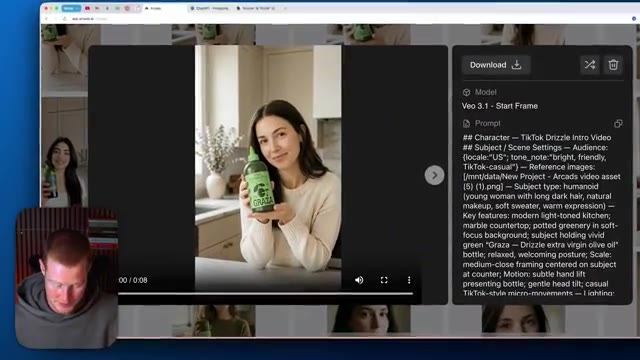
*⏱️ 00:08:14 — Visualisation d'une vidéo générée en cours de lecture avec son interface de contrôle et le panneau des métadonnées du modèle Veo 3.1.*

---

### ⏱️ `[00:08:24 - 00:09:00]` | Segment #19

**🔊 Audio (Transcription Intégrale Mot pour Mot en Français) :**
> ces comme des étincelles à la fin de la vidéo et cela a été généré avec Google VO 3.1, laissez-moi jeter un œil à certains des autres. Donc, une chose que je veux noter, c'est que ça a même ces coupes. Donc, par exemple, ça va faire un zoom avant sur la bouteille ici quand ça la montre en train de la présenter à la caméra. Ça va faire des transitions vers nos vidéos. Ce n'est pas juste comme une vidéo fixe et statique de la personne qui parle. Ça a vraiment l'air que ce serait comme une publicité TikTok ou quelque chose que vous verriez sur vos Reels Instagram pour cette entreprise d'huile d'olive Graza. Donc ce qu'on pourrait faire, c'est qu'on pourrait simplement télécharger tout ça à partir de

**👁️ Analyse Visuelle d'Écran (gemini-3.5-flash-lite) :**
**Interface & Outils** : Interface web de génération de vidéos par IA (Nano Banana Pro / Arcad) et webcam du présentateur.

**Contenu textuel & Code** : Prompts textuels pour l'intelligence artificielle, métadonnées de modèles vidéo (Veo 3.1) et grille de miniatures.

**Action / Démonstration** : Le présentateur navigue et commente les différentes vidéos générées par IA et leurs prompts associés.

---

### ⏱️ `[00:09:00 - 00:09:33]` | Segment #20

**🔊 Audio (Transcription Intégrale Mot pour Mot en Français) :**
> ici. Et ensuite maintenant nous avons ces vidéos de haute qualité que nous pouvons soit publier, soit modifier. Donc les amis, voilà qui est fait. Nous avons non seulement généré ce personnage à partir de zéro en utilisant Nano Banana Pro, mais nous avons créé de multiples angles différents que nous pourrions utiliser pour des vidéos. Et si nous voulions faire plus de vidéos à partir, vous savez, de différentes scènes, par exemple, nous pourrions simplement discuter avec nos chats et dire, je veux que tu génères ce personnage dans cette scène, dans ce décor, portant ces vêtements, et ensuite faire exactement la même chose. Nous téléchargeons simplement cette image de cadre de départ que nous avons créée avec Nano Banana Pro, qui est une image de haute qualité, et elle générera un résultat comme celui-ci. Et en utilisant ce

**👁️ Analyse Visuelle d'Écran (gemini-3.5-flash-lite) :**
**Interface & Outils** : Navigateur web affichant l'interface de Nano Banana Pro avec incrustation vidéo du présentateur.

**Contenu textuel & Code** : Galerie de portraits et d'avatairs générés affichés en grille avec des options pour les acteurs parlants (Talking Actors).

**Action / Démonstration** : Présentation de la génération et de la sélection de différents angles de personnages synthétiques.

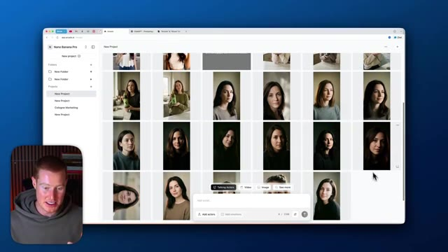
*⏱️ 00:09:16 — Interface de l'outil Nano Banana Pro montrant une grille de miniatures de personnages générés par IA.*

---

### ⏱️ `[00:09:33 - 00:10:04]` | Segment #21

**🔊 Audio (Transcription Intégrale Mot pour Mot en Français) :**
> GPT va être crucial ici, car c'est vraiment la raison pour laquelle cette vidéo a si bien réussi, parce que j'avais un prompt hyper spécifique et nous pouvions essayer différents styles rien qu'en lui donnant un prompt de base à l'intérieur de ce GPT. Donc les gars, si vous voulez vous inscrire sur Arcads, il y a un lien dans la description pour le faire. Je le recommande vivement si vous voulez prendre au sérieux la création de vidéos ou d'images par IA. Si vous avez tiré de la valeur de cette vidéo, laissez un pouce bleu. Dites-moi ce que vous en pensez dans les commentaires ci-dessous. Abonnez-vous à cette chaîne où je couvre l'IA pour les non-techniciens. Donc si vous n'êtes pas technique et que vous voulez rester à jour avec différents outils d'IA et cas d'usage, c'est l'endroit où il faut être. Merci les gars d'être restés jusqu'à la fin et je vous vois dans la prochaine vidéo.

**👁️ Analyse Visuelle d'Écran (gemini-3.5-flash-lite) :**
**Interface & Outils** : ChatGPT, navigateur web.

**Contenu textuel & Code** : Texte de prompt détaillé pour la création de contenu vidéo avec des spécifications de personnage, de scène et d'audio.

**Action / Démonstration** : Affichage et explication du prompt utilisé pour générer les différents styles vidéo.

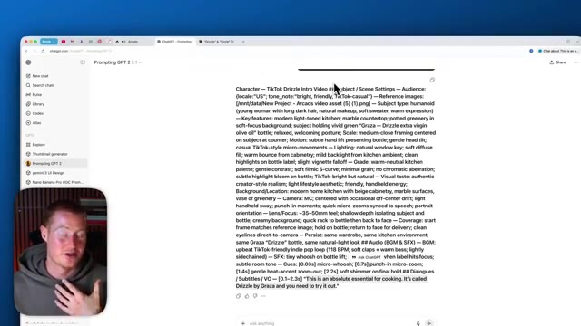
*⏱️ 00:09:41 — Capture d'écran montrant une interface ChatGPT avec un prompt textuel détaillé destiné à la génération vidéo.*

---

