# 🎬 Stop Using Nano Banana Pro WRONG (Do This Instead)

> **Chaîne** : [Brock Mesarich | AI for Non Techies](https://www.youtube.com/@BrockMesarich)  
> **Lien YouTube** : [https://www.youtube.com/watch?v=Lv_wtzRyaLc](https://www.youtube.com/watch?v=Lv_wtzRyaLc)  
> **Date de publication** : 20251125  
> **Durée** : 00:10:09  
> **Identifiant vidéo** : `Lv_wtzRyaLc`  
> **Transcription & Analyse** : `whisper-v3-large-turbo+gemini-3.5-flash-lite`  

---

## 📌 Synthèse Exécutive & Outils

### 💡 Résumé

La vidéo de la chaîne *Brock Mesarich | AI for Non Techies* lève le voile sur l'utilisation stratégique et sous-estimée de « Nano Banana Pro », un modèle d'intelligence artificielle de pointe que la majorité des utilisateurs emploient de manière superficielle. Loin de se limiter à un simple générateur d'images isolé, le modèle révèle son plein potentiel lorsqu'il est exploité à travers une plateforme centralisée et unifiée comme Freepik. La démonstration détaille comment combiner des flux de travail multi-modèles pour passer en quelques clics d'une simple photo de base à des modifications itératives complexes, à l'ajout de typographies vectorielles précises, et enfin à la production de séquences vidéo cinématographiques fluides.

L'analyse démontre l'importance cruciale de choisir le bon moteur d'inférence selon l'objectif recherché (génération de masse, fidélité esthétique en 4K ou édition fine d'images préexistantes). En s'appuyant sur des fonctionnalités avancées telles que le mode de sélection automatique (« Auto ») et les « espaces » de travail interactifs — comparables à des toiles infinies de prototypage —, les créateurs et professionnels peuvent automatiser la cohérence de leurs personnages, tester des variations vestimentaires ou générer des visuels professionnels illimités. Le tout repose sur une approche méthodique du *prompt engineering* (souvent assistée par ChatGPT) et sur l'utilisation de forfaits adaptés pour s'affranchir des barrières de volume.

Bien que la vidéo s'inscrive dans le domaine de la création visuelle et de l'intelligence artificielle générative, la rigueur méthodologique présentée s'apparente aux processus itératifs rigoureux du trading quantitatif et de l'automatisation de flux. Chaque étape — de la sélection des données sources (images de référence) au backtesting visuel (génération de multiples variantes), en passant par l'optimisation des hyperparamètres (prompts et ratios d'image) et l'exécution finale (rendu vidéo) — est pensée pour maximiser le ratio coût-performance et éliminer les biais inhérents aux outils d'IA non structurés.

### 🛠️ Outils, Modèles & Logiciels Présentés

* **Nano Banana Pro** : Modèle phare de pointe de Google spécialisé dans la génération multi-images de niveau supérieur et l'édition fine d'éléments visuels préexistants.
* **Freepik** : Plateforme créative tout-en-un servant de socle centralisé intégrant de multiples modèles de génération d'images et de vidéos, ainsi qu'un espace de travail interactif en toile infinie (« Espaces »).
* **SeaDream 4K** : Modèle de génération d'images hautement performant, particulièrement reconnu pour sa gestion des références visuelles en haute résolution et la puissance de ses esthétiques.
* **ChatGPT** : Assistant conversationnel textuel utilisé en amont pour concevoir, structurer et affiner les *prompts* destinés aux modèles de génération visuelle.
* **Gemini** : Modèle linguistique et multimodal de Google, mentionné comme alternative pour l'utilisation initiale de Nano Banana.
* **Make** : Outil d'automatisation de flux de travail no-code (mentionné dans le contexte technologique global de la chaîne).
* **Grok** : Modèle conversationnel d'IA (mentionné dans l'écosystème technologique de référence).
* **Zapier** : Plateforme d'intégration et d'automatisation d'applications (présente dans l'arsenal d'automatisation de la chaîne).
* **n8n** : Logiciel d'automatisation de flux de travail orienté développeurs et auto-hébergé (mentionné parmi les compétences de l'écosystème).
* **Claude** : Modèle d'intelligence artificielle conversationnelle d'Anthropic (évoqué dans la stack technologique globale).

### 🔑 Points Clés & Enseignements Stratégiques

* **Dépassement de l'usage basique** : Transformer un modèle d'image IA en véritable moteur créatif nécessite de combiner l'édition multi-étapes, le masquage et la génération vidéo à partir d'une source unique.
* **Centralisation sur une plateforme socle** : L'utilisation de Freepik permet d'accéder à une suite diversifiée de modèles sous une interface unifiée, évitant les frictions liées au changement constant d'applications.
* **Mode de sélection automatique (« Auto »)** : Déléguer le choix du modèle (Nano Banana Pro vs. SeaDream 4K) à l'algorithme en fonction du *prompt* garantit l'adéquation parfaite entre la tâche (édition fine vs. esthétique 4K) et la technologie.
* **Optimisation par le *Prompt Engineering*** : L'utilisation itérative de ChatGPT pour transformer des instructions basiques en *prompts* hautement spécifiques est indispensable pour obtenir des résultats cohérents et de haute qualité.
* **Gestion des formats et dimensions** : L'ajustement précis des ratios d'image (comme le 9:16 pour les réseaux sociaux ou le format carré 1:1) conditionne l'efficacité visuelle du rendu final selon le canal de diffusion.
* **Génération en volume (Batching)** : Produire simultanément plusieurs variations d'une même image (ex: 4 options) compense le manque inhérent de cohérence déterministe des IA génératives et accélère le processus de sélection.
* **Édition granulaire et dézoom** : Utiliser les capacités de modification de Nano Banana Pro pour redimensionner, dézoomer ou modifier l'arrière-plan tout en préservant l'intégrité du sujet principal et la pose du personnage.
* **Incrustation textuelle précise** : Définir explicitement le style, la police et le message textuel dans le *prompt* permet d'intégrer des superpositions typographiques propres directement sur l'image générée.
* **Transition fluide vers la vidéo cinématographique** : Transformer une image fixe modifiée en séquence animée (via des mouvements de caméra simulés et des éléments dynamiques comme de l'eau ou des véhicules) en combinant image de départ et instructions de mouvement.
* **Espaces de travail interactifs (« Espaces »)** : Exploiter des toiles infinies pour structurer des flux de travail visuels, comparer des configurations vestimentaires et tester des portraits professionnels de référence.
* **Rentabilité des forfaits illimités** : L'adoption d'un abonnement premium (tel que le forfait à 39 $ par mois) s'avère stratégiquement rentable pour les créateurs intensifs, levant toute restriction de quota sur la génération d'images.
* **Approche quantitative et itérative** : Traiter la création visuelle par IA comme un processus systématique de backtesting et d'optimisation de paramètres (grain, résolution 4K, styles de peinture à l'huile) afin de maximiser le retour sur investissement créatif.

---

## ⏱️ Chronologie & Transcription Complète Audio & Visuelle (Mot pour Mot)

### ⏱️ `[00:00:00 - 00:00:23]` | Segment #01

**🔊 Audio (Transcription Intégrale Mot pour Mot en Français) :**
> Nano Banana Pro vient de sortir et c'est vraiment insensé quand on l'utilise de la bonne manière. Mais voilà le problème, la plupart des gens l'utilisent complètement de travers, ce qui explique pourquoi ils n'obtennent pas les résultats qu'ils cessent de voir sur les réseaux sociaux. Si vous l'utilisez de cette façon spécifique, il cesse d'être juste un autre modèle d'image IA et se transforme en un véritable moteur créatif où vous pouvez créer des visuels illimités, des modifications illimitées, et même des vidéos cinématographiques complètes à partir d'une seule photo.

**👁️ Analyse Visuelle d'Écran (gemini-3.5-flash-lite) :**
**Interface & Outils** : Aucune interface logicielle, graphique ou plateforme de trading n'est affichée dans ce segment.

**Contenu textuel & Code** : Aucun code source, indicateur technique, prompt ou donnée chiffrée n'est visible.

**Action / Démonstration** : Le présentateur introduit son sujet à l'oral sans effectuer de manipulation à l'écran.

---

### ⏱️ `[00:00:23 - 00:00:57]` | Segment #02

**🔊 Audio (Transcription Intégrale Mot pour Mot en Français) :**
> Donc, dans cette vidéo, je vais vous présenter la meilleure façon d'utiliser Nano Banana Pro en ce moment pour que vous puissiez enfin exploiter ce dont il est réellement capable. Très bien les gars, donc dans cette vidéo, nous allons utiliser FreePick comme socle créatif. Ça va être crucial si nous voulons réellement générer des images et des vidéos créatives par IA extraordinaires en utilisant non seulement Nano Banana Pro, mais aussi tous ces différents modèles de génération d'images qui s'intègrent directement dans cette plateforme. Laissez-moi donc vous montrer rapidement un exemple de quelque chose que j'ai fait en quelques invites seulement. J'ai pris cette image juste ici de cette fille. J'ai en fait créé ceci avec FreePic, cette image juste ici. Et j'ai créé

**👁️ Analyse Visuelle d'Écran (gemini-3.5-flash-lite) :**
**Interface & Outils** : Navigateur web affichant la plateforme Freepik (freepik.com) avec l'outil de génération de contenu et le présentateur en médaillon vidéo.

**Contenu textuel & Code** : Tableau de bord Freepik avec barres de recherche d'actifs, options de génération d'images, de vidéos et d'édition, ainsi que l'historique des créations.

**Action / Démonstration** : Navigation et présentation de la plateforme Freepik pour l'utiliser comme socle créatif dans le workflow de création vidéo.

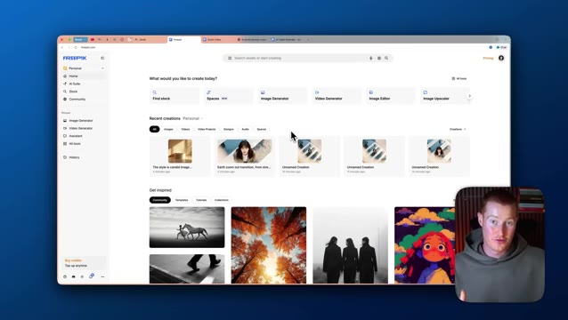
*⏱️ 00:00:32 — Interface principale du site web Freepik montrant le tableau de bord avec les options de création et les créations récentes.*

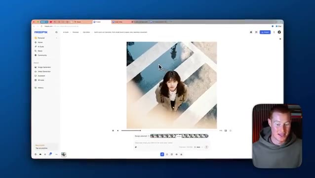
*⏱️ 00:00:49 — Visualisation d'une vidéo générée sur Freepik représentant une personne vue du dessus sur un passage piéton avec un effet de zoom arrière.*

---

### ⏱️ `[00:00:57 - 00:01:29]` | Segment #03

**🔊 Audio (Transcription Intégrale Mot pour Mot en Français) :**
> cette image aussi, cette image finale, qui est fondamentalement un plan dézoomé de cette même image exacte que je vous ai montrée. Et j'ai créé cette vidéo cinématographique avec en utilisant FreePic. Et je vais vous montrer comment vous pouvez commencer à faire des choses comme ça dans cette vidéo. Donc tout d'abord, laissez-moi simplement parler de ce qu'est FreePic. Donc FreePic est une plateforme qui possède un tas de modèles d'images IA différents, de modèles de génération de vidéo, et un tas de flux de travail différents que nous pouvons utiliser ainsi que des modèles pour nous permettre de créer les meilleures vidéos et images créatives par IA. Il y en a honnêtement tellement

**👁️ Analyse Visuelle d'Écran (gemini-3.5-flash-lite) :**
**Interface & Outils** : Navigateur web affichant la plateforme Freepik (freepik.com) avec l'interface de création par IA.

**Contenu textuel & Code** : Tableau de bord Freepik avec les sections "Recent creations", "Find stock", "Image Generator", "Video Generator", "Image Editor", et "Image Upscaler".

**Action / Démonstration** : Navigation et présentation de l'interface du site Freepik pour montrer les outils de génération vidéo et d'image.

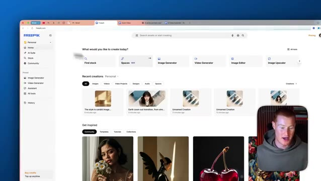
*⏱️ 00:01:13 — Capture d'écran du site Freepik montrant le tableau de bord principal avec les outils d'IA et de génération d'images, avec une petite incrustation vidéo du présentateur en bas à droite.*

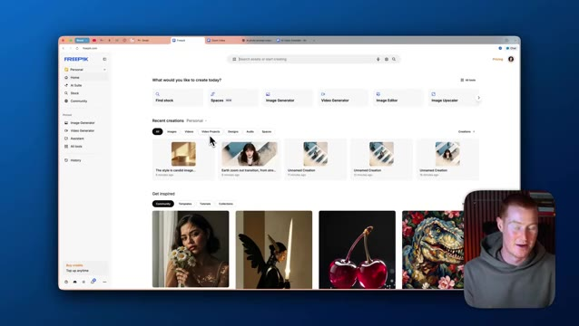
*⏱️ 00:01:21 — Capture d'écran similaire de la plateforme Freepik montrant les créations récentes et les options d'inspiration, avec l'incrustation vidéo du présentateur.*

---

### ⏱️ `[00:01:29 - 00:02:03]` | Segment #04

**🔊 Audio (Transcription Intégrale Mot pour Mot en Français) :**
> fonctionnalités quand il s'agit de Freepik. Donc dans cette vidéo, je vais essayer de me concentrer sur quelques-unes que nous pouvons commencer à utiliser dès maintenant. Première des choses, je vais venir sur le générateur d'images, et c'est ici que nous pouvons générer nos images avec Nano Banana Pro et tous ces autres modèles d'images ici. Donc si je veux utiliser Nano Banana Pro, je peux simplement venir ici et sélectionner Nano Banana Pro. Et il y a quelques choses que je veux mentionner. Nous avons différents styles que nous pouvons choisir, ce qui va essentiellement émuler ce style lorsque nous essayons de générer notre image. Par exemple, nous voulons faire cette image de style peinture à l'huile ici, et je veux télécharger une photo. Je peux

**👁️ Analyse Visuelle d'Écran (gemini-3.5-flash-lite) :**
**Interface & Outils** : Navigateur web affichant l'interface de la plateforme Freepik (générateur d'images et bibliothèque de styles).

**Contenu textuel & Code** : Options de génération d'images, menu déroulant des modes, champ de saisie de prompt et galerie de styles prédéfinis (Photo, Illustration, 3D, Design).

**Action / Démonstration** : Navigation et présentation des outils de génération d'images et de sélection de styles artistiques sur la plateforme Freepik.

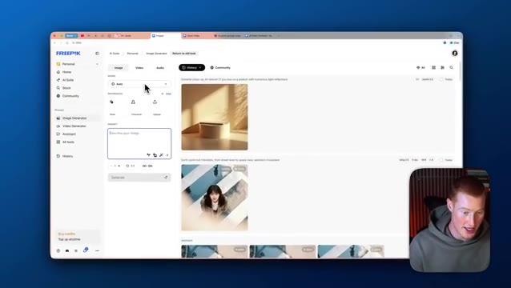
*⏱️ 00:01:38 — Interface principale du générateur d'images de Freepik avec un panneau latéral de configuration et des exemples de créations générées.*

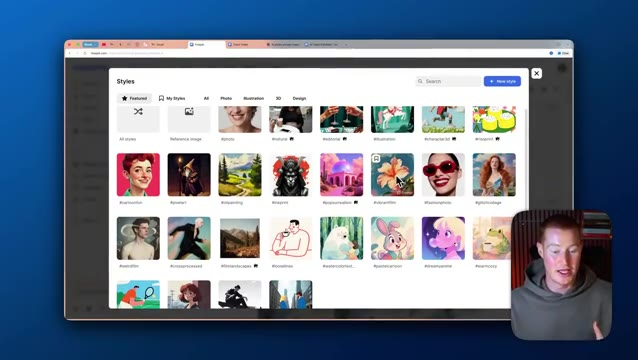
*⏱️ 00:01:55 — Fenêtre modale des styles artistiques disponibles dans le générateur d'images de Freepik, affichant une grille d'exemples visuels.*

---

### ⏱️ `[00:02:03 - 00:02:35]` | Segment #05

**🔊 Audio (Transcription Intégrale Mot pour Mot en Français) :**
> essentiellement télécharger n'importe quelle photo que j'ai ici, soit taper une instruction et modifier cette image, soit simplement dire de recréer ceci dans un style de peinture à l'huile. Recrée cette image pour moi dans ce style de peinture à l'huile. Garde tout exactement pareil. Donc, quelques petites choses que je veux mentionner ici. Nous pourrions donc changer plusieurs choses. Nous pourrions modifier le format d'image. En gros, cela change la largeur et la hauteur d'une image spécifique. Par exemple, je pourrais faire du format large. Je pourrais faire du 9 par 16, ce qui est quelque chose que l'on verrait sur les stories Instagram ou sur un reel Instagram, par exemple. Je vais juste faire du 1 par 1 ici et nous pourrions aussi télécharger un personnage si nous le voulions. Je vais vous montrer plus tard dans ce

**👁️ Analyse Visuelle d'Écran (gemini-3.5-flash-lite) :**
**Interface & Outils** : Freepik AI Image Generator (interface web).

**Contenu textuel & Code** : Champ de prompt avec la balise '@img1' et des options de configuration de génération d'images.

**Action / Démonstration** : Saisie d'un prompt textuel et manipulation des paramètres de génération d'image à partir d'une référence.

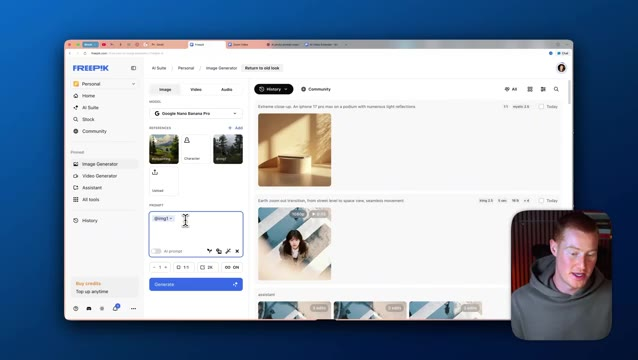
*⏱️ 00:02:11 — Interface du générateur d'images de Freepik avec un panneau de prompt montrant '@img1' et le présentateur en médaillon.*

*⏱️ 00:02:27 — Interface de Freepik avec le menu déroulant des formats d'image ouvert (sélection des proportions).*

---

### ⏱️ `[00:02:35 - 00:03:10]` | Segment #06

**🔊 Audio (Transcription Intégrale Mot pour Mot en Français) :**
> vidéo sur la façon dont vous pouvez télécharger votre propre personnage afin de pouvoir générer des images de vous-même. Une autre chose que nous pouvons faire est de modifier la résolution ici. Je vais donc dire image 4K et nous pouvons générer autant d'images que nous le voulons. Je vais juste m'en tenir à une pour l'instant et je vais cliquer sur générer. Très bien, alors pendant que ça fait son travail, je tiens à mentionner une chose. Selon le forfait Freepik que vous possédez, vous bénéficiez d'une génération d'images illimitée. J'utilise donc le forfait Premium Plus qui coûte 39 dollars par mois. Donc dans cette vidéo, vous me verrez générer autant d'images que je le veux et c'est parce que je suis sur ce forfait et si vous prévoyez d'utiliser Nano Banana dans ces autres images

**👁️ Analyse Visuelle d'Écran (gemini-3.5-flash-lite) :**
**Interface & Outils** : Interface web de Freepik (Générateur d'images, Page de tarification, Video Extender) et incrustation vidéo du présentateur.

**Contenu textuel & Code** : Paramètres de génération d'IA, sélection de modèles, options de résolution (4K), formats et grilles tarifaires de la plateforme Freepik.

**Action / Démonstration** : Navigation et démonstration des fonctionnalités de génération d'images et de vidéo ainsi que consultation des grilles de prix sur le site web.

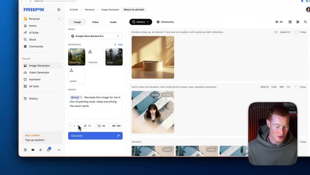
*⏱️ 00:02:44 — Interface du générateur d'images de Freepik montrant les options de prompt, les paramètres de résolution 4K et de format, avec une webcam incrustée du présentateur en bas à droite.*

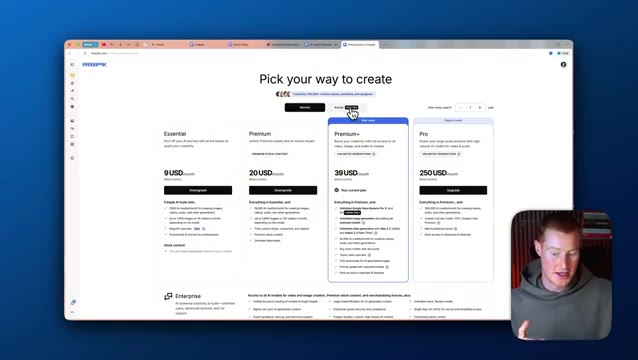
*⏱️ 00:02:53 — Page de tarification de Freepik affichant les différents abonnements (Essential, Premium, Premium+, Pro) avec des tarifs mensuels et annuels.*

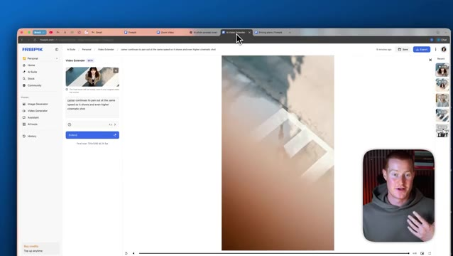
*⏱️ 00:03:01 — Interface de l'outil "Video Extender" de Freepik affichant une vidéo en cours de traitement et de lecture avec des commandes d'extension.*

---

### ⏱️ `[00:03:10 - 00:03:45]` | Segment #07

**🔊 Audio (Transcription Intégrale Mot pour Mot en Français) :**
> les modèles de génération au sérieux. C'est vraiment un excellent rapport qualité-prix en ce qui concerne le nombre d'images que vous pouvez créer pour 39 dollars par mois. Très bien, et juste comme ça, nous avons ici cette peinture de style huile qui correspond presque exactement à ce style de référence, alors laissez-moi vous montrer d'autres cas d'utilisation maintenant. L'une de mes fonctionnalités préférées dans Freepik et la raison pour laquelle c'est tellement différent d'utiliser simplement Nano Banana dans Gemini, c'est que vous pouvez sélectionner ce modèle automatique ici, donc au lieu d'utiliser Nano Banana 2 ou SeaDream 4K, il va littéralement suggérer et choisir quel modèle est le meilleur en fonction du prompt

**👁️ Analyse Visuelle d'Écran (gemini-3.5-flash-lite) :**
**Interface & Outils** : Navigateur web affichant la plateforme de génération d'images Freepik.

**Contenu textuel & Code** : Panneau de configuration des modèles d'IA, interface de sélection des moteurs de rendu d'images et champ de prompt.

**Action / Démonstration** : Navigation dans l'interface de Freepik et sélection des options de génération d'images par IA.

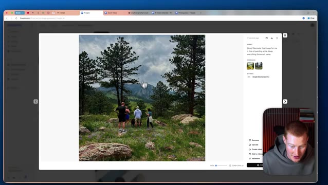
*⏱️ 00:03:19 — Interface web de Freepik affichant une photo de paysage de montagne avec un groupe de personnes au premier plan et le panneau de configuration des prompts sur le côté droit.*

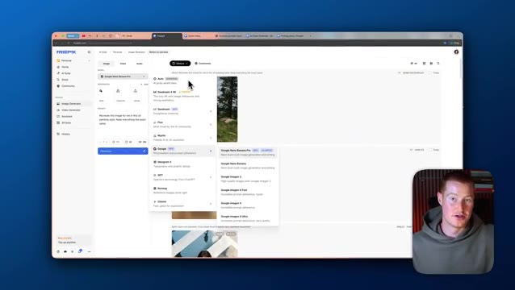
*⏱️ 00:03:28 — Interface web de Freepik montrant les menus déroulants de sélection des différents modèles de génération d'images par IA.*

---

### ⏱️ `[00:03:45 - 00:04:08]` | Segment #08

**🔊 Audio (Transcription Intégrale Mot pour Mot en Français) :**
> que nous lui donnons. Parce que si nous jetons un œil ici, ces différents modèles d'images sont bons dans des domaines spécifiques. Donc si je viens chez Google, Google Nano Banana Pro est bon pour la génération et l'édition multi-images de niveau supérieur. Donc si je veux générer un tas d'images différentes et que je veux éditer des images, Nano Banana Pro est bon pour ça. Cependant, par exemple, SeaDream 4 4K est un autre modèle d'image qui fait actuellement un carton dans le monde entier.

**👁️ Analyse Visuelle d'Écran (gemini-3.5-flash-lite) :**
**Interface & Outils** : Navigateur web affichant la plateforme Freepik Image Generator

**Contenu textuel & Code** : Menus déroulants des modèles d'IA (Seedream, Flux, Mystic, Google, Ideogram 3, GPT, Runway, Classic) et sous-menu des variantes Google (Google Nano Banana Pro, Google Nano Banana, Google Imagen 3, Imagen 4 Fast/Ultra).

**Action / Démonstration** : Le présentateur navigue dans les options de modèles d'IA de Freepik pour sélectionner le modèle Google Nano Banana Pro.

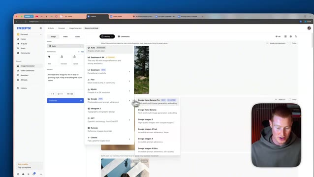
*⏱️ 00:03:51 — Interface web de l'outil Freepik montrant les menus de sélection des modèles d'IA, avec le curseur sur le sous-menu Google et l'option Google Nano Banana Pro en surbrillance.*

*⏱️ 00:03:57 — Vue similaire sur l'interface Freepik montrant le sous-menu des modèles Google et les différentes options de génération d'images disponibles.*

---

### ⏱️ `[00:04:08 - 00:04:29]` | Segment #09

**🔊 Audio (Transcription Intégrale Mot pour Mot en Français) :**
> Et celui-ci est vraiment bon pour les références d'images en 4K et les esthétiques fortes. Et si vous n'êtes pas quelqu'un qui connaît les subtilités de ces modèles d'images, il peut être très difficile pour vous de décider lequel est le meilleur pour votre cas d'utilisation spécifique, car ils font une très grande différence. Je clique généralement simplement sur auto ici et il sélectionnera le meilleur modèle pour moi. Alors, laissez-moi aller de l'avant et trouver un style que je veux recréer.

**👁️ Analyse Visuelle d'Écran (gemini-3.5-flash-lite) :**
**Interface & Outils** : Navigateur web affichant l'interface de l'outil de génération d'images Freepik.

**Contenu textuel & Code** : Liste des modèles de génération d'images IA (Seedream, Flux, Mystic, etc.) et champ de saisie de prompt textuel.

**Action / Démonstration** : Navigation et sélection d'un modèle d'intelligence artificielle pour la génération d'images dans l'interface de Freepik.

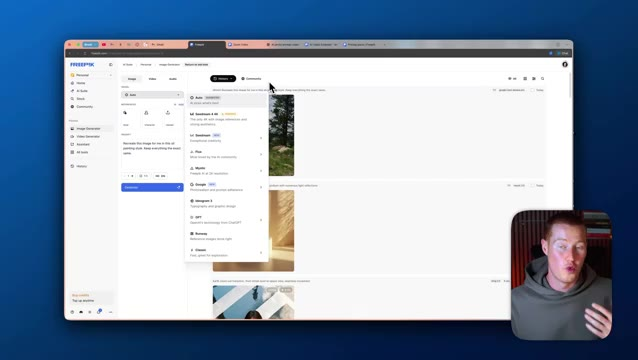
*⏱️ 00:04:19 — Interface de la plateforme Freepik affichant le menu déroulant des différents modèles de génération d'images IA avec le présentateur en incrustation.*

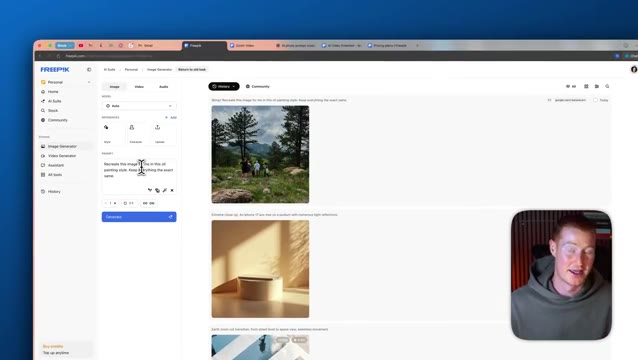
*⏱️ 00:04:24 — Interface de la plateforme Freepik montrant les options de génération d'images avec le champ de texte et le bouton 'Generate'.*

---

### ⏱️ `[00:04:29 - 00:05:02]` | Segment #10

**🔊 Audio (Transcription Intégrale Mot pour Mot en Français) :**
> Donc j'en ai sauvegardé quelques-uns ici. J'aime vraiment celui-ci avec des images fixes épurées. Donc laissez-moi le prendre. Et je vais juste écrire mon prompt ici. J'ai demandé à ChatGPT de m'aider avec ce prompt. Donc si vous avez besoin d'aide, allez simplement sur ChatGPT et dites essentiellement : aidez-moi à améliorer ce prompt. Et il transformera votre prompt basique en un prompt beaucoup plus spécifique pour Freepik afin de générer réellement cette image pour vous. Ensuite, je vais changer mon format d'image. Je vais définir celui-ci en trois quarts pour le format traditionnel, et ensuite je vais générer quatre images ici. J'ai donc plus de choix. C'est le grand avantage d'utiliser Freepik. Vous pouvez générer autant d'images que vous le souhaitez, ce qui rend les choses beaucoup plus faciles parce que

**👁️ Analyse Visuelle d'Écran (gemini-3.5-flash-lite) :**
**Interface & Outils** : Navigateur web affichant la plateforme de génération d'images Freepik.

**Contenu textuel & Code** : Un prompt textuel détaillé destiné à un générateur d'images IA (génération de scènes cinématographiques).

**Action / Démonstration** : Le présentateur montre l'utilisation d'un prompt d'IA sur Freepik pour générer des images et explique son processus.

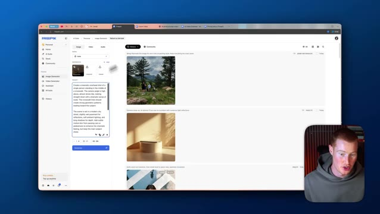
*⏱️ 00:04:38 — Capture d'écran du navigateur affichant l'interface de Freepik (générateur d'images par IA) avec un panneau latéral contenant un prompt détaillé, et une petite incrustation vidéo du présentateur en bas à droite.*

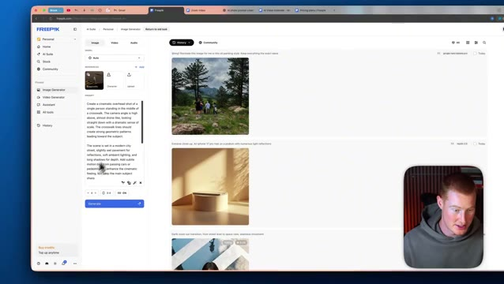
*⏱️ 00:04:54 — Capture d'écran de l'interface Freepik montrant la saisie ou la modification d'un prompt textuel dans le générateur d'images, avec le présentateur en incrustation.*

---

### ⏱️ `[00:05:02 - 00:05:35]` | Segment #11

**🔊 Audio (Transcription Intégrale Mot pour Mot en Français) :**
> Parfois, lorsque vous utilisez ces modèles d'images d'IA, ils ne sont pas super cohérents. Donc, en générer plusieurs à la fois rend tout ce processus tellement plus fluide pour vous. Très bien, j'ai donc toutes ces images différentes. Laissez-moi donc procéder à une modification sur l'une d'elles. Il y a donc plusieurs choses que je peux faire avec cette image. Je pourrais l'agrandir pour améliorer sa qualité. Je pourrais créer une vidéo à partir de celle-ci. Je pourrais l'ajouter à un projet vidéo. Je peux ensuite l'enregistrer comme style ou l'utiliser comme référence. Mais ce que je vais faire, c'est que je vais cliquer sur cette fonctionnalité de modification d'image. Et ensuite, je peux essentiellement décrire le changement que je veux apporter à celle-ci. Et remarquez qu'elle utilise Google Nano Banana.

**👁️ Analyse Visuelle d'Écran (gemini-3.5-flash-lite) :**
**Interface & Outils** : Navigateur web affichant l'interface de génération d'images Freepik.

**Contenu textuel & Code** : Galerie d'images générées par IA et panneau de contrôle des prompts.

**Action / Démonstration** : Navigation et sélection d'une image générée pour effectuer une modification.

---

### ⏱️ `[00:05:35 - 00:06:08]` | Segment #12

**🔊 Audio (Transcription Intégrale Mot pour Mot en Français) :**
> Pro 4K ici parce que c'est le meilleur modèle quand il s'agit d'apporter des modifications à une image préexistante que nous avons. Nous avons aussi ces boutons ici en bas où nous pourrions restyler l'image. Nous pouvons supprimer l'arrière-plan, par exemple, et y apporter des ajustements et tout simplement changer la couleur si nous le souhaitons. Je vais juste m'en tenir à ce prompt et je vais lancer le traitement maintenant. Très bien, alors allons-y. Vous pouvez voir que cette image est maintenant davantage dézoomée. C'est exactement le même personnage dans exactement la même position. Tout à ce sujet a l'air cohérent. Vous pouvez voir qu'il a en fait ajouté ces bâtiments en arrière-plan maintenant et qu'il a ajouté quelques, vous savez, différentes choses ici. Donc ce que je vais faire, je vais cliquer à nouveau sur ce bouton d'édition. Et ce que je pourrais faire c'est

**👁️ Analyse Visuelle d'Écran (gemini-3.5-flash-lite) :**
**Interface & Outils** : Freepik (éditeur d'image en ligne)

**Contenu textuel & Code** : Interface utilisateur de retouche d'image par IA, options de style et paramètres.

**Action / Démonstration** : Présentation des fonctionnalités de modification d'images existantes et des boutons de personnalisation.

---

### ⏱️ `[00:06:08 - 00:06:41]` | Segment #13

**🔊 Audio (Transcription Intégrale Mot pour Mot en Français) :**
> Je pourrais en fait ajouter du texte à cela. Je veux créer un style similaire à celui-ci en ayant comme une superposition de texte comme ça. Et voyons si je peux le faire maintenant. Très bien. Je vais donc utiliser ce prompt ici qui dit essentiellement d'ajouter du texte qui dit la créativité vous attend. Je lui donne le style exact de texte et la police que je veux utiliser parce que, vous savez, encore une fois, vous devez être vraiment précis sur les prompts que vous allez utiliser lors de l'utilisation de nano banana pro ou de tout modèle d'image, par exemple. Je vais donc l'envoyer et voyons ce que cela génère pour nous. Très bien, c'est parti. Nous avons maintenant ce texte la créativité vous attend à l'écran. Et ce que je pourrais faire ici, et encore une fois, pourquoi j'aime free pick, c'est que nous pouvons instantanément transformer cela en vidéo. Donc ce que je vais

**👁️ Analyse Visuelle d'Écran (gemini-3.5-flash-lite) :**
**Interface & Outils** : Interface web Freepik (générateur d'images et outils d'édition IA)

**Contenu textuel & Code** : Prompt textuel : « Overlay the text CREATIVITY AWAITS onto the provided image... »

**Action / Démonstration** : Génération et affichage du résultat final avec texte superposé sur l'image.

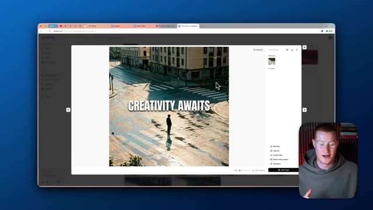
*⏱️ 00:06:32 — Résultat de l'IA affichant l'image finale avec le texte « CREATIVITY AWAITS » incrusté au centre de la scène urbaine.*

---

### ⏱️ `[00:06:41 - 00:07:16]` | Segment #14

**🔊 Audio (Transcription Intégrale Mot pour Mot en Français) :**
> ce que je vais faire, c'est que je vais venir ici. Nous avons cette image de départ. Je pourrais ajouter une image de fin si je le voulais. Et je vais fondamentalement juste ajouter ce prompt. Donc plan large d'une seule figure se tenant au milieu d'une ville mouillée. Et encore une fois, ça va utiliser cette image comme image de départ, et ensuite nous allons générer une vidéo basée sur ça. Et fondamentalement, des voitures vont juste passer en conduisant. Je vais cliquer sur générer et ensuite voir ce que ça nous donne. Très bien. Alors c'est parti. Voici la vidéo. Vous pouvez voir que ça effectue un lent panoramique vers la droite. Les voitures passent en conduisant. L'eau éclabousse parce que c'est une rue mouillée parce que dans l'image originale, nous lui avions dit de, vous savez, ajouter de l'eau sur la rue comme s'il pleuvait pour créer cette esthétique que nous recherchions.

**👁️ Analyse Visuelle d'Écran (gemini-3.5-flash-lite) :**
**Interface & Outils** : Navigateur web affichant l'interface de l'outil de génération vidéo Freepik AI.

**Contenu textuel & Code** : Prompt textuel saisi : "Wide shot of a lone figure standing in the middle of a wet city street..." et options de génération vidéo.

**Action / Démonstration** : Le présentateur configure le prompt textuel et clique sur le bouton de génération pour créer la vidéo à partir de l'image de départ.

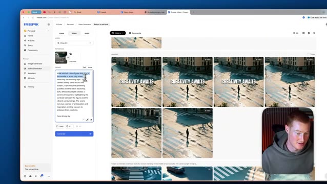
*⏱️ 00:06:50 — Interface Freepik avec le champ de texte du prompt pour la génération vidéo visible à gauche, montrant le texte saisi.*

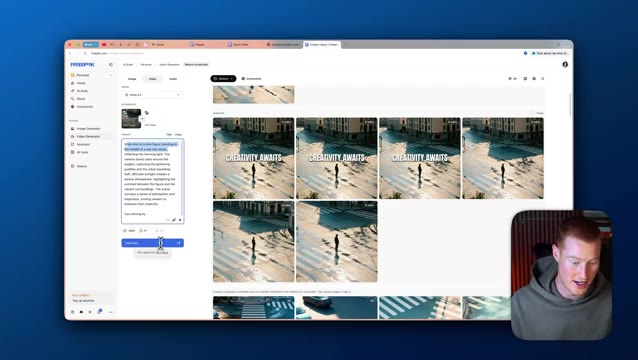
*⏱️ 00:06:58 — Interface Freepik montrant le bouton "Generate" sur lequel le curseur est positionné pour lancer la génération de la vidéo.*

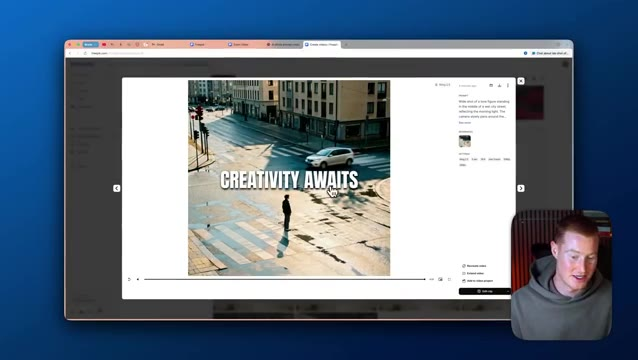
*⏱️ 00:07:07 — Aperçu agrandi d'une des vidéos générées sur Freepik montrant une personne au milieu d'une rue avec le texte "CREATIVITY AWAITS".*

---

### ⏱️ `[00:07:16 - 00:07:42]` | Segment #15

**🔊 Audio (Transcription Intégrale Mot pour Mot en Français) :**
> Très bien. Donc, une autre façon incroyable que Freepik peut vous aider dans votre processus créatif lors de l'utilisation d'outils comme Nano Banana ou d'autres modèles de génération d'images est cette nouveauté qu'ils appellent les espaces. Considérez donc cela comme une toile interactive. Comme vous pouvez le voir ici, j'ai téléchargé toutes ces images de moi comme référence et j'ai généré toutes ces images. En gros, j'ai juste essayé de créer une photo de profil professionnel puisque je n'ai aucune image professionnelle de moi que je pourrais utiliser pour, genre, LinkedIn ou pour n'importe quel cas d'utilisation.

**👁️ Analyse Visuelle d'Écran (gemini-3.5-flash-lite) :**
**Interface & Outils** : Navigateur web affichant l'interface de Freepik (outil Espaces / Spaces).

**Contenu textuel & Code** : Interface utilisateur de Freepik, affichage de nœuds d'images connectés, invite textuelle pour la génération d'images avec le modèle Google Nano Banana Pro.

**Action / Démonstration** : Navigation et présentation de la toile interactive (espaces) de Freepik pour organiser et générer des images d'IA.

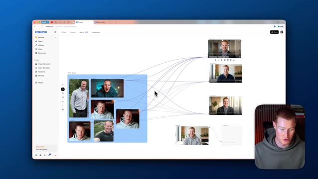
*⏱️ 00:07:23 — Vue globale de l'interface Freepik montrant une toile interactive (espaces) avec un groupe d'images reliées par des lignes.*

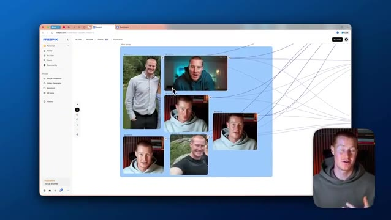
*⏱️ 00:07:29 — Zoom sur le groupe d'images interconnectées au sein de la toile interactive Freepik.*

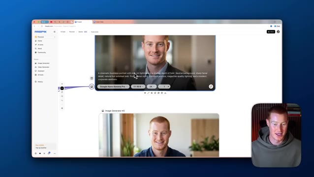
*⏱️ 00:07:36 — Gros plan sur une image générée avec le modèle Google Nano Banana Pro et son invite textuelle associée.*

---

### ⏱️ `[00:07:43 - 00:08:01]` | Segment #16

**🔊 Audio (Transcription Intégrale Mot pour Mot en Français) :**
> Vous pourriez voir celui-ci. Celui-là est plutôt solide. Et c'est juste une autre façon d'interagir avec, vous savez, nos outils créatifs que nous avons ici à l'intérieur de Freepik. Très bien. Alors voici un exemple parfait de ceci. J'ai cette image de référence de moi-même. Et fondamentalement, le but de ceci ici est d'essayer différents vêtements et de voir à quoi je ressemble dans différents vêtements.

**👁️ Analyse Visuelle d'Écran (gemini-3.5-flash-lite) :**
**Interface & Outils** : Navigateur web affichant l'interface de la plateforme Freepik (outil créatif IA).

**Contenu textuel & Code** : Interface utilisateur avec des blocs d'images interconnectés par des lignes de liaison, illustrant un flux de travail créatif basé sur l'IA.

**Action / Démonstration** : Navigation et démonstration d'un outil interactif de création d'images et de génération visuelle sur Freepik.

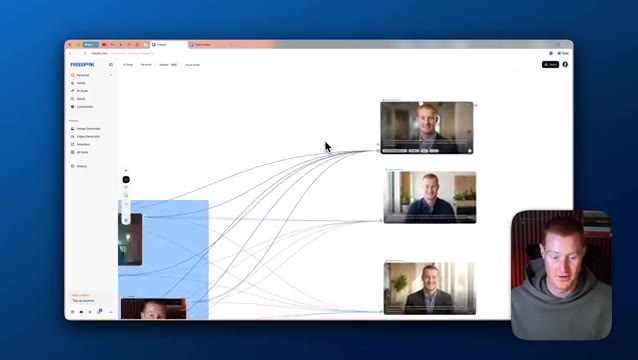
*⏱️ 00:07:47 — Interface Freepik montrant un tableau de bord visuel avec des nœuds connectés générant des images de référence du présentateur.*

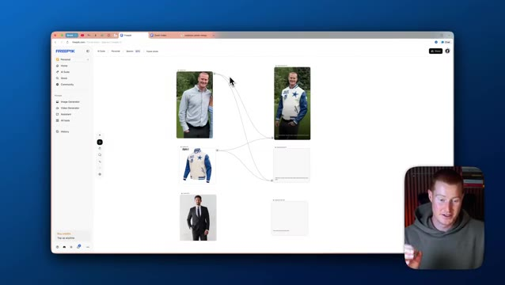
*⏱️ 00:07:52 — Interface Freepik affichant un autre ensemble de nœuds connectés montrant des photos du présentateur et des vêtements générés par IA.*

---

### ⏱️ `[00:08:01 - 00:08:20]` | Segment #17

**🔊 Audio (Transcription Intégrale Mot pour Mot en Français) :**
> Et par exemple, ceci juste ici a été généré dans Seadream pour du 4K. Et ensuite ce nœud de génération d'image juste ici, j'ai choisi Google Nano Banana Pro pour pouvoir tester et voir quel modèle d'image a meilleur rendu si je veux en générer plusieurs. Et encore une fois, rappelez-vous dans FreePick, la génération d'image, si vous utilisez le forfait à 39 dollars par mois et bien c'est illimité.

**👁️ Analyse Visuelle d'Écran (gemini-3.5-flash-lite) :**
**Interface & Outils** : Navigateur web (Freepik)

**Contenu textuel & Code** : Nœuds de génération d'images connectés avec sélection de modèles (notamment Google Nano Banana Pro) et paramètres de génération.

**Action / Démonstration** : Le présentateur montre et sélectionne les différents nœuds de génération d'images dans l'interface de l'outil.

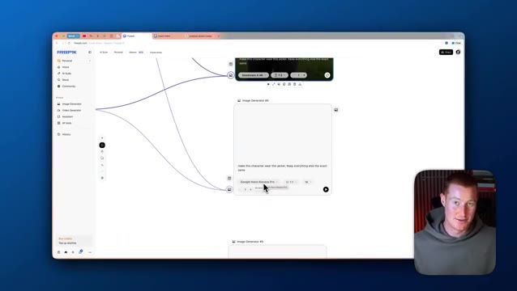
*⏱️ 00:08:06 — Interface web de Freepik affichant un flux de travail sous forme de nœuds (workflow) pour la génération d'images par IA.*

---

### ⏱️ `[00:08:20 - 00:08:40]` | Segment #18

**🔊 Audio (Transcription Intégrale Mot pour Mot en Français) :**
> Donc laissez-moi juste aller de l'avant et cliquer sur exécuter et ça va en fait générer ceci dans Nano Banana Pro maintenant. Et voici un autre exemple. Si je veux me voir dans ce costume ici, je pourrais juste sélectionner ceci et ensuite je connecte cette image de moi-même et je pourrais en générer plusieurs. Générons-juste quatre d'entre elles pour voir à quoi ça ressemble. Donc c'est une excellente façon pour nous de générer plusieurs images à grande échelle ici.

**👁️ Analyse Visuelle d'Écran (gemini-3.5-flash-lite) :**
**Interface & Outils** : Interface web de génération d'images par IA (Freepik Workspace).

**Contenu textuel & Code** : Nœuds de flux de travail (workflow nodes), images d'entrée, blocs de génération de texte/image.
[DESC_ACTION] Manipulation d'une interface de flux de travail IA pour connecter des images et générer de nouveaux visuels.

**Action / Démonstration** : Explications face caméra et analyse conceptuelle des marchés.

---

### ⏱️ `[00:08:40 - 00:09:12]` | Segment #19

**🔊 Audio (Transcription Intégrale Mot pour Mot en Français) :**
> Donc je pourrais générer beaucoup d'images juste à partir d'une seule consigne et d'une seule exécution de ce flux de travail ici. Et vous pourriez devenir vraiment créatif. Encore une fois, vous pourriez en fait transformer cela en vidéos générées si nous le voulons à partir de ces images. Très bien, alors juste ici, on me voit porter la veste de ce cowboy et nous pourrions simplement télécharger ceci ici ou nous pourrions changer la résolution, alors laissez-moi juste changer ça en 4k et ensuite voici les quatre images générées de moi portant réellement ce costume, c'est plutôt drôle, certaines d'entre elles ont l'air plutôt solides et encore une fois, c'est pourquoi c'est si puissant à l'intérieur de Freepik car toutes les images générées avec nano

**👁️ Analyse Visuelle d'Écran (gemini-3.5-flash-lite) :**
**Interface & Outils** : Navigateur web affichant une interface de workflow visuel de génération d'images par IA.

**Contenu textuel & Code** : Nœuds de génération d'images, liens de connexion entre les sources et les résultats, vignettes d'images générées.

**Action / Démonstration** : Navigation et présentation d'un flux de travail de génération d'images par IA.

---

### ⏱️ `[00:09:12 - 00:09:34]` | Segment #20

**🔊 Audio (Transcription Intégrale Mot pour Mot en Français) :**
> banana ou ces autres modèles d'images IA sont bons donc c'est bien de pouvoir choisir parmi ceux qui sont bons et ceux qui sont mauvais. Très bien. Alors voilà. Cette image est maintenant en 4k. Je peux la télécharger ici même. Je clique simplement sur le bouton d'exportation et jetons un œil à la qualité de ceci. C'est une super bonne qualité. Je veux dire, c'est super net. C'est une image 4k ici. Elle me ressemble exactement et ressemble exactement à cette veste que je voulais vraiment essayer.

**👁️ Analyse Visuelle d'Écran (gemini-3.5-flash-lite) :**
**Interface & Outils** : Navigateur web, interface de génération d'images par IA de Freepik (freepik.com).

**Contenu textuel & Code** : Paramètres de génération (Google Nano Banana Pro, rapport 1:1, résolution 4K), interface de nœuds et invite textuelle ("make this character wear this jacket...").

**Action / Démonstration** : Navigation dans l'interface de nœuds, sélection d'une image générée, passage en résolution 4K et téléchargement/agrandissement de l'image.

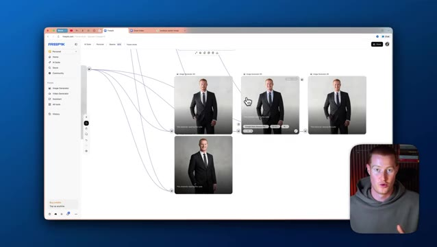
*⏱️ 00:09:17 — Interface de nœuds de Freepik affichant plusieurs variantes de génération d'images d'un homme en costume.*

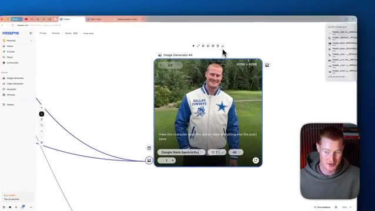
*⏱️ 00:09:23 — Gros plan sur le générateur d'images numéro 4 montrant un homme portant une veste des Dallas Cowboys générée par IA.*

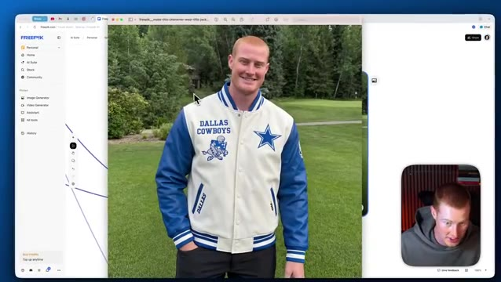
*⏱️ 00:09:28 — Affichage en plein écran de l'image haute résolution générée (4K) montrant l'homme avec la veste des Dallas Cowboys dans un parc.*

---

### ⏱️ `[00:09:34 - 00:10:09]` | Segment #21

**🔊 Audio (Transcription Intégrale Mot pour Mot en Français) :**
> Et vous pouvez réellement trier parmi les multiples images que vous générez juste ici. Et nous pourrions ensuite simplement cliquer sur ceci et modifier davantage notre image si nous le voulons. Donc les gars, voilà, c'est fait. C'est ainsi qu'il faut utiliser les différents outils de génération d'images de Nano Banana à l'intérieur de FreePic. J'espère vraiment que ce tutoriel a été utile. Il y a honnêtement tellement de choses différentes que vous pouvez faire à l'intérieur de cette plateforme. Donc si vous êtes un créatif en IA ou que vous voulez vous lancer dans l'industrie de la création en IA, c'est la plateforme parfaite pour pouvoir faire cela. Et je ne voulais pas vous submerger avec plein de cas d'utilisation différents. J'espère donc que vous avez retiré de la valeur de cette vidéo. Si vous avez apprécié, faites-moi savoir dans les commentaires ce que vous pensez de ceci, laissez un pouce bleu, abonnez-vous à la chaîne pour plus de contenu de ce genre. Sans plus tarder, les gars, merci d'être restés jusqu'à la fin et je vous vois dans la prochaine.

**👁️ Analyse Visuelle d'Écran (gemini-3.5-flash-lite) :**
**Interface & Outils** : Navigateur web affichant l'interface de la plateforme MiniMax.

**Contenu textuel & Code** : Interface utilisateur avec des options de génération d'images/vidéos, des vignettes de prévisualisation et le logo MiniMax.

**Action / Démonstration** : Présentation et démonstration de l'outil de génération de contenu MiniMax.

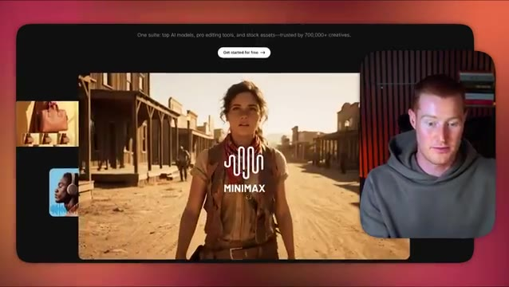
*⏱️ 00:09:52 — Interface du site web MiniMax affichant un aperçu vidéo avec des vignettes sur le côté et la caméra du présentateur incrustée dans un coin.*

---

