# 🎬 I Built an ENTIRE App with Gemini 3 (In Minutes)

> **Chaîne** : [Brock Mesarich | AI for Non Techies](https://www.youtube.com/@BrockMesarich)  
> **Lien YouTube** : [https://www.youtube.com/watch?v=_CjObGpBhlA](https://www.youtube.com/watch?v=_CjObGpBhlA)  
> **Date de publication** : 20251128  
> **Durée** : 00:10:46  
> **Identifiant vidéo** : `_CjObGpBhlA`  
> **Transcription & Analyse** : `whisper-v3-large-turbo+gemini-3.5-flash-lite`  

---

## 📌 Synthèse Exécutive & Outils

### 💡 Résumé

Cette vidéo, présentée par Brock Mesarich sur la chaîne *Brock Mesarich | AI for Non Techies*, démontre comment concevoir et déployer une application web complète, fonctionnelle et dotée d'un véritable backend en quelques minutes grâce à la puissance de Gemini 3. Alors que la plupart des présentations se limitent à l'affichage d'interfaces graphiques statiques, l'auteur s'attaque ici à la création d'un clone fonctionnel de la plateforme DocuSign, intégrant un design épuré, des animations fluides et une expérience utilisateur haut de gamme directement inspirée de pages de destination professionnelles capturées par simple capture d'écran.

L'approche méthodologique repose sur une architecture de développement augmentée par l'IA via la plateforme *Emergent*, combinant des modèles de pointe (Gemini 3 Pro) à des agents de test autonomes capables d'interagir en temps réel avec l'interface pour détecter et corriger les erreurs. La démonstration illustre la transition d'un design statique généré par Google AI Studio vers une application web interactive complète, dotée d'un système d'authentification des utilisateurs (connexion sociale Google) et d'un tableau de bord dynamique permettant le téléchargement de documents PDF, l'insertion de signatures manuscrites ou dactylographiées, et la gestion des flux documentaires.

Enfin, la vidéo aborde l'intégration de serveurs MCP (Model Context Protocol), notamment le MCP de Zapier, qui permet de connecter l'application nouvellement créée à plus de 30 000 actions automatisées tierces. Cette brique d'automatisation ouvre la voie à des cas d'usage avancés tels que l'envoi d'e-mails de bienvenue personnalisés, le stockage automatisé des données utilisateurs dans des tableurs, ou l'envoi de notifications d'équipe sur des canaux de messagerie, transformant un simple prototype visuel en un logiciel SaaS prêt pour la commercialisation.

### 🛠️ Outils, Modèles & Logiciels Présentés

* **Gemini 3 / Gemini 3 Pro** : Modèle linguistique et multimodal de pointe développé par Google, utilisé pour concevoir le code, structurer le backend et générer des interfaces utilisateur d'une qualité esthétique remarquable.
* **Google AI Studio** : Environnement de prototypage rapide pour les développeurs, utilisé initialement dans la vidéo pour capturer et transformer des designs de pages de destination à partir de simples captures d'écran.
* **Emergent** : Plateforme de développement d'applications assistée par IA intégrant Gemini 3 Pro et un agent de test autonome capable d'auditer et de corriger le code en temps réel.
* **Zapier MCP** : Protocole de serveur MCP permettant de connecter des applications générées par IA à l'écosystème d'automatisation de Zapier et à ses milliers d'intégrations logicielles.
* **Make** : Alternative majeure d'automatisation des flux de travail no-code mentionnée dans l'écosystème d'automatisation globale.
* **n8n** : Outil d'automatisation de flux de travail open-source et flexible fréquemment associé aux architectures d'agents IA.
* **Grok** : Modèle d'intelligence artificielle conversationnelle développé par xAI.
* **ChatGPT** : Modèle conversationnel et assistant de génération de contenu d'OpenAI.
* **Claude** : Modèle linguistique avancé d'Anthropic reconnu pour ses capacités de raisonnement et de codage.

### 🔑 Points Clés & Enseignements Stratégiques

* **Transition du prototype visuel au logiciel complet** : Le passage de simples interfaces graphiques (UI) à des applications dotées d'un backend fonctionnel constitue le véritable défi du développement assisté par IA, résolu ici par l'utilisation combinée de Gemini 3 et de plateformes de déploiement rapide.
* **Ingénierie de prompt visuelle par capture d'écran** : La méthode consiste à capturer des éléments de design existants sur des sites web de référence pour guider l'IA dans la reproduction exacte des codes typographiques, des palettes de couleurs et des dispositions ergonomiques.
* **Intégration d'agents de test autonomes** : L'utilisation d'agents de test intégrés à la plateforme de développement permet d'automatiser la recherche de bugs en simulant les clics et les soumissions de formulaires utilisateurs en temps réel, garantissant la robustesse du code généré.
* **Mise en place d'une authentification sécurisée** : L'implémentation de la connexion par compte Google (authentification sociale) est présentée comme une étape critique et non négociable pour transformer un prototype en un produit SaaS monétisable et sécurisé.
* **Développement d'interfaces dynamiques et fluides** : L'intégration d'animations graphiques légères (comme le défilement de PDF, le positionnement par glisser-déposer de signatures et les compteurs animés) confère à l'application un aspect haut de gamme éliminant l'effet "générique" typique des interfaces produites par l'IA.
* **Architecture de tableau de bord utilisateur** : La structuration d'un espace personnel centralisé permet de lier l'authentification aux fonctionnalités métier de l'application, telles que le téléchargement et le suivi de documents numériques.
* **Signature numérique interactive** : La création d'un module de signature s'appuyant à la fois sur le dessin vectoriel à la souris/tactile et sur la typographie textuelle démontre la capacité de Gemini 3 à coder des logiques front-end complexes en quelques instructions.
* **Exploitation des serveurs MCP (Model Context Protocol)** : L'utilisation de protocoles de communication standardisés entre l'IA et des services tiers permet d'étendre instantanément les capacités logicielles de l'application sans nécessiter de développements d'API complexes.
* **Automatisation des parcours utilisateurs avec Zapier MCP** : La connexion au serveur MCP de Zapier permet d'enclencher des actions automatisées (comme l'envoi d'e-mails de bienvenue ou la centralisation de données) dès qu'un nouvel utilisateur s'inscrit sur la plateforme.
* **Scalabilité et interopérabilité écosystémique** : En s'interfaçant avec plus de 30 000 applications via des passerelles d'automatisation, l'application générée par IA s'insère immédiatement dans des piles logicielles d'entreprise existantes (CRM, outils de messagerie, tableurs).

---

## ⏱️ Chronologie & Transcription Complète Audio & Visuelle (Mot pour Mot)

### ⏱️ `[00:00:00 - 00:00:24]` | Segment #01

**🔊 Audio (Transcription Intégrale Mot pour Mot en Français) :**
> Donc Gemini 3 vient de sortir et tout le monde montre les interfaces utilisateur de fou qu'il peut concevoir. Et je vais être honnête, c'est vraiment tellement bien. Mais personne ne vous montre réellement comment créer une vraie application avec, genre avec un vrai backend qui fonctionne. Donc dans cette vidéo, je vais vous montrer exactement comment faire. Créer une interface propre et professionnelle, ajouter un vrai backend avec de vraies fonctionnalités, et comment déployer l'application pour que les gens puissent vraiment commencer à l'utiliser.

**👁️ Analyse Visuelle d'Écran (gemini-3.5-flash-lite) :**
**Interface & Outils** : Interface de développement et navigateur web (aperçu flouté).

**Contenu textuel & Code** : Éléments de code source et interface utilisateur partiellement masqués ou floutés pour illustrer le sujet abordé plus tard dans la vidéo.

**Action / Démonstration** : Présentation d'un avant-goût visuel de l'application qui sera créée dans la suite de la vidéo.

*⏱️ 00:00:18 — Un aperçu flouté d'une interface de code et de site web avec le texte superposé 'LATER IN THIS VIDEO' et le présentateur en vignette en bas à droite.*

---

### ⏱️ `[00:00:24 - 00:00:49]` | Segment #02

**🔊 Audio (Transcription Intégrale Mot pour Mot en Français) :**
> Je vais même vous montrer une astuce qui connecte vos applications à plus de 30 000 automatisations en quelques secondes. Entrons donc dans le vif du sujet. Très bien, j'ai donc généré cette page de destination à partir de cette capture d'écran, j'ai basically pris une capture d'écran de ceci et l'ai transformée en cela en une seule invite en utilisant Gemini 3. J'utilisais cela dans Google AI Studio, dont vous avez probablement entendu parler. Mais le problème avec Google AI Studio, c'est qu'on ne peut pas réellement créer de backend ni bâtir une application complète qu'on pourrait ensuite publier pour que les utilisateurs puissent réellement l'utiliser.

**👁️ Analyse Visuelle d'Écran (gemini-3.5-flash-lite) :**
**Interface & Outils** : Navigateur web, interface de développement / génération d'application web (AI Studio / Bolt ou similaire).

**Contenu textuel & Code** : Code source sous forme de composants, arborescence de fichiers et aperçu visuel d'une page web d'agence.

**Action / Démonstration** : Présentation d'une page de destination générée automatiquement à partir d'une capture d'écran.

---

### ⏱️ `[00:00:50 - 00:01:08]` | Segment #03

**🔊 Audio (Transcription Intégrale Mot pour Mot en Français) :**
> Donc l'interface de ceci et le design de ceci sont absolument phénoménaux. Ça n'a pas du tout l'air généré par l'IA. Si je rafraîchis ceci, vous pouvez même voir qu'il y a ces animations graphiques ici qui ont l'air tellement épurées. Je veux dire, c'est d'une qualité ridicule. Mais dans cette vidéo, je vais vous montrer exactement comment créer une application complète qui n'a pas seulement une interface sympa.

**👁️ Analyse Visuelle d'Écran (gemini-3.5-flash-lite) :**
**Interface & Outils** : Navigateur web, interface de développement / builder web (Emergent.sh / Webflow-style)

**Contenu textuel & Code** : Code source textuel, modifications de composants UI (index.tsx, components/Hero.tsx), métriques numériques animées (+40, +15, +12) et interface de prompt IA.

**Action / Démonstration** : Présentation d'une application web générée par IA montrant des animations graphiques fluides et le code associé dans l'éditeur.

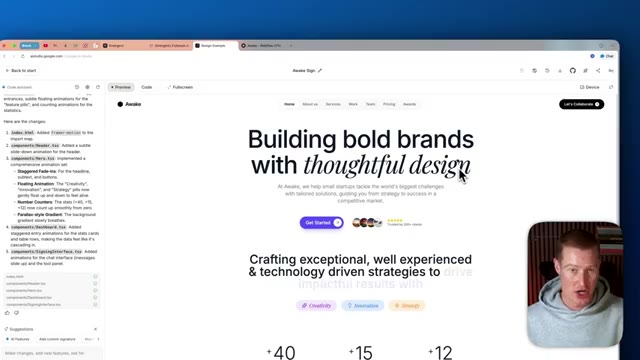
*⏱️ 00:00:54 — Capture d'écran montrant l'interface d'un outil de développement web avec une page d'accueil moderne (Awake Sign) et un panneau de code sur la gauche.*

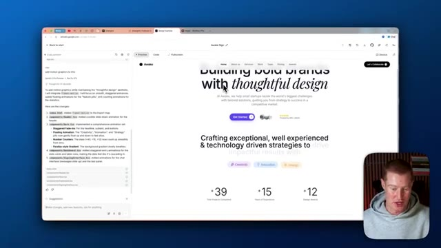
*⏱️ 00:00:59 — Capture similaire montrant l'interface du site web en cours de rafraîchissement avec des modifications de design et d'animations textuelles.*

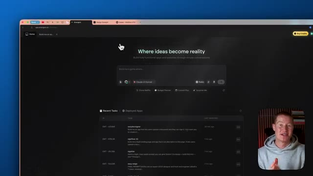
*⏱️ 00:01:03 — Vue de l'interface principale de la plateforme web sombre (app.emergent.sh) avec un champ de saisie de prompt et l'historique des tâches récentes.*

---

### ⏱️ `[00:01:08 - 00:01:29]` | Segment #04

**🔊 Audio (Transcription Intégrale Mot pour Mot en Français) :**
> Et nous pouvons maintenant faire cela directement dans Emergent. Vous pouvez voir que nous avons Gemini 3 Pro ici, et nous pouvons simplement décrire l'application que nous essayons de construire. En utilisant Emergent, laissez-moi faire cela dès maintenant. Donc tout d'abord, comme je l'ai mentionné, j'ai pris ce design à partir de cette page de destination, en fait. Donc je vais simplement faire une capture d'écran de ceci, et je vais l'utiliser comme source d'inspiration pour le design.

**👁️ Analyse Visuelle d'Écran (gemini-3.5-flash-lite) :**
**Interface & Outils** : Navigateur web affichant la plateforme de développement d'applications Emergent et un site web d'exemple.

**Contenu textuel & Code** : Champ de prompt "Where ideas become reality", sélection du modèle Gemini 3 Pro, historique des tâches récentes ("Recent Tasks").

**Action / Démonstration** : Le présentateur navigue sur la plateforme Emergent et présente l'interface de création d'application par simple description textuelle.

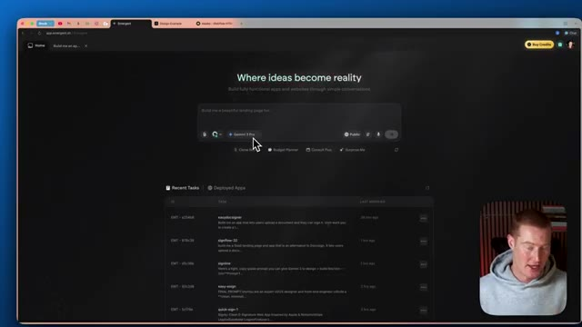
*⏱️ 00:01:13 — Interface principale de la plateforme Emergent affichant le champ de saisie de prompt et la sélection du modèle Gemini 3 Pro.*

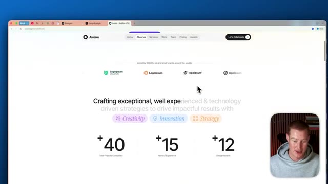
*⏱️ 00:01:24 — Page web d'exemple conçue ou présentée (site agence "Awake") avec des statistiques et des sections interactives.*

---

### ⏱️ `[00:01:29 - 00:01:48]` | Segment #05

**🔊 Audio (Transcription Intégrale Mot pour Mot en Français) :**
> parce que ça a vraiment l'air impeccable. C'est parti. Je vais faire une capture d'écran de toutes ces pages différentes, ou je suppose de toutes ces petites parties différentes de cette page de destination que je veux recréer. Et le but ici n'est pas seulement de recréer cette page de destination, mais je vais créer une application autour du même thème, avec le même texte, la même police, les mêmes couleurs, tout ça.

**👁️ Analyse Visuelle d'Écran (gemini-3.5-flash-lite) :**
**Interface & Outils** : Navigateur web affichant une application SaaS et un site web.

**Contenu textuel & Code** : Interface utilisateur de création de page de destination, listes de tâches et statistiques d'entreprise.

**Action / Démonstration** : Navigation et présentation visuelle de pages web en cours de développement.

---

### ⏱️ `[00:01:48 - 00:02:22]` | Segment #06

**🔊 Audio (Transcription Intégrale Mot pour Mot en Français) :**
> Donc ça a la même ambiance. Très bien, donc maintenant que j'ai ces captures d'écran, je vais maintenant simplement décrire ce que j'essaie de construire ici. Très bien, donc voici mon prompt. Construis-moi une page de destination qui permet aux utilisateurs de télécharger un document et de les signer. Application très simple. Donc je vais fondamentalement juste recréer DocuSign parce que j' déteste devoir payer pour ces plateformes. Et je pense que je pourrais en fabriquer une qui est encore meilleure. Je veux que tu recettes design exact, non seulement pour la page de destination, mais pour l'application également. Fais le texte personnalisé pour notre application. Laissez-moi aller de l'avant, envoyer ceci à Emergent. Et encore une fois, je pourrais sélectionner quel modèle je vais utiliser. Je vais utiliser Gemini 3 Pro. Très bien. Donc juste quelques minutes plus tard, nous avons cette page de destination qui a l'air extrêmement solide. Laissez-moi donc jeter un œil à ceci. Si j'ouvre

**👁️ Analyse Visuelle d'Écran (gemini-3.5-flash-lite) :**
**Interface & Outils** : Interface web de génération d'applications (Emergen / plateforme No-Code IA) et navigateur web.

**Contenu textuel & Code** : Prompt utilisateur : "Build me a landing page and app that lets users upload a document and sign them. Very simple app..." et liste des modèles disponibles (Gemini 3 Pro, Claude 3.5 Sonnet, GPT-4.1).

**Action / Démonstration** : Saisie d'un prompt textuel et sélection du modèle de langage pour générer une application web à partir de captures d'écran.

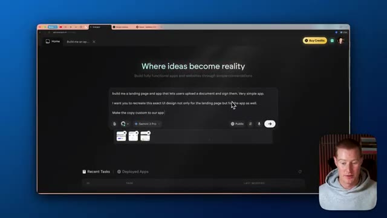
*⏱️ 00:01:57 — Vue générale de l'interface d'IA générative avec le prompt de création d'application de signature de documents.*

*⏱️ 00:02:05 — Gros plan sur le texte du prompt en cours de rédaction dans la zone de saisie.*

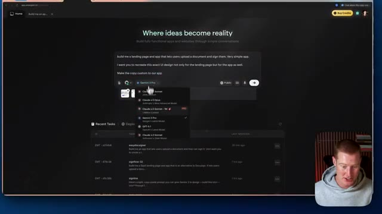
*⏱️ 00:02:14 — Déroulement du menu de sélection du modèle d'IA (Claude, Gemini, GPT).*

---

### ⏱️ `[00:02:22 - 00:02:43]` | Segment #07

**🔊 Audio (Transcription Intégrale Mot pour Mot en Français) :**
> ceci dans un nouvel onglet, vous pouvez voir que c'est juste cette partie ici, signer des documents en gras avec des outils simples. Ça a pour ainsi dire copié l'interface de celui-ci en termes de style de texte, de mise en page. C'est un bon point de départ. Et une chose que je veux mentionner, c'est qu'à l'intérieur d'Emergent, nous avons cette chose appelée notre agent de test ici. Et ce que cela fait, c'est que ça va littéralement interagir avec notre application et la tester.

**👁️ Analyse Visuelle d'Écran (gemini-3.5-flash-lite) :**
**Interface & Outils** : Navigateur web, plateforme de développement no-code / agent IA (Emergent Agent) avec panneau de prévisualisation et panneau latéral d'exécution.

**Contenu textuel & Code** : Page d'accueil d'une application de signature de documents nommée "SignFlow" avec des statistiques simulées (+40k documents signés, +15 ans de sécurité, +12 prix de design) et des logs d'exécution d'agent à gauche.

**Action / Démonstration** : Le présentateur navigue entre les onglets et présente l'interface générée par l'IA pour l'application "SignFlow".

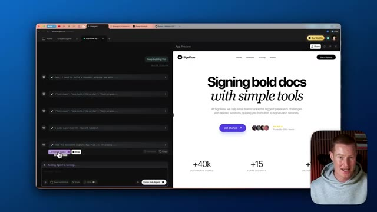
*⏱️ 00:02:38 — Interface de développement avec un panneau latéral de l'agent IA à gauche et l'aperçu de l'application "SignFlow" à droite, montrant le panneau de contrôle de l'agent en cours d'exécution.*

---

### ⏱️ `[00:02:43 - 00:03:02]` | Segment #08

**🔊 Audio (Transcription Intégrale Mot pour Mot en Français) :**
> C'est en train de pointer et de cliquer et d'essayer différentes formes. Vous pouvez voir qu'il essaie de télécharger un document ici. Il utilise littéralement notre application pour fondamentalement essayer de la casser et de trouver des moyens que nous devons y apporter des changements. Et vous pouvez voir en temps réel, il a réellement capturé cette erreur. Donc, laissons-le faire son travail. Et puis une fois que ce sera terminé, je vais en fait revenir et changer un peu de ceci.

**👁️ Analyse Visuelle d'Écran (gemini-3.5-flash-lite) :**
**Interface & Outils** : Navigateur web affichant une application de développement assistée par IA avec un agent de test en cours d'exécution.

**Contenu textuel & Code** : Journaux d'exécution de l'agent de test, statut des tests des API backend et de l'interface utilisateur (frontend).

**Action / Démonstration** : Exécution d'un agent de test automatisé naviguant et testant les fonctionnalités de l'application web créée.

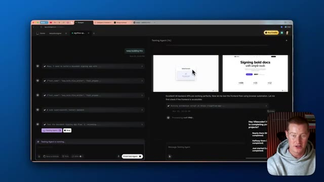
*⏱️ 00:02:48 — Interface d'un agent de test automatisé affichant le déroulement des tests de l'application avec des captures d'écran de l'interface utilisateur.*

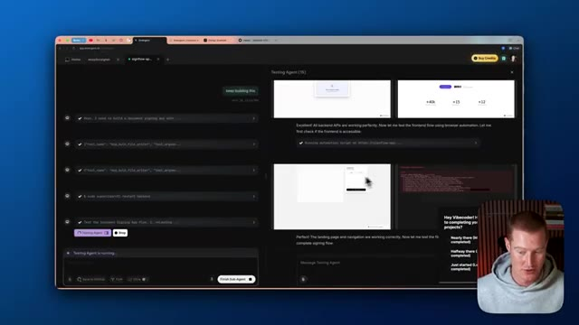
*⏱️ 00:02:53 — Poursuite des tests automatisés avec affichage de nouvelles étapes et de retours visuels sur l'application en cours de test.*

---

### ⏱️ `[00:03:02 - 00:03:21]` | Segment #09

**🔊 Audio (Transcription Intégrale Mot pour Mot en Français) :**
> Genre, il faut qu'on change le texte ici, signer des documents en gras. On a besoin de genre changer ça. Et ensuite, on va ajouter à ça aussi. Mais c'est vraiment un très bon point de départ avec Gemini 3 dans Emergent et une seule invite. C'est parti. J'ai fait quelques changements ici. Laisse-moi ouvrir ça dans un nouvel onglet pour voir notre application complète. Donc, signer des documents n'a jamais été aussi facile. Les gars, ça a l'air parfait. J'ai même ajouté ça ici.

**👁️ Analyse Visuelle d'Écran (gemini-3.5-flash-lite) :**
**Interface & Outils** : Emergent AI Web App / Navigateur web

**Contenu textuel & Code** : Interface utilisateur de l'application SignFlow avec affichage du titre principal, statistiques (+40k documents signés, +15 ans de sécurité) et panneau d'exécution d'agent à gauche.

**Action / Démonstration** : Navigation et démonstration visuelle de la landing page générée pour l'application de signature de documents.

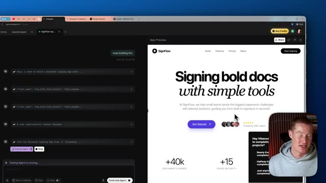
*⏱️ 00:03:07 — Aperçu de l'interface de développement de l'application de signature de documents SignFlow sur Emergent, avec le panneau de test à gauche et le rendu Web à droite.*

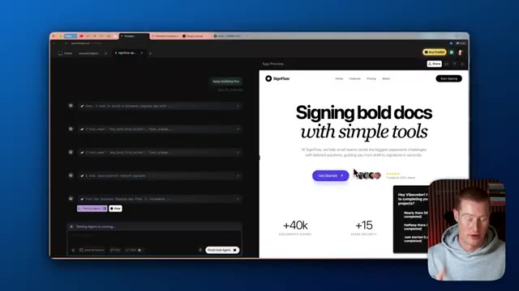
*⏱️ 00:03:12 — Vue similaire affichant les modifications apportées au projet SignFlow avec le panneau de contrôle de l'agent actif.*

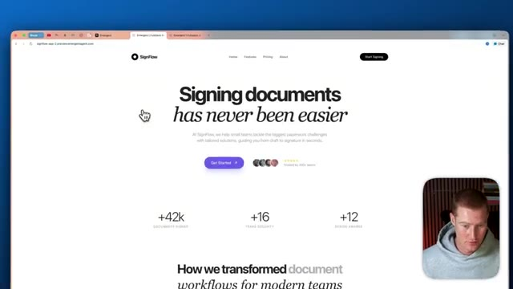
*⏱️ 00:03:16 — Vue en plein écran du rendu de la page d'accueil de l'application SignFlow montrant le titre principal "Signing documents has never been easier".*

---

### ⏱️ `[00:03:21 - 00:03:44]` | Segment #10

**🔊 Audio (Transcription Intégrale Mot pour Mot en Français) :**
> Donc ça anime en gros les chiffres qui s'additionnent, comment nous transformons les flux de documents pour les équipes modernes. Facile, simple, rapide, les gars, l'interface utilisateur de cette application a l'air phénoménale. On dirait même pas que c'est généré par IA. On est honnêtement entré dans une nouvelle ère en ce qui concerne Gemini 3 et pour aider à créer des interfaces utilisateur superbes avec l'IA. Donc maintenant qu'on a un beau rendu, parce que ça a l'air vraiment solide, allons-y et commençons à construire le backend pour notre application.

**👁️ Analyse Visuelle d'Écran (gemini-3.5-flash-lite) :**
**Interface & Outils** : Navigateur web affichant une application SaaS nommée 'SignFlow' (signflow-app.-preview.emergentagent.com).

**Contenu textuel & Code** : Page d'accueil de l'application avec le titre 'Signing documents has never been easier', des métriques chiffrées (+40k documents signed, +15 years security, +12 design awards) et une section 'How we transformed document workflows for modern teams'.

**Action / Démonstration** : Navigation et présentation visuelle de la page d'accueil de l'application web SignFlow.

*⏱️ 00:03:33 — Capture d'écran d'un navigateur affichant l'interface d'une application web nommée 'SignFlow' avec des statistiques et un design épuré.*

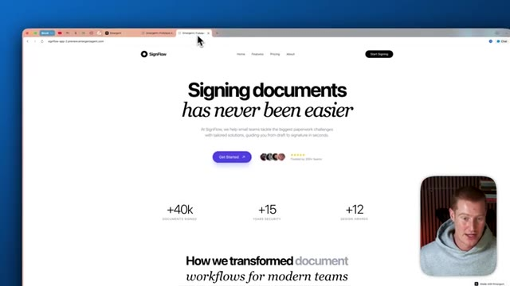
*⏱️ 00:03:38 — Même vue de l'interface web 'SignFlow' avec un léger mouvement de curseur dans les onglets du navigateur.*

---

### ⏱️ `[00:03:44 - 00:04:04]` | Segment #11

**🔊 Audio (Transcription Intégrale Mot pour Mot en Français) :**
> Donc ce que je vais faire, je vais venir ici vers notre agent et je vais simplement dire, ajoutons maintenant l'authentification des utilisateurs. Donc l'utilisateur doit s'inscrire pour utiliser notre application. Donc si vous ne savez pas ce qu'est l'authentification des utilisateurs, cela signifie essentiellement que pour utiliser cette application, vous devez être soit un utilisateur payant, soit un utilisateur abonné.

**👁️ Analyse Visuelle d'Écran (gemini-3.5-flash-lite) :**
**Interface & Outils** : Interface de développement web / éditeur d'application assisté par IA.

**Contenu textuel & Code** : Panneau de l'agent IA avec historique de modifications, champ de saisie de prompt (« lets now add user... »), et prévisualisation d'une page d'accueil d'application ("SignFlow").

**Action / Démonstration** : Le présentateur s'apprête à interagir avec l'agent IA pour ajouter l'authentification des utilisateurs.

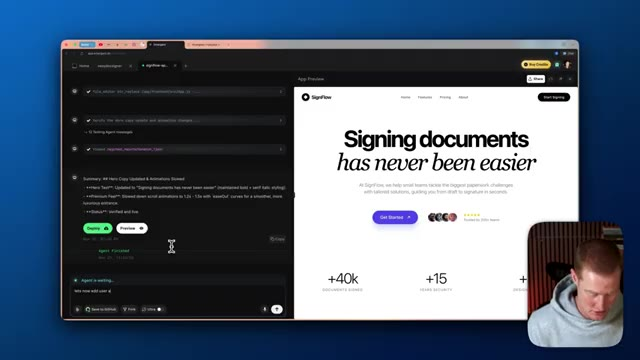
*⏱️ 00:03:49 — Capture d'écran montrant une interface de développement web avec un panneau d'agent IA à gauche et un aperçu d'application web "SignFlow" à droite, ainsi que le présentateur en incrustation.*

---

### ⏱️ `[00:04:04 - 00:04:40]` | Segment #12

**🔊 Audio (Transcription Intégrale Mot pour Mot en Français) :**
> Il faut donc en fait se connecter avec Gmail, ajouter un mot de passe. Ainsi, vous ne pouvez y accéder que si vous avez accès à cet e-mail et à ce mot de passe. C'est crucial si nous cherchons à créer un logiciel complet que nous essayons réellement de vendre à des utilisateurs, car sinon n'importe qui peut utiliser notre application et ce n'est pas ce que nous voulons. Très bien, je vais donc dire, allons de l'avant avec la connexion sociale Google. Tout comme n'importe quelle autre application, vous pouvez simplement vous connecter avec votre compte Google. Et en plus de cela, après avoir terminé la mise en place de l'authentification, nous devons également modifier l'interface de notre application actuelle ici. Vous pouvez donc voir à quoi ça ressemble en réalité pour le moment. Cela ne nous permet en fait pas encore de télécharger le moindre document. Et cela a l'air plutôt basique. Nous allons pimenter un peu cette application parce que Gemini 3 est évidemment

**👁️ Analyse Visuelle d'Écran (gemini-3.5-flash-lite) :**
**Interface & Outils** : Navigateur web avec l'outil de développement IA Emergent et le panneau de prévisualisation de l'application 'SignFlow'.

**Contenu textuel & Code** : Options d'authentification utilisateur proposées par l'agent IA : Connexion Sociale Google et Email/Mot de passe personnalisé (JWT).

**Action / Démonstration** : Interaction avec l'agent IA pour ajouter et configurer l'authentification des utilisateurs dans l'application en cours de création.

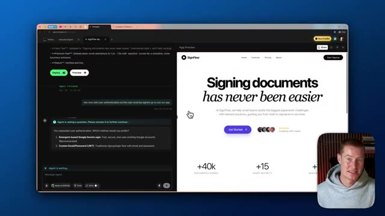
*⏱️ 00:04:13 — Interface du navigateur affichant un outil de développement d'application avec un panneau de chat IA à gauche et un aperçu d'application à droite, montrant une question de l'agent sur l'authentification des utilisateurs.*

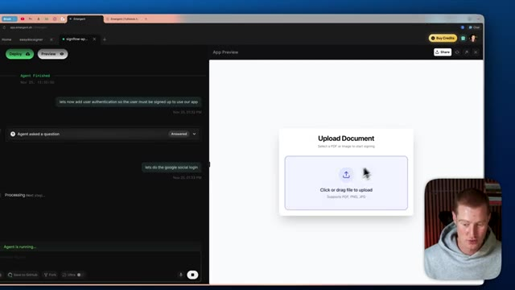
*⏱️ 00:04:31 — Interface de développement montrant l'application en cours d'exécution avec une boîte de dialogue 'Upload Document' et un message de chat demandant la connexion sociale Google.*

---

### ⏱️ `[00:04:40 - 00:05:14]` | Segment #13

**🔊 Audio (Transcription Intégrale Mot pour Mot en Français) :**
> incroyable pour nous aider, tu sais, à ajouter du piquant à nos designs basiques. D'accord. Donc maintenant, nous avons l'authentification des utilisateurs intégrée, ou du moins nous devrions l'avoir. C'est ce qu'Emergent nous dit. Donc encore une fois, je vais l'ouvrir dans un nouvel onglet. Les gars, j'adore notre page d'accueil jusqu'à présent. Essayons maintenant de nous connecter. Maintenant, nous pourrions réellement nous inscrire. Donc, laissez-moi vraiment entrer quelques informations. Et juste comme ça, je me suis inscrit à un compte. Je pourrais me déconnecter. Je pourrais me reconnecter en utilisant exactement le même nom d'utilisateur et le même mot de passe. Et voilà. Notre authentification fonctionne correctement. Maintenant, ce que nous devons faire, c'est changer l'interface utilisateur de notre application. Pour l'instant, encore une fois, cela ne fonctionne pas pour l'instant.

**👁️ Analyse Visuelle d'Écran (gemini-3.5-flash-lite) :**
**Interface & Outils** : Navigateur web, plateforme Emergent, application web SignFlow.

**Contenu textuel & Code** : Page d'accueil de l'application SignFlow avec options de connexion et de création de compte, logs de l'agent IA à gauche, et formulaire d'authentification utilisateur.

**Action / Démonstration** : Navigation et test de l'authentification des utilisateurs dans l'application générée par l'IA.

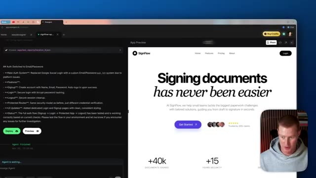
*⏱️ 00:04:48 — Interface de l'outil d'IA Emergent montrant l'aperçu de l'application SignFlow avec le code/logs à gauche et la landing page à droite, ainsi que le présentateur en médaillon.*

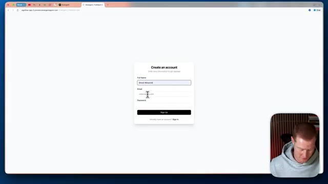
*⏱️ 00:04:57 — Page web de l'application SignFlow affichant le formulaire d'inscription ('Create an account') avec les champs Full Name, Email et Password.*

---

### ⏱️ `[00:05:14 - 00:05:38]` | Segment #14

**🔊 Audio (Transcription Intégrale Mot pour Mot en Français) :**
> la fonctionnalité n'est pas là. Donc laissez-moi revenir sur Emergent et expliquer simplement ce qu'on essaie de construire. Très bien. Donc je veux que vous alliez de l'avant et ajoutiez en fait la possibilité de télécharger un PDF pour que l'utilisateur le signe en ce moment. Ça ne vous laisse pas faire ça. Donc je vais juste lui donner cette consigne et ensuite jetons un œil à la façon dont il fonctionne et ensuite à quoi ressemble l'interface. Donc ensuite je pourrais y apporter quelques modifications. Les gars, regardez ça. Donc je lui ai donné quelques consignes et c'est à ça que ressemble notre application. Maintenant, laissez-moi ouvrir ceci dans un onglet séparé.

**👁️ Analyse Visuelle d'Écran (gemini-3.5-flash-lite) :**
**Interface & Outils** : Navigateur web affichant l'application de développement Emergent avec interface de prévisualisation et panneau de code/agent textuel.

**Contenu textuel & Code** : Texte descriptif de l'authentification ('Auth Switched to Email/Password', 'New Auth System', 'Signup', 'Login', 'Logout', 'Protected Routes') et aperçu de la page d'accueil de 'SignFlow' avec statistiques ('+40k documents signed', '+15 years security').

**Action / Démonstration** : Présentation et démonstration de l'interface de développement d'une application web de signature de documents via une plateforme d'IA.

*⏱️ 00:05:20 — Interface d'un outil de développement web divisée en deux volets : à gauche, un terminal textuel affichant l'historique d'un agent de code ; à droite, l'aperçu de l'application web nommée 'SignFlow' avec un titre principal 'Signing documents has never been easier'.*

---

### ⏱️ `[00:05:38 - 00:05:57]` | Segment #15

**🔊 Audio (Transcription Intégrale Mot pour Mot en Français) :**
> Donc encore une fois, nous avons notre page d'atterrissage ici. Elle a l'air super propre. Nous pouvons maintenant nous connecter à notre compte. Et juste comme ça, nous avons ce tableau de bord ici. Ce tableau de bord a l'air super propre. Il suit exactement le même genre de style que notre page de planification, ce qui est exactement ce que nous voulions. Et nous pourrions effectivement télécharger notre document. Alors laissez-moi vous montrer comment faire cela. Je vais télécharger un PDF aléatoire ici et ensuite jetez un œil à cette animation.

**👁️ Analyse Visuelle d'Écran (gemini-3.5-flash-lite) :**
**Interface & Outils** : Application web SignFlow affichée dans un navigateur web avec incrustation vidéo du présentateur.

**Contenu textuel & Code** : Interface utilisateur d'un tableau de bord de gestion de documents, listes de fichiers PDF récents, statistiques et sélecteur de fichiers.

**Action / Démonstration** : Navigation et présentation de l'interface utilisateur du tableau de bord de l'application SignFlow.

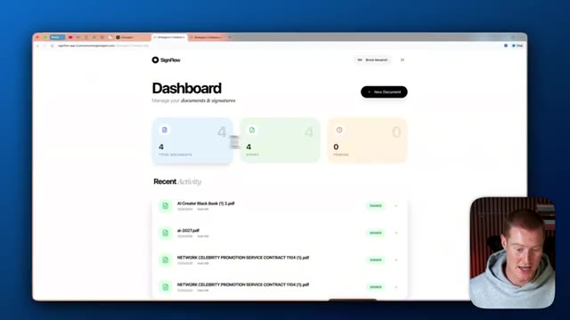
*⏱️ 00:05:43 — Le tableau de bord utilisateur de l'application SignFlow affichant les statistiques des documents et l'activité récente.*

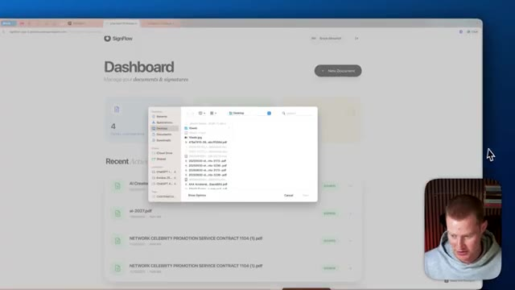
*⏱️ 00:05:52 — Le tableau de bord SignFlow avec une fenêtre de sélection de fichiers système ouverte par-dessus pour ajouter un document.*

---

### ⏱️ `[00:05:57 - 00:06:16]` | Segment #16

**🔊 Audio (Transcription Intégrale Mot pour Mot en Français) :**
> Boum, juste ici, il y a comme ces petites animations un peu bizarre qui font juste paraître notre application un peu plus haut de gamme. Et vous pouvez voir qu'on peut faire défiler tout notre document PDF et ensuite on peut dessiner notre signature et on peut télécharger notre signature ici. On peut la faire glisser n'importe où sur notre PDF. On peut confirmer l'emplacement et on peut même aller de l'avant et en signer un autre.

**👁️ Analyse Visuelle d'Écran (gemini-3.5-flash-lite) :**
**Interface & Outils** : Navigateur web affichant l'application SignFlow avec visualiseur de PDF et outil de signature.

**Contenu textuel & Code** : Document PDF intitulé 'AI 2027' avec des options de dessin pour la signature numérique.

**Action / Démonstration** : Démonstration de la fonctionnalité de signature et de visualisation de documents PDF dans l'application web.

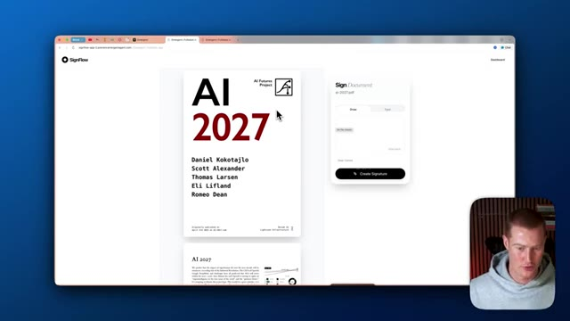
*⏱️ 00:06:02 — Interface web de l'application SignFlow affichant un document PDF et un panneau latéral pour signer.*

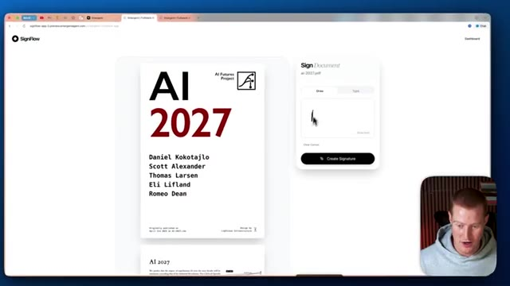
*⏱️ 00:06:07 — L'utilisateur dessine une signature à la souris dans le panneau dédié de l'application SignFlow.*

---

### ⏱️ `[00:06:16 - 00:06:40]` | Segment #17

**🔊 Audio (Transcription Intégrale Mot pour Mot en Français) :**
> Et non seulement nous pouvons la signer, mais nous pouvons aussi la taper, tout comme vous pouvez le faire dans un outil comme DocuSign. Boum, et voilà. Et regardez comme ça a l'air bien, les gars. C'est fondamentalement comme DocuSign. J'ai créé ceci en quelques instructions avec Gemini 3. Ça a donc l'air vraiment solide jusqu'à présent, mais je veux ajouter un peu plus de fonctionnalités. Ce que nous pourrions faire, c'est en fait connecter cela à plus de 30 000 actions différentes en utilisant le MCP Zapier.

**👁️ Analyse Visuelle d'Écran (gemini-3.5-flash-lite) :**
**Interface & Outils** : Navigateur web, interface de l'application SignFlow, environnement de développement Emergent AI.

**Contenu textuel & Code** : Document PDF intitulé "AI 2027", panneau de placement de signature, journal d'activité de l'agent IA avec modifications de code (App.js).

**Action / Démonstration** : Positionnement interactif d'une signature numérique sur un document de type DocuSign et visualisation du tableau de bord de l'application générée par l'IA.

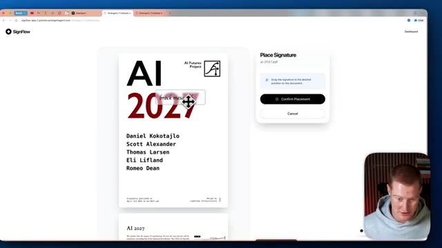
*⏱️ 00:06:22 — Interface de l'application SignFlow montrant l'ajout d'une signature sur un document PDF avec un panneau de confirmation à droite.*

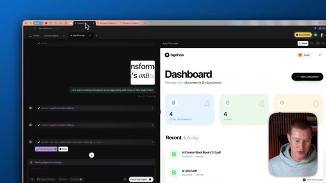
*⏱️ 00:06:34 — Vue divisée de l'écran montrant l'agent IA en cours d'exécution à gauche et le tableau de bord de l'application SignFlow à droite.*

---

### ⏱️ `[00:06:40 - 00:06:59]` | Segment #18

**🔊 Audio (Transcription Intégrale Mot pour Mot en Français) :**
> et je vais vous montrer exactement comment faire cela en ce moment même. Très bien, alors parlons rapidement de ce qu'est un serveur MCP et de la façon dont c'est extrêmement bénéfique pour nos applications. Nous allons utiliser le MCP de Zapier, ce qui nous permet de vous connecter à n'importe laquelle des différentes applications avec lesquelles Zapier s'intègre. Alors, réfléchissez-y une seconde. Nous avons notre application ici que nous avons construite et qui vous permet de signer des documents.

**👁️ Analyse Visuelle d'Écran (gemini-3.5-flash-lite) :**
**Interface & Outils** : Navigateur web affichant la page Zapier MCP et un environnement de développement d'application web.

**Contenu textuel & Code** : Documentation et présentation de Zapier MCP permettant de connecter des IA comme Claude ou ChatGPT à plus de 8 000 applications.

**Action / Démonstration** : Navigation et présentation des outils d'intégration de serveurs MCP et de Zapier pour automatiser les flux de travail.

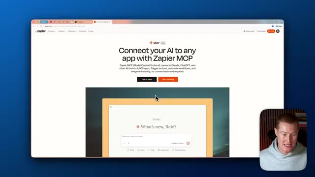
*⏱️ 00:06:45 — Capture d'écran montrant le site web de Zapier présentant son MCP (Model Context Protocol) pour connecter des IA à de nombreuses applications.*

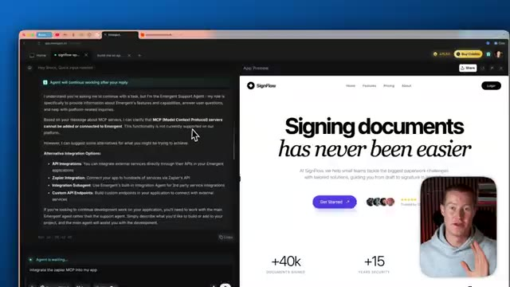
*⏱️ 00:06:54 — Capture d'écran montrant une interface de développement avec un assistant conversationnel à gauche et un aperçu d'application à droite.*

---

### ⏱️ `[00:06:59 - 00:07:32]` | Segment #19

**🔊 Audio (Transcription Intégrale Mot pour Mot en Français) :**
> Disons que chaque fois qu'un nouvel utilisateur s'inscrit et se connecte à notre plateforme, et si nous voulions récupérer son adresse e-mail et lui envoyer un e-mail de bienvenue ? Ce que nous pourrions faire, c'est nous connecter, encore une fois, à n'importe quelle application avec laquelle Zapier s'intègre, telle que Google Spreadsheet, Gmail, et 8 000 autres applications différentes, et nous pourrions lui envoyer un e-mail personnalisé pour lui souhaiter la bienvenue sur la plateforme. Nous pourrions également stocker son e-mail dans Google Spreadsheets. Nous pourrions envoyer un message à notre équipe sur Slack pour dire qu'un nouvel utilisateur s'est inscrit, toutes ces choses différentes que nous pourrions faire. Et ce n'est que la partie émergée de l'iceberg en ce qui concerne les différentes actions et choses que nous pourrions faire au sein de notre application.

**👁️ Analyse Visuelle d'Écran (gemini-3.5-flash-lite) :**
**Interface & Outils** : Navigateur web affichant une application SaaS (SignFlow).

**Contenu textuel & Code** : Page de présentation d'un service de signature de documents en ligne.
[DESC_IMAGE_3] Navigation et présentation visuelle d'une interface web d'application SaaS.

**Action / Démonstration** : Présentation d'un cas d'usage logiciel lié aux workflows et à l'automatisation.

*⏱️ 00:07:07 — Capture d'écran montrant le site web 'SignFlow' avec une fenêtre incrustée du présentateur en bas à droite.*

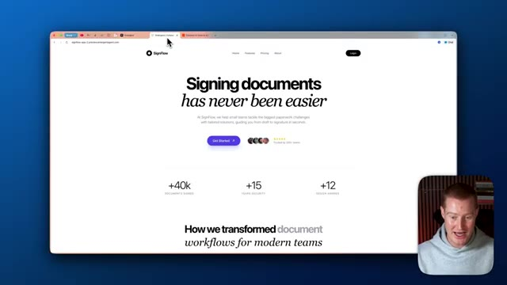
*⏱️ 00:07:24 — Capture d'écran identique à la première, montrant la page d'accueil de la plateforme SignFlow.*

---

### ⏱️ `[00:07:32 - 00:08:05]` | Segment #20

**🔊 Audio (Transcription Intégrale Mot pour Mot en Français) :**
> Alors laissez-moi vous montrer exactement comment nous pourrions faire cela maintenant. Nous allons aller sur Zapier MCP. Il y va y avoir un lien dans la description pour faire cela. Ensuite, nous allons cliquer sur nouveau serveur MCP. Et les gars, tout ce concept de MCP peut sembler complexe. Ça ne l'est vraiment pas. Je vais juste l'expliquer très simplement pour que vous puissiez le comprendre même si vous n'êtes pas technique. Tout d'abord, nous allons connecter un client MCP. Cliquez simplement sur l'API OpenAI, puis donnez un nom à ceci. Je vais simplement appeler cela application de signature de documents. Et puis je vais créer un serveur MCP. Et puis juste ici, c'est la partie vraiment passionnante. Nous avons donc nos outils et il est extrêmement facile d'ajouter un outil.

**👁️ Analyse Visuelle d'Écran (gemini-3.5-flash-lite) :**
**Interface & Outils** : Navigateur web affichant l'interface de Zapier MCP.

**Contenu textuel & Code** : Menus déroulants de configuration de serveurs MCP, listes de clients compatibles (Claude, Microsoft Copilot, ChatGPT, etc.), champs de texte pour le nom.

**Action / Démonstration** : Configuration et sélection d'un client MCP sur la plateforme Zapier pour l'intégration d'outils d'IA.

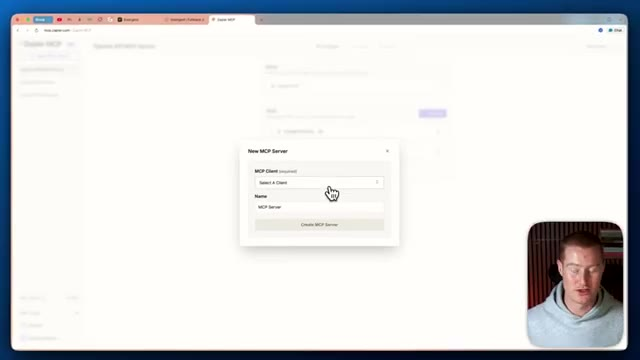
*⏱️ 00:07:40 — Interface de Zapier MCP montrant une boîte de dialogue pour créer un nouveau serveur MCP avec le champ client et nom.*

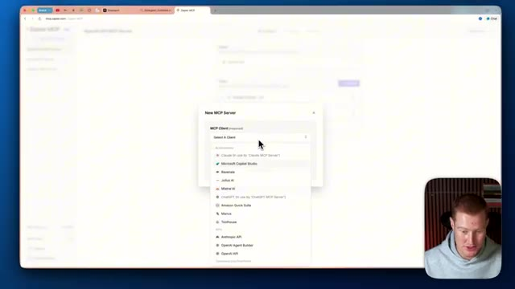
*⏱️ 00:07:48 — Déroulement du menu de sélection du client MCP listant différentes applications d'intelligence artificielle.*

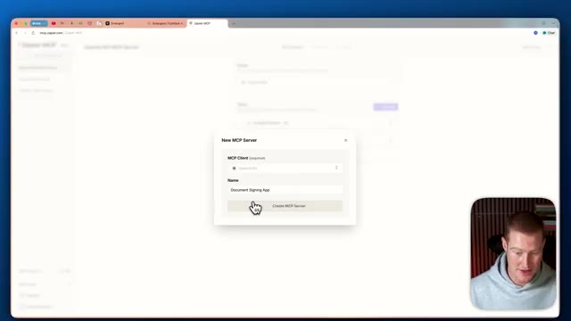
*⏱️ 00:07:57 — Formulaire de création de serveur MCP rempli avec un nom d'application et le bouton de validation.*

---

### ⏱️ `[00:08:05 - 00:08:32]` | Segment #21

**🔊 Audio (Transcription Intégrale Mot pour Mot en Français) :**
> C'est fondamentalement une action que notre agent peut réellement utiliser. Je vais en fait sélectionner Gmail pour qu'il puisse envoyer des e-mails pour nous. Je vais sélectionner tous ces outils. Maintenant, si j'y regarde de plus près, il peut trouver des e-mails. Il peut ajouter des libellés aux e-mails. Il peut envoyer des e-mails. Il peut supprimer des e-mails. Il peut faire toutes ces différentes choses à l'intérieur de Gmail. Et le simple fait d'activer cela donne à notre application la capacité d'exécuter ces actions. Je vais donc faire exactement la même chose pour Google Sheets. Je vais sélectionner tous ces outils. Maintenant, il y a 28 outils différents ici.

**👁️ Analyse Visuelle d'Écran (gemini-3.5-flash-lite) :**
**Interface & Outils** : Navigateur web affichant l'interface de configuration de Zapier MCP.

**Contenu textuel & Code** : Liste des fonctionnalités Gmail disponibles (Find Email, Add Label, Archive, Delete, Create Draft, Send Email, etc.).

**Action / Démonstration** : Sélection des outils Gmail pour permettre à l'agent d'interagir avec la messagerie.

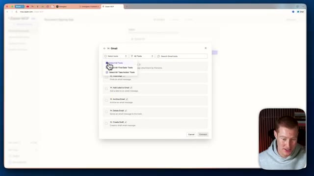
*⏱️ 00:08:12 — Interface de Zapier affichant une fenêtre modale de sélection des outils Gmail avec un menu déroulant pour sélectionner tous les outils.*

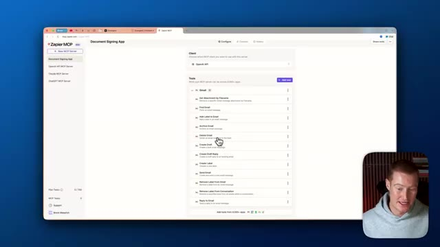
*⏱️ 00:08:19 — Interface principale de Zapier montrant la liste complète des outils Gmail sélectionnés et configurés pour l'agent.*

---

### ⏱️ `[00:08:32 - 00:08:51]` | Segment #22

**🔊 Audio (Transcription Intégrale Mot pour Mot en Français) :**
> Je vais connecter cela et nous pourrions faire cela pour n'importe quelle application que nous voulons utiliser. Allons-y et connectons cela à notre canal Slack également. Donc peut-être que chaque fois qu'une nouvelle personne s'inscrit sur notre plateforme, nous pourrions alors notifier notre équipe sur Slack. Et voilà. Nous avons toutes ces différentes actions maintenant ajoutées à notre serveur. Ensuite, nous devons venir sur ce bouton de connexion. Et encore une fois, cela peut sembler vraiment complexe.

**👁️ Analyse Visuelle d'Écran (gemini-3.5-flash-lite) :**
**Interface & Outils** : Navigateur web affichant l'interface de Zapier MCP.

**Contenu textuel & Code** : Liste des applications connectables et outils d'intégration (Gmail, Google Sheets, Slack).

**Action / Démonstration** : Sélection et ajout de l'application Slack pour intégrer les notifications dans le flux de travail.

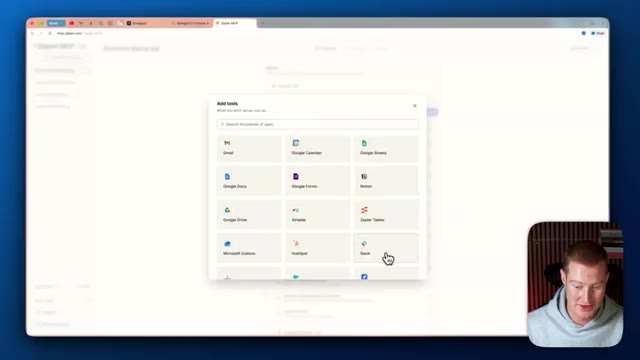
*⏱️ 00:08:37 — Interface de Zapier affichant une fenêtre modale pour l'ajout d'outils avec l'icône de Slack sélectionnée.*

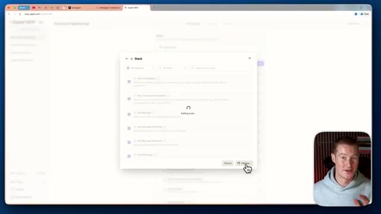
*⏱️ 00:08:41 — Fenêtre de configuration Slack dans Zapier en train d'ajouter des actions avec un indicateur de chargement.*

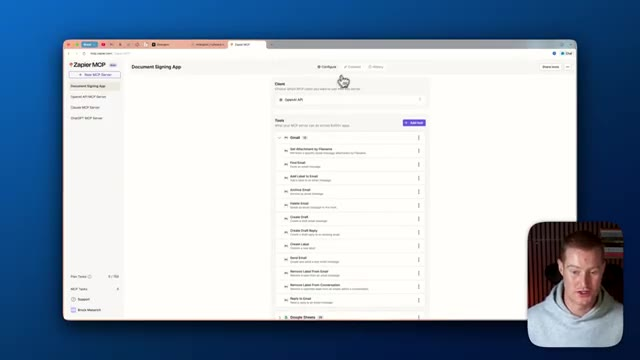
*⏱️ 00:08:46 — Tableau de bord principal de Zapier montrant l'application Document Signing App configurée avec les outils connectés.*

---

### ⏱️ `[00:08:51 - 00:09:27]` | Segment #23

**🔊 Audio (Transcription Intégrale Mot pour Mot en Français) :**
> Je vais vous l'expliquer très simplement pour que vous puissiez le faire en quelques secondes. Donc, ce qu'on veut faire, c'est en fait copier quelques éléments. On veut donc copier cette URL de serveur MCP, puis cette clé API ici, qu'il ne faut surtout montrer à personne, car ils auraient alors accès à vos comptes. Ensuite, je vais aller sur ChatGPT et utiliser ce prompt : "Transforme ces infos en cette configuration JSON." Je vais donc coller ces informations, à la fois l'URL du serveur MCP et la clé API. Ensuite, je vais retourner sur Emergent, venir sur notre page d'accueil, et je vais cliquer sur ce petit interrupteur ici. Je clique sur "MCP tools" (Outils MCP). Je vais ajouter un nouveau serveur MCP. Et puis juste ici, je vais simplement faire une capture d'écran de ceci.

**👁️ Analyse Visuelle d'Écran (gemini-3.5-flash-lite) :**
**Interface & Outils** : Navigateur web (Zapier MCP et plateforme Emergent)

**Contenu textuel & Code** : URL de serveur MCP, clés API masquées, exemples de code cURL et interface de discussion avec un agent IA.

**Action / Démonstration** : Configuration et explication de la copie des identifiants API et de l'URL du serveur MCP pour l'intégration.

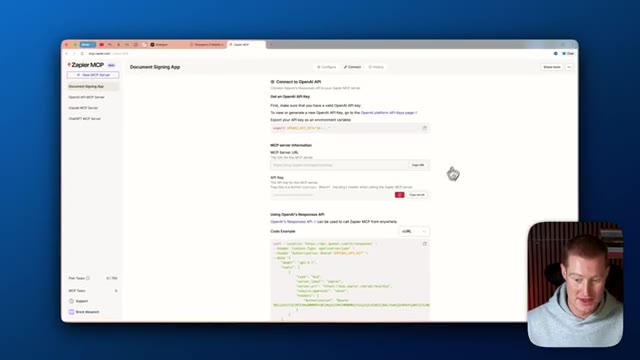
*⏱️ 00:09:00 — Interface web montrant les paramètres de configuration Zapier MCP avec l'URL du serveur MCP et la clé API.*

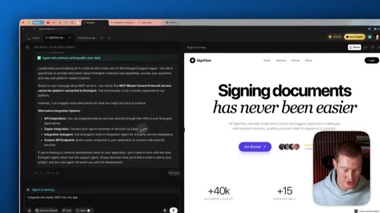
*⏱️ 00:09:18 — Interface de l'application de développement Emergent avec un agent conversationnel à gauche et un aperçu de l'application SignFlow à droite.*

---

### ⏱️ `[00:09:27 - 00:10:00]` | Segment #24

**🔊 Audio (Transcription Intégrale Mot pour Mot en Français) :**
> pour le donner à un ChatGPT afin qu'il puisse ensuite structurer cette information de cette manière spécifique, dans le format dont il a besoin. Très bien. Donc ensuite, vous allez voir un format similaire à celui-ci, juste ici. Je vais copier ce code, revenir sur Emergent. Et ensuite, il y a une chose que je dois réellement ajouter ici. Je vais donc revenir à Zapier MCP, copier cette clé API, et ensuite je vais la coller ici même. Très bien. Donc ensuite, nous avons juste besoin de donner un nom à notre serveur ici. Donc serveur Zapier MCP, vérifier et enregistrer. Et donc maintenant, notre application aura accès à toutes ces différentes actions. Ce que je vous suggère donc de faire, c'est de faire cela avant de commencer.

**👁️ Analyse Visuelle d'Écran (gemini-3.5-flash-lite) :**
**Interface & Outils** : Navigateur web affichant l'interface de ChatGPT, la plateforme Zapier MCP et l'application Emergent.

**Contenu textuel & Code** : Code JSON de configuration MCP, URL du serveur Zapier MCP, clés API et liste des serveurs MCP disponibles (Zapier MCP Server, ZP, Zapier+, Memory MCP).

**Action / Démonstration** : Copie de la structure JSON depuis ChatGPT, configuration des clés d'API et sélection/activation des serveurs MCP dans l'application Emergent.

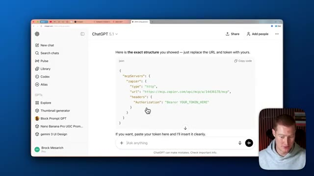
*⏱️ 00:09:35 — Interface ChatGPT affichant un extrait de code JSON pour la configuration d'un serveur MCP Zapier avec authentification par jeton Bearer.*

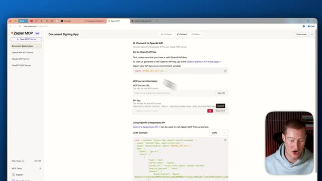
*⏱️ 00:09:44 — Interface de la plateforme Zapier MCP montrant les détails de connexion, l'URL du serveur MCP et la clé API masquée.*

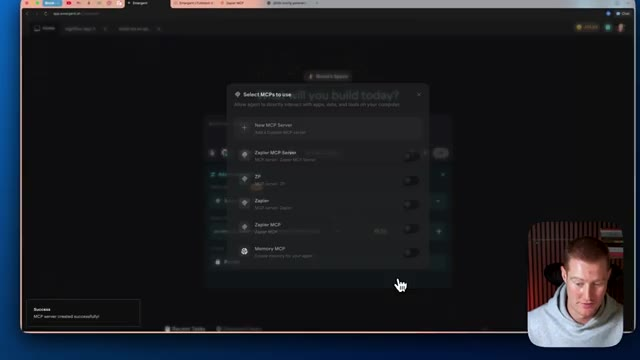
*⏱️ 00:09:52 — Interface de l'application Emergent affichant une fenêtre modale de sélection et de configuration des serveurs MCP ("Select MCPs to use").*

---

### ⏱️ `[00:10:00 - 00:10:33]` | Segment #25

**🔊 Audio (Transcription Intégrale Mot pour Mot en Français) :**
> construire votre application parce que ce sera beaucoup plus simple. Et ensuite, ce que vous pourriez faire, c'est simplement faire une requête et dire : "Je veux que tu utilises ce serveur MCP pour nous aider à envoyer des e-mails, à ajouter les e-mails dans une feuille de calcul Google." Chaque fois que quelqu'un s'inscrit à notre application, donnez en quelque sorte des instructions sur la façon dont vous voulez que votre application utilise réellement les différentes actions que vous pouvez effectuer à l'intérieur de votre application. Donc les gars, voilà. Nous avons construit une application entièrement complète en utilisant Gemini 3. En utilisant Gemini 3, nous pouvons construire des applications beaucoup plus esthétiques qui ne donnent pas l'air d'avoir été générées par l'IA. Ce que je pourrais faire, c'est que je pourrais littéralement lancer ceci dès maintenant pour que les utilisateurs puissent l'utiliser. Et je pourrais même ajouter Stripe devant mon application. Donc les gens

**👁️ Analyse Visuelle d'Écran (gemini-3.5-flash-lite) :**
**Interface & Outils** : Interface web de développement d'applications (type outil no-code/AI-powered).

**Contenu textuel & Code** : Champ de requête "What will you build today?", sélection du modèle d'IA (Gemini 3 Pro) et configuration des options avancées avec le serveur MCP Zapier.

**Action / Démonstration** : Configuration d'un prompt pour intégrer un serveur MCP et construire une application automatisée.

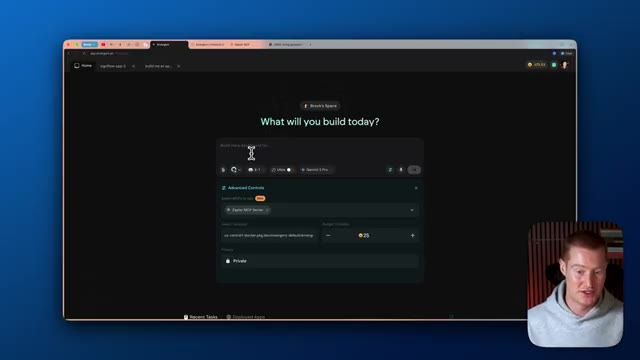
*⏱️ 00:10:08 — Capture d'écran montrant une interface de création d'application web avec des options de configuration avancées et un serveur MCP Zapier sélectionné.*

---

### ⏱️ `[00:10:33 - 00:10:46]` | Segment #26

**🔊 Audio (Transcription Intégrale Mot pour Mot en Français) :**
> doivent être des utilisateurs payants pour utiliser réellement ma plateforme et je pourrais facturer de l'argent pour l'utiliser. Donc les gars, j'espère que vous avez retiré de la valeur de cette vidéo. Il y des liens vers ces deux plateformes différentes et les ressources dont j'ai parlé dans cette vidéo juste en bas dans les commentaires. Merci d'être restés jusqu'à la fin et je vous retrouve les gars dans la prochaine.

**👁️ Analyse Visuelle d'Écran (gemini-3.5-flash-lite) :**
**Interface & Outils** : Navigateur web affichant le site de la plateforme 'SignFlow'.

**Contenu textuel & Code** : Interface web de présentation de la plateforme de signature de documents 'SignFlow'.

**Action / Démonstration** : Navigation et présentation visuelle de la plateforme logicielle évoquée dans la vidéo.

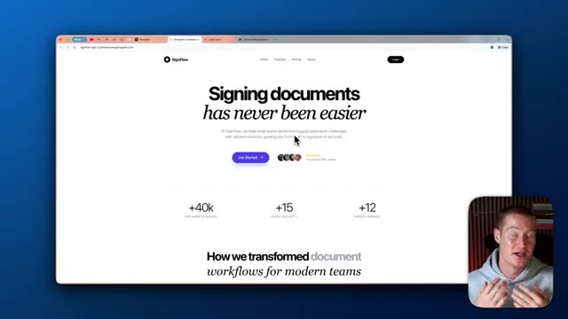
*⏱️ 00:10:36 — Capture d'écran montrant le site web 'SignFlow' avec une page d'accueil de signature de documents, et le présentateur visible en incrustation en bas à droite.*

---

