# 🎬 This Gemini 3 + Claude Opus 4.5 Workflow Is Actually Unreal...

> **Chaîne** : [Brock Mesarich | AI for Non Techies](https://www.youtube.com/@BrockMesarich)  
> **Lien YouTube** : [https://www.youtube.com/watch?v=wuQVdtwFzXc](https://www.youtube.com/watch?v=wuQVdtwFzXc)  
> **Date de publication** : 20251202  
> **Durée** : 00:10:21  
> **Identifiant vidéo** : `wuQVdtwFzXc`  
> **Transcription & Analyse** : `whisper-v3-large-turbo+gemini-3.5-flash-lite`  

---

## 📌 Synthèse Exécutive & Outils

### 💡 Résumé

Cette vidéo, présentée par la chaîne *Brock Mesarich | AI for Non Techies*, met en lumière un workflow de développement d'applications hybride et ultra-rapide combinant les forces esthétiques de Gemini 3 et la puissance logique de Claude Opus 4.5. L'approche démontre qu'il est désormais possible de concevoir des applications web hautement fonctionnelles, dotées d'une interface utilisateur de qualité professionnelle et d'un système dorsal (backend) robuste, le tout en quelques minutes et sans compétences techniques approfondies. Le cas d'usage illustré est celui d'une application SaaS conçue pour les peintres en bâtiment, leur permettant de générer instantanément des maquettes de maisons repeintes à partir d'images immobilières (notamment issues de Zillow) afin de démarcher de nouveaux clients.

Au-delà de la simple génération de prototypes visuels, la démonstration explore l'intégration itérative de fonctionnalités complexes telles que la manipulation d'images par IA, la gestion de bases de données relationnelles et l'authentification sécurisée des utilisateurs. En associant un modèle spécialisé dans le design minimaliste et soigné (Gemini 3 Pro) à un modèle de pointe pour l'architecture logicielle et le codage (Claude Opus 4.5) via la plateforme de déploiement *blink.new*, la vidéo illustre une mutation profonde des méthodes de prototypage rapide. Les non-techniciens peuvent ainsi automatiser la création d'outils métiers complexes, abaissant drastiquement les barrières à l'entrée pour le lancement de micro-SaaS ou d'outils d'automatisation stratégiques.

### 🛠️ Outils, Modèles & Logiciels Présentés

* **Gemini 3 (et Gemini 3 Pro Preview)** : Dernier modèle multimodal de Google salué pour sa capacité à concevoir des interfaces utilisateur d'un raffinement esthétique digne d'un designer humain.
* **Claude Opus 4.5** : Modèle de codage de pointe développé par Anthropic, réputé pour sa puissance logique, sa maîtrise de l'architecture backend et sa capacité à structurer des bases de données complexes.
* **blink.new** : Plateforme de développement et de déploiement d'applications cloud centralisant l'accès à plusieurs grands modèles de langage et facilitant le "vibe coding".
* **Nano Banana Pro** : Modèle de génération d'images avancé de Gemini intégré au workflow pour modifier dynamiquement les couleurs de peinture sur les photographies de biens immobiliers.
* **Zillow** : Plateforme immobilière utilisée comme source pour extraire des images de maisons cibles à des fins de prospection commerciale et de démonstration.
* **Make & n8n** *(Mentionnés dans les métadonnées de la chaîne)* : Outils d'automatisation de workflows no-code/low-code couramment utilisés pour interconnecter des API et automatiser des processus métiers.
* **Zapier** *(Mentionné dans les métadonnées de la chaîne)* : Solution d'automatisation cloud grand public permettant de relier différentes applications logicielles entre elles.
* **ChatGPT & Grok** *(Mentionnés dans les métadonnées de la chaîne)* : Modèles conversationnels alternatifs utilisés pour l'idéation, le prompt engineering et l'assistance au développement.

### 🔑 Points Clés & Enseignements Stratégiques

* **Paradigme du "Vibe Coding"** : Utilisation intensive du langage naturel pour piloter des IA génératives dans la conception d'applications, réduisant le cycle de développement de plusieurs semaines à quelques minutes.
* **Spécialisation des modèles (Front-end vs Back-end)** : Exploitation séquentielle des forces de chaque IA — Gemini 3 pour l'ergonomie visuelle et le design (style minimaliste Apple / international suisse), puis Claude Opus 4.5 pour la solidité du code dorsal.
* **Richesse et spécificité du Prompt Engineering** : Nécessité absolue de fournir des consignes stylistiques extrêmement précises pour éviter des interfaces génériques ou stéréotypées aux accents typiques de l'intelligence artificielle.
* **Intégration d'une IA générative d'images** : Utilisation de Nano Banana Pro pour appliquer des modifications contextuelles complexes (changement de couleur de façade) tout en préservant le réalisme photographique.
* **Cas d'usage B2B orienté conversion** : Transformation d'un prototype technique en un outil de prospection commerciale ultra-efficace pour des prestataires de services (ex: peintres en bâtiment générant du contenu visuel avant/après).
* **Évolution itérative pilotée par l'IA** : Approche agile où l'utilisateur dialogue avec l'agent pour ajouter progressivement des fonctionnalités (sauvegarde de projets, affichage comparatif avant/après) sans manipuler directement le code source.
* **Implémentation de bases de données et persistance** : Prise en charge par Claude Opus 4.5 de la création d'une architecture de données structurée pour stocker les projets des utilisateurs de manière isolée.
* **Gestion de l'authentification utilisateur** : Intégration transparente d'un système de connexion (notamment via Google) pour cloisonner l'espace de travail et l'historique des projets par compte individuel.
* **Fonctionnalité d'édition réversible** : Capacité pour l'application à permettre la réouverture, la modification et la réédition de projets précédemment enregistrés dans l'espace de travail.
* **Gestion des environnements de déploiement** : Utilisation des fonctionnalités natives de la plateforme *blink.new* pour configurer des domaines personnalisés, injecter des clés d'API sécurisées et gérer l'historique des versions de l'application.

---

## ⏱️ Chronologie & Transcription Complète Audio & Visuelle (Mot pour Mot)

### ⏱️ `[00:00:00 - 00:00:22]` | Segment #01

**🔊 Audio (Transcription Intégrale Mot pour Mot en Français) :**
> J'ai créé toute cette application en quelques minutes en utilisant à la fois Gemini 3 et Claude Opus 4.5. Google vient de lancer Gemini 3 et les gens paniquent parce qu'il conçoit des interfaces utilisateur qui ont l'air d'avoir été créées par un vrai designer humain. C'est vraiment du niveau supérieur. Mais littéralement quelques jours plus tard, Anthropic a sorti Claude Opus 4.5, qu'ils qualifient de modèle de codage le plus puissant au monde.

**👁️ Analyse Visuelle d'Écran (gemini-3.5-flash-lite) :**
**Interface & Outils** : Navigateur web présentant des pages d'actualité et de documentation sur les IA Gemini 3 et Claude Opus 4.5.

**Contenu textuel & Code** : Titres de pages, communiqués de lancement et illustrations graphiques liés aux modèles Gemini 3 et Claude Opus 4.5.

**Action / Démonstration** : Présentation visuelle des articles de lancement des nouveaux modèles d'intelligence artificielle par le présentateur.

---

### ⏱️ `[00:00:22 - 00:00:57]` | Segment #02

**🔊 Audio (Transcription Intégrale Mot pour Mot en Français) :**
> Donc, je me suis posé une question évidente. Que se passe-t-il si vous laissez Gemini 3 concevoir l'application ? Claude Opus 4.5 construire réellement le backend. Et pour être honnête, les résultats m'ont complètement choqué. Donc, dans cette vidéo, je vais vous montrer exactement comment vous pouvez faire cela vous-même et voir les résultats finaux que j'ai réellement obtenus. Très bien, les gars. Alors tout d'abord, parlons de Gemini 3. J'ai construit des applications à l'apparence incroyable, tout comme celle-ci. Et celle-ci a été construite en quelques instructions avec Gemini 3. C'est un niveau supérieur lorsqu'il s'agit de conception par IA lors du "vibe coding". Genre, avant que ce modèle ne sorte, vous n'auriez pas été capable d'obtenir quoi que ce soit d'approchant en seulement quelques instructions.

**👁️ Analyse Visuelle d'Écran (gemini-3.5-flash-lite) :**
**Interface & Outils** : Navigateur web (Google Chrome) affichant une application ou un site vitrine, avec la vignette vidéo du présentateur en incrustation.

**Contenu textuel & Code** : Interface utilisateur web minimaliste avec des titres, des boutons d'appel à l'action (« Get Started »), des statistiques chiffrées (+40, +15, +12) et une mise en page épurée.

**Action / Démonstration** : Présentation visuelle du résultat de conception d'une application ou d'un site web généré par l'IA.

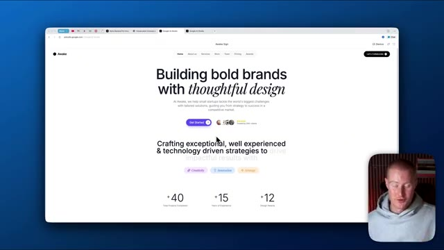
*⏱️ 00:00:40 — Capture d'écran d'un navigateur web montrant une page d'accueil de site web conçue avec un design moderne (« Building bold brands with thoughtful design »), avec la webcam du présentateur en bas à droite.*

---

### ⏱️ `[00:00:58 - 00:01:33]` | Segment #03

**🔊 Audio (Transcription Intégrale Mot pour Mot en Français) :**
> Et voici un autre que j'ai fait. Ce sont littéralement des captures d'écran provenant de différentes pages de destination et de sites web dont je me suis inspiré. Et j'ai dit : recrée simplement ceci. Et il a fait ça en un seul prompt environ. Que se passe-t-il lorsque vous combinez cela avec un modèle de codage de niveau supérieur, comme Claude Opus 4.5. Et c'est pourquoi je suis si impatient de présenter ce flux de travail dans cette vidéo. Très bien, les gars. Nous allons donc tout d'abord aller sur blink.new. C'est la plateforme que nous allons utiliser pour créer notre application. L'une des principales raisons pour lesquelles nous allons l'utiliser, c'est parce que vous pouvez voir que nous avons accès à tous ces différents modèles de codage. Nous avons Gemini 3 Pro Preview, qui est le modèle

**👁️ Analyse Visuelle d'Écran (gemini-3.5-flash-lite) :**
**Interface & Outils** : Navigateur web affichant l'interface de développement d'applications Blink et une page de prévisualisation de site web, avec une webcam du présentateur en bas à droite.

**Contenu textuel & Code** : Page web « Awake » générée avec des éléments de design, des titres, des statistiques et un panneau de code sur la gauche ; page « Blink » avec un champ de saisie de prompt et des boutons de sélection de modèles.

**Action / Démonstration** : Le présentateur montre le résultat visuel d'une page web créée à partir d'un prompt d'inspiration, puis navigue sur l'interface de la plateforme Blink.

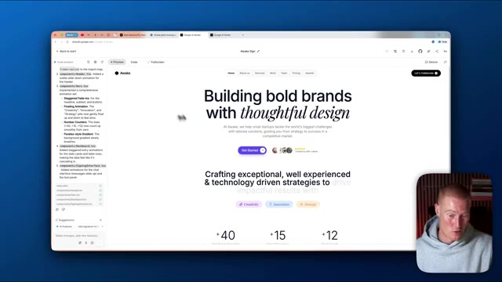
*⏱️ 00:01:06 — Aperçu d'une page web générée par une intelligence artificielle avec un panneau latéral montrant les modifications de code.*

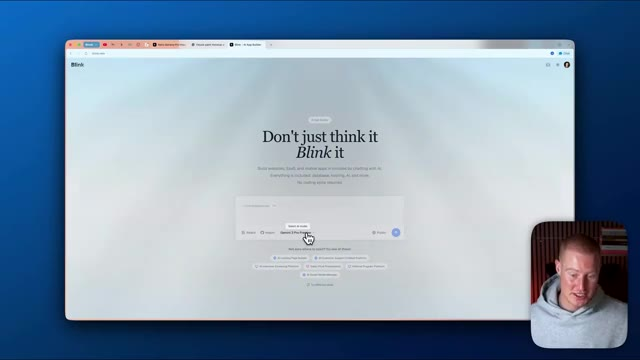
*⏱️ 00:01:24 — Interface de la plateforme de création d'applications Blink affichant le champ de saisie de prompt et les options de modèles d'IA.*

---

### ⏱️ `[00:01:33 - 00:01:53]` | Segment #04

**🔊 Audio (Transcription Intégrale Mot pour Mot en Français) :**
> qui a été utilisé pour créer ces pages de destination et ces sites Web précédents que vous avez vus. Et ensuite, nous avons également Claude Opus 4.5, qui est le modèle de codage le plus intelligent qui ait été publié, selon Anthropic. Donc ce que nous allons faire, tout d'abord, trouvons notre idée d'application. Et nous allons utiliser Gemini 3 Pro pour concevoir l'interface utilisateur, puis nous utiliserons Claude Opus 4.5 pour construire le système dorsal.

**👁️ Analyse Visuelle d'Écran (gemini-3.5-flash-lite) :**
**Interface & Outils** : Navigateur web affichant l'interface de l'outil de création de sites/applications Blink avec un menu contextuel de sélection de modèles d'IA.

**Contenu textuel & Code** : Listes déroulantes de modèles d'IA (Claude Opus 4.5, Gemini 3 Pro, GPT-4, etc.) avec leurs caractéristiques de performance (intelligence, vitesse, coût).

**Action / Démonstration** : Sélection et changement de modèle d'intelligence artificielle pour la génération de code ou de pages web au sein de la plateforme Blink.

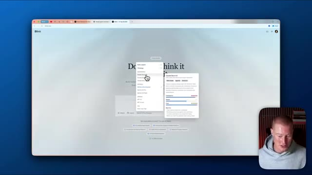
*⏱️ 00:01:38 — Le présentateur navigue sur l'interface de Blink et sélectionne le modèle Claude Opus 4.5 dans un menu déroulant pour configurer la création d'une application.*

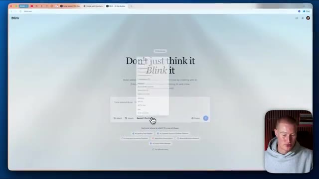
*⏱️ 00:01:48 — Le présentateur clique sur une option du menu déroulant pour choisir un autre modèle d'IA (Gemini 3 Pro) sur l'interface de Blink.*

---

### ⏱️ `[00:01:53 - 00:02:28]` | Segment #05

**🔊 Audio (Transcription Intégrale Mot pour Mot en Français) :**
> Très bien les gars, donc voici le prompt que je vais utiliser et si vous voulez utiliser exactement ce même prompt, il y aura un lien pour le télécharger gratuitement dans les commentaires et dans la description. C'est un prompt vraiment complet et une chose que je tiens à dire, c'est que lorsque vous utilisez Gemini 3 Pro, il est vraiment important d'être super spécifique dans vos instructions de style, car si vous lui donnez une entrée générique, il vous donnera un résultat à l'aspect générique et l'interface utilisateur ne sera pas belle. Ça ressemblera à n'importe quel autre modèle d'IA en matière de design. Je lui ai donné ce prompt vraiment spécifique et laissez-moi analyser ce prompt maintenant pendant que Blink s'exécute et construit

**👁️ Analyse Visuelle d'Écran (gemini-3.5-flash-lite) :**
**Interface & Outils** : Google Docs, Navigateur web, Plateforme Blink.

**Contenu textuel & Code** : Spécifications techniques d'un prompt détaillé pour le développement d'applications, instructions de design (style minimaliste suisse, structure à 3 panneaux).

**Action / Démonstration** : Présentation et défilement d'un prompt complet destiné au téléchargement pour les utilisateurs.

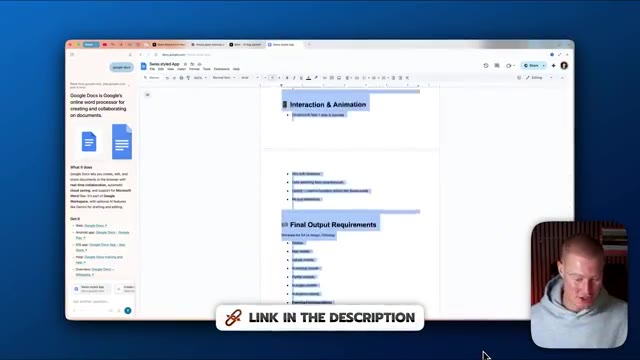
*⏱️ 00:02:02 — Vue d'un document Google Docs affichant les sections 'Interaction & Animation' et 'Final Output Requirements' d'un prompt pour application.*

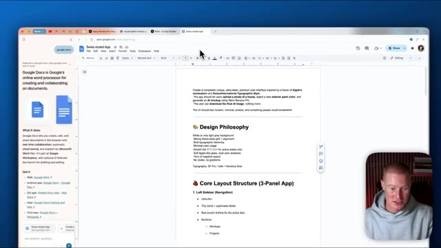
*⏱️ 00:02:11 — Vue détaillée du haut du même document Google Docs montrant les sections 'Design Philosophy' et 'Core Layout Structure (3-Panel App)'.*

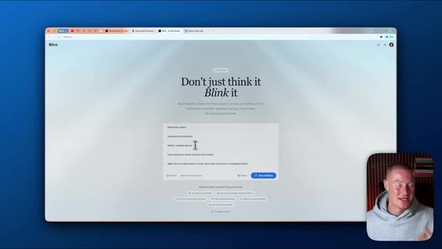
*⏱️ 00:02:20 — Vue de l'interface web de la plateforme Blink affichant le champ de saisie du prompt avec le slogan 'Don't just think it, Blink it'.*

---

### ⏱️ `[00:02:28 - 00:02:47]` | Segment #06

**🔊 Audio (Transcription Intégrale Mot pour Mot en Français) :**
> Ceci. Vous pouvez voir que ça lance cet espace de travail ici. En ce moment, laissez-moi vous décortiquer ça. C'est une fusion du minimalisme façon Apple et du style international suisse. Donc c'est l'application que nous allons construire. Donc l'application permet aux utilisateurs de télécharger la photo d'une maison, de sélectionner une couleur de peinture extérieure et de créer une maquette par IA avec Nano Banana Pro, qui est le nouveau modèle d'image de Gemini.

**👁️ Analyse Visuelle d'Écran (gemini-3.5-flash-lite) :**
**Interface & Outils** : Google Docs et navigateur web.

**Contenu textuel & Code** : Texte décrivant la philosophie de design d'une application inspirée du minimalisme d'Apple et du style international suisse.

**Action / Démonstration** : Le présentateur explique les spécifications textuelles du projet affichées à l'écran.

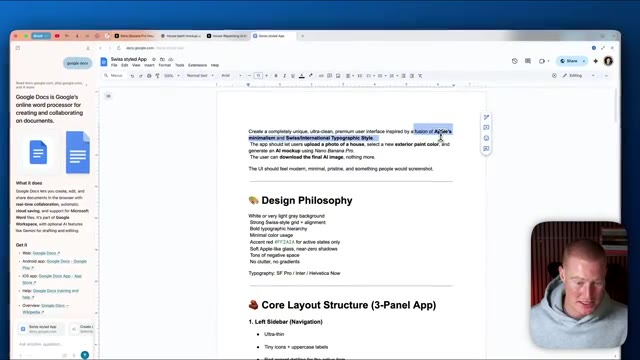
*⏱️ 00:02:33 — Vue d'un document Google Docs montrant le texte sur le design minimaliste et le style suisse, avec la webcam du présentateur en bas à droite.*

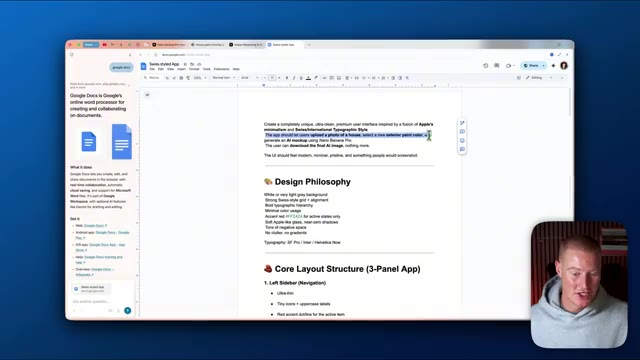
*⏱️ 00:02:43 — Vue similaire du document Google Docs avec une sélection de texte légèrement modifiée, et le présentateur visible en bas à droite.*

---

### ⏱️ `[00:02:48 - 00:03:09]` | Segment #07

**🔊 Audio (Transcription Intégrale Mot pour Mot en Français) :**
> L'utilisateur peut télécharger l'image finale, rien de plus. C'est donc une application pour les peintres afin de montrer réellement aux clients potentiels à quoi ressemblera la maison si elle est peinte d'une certaine manière. Et ensuite, on entre vraiment dans les détails de la philosophie du design et tout ça. Pas besoin d'entrer trop dans les détails. Très bien, alors quelques minutes plus tard, regardez ce design que Gemini 3 a réellement créé pour nous.

**👁️ Analyse Visuelle d'Écran (gemini-3.5-flash-lite) :**
**Interface & Outils** : Navigateur web, plateforme Blink, Google Docs.

**Contenu textuel & Code** : Spécifications textuelles de design d'application, interface utilisateur d'un outil de simulation de peinture basé sur l'IA (Blink), contrôles d'intensité, de texture et de contraste.
[DESC_IMAGE_3] Navigation et présentation du code source et de l'interface de prévisualisation de l'application par le présentateur.

**Action / Démonstration** : Explications face caméra et analyse conceptuelle des marchés.

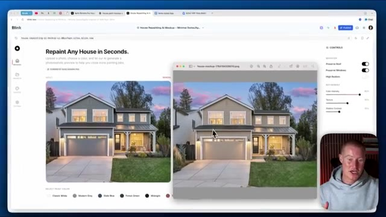
*⏱️ 00:02:53 — Aperçu de l'application web Blink montrant une interface de simulation de peinture de maison avec des options de couleurs et des contrôles de personnalisation.*

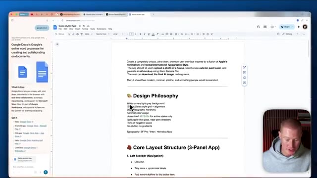
*⏱️ 00:02:58 — Document Google Docs affichant le cahier des charges et la philosophie de design (« Design Philosophy ») pour l'application de peinture.*

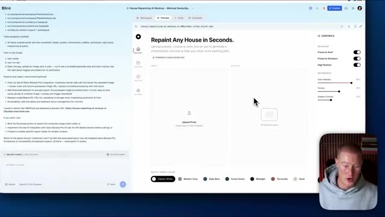
*⏱️ 00:03:04 — Interface de développement sur la plateforme Blink montrant l'éditeur de code, l'aperçu de l'application et les zones de téléchargement d'images.*

---

### ⏱️ `[00:03:09 - 00:03:34]` | Segment #08

**🔊 Audio (Transcription Intégrale Mot pour Mot en Français) :**
> Repainindre n'importe quelle maison en quelques secondes. J'aime la typographie. J'aime la simplicité de notre application. Ça a l'air vraiment propre. Ça ne fait pas trop généré par IA. C'est la puissance de Gemini 3 Pro. Ce que je vais faire maintenant, c'est qu'on va essayer ça. Je vais aller sur Zillow et imaginez être un peintre et avoir cette application. Ce serait tellement bénéfique. Genre, imaginez présenter cela à vos clients et générer simplement une image IA de la maison de quelqu'un avec une nouvelle couche de peinture et puis dire je pourrais genre vous livrer cela comme un service.

**👁️ Analyse Visuelle d'Écran (gemini-3.5-flash-lite) :**
**Interface & Outils** : Navigateur web, application de simulation de peinture (Blink), site Zillow.

**Contenu textuel & Code** : Interface utilisateur d'application web, code source, options de peinture, barres de recherche immobilière.

**Action / Démonstration** : Navigation et présentation de l'application de maquette de peinture de maison puis transition vers le site Zillow.

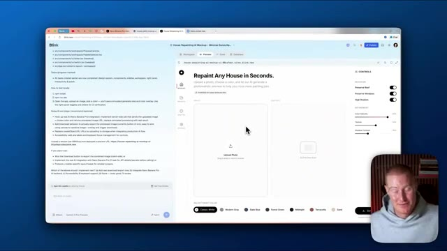
*⏱️ 00:03:15 — Interface d'une application web de simulation de peinture de maison avec des options de design, panneau de contrôle et code source visible.*

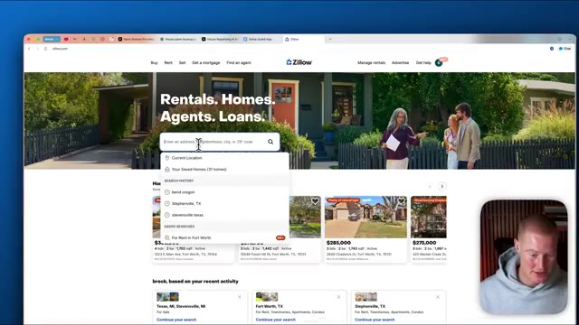
*⏱️ 00:03:21 — Page d'accueil du site immobilier Zillow avec une barre de recherche active et l'historique de recherche visible.*

---

### ⏱️ `[00:03:34 - 00:04:08]` | Segment #09

**🔊 Audio (Transcription Intégrale Mot pour Mot en Français) :**
> Donc ce que je vais faire, laissez-moi juste afficher une image d'une maison. Celle-ci juste ici fonctionne bien. Ensuite, je vais venir sur notre application, simplement télécharger ceci. Voyons à quel point notre application est fonctionnelle. Donc vous pouvez voir, laissez-moi en fait juste ouvrir ceci en mode plein écran. Et si vous ne savez pas ce qu'est Nano Banana Pro, c'est le modèle d'image que nous allons utiliser qui est sorti la semaine dernière en même temps que Gemini 3. Et il est phénoménal lorsqu'il s'agit de générer des images par IA. On ne peut même pas deviner que cela va être généré par IA. Donc laissez-moi choisir la couleur de maison que je veux choisir. Peut-être optons pour du sable juste parce que c'est un changement radical pour voir la différence ici. Et jusqu'à présent, on dirait que cela ne génère pas de résultat.

**👁️ Analyse Visuelle d'Écran (gemini-3.5-flash-lite) :**
**Interface & Outils** : Navigateur web affichant l'application Blink et l'interface de développement.

**Contenu textuel & Code** : Application « Repaint Any House in Seconds » avec palettes de couleurs et contrôles de rendu (haute fidélité, intensité).

**Action / Démonstration** : Navigation sur l'interface de l'application de maquette de peinture de maison pour tester les fonctionnalités.

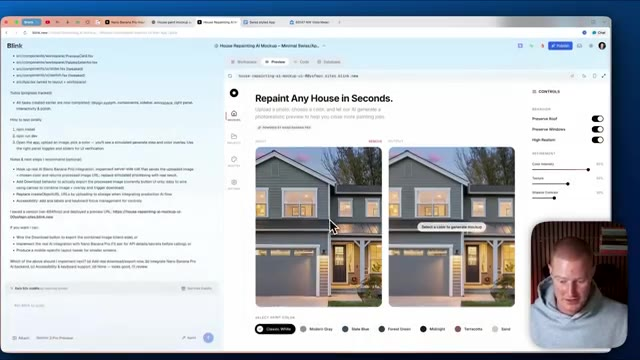
*⏱️ 00:03:42 — Interface Blink affichant l'application de simulation de peinture de maison avec deux aperçus côte à côte et un panneau latéral de code à gauche.*

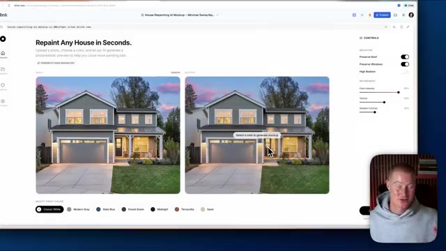
*⏱️ 00:03:51 — Gros plan sur l'interface web montrant l'application de simulation de repeignage de maison avec les options de couleur en bas.*

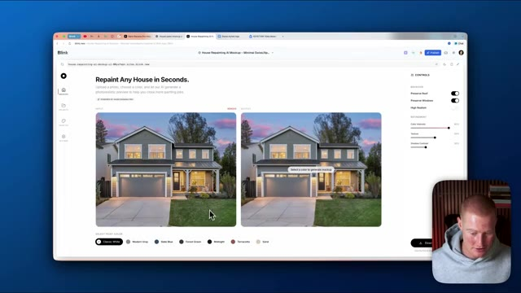
*⏱️ 00:04:00 — Vue complète de l'application web Blink de modification de couleur de maison avec les curseurs de contrôle à droite.*

---

### ⏱️ `[00:04:08 - 00:04:27]` | Segment #10

**🔊 Audio (Transcription Intégrale Mot pour Mot en Français) :**
> mais quand je clique sur le sable. Revenons donc à notre agent ici et expliquons simplement que nous devons développer cette fonctionnalité. Mais ce que je vais faire, c'est que je vais maintenant changer notre modèle pour Claude Opus 4.5, puisque vous pouvez voir que l'intelligence de ce modèle est bien meilleure comparativement à Gemini 3 Pro, qui se montre d'ailleurs plutôt intelligent aussi.

**👁️ Analyse Visuelle d'Écran (gemini-3.5-flash-lite) :**
**Interface & Outils** : Interface web Blink (outil de développement d'applications par IA).

**Contenu textuel & Code** : Code source, arborescence de fichiers, instructions de configuration locale, options de personnalisation d'image et menu de sélection de modèles d'IA (Claude Opus 4.5, Gemini 3 Pro, etc.).

**Action / Démonstration** : Le présentateur sélectionne et bascule vers le modèle d'IA Claude Opus 4.5 pour améliorer les performances de développement.

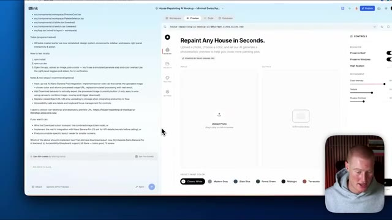
*⏱️ 00:04:13 — Vue d'ensemble de l'interface de développement d'application Blink avec un aperçu de l'outil 'House Repainting AI Mockup' et la webcam du présentateur en bas à droite.*

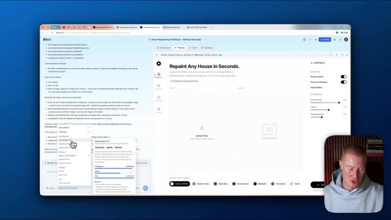
*⏱️ 00:04:22 — Le menu déroulant de sélection des modèles d'IA est ouvert, montrant les différentes options disponibles dont Claude Opus 4.5.*

---

### ⏱️ `[00:04:27 - 00:04:48]` | Segment #11

**🔊 Audio (Transcription Intégrale Mot pour Mot en Français) :**
> Mais ce modèle devrait être meilleur lorsqu'il s'agit de nous générer un véritable backend qui fonctionne. Très bien, alors c'est parti. En gros, cela dit de conserver exactement le même style de notre application. Nous devons juste générer la bonne image lorsque l'utilisateur sélectionne la couleur de peinture. Donc je vais l'envoyer dès maintenant. Très bien. Soi-disant, des modifications ont été apportées et cela devrait fonctionner correctement maintenant. Alors, vas-y. Cliquetons simplement sur sable pour la couleur de peinture que nous voulons utiliser.

**👁️ Analyse Visuelle d'Écran (gemini-3.5-flash-lite) :**
**Interface & Outils** : Navigateur web avec l'interface Blink AI et la webcam du présentateur en bas à droite.

**Contenu textuel & Code** : Application « Repaint Any House in Seconds » avec des options de couleurs et un prompt textuel pour générer le backend.

**Action / Démonstration** : Saisie d'un prompt pour améliorer le modèle et génération d'une interface avec des options de couleurs dynamiques.

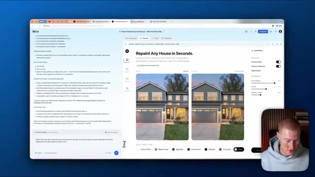
*⏱️ 00:04:32 — Interface Blink avec le panneau de code à gauche et l'application Web interactive montrant des aperçus de maisons repeintes et le champ de saisie du prompt.*

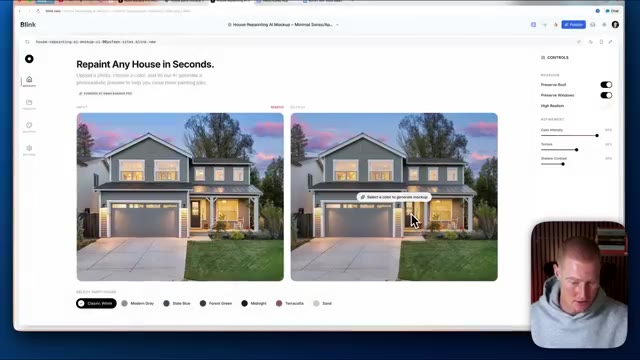
*⏱️ 00:04:42 — Vue agrandie de l'application Web Blink montrant les options de couleurs pour repeindre la maison et les images avant/après.*

---

### ⏱️ `[00:04:48 - 00:05:21]` | Segment #12

**🔊 Audio (Transcription Intégrale Mot pour Mot en Français) :**
> Et ça devrait générer exactement cette même image, mais avec cette maison couleur sable. Et boum, c'est parfait. C'était super fluide. Ça fonctionne correctement maintenant. Donc ce que je pourrais faire, c'est que je pourrais simplement télécharger rapidement cette maquette et ensuite, genre, regarder les comparaisons côte à côte ici. Voici l'image initiale qu'on lui a donnée. Voici la version mise à jour. Si nous étions peintre, nous pourrions alors aller démarcher cette personne sur Zillow ou ce client potentiel et dire, hé, nous pouvons refaire le design de votre maison ou refaire la peinture de votre maison. Et nous avons un prototype fonctionnel en quelques secondes. Très bien. Donc maintenant que notre application fonctionne correctement, construisons par-dessus

**👁️ Analyse Visuelle d'Écran (gemini-3.5-flash-lite) :**
**Interface & Outils** : Application web Blink (générateur de maquettes de peinture immobilière par IA)

**Contenu textuel & Code** : Interface SaaS avec options de personnalisation (couleurs de peinture, intensité, préservation du toit et des fenêtres) et affichage d'une image générée de maison couleur sable.

**Action / Démonstration** : Téléchargement et visualisation de la maquette d'image générée par l'IA.

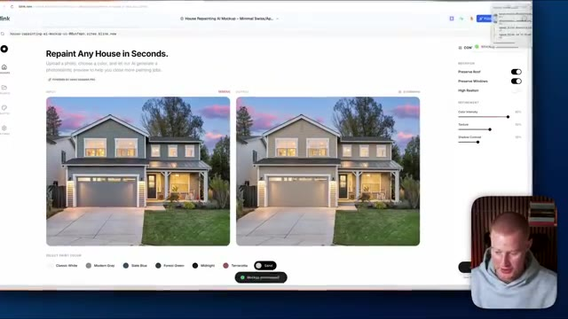
*⏱️ 00:04:56 — Interface web de l'application Blink montrant l'outil de repeinture de maison par IA avec une image avant/après et une petite webcam du présentateur en bas à droite.*

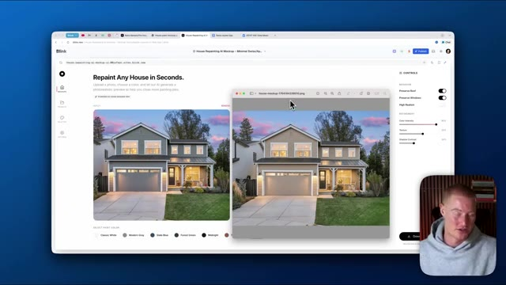
*⏱️ 00:05:12 — Interface web de l'application Blink avec une fenêtre de visualisation d'image téléchargée superposée et le présentateur en incrustation vidéo.*

---

### ⏱️ `[00:05:21 - 00:05:54]` | Segment #13

**🔊 Audio (Transcription Intégrale Mot pour Mot en Français) :**
> cette fonctionnalité. Faisons quelques petites choses ici. Je vais rédiger un prompt et ensuite nous continuerons à partir de là. Très bien. Voici donc le prompt que je lui ai donné. Tout cela fonctionne correctement. Maintenant, ajoutons quelques éléments à l'application. Je veux pouvoir voir tous les projets, utiliser exactement la même interface utilisateur et le même design, puis m'assurer que l'onglet latéral qui indique projets affiche réellement les projets qui sont reflétés dans la base de données. Ce qu'il a fait, c'est qu'il a pris les devants et a demandé si je voulais ajouter une authentification à notre application, alors j'ai dit oui, ajoutons l'authentification des utilisateurs. Il va donc construire une base de données ici, comme vous pouvez le voir, la base de données est en train de se charger et Claude Opus 4.5 devrait

**👁️ Analyse Visuelle d'Écran (gemini-3.5-flash-lite) :**
**Interface & Outils** : Navigateur web avec interface d'assistant IA de type chat et webcam du présentateur.

**Contenu textuel & Code** : Texte du prompt saisi par l'utilisateur demandant d'ajouter des fonctionnalités à l'application (voir tous les projets, barre latérale, base de données pour les photos) et analyse de l'architecture par l'IA.

**Action / Démonstration** : Le présentateur montre l'interface de l'assistant IA et le prompt en cours de rédaction ou de soumission.

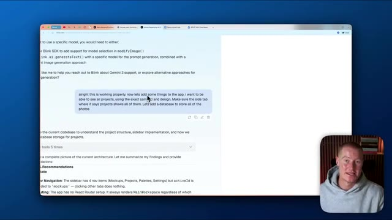
*⏱️ 00:05:29 — Une interface de chat d'une IA affichant un prompt textuel rédigé par l'utilisateur et la réponse de l'assistant, avec la vidéo du présentateur en incrustation dans le coin inférieur droit.*

---

### ⏱️ `[00:05:54 - 00:06:28]` | Segment #14

**🔊 Audio (Transcription Intégrale Mot pour Mot en Français) :**
> n'ont aucun problème lorsqu'il s'agit de construire cette base de données. Ce que je vais faire, c'est que je vais la laisser faire son travail et ensuite, ce que nous aurons, c'est essentiellement la possibilité pour les utilisateurs de se connecter à un compte et ensuite, chaque fois qu'ils enregistreront un projet, il s'enregistrera uniquement sur leur compte et non pour chaque utilisateur de l'application. C'est vraiment important qu'on réussisse ça, alors voyons ce qu'elle peut trouver après cette invite. Très bien, alors allons-y, essayons maintenant. Encore une fois, je vais télécharger cette même image, je vais cliquer sur la peinture de sable, en fait, commençons par la terre cuite. Tout d'abord, je tiens à dire que je suis vraiment satisfait de la façon dont notre application s'est avérée jusqu'à présent, je trouve que son design est vraiment superbe avec la fonctionnalité de Gemini 3, la fonctionnalité fonctionne bien, Claude Opus 4.5 a géré cela comme un champion et

**👁️ Analyse Visuelle d'Écran (gemini-3.5-flash-lite) :**
**Interface & Outils** : Application web Blink (générateur d'applications IA) et explorateur de fichiers du système d'exploitation.

**Contenu textuel & Code** : Interface utilisateur avec aperçu de projet "Repaint Any House in Seconds", panneaux de contrôle (commandes d'IA, curseurs), et liste de fichiers système.

**Action / Démonstration** : Sélection de fichiers dans l'explorateur et génération de maquettes de maisons avec l'outil d'IA.

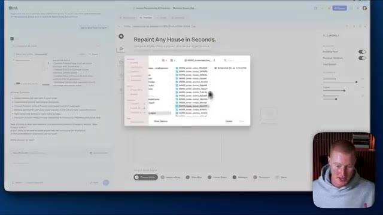
*⏱️ 00:06:11 — Interface de l'application web Blink affichant une boîte de dialogue système de sélection de fichiers par-dessus le projet de repeinte de maison.*

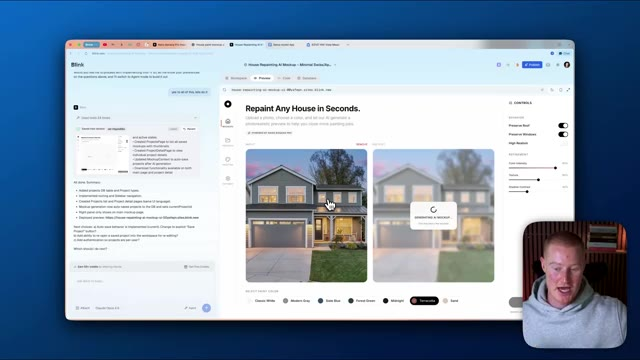
*⏱️ 00:06:19 — Interface de l'application web Blink montrant la génération en cours d'une image de maison repeinte (mockup) avec panneau de contrôle à droite.*

---

### ⏱️ `[00:06:28 - 00:07:01]` | Segment #15

**🔊 Audio (Transcription Intégrale Mot pour Mot en Français) :**
> Voilà, c'est fait. Nous avons notre maquette ici. Je vais télécharger cette image. Et ensuite, si je vais dans les projets, vous pouvez voir que j'ai maintenant ce projet ici avec un avant et un après. Et je peux à nouveau télécharger ceci ici. Donc notre application fonctionne correctement. Maintenant, nous devons réellement ajouter l'authentification, ce qu'elle n'a pas encore fait. Disons donc d'ajouter les deux car elle demande en fait si vous voulez avoir la possibilité de rouvrir un projet enregistré dans l'espace de travail pour le rééditer. Allons donc de l'avant avec les deux. Très bien. Donc ça devrait fonctionner maintenant. Laisse-moi tester ça. Juste pour le plaisir, je vais simplement télécharger une image différente d'une autre maison. Prenons cette maison ici, faisons une capture d'écran, téléchargeons ceci.

**👁️ Analyse Visuelle d'Écran (gemini-3.5-flash-lite) :**
**Interface & Outils** : Navigateur web affichant l'interface de développement et de prévisualisation de Blink avec panneau de contrôle latéral.

**Contenu textuel & Code** : Maquette web interactive pour la coloration de façades de maisons avec aperçus avant/après et sélecteur de teintes.
[DESC_IMAGE_3] Navigation dans les différentes vues de l'application et démonstration de la génération d'images par IA.

**Action / Démonstration** : Explications face caméra et analyse conceptuelle des marchés.

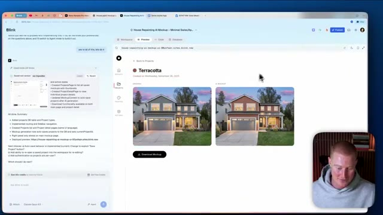
*⏱️ 00:06:36 — Vue détaillée du projet "Terracotta" affichant la comparaison avant et après de la maison repeinte.*

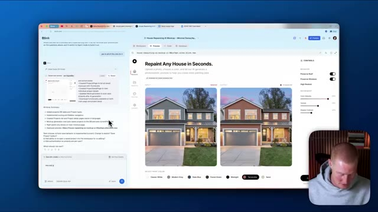
*⏱️ 00:06:45 — Interface principale de l'application montrant l'outil de repeint de maison avec options de couleurs et aperçu dynamique.*

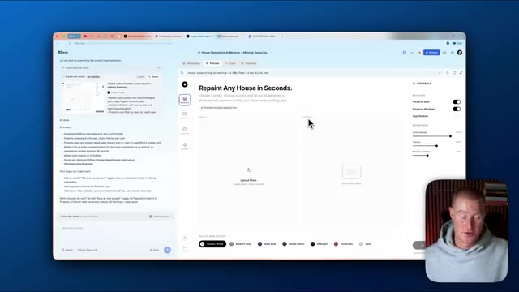
*⏱️ 00:06:53 — Page d'accueil de l'application "Repaint Any House in Seconds" avec les zones de téléchargement de photos vides.*

---

### ⏱️ `[00:07:01 - 00:07:35]` | Segment #16

**🔊 Audio (Transcription Intégrale Mot pour Mot en Français) :**
> photo. Et puis laissez-moi choisir, disons simplement minuit pour celui-ci parce qu'il est radicalement différent. Et comme vous pouvez le voir, je me suis connecté, mais je vais vous montrer exactement comment faire cela ici bientôt. La fonctionnalité de connexion fonctionne donc et boum, nous avons notre peinture de style minuit ici. Et si nous allons dans les projets, nous avons cela de disponible. Et ensuite, nous pourrions même essayer une couleur différente et l'éditer directement. Les gars, c'est, je ne vais pas mentir, le processus le plus facile et le plus simple que j'aie eu lorsqu'il s'agit de construire une application en utilisant Gemini 3 pour le design et Claude Opus 4.5 pour le backend. Je pourrais donc me déconnecter et ensuite je pourrais me connecter. Je pourrais continuer avec Google juste ici. Et je l'ai fait

**👁️ Analyse Visuelle d'Écran (gemini-3.5-flash-lite) :**
**Interface & Outils** : Application web Blink (générateur d'applications/mockups par IA).

**Contenu textuel & Code** : Interface utilisateur d'une application web de maquettage avec options de personnalisation de couleur et panneau de génération textuelle.

**Action / Démonstration** : Sélection d'une option de couleur ("midnight") pour modifier l'image de la maison via l'IA.

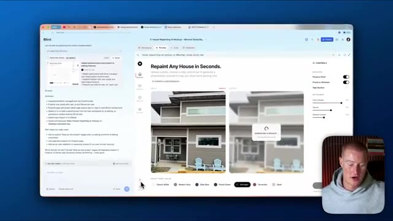
*⏱️ 00:07:10 — Interface de l'application Blink affichant un générateur de peinture de maison par IA, avec le panneau de chat à gauche et la prévisualisation au centre.*

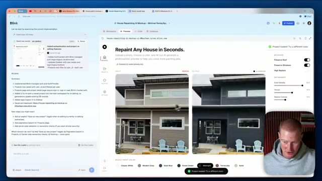
*⏱️ 00:07:18 — Sélection de la couleur "Midnight" dans l'interface de prévisualisation de l'application Blink.*

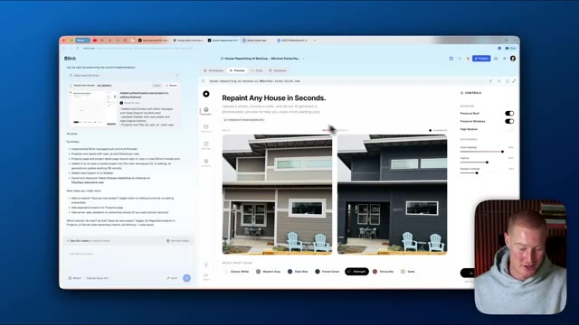
*⏱️ 00:07:27 — Résultat de l'application de la couleur "Midnight" sur la maquette de la maison générée par l'IA.*

---

### ⏱️ `[00:07:35 - 00:08:11]` | Segment #17

**🔊 Audio (Transcription Intégrale Mot pour Mot en Français) :**
> design juste là. J'ai fait cette peinture sur ce compte. Donc je devrais voir ça dans mes projets ici. Et juste comme ça, ça fonctionne correctement. Et vous pouvez voir que nous avons notre base de données ici en ce qui concerne blink.new. Nous avons toutes ces informations. Nous avons des utilisateurs, nous avons des projets, nous avons des jetons de réinitialisation de mot de passe, toutes ces choses. Donc notre base de données fonctionne correctement. Et puis une chose que je veux mentionner à l'intérieur de notre espace de travail, nous pourrions aussi lancer ceci sur un domaine personnalisé, nous pourrions ajouter nos secrets ici si nous avons des clés d'API et ensuite vous pouvez même voir toutes les différentes versions ici que nous avons faites. Laissez-moi continuer, laissez-moi ajouter un peu plus de fonctionnalités à notre application donc disons simplement que nous voulons faire de ceci non seulement une application pour les peintres mais peut-être que nous voulons faire en sorte que nous puissions ajouter comme

**👁️ Analyse Visuelle d'Écran (gemini-3.5-flash-lite) :**
**Interface & Outils** : Navigateur web sur blink.new

**Contenu textuel & Code** : Structure de la base de données, tables, noms de colonnes et détails du projet web.

**Action / Démonstration** : Navigation entre les onglets de la plateforme de développement blink.new pour montrer la base de données et les paramètres du projet.

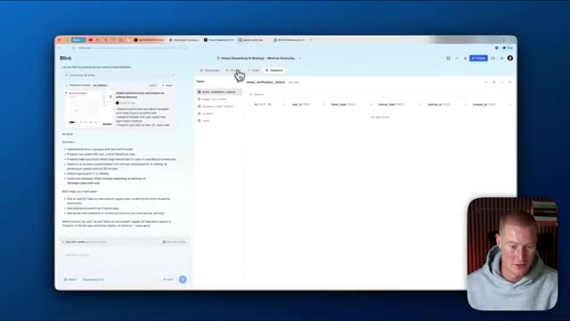
*⏱️ 00:07:44 — L'interface de blink.new affichant l'onglet Base de données avec la table email_verification_tokens.*

---

### ⏱️ `[00:08:11 - 00:08:35]` | Segment #18

**🔊 Audio (Transcription Intégrale Mot pour Mot en Français) :**
> des modifications sur le terrain de quelqu'un si nous sommes par exemple une entreprise d'aménagement paysager, alors laissez-moi rédiger une consigne ici. Très bien les gars, regardez, nous avons maintenant deux onglets différents ici, nous avons notre mode paysage où nous pouvons redessiner n'importe quel jardin en quelques secondes. Et ensuite, nous avons notre mode peinture. Vous pouvez voir que nous avons ces consignes pré-sélectionnées ici. Nous avons paysage minimaliste moderne. Nous avons tropical, nous avons prairie de fleurs sauvages. Les gars, c'est fou. Laissez-moi télécharger cette image de cette maison ici.

**👁️ Analyse Visuelle d'Écran (gemini-3.5-flash-lite) :**
**Interface & Outils** : Application web Blink (générateur d'interface et d'applications par IA)

**Contenu textuel & Code** : Interface utilisateur avec des sections de prévisualisation, des options de contrôle (Preserve Roof/House/Driveway), des curseurs de réglage (Color Intensity, Texture) et une sélection de styles visuels.

**Action / Démonstration** : Navigation et démonstration entre les différents modes de l'application (peinture de maison et aménagement paysager).

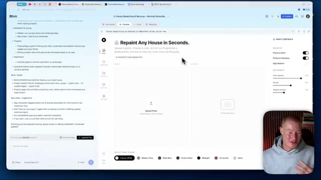
*⏱️ 00:08:17 — Interface de l'application de maquettage affichant l'onglet "Repaint Any House in Seconds" avec des options de peinture et de contrôle à droite.*

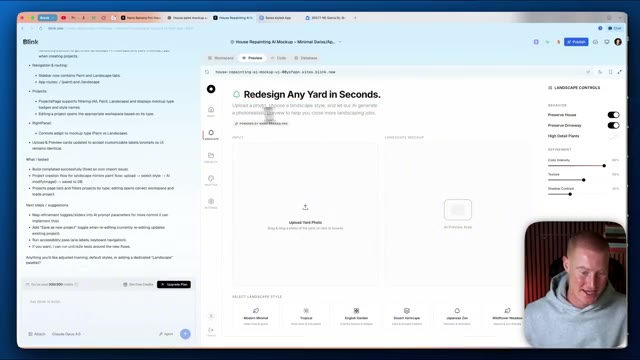
*⏱️ 00:08:23 — Passage à l'onglet "Redesign Any Yard in Seconds" montrant l'interface d'aménagement paysager avec les styles de jardin en bas.*

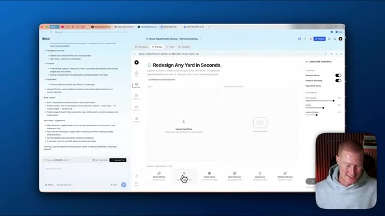
*⏱️ 00:08:29 — Le curseur clique sur un style paysager spécifique ("Tropical") dans l'application de démonstration.*

---

### ⏱️ `[00:08:36 - 00:09:04]` | Segment #19

**🔊 Audio (Transcription Intégrale Mot pour Mot en Français) :**
> Et laissez-moi juste aller de l'avant et cliquer sur un. Faisons simplement le minimalisme moderne pour voir à quoi cela ressemblerait. Et si ça marche, les gars, je vais être tellement emballé. Je ne peux même pas vous le dire. Oh mon Dieu, regardez ça. C'est insensé, les gars. Je pourrais télécharger cette maquette. C'est une image hyper-réaliste. Si vous étiez paysagiste ou peintre, imaginez montrer cette maquette à un client potentiel et voir sa réaction et dire, hey, je peux construire ça pour vous.

**👁️ Analyse Visuelle d'Écran (gemini-3.5-flash-lite) :**
**Interface & Outils** : Application web Blink (générateur d'aménagement paysager par IA).

**Contenu textuel & Code** : Interface utilisateur avec des options de design ("Modern Minimal", "Tropical", etc.), des curseurs de réglage (Color intensity, Texture) et des comparatifs avant/après de maisons.

**Action / Démonstration** : Sélection et prévisualisation d'un style paysager minimaliste moderne pour observer le résultat généré par l'IA.

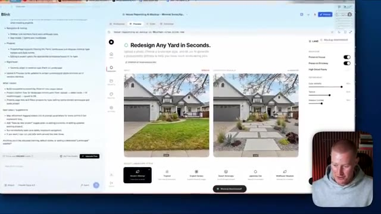
*⏱️ 00:08:50 — Interface de l'application Blink montrant un générateur de design paysager par IA avec l'aperçu avant/après d'une maison et ses options de style.*

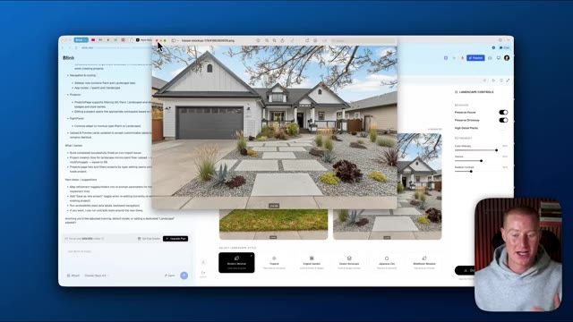
*⏱️ 00:08:57 — Visualisation agrandie d'une image générée par l'IA représentant un aménagement paysager minimaliste moderne devant une maison.*

---

### ⏱️ `[00:09:04 - 00:09:22]` | Segment #20

**🔊 Audio (Transcription Intégrale Mot pour Mot en Français) :**
> Et ensuite, vous leur donnez simplement un devis, puis vous allez de l'avant et vous leur vendez ce service. C'est insensé. Et c'est une plateforme que j'ai construite en littéralement environ 10 à 15 minutes en utilisant Gemini 3 et Plot Opus 4.5. Ce que je pourrais faire, c'est que je peux réellement retourner dans mes projets. C'est maintenant stocké ici. Vous pouvez voir que j'ai réellement cet autre projet.

**👁️ Analyse Visuelle d'Écran (gemini-3.5-flash-lite) :**
**Interface & Outils** : Navigateur web affichant la plateforme de prototypage Blink avec panneau de contrôle à droite et notes de projet à gauche.

**Contenu textuel & Code** : Maquette d'application d'aménagement paysager par IA, avec aperçus visuels avant/après, options de style et curseurs de contrôle (Color Intensity, Texture, Shadow Contrast).

**Action / Démonstration** : Navigation et présentation de l'application web générée par IA pour la refonte de paysages.

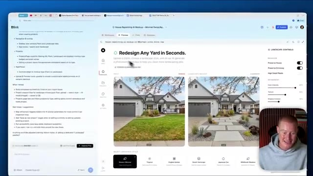
*⏱️ 00:09:08 — Interface Blink affichant l'application 'Redesign Any Yard in Seconds' avec un aperçu comparatif avant/après de l'aménagement paysager d'une maison.*

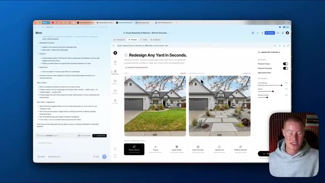
*⏱️ 00:09:13 — Vue rapprochée de l'interface montrant les options de style paysager (Modern Minimal) et les commandes de réglage latéral.*

---

### ⏱️ `[00:09:22 - 00:09:42]` | Segment #21

**🔊 Audio (Transcription Intégrale Mot pour Mot en Français) :**
> Permettez-moi de continuer et essayons-en un de plus ici pour le mode paysage. Téléchargeons cette maison. Et ensuite, allons de l'avant avec, faisons simplement un jardin anglais pour voir à quoi cela ressemblerait. C'est fou. On ne peut même pas deviner que cela a été généré par IA, les gars. Je ne vais pas vous mentir, les gars. C'est l'expérience la plus facile que j'aie jamais vécue pour créer une application en utilisant l'IA.

**👁️ Analyse Visuelle d'Écran (gemini-3.5-flash-lite) :**
**Interface & Outils** : Navigateur web affichant l'application Blink (Blink.new) avec un panneau de contrôle latéral.

**Contenu textuel & Code** : Interface utilisateur de refonte paysagère avec options de style (Modern Minimal, Tropical, English Garden, Desert Hardscape, etc.) et curseurs de réglage.

**Action / Démonstration** : Téléchargement d'une image de maison et sélection du style 'English Garden' pour lancer la génération par IA.

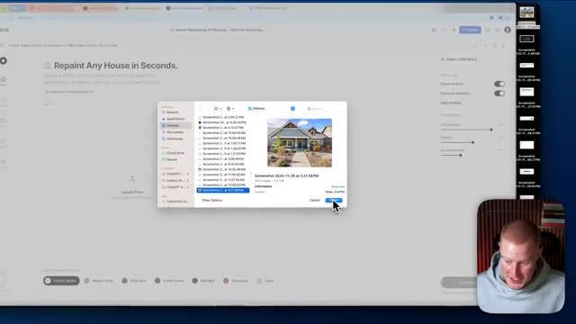
*⏱️ 00:09:27 — Sélection d'une photo de maison sur le bureau de l'ordinateur pour l'importer dans l'application web Blink.*

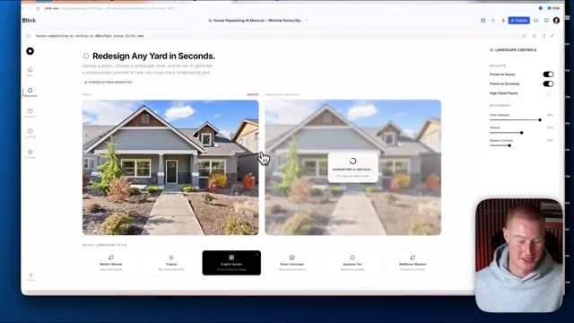
*⏱️ 00:09:32 — Interface de l'outil Blink en cours de génération d'un aménagement paysager de type jardin anglais.*

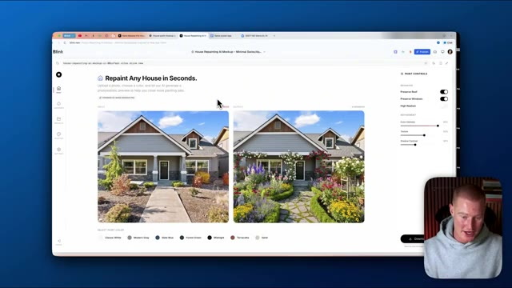
*⏱️ 00:09:37 — Résultat final affichant la maison avec un jardin anglais généré par intelligence artificielle.*

---

### ⏱️ `[00:09:42 - 00:10:04]` | Segment #22

**🔊 Audio (Transcription Intégrale Mot pour Mot en Français) :**
> Je n'ai rencontré absolument aucun problème. J'ai construit ceci en à peu près trois ou quatre instructions. Et le design de notre application est phénoménal. Cela a l'air tellement mieux que n'importe quelle autre application générée par IA que j'ai jamais construite. Cela a suivi mes préférences de design pour ainsi dire au doigt et à l'œil, exactement ce que je voulais construire. Donc les gars, si vous voulez essayer de construire une application comme celle-ci par vous-mêmes, il y a un lien pour utiliser Blinked dès maintenant.

**👁️ Analyse Visuelle d'Écran (gemini-3.5-flash-lite) :**
**Interface & Outils** : Navigateur web affichant la plateforme de création d'applications Blink.new et une caméra incrustée du présentateur.

**Contenu textuel & Code** : Interface utilisateur d'une application web nommée "Repaint Any House in Seconds" avec des boutons de contrôle de peinture et des images avant/après.

**Action / Démonstration** : Le présentateur navigue et démontre l'interface utilisateur de l'application générée par IA.

---

### ⏱️ `[00:10:04 - 00:10:20]` | Segment #23

**🔊 Audio (Transcription Intégrale Mot pour Mot en Français) :**
> C'est une plateforme parfaite pour utiliser à la fois Gemini 3 Pro et Claude Opus 4.5 sur une seule et même plateforme. Juste comme vous l'avez vu dans cette vidéo. Si vous avez tiré un peu de valeur de ceci, laissez un pouce bleu. Dites-moi ce que vous en pensez dans les commentaires et abonnez-vous à cette chaîne pour plus de vidéos comme celle-ci. Cela étant dit, les gars, merci d'avoir regardé jusqu'à la fin et je vous retrouve dans la prochaine vidéo.

**👁️ Analyse Visuelle d'Écran (gemini-3.5-flash-lite) :**
**Interface & Outils** : AUCUNE

**Contenu textuel & Code** : AUCUNE

**Action / Démonstration** : AUCUNE

---

