# 🎬 How to Edit Any Video with AI INSTANTLY (Kling o1)

> **Chaîne** : [Brock Mesarich | AI for Non Techies](https://www.youtube.com/@BrockMesarich)  
> **Lien YouTube** : [https://www.youtube.com/watch?v=ylt358aJ7jA](https://www.youtube.com/watch?v=ylt358aJ7jA)  
> **Date de publication** : 20251204  
> **Durée** : 00:09:52  
> **Identifiant vidéo** : `ylt358aJ7jA`  
> **Transcription & Analyse** : `whisper-v3-large-turbo+gemini-3.5-flash-lite`  

---

## 📌 Synthèse Exécutive & Outils

### 💡 Résumé

Cette vidéo, présentée par la chaîne *Brock Mesarich | AI for Non Techies*, met en lumière l'émergence des nouveaux modèles de génération et d'édition vidéo par intelligence artificielle, comparables à un « Photoshop pour la vidéo ». À travers des démonstrations pratiques, la session explore comment transformer radicalement une séquence existante — qu'il s'agisse d'un bâtiment historique à Lisbonne ou d'un personnage marchant dans la rue — en modifiant en quelques secondes l'éclairage, l'arrière-plan (passant des montagnes à une plage ou un champ ouvert) ou la garde-robe du sujet, tout en conservant une cohérence visuelle parfaite.

L'analyse démontre l'efficacité d'un workflow combinant des outils de pointe et du *prompt engineering* avancé. En s'appuyant sur des interfaces comme Arcads et des modèles de pointe (Kling 01 et Kling 2.6), le présentateur montre comment structurer des requêtes ultra-spécifiques — détaillant le choix des objectifs, l'éclairage et le cadrage — grâce à l'aide de GPTs personnalisés. Cette approche permet d'automatiser et d'accélérer la production de contenus cinématographiques de haute qualité, réduisant drastiquement le besoin d'effets visuels traditionnels complexes.

Au-delà de la simple manipulation d'images, cette avancée technologique redéfinit les standards de la création de contenu visuel. La capacité à générer et éditer des vidéos de manière instantanée à partir de simples consignes textuelles ouvre des perspectives inédites pour la production rapide de médias, l'itération créative et le prototypage visuel à grande échelle, marquant un tournant décisif dans l'accessnalité des technologies de pointe pour les non-techniciens.

### 🛠️ Outils, Modèles & Logiciels Présentés

* **Kling 01 (et Kling 2.6)** : Modèle vidéo de pointe intégré à Arcads, spécialisé dans la génération ultra-réaliste et l'édition dynamique de séquences vidéo à partir de simples consignes textuelles.
* **Arcads** : Plateforme centrale de création et d'édition vidéo par IA regroupant plusieurs modèles de pointe pour le montage et la production automatisée.
* **ChatGPT** : Assistant conversationnel utilisé pour exploiter des GPTs personnalisés dédiés à la rédaction de prompts vidéo hautement spécifiques et techniques.
* **Luma** : Modèle de génération vidéo complémentaire mentionné pour sa capacité à assister dans la construction de séquences visuelles.
* **VO 3.1** : Modèle de génération vidéo alternatif disponible sur les plateformes de création pour diversifier les rendus stylistiques.
* **Sora 2 Pro** : Modèle de pointe de génération de vidéo cinématique haut de gamme évoqué pour les plans complexes.
* **Gemini** : Modèle de langage étendu de Google, mentionné dans l'écosystème technologique global des IA génératives.
* **Claude** : Assistant IA de pointe d'Anthropic, utilisé dans les flux de travail d'automatisation et de structuration textuelle.
* **Make** et **n8n** : Plateformes d'automatisation de flux de travail (*workflows*) pour connecter des outils d'IA et industrialiser des processus.
* **Grok** : Modèle d'intelligence artificielle conversationnelle développé par xAI, intégré aux écosystèmes d'analyse en temps réel.
* **Zapier** : Outil d'intégration et d'automatisation no-code reliant différentes applications logicielles entre elles.

### 🔑 Points Clés & Enseignements Stratégiques

* **Le concept du « Photoshop pour la vidéo »** : Les nouveaux modèles permettent d'éditer des séquences existantes de manière instantanée, en modifiant l'arrière-plan, la météo ou l'habillement sans altérer la cohérence du sujet principal.
* **Importance du *Prompt Engineering* avancé** : Pour obtenir des résultats professionnels sans artéfacts, il est indispensable de structurer des requêtes extrêmement détaillées spécifiant l'éclairage, les objectifs de caméra et la composition du cadre.
* **Utilisation de GPTs personnalisés** : Le recours à des assistants IA spécialisés permet de générer des prompts hyper-spécifiques adaptés aux exigences techniques des moteurs vidéo comme Kling.
* **Cohérence temporelle et spatiale** : Les technologies actuelles garantissent que le sujet principal (personnage, bâtiment) reste rigoureusement identique malgré les modifications radicales apportées à l'environnement ou au décor.
* **Maîtrise des paramètres de sortie** : Ajuster la durée de la vidéo (par exemple 5 à 10 secondes) et le nombre de générations permet d'optimiser le compromis entre temps de calcul et qualité du rendu final.
* **Flexibilité du format d'image** : La capacité à basculer rapidement vers des formats verticaux (9:16) facilite l'adaptation des contenus pour les réseaux sociaux et les plateformes mobiles.
* **Itération rapide et prototypage** : Le processus de modification itératif (passer d'une ambiance sombre à un coucher de soleil, puis à un plein jour en montagne) s'exécute en quelques minutes, réduisant les cycles de production.
* **Intégration multi-modèle** : La possibilité de basculer facilement entre différents moteurs (Kling 2.6, VO 3.1, Sora 2 Pro) au sein d'une même interface permet de sélectionner le rendu stylistique le plus adapté au projet.
* **Démocratisation de la production visuelle** : Les outils présentés permettent à des utilisateurs non-techniques de réaliser des montages de niveau cinématographique autrefois réservés aux studios dotés de budgets conséquents.
* **Gestion de l'éclairage et de l'ambiance** : Les modifications textuelles permettent de transformer radicalement la tonalité émotionnelle d'une vidéo (d'une ambiance "moody" et sombre à un plan chaleureux ou lumineux) en une seule instruction.

---

## ⏱️ Chronologie & Transcription Complète Audio & Visuelle (Mot pour Mot)

### ⏱️ `[00:00:00 - 00:00:21]` | Segment #01

**🔊 Audio (Transcription Intégrale Mot pour Mot en Français) :**
> Ce nouveau modèle vidéo d'IA vient de sortir et il peut générer et éditer n'importe quelle vidéo que vous voulez. C'est en gros Photoshop pour la vidéo, mais en beaucoup plus facile. Regardez ça. J'ai pris une vraie vidéo de mariage et avec une seule consigne, je l'ai déplacée des montagnes à une plage. Ensuite, l'ai fait à nouveau. J'ai changé la couleur du ciel, échangé l'arrière-plan, et j'ai même changé ce que quelqu'un portait à partir d'une seule consigne.

**👁️ Analyse Visuelle d'Écran (gemini-3.5-flash-lite) :**
**Interface & Outils** : Interface de lecteur vidéo et incrustation vidéo du présentateur.

**Contenu textuel & Code** : Exemple de modification de décor vidéo par IA (passage de la montagne à la plage).

**Action / Démonstration** : Démonstration visuelle de l'édition vidéo par IA à partir d'une vidéo réelle.

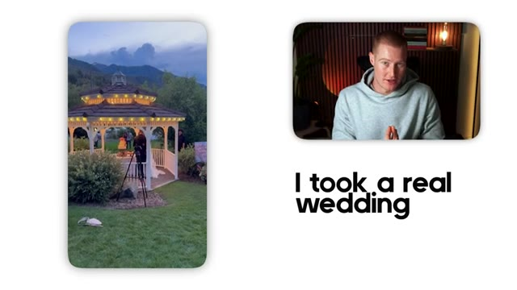
*⏱️ 00:00:10 — Vidéo d'un mariage sous un gazebo avec un paysage de montagne en arrière-plan, accompagnée du présentateur en incrustation et du texte 'I took a real wedding'.*

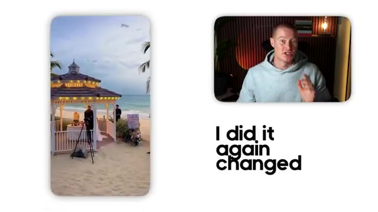
*⏱️ 00:00:15 — Vidéo du même mariage sous le gazebo mais modifié pour être sur une plage tropicale, avec le présentateur en incrustation et le texte 'I did it again changed'.*

---

### ⏱️ `[00:00:21 - 00:00:40]` | Segment #02

**🔊 Audio (Transcription Intégrale Mot pour Mot en Français) :**
> Ainsi qu'ici, voici d'autres vidéos que j'ai montées en utilisant ce nouveau modèle en seulement quelques minutes. Donc dans cette vidéo, je vais vous montrer exactement comment utiliser Kling01 pour faire des montages comme celui-ci en quelques secondes. Très bien, entrons dans le vif du sujet. Très bien, les gars. Donc nous allons utiliser Arcads dans cette vidéo pour utiliser Kling01. Donc tout d'abord, ce que vous allez faire, c'est que vous allez sélectionner nouveau projet.

**👁️ Analyse Visuelle d'Écran (gemini-3.5-flash-lite) :**
**Interface & Outils** : Interface web de gestion de projets (Nanana Pro)

**Contenu textuel & Code** : Vignettes de vidéos verticales avec des aperçus de paysages et de portraits, et une zone de texte pour décrire la vidéo.

**Action / Démonstration** : Navigation et présentation de l'interface de l'application de montage vidéo par IA.

---

### ⏱️ `[00:00:41 - 00:01:02]` | Segment #03

**🔊 Audio (Transcription Intégrale Mot pour Mot en Français) :**
> Vous pouvez voir que j'ai un projet ouvert juste ici. Et laissez-moi vous montrer sur quoi je venais juste de travailler en faisant des tests avec ceci avant de filmer réellement cette vidéo. J'ai donc créé ceci juste ici. Voici donc la première vidéo que j'ai générée. Parfois le monde bouge, et vous apprenez simplement à bouger avec lui.

**👁️ Analyse Visuelle d'Écran (gemini-3.5-flash-lite) :**
**Interface & Outils** : Interface web d'un outil de génération vidéo par IA (type Kling AI ou plateforme similaire).

**Contenu textuel & Code** : Panneau latéral affichant les détails du prompt de génération vidéo ("# SIDEWALK EPOCH...", modèle Kling) et grille de projets.

**Action / Démonstration** : Le présentateur présente l'interface de son projet et montre un exemple concret de vidéo générée par l'IA.

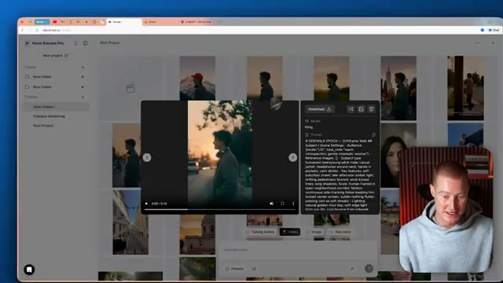
*⏱️ 00:00:51 — Interface d'un outil de génération vidéo par IA montrant un projet en cours avec une vidéo prévisualisée et son prompt textuel associé.*

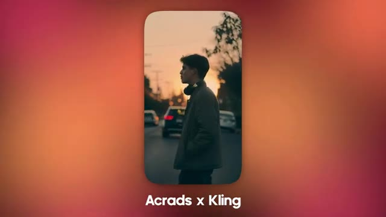
*⏱️ 00:00:57 — Gros plan sur la première vidéo générée montrant un jeune homme marchant dans la rue, avec le texte "Agrads x Kling" en bas.*

---

### ⏱️ `[00:01:04 - 00:01:24]` | Segment #04

**🔊 Audio (Transcription Intégrale Mot pour Mot en Français) :**
> Donc, comme vous pouvez le voir, ça a l'air extrêmement bien. C'est une vidéo très cinématographique de ce type qui marche dans la rue. La caméra le suit fondamentalement. Il reste au milieu du cadre et c'est exactement ce que je voulais que cette vidéo soit. Vous pouvez voir que j'ai utilisé ce prompt très complet pour générer cette vidéo et c'est pourquoi elle est si réussie. Et j'ai utilisé le modèle vidéo Kling pour faire cela.

**👁️ Analyse Visuelle d'Écran (gemini-3.5-flash-lite) :**
**Interface & Outils** : Interface web de génération de vidéo par IA (nano.enicards.ai / Kling) avec incrustation vidéo du présentateur.

**Contenu textuel & Code** : Prompt textuel détaillé de génération vidéo ("SIDEWALK EPOCH", "Driftframe V6.4", descriptions des scènes, éclairage, mouvements de caméra).

**Action / Démonstration** : Le présentateur présente et commente le résultat visuel et le prompt de la vidéo générée par IA.

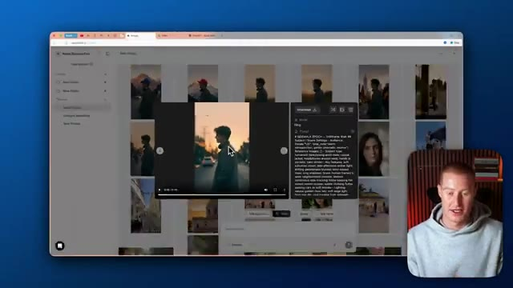
*⏱️ 00:01:09 — Interface d'un générateur de vidéo par IA montrant le résultat d'une vidéo verticale d'un jeune homme marchant dans la rue, avec le présentateur en incrustation.*

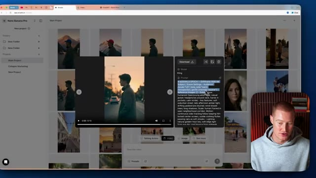
*⏱️ 00:01:19 — La même interface de génération vidéo avec une mise en avant du panneau latéral affichant le prompt textuel utilisé pour créer la vidéo.*

---

### ⏱️ `[00:01:24 - 00:01:59]` | Segment #05

**🔊 Audio (Transcription Intégrale Mot pour Mot en Français) :**
> Dans cette vidéo, je vais vous montrer un truc pour créer des prompts et des vidéos qui sont aussi précis et de si haute qualité au lieu d'avoir, vous savez, un tas d'erreurs différentes, et ensuite ce que j'ai fait, c'est que j'ai pris cette vidéo et je l'ai transformée en celle-ci où il est dans un champ ouvert. Parfois, le monde bouge. Exactement la même vidéo, vous pouvez voir que le personnage est complètement cohérent, et puis j'ai même fait celle-ci juste ici où il marche et l'arrière-plan le montre dans les montagnes, et encore une fois, j'ai fait ça en un seul prompt en modifiant cette vidéo. Parfois, le monde

**👁️ Analyse Visuelle d'Écran (gemini-3.5-flash-lite) :**
**Interface & Outils** : Application Web de génération de vidéo par IA (Nano Banana Pro / Kling AI).

**Contenu textuel & Code** : Galerie de projets vidéo, interface de prévisualisation, paramètres de génération et prompts textuels détaillés pour Kling.

**Action / Démonstration** : Navigation dans l'interface de création et démonstration du résultat vidéo obtenu à partir d'un prompt.

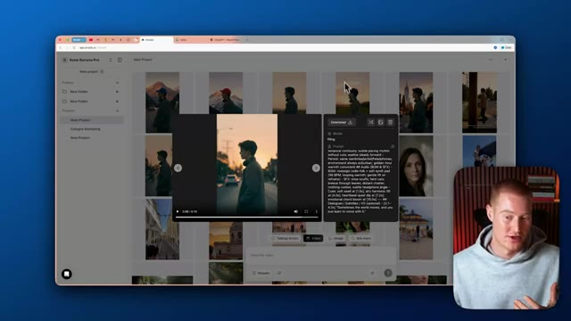
*⏱️ 00:01:33 — Interface d'un générateur de vidéo par IA affichant une grille de projets et une fenêtre de prévisualisation avec un prompt détaillé sur le côté.*

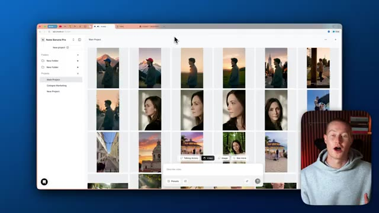
*⏱️ 00:01:51 — Vue large de l'interface de création vidéo montrant la galerie complète de clips générés par IA et le champ de saisie de prompt.*

---

### ⏱️ `[00:01:59 - 00:02:34]` | Segment #06

**🔊 Audio (Transcription Intégrale Mot pour Mot en Français) :**
> mouvements. Et ensuite, ce que j'ai fait, c'est que j'ai même pris celui-ci et je l'ai encore plus modifié au point où il est de nouveau en train de marcher devant une montagne, mais maintenant il a un chapeau bleu. Parfois, le monde bouge et on apprend simplement à bouger avec lui. Je vais donc vous montrer à quel point il est facile de modifier réellement une vidéo comme celle-ci ou de générer une vidéo à partir de zéro. Tout d'abord, ce que je vais faire, c'est descendre ici et cliquer sur « voir plus » et comme vous pouvez le voir, nous avons l'éditeur vidéo Kling 01 ici

**👁️ Analyse Visuelle d'Écran (gemini-3.5-flash-lite) :**
**Interface & Outils** : Application web Nano Banana Pro et interface de génération vidéo (Kling).

**Contenu textuel & Code** : Galerie de projets vidéo montrant des variations de personnages et d'arrière-plans générés par IA.
[DESC_IMAGE_3] Présentation et démonstration de modifications d'images et de vidéos par IA.

**Action / Démonstration** : Explications face caméra et analyse conceptuelle des marchés.

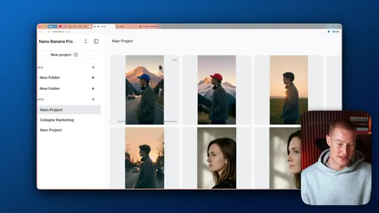
*⏱️ 00:02:08 — Interface d'un outil de création vidéo IA (Nano Banana Pro) montrant plusieurs clips générés, incluant le personnage avec un chapeau bleu devant une montagne.*

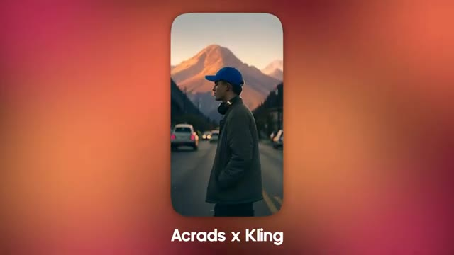
*⏱️ 00:02:17 — Gros plan sur la vidéo générée montrant un homme avec un chapeau bleu marchant dans une rue avec une montagne en arrière-plan, avec la mention "Acrads x Kling".*

---

### ⏱️ `[00:02:34 - 00:03:09]` | Segment #07

**🔊 Audio (Transcription Intégrale Mot pour Mot en Français) :**
> qui est un outil que nous pourremmo utiliser à l'intérieur d'Arcads, l'une des raisons pour lesquelles j'aime vraiment cette plateforme, je vais simplement sélectionner ceci et ensuite ce que je pourrais faire, c'est que je pourrais télécharger n'importe quelle vidéo et ensuite je peux y apporter des modifications. Pour les besoins de la cause, téléchargeons réellement une vraie vidéo que j'ai prise lorsque j'étais en vacances, ce n'തല്ല pas une vidéo générée par IA et je vais vous montrer exactement ce que je veux dire. J'ai donc cette vidéo juste ici, qui est de ce château lorsque j'étais réellement à Lisbonne, au Portugal, ou ce bâtiment. Je ne sais pas si c'est nécessairement un château, mais cela a l'air vraiment cool. Et ce que je veux faire, c'est que je veux modifier cette vidéo pour y rendre le temps ensoleillé à l'extérieur et peut-être

**👁️ Analyse Visuelle d'Écran (gemini-3.5-flash-lite) :**
**Interface & Outils** : Application Web Arcads (plateforme de génération et d'édition vidéo).

**Contenu textuel & Code** : Galerie de projets vidéo avec vignettes et options d'édition (Talking Actors, Video, Image, Video editor).

**Action / Démonstration** : Sélection d'une option de téléchargement et d'édition de vidéo au sein de la plateforme Arcads.

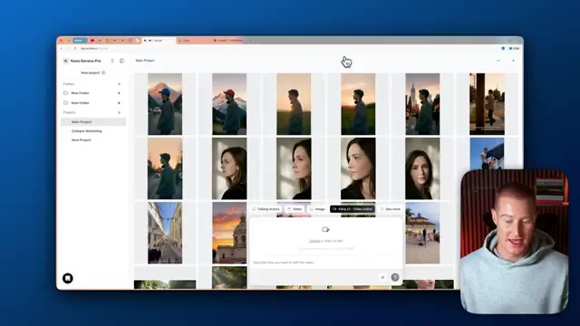
*⏱️ 00:02:43 — Interface d'Arcads montrant une galerie de vidéos avec une fenêtre contextuelle pour télécharger et modifier une vidéo.*

---

### ⏱️ `[00:03:09 - 00:03:44]` | Segment #08

**🔊 Audio (Transcription Intégrale Mot pour Mot en Français) :**
> avoir un coucher de soleil. Je veux qu'il ait l'air un peu plus esthétique au lieu d'avoir l'air si sombre et lugubre ici. Je vais vous montrer à quel point il est facile de faire une telle modification. Très bien. La première chose que je vais faire, c'est simplement télécharger cette image. Et encore une fois, assurez-vous d'utiliser cet outil de montage vidéo ici qui est Kling 01, et ensuite je vais simplement décrire le changement que je veux apporter à cette vidéo, je vais lui donner un prompt aussi simple que celui-ci : rendre le ciel ensoleillé au coucher du soleil, garder tout le reste pareil. Et ce que je vais faire, c'est m'assurer que la durée de sortie ici est de 10 secondes, et ensuite je pourrais changer le nombre de générations de vidéos que je veux, allons-y simplement et commençons par une parce que je pense que cela devrait suffire, donc je suis

**👁️ Analyse Visuelle d'Écran (gemini-3.5-flash-lite) :**
**Interface & Outils** : Interface web Nano Banana Pro / Kling AI (éditeur vidéo)

**Contenu textuel & Code** : Menu de téléchargement de fichiers, interface de grille de projets et options de paramètres d'outils (durée, générations).

**Action / Démonstration** : Téléchargement d'une image/vidéo de coucher de soleil et préparation de l'édition avec un prompt textuel.

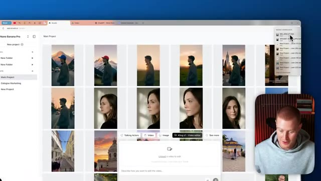
*⏱️ 00:03:17 — L'interface de l'application web avec le panneau de téléchargement et le curseur de la souris sélectionnant une vidéo.*

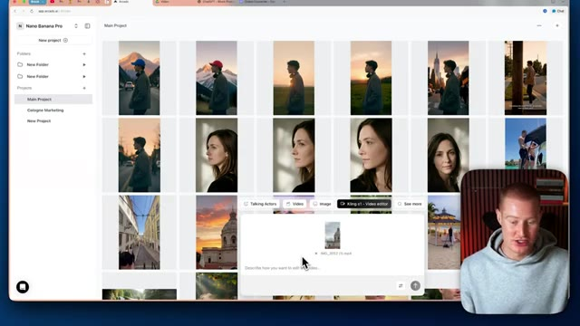
*⏱️ 00:03:26 — La vidéo du coucher de soleil est maintenant téléchargée dans l'interface de montage vidéo.*

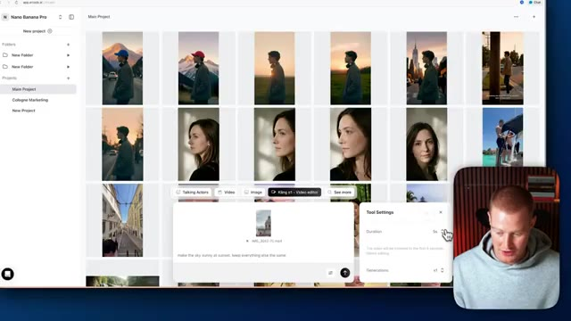
*⏱️ 00:03:35 — Le panneau de configuration s'ouvre avec le champ de texte pour taper le prompt de modification de la vidéo.*

---

### ⏱️ `[00:03:44 - 00:04:16]` | Segment #09

**🔊 Audio (Transcription Intégrale Mot pour Mot en Français) :**
> on va envoyer ça et Kling et Luma vont commencer à construire notre vidéo, laissez-moi y revenir dans une seconde. Très bien. Et juste quelques minutes plus tard, cette vidéo a été générée. Waouh. Exactement la même vidéo. Vous pouvez voir que c'est exactement le même sujet ici. C'est le même bâtiment. Cependant, l'arrière-plan est juste ce coucher de soleil maintenant, au lieu d'être cette ambiance sombre et nuageuse de la vidéo d'origine. Et on ne peut même pas deviner que c'est généré par IA les gars. C'est tellement fou. Et je veux que vous réalisiez à quelle époque nous vivons maintenant. Nous vivons à une époque maintenant où vous pouvez éditer vos

**👁️ Analyse Visuelle d'Écran (gemini-3.5-flash-lite) :**
**Interface & Outils** : Interface web de génération vidéo par IA (type Kling / Luma ou similaire).

**Contenu textuel & Code** : Fenêtre de lecture vidéo avec barre de progression (0:00/0:05), boutons de téléchargement et panneau latéral affichant le prompt textuel « make the sky sunny at sunset, keep everything else the same ».

**Action / Démonstration** : Le présentateur commente le résultat généré par l'IA et montre l'interface de l'outil.

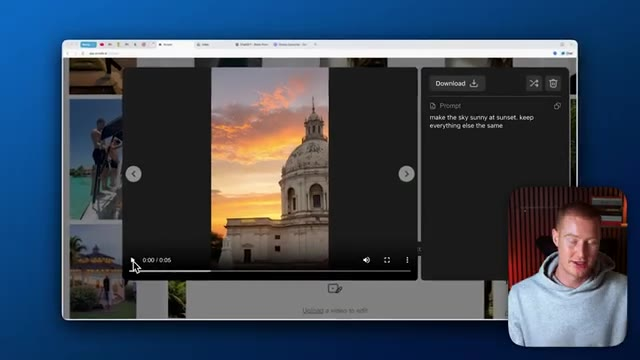
*⏱️ 00:03:52 — Capture d'écran montrant une interface de génération vidéo en ligne avec un aperçu d'un bâtiment au coucher du soleil et un panneau de prompt textuel à droite.*

---

### ⏱️ `[00:04:16 - 00:04:53]` | Segment #10

**🔊 Audio (Transcription Intégrale Mot pour Mot en Français) :**
> des vidéos. Comme à l'époque où l'on pouvait modifier Photoshop et retoucher quelque chose pour le rendre réel et que personne ne savait que c'est faux et qu'on peut faire exactement la même chose avec les vidéos IA maintenant. C'est un peu fou et un peu effrayant. En voici un autre que j'ai généré juste pour le faire. Je voulais voir à quoi en ressemblerait un autre. Même le zoom arrière, vous pouvez voir que le zoom arrière a exactement le même aspect, mais le background est la seule chose qui a changé. Très bien, je vais donc vous montrer comment vous pouvez créer cette même vidéo ici à partir de zéro en utilisant l'IA, puis y apporter des modifications pour qu'elle ait ce changement de décor en arrière-plan. La première chose que je vais donc faire, c'est de venir sur ce GPT personnalisé que mon ami Rourke m'a donné. C'est le meilleur dans le

**👁️ Analyse Visuelle d'Écran (gemini-3.5-flash-lite) :**
**Interface & Outils** : Navigateur web affichant une application de génération/modification vidéo par IA.

**Contenu textuel & Code** : Interface utilisateur web, lecteur vidéo, boutons de téléchargement et panneaux de texte de type prompt IA.

**Action / Démonstration** : Navigation et démonstration de clips vidéo modifiés ou générés par intelligence artificielle.

---

### ⏱️ `[00:04:53 - 00:05:18]` | Segment #11

**🔊 Audio (Transcription Intégrale Mot pour Mot en Français) :**
> entreprise lorsqu'il s'agit de créer des vidéos avec l'IA. Et ce que nous allons faire, c'est simplement expliquer ce que nous voulons créer. Alors, laissez-moi faire cela dès maintenant. Je veux que vous créiez un prompt pour une vidéo cinématographique. Un gars qui marche dans la rue, la caméra le suit pendant qu'il marche et c'est un plan de profil latéral avec lui directement au milieu du cadre. Je veux que cela ait une ambiance cinématographique et moody. Très bien, c'est donc le prompt que je vais donner à ce GPT.

**👁️ Analyse Visuelle d'Écran (gemini-3.5-flash-lite) :**
**Interface & Outils** : Navigateur web affichant l'interface de ChatGPT avec un GPT personnalisé.

**Contenu textuel & Code** : Page d'accueil de "Block Prompt GPT" avec un champ de saisie de texte en bas ("Prompt anything").

**Action / Démonstration** : Le présentateur s'apprête à saisir un prompt pour générer une vidéo cinématographique.

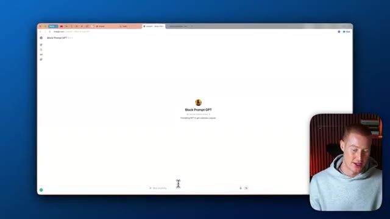
*⏱️ 00:04:59 — Capture d'écran montrant une interface de chatbot personnalisée nommée "Block Prompt GPT" dans un navigateur web, avec le présentateur en médaillon en bas à droite.*

---

### ⏱️ `[00:05:18 - 00:05:46]` | Segment #12

**🔊 Audio (Transcription Intégrale Mot pour Mot en Français) :**
> Et ce qu'il va faire, c'est qu'il va cracher ce prompt hyper spécifique qui est spécifique pour ces outils de génération de vidéo comme Kling et Arcads. Très bien, et voici notre prompt super spécifique. Ça a l'air un peu fou, donc n'y prêtez pas attention. Nous allons juste coller ceci dans Arcads, mais vous pouvez voir qu'il est même dit, genre, il nous donne un dialogue ici. Il détaille même l'éclairage, l'objectif et la mise au point de la caméra. C'est super spécifique, et c'est comme ça que vous pouvez obtenir de très bons résultats comme ceux que j'ai montrés dans cette vidéo. Donc ensuite, ce que je vais faire, c'est que je vais revenir sur Arcads, cliquer sur vidéo.

**👁️ Analyse Visuelle d'Écran (gemini-3.5-flash-lite) :**
**Interface & Outils** : Navigateur web affichant une interface de type ChatGPT / générateur de prompts.

**Contenu textuel & Code** : Texte détaillé de prompt vidéo incluant des instructions de cadrage, d'éclairage, de mouvements de caméra et d'ambiance sonore.

**Action / Démonstration** : Affichage et lecture d'un prompt hyper spécifique destiné aux outils de génération vidéo comme Kling et Arcads.

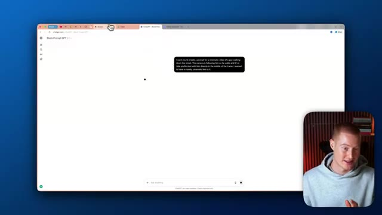
*⏱️ 00:05:25 — Interface d'un générateur de prompts affichant un prompt textuel pour une vidéo cinématique.*

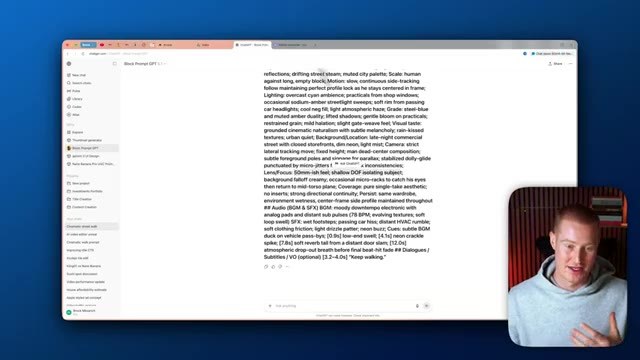
*⏱️ 00:05:39 — Interface du navigateur affichant un prompt détaillé et technique de génération vidéo avec des instructions de caméra et d'éclairage.*

---

### ⏱️ `[00:05:46 - 00:06:06]` | Segment #13

**🔊 Audio (Transcription Intégrale Mot pour Mot en Français) :**
> Je vais décrire ma vidéo et simplement coller ce prompt. Et ensuite, ce que je pourrais faire, c'est en fait cliquer sur ce petit outil ici et changer le modèle à utiliser. Kling 2.6 vient de sortir au moment de cette vidéo. Et il est vraiment bon pour ces plans de type cinématographique comme celui que je viens de vous montrer. Donc je vais sélectionner ce modèle, mais nous pourrions aussi utiliser VO 3.1 ou Sora 2 Pro.

**👁️ Analyse Visuelle d'Écran (gemini-3.5-flash-lite) :**
**Interface & Outils** : Application Web de génération de vidéo (Nano Banana Pro / Kling AI)

**Contenu textuel & Code** : Texte descriptif détaillé (prompt) pour la génération vidéo et menu des paramètres vidéo affichant le modèle Kling 2.6, le format 9:16 et la durée.

**Action / Démonstration** : Configuration d'un prompt textuel et sélection des paramètres de modèle pour la génération de plans cinématographiques.

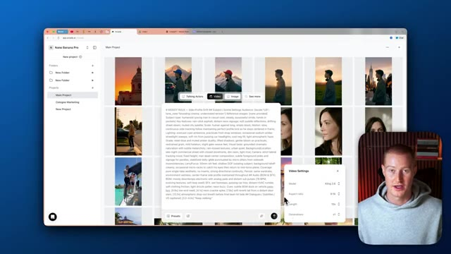
*⏱️ 00:05:51 — Interface d'un générateur de vidéo par IA montrant une grille de projets et une fenêtre contextuelle de saisie de prompt, avec un encart vidéo du présentateur en bas à droite.*

---

### ⏱️ `[00:06:06 - 00:06:24]` | Segment #14

**🔊 Audio (Transcription Intégrale Mot pour Mot en Français) :**
> Et ensuite, je vais changer le format d'image pour du neuf par seize. Donc, c'est dans ce style que j'ai montré. Ça va être une vidéo de 10 secondes. Et ensuite, nous pourrons changer la sortie. Faisons trois générations de ceci pour choisir notre préférée. Je vais donc envoyer ça à Arcads et revoyons ça dans un instant. Très bien, voici donc le résultat que nous avons obtenu, et ensuite, je vais y apporter quelques modifications pour éditer notre vidéo, pour ainsi dire.

**👁️ Analyse Visuelle d'Écran (gemini-3.5-flash-lite) :**
**Interface & Outils** : Application web Arcads (générateur de vidéo par IA)

**Contenu textuel & Code** : Paramètres de génération vidéo : modèle (Kling 2.0), format d'image (9:16), durée (10s), nombre de générations (x3), ainsi qu'une invite textuelle détaillée.

**Action / Démonstration** : Configuration des paramètres de format d'image, de durée et de nombre de générations dans l'interface d'Arcads.

*⏱️ 00:06:15 — Interface de l'outil de génération vidéo Arcads affichée à l'écran, avec une fenêtre de paramètres de vidéo ouverte en bas à droite et le présentateur visible en incrustation.*

---

### ⏱️ `[00:06:25 - 00:06:47]` | Segment #15

**🔊 Audio (Transcription Intégrale Mot pour Mot en Français) :**
> Continuez à marcher. Donc c'est tout simplement ce type qui marche dans la rue. Il reste au milieu de notre cadre. C'est vraiment très sombre. J'ai compris que je voulais un plan vraiment sombre. Donc ce que je vais faire, en fait, c'est que je vais télécharger cette vidéo et ensuite je vais la modifier pour qu'elle ne soit plus si sombre.

**👁️ Analyse Visuelle d'Écran (gemini-3.5-flash-lite) :**
**Interface & Outils** : Application web Kling AI (navigateur web, lecteur vidéo, panneau de configuration des prompts et tableau de bord des projets).

**Contenu textuel & Code** : Paramètres de génération vidéo, modèle Kling, prompt textuel détaillé ("MOODY WALK - Side-Profile Drama"), ratio 9:16 et vignettes de vidéos d'IA.

**Action / Démonstration** : Navigation dans l'interface de Kling AI, lecture d'une vidéo générée et examen des détails du prompt et des paramètres de génération.

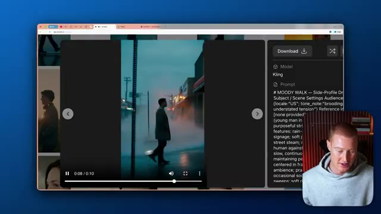
*⏱️ 00:06:36 — Capture d'écran du navigateur montrant le lecteur vidéo de l'application Kling AI en plein écran avec les détails du prompt sur le panneau de droite et le présentateur en incrustation.*

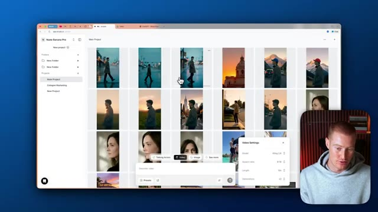
*⏱️ 00:06:41 — Interface complète du tableau de bord de Kling AI affichant la bibliothèque de projets avec de multiples vignettes de vidéos générées, les paramètres vidéo et le présentateur dans un encadré.*

---

### ⏱️ `[00:06:47 - 00:07:06]` | Segment #16

**🔊 Audio (Transcription Intégrale Mot pour Mot en Français) :**
> En fait, je veux que ce soit une ambiance joyeuse et peut-être introspective. Donc ce que je vais faire, c'est que je vais à nouveau sélectionner Kling01 Video Editor. Ensuite, je vais venir ici. Je vais simplement glisser notre vidéo, puis je vais décrire mes modifications ici. Très bien, alors voici le prompt que je vais donner à notre GPT. Je veux que tu crées un prompt pour une vidéo cinématographique d'un gars qui marche dans la rue.

**👁️ Analyse Visuelle d'Écran (gemini-3.5-flash-lite) :**
**Interface & Outils** : Nano Banana Pro / Application web d'IA, Kling v1 Video Editor, et interface de ChatGPT.

**Contenu textuel & Code** : Grille de vignettes vidéo générées par IA, panneau d'édition vidéo avec option de téléchargement et zone de saisie de texte pour un prompt de génération de vidéo.

**Action / Démonstration** : Sélection de l'outil d'édition vidéo Kling v1 et saisie des instructions de modification de la vidéo.

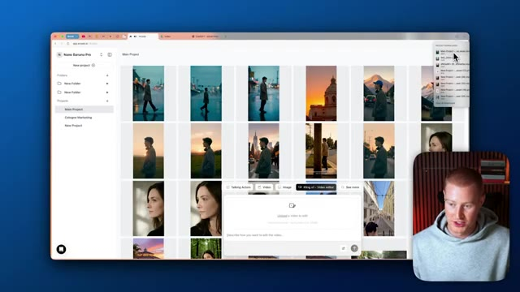
*⏱️ 00:06:56 — Interface de l'application web d'IA montrant une grille de vidéos générées et l'outil Kling v1 - Video Editor sélectionné avec une boîte de téléchargement.*

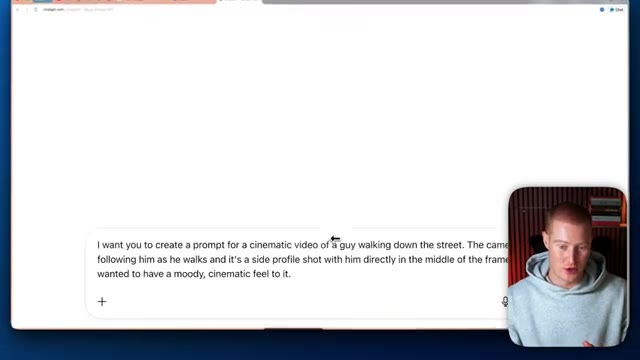
*⏱️ 00:07:01 — Interface de ChatGPT affichant un prompt textuel en anglais pour générer une vidéo cinématique d'un homme marchant dans la rue.*

---

### ⏱️ `[00:07:06 - 00:07:43]` | Segment #17

**🔊 Audio (Transcription Intégrale Mot pour Mot en Français) :**
> La caméra le suit pendant qu'il marche et c'est un plan de profil de lui directement au milieu du cadre. Je veux que ça ait une ambiance cinématographique un peu sombre. Donc c'est le prompt que je vais donner à notre GPT et maintenant il va nous concevoir un prompt vraiment spécifique à donner à Cling. Très bien, c'est parti. On a un prompt vraiment, vraiment spécifique. Il détaille même, vous savez, le dialogue qu'on veut avoir. Il détaille la caméra qu'on veut utiliser, l'objectif qu'on veut utiliser, tout ça ainsi que l'éclairage. Donc je vais copier ça. Je vais ensuite venir sur notre vidéo ici. Je vais coller ça et je vais m'assurer d'avoir Cling 2.6 comme sortie ici. Et ensuite, faisons juste une vidéo de cinq secondes et je vais

**👁️ Analyse Visuelle d'Écran (gemini-3.5-flash-lite) :**
**Interface & Outils** : Navigateur web affichant l'interface de ChatGPT et l'application web de génération vidéo Nano Banana Pro.

**Contenu textuel & Code** : Un prompt textuel descriptif pour IA vidéo ("a cinematic video of a guy walking down the street") et un prompt technique détaillé généré par le GPT personnalisé.

**Action / Démonstration** : Saisie et génération d'un prompt textuel détaillé destiné à un outil de création de vidéo par IA.

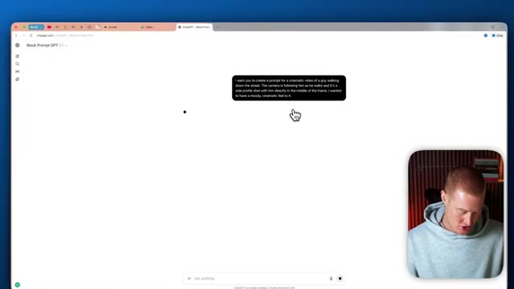
*⏱️ 00:07:15 — Interface de ChatGPT montrant le prompt initial entré par l'utilisateur pour décrire la scène de la vidéo cinématographique.*

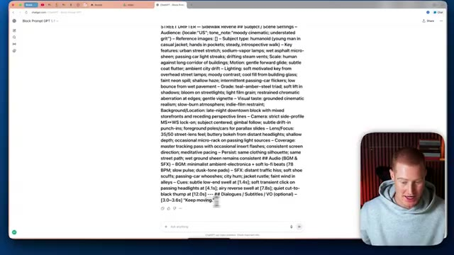
*⏱️ 00:07:25 — Interface de ChatGPT affichant le prompt détaillé et structuré généré en réponse pour la création vidéo.*

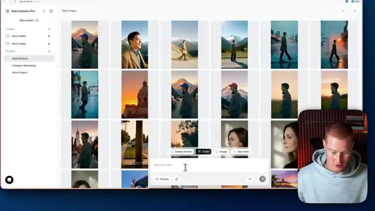
*⏱️ 00:07:34 — Interface de l'application de génération vidéo (Nano Banana Pro) affichant une galerie de projets avec des aperçus de vidéos générées.*

---

### ⏱️ `[00:07:43 - 00:08:05]` | Segment #18

**🔊 Audio (Transcription Intégrale Mot pour Mot en Français) :**
> vas-y et envoie ça à nos chats. Très bien. Alors voici le résultat qu'on a obtenu. Continue d'avancer. Donc tu peux voir que c'est notre personnage qui marche simplement dans la rue. C'est un plan vraiment cinématographique. Ça a l'air vraiment sombre et mystérieux. On dirait un truc que tu verrais dans un film dramatique ou quelque chose comme ça.

**👁️ Analyse Visuelle d'Écran (gemini-3.5-flash-lite) :**
**Interface & Outils** : Application web de génération vidéo par IA (Kling AI).

**Contenu textuel & Code** : Un prompt textuel descriptif pour la vidéo intitulé "# STREET DRIFTER - Sidewalk Reverie".

**Action / Démonstration** : Le présentateur commente le résultat visuel de la vidéo générée par l'IA et examine le prompt associé.

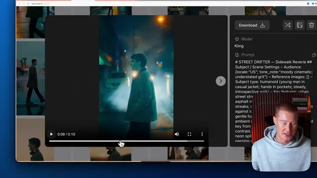
*⏱️ 00:08:00 — L'interface d'une application web de génération vidéo montrant le lecteur vidéo au centre, le panneau du prompt détaillé à droite, et le présentateur en médaillon dans le coin inférieur droit.*

---

### ⏱️ `[00:08:05 - 00:08:46]` | Segment #19

**🔊 Audio (Transcription Intégrale Mot pour Mot en Français) :**
> Donc ce que je vais faire maintenant, allons-y, téléchargeons ceci et créons différentes versions de cela. Je veux que l'arrière-plan ait, vous savez, des montagnes ou quelque chose comme ça, ou je veux que ça ait l'air plus léger et chaleureux au lieu de cette scène sombre. Essayons ça maintenant. Donc ce que je vais faire encore une fois, je vais venir et cliquer sur l'éditeur vidéo de Kling01. Je vais ensuite télécharger cette vidéo et je vais décrire mes changements. Très bien. Donc je vais lui donner ce prompt basique, je vais juste dire de changer l'ambiance pour que ça ait l'air chaleureux et lumineux et pas si sombre et ensuite à partir de là, une fois que j'obtiendrai le résultat suivant, je vais ensuite apporter des modifications au décor et à l'arrière-plan. Très bien, donc voici le résultat, vous pouvez voir que ça a l'air beaucoup plus chaleureux, ça a

**👁️ Analyse Visuelle d'Écran (gemini-3.5-flash-lite) :**
**Interface & Outils** : Application web de génération et d'édition vidéo par IA (Nano Banana Pro / Kling AI).

**Contenu textuel & Code** : Grille de projets vidéo, vignettes de scènes générées, options d'édition et prompt textuel de modification de scène.

**Action / Démonstration** : Sélection d'une vidéo et préparation d'une modification pour rendre l'ambiance plus claire et chaleureuse.

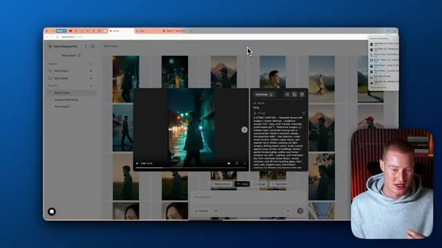
*⏱️ 00:08:16 — Interface d'une application web présentant une grille de vidéos avec un aperçu vidéo en cours de lecture au premier plan et le présentateur en médaillon.*

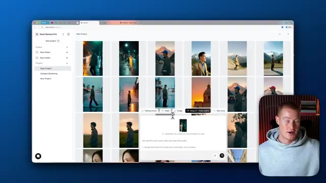
*⏱️ 00:08:26 — La même interface web avec un panneau de modification textuel ouvert en bas pour ajuster la scène vidéo.*

---

### ⏱️ `[00:08:46 - 00:09:21]` | Segment #20

**🔊 Audio (Transcription Intégrale Mot pour Mot en Français) :**
> Des tons chauds provenant de ces lampadaires ici, cependant, allons-y, faisons en sorte que ce soit le jour maintenant, je ne veux pas que ce soit sombre et je ne veux pas que ce soit sombre, alors allons-y simplement et faisons en sorte que ce soit en plein jour. Ce que je vais faire encore une fois, je vais télécharger ceci ici et dire : prends cette vidéo exacte et fais en sorte que ce soit le jour avec un ciel bleu dégagé, et je dis qu'au lieu de le faire dans la rue, fais en sorte qu'il soit au milieu de nulle part avec des montagnes en arrière-plan, très bien, alors juste comme ça, nous avons maintenant ce même personnage exact avec les mêmes mouvements exacts ici, mais il est maintenant

**👁️ Analyse Visuelle d'Écran (gemini-3.5-flash-lite) :**
**Interface & Outils** : Interface web d'Arcade (arcads.ai) pour l'édition et la génération de vidéos par IA.

**Contenu textuel & Code** : Prompts textuels pour l'édition de vidéos ("Let's take this exact same video and make these edits", "take this layout and make it as if in daytime").

**Action / Démonstration** : Saisie et application d'un prompt pour transformer l'ambiance nocturne d'une vidéo en scène de plein jour.

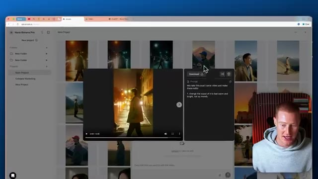
*⏱️ 00:08:54 — Interface d'Arcade affichant une grille de vidéos avec une modale de lecture et d'édition de prompt.*

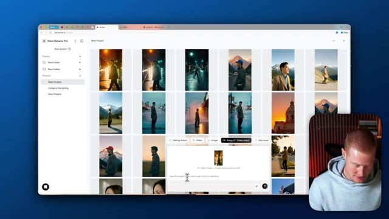
*⏱️ 00:09:03 — Interface principale d'Arcade montrant le panneau de saisie du prompt pour modifier une vidéo existante.*

---

### ⏱️ `[00:09:21 - 00:09:43]` | Segment #21

**🔊 Audio (Transcription Intégrale Mot pour Mot en Français) :**
> en train de marcher en plein jour et il y a une montagne en arrière-plan exactement comme nous l'avons demandé, les gars, c'est comme ça qu'on monte des vidéos en utilisant Kling 01 à l'intérieur d'Arcads, si vous avez tiré de la valeur de cette vidéo, laissez un pouce bleu, faites-moi savoir ce que vous en pensez dans les commentaires et abonnez-vous pour plus de contenu comme celui-ci où j'apprends fondamentalement aux non-techniciens à utiliser l'IA. Non seulement je couvre la façon de faire des vidéos par IA, mais je couvre aussi la façon de coder au feeling et d'utiliser l'IA dans tout un tas de domaines différents.

**👁️ Analyse Visuelle d'Écran (gemini-3.5-flash-lite) :**
**Interface & Outils** : Interface web de gestion de projets vidéo (Arcads), navigateur web et YouTube.

**Contenu textuel & Code** : Miniatures de vidéos générées par IA, projets en grille et bannières de chaînes.
[DESC_IMAGE_3] Navigation et présentation des vignettes vidéo sur la chaîne YouTube de Brock Mesarich.

**Action / Démonstration** : Démonstration de l'interface de montage vidéo et incitation à s'abonner à la chaîne.

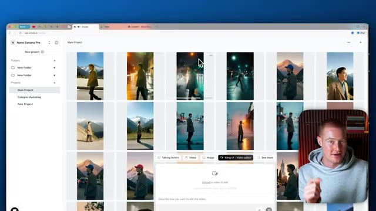
*⏱️ 00:09:26 — Capture d'écran montrant l'interface d'un outil de création vidéo par IA avec une grille de projets et le présentateur en incrustation.*

---

### ⏱️ `[00:09:43 - 00:09:52]` | Segment #22

**🔊 Audio (Transcription Intégrale Mot pour Mot en Français) :**
> Donc si cela vous semble précieux, assurez-vous d'être abonné à cette chaîne. Cela étant dit, les gars, si vous voulez utiliser Arcad, il y a un lien dans la description pour le faire. Et j'ai hâte de vous voir dans la prochaine vidéo.

**👁️ Analyse Visuelle d'Écran (gemini-3.5-flash-lite) :**
**Interface & Outils** : AUCUNE

**Contenu textuel & Code** : AUCUN

**Action / Démonstration** : Le présentateur s'adresse directement à l'audience pour conclure la vidéo et invite à consulter le lien dans la description.

---

